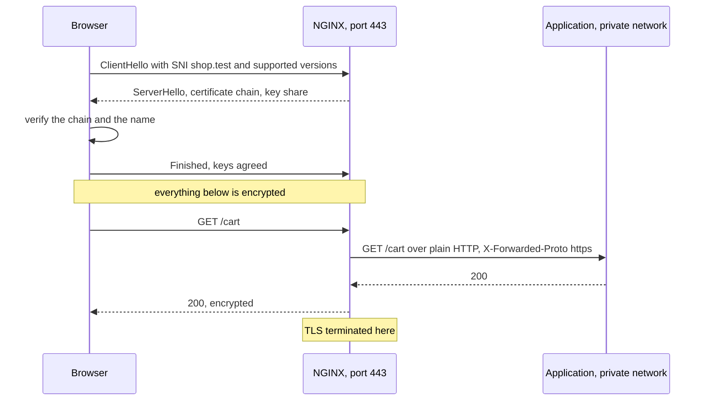

# TLS, HTTPS redirects, HSTS and upstream encryption

## Before this lesson

You should be able to write `server` blocks and understand default servers ([Serving a first static site](#/lesson/nginx/first-static-site)), use `return 301` ([try_files, return, rewrite](#/lesson/nginx/try-files-rewrite-return)), and forward `X-Forwarded-Proto` ([HTTP load balancing](#/lesson/nginx/lb-http-upstreams)). The networking track covers the cryptography in [the TLS handshake and certificates](#/lesson/networking/tls-handshake-certificates); the essentials are restated here.

## In plain words

Plain HTTP is a postcard: every post office it passes through can read it and could rewrite it. HTTPS puts the same message in a locked, tamper-evident box that only the intended recipient can open, and the box comes with an identity card proving who the recipient is.

The technology is **TLS** (Transport Layer Security; its predecessor SSL lives on in the names of directives). It gives three guarantees:

- **Privacy**: nobody in between can read the traffic.
- **Integrity**: nobody in between can change it unnoticed.
- **Identity**: the browser knows it is talking to the real `shop.test` and not an impostor.

NGINX is very often the place where the box is opened, which is called **TLS termination**: encrypted traffic from the internet ends at NGINX, and NGINX talks to the applications behind it either in plain HTTP on a trusted private network or over a second encrypted connection.

Every production site needs this. Configuring a certificate, forcing HTTPS, and explaining HSTS are among the most common hands-on tasks and interview questions about NGINX.

## The pieces

- A **key pair** is two mathematically linked keys. The **private key** stays secret on the server. The **public key** can be given to anyone. What one locks, only the other unlocks.
- A **certificate** is a file containing your public key and your domain name, signed by a **certificate authority (CA)**, an organisation browsers already trust. The signature is the CA saying "we checked that whoever holds this key controls this domain". Let's Encrypt is a free, automated CA.
- A **certificate chain** links your certificate to the CA's root through one or more **intermediate** certificates. The server must send its own certificate and the intermediates; the browser already has the roots.
- The **handshake** is the opening exchange in which the server presents its chain, both sides agree on a protocol version and **cipher suite** (the set of algorithms to use), and they derive temporary shared keys for this connection.



## Step 1: an HTTPS server

```nginx
server {
    listen 443 ssl;
    listen [::]:443 ssl;
    http2 on;
    server_name shop.test www.shop.test;

    ssl_certificate     /etc/nginx/tls/shop.test.fullchain.pem;
    ssl_certificate_key /etc/nginx/tls/shop.test.key;

    ssl_protocols TLSv1.2 TLSv1.3;
    ssl_prefer_server_ciphers off;

    ssl_session_cache   shared:TLS:10m;
    ssl_session_timeout 1d;
    ssl_session_tickets off;

    location / {
        proxy_pass http://127.0.0.1:8000;
        proxy_set_header Host              $host;
        proxy_set_header X-Forwarded-For   $proxy_add_x_forwarded_for;
        proxy_set_header X-Forwarded-Proto $scheme;
    }
}
```

- `listen 443 ssl;` accept TLS on port 443. `[::]:443` is the same for IPv6 addresses.
- `http2 on;` enable HTTP/2 on this server (covered in the protocols module). On versions before 1.25.1 this was written as a `listen` parameter: `listen 443 ssl http2;`.
- `ssl_certificate` points to the certificate file, which must contain **your certificate first, followed by the intermediates** ("full chain"). Sending only your own certificate works in some browsers and fails in other clients that have not cached the intermediate, which makes for a confusing bug.
- `ssl_certificate_key` is the private key. It must be readable only by root (`chmod 600`); the master process reads it before workers drop privileges.
- `ssl_protocols TLSv1.2 TLSv1.3;` allow only these two versions. TLS 1.0 and 1.1 and all SSL versions are obsolete and insecure.
- `ssl_prefer_server_ciphers off;` let the client choose among the mutually supported cipher suites. With only modern protocol versions enabled, every remaining choice is strong, and clients know which is fastest on their hardware.
- `ssl_session_cache shared:TLS:10m;` a 10-megabyte shared-memory cache of session parameters (about 40,000 sessions) so that a returning client can **resume** its session with a shortened handshake. Handshakes are the expensive part of TLS; resumption saves CPU and a network round trip.
- `ssl_session_timeout 1d;` how long a session may be resumed.
- `ssl_session_tickets off;` disables a second resumption mechanism whose encryption keys, unless rotated, weaken **forward secrecy** (the property that stealing the server's key later does not decrypt recorded past traffic).

Check from the command line:

```bash
$ curl -sI https://shop.test/ | head -3
HTTP/2 200
server: nginx/1.28.0
content-type: text/html; charset=utf-8

$ openssl s_client -connect shop.test:443 -servername shop.test </dev/null 2>/dev/null \
    | grep -E 'Protocol|Cipher|Verify return'
    Protocol  : TLSv1.3
    Cipher    : TLS_AES_256_GCM_SHA384
    Verify return code: 0 (ok)

$ openssl s_client -connect shop.test:443 -servername shop.test </dev/null 2>/dev/null \
    | openssl x509 -noout -subject -enddate
subject=CN = shop.test
notAfter=Feb 19 08:14:22 2027 GMT
```

- `openssl s_client` opens a TLS connection and prints what was negotiated. `-servername` sends the SNI name. `Verify return code: 0 (ok)` means the chain is complete and trusted.
- Piping into `openssl x509 -noout -subject -enddate` prints the certificate's name and expiry date. An expired certificate is the single most common TLS outage; monitor that date.

### Several sites, one address: SNI

One IP address can serve many HTTPS sites because the client names the site it wants in the handshake (**SNI**, Server Name Indication). NGINX selects the `server` block by SNI and presents that block's certificate. For a connection with no SNI or an unknown name, the **default server for port 443** answers, with its certificate. A tidy catch-all:

```nginx
server {
    listen 443 ssl default_server;
    server_name _;
    ssl_reject_handshake on;
}
```

`ssl_reject_handshake on;` aborts the handshake for unknown names, so no certificate has to be invented for the catch-all and scanners learn nothing.

### Two certificates for one site

Certificates come in two key types. **RSA** is universal; **ECDSA** uses elliptic-curve keys that are much smaller and faster to sign with. NGINX can hold both and offers each client the best it supports:

```nginx
ssl_certificate     /etc/nginx/tls/shop.test.ecdsa.fullchain.pem;
ssl_certificate_key /etc/nginx/tls/shop.test.ecdsa.key;
ssl_certificate     /etc/nginx/tls/shop.test.rsa.fullchain.pem;
ssl_certificate_key /etc/nginx/tls/shop.test.rsa.key;
```

Modern clients get the faster ECDSA handshake; very old ones fall back to RSA.

### OCSP stapling

A CA can revoke a certificate before it expires. Browsers may check revocation by asking the CA's **OCSP** (Online Certificate Status Protocol) server, which is slow and tells the CA which sites you visit. With **stapling**, NGINX fetches the signed "still valid" statement itself and attaches it to the handshake:

```nginx
ssl_stapling        on;
ssl_stapling_verify on;
ssl_trusted_certificate /etc/nginx/tls/ca-chain.pem;
resolver 1.1.1.1 9.9.9.9 valid=300s;
```

`resolver` gives NGINX DNS servers so it can find the CA's OCSP address. Note that some CAs, Let's Encrypt among them, have been winding down OCSP in favour of other revocation mechanisms; if your CA no longer publishes an OCSP address, leave stapling off.

## Step 2: redirect HTTP to HTTPS

Browsers try `http://` when a user types a bare name, so port 80 must answer, and its only job is to send everyone to HTTPS.

```nginx
server {
    listen 80 default_server;
    listen [::]:80 default_server;
    server_name _;
    return 301 https://$host$request_uri;
}
```

- One block catches every hostname on port 80.
- `return 301 https://$host$request_uri;` keeps the host, path and query, changing only the scheme.

```bash
$ curl -I 'http://shop.test/sale?ref=mail'
HTTP/1.1 301 Moved Permanently
Location: https://shop.test/sale?ref=mail
```

For a single canonical name (send `www.shop.test` to `shop.test` too), name it explicitly: `return 301 https://shop.test$request_uri;`. That form is also safer, because `$host` comes from the request and a hostile `Host` header would otherwise be reflected into your redirect.

### When TLS is terminated before NGINX

Behind a cloud load balancer that terminates TLS, every request reaches NGINX as plain HTTP on port 80, including those the visitor sent over HTTPS. The block above would redirect them all, the balancer would forward the redirected request as HTTP again, and the browser would report **"too many redirects"**.

The balancer reports the visitor's original scheme in `X-Forwarded-Proto`. Redirect only when that says `http`:

```nginx
server {
    listen 80;
    server_name shop.test;

    if ($http_x_forwarded_proto = "http") {
        return 301 https://$host$request_uri;
    }

    location / {
        proxy_pass http://127.0.0.1:8000;
        proxy_set_header X-Forwarded-Proto $http_x_forwarded_proto;
    }
}
```

The `if` with `return` at server level is the safe form. The application receives the visitor's real scheme through the forwarded header.

## Step 3: HSTS

The redirect has a gap. The very first request is plain HTTP, and an attacker on the same café Wi-Fi can intercept it and never deliver the redirect, keeping the victim on an unencrypted copy of the site. This is an **SSL-stripping** attack.

**HSTS** (HTTP Strict Transport Security) closes the gap for returning visitors. It is a response header that tells the browser: "for the next N seconds, never use plain HTTP for this host; convert `http://` to `https://` yourself before sending anything, and do not let the user click through certificate warnings".

```nginx
server {
    listen 443 ssl;
    server_name shop.test;
    # ... certificates ...

    add_header Strict-Transport-Security "max-age=31536000; includeSubDomains" always;
}
```

- `max-age=31536000` is one year in seconds.
- `includeSubDomains` extends the rule to every subdomain.
- `always` sends the header on error responses too.
- The header must be sent **over HTTPS**; browsers ignore it on plain HTTP.

```bash
$ curl -sI https://shop.test/ | grep -i strict
strict-transport-security: max-age=31536000; includeSubDomains
```

> [!WARNING]
> HSTS is a promise you cannot easily take back. Once a browser has seen `max-age=31536000`, it refuses plain HTTP for that host for a year, and with `includeSubDomains` for every subdomain, including an internal tool that only works over HTTP. Roll out in stages: start with `max-age=300`, verify everything, then raise it. The `preload` flag, which asks browser vendors to ship your domain in a built-in list, is close to permanent; add it only when every subdomain is HTTPS for good.

And recall the inheritance rule: a location that declares its own `add_header` loses this one. Put security headers in a snippet and include it wherever headers are added.

```python-run
def respond(listener_scheme, forwarded_proto, host, request_uri, hsts_max_age=31536000):
    """What a correctly configured front door answers. forwarded_proto is None when no proxy is in front."""
    client_scheme = forwarded_proto or listener_scheme
    if client_scheme == "http":
        return 301, {"Location": f"https://{host}{request_uri}"}
    headers = {"Strict-Transport-Security": f"max-age={hsts_max_age}; includeSubDomains"}
    return 200, headers

print(respond("http",  None,    "shop.test", "/sale?ref=mail"))   # direct, plain: redirect
print(respond("https", None,    "shop.test", "/sale"))            # direct, TLS: serve with HSTS
print(respond("http",  "https", "shop.test", "/sale"))            # behind a TLS-terminating balancer: serve
print(respond("http",  "http",  "shop.test", "/sale"))            # behind the balancer, visitor used http: redirect
```

The third line is the case that causes redirect loops when the forwarded header is ignored.

## Step 4: encrypting the upstream hop

Terminating TLS at NGINX leaves the hop to the application in plain text. On a single machine (`127.0.0.1`) that is fine. Across a network you do not fully control, or under compliance rules that demand encryption everywhere, encrypt that hop too.

```nginx
upstream shop_app {
    server app1.internal.shop.test:8443;
    server app2.internal.shop.test:8443;
}

server {
    listen 443 ssl;
    server_name shop.test;
    # ... certificates ...

    location / {
        proxy_pass https://shop_app;

        proxy_ssl_protocols           TLSv1.2 TLSv1.3;
        proxy_ssl_verify              on;
        proxy_ssl_verify_depth        2;
        proxy_ssl_trusted_certificate /etc/nginx/tls/internal-ca.pem;
        proxy_ssl_server_name         on;
        proxy_ssl_name                app.internal.shop.test;
        proxy_ssl_session_reuse       on;
    }
}
```

- `proxy_pass https://...` the `https` scheme makes NGINX act as a TLS **client** towards the upstream.
- `proxy_ssl_verify on;` check the upstream's certificate. **The default is off**: without this line the traffic is encrypted but NGINX would accept any certificate, so an attacker in the middle could impersonate the application. Encryption without verification protects against eavesdropping only.
- `proxy_ssl_trusted_certificate` the CA that signed the upstream certificates, typically a private internal CA.
- `proxy_ssl_verify_depth 2;` how many intermediate steps the chain may have.
- `proxy_ssl_server_name on;` send SNI to the upstream; `proxy_ssl_name` sets the name sent and checked (by default the name in `proxy_pass`, which here would be the upstream group's name).
- `proxy_ssl_session_reuse on;` resume sessions to avoid a full handshake per connection; combine with upstream `keepalive`.

### Mutual TLS

In ordinary TLS only the server proves its identity. In **mutual TLS (mTLS)** the client presents a certificate as well. It is used between services, and for locking an admin site to devices that hold a company-issued certificate.

```nginx
server {
    listen 443 ssl;
    server_name admin.shop.test;
    # ... server certificates ...

    ssl_client_certificate /etc/nginx/tls/staff-ca.pem;
    ssl_verify_client      on;

    location / {
        proxy_set_header X-Client-DN $ssl_client_s_dn;
        proxy_pass http://127.0.0.1:8000;
    }
}
```

- `ssl_client_certificate` the CA whose signatures on client certificates you accept.
- `ssl_verify_client on;` require a valid client certificate. Without one the request is refused with status **400** and the message "No required SSL certificate was sent". The value `optional` lets the request through and exposes the outcome in `$ssl_client_verify` so that locations can decide individually.
- `$ssl_client_s_dn` is the certificate's subject ("distinguished name"), a verified identity to pass to the application.

For NGINX to present a client certificate to an upstream, the mirror-image directives are `proxy_ssl_certificate` and `proxy_ssl_certificate_key`.

## A reusable hardening snippet

```nginx
# /etc/nginx/snippets/tls-params.conf
ssl_protocols TLSv1.2 TLSv1.3;
ssl_prefer_server_ciphers off;
ssl_session_cache   shared:TLS:10m;
ssl_session_timeout 1d;
ssl_session_tickets off;
add_header Strict-Transport-Security "max-age=31536000; includeSubDomains" always;
add_header X-Content-Type-Options "nosniff" always;
add_header X-Frame-Options "DENY" always;
add_header Referrer-Policy "strict-origin-when-cross-origin" always;
```

The three extra headers are cheap browser-side protections: do not guess content types, do not allow this site inside frames on other sites (which blocks click-hijacking), and limit how much of the address is sent to other sites in the `Referer` header. Mozilla publishes an SSL configuration generator that outputs current recommended settings for a given NGINX and OpenSSL version; prefer it to copying cipher lists from old blog posts.

> [!INTERVIEW]
> "What is TLS termination and where would you do it?" Decrypting client TLS at a proxy so that backends receive plain HTTP. It centralises certificates and offloads cryptography. Options: terminate at a cloud load balancer, at NGINX, or pass through to the application. Mention re-encryption to upstreams with verification when the internal network is not trusted, the `X-Forwarded-Proto` header so applications know the original scheme, and the redirect-loop trap when termination happens in front of NGINX.

## Pitfalls

- **Certificate without the intermediates**: works in your browser, fails for other clients. Test with `openssl s_client` and look for `Verify return code: 0`.
- **Mismatched key and certificate**: NGINX refuses to start with `key values mismatch`.
- **World-readable private key.**
- **Expired certificate.** Automate renewal and monitor the date.
- **Redirect loops** behind a TLS-terminating balancer.
- **HSTS with a long `max-age` on day one**, or `includeSubDomains` while some subdomain is still HTTP.
- **`proxy_pass https://` without `proxy_ssl_verify on`**, giving encryption with no identity check.
- **Mixed content.** An HTTPS page that loads scripts over `http://` is blocked by browsers. The application must generate `https://` links, which is why `X-Forwarded-Proto` matters.
- **Old protocol versions left enabled** for a client that no longer exists.
- **Forgetting port 443 in the firewall**, or IPv6 `listen` lines when the domain has an IPv6 address.

## Cheat sheet

| Goal | Configuration |
|---|---|
| HTTPS server | `listen 443 ssl; ssl_certificate full.pem; ssl_certificate_key key.pem;` |
| Modern protocols | `ssl_protocols TLSv1.2 TLSv1.3;` |
| Session resumption | `ssl_session_cache shared:TLS:10m; ssl_session_timeout 1d;` |
| Reject unknown names | `listen 443 ssl default_server; ssl_reject_handshake on;` |
| Force HTTPS | `return 301 https://$host$request_uri;` on port 80 |
| Force HTTPS behind a terminating balancer | `if ($http_x_forwarded_proto = "http") { return 301 ...; }` |
| HSTS | `add_header Strict-Transport-Security "max-age=31536000; includeSubDomains" always;` |
| Encrypt to upstream | `proxy_pass https://...; proxy_ssl_verify on; proxy_ssl_trusted_certificate ca.pem;` |
| Require client certificates | `ssl_client_certificate ca.pem; ssl_verify_client on;` |
| Inspect a server | `openssl s_client -connect host:443 -servername host` |
| Certificate dates | `openssl x509 -noout -enddate` |

## Summary

- TLS gives privacy, integrity and identity; NGINX usually terminates it with a full-chain certificate and private key.
- Allow TLS 1.2 and 1.3, cache sessions, and reject unknown names on the default server.
- Redirect port 80 with `return 301`, switching to the `X-Forwarded-Proto` test when something in front already terminated TLS.
- HSTS makes browsers refuse plain HTTP for a period; raise `max-age` gradually.
- Encrypting the upstream hop needs `proxy_ssl_verify on` to mean anything; mutual TLS adds client certificates.

## Glossary

- **Certificate / chain**: a signed statement binding a public key to a name / the links from it to a trusted root.
- **Certificate authority (CA)**: an organisation whose signatures browsers trust.
- **Cipher suite**: the set of algorithms used on a TLS connection.
- **Forward secrecy**: past traffic stays safe even if the server key is stolen later.
- **Handshake**: the opening exchange that authenticates the server and agrees keys.
- **HSTS**: a header telling browsers to use HTTPS only for a host.
- **Mixed content**: an HTTPS page loading resources over HTTP.
- **mTLS**: TLS in which the client also presents a certificate.
- **OCSP stapling**: the server attaching proof that its certificate is not revoked.
- **Private / public key**: the secret and shareable halves of a key pair.
- **Session resumption**: reusing earlier handshake results for a faster reconnect.
- **SNI**: the hostname the client names during the handshake.
- **SSL stripping**: an attack that keeps a victim on plain HTTP.
- **TLS termination**: decrypting TLS at a proxy.

## Check yourself

```quiz
[
  {"q": "A port-80 server contains only `return 301 https://$host$request_uri;`. What does `curl -I http://shop.test/a?b=1` show?",
   "options": ["200 OK", "301 with Location: https://shop.test/a?b=1", "302 with Location: https://shop.test/", "404"], "answer": 1,
   "explain": "return 301 sends a permanent redirect; $request_uri preserves the path and the query string."},
  {"q": "NGINX sits behind a balancer that terminates TLS and forwards plain HTTP. NGINX has an unconditional port-80 redirect to HTTPS. What does the visitor experience?",
   "options": ["A normal page", "An endless redirect loop", "A 502", "A certificate warning"], "answer": 1,
   "explain": "Every request arrives as HTTP at NGINX, so each is redirected again. Test X-Forwarded-Proto instead."},
  {"q": "What does HSTS protect against that a 301 redirect alone does not?",
   "options": ["Expired certificates", "An attacker intercepting the initial plain-HTTP request before the redirect", "Slow handshakes", "Weak passwords"], "answer": 1,
   "explain": "After the first HTTPS visit, the browser upgrades to HTTPS itself and never sends the vulnerable plain request."},
  {"q": "The HSTS header is sent on a plain-HTTP response. What do browsers do with it?",
   "options": ["Apply it", "Ignore it", "Show a warning", "Clear cookies"], "answer": 1,
   "explain": "HSTS is honoured only when received over a valid HTTPS connection, since plain HTTP could be forged."},
  {"q": "proxy_pass https://app; with no other proxy_ssl directives. Which statement is true?",
   "options": ["The upstream certificate is verified against system CAs", "Traffic is encrypted but the upstream certificate is not verified", "NGINX refuses to start", "HTTP/2 is used to the upstream"], "answer": 1,
   "explain": "proxy_ssl_verify defaults to off, so any certificate is accepted unless verification is enabled."},
  {"q": "ssl_verify_client on; and a request arrives without a client certificate. What status code is returned?",
   "options": ["401", "403", "400", "495 always"], "answer": 2,
   "explain": "NGINX answers 400 Bad Request with the message that no required SSL certificate was sent."},
  {"q": "ssl_certificate points at a file containing only the site certificate, not the intermediate. What is the typical symptom?",
   "options": ["NGINX will not start", "Browsers that cached the intermediate work, while curl and other clients report an untrusted certificate", "HSTS is disabled", "HTTP/2 stops working"], "answer": 1,
   "explain": "The server must send the chain; clients cannot always fetch missing intermediates themselves."},
  {"q": "A site has add_header Strict-Transport-Security at server level. One location adds `add_header Cache-Control no-store;`. Do responses from that location carry HSTS?",
   "options": ["Yes", "No, the location's own add_header replaces the inherited ones", "Only on errors", "Only over HTTP/2"], "answer": 1,
   "explain": "add_header is inherited only when the inner level declares none, unless merging is explicitly enabled on recent versions."}
]
```

> **Source:** DeJonghe, NGINX Cookbook, ch. 7 (client-side encryption, advanced client-side encryption, upstream encryption, HTTPS redirects, redirecting where TLS is terminated before NGINX, HTTP Strict Transport Security). Docs: https://nginx.org/en/docs/http/configuring_https_servers.html, https://nginx.org/en/docs/http/ngx_http_ssl_module.html, https://nginx.org/en/docs/http/ngx_http_proxy_module.html#proxy_ssl_verify, https://ssl-config.mozilla.org/
