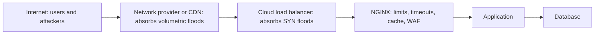
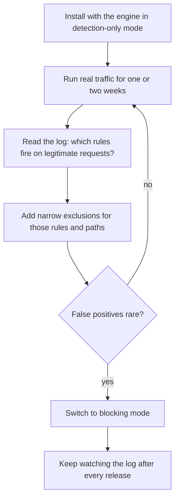

# DDoS mitigation basics and web application firewalls

## Before this lesson

You need the three limit families from [Limiting request rate, connections and bandwidth](#/lesson/nginx/rate-conn-limits), the `map` and `geo` tables from [A/B testing, map, geo and finding the real client](#/lesson/nginx/split-geo-map), the `allow` and `deny` rules from [Access rules, satisfy, CORS and secure links](#/lesson/nginx/access-cors-secure-links) and the idea of a cache from [Proxy caching: zones, keys and validity](#/lesson/nginx/cache-basics). The security track looks at the same subject from the attacker's side in [Denial of service and rate limiting](#/lesson/web-security/dos-rate-limiting).

## In plain words

A small restaurant takes bookings by phone. One evening a group of pranksters decides to ruin it. They do not break in and they do not steal anything. They phone the booking line again and again, from hundreds of different numbers, and keep each call going as long as they can. Real customers hear the engaged tone and go elsewhere. Nothing was damaged, yet the restaurant lost the evening.

That is a **denial-of-service attack** (DoS): making a service unavailable to its real users by using up something it has a limited amount of. When the calls come from many machines at once it is a **distributed** denial of service, or **DDoS**.

A second kind of trouble is different. Somebody books a table politely, walks in, and tries to slip a note to the kitchen that says "ignore the order, hand me the cash box". This visitor is not using up capacity. They are sending one carefully written message that abuses a weakness in how the kitchen reads notes. A doorman who reads every note before it reaches the kitchen and stops the suspicious ones is a **web application firewall**, or **WAF**.

NGINX sits at the front door, so both jobs land on it. For a backend or DevOps role you are expected to know which attacks a reverse proxy can absorb, which settings do the absorbing, and where the proxy stops being enough and a network provider has to take over.

## Three kinds of flood

"DDoS" covers very different attacks. The first question is always: which limited thing is being used up?

| Kind | What is exhausted | Example | Who can stop it |
|---|---|---|---|
| **Volumetric** | the network link | a flood of UDP packets, or amplified DNS answers, many gigabits per second | the network provider or a scrubbing service, before the traffic reaches your server |
| **Protocol** | operating-system connection tables | a SYN flood: millions of half-opened TCP connections | the kernel (SYN cookies), a cloud load balancer, a scrubbing service |
| **Application layer** | workers, connection slots, the application and its database | an HTTP flood on `/search`, slow requests that hold connections open | NGINX, a WAF, the application |

Some terms used in that table:

- A **packet** is one small unit of data travelling over a network.
- **UDP** (User Datagram Protocol) sends packets without setting up a connection first, so an attacker can fake the sender address.
- A **SYN** is the first packet of the three-step greeting that opens a TCP (Transmission Control Protocol) connection. The networking track walks through it in [UDP and the TCP connection lifecycle](#/lesson/networking/udp-tcp-lifecycle).
- A **scrubbing service** is a company with enormous network capacity that receives your traffic first, throws away the attack and forwards the rest. Content delivery networks offer the same thing.

An honest point to make in interviews: **NGINX cannot stop a volumetric attack.** If 40 gigabits per second arrive at a server with a 1 gigabit link, the link is full before NGINX reads a single byte. NGINX is the right tool for the third row, and it helps a little with the second.



Each layer removes what it is good at removing, so the layer behind it sees less. This arrangement is called **defence in depth**: several independent barriers, so that one failing does not expose everything.

## Tool 1: the limits you already know

The earlier lesson covered `limit_req`, `limit_conn` and `limit_rate`. Against a flood they are used like this:

```nginx
http {
    limit_req_zone  $binary_remote_addr zone=flood:20m rate=30r/s;
    limit_conn_zone $binary_remote_addr zone=conns:20m;
    limit_req_status  429;
    limit_conn_status 429;

    server {
        listen 80;
        server_name shop.test;

        limit_req  zone=flood burst=60 nodelay;
        limit_conn conns 40;

        location / {
            proxy_pass http://127.0.0.1:8000;
        }
    }
}
```

- The two `_zone` lines create shared memory counters keyed by client address. 20 megabytes holds counters for a few hundred thousand addresses.
- `limit_req zone=flood burst=60 nodelay;` lets one address send 30 requests per second with short bursts of 60 on top, served at once.
- `limit_conn conns 40;` caps one address at 40 requests in progress at the same moment.
- Both refusals answer 429, which costs NGINX almost nothing to produce.

The limits per address work when an attack comes from a modest number of sources. A large botnet (a collection of hijacked machines) can have a hundred thousand addresses, each staying politely under the limit. Limits per address do not help there, which is why the tools below exist too.

## Tool 2: timeouts and size caps against slow attacks

Floods are loud. A quieter attack opens many connections and sends data as slowly as the server will tolerate. The best-known version is called **Slowloris**: the client sends a request header one line at a time with long pauses and never finishes. Each such connection holds one of the worker's connection slots (the `worker_connections` number from [Installing NGINX and reading nginx.conf](#/lesson/nginx/install-and-config)). A few thousand of them and no slot is left for real users.

NGINX copes far better than servers that dedicate a whole process to each connection, because an idle connection costs it only a little memory. It still has a finite number of slots, so the defence is to refuse to wait for long.

```nginx
http {
    client_header_timeout 10s;
    client_body_timeout   10s;
    send_timeout          15s;
    keepalive_timeout     30s;

    client_max_body_size        2m;
    client_header_buffer_size   1k;
    large_client_header_buffers 4 8k;

    reset_timedout_connection on;
}
```

Directive by directive:

- `client_header_timeout 10s;` The client must deliver the *whole* request header within ten seconds, or NGINX answers 408 Request Timeout and closes. The default is 60 seconds. This is the direct answer to Slowloris.
- `client_body_timeout 10s;` Applies while the request body (for instance an upload) is being read. It measures the gap *between two successive reads*, not the whole upload, so a legitimate large upload on a slow line is not cut off as long as bytes keep arriving. Default 60 seconds.
- `send_timeout 15s;` The same idea in the other direction: the longest NGINX waits between two successful writes to a client that has stopped reading. Default 60 seconds.
- `keepalive_timeout 30s;` How long an idle connection may stay open waiting for the next request. The default is 75 seconds.
- `client_max_body_size 2m;` Requests with a larger body are refused with 413 Content Too Large. The default is 1 megabyte. Raise it only in the locations that accept uploads.
- `client_header_buffer_size 1k;` and `large_client_header_buffers 4 8k;` are the defaults, written out. A request line longer than one large buffer gets 414, and a header field longer than one gets 400. They stop a client from making NGINX allocate unbounded memory for headers.
- `reset_timedout_connection on;` When a connection times out, NGINX sends a TCP reset instead of the normal closing exchange, which frees the kernel memory tied to that connection at once.

The table below is worth memorising because every code in it turns up in logs during an attack:

| What the client did | Status |
|---|---|
| Took too long to send the header or body | 408 |
| Body larger than `client_max_body_size` | 413 |
| Request line longer than a large header buffer | 414 |
| One header field longer than a large header buffer | 400 |
| Over a `limit_req` or `limit_conn` with the status set | 429 |

### Simulate it: slots held by slow clients

The model: an attacker opens new connections at a steady rate and never completes a request. Each connection occupies a slot until the header timeout expires. The question is how many of the worker's slots stay free.

```python-run
def slots_held(open_per_sec, header_timeout_s, per_ip_cap=None, attacker_ips=1, seconds=180):
    """Return the largest number of slots the attacker holds at any moment."""
    expiry = []                                   # second at which each held connection is dropped
    worst = 0
    for now in range(seconds):
        expiry = [e for e in expiry if e > now]   # timed-out connections are closed
        for _ in range(open_per_sec):
            cap = None if per_ip_cap is None else per_ip_cap * attacker_ips
            if cap is None or len(expiry) < cap:  # limit_conn refuses the rest
                expiry.append(now + header_timeout_s)
        worst = max(worst, len(expiry))
    return worst

SLOTS = 1024
cases = [
    ("default 60s timeout, no limit_conn", dict(open_per_sec=20, header_timeout_s=60)),
    ("10s timeout, no limit_conn",         dict(open_per_sec=20, header_timeout_s=10)),
    ("60s timeout, limit_conn 10, 1 IP",   dict(open_per_sec=20, header_timeout_s=60, per_ip_cap=10)),
    ("10s timeout, limit_conn 10, 50 IPs", dict(open_per_sec=20, header_timeout_s=10, per_ip_cap=10, attacker_ips=50)),
]
for label, kw in cases:
    held = slots_held(**kw)
    free = max(0, SLOTS - held)
    print(f"{label:38} attacker holds {held:5}  free for users {free:5}")
```

With the default timeout, 20 new slow connections per second hold 1,200 slots, more than the worker has, so users get nothing. Dropping the timeout to ten seconds cuts the attacker to 200. A connection limit per address makes a single attacking machine harmless, and the last line shows the two settings working together against fifty machines. The pattern to remember: slots held is roughly *arrival rate multiplied by how long each one is tolerated*.

> [!NOTE]
> Strictly, `limit_conn` starts counting a connection once its request header has been read in full, so a pure Slowloris connection that never finishes the header is cut by `client_header_timeout`, and `limit_conn` handles the cousin that sends the header quickly and then dribbles the body. The simulation merges the two for clarity.

## Tool 3: refuse cheaply

During an attack every refused request should cost as little as possible. NGINX has a special status for this.

```nginx
map $http_user_agent $bad_agent {
    default                 0;
    ""                      1;
    ~*(masscan|sqlmap|nikto) 1;
}

server {
    listen 80 default_server;
    server_name _;
    return 444;
}

server {
    listen 80;
    server_name shop.test;

    if ($bad_agent) { return 444; }

    location = /xmlrpc.php { return 444; }
    location /            { proxy_pass http://127.0.0.1:8000; }
}
```

- The `map` builds a variable `$bad_agent` from the `User-Agent` request header, the text in which a client names its software. An empty value and three well-known scanning tools are labelled 1. `~*` starts a case-insensitive regular expression.
- **444** is not an HTTP status. It is an instruction to NGINX: close the connection without sending anything. No headers and no body are written, so the reply uses no bandwidth, and automated tools often give up when they get silence.
- The first `server` block is the catch-all default. Scanners that probe by IP address, without the real site name, land there and get 444.
- `if ($bad_agent) { return 444; }` is one of the few safe uses of `if`: a `return` directly inside it.
- `location = /xmlrpc.php` drops requests for a path this application does not have but bots constantly try.

A user agent is trivial to fake, so this stops only lazy tools. It is still worthwhile, because lazy tools are most of the background noise. For whole networks, the `deny` directive and the `geo` table from earlier lessons do the same job by address.

## Tool 4: protect what is behind you

NGINX can accept tens of thousands of connections. The application behind it usually cannot. An attack that NGINX survives may still flatten the database. Three settings keep the pressure off the backend.

```nginx
upstream shop_app {
    zone shop_app 64k;
    server 10.0.0.11:8000 max_conns=100;
    server 10.0.0.12:8000 max_conns=100;
}

proxy_cache_path /var/cache/nginx/micro keys_zone=micro:10m max_size=200m inactive=10m;

server {
    listen 80;
    server_name shop.test;

    location / {
        proxy_cache           micro;
        proxy_cache_valid     200 1s;
        proxy_cache_lock      on;
        proxy_cache_use_stale updating error timeout http_502 http_503 http_504;
        proxy_pass http://shop_app;
    }
}
```

- `max_conns=100` caps the connections NGINX opens to each server at the same time. The `zone` line makes the count shared by all workers. Once both servers are at their cap, further requests receive 502 at once instead of piling onto a struggling application. (NGINX Plus adds a `queue` directive that holds the overflow for a short time instead of failing it.)
- `proxy_cache_valid 200 1s;` is **microcaching**: successful responses are stored for one second. Under normal load nobody notices. Under a flood of 5,000 requests per second for the home page, the application renders the page once per second and NGINX answers the other 4,999 from memory.
- `proxy_cache_lock on;` makes sure that when the one-second copy expires, only one request goes to the application to refresh it.
- `proxy_cache_use_stale ...` lets NGINX keep serving the last good copy while the refresh is running or when the application is failing.

Microcaching applies only to responses that are the same for everybody. Pages for logged-in users need a bypass rule, covered in [Bypass, purge, locking, stale content and slicing](#/lesson/nginx/cache-advanced).

## Tool 5: a moving block list

Fixed limits treat every client the same. A smarter defence notices a misbehaving client and then treats it worse for a while.

> [!NOTE]
> **NGINX Plus.** The cookbook's recipe uses three commercial features together: the key-value store, the REST API and zone synchronisation between cluster members.

The idea, in words. A rate limit is declared with the `sync` parameter so that all NGINX Plus machines in a cluster share its counters. A key-value zone called a "sin bin" (a sporting term for the bench where a penalised player waits) is declared with a timeout of ten minutes, also synchronised. When a client exceeds the rate limit and would receive 429, an `error_page` rule turns that event into an internal call to the NGINX Plus API which writes the client's address into the sin bin. On every later request a `keyval` lookup finds the address there, and the configuration sets a tiny bandwidth limit for that client. After ten minutes the entry expires by itself.

Two design choices are worth noticing. The punishment is **slowness, not an error**: an attacker who receives 429 knows a limit was hit and adapts, while one who receives a trickle of bytes has less to go on. And the list is **shared**, so an address caught by one machine is slowed by all of them.

Open-source NGINX has no key-value store, but the same loop can be built from outside:

- **fail2ban** is a small daemon that reads log files, counts lines matching a pattern per address, and adds a firewall rule for addresses over a threshold. NGINX writes a line containing `limiting requests, excess:` to the error log for every refusal, which is the pattern to count. The ban is removed after a set time.
- **CrowdSec** works the same way and also shares lists of bad addresses between its users.

### Simulate it: a sin bin

```python-run
class SinBin:
    def __init__(self, limit_per_sec, penalty_seconds):
        self.limit, self.penalty = limit_per_sec, penalty_seconds
        self.counts = {}            # (address, second) -> requests seen
        self.binned_until = {}      # address -> second at which the penalty ends

    def request(self, addr, second):
        if self.binned_until.get(addr, -1) > second:
            return "slow (in sin bin)"
        n = self.counts.get((addr, second), 0) + 1
        self.counts[(addr, second)] = n
        if n > self.limit:
            self.binned_until[addr] = second + self.penalty
            return "429 and sent to sin bin"
        return "served at full speed"

guard = SinBin(limit_per_sec=3, penalty_seconds=600)
timeline = [("198.51.100.7", 0)] * 5 + [("203.0.113.9", 0), ("198.51.100.7", 30),
            ("203.0.113.9", 30), ("198.51.100.7", 601)]
for addr, t in timeline:
    print(f"t={t:4}s  {addr:14} -> {guard.request(addr, t)}")
```

The noisy address is served three times, trips the limit on the fourth request and is slowed for the next ten minutes, while the quiet address is never affected. At 601 seconds the penalty has run out. A fixed one-second counting window is used here to keep the code short; the real limiter is the leaky bucket you have already written.

## Web application firewalls

### What a WAF looks for

The tools so far count requests. None of them reads what a request says. Many attacks need one request, not a million:

- **SQL injection**: placing database commands inside an input, such as a search for `' OR 1=1 --`, hoping the application pastes it into a query.
- **Cross-site scripting** (XSS): submitting a fragment such as `<script>...</script>` that the site later shows to other users, whose browsers then run it.
- **Path traversal**: asking for `/files/../../etc/passwd` to climb out of the intended folder.
- **Remote command execution**: input such as `; cat /etc/passwd` aimed at an application that passes text to a shell.

A WAF inspects the request line, headers, cookies and body of each request against a set of **rules**. A rule is a pattern plus an action. Two styles of deciding exist:

- **Signature blocking**: any single rule that matches blocks the request. It is easy to reason about and it blocks legitimate requests often, because ordinary text sometimes resembles an attack.
- **Anomaly scoring**: each matching rule adds points according to its severity, and the request is blocked only when the total reaches a threshold. One weak hint is tolerated and several hints together are not.

A legitimate request that gets blocked is a **false positive**. An attack that passes is a **false negative**. Tuning a WAF means trading one against the other for your application.

### Simulate it: anomaly scoring

The severities and the default threshold of 5 follow the scheme used by the OWASP Core Rule Set, the most widely used open rule collection (OWASP is the Open Worldwide Application Security Project).

```python-run
import re
from urllib.parse import unquote_plus

RULES = [   # (rule id, description, pattern, points)
    (942100, "SQL injection: tautology",     r"('|\")\s*or\s+\d+\s*=\s*\d+", 5),
    (942190, "SQL injection: union select",  r"union\s+(all\s+)?select",      5),
    (941100, "XSS: script tag",              r"<\s*script\b",                 5),
    (930100, "Path traversal",               r"\.\./",                        5),
    (920350, "Host header is an IP address", r"^host:\s*\d+\.\d+\.\d+\.\d+$", 3),
    (913100, "Scanner user agent",           r"^user-agent:.*(sqlmap|nikto)", 2),
]

def inspect(request_line, headers, threshold=5, engine="On"):
    target = unquote_plus(request_line).lower()        # undo %27 style encoding first
    lines = [target] + [h.lower() for h in headers]
    score, hits = 0, []
    for rule_id, text, pattern, points in RULES:
        if any(re.search(pattern, line) for line in lines):
            score += points
            hits.append(rule_id)
    if score >= threshold and engine == "On":
        verdict = "403 blocked"
    elif score >= threshold:
        verdict = "passed, but logged (detection only)"
    else:
        verdict = "passed"
    return f"score {score:2} rules {hits} -> {verdict}"

print(inspect("GET /search?q=red+shoes", ["Host: shop.test"]))
print(inspect("GET /search?q=%27+OR+1%3D1+--", ["Host: shop.test"]))
print(inspect("GET /img?f=../../etc/passwd", ["Host: shop.test"], engine="DetectionOnly"))
print(inspect("GET /", ["Host: 203.0.113.10"]))
print(inspect("GET /", ["Host: 203.0.113.10", "User-Agent: sqlmap/1.8"]))
```

The second request is URL-encoded (`%27` is a quote character), which is why the function decodes before matching: real WAFs normalise input in many ways so that an attacker cannot hide behind encodings. The fourth request scores 3 and passes. The fifth adds 2 more for the scanner name, reaches 5 and is blocked. That is anomaly scoring doing its job: neither hint alone was enough.

### Options for a WAF in front of NGINX

| Option | Licence | Notes |
|---|---|---|
| **ModSecurity v3** with the OWASP Core Rule Set | open source | A rule engine (`libmodsecurity`) plus a connector module for NGINX. The project is now looked after by OWASP. F5 stopped selling its own ModSecurity build for NGINX Plus in 2024. |
| **Coraza** | open source | A newer engine that reads the same rule language; often run as a separate proxy. |
| **NGINX App Protect** (sold today as F5 WAF for NGINX) | commercial add-on for NGINX Plus | The cookbook's recipe. Built on F5's own signatures, configured with a JSON policy file. |
| **A cloud or CDN WAF** | paid service | Runs before traffic reaches you, so it also absorbs volume. |

**ModSecurity with open-source NGINX.** After installing the engine and the connector module:

```nginx
load_module modules/ngx_http_modsecurity_module.so;

http {
    server {
        listen 80;
        server_name shop.test;

        modsecurity on;
        modsecurity_rules_file /etc/nginx/modsec/main.conf;

        location / { proxy_pass http://127.0.0.1:8000; }
    }
}
```

- `load_module` loads a **dynamic module**, a separately compiled piece of NGINX, and must appear at the top level of `nginx.conf`.
- `modsecurity on;` switches inspection on for this server.
- `modsecurity_rules_file` points to a file written in ModSecurity's own language. A minimal one:

```
Include /etc/nginx/modsec/modsecurity.conf
Include /usr/share/modsecurity-crs/crs-setup.conf
Include /usr/share/modsecurity-crs/rules/*.conf
SecRuleEngine DetectionOnly
```

The three `Include` lines pull in the engine's base settings and the Core Rule Set. `SecRuleEngine DetectionOnly` means "evaluate and log, never block". Changing it to `On` starts blocking. The Core Rule Set has a **paranoia level** from 1 to 4: higher levels switch on stricter rules and produce more false positives.

**NGINX App Protect.**

> [!NOTE]
> **NGINX Plus.** App Protect is a separately licensed module that runs only on NGINX Plus.

```nginx
load_module modules/ngx_http_app_protect_module.so;

http {
    app_protect_enable on;
    app_protect_policy_file "/etc/app_protect/conf/NginxDefaultPolicy.json";
    app_protect_security_log_enable on;
    app_protect_security_log "/etc/app_protect/conf/log_default.json" syslog:server=10.0.0.50:514;

    server {
        listen 80;
        server_name shop.test;
        location / { proxy_pass http://127.0.0.1:8000; }
    }
}
```

- `app_protect_enable on;` turns the WAF on for everything below this level. It can be set per server or per location too.
- `app_protect_policy_file` names a JSON document that says which signature sets apply and whether the policy is in *transparent* mode (log only) or *blocking* mode.
- `app_protect_security_log_enable on;` and `app_protect_security_log` control a dedicated security log: the first argument is a JSON file describing which events to record and in what format, the second is where to send them. Here they go to a **syslog** collector, a standard network logging service, at `10.0.0.50`.

### Rolling a WAF out safely



Switching straight to blocking mode is the classic mistake. An application that accepts rich text, code snippets or JSON documents will trip rules on day one, and the team's reaction is usually to switch the WAF off for good.

A WAF also costs processing time on every request, and it is a second line of defence, not a repair. The injection hole in the application still has to be fixed in the application.

> [!INTERVIEW]
> "How would you protect a service behind NGINX from a DDoS?" Start by splitting the problem. Volumetric and SYN floods must be absorbed upstream by the provider, a CDN or the cloud load balancer, because they fill the link before NGINX sees them. At NGINX: rate and connection limits per client with 429, short header and body timeouts for slow attacks, body and header size caps, `return 444` for junk, `max_conns` and microcaching to shield the application, and automatic temporary bans driven by the logs. Then mention a WAF for malicious payloads, introduced in detection mode first. Finish with monitoring, because limits you cannot see firing cannot be tuned.

## Pitfalls

- **Believing a reverse proxy stops volumetric attacks.** It cannot; plan for a provider-level service.
- **Limiting by the wrong address.** Behind a load balancer every client appears to be the balancer. Restore the real address with the realip module first, or one bucket serves the whole world.
- **Leaving the 60-second defaults** for header and body timeouts on a public site.
- **Raising `client_max_body_size` globally** because one upload form needed it.
- **Answering floods with expensive error pages.** A custom 429 page rendered by the application defeats the purpose. Use a static body or 444.
- **Caching personalised pages** while microcaching, which shows one user's page to another.
- **Turning a WAF to blocking mode on day one**, or never reading its log afterwards.
- **Banning shared addresses for hours.** Mobile carriers and offices put thousands of people behind one address; keep automatic bans short.
- **Treating the user agent as proof of anything.** It is a hint that the client chose to send.

## Cheat sheet

| Goal | Configuration |
|---|---|
| Drop slow headers | `client_header_timeout 10s;` |
| Drop stalled uploads | `client_body_timeout 10s;` |
| Drop clients that stop reading | `send_timeout 15s;` |
| Cap body size | `client_max_body_size 2m;` |
| Refuse without replying | `return 444;` |
| Limit per client | `limit_req zone=z burst=60 nodelay; limit_conn c 40;` |
| Shield a backend server | `server 10.0.0.11:8000 max_conns=100;` |
| Absorb repeats | `proxy_cache_valid 200 1s; proxy_cache_lock on;` |
| Temporary bans, open source | fail2ban on `limiting requests` log lines |
| Temporary bans, NGINX Plus | `keyval_zone ... timeout=600 sync;` filled through the API |
| WAF, open source | `modsecurity on; modsecurity_rules_file ...;` |
| WAF, NGINX Plus | `app_protect_enable on; app_protect_policy_file ...;` |

## Summary

- A DoS attack exhausts something finite: the link, the kernel's tables, or the application's capacity. Only the last is NGINX's territory.
- Limits per client, short timeouts and size caps bound what any one client can consume.
- Refuse as cheaply as possible, shield the upstream with `max_conns` and microcaching, and ban repeat offenders for a short time.
- A WAF reads request contents against rules, by signature or by anomaly score. Start in detection mode and tune before blocking.
- App Protect, the key-value sin bin, `queue` and zone synchronisation need NGINX Plus. ModSecurity, Coraza, fail2ban and everything else in this lesson work with open-source NGINX.

## Glossary

- **Anomaly scoring**: adding up points from every matching rule and blocking at a threshold.
- **Botnet**: many hijacked machines controlled by one attacker.
- **Core Rule Set**: OWASP's free collection of WAF rules.
- **DDoS**: a denial-of-service attack launched from many sources at once.
- **Defence in depth**: several independent protective layers.
- **Detection-only mode**: a WAF mode that logs what it would block without blocking.
- **False positive**: a legitimate request wrongly blocked.
- **Microcaching**: caching responses for about a second to absorb bursts.
- **Paranoia level**: the Core Rule Set's strictness setting, 1 to 4.
- **Scrubbing service**: a provider that filters attack traffic before it reaches you.
- **Sin bin**: a temporary list of clients being penalised.
- **Slowloris**: an attack that holds connections open by sending a request very slowly.
- **WAF**: web application firewall, a filter that inspects request contents.
- **444**: NGINX's instruction to close a connection without answering.

## Check yourself

```quiz
[
  {"q": "A site receives 30 Gbit/s of UDP traffic on a 1 Gbit/s link. Which NGINX setting stops the attack?",
   "options": ["limit_req with a low rate", "limit_conn per address", "client_header_timeout", "None; it must be absorbed before it reaches the server"], "answer": 3,
   "explain": "A volumetric flood fills the network link before NGINX reads anything. The provider, a CDN or a scrubbing service has to drop it upstream."},
  {"q": "Clients open connections and send one header line every 20 seconds, never finishing. Which directive is the direct defence?",
   "options": ["client_header_timeout", "send_timeout", "proxy_read_timeout", "limit_rate"], "answer": 0,
   "explain": "client_header_timeout bounds the time allowed for the whole request header; when it expires NGINX answers 408 and closes."},
  {"q": "What does `return 444;` send to the client?",
   "options": ["A 444 status line with an empty body", "A 403 page", "Nothing; the connection is closed", "A TCP redirect"], "answer": 2,
   "explain": "444 is internal to NGINX: close the connection without writing a response."},
  {"q": "The home page is requested 4,000 times per second during a flood. With `proxy_cache_valid 200 1s;` and `proxy_cache_lock on;`, about how many of those reach the application each second?",
   "options": ["4,000", "400", "About 1", "0"], "answer": 2,
   "explain": "The response is cached for a second and the lock lets a single request refresh it; the rest are answered from the cache."},
  {"q": "A WAF using anomaly scoring has threshold 5. A request matches one rule worth 3 and one worth 2. What happens in blocking mode?",
   "options": ["It passes, because no single rule reached 5", "It is blocked, because the total reaches the threshold", "It is delayed", "It is logged only"], "answer": 1,
   "explain": "Scores are summed; 3 + 2 = 5 meets the threshold, so the request is blocked."},
  {"q": "Which of these needs NGINX Plus?",
   "options": ["client_body_timeout", "return 444", "A synchronised key-value sin bin filled through the API", "max_conns on an upstream server"], "answer": 2,
   "explain": "The key-value store, the API and zone synchronisation are commercial. max_conns has been in open-source NGINX since 1.11.5."},
  {"q": "What is the recommended first step when adding a WAF to an existing application?",
   "options": ["Blocking mode at the highest paranoia level", "Detection-only mode, then tune from the logs", "Disable request body inspection", "Block all POST requests"], "answer": 1,
   "explain": "Detection mode reveals false positives on real traffic so exclusions can be written before anything is blocked."}
]
```

> **Source:** DeJonghe, NGINX Cookbook, ch. 7 (dynamic application-layer DDoS mitigation with NGINX Plus, installing and configuring the App Protect module) and ch. 3 (limits). Docs: https://nginx.org/en/docs/http/ngx_http_core_module.html#client_header_timeout, https://nginx.org/en/docs/http/ngx_http_upstream_module.html#max_conns, https://docs.nginx.com/nginx-app-protect-waf/, https://github.com/owasp-modsecurity/ModSecurity-nginx, https://coreruleset.org/docs/
