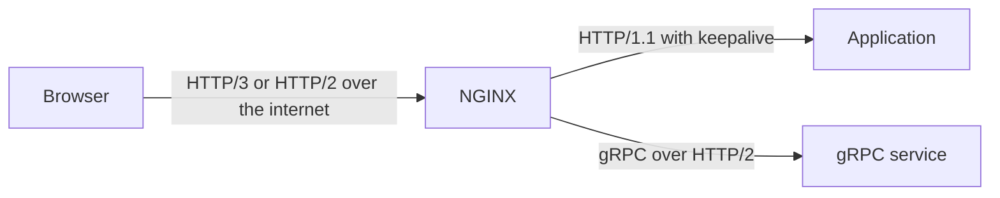
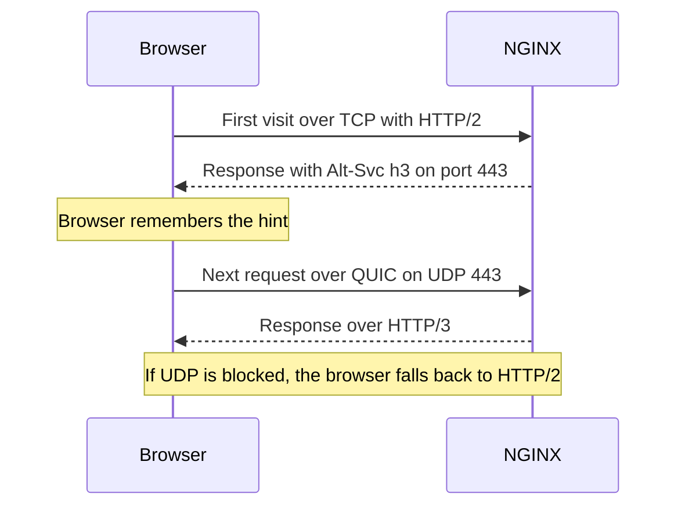
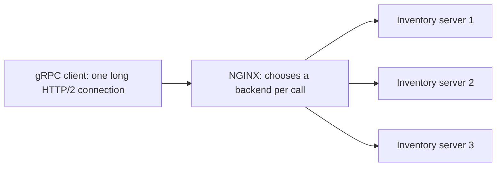

# HTTP/2, HTTP/3, server push and gRPC

## Before this lesson

You should be able to set up an HTTPS `server` block ([TLS, HTTPS redirects, HSTS and upstream encryption](#/lesson/nginx/tls-https-hsts)) and proxy to an `upstream` group ([HTTP load balancing and the balancing methods](#/lesson/nginx/lb-http-upstreams)). The protocols themselves are explained from the ground up in the networking track: [HTTP/2: streams, multiplexing and HPACK](#/lesson/networking/http2), [HTTP/3 and QUIC](#/lesson/networking/http3-quic) and [gRPC, service discovery, API gateways and virtual private clouds](#/lesson/networking/grpc-discovery-vpc). This lesson repeats the essentials and then concentrates on the NGINX side.

## In plain words

Picture a post office counter.

- **HTTP/1.1** is a counter where each clerk serves one customer from start to finish. If the customer at the front has a complicated parcel, everyone behind waits. To cope, browsers queue at six counters at once for each site.
- **HTTP/2** is one clerk with a conveyor belt. Every customer's items go onto the same belt, each labelled with the customer's number, mixed together and sorted at the other end. Nobody waits for a whole parcel to finish. One belt, many conversations.
- **HTTP/3** notices a weakness of the single belt: when one item falls off, the belt stops until it is put back, and all customers are held up. So it gives each customer their own lane on a wider belt. A dropped item delays only its owner.

**gRPC** is a way for programs to call each other's functions across a network. It is built on HTTP/2. **WebSocket** turns one HTTP connection into a two-way pipe that stays open, used for chat and live dashboards.

Why this matters at work: switching on HTTP/2 is one line and often the cheapest speed-up a site ever gets, HTTP/3 helps mobile users on poor networks, and "how do you load-balance gRPC?" is a standard question for anyone working with microservices, because the answer most people expect is wrong.

## The problem with HTTP/1.1

On one HTTP/1.1 connection, a request must be fully answered before the next response can start. A slow response blocks the ones behind it. This is **head-of-line blocking**: the item at the head of the queue delays everything else.

Browsers work round it by opening up to six connections per site, and each extra connection costs a TCP handshake and a TLS handshake. The simulation below counts the time for a page with 30 small files under a deliberately simple model: every request costs one network round trip plus the server's thinking time, and a new connection costs two round trips to set up.

```python-run
import math

def page_load_ms(resources, rtt_ms, server_ms, connections, multiplexed):
    setup = 2 * rtt_ms                       # TCP handshake + TLS 1.3 handshake
    one_request = rtt_ms + server_ms
    if multiplexed:                          # all requests travel at once on one connection
        return setup + one_request
    rounds = math.ceil(resources / connections)
    return setup + rounds * one_request      # each connection carries one request at a time

for rtt in (20, 100, 300):
    h1 = page_load_ms(30, rtt, 30, connections=6, multiplexed=False)
    h2 = page_load_ms(30, rtt, 30, connections=1, multiplexed=True)
    print(f"round trip {rtt:3} ms   HTTP/1.1 with 6 connections: {h1:5} ms   HTTP/2 with 1: {h2:4} ms")
```

The gap grows with the round-trip time, which is why the gain is largest for distant or mobile users. Real pages are messier, but the shape is right.

## HTTP/2 in NGINX

### What changes on the wire

- **Binary frames.** Messages are cut into small labelled pieces called **frames** instead of lines of text.
- **Streams.** Each request and its response form a numbered **stream**. Frames from many streams are interleaved on one connection. This is **multiplexing**.
- **Header compression** (HPACK). Repeated headers such as cookies are sent once and then referred to by number.

Methods, status codes, headers and URLs are unchanged. Your `location` blocks, `proxy_pass` lines and application do not need to know which version the browser used.

### Switching it on

```nginx
server {
    listen 443 ssl;
    http2 on;

    server_name shop.test;
    ssl_certificate     /etc/nginx/tls/shop.crt;
    ssl_certificate_key /etc/nginx/tls/shop.key;

    location / {
        proxy_pass http://127.0.0.1:8000;
    }
}
```

- `listen 443 ssl;` accepts TLS connections as before.
- `http2 on;` allows HTTP/2 on this server. This directive arrived in version 1.25.1. Before that the word went on the listen line, `listen 443 ssl http2;`, a form that still works but is marked as deprecated and produces a warning.

How do the two sides agree on the version? During the TLS handshake the browser lists the protocols it speaks and the server picks one. The mechanism is **ALPN** (Application-Layer Protocol Negotiation), and the labels are `h2` for HTTP/2 and `http/1.1`. A client that does not offer `h2` carries on with HTTP/1.1 on the same port, so enabling HTTP/2 breaks nobody.

Browsers only use HTTP/2 over TLS. NGINX can also accept HTTP/2 without TLS on a plain `listen 80;` server with `http2 on;`, which matters for internal gRPC traffic later in this lesson.

### Checking it

```bash
$ curl -sI --http2 https://shop.test/ | head -n 1
HTTP/2 200
$ nginx -V 2>&1 | tr ' ' '\n' | grep http_v2
--with-http_v2_module
```

`curl -I` asks for headers only. The first line of the answer names the protocol. The second command prints the options NGINX was compiled with, one per line, and filters for the HTTP/2 module, which the official packages include. To see versions in the access log, add `$server_protocol` to the log format (it prints `HTTP/2.0`), or `$http2`, which holds `h2` on such connections and is empty otherwise.

### The few settings worth knowing

| Directive | Default | Meaning |
|---|---|---|
| `http2_max_concurrent_streams` | 128 | how many streams one connection may have open at once |
| `keepalive_requests` | 1000 | total requests served on one connection before NGINX asks the client to open a new one |
| `keepalive_timeout` | 75s | how long an idle connection is kept |
| `http2_chunk_size` | 8k | largest piece a response body is cut into, so that streams interleave fairly |

`limit_conn` counts each stream as a connection, as noted in the limits lesson, so a per-address cap of 10 allows ten parallel streams, not ten browsers.

### What NGINX speaks to the backend

The version used by the browser and the version used towards the application are independent. NGINX translates. Towards upstream servers the proxy module speaks HTTP/1.1 by default (HTTP/1.0 before version 1.29.7), reusing kept-alive connections. Since 1.29.4 `proxy_http_version 2;` is also accepted. For ordinary web applications HTTP/1.1 on a fast local network is perfectly good: head-of-line blocking is a problem of slow, lossy links, not of the hop between two machines in one data centre.



## The story of server push

HTTP/2 included a feature called **server push**. The idea: when a browser asks for `index.html`, the server already knows that `style.css` will be wanted next, so it sends the stylesheet without being asked and saves a round trip. NGINX supported it from 1.13.9 through the `http2_push` and `http2_push_preload` directives, and the cookbook has a recipe for it.

In practice it disappointed. The server cannot see the browser's cache, so it often pushed files the browser already had, wasting bandwidth on exactly the slow connections it was meant to help. Measurements across many sites showed little or no gain. Chrome removed support for push in 2022, and NGINX removed its implementation in **1.25.1**; the directives are now obsolete.

Two replacements do the same job with the browser in control:

1. **Preload hints.** A response header `Link: </style.css>; rel=preload; as=style` tells the browser to fetch the file early. The browser checks its cache first.
2. **103 Early Hints.** While the application is still working on the page, an interim response with status 103 carries those `Link` headers ahead of the real answer. NGINX passes a 103 from the upstream to the client when told to, since version 1.29.0:

```nginx
location / {
    early_hints $http2$http3;
    proxy_pass http://127.0.0.1:8000;
}
```

`early_hints` takes one or more strings and forwards the interim response when any of them is non-empty and not `0`. `$http2` and `$http3` are empty on HTTP/1.1 connections, so this line forwards hints only to clients on the newer protocols, which are the ones known to handle them.

If an interviewer mentions server push, the answer that shows you are current is: it existed, it was withdrawn, and preload with Early Hints replaced it.

## HTTP/3 and QUIC

### What is different

HTTP/2 multiplexes streams inside *one TCP connection*. TCP guarantees that bytes are delivered in order. If one packet is lost, everything behind it waits for the resend, including data that belongs to other streams. Head-of-line blocking moved down a layer.

HTTP/3 replaces TCP with **QUIC**, a transport protocol built on UDP. QUIC knows about streams, so a lost packet delays only the stream it belonged to. It also folds the TLS 1.3 handshake into its own, so a new connection is ready after one round trip, and a connection is identified by an ID, not by the address pair, which lets it survive a phone moving from Wi-Fi to mobile data.

```python-run
def finish_times(packets, lost, gap_ms=10, resend_ms=200, streams_independent=False):
    arrive = [i * gap_ms for i in range(len(packets))]
    arrive[lost] += resend_ms                         # this packet has to be sent again
    done = {}
    if streams_independent:                           # QUIC: order is kept per stream only
        for i, s in enumerate(packets):
            done[s] = max(done.get(s, 0), arrive[i])
    else:                                             # TCP: one ordered byte stream for everything
        ready = 0
        for i, s in enumerate(packets):
            ready = max(ready, arrive[i])             # cannot be delivered before earlier packets
            done[s] = ready
    return done

packets = ["css", "js", "img"] * 4                    # 12 packets, three streams interleaved
print("lost packet belongs to:", packets[1])
print("HTTP/2 over TCP :", finish_times(packets, lost=1))
print("HTTP/3 over QUIC:", finish_times(packets, lost=1, streams_independent=True))
```

Over TCP one lost packet of the script delays the stylesheet and the image as well. Over QUIC only the script waits.

### Configuration

```nginx
server {
    listen 443 quic reuseport;
    listen 443 ssl;
    http2 on;
    http3 on;

    server_name shop.test;
    ssl_certificate     /etc/nginx/tls/shop.crt;
    ssl_certificate_key /etc/nginx/tls/shop.key;
    ssl_protocols       TLSv1.2 TLSv1.3;

    add_header Alt-Svc 'h3=":443"; ma=86400' always;

    location / {
        proxy_pass http://127.0.0.1:8000;
    }
}
```

- `listen 443 quic reuseport;` opens **UDP** port 443 for QUIC. `reuseport` gives every worker its own socket so that the kernel spreads packets between workers; write it on one `listen` line per address and port only.
- `listen 443 ssl;` keeps the ordinary TCP listener. Both are needed: the first visit always arrives over TCP.
- `http3 on;` is the default once a `quic` listener exists, written here to be explicit.
- `ssl_protocols` must include `TLSv1.3`, because QUIC uses nothing older.
- `add_header Alt-Svc 'h3=":443"; ma=86400' always;` is how browsers find out. `Alt-Svc` means "alternative service": this site is also reachable with HTTP/3 on UDP port 443, and you may remember that for 86,400 seconds (one day). `always` attaches the header to error responses too.



### Things that go wrong

- **The firewall.** Port 443 is usually open for TCP only. Open UDP 443 in the host firewall and in the cloud security group, or HTTP/3 silently never happens and browsers stay on HTTP/2.
- **The build.** The module is `ngx_http_v3_module`, present since 1.25.0, labelled experimental in the documentation, and compiled into the packages from nginx.org. Check with `nginx -V 2>&1 | grep -o http_v3_module`. Distribution packages may lack it.
- **Load balancers in front.** A cloud load balancer that forwards only TCP will not carry QUIC.
- **0-RTT.** QUIC can send a request in the very first packet of a resumed connection (`ssl_early_data on;`). Such data can be captured and replayed by an attacker, so enable it only where requests are safe to repeat.

`quic_retry on;` makes NGINX verify a client's address with an extra exchange before doing work for it, which is a defence against forged source addresses. Test from the command line with `curl --http3 -sI https://shop.test/` on a curl build that supports it, and log `$http3`, which holds `h3` on such requests.

## gRPC

### What it is

**RPC** stands for remote procedure call: code on one machine calls a function that runs on another. **gRPC** is Google's open framework for it. Three facts matter for a proxy:

1. gRPC runs over HTTP/2 and nothing older.
2. Every call is an HTTP/2 `POST` to the path `/package.Service/Method`, with content type `application/grpc` and a body encoded with Protocol Buffers, a compact binary format.
3. The outcome is reported in **trailers**, headers that come *after* the body: `grpc-status` (0 means success) and `grpc-message`. The HTTP status is 200 even for most failures.

A call may be a single request and response, or a **stream** in which either side sends many messages over minutes or hours.

### Proxying gRPC

```nginx
upstream inventory_grpc {
    server 10.0.0.21:50051;
    server 10.0.0.22:50051;
}

upstream orders_grpc {
    server 10.0.0.31:50051;
}

server {
    listen 443 ssl;
    http2 on;
    server_name grpc.shop.test;
    ssl_certificate     /etc/nginx/tls/grpc.crt;
    ssl_certificate_key /etc/nginx/tls/grpc.key;

    location /shop.Inventory/ {
        grpc_pass grpc://inventory_grpc;
    }

    location /shop.Orders/ {
        grpc_pass grpc://orders_grpc;
        grpc_read_timeout 1h;
        grpc_send_timeout 1h;
        client_body_timeout 1h;
        client_max_body_size 0;
    }

    error_page 502 504 = /grpc_unavailable;
    location = /grpc_unavailable {
        internal;
        default_type application/grpc;
        add_header grpc-status 14;
        add_header grpc-message "upstream unavailable";
        return 204;
    }
}
```

- `http2 on;` is compulsory. Without it gRPC clients cannot connect at all.
- `grpc_pass grpc://inventory_grpc;` is the gRPC counterpart of `proxy_pass`. The scheme `grpc://` means plain HTTP/2 to the backend; `grpcs://` means HTTP/2 over TLS. Here NGINX ends the TLS session from clients and talks unencrypted inside the private network.
- The two `location` blocks route by service name, because the path of every call begins with it. One public address can therefore front many internal services.
- For the `Orders` service, which offers long streams, the timeouts are raised. `grpc_read_timeout` and `grpc_send_timeout` default to 60 seconds and measure silence between two reads or writes, so a stream that is quiet for a minute is cut. `client_body_timeout` is the same clock on the client side, and `client_max_body_size 0;` removes the body size check, since a stream has no fixed length.
- The `error_page` block translates NGINX's own gateway errors into something a gRPC client understands. A raw 502 page confuses client libraries. The internal location answers with the content type gRPC expects and `grpc-status 14`, which is the code named UNAVAILABLE, so that clients retry properly.

### The load-balancing question

A gRPC client opens one HTTP/2 connection and keeps it for hours, sending thousands of calls down it. A load balancer that works at the transport layer picks a backend *once per connection*. Add three new backend servers and the existing connections stay glued to the old ones; the new servers idle.

NGINX with `grpc_pass` works at the application layer. It ends the client's HTTP/2 connection itself and picks a backend **for every call**, using whichever balancing method the `upstream` block names. Calls from one long-lived client connection are spread across all servers.



> [!NOTE]
> **NGINX Plus.** Active health checks that speak gRPC (`health_check type=grpc;`) are commercial. Open-source NGINX relies on the passive `max_fails` checks from the health-check lesson.

## WebSocket

A WebSocket connection starts as an HTTP/1.1 request carrying two headers, `Upgrade: websocket` and `Connection: Upgrade`. The server answers `101 Switching Protocols`, and from then on the connection carries messages in both directions. `Upgrade` and `Connection` are *hop-by-hop* headers: they apply to one link only, so a proxy does not forward them unless told to.

```nginx
map $http_upgrade $connection_upgrade {
    default upgrade;
    ""      close;
}

server {
    listen 443 ssl;
    server_name shop.test;

    location /ws/ {
        proxy_pass http://127.0.0.1:8000;
        proxy_http_version 1.1;
        proxy_set_header Upgrade    $http_upgrade;
        proxy_set_header Connection $connection_upgrade;
        proxy_read_timeout 1h;
    }
}
```

- The `map` sets `$connection_upgrade` to `upgrade` when the client sent an `Upgrade` header and to `close` when it did not, so the same location can serve ordinary requests as well.
- `proxy_http_version 1.1;` is required for the upgrade. It is the default from 1.29.7 and must be written on anything older.
- The two `proxy_set_header` lines pass the upgrade request on to the application.
- `proxy_read_timeout 1h;` matters most. The default of 60 seconds closes any socket on which the application sends nothing for a minute. Either raise it or have the application send small "ping" messages more often than the timeout.

## Side by side

| | HTTP/1.1 | HTTP/2 | HTTP/3 | gRPC | WebSocket |
|---|---|---|---|---|---|
| Transport | TCP | TCP | QUIC over UDP | HTTP/2 | TCP, upgraded from HTTP/1.1 |
| Parallel requests on one connection | no | yes | yes | yes | messages, not requests |
| A lost packet delays | that connection | every stream | one stream | every stream | that socket |
| NGINX directive | none needed | `http2 on;` | `listen ... quic;` | `grpc_pass` | `Upgrade` headers |
| Needs TLS in browsers | no | yes | yes, built in | not used by browsers directly | no |

> [!INTERVIEW]
> "Why is load-balancing gRPC harder than load-balancing REST, and what do you do about it?" Because gRPC multiplexes many calls on one long-lived HTTP/2 connection, a connection-level balancer sends all of a client's calls to a single backend and never rebalances. The fix is a balancer that understands HTTP/2 and distributes per call, such as NGINX with `grpc_pass` to an `upstream` group, or balancing in the client. Add that streaming calls need longer `grpc_read_timeout`, and that errors should be mapped to `grpc-status` values.

## Pitfalls

- **Writing `listen 443 ssl http2;` on a current version** and ignoring the deprecation warning. Use `http2 on;`.
- **Expecting HTTP/2 to reach the backend.** The upstream hop is HTTP/1.1 unless configured otherwise, and that is normal.
- **Configuring `http2_push`.** It has been removed; the configuration test fails on recent versions.
- **Forgetting UDP 443** for HTTP/3, or the `Alt-Svc` header, without which no browser ever tries it.
- **Using `proxy_pass` for gRPC.** Use `grpc_pass`, the module written for gRPC, with its own timeouts and header directives.
- **Leaving 60-second timeouts on streams and WebSockets**, which produces connections that drop "randomly" after a quiet minute.
- **Putting a TCP-only load balancer in front of gRPC** and wondering why one backend takes all the traffic.
- **Counting on `limit_conn` per connection** when each HTTP/2 stream is counted.

## Cheat sheet

| Goal | Configuration |
|---|---|
| Enable HTTP/2 | `listen 443 ssl; http2 on;` |
| Enable HTTP/3 | `listen 443 quic reuseport; listen 443 ssl; add_header Alt-Svc 'h3=":443"; ma=86400' always;` |
| Log the protocol | `$server_protocol`, `$http2`, `$http3` |
| Forward 103 Early Hints | `early_hints $http2$http3;` |
| Proxy gRPC | `grpc_pass grpc://group;` or `grpcs://group;` |
| Long gRPC streams | `grpc_read_timeout 1h; grpc_send_timeout 1h; client_max_body_size 0;` |
| gRPC-friendly errors | `error_page 502 504 = /x;` returning `grpc-status 14` |
| Proxy WebSocket | `proxy_http_version 1.1;` plus `Upgrade` and `Connection` headers and a long `proxy_read_timeout` |
| Test | `curl -sI --http2 URL`, `curl -sI --http3 URL` |

## Summary

- HTTP/2 multiplexes many streams on one TCP connection; enable it with `http2 on;`. Clients fall back to HTTP/1.1 through ALPN.
- Server push was removed from browsers and from NGINX 1.25.1. Preload hints and 103 Early Hints replace it.
- HTTP/3 runs on QUIC over UDP, removes transport-level head-of-line blocking, and is advertised with `Alt-Svc`. It needs a `quic` listener, TLS 1.3 and an open UDP port.
- gRPC needs HTTP/2 end to end on the client side, `grpc_pass` towards the backend, longer timeouts for streams, and per-call balancing.
- WebSocket needs the `Upgrade` and `Connection` headers passed on and a read timeout longer than the quietest period.

## Glossary

- **ALPN**: the TLS extension through which client and server choose the application protocol.
- **Alt-Svc**: a response header advertising another way to reach the same site, such as HTTP/3.
- **Early Hints**: an interim 103 response carrying `Link` headers before the final response.
- **Frame**: the smallest unit of an HTTP/2 or HTTP/3 message.
- **gRPC**: a remote procedure call framework built on HTTP/2 and Protocol Buffers.
- **Head-of-line blocking**: one delayed item holding up everything queued behind it.
- **Hop-by-hop header**: a header that applies to a single link and is not forwarded by proxies.
- **Multiplexing**: carrying several independent conversations on one connection.
- **QUIC**: a transport protocol on UDP with built-in encryption and independent streams.
- **Server push**: a withdrawn HTTP/2 feature in which the server sent resources unasked.
- **Stream**: one request and response pair inside an HTTP/2 or HTTP/3 connection.
- **Trailer**: a header sent after the message body.
- **WebSocket**: a long-lived two-way channel started by an HTTP upgrade.

## Check yourself

```quiz
[
  {"q": "On NGINX 1.27, which line is the current way to allow HTTP/2 on an HTTPS server?",
   "options": ["http2 on;", "listen 443 http2 only;", "ssl_protocols h2;", "proxy_http_version 2;"], "answer": 0,
   "explain": "The http2 directive replaced the http2 parameter of listen in 1.25.1. proxy_http_version concerns the upstream hop, not clients."},
  {"q": "A client that only speaks HTTP/1.1 connects to a server with `http2 on;`. What happens?",
   "options": ["The connection is refused", "It is served over HTTP/1.1, chosen through ALPN", "NGINX returns 505", "It is redirected to port 80"], "answer": 1,
   "explain": "The protocol is negotiated during the TLS handshake; clients that do not offer h2 continue with HTTP/1.1."},
  {"q": "What happened to HTTP/2 server push in NGINX?",
   "options": ["It is enabled by default", "It needs NGINX Plus", "It was removed in 1.25.1 after browsers dropped it", "It moved to HTTP/3 only"], "answer": 2,
   "explain": "Chrome removed push support and NGINX removed http2_push in 1.25.1. Preload links and 103 Early Hints are the replacement."},
  {"q": "HTTP/3 is configured correctly in NGINX but browsers keep using HTTP/2. Which cause is most likely?",
   "options": ["TCP port 443 is closed", "UDP port 443 is blocked or the Alt-Svc header is missing", "gzip is off", "worker_processes is 1"], "answer": 1,
   "explain": "Browsers learn about HTTP/3 from Alt-Svc and then need UDP 443 to be reachable; otherwise they stay on HTTP/2 without any error."},
  {"q": "Why does one lost packet hurt HTTP/2 more than HTTP/3?",
   "options": ["HTTP/2 has no compression", "TCP delivers bytes in order, so all streams wait for the resend", "HTTP/2 uses UDP", "HTTP/3 never loses packets"], "answer": 1,
   "explain": "All HTTP/2 streams share one ordered TCP byte stream. QUIC orders each stream separately."},
  {"q": "A transport-level load balancer sits in front of four gRPC servers. One client sends 10,000 calls over a single connection. How are they spread?",
   "options": ["Evenly over four servers", "All to one server", "Two servers alternate", "Randomly per call"], "answer": 1,
   "explain": "The balancer chooses once per connection. Per-call distribution needs an HTTP/2-aware proxy such as NGINX with grpc_pass."},
  {"q": "A WebSocket proxied by NGINX closes after exactly one minute without messages. Which setting is responsible?",
   "options": ["keepalive_timeout", "proxy_read_timeout", "client_header_timeout", "send_timeout"], "answer": 1,
   "explain": "proxy_read_timeout defaults to 60 seconds of silence from the upstream. Raise it or send periodic pings."}
]
```

> **Source:** DeJonghe, NGINX Cookbook, ch. 8 (HTTP/2 basic configuration, gRPC, HTTP/2 server push). Docs: https://nginx.org/en/docs/http/ngx_http_v2_module.html, https://nginx.org/en/docs/http/ngx_http_v3_module.html, https://nginx.org/en/docs/quic.html, https://nginx.org/en/docs/http/ngx_http_grpc_module.html, https://nginx.org/en/docs/http/ngx_http_core_module.html#early_hints, https://nginx.org/en/docs/http/websocket.html
