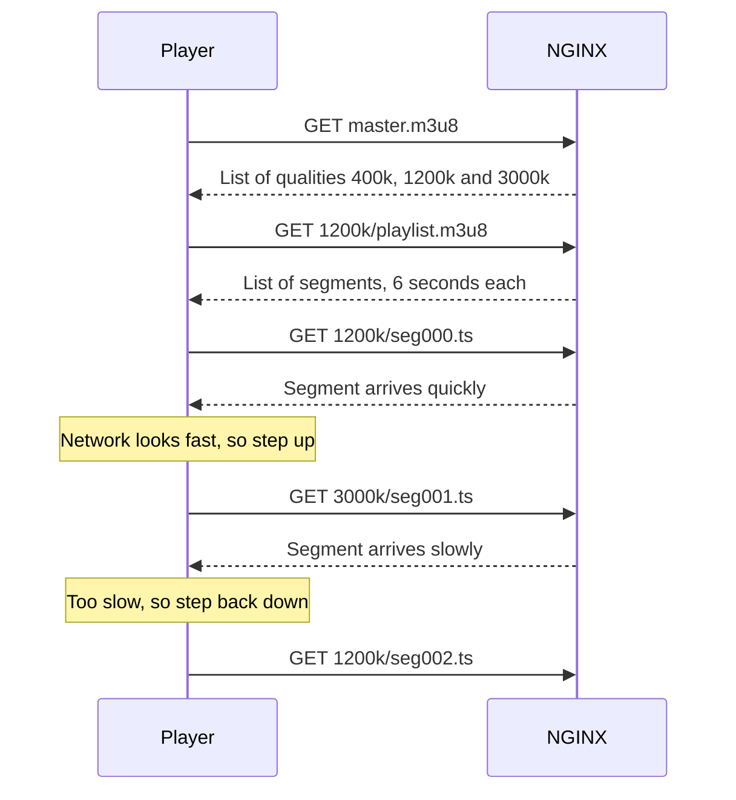

# Media streaming: MP4, HLS and bandwidth control

## Before this lesson

You should know how NGINX serves files from a `root` folder ([Serving a first static site](#/lesson/nginx/first-static-site)), how `limit_rate` slows a response ([Limiting request rate, connections and bandwidth](#/lesson/nginx/rate-conn-limits)), and what a cache key and cache validity are ([Proxy caching: zones, keys and validity](#/lesson/nginx/cache-basics)). Secure links from [Access rules, satisfy, CORS and secure links](#/lesson/nginx/access-cors-secure-links) appear once near the end.

## In plain words

Suppose a friend lends you a 600-page novel by post. There are three ways to do it.

1. **Send the whole book in one parcel.** You cannot read a word until the parcel arrives. This is a plain **download**.
2. **Post the pages in order, a few at a time.** You start reading as soon as the first pages arrive, and as long as pages come faster than you read, you never wait. If you want to skip to chapter 20, you ask for "pages from 410 onward". This is **progressive download**, also called **pseudo-streaming**.
3. **Cut the book into chapters and print each chapter in three sizes: large print, normal, and pocket.** Your friend posts one chapter at a time, and before each one checks how fast the post is running today and picks the size that will arrive in time. This is **adaptive streaming**, and the best-known format is **HLS**.

Video on the web is delivered in the second or third way, over ordinary HTTP. That is good news: a web server that is fast at sending files is already most of a video server. This lesson shows what NGINX adds on top, which parts are free and which belong to the commercial NGINX Plus, and how to keep one viewer from draining the server's bandwidth. Teams building learning platforms, internal training portals, or anything with user uploads meet these questions sooner than they expect.

## The vocabulary

- A **container** is a file format that packs video, audio and an index together. **MP4** is the common one. **FLV** (Flash Video) is an older one.
- A **codec** is the method used to compress the pictures or sound inside the container. **H.264** is the most widely playable video codec, **AAC** the usual audio codec.
- **Bitrate** is how much data one second of the media needs, in bits per second. A 1080p film might be 5 megabits per second.
- A **key frame** is a complete picture. The frames between key frames store only what changed, so playback can only begin at a key frame.
- The **moov atom** is the index inside an MP4 file: a table saying which bytes hold which moment of the film.
- **VOD** means video on demand: a finished file. **Live** means the video is still being produced while people watch.

One trap with units appears throughout: bitrates are given in **bits** per second, while NGINX's rate directives take **bytes** per second. Divide by eight. A 2,000 kilobit stream needs 250 kilobytes per second.

## Step 1: range requests, which NGINX already does

A browser's built-in video player does not download a file from start to finish. It asks for pieces using the `Range` request header, and the server answers with status **206 Partial Content** and a `Content-Range` header. When the viewer drags the slider, the player asks for a different range.

```nginx
server {
    listen 80;
    server_name media.test;
    root /srv/media;

    location /videos/ {
        sendfile on;
        tcp_nopush on;
    }
}
```

No special module is involved. NGINX honours `Range` for static files by default. `sendfile on;` asks the kernel to copy file bytes straight to the network socket without passing through NGINX's memory, and `tcp_nopush on;` fills each packet before sending it; both suit large files and are explained in the performance module.

```bash
$ curl -s -o /dev/null -D - -H 'Range: bytes=0-999' http://media.test/videos/intro.mp4 | head -n 4
HTTP/1.1 206 Partial Content
Content-Type: video/mp4
Content-Length: 1000
Content-Range: bytes 0-999/48213377
```

`-D -` prints the response headers, and `-o /dev/null` throws the body away. The answer says: here are bytes 0 to 999 of a file that is 48,213,377 bytes long.

The rules for interpreting a `Range` header are short enough to implement:

```python-run
def serve_range(header, size):
    """Return (status, first_byte, last_byte) for a single-range request."""
    if not header or not header.startswith("bytes="):
        return 200, 0, size - 1                      # no usable Range: send everything
    first, _, last = header[len("bytes="):].partition("-")
    if first == "":                                  # "bytes=-500": the final 500 bytes
        n = int(last)
        if n == 0:
            return 416, None, None
        return 206, max(0, size - n), size - 1
    start = int(first)
    end = int(last) if last else size - 1            # "bytes=500-": from 500 to the end
    if start >= size or start > end:
        return 416, None, None                       # Range Not Satisfiable
    return 206, start, min(end, size - 1)

SIZE = 10_000
for h in [None, "bytes=0-999", "bytes=9500-", "bytes=-200", "bytes=9000-20000", "bytes=10000-"]:
    status, a, b = serve_range(h, SIZE)
    extra = f"Content-Range: bytes {a}-{b}/{SIZE}" if status == 206 else ""
    print(f"{str(h):18} -> {status} {extra}")
```

A range that reaches past the end is trimmed, and one that starts past the end receives 416 Range Not Satisfiable. Problem `nginx-range-request` asks you to write a stricter version that also rejects malformed headers.

Plain range requests are enough for many sites. Their weakness: the player must fetch the MP4's index before it can translate "minute 42" into a byte position. If the index sits at the end of the file, that costs extra requests.

## Step 2: the MP4 module

The `ngx_http_mp4_module` lets the player seek by **time** instead of by bytes. It is part of open-source NGINX, compiled into the official packages (a self-built NGINX needs `--with-http_mp4_module`).

```nginx
location /videos/ {
    mp4;
    mp4_buffer_size     1m;
    mp4_max_buffer_size 8m;
    mp4_start_key_frame on;
}
```

- `mp4;` switches the module on for this location.
- A request such as `/videos/intro.mp4?start=95.5` now returns a valid, playable MP4 that begins 95.5 seconds in. `&end=140` cuts the other side. Both numbers are **seconds**. NGINX reads the index, rewrites it for the shortened film and sends that followed by the matching bytes.
- `mp4_buffer_size 1m;` is the memory first set aside for reading the index (default 512 kilobytes).
- `mp4_max_buffer_size 8m;` is the ceiling it may grow to (default 10 megabytes). When the index of a very long film is larger, the request fails with status 500 and the error log says `mp4 moov atom is too large` followed by the size and a suggestion to raise this directive.
- `mp4_start_key_frame on;` (from 1.21.4) makes the output begin on a key frame even when the requested second falls between two, which avoids a broken first moment.

Requests without `start` or `end` are served as ordinary static files, with no extra cost.

**Where the index sits matters.** Many encoders write the moov atom at the end of the file. NGINX then has to read through the file to find it on every seek. Move it to the front once, when the file is prepared:

```bash
$ ffmpeg -i raw.mp4 -c copy -movflags +faststart intro.mp4
```

`ffmpeg` is the standard free tool for converting media. `-c copy` keeps the video and audio as they are, without re-encoding, and `-movflags +faststart` rewrites the file with the index first.

**FLV.** The sister module `ngx_http_flv_module` (`flv;` in a location) does a similar job for Flash Video, with one difference: its `start` argument is a **byte offset**, not seconds. Flash Player was retired at the end of 2020, so this is legacy knowledge, useful mainly for recognising old configurations.

## Step 3: HLS, the chapter-by-chapter approach

### How HLS works

**HLS** stands for HTTP Live Streaming, a format designed by Apple and playable almost everywhere. The film is cut into **segments**, short files of a few seconds each, traditionally with the extension `.ts`. A text file called a **playlist** (extension `.m3u8`) lists the segments in order. For adaptive streaming there is one playlist per quality level and a **master playlist** that lists those.



The player makes every decision. The server only hands out small files, which is why HLS scales so well: segments are ordinary cacheable HTTP responses.

For live video the playlist is a moving window. The encoder keeps appending new segments and dropping old ones, and players fetch the playlist again every few seconds.

### Simulate it: a playlist and an adaptive player

```python-run
def media_playlist(name, duration_s, fragment_s=5):
    lines = ["#EXTM3U", "#EXT-X-VERSION:3", f"#EXT-X-TARGETDURATION:{fragment_s}",
             "#EXT-X-MEDIA-SEQUENCE:0"]
    t = 0.0
    while t < duration_s:
        end = min(t + fragment_s, duration_s)
        lines.append(f"#EXTINF:{end - t:.3f},")
        lines.append(f"{name}.ts?start={t:.3f}&end={end:.3f}")
        t = end
    lines.append("#EXT-X-ENDLIST")                 # present for VOD, absent for live
    return "\n".join(lines)

print(media_playlist("intro.mp4", 17.2))

def choose_quality(variants_kbps, measured_kbps, safety=0.8):
    usable = [v for v in sorted(variants_kbps) if v <= measured_kbps * safety]
    return usable[-1] if usable else min(variants_kbps)

print()
variants = [400, 1200, 3000, 6000]
for speed in [9000, 5200, 1400, 300, 2500]:
    print(f"measured {speed:5} kbit/s -> play the {choose_quality(variants, speed):4} kbit/s version")
```

The first part prints a playlist for a 17.2-second clip in five-second pieces; the last piece is shorter. The second part is the heart of every adaptive player: measure how fast the last segment arrived, keep a safety margin, and pick the best quality that fits. When even the lowest quality does not fit, it is chosen anyway and the viewer sees pauses.

### Three ways to produce HLS with NGINX

**1. NGINX Plus, on the fly.**

> [!NOTE]
> **NGINX Plus.** The `ngx_http_hls_module` is commercial.

```nginx
location /vod/ {
    hls;
    hls_fragment            6s;
    hls_buffers             10 10m;
    hls_mp4_buffer_size     1m;
    hls_mp4_max_buffer_size 8m;
    root /srv/media;
}
```

With this in place, an MP4 stored as `/srv/media/vod/intro.mp4` can be requested as `/vod/intro.mp4.m3u8`. NGINX Plus builds the playlist and cuts the segments from the MP4 at the moment they are requested. Nothing is prepared in advance and nothing extra is stored.

- `hls;` enables it.
- `hls_fragment 6s;` sets the segment length (default 5 seconds).
- `hls_buffers 10 10m;` is the number and size of the buffers used to read and write video data (default 8 buffers of 2 megabytes).
- The two `hls_mp4_` lines are the same index buffers as in the MP4 module.

It handles H.264 video with AAC or MP3 audio. A related commercial module, `f4f`, serves Adobe's HDS format in the same spirit (`f4f;` in a location); HDS has faded along with Flash.

**2. Open source, prepared in advance.** Cut the file once with `ffmpeg` and let NGINX serve the pieces as static files:

```bash
$ ffmpeg -i intro.mp4 -c copy -f hls -hls_time 6 -hls_playlist_type vod \
    -hls_segment_filename '/srv/media/hls/intro/seg%03d.ts' /srv/media/hls/intro/playlist.m3u8
```

`-f hls` selects the HLS output format, `-hls_time 6` asks for six-second segments, `-hls_playlist_type vod` marks the playlist as complete, and `seg%03d.ts` names the pieces `seg000.ts`, `seg001.ts` and so on.

```nginx
location /hls/ {
    root /srv/media;
    add_header Access-Control-Allow-Origin "https://shop.test" always;

    location ~ \.m3u8$ {
        add_header Cache-Control "public, max-age=5";
        add_header Access-Control-Allow-Origin "https://shop.test" always;
    }
    location ~ \.ts$ {
        add_header Cache-Control "public, max-age=31536000, immutable";
        add_header Access-Control-Allow-Origin "https://shop.test" always;
    }
}
```

- The MIME types for `.m3u8` (`application/vnd.apple.mpegurl`) and `.ts` (`video/mp2t`) are already in the `mime.types` file that ships with NGINX.
- Playlists get a short cache lifetime so that a live playlist stays fresh. Segments never change once written, so they can be cached for a year.
- The CORS header is needed when the page with the player lives on a different origin from the media. It is repeated in the nested locations because a block that declares its own `add_header` does not inherit the outer ones.

This costs disk space, one copy per quality level, and is how most open-source deployments work.

**3. Live streams.** Open-source NGINX has no built-in live ingest. The usual addition is the third-party **nginx-rtmp-module**, which accepts a stream from broadcasting software over the RTMP protocol and writes HLS segments and playlists into a folder that a normal `location` then serves. It is community-maintained, so check its state before depending on it.

## Step 4: bandwidth control

A player needs data only slightly faster than it plays it. Left alone, NGINX sends a file as fast as the network allows, so a viewer on a fast connection pulls the whole two-hour film in a minute, then closes the tab after five minutes. Most of that bandwidth was wasted, and you pay for bandwidth.

### Open source: limit_rate

```nginx
location /videos/ {
    mp4;
    limit_rate_after 4m;
    limit_rate       320k;
}
```

- `limit_rate_after 4m;` sends the first 4 megabytes at full speed, so playback starts at once and the player has a cushion.
- `limit_rate 320k;` then holds the response to 320 kilobytes per second. For a film encoded at 2,000 kilobits per second (250 kilobytes per second) that is about 1.3 times the playback speed: enough to stay ahead, not enough to waste.

The weakness is that one number has to suit every file in the location. A rate tuned for standard definition starves a high-definition file.

### NGINX Plus: limits that follow the bitrate

> [!NOTE]
> **NGINX Plus.** `mp4_limit_rate` and `mp4_limit_rate_after` are commercial.

```nginx
location /videos/ {
    mp4;
    mp4_limit_rate_after 20s;
    mp4_limit_rate       1.3;
}
```

Here the units are about the film, not about bytes. `mp4_limit_rate_after 20s;` sends the first twenty seconds *of playing time* unthrottled (the default is 60 seconds), and `mp4_limit_rate 1.3;` then sends at 1.3 times the file's own average bitrate, whatever that is. The value `on` means a factor of 1.1. Every file gets a fitting rate without any per-file configuration.

### Simulate it: will the viewer see a pause?

```python-run
def playback(bitrate_kbit, limit_kbyte, burst_mbyte, seconds=60):
    need = bitrate_kbit / 8                 # kilobytes of video consumed per second of viewing
    burst_left = burst_mbyte * 1024         # kilobytes still sent at full speed
    downloaded = played = 0.0
    stalls = 0
    for _ in range(seconds):
        if burst_left > 0:
            sent = min(burst_left, 20_000)  # a fast line: 20 MB/s
            burst_left -= sent
        else:
            sent = limit_kbyte
        downloaded += sent
        if downloaded - played >= need:     # one second of film is ready to show
            played += need
        else:
            stalls += 1
    return stalls, (downloaded - played) / need

for label, bitrate, limit in [("SD file, 320k limit", 2000, 320), ("HD file, 320k limit", 6000, 320),
                              ("HD file, 1000k limit", 6000, 1000)]:
    stalls, cushion = playback(bitrate, limit, burst_mbyte=4)
    print(f"{label:22} pauses: {stalls:2} s   buffered ahead at the end: {cushion:5.1f} s")
```

The limit that suits the standard-definition file makes the high-definition file pause, because 320 kilobytes per second is less than the 750 it consumes. That mismatch is exactly what the bitrate-aware Plus directives remove; with open-source NGINX you split files of different quality into different locations, or set the rate from a `map` on the path.

Remember also that `limit_rate` applies per response. A player that opens several connections gets several allowances, so pair it with `limit_conn`.

## Step 5: scaling and protecting media

**Caching.** When NGINX is a proxy in front of a storage server, segments are ideal cache objects: small, immutable and requested by many viewers.

```nginx
proxy_cache_path /var/cache/nginx/media keys_zone=media:50m max_size=50g inactive=7d;

location /hls/ {
    proxy_cache       media;
    proxy_cache_valid 200 206 7d;
    proxy_cache_lock  on;
    proxy_pass        http://storage.internal:9000;
}
```

`proxy_cache_lock on;` matters for live streams: when a new segment appears, hundreds of players ask for it within the same second, and the lock sends only one of those requests to storage. For large single MP4 files behind a proxy, the `slice` module from the advanced caching lesson stores the file in fixed-size pieces so that range requests are cached piece by piece.

**Disk and memory.** For big files, three core directives are commonly set together:

```nginx
location /videos/ {
    sendfile       on;
    aio            threads;
    directio       8m;
    output_buffers 2 1m;
}
```

`aio threads;` hands slow disk reads to a pool of helper threads so that a worker never stops to wait for the disk. `directio 8m;` reads files of 8 megabytes or more without filling the operating system's file cache with data that will not be read twice. `output_buffers` sets the memory used for reading when `sendfile` is not in play, which is the case for files read with `directio`.

**Access control.** Media URLs get shared. The secure-link technique from the access lesson, a signature and an expiry time in the URL, works for video too. With NGINX Plus, `hls_forward_args on;` copies the query arguments of the playlist request onto every segment address inside the playlist, so the signature travels with each segment request.


> [!INTERVIEW]
> "How would you serve video from NGINX?" Start with what is free: static files with range requests give seekable playback, and the MP4 module adds seeking by time. For adaptive quality, pre-cut HLS with ffmpeg and serve playlists and segments as static files with short and long cache lifetimes respectively; NGINX Plus can generate HLS on the fly instead. Control cost with `limit_rate_after` and `limit_rate` (or the bitrate-aware `mp4_limit_rate` in Plus), cache segments, and sign URLs. Mention the bits-versus-bytes conversion; it shows you have done it.

## Pitfalls

- **Mixing up bits and bytes.** `limit_rate 2000k` is 16 megabits per second, eight times a 2,000 kilobit film.
- **The index at the end of the MP4.** Seeking works but is slow and disk-heavy. Use `-movflags +faststart`.
- **A `moov atom is too large` error** on long films. Raise `mp4_max_buffer_size`.
- **Expecting `hls;` or `mp4_limit_rate` in open-source NGINX.** The configuration test reports an unknown directive.
- **Caching live playlists for long.** Players then see a stale list and stop at its end.
- **Giving `.ts` segments a short cache lifetime**, which sends every viewer back to the origin for files that never change.
- **Forgetting CORS** when the player page and the media are on different hostnames; the browser blocks the playlist.
- **Rate limiting without a starting burst**, which makes every video begin with a spinner.
- **Assuming `flv` and `mp4` use the same `start` unit.** One counts bytes, the other seconds.

## Cheat sheet

| Goal | Configuration | Edition |
|---|---|---|
| Seekable playback by byte range | static files; nothing to add | open source |
| Seek by time in MP4 | `mp4;` then `?start=SECONDS&end=SECONDS` | open source |
| Bigger index buffer | `mp4_max_buffer_size 20m;` | open source |
| Start on a key frame | `mp4_start_key_frame on;` | open source |
| FLV pseudo-streaming | `flv;` then `?start=BYTES` | open source |
| HLS from MP4 on the fly | `hls; hls_fragment 6s;` | NGINX Plus |
| HDS | `f4f;` | NGINX Plus |
| HLS from prepared files | `ffmpeg -f hls`, served as static files | open source |
| Throttle after a burst | `limit_rate_after 4m; limit_rate 320k;` | open source |
| Throttle relative to bitrate | `mp4_limit_rate 1.3; mp4_limit_rate_after 20s;` | NGINX Plus |
| Large-file I/O | `sendfile on; aio threads; directio 8m;` | open source |

## Summary

- Video on the web is file delivery over HTTP. Range requests and status 206 give seeking with no extra modules.
- The MP4 module seeks by seconds and works best when the moov atom is at the start of the file.
- HLS cuts media into short segments listed in playlists, and the player chooses the quality. Open-source NGINX serves prepared HLS; NGINX Plus can produce it on demand.
- Throttle a little above the playback rate after an unthrottled start. Rate directives count bytes; bitrates count bits.
- Cache segments for a long time and playlists briefly, read big files with threads and direct I/O, and sign URLs when content must stay private.

## Glossary

- **Adaptive streaming**: delivery in which the player switches quality as network speed changes.
- **Bitrate**: the amount of data per second of media.
- **Codec**: the compression method for video or audio.
- **Container**: the file format wrapping video, audio and index.
- **HDS**: Adobe's HTTP Dynamic Streaming, a legacy segmented format.
- **HLS**: HTTP Live Streaming, segments plus playlists.
- **Key frame**: a complete picture from which decoding can start.
- **Master playlist**: the HLS file listing the available quality levels.
- **moov atom**: the index of an MP4 file.
- **Playlist**: an `.m3u8` text file listing segments in order.
- **Pseudo-streaming**: progressive download with seeking, by range or by time.
- **Range request**: a request for part of a file, answered with 206.
- **Segment**: one short piece of a stream, often a `.ts` file.
- **VOD**: video on demand, a finished recording.

## Check yourself

```quiz
[
  {"q": "A browser sends `Range: bytes=1000-1999` for a static 50,000-byte file. What status does NGINX return by default?",
   "options": ["200", "206", "416", "302"], "answer": 1,
   "explain": "Static files support range requests without extra configuration; a satisfiable range gets 206 Partial Content."},
  {"q": "With `mp4;` enabled, what does `/videos/a.mp4?start=90` return?",
   "options": ["The file from byte 90", "A playable MP4 starting 90 seconds in", "A playlist", "A redirect"], "answer": 1,
   "explain": "The MP4 module interprets start and end as seconds and rewrites the index for the shortened film."},
  {"q": "A film is encoded at 4,000 kbit/s. Which `limit_rate` is about 1.2 times its playback speed?",
   "options": ["4800k", "600k", "500k", "48k"], "answer": 1,
   "explain": "4,000 kbit/s is 500 kilobytes per second; 1.2 times that is 600k. limit_rate counts bytes."},
  {"q": "Which of these works in open-source NGINX?",
   "options": ["hls;", "mp4_limit_rate 1.2;", "f4f;", "mp4; with limit_rate_after and limit_rate"], "answer": 3,
   "explain": "The MP4 module and the core rate directives are open source. HLS generation, HDS and the bitrate-aware limits are NGINX Plus."},
  {"q": "In HLS, who decides which quality level to fetch next?",
   "options": ["NGINX", "The player", "The CDN", "The encoder"], "answer": 1,
   "explain": "The player measures download speed and picks a variant from the master playlist; the server only serves files."},
  {"q": "Which cache lifetimes suit a live HLS stream?",
   "options": ["Long for playlists, short for segments", "Short for playlists, long for segments", "Long for both", "No caching at all"], "answer": 1,
   "explain": "Playlists change every few seconds; a segment never changes once written."},
  {"q": "Seeking in MP4 files is slow and the disk is busy. What is the usual cause?",
   "options": ["gzip is off", "The moov atom is at the end of the files", "keepalive_timeout is too low", "The files use H.264"], "answer": 1,
   "explain": "NGINX must read through the file to find an index stored at the end. Re-mux with -movflags +faststart."}
]
```

> **Source:** DeJonghe, NGINX Cookbook, ch. 9 (serving MP4 and FLV, streaming with HLS, streaming with HDS, bandwidth limits). Docs: https://nginx.org/en/docs/http/ngx_http_mp4_module.html, https://nginx.org/en/docs/http/ngx_http_flv_module.html, https://nginx.org/en/docs/http/ngx_http_hls_module.html, https://nginx.org/en/docs/http/ngx_http_f4f_module.html, https://nginx.org/en/docs/http/ngx_http_core_module.html#limit_rate, https://developer.apple.com/streaming/
