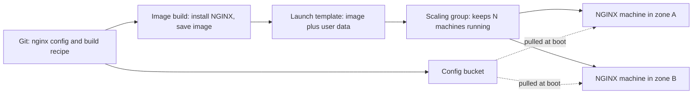
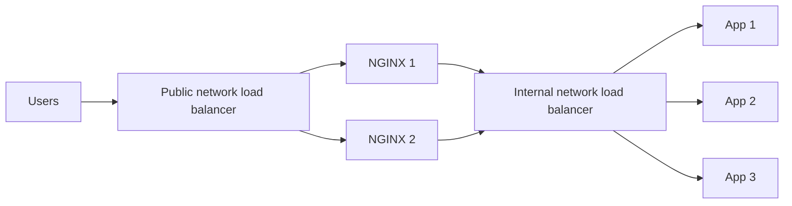

# Cloud deployments: provisioning, cloud load balancers and DNS

## Before this lesson

You should know how an `upstream` group and passive health checks work ([HTTP load balancing and the balancing methods](#/lesson/nginx/lb-http-upstreams), [Health checks, retries, draining and slow start](#/lesson/nginx/lb-health-checks)), how the realip module restores a client address ([A/B testing, map, geo and finding the real client](#/lesson/nginx/split-geo-map)), what the PROXY protocol is ([TCP and UDP load balancing and sticky sessions](#/lesson/nginx/lb-tcp-udp-sticky)) and how configuration is generated by tools ([Configuration management, templating and the API](#/lesson/nginx/automation-api)). DNS itself is explained in [How DNS resolution works](#/lesson/networking/dns-resolution).

## In plain words

Think of a chain of coffee kiosks at a large railway station.

On a quiet morning two kiosks are enough. At rush hour the chain needs eight. Nobody builds a kiosk by hand each time: there is a **blueprint**, and a kiosk built from it is ready to serve within minutes. A **manager** watches the queues and opens or closes kiosks to match. At the station entrance a **signpost** points each traveller to a kiosk that is open, and stops pointing at one the moment its shutter comes down.

In a cloud:

- the blueprint is a **machine image**,
- a kiosk is a **virtual machine** (also called an instance) running NGINX,
- the manager is an **auto scaling group**,
- the signpost is a **cloud load balancer** or a **DNS record**.

Everything in the earlier lessons still applies; `nginx.conf` does not know it is in a cloud. What changes is that machines appear and vanish without a person involved, so three questions need answers. How does a new machine become a working NGINX with nobody logging in? How do clients reach a set of machines that keeps changing? And what does NGINX have to be told when it sits behind somebody else's load balancer? Cloud and DevOps interviews circle around exactly these.

## The vocabulary

| Term | Meaning | AWS name | Azure name | Google Cloud name |
|---|---|---|---|---|
| Virtual machine | a rented computer | EC2 instance | Virtual Machine | Compute Engine instance |
| Machine image | a saved disk to start machines from | AMI | managed image | custom image |
| Scaling group | a set of identical machines kept at a target size | Auto Scaling group | Virtual Machine Scale Set | managed instance group |
| Layer 4 balancer | forwards TCP or UDP connections | Network Load Balancer (NLB) | Azure Load Balancer | passthrough Network Load Balancer |
| Layer 7 balancer | understands HTTP | Application Load Balancer (ALB) | Application Gateway | Application Load Balancer |
| Managed DNS | name records with health checks | Route 53 | Azure DNS, Traffic Manager | Cloud DNS |
| Firewall rule set | which ports are reachable | security group | network security group | firewall rules |

A **region** is a geographic area with several separate data centres called **availability zones**. Spreading machines across zones protects against one building failing.

**Why run NGINX at all when the cloud sells load balancers?** They are good at different things, and most real systems use both.

| | Cloud load balancer | NGINX |
|---|---|---|
| Capacity and availability | scales by itself, spans zones, nothing to patch | you size, patch and replicate it |
| Routing | hosts and paths, a few rules | regex locations, `map`, rewrites, per-route settings |
| Extras | managed certificates | caching, rate limits, auth subrequests, response headers, njs |
| Portability | different in every cloud | the same file everywhere |
| Cost | per hour and per gigabyte | the machines it runs on |

The common pattern: a cloud balancer provides a stable, highly available entry point, and NGINX behind it does the clever work.

## Step 1: machines that configure themselves

A machine launched by a scaling group gets no human attention. There are two ways to make it useful, usually combined.

**Bake.** Build a machine image that already contains NGINX and its configuration. A tool such as Packer starts a temporary machine, runs your installation steps (often an Ansible playbook), saves the disk as an image and deletes the machine. Machines started from the image are ready in seconds, and every one is identical.

**Bootstrap.** Give the scaling group a start-up script, which clouds call **user data**. The machine runs it once on first boot.

```bash
#!/bin/bash
set -euo pipefail
apt-get update
apt-get install -y nginx awscli
aws s3 sync s3://shop-config/nginx/ /etc/nginx/ --delete
nginx -t
systemctl enable --now nginx
```

- `set -euo pipefail` stops the script at the first failing command, so that a half-configured machine does not start taking traffic.
- The two `apt-get` lines install NGINX and the cloud's command-line tool.
- `aws s3 sync ... --delete` copies the configuration from a storage bucket into `/etc/nginx/`, removing local files that are not in the bucket. The machine's permission to read the bucket comes from a role attached to it, not from a password in the script.
- `nginx -t` tests the configuration; with `set -e`, a failed test ends the script.
- `systemctl enable --now nginx` starts NGINX and makes it start on every boot.

Baking gives fast, repeatable starts; bootstrapping gives fresh configuration without rebuilding the image. A sensible split is to bake the software and bootstrap the configuration.



Machines built this way are treated as **immutable**: nobody edits a running one. To change the configuration you publish a new version and replace the machines, a few at a time. The cloud marketplaces also sell ready-made NGINX Plus images, billed by the hour with the licence included, which removes the installation step for the commercial edition.

### Simulate it: a scaling group following the load

The usual scaling rule is **target tracking**: keep a measurement, such as average CPU use, near a target by resizing the group in proportion.

```python-run
import math

def desired_size(current, cpu_percent, target=50, smallest=2, largest=10):
    wanted = math.ceil(current * cpu_percent / target)
    return max(smallest, min(largest, wanted))

CAPACITY = 1000                       # requests per second one machine handles at 100% CPU
load = [600, 900, 2500, 4200, 4200, 3000, 1200, 500, 500]
size = 2
print("minute  load  machines  cpu%  decision")
for minute, rps in enumerate(load):
    cpu = min(100, round(rps / (size * CAPACITY) * 100))
    new = desired_size(size, cpu)
    if new < size:
        new = size - 1                # shrink gently, one machine at a time
    note = "hold" if new == size else ("grow" if new > size else "shrink")
    print(f"{minute:5} {rps:6} {size:8} {cpu:5}  {note} to {new}")
    size = new
```

Follow minute 2: the load jumps to 2,500 while there are two machines, CPU reads 100%, and the rule doubles the group. Growth is fast and shrinking is slow on purpose, because adding a machine too late hurts users while removing one too late only costs a little money. Notice also that at the moment of the jump the group was already saturated: scaling reacts after the fact, so keep headroom.

## Step 2: getting traffic to a changing set of machines

### Option A: DNS only

The cheapest signpost is the name system itself. Create one address record per NGINX machine under the same name, and attach a **health check** to each record so that the DNS service stops handing out the address of a machine that fails. With AWS Route 53 a small function triggered by scaling events adds and removes records as machines come and go.

It costs almost nothing and has one serious weakness: **caching**. Every DNS answer carries a **TTL** (time to live), the number of seconds a client may keep using it. After a machine dies, clients that looked the name up a moment earlier keep trying the dead address until their copy expires.

```python-run
import math

def exposure_seconds(fail_at, check_every, failures_needed, ttl):
    first_check = math.ceil(fail_at / check_every) * check_every
    detected = first_check + (failures_needed - 1) * check_every   # record withdrawn here
    return detected - fail_at + ttl                                # last client's cached copy expires

print("check every  failures  TTL   clients may hit the dead machine for")
for check_every, needed, ttl in [(30, 3, 300), (10, 3, 60), (10, 2, 30), (10, 2, 5)]:
    worst = exposure_seconds(fail_at=7, check_every=check_every, failures_needed=needed, ttl=ttl)
    print(f"{check_every:11} {needed:9} {ttl:4}   up to {worst} s")
```

With relaxed settings a dead machine keeps receiving visitors for over six minutes. Tight settings bring that under a minute but never to zero, and very short TTLs mean more DNS lookups and are ignored by some resolvers. DNS balancing is acceptable for small setups and as an outer layer that spreads users across regions. It is a poor only line of defence.

### Option B: a cloud load balancer in front

A cloud balancer has one stable name, checks its targets every few seconds and stops sending to a failed one at once. Scaling groups register and deregister their machines with it automatically. This is the standard choice.

### Option C: the load balancer sandwich

Now look one hop further. NGINX needs to know where the application machines are, and those are in their own scaling group, changing all the time. Open-source NGINX reads its `upstream` list from a file. Rewriting the file whenever a machine starts is possible but is one more moving part.

The cookbook's answer is the **NLB sandwich**: put a second, *internal* network load balancer between NGINX and the application tier.



NGINX is the filling between two slices of load balancer. Each scaling group registers with the balancer in front of it, both tiers grow and shrink independently, and the NGINX configuration contains one unchanging line: the internal balancer's name. Layer 4 balancers are used on both sides so that NGINX remains the only component that reads HTTP.

What you give up: NGINX no longer sees individual application servers, so its balancing methods, `max_fails` and per-server limits have nothing to act on. With NGINX Plus, or with a discovery tool writing the upstream list, you can drop the inner balancer and let NGINX balance directly.

### The stale address trap

When a configuration says `proxy_pass http://internal-app-lb.shop.internal:8000;`, NGINX looks the name up **once, when the configuration is loaded**, and keeps the addresses until the next reload. Cloud load balancers change their addresses whenever they scale or are repaired. Days later NGINX is sending requests to an address that no longer answers, and the error log fills with `connect() failed` or `upstream timed out` while everything looks healthy in the cloud console.

The fix is to make NGINX look the name up again at run time:

```nginx
http {
    resolver 10.0.0.2 valid=30s;

    upstream app_tier {
        zone app_tier 64k;
        server internal-app-lb.shop.internal:8000 resolve;
    }

    server {
        listen 80;
        location / {
            proxy_pass http://app_tier;
        }
    }
}
```

- `resolver 10.0.0.2 valid=30s;` names the DNS server to ask (in an AWS network it lives at the network's base address plus two) and says to trust each answer for 30 seconds regardless of its TTL.
- `zone app_tier 64k;` puts the group in shared memory, which `resolve` requires.
- `server ... resolve;` tells NGINX to keep watching the name and update the group when the addresses change, with no reload.

The `resolve` parameter was an NGINX Plus feature for years and became part of open-source NGINX in **1.27.3**. On older versions the workaround is a variable, because a `proxy_pass` containing a variable is resolved for each request:

```nginx
location / {
    set $app_host internal-app-lb.shop.internal;
    proxy_pass http://$app_host:8000;
}
```

## Step 3: what NGINX must know behind a cloud balancer

**1. Who the client is.** Every connection now arrives from the balancer's address. Limits per address, access rules and logs are all wrong until the real address is restored.

```nginx
# Behind a layer 7 balancer, which adds X-Forwarded-For
set_real_ip_from 10.0.0.0/16;
real_ip_header   X-Forwarded-For;
real_ip_recursive on;
```

```nginx
# Behind a layer 4 balancer with the PROXY protocol switched on
server {
    listen 80 proxy_protocol;
    set_real_ip_from 10.0.0.0/16;
    real_ip_header   proxy_protocol;
}
```

In both, `set_real_ip_from` names the network the balancer lives in, the only source whose word about the client is trusted. A layer 7 balancer writes the client address into the `X-Forwarded-For` header. A layer 4 balancer cannot add headers, so it either keeps the original source address on the packets or, with the PROXY protocol enabled, prepends one line stating it. `listen ... proxy_protocol` tells NGINX to expect that line. If it is enabled on only one side, every connection fails.

**2. A health check target.** The balancer needs something cheap to poll.

```nginx
location = /healthz {
    access_log off;
    default_type text/plain;
    return 200 "ok\n";
}
```

An exact-match location that answers from NGINX itself, without touching the application and without filling the access log. If you would prefer the balancer to notice a broken application too, proxy the check through to it; then an application outage takes the NGINX machines out of service as well, which is rarely what you want when NGINX can still serve a cached or friendly error page.

**3. The original scheme.** When the balancer ends TLS and forwards plain HTTP, NGINX sees `http` for every request. Redirects and `X-Forwarded-Proto` must be based on the header the balancer sets, as shown in the TLS lesson.

**4. Idle timeouts.** A layer 7 balancer keeps connections to NGINX open and reuses them. The AWS Application Load Balancer closes idle ones after 60 seconds by default. NGINX's `keepalive_timeout` must be **longer** than the balancer's idle timeout. If NGINX closes first, the balancer will sooner or later send a request down a connection NGINX is shutting at that very moment, and the user receives a 502 from the balancer that no NGINX log explains. The default of 75 seconds is safe against a 60-second balancer; a "tuned" value of 15 is not.

**5. Leaving gracefully.** When the scaling group removes a machine, the balancer stops sending new requests and waits a configurable period for running ones. On the machine, `nginx -s quit` finishes requests in progress before exiting, and `worker_shutdown_timeout 30s;` caps how long that may take.

## Step 4: other clouds, the same ideas

The names in the vocabulary table change; the steps do not. On **Azure** you capture a configured machine as an image, start a Virtual Machine Scale Set from it and place an Azure Load Balancer in front; the marketplace offers NGINX Plus images. On **Google Cloud** you create a Compute Engine instance, save a custom image, build an instance template and a managed instance group, and attach a load balancer.

One Google-specific recipe in the cookbook is worth understanding because the pattern is general: using NGINX on a virtual machine as a front for a *managed platform*, there App Engine, which runs your code without giving you servers. The reason is to add things the platform does not offer, such as custom routing, caching or a single hostname over several applications.

```nginx
resolver 8.8.8.8 valid=60s;

server {
    listen 80;
    server_name shop.test;

    location / {
        set $platform_host shop-project.appspot.com;
        proxy_pass https://$platform_host;
        proxy_set_header Host $platform_host;
        proxy_ssl_server_name on;
    }
}
```

- The variable forces a fresh DNS lookup, because a managed platform's addresses change constantly.
- `proxy_set_header Host $platform_host;` matters because such platforms host thousands of applications on shared addresses and choose yours by the `Host` header.
- `proxy_ssl_server_name on;` sends the hostname in the TLS handshake (SNI) so that the platform presents the matching certificate.

The same three lines are what you need in front of an object storage website, a serverless function URL, or any other shared platform.

> [!INTERVIEW]
> "Your NGINX fleet sits behind a cloud load balancer and proxies to an internal one. Users see occasional 502s. Where do you look?" Two classic causes. First, DNS: NGINX resolved the internal balancer's name at start-up and its addresses have changed; fix with a `resolver` and the `resolve` parameter or a variable in `proxy_pass`. Second, idle timeouts: NGINX's `keepalive_timeout` is shorter than the front balancer's idle timeout, so the balancer reuses a connection NGINX has closed. Mentioning both, and how you would tell them apart (the first shows in NGINX's error log, the second only in the balancer's), is a strong answer.

## Pitfalls

- **Hostnames in `upstream` or `proxy_pass` without run-time resolution**, pointing at balancers whose addresses move.
- **`keepalive_timeout` shorter than the front balancer's idle timeout.**
- **Trusting `X-Forwarded-For` from anywhere.** Limit `set_real_ip_from` to the balancer's network, or clients can forge their address.
- **PROXY protocol enabled on one side only.** NGINX then logs broken header errors, or the backend sees garbage at the start of each request.
- **A health check that depends on the application**, so that one application fault removes every NGINX machine.
- **Editing a running machine by hand.** The next machine from the image will not have the change.
- **Secrets inside user data or baked into images.** Use the machine's role and a secrets service.
- **Long DNS TTLs with DNS-only balancing**, which stretch every failure.
- **All machines in one availability zone.** A single building's outage takes the site down.
- **No spare capacity.** New machines need minutes to boot; scale before saturation, not at it.

## Cheat sheet

| Need | How |
|---|---|
| Identical machines | bake an image with Packer and a playbook |
| Fresh configuration at boot | user data script pulling from a bucket, then `nginx -t` |
| Stable entry point | cloud load balancer in front of the scaling group |
| Cheap entry point | DNS records with health checks and short TTLs |
| Two independent tiers | load balancer sandwich |
| Follow changing addresses | `resolver IP valid=30s;` and `server name:port resolve;` in a `zone` |
| Same, before 1.27.3 | `set $h name; proxy_pass http://$h:port;` |
| Client address behind layer 7 | `set_real_ip_from`, `real_ip_header X-Forwarded-For` |
| Client address behind layer 4 | `listen 80 proxy_protocol;` and `real_ip_header proxy_protocol;` |
| Balancer health probe | `location = /healthz { access_log off; return 200; }` |
| Clean removal | `nginx -s quit`, `worker_shutdown_timeout` |
| Proxy to a shared platform | `Host` header, `proxy_ssl_server_name on;`, run-time DNS |

## Summary

- In a cloud, NGINX machines are created from an image and a start-up script, and replaced instead of edited.
- Clients reach a changing fleet through a cloud load balancer, or through DNS records with health checks, whose weakness is cached answers.
- The load balancer sandwich lets the NGINX tier and the application tier scale separately with a fixed configuration.
- NGINX resolves names once at load unless told otherwise; use `resolver` with `resolve` (open source since 1.27.3) or a variable.
- Behind a balancer, restore the client address, provide a health endpoint, respect the forwarded scheme and keep idle timeouts in the right order.

## Glossary

- **Auto scaling group**: a set of identical machines whose size follows demand.
- **Availability zone**: one of several separate data centres in a region.
- **Bake**: build software into a machine image in advance.
- **Bootstrap**: configure a machine with a script on first boot.
- **Immutable infrastructure**: replacing machines instead of changing them.
- **Launch template**: the recipe a scaling group uses to start machines.
- **Machine image**: a saved disk from which machines are started.
- **NLB sandwich**: NGINX placed between a public and an internal network load balancer.
- **Region**: a geographic area of a cloud provider.
- **Target tracking**: scaling to keep a measurement near a chosen value.
- **TTL**: how long a DNS answer may be cached.
- **User data**: a script handed to a new machine to run at first boot.

## Check yourself

```quiz
[
  {"q": "NGINX has `proxy_pass http://internal-lb.example.internal;` and was started a week ago. The balancer's IP addresses changed yesterday. What happens without further configuration?",
   "options": ["NGINX notices through the TTL", "NGINX keeps using the old addresses until reloaded", "NGINX refuses to proxy", "The cloud updates nginx.conf"], "answer": 1,
   "explain": "Names in the configuration are resolved once when it is loaded. Run-time resolution needs a resolver plus `resolve` or a variable."},
  {"q": "Which open-source version made the upstream `resolve` parameter available without NGINX Plus?",
   "options": ["1.9.11", "1.19.0", "1.27.3", "It is still commercial"], "answer": 2,
   "explain": "`resolve` and the related `service` parameter moved to open-source NGINX in 1.27.3."},
  {"q": "What is the main weakness of DNS-only load balancing across NGINX machines?",
   "options": ["DNS cannot hold more than one address", "Clients cache answers, so a dead machine keeps receiving traffic for a while", "It needs NGINX Plus", "It breaks TLS"], "answer": 1,
   "explain": "Cached answers live until their TTL expires, on top of the time the health check needs to detect the failure."},
  {"q": "In the NLB sandwich, what does the NGINX configuration point at as its upstream?",
   "options": ["Each application machine by IP", "The internal load balancer's name", "The public load balancer", "Route 53"], "answer": 1,
   "explain": "The application scaling group registers with the internal balancer, so NGINX needs only that one stable name."},
  {"q": "A front Application Load Balancer has a 60 s idle timeout and NGINX has `keepalive_timeout 20s;`. What symptom is likely?",
   "options": ["Slow TLS handshakes", "Occasional 502s returned by the balancer", "Every request fails", "Higher memory use only"], "answer": 1,
   "explain": "NGINX closes idle connections the balancer still believes are usable; a request sent at that moment fails with 502."},
  {"q": "A network load balancer has the PROXY protocol enabled. Which line must the NGINX server have?",
   "options": ["listen 80 proxy_protocol;", "proxy_protocol on; in the location", "real_ip_header X-Forwarded-For;", "listen 80 ssl;"], "answer": 0,
   "explain": "The listen parameter tells NGINX to expect the PROXY protocol line at the start of each connection; real_ip_header proxy_protocol then uses it."},
  {"q": "Why bake software into an image and fetch configuration at boot?",
   "options": ["Images cannot contain files", "Fast identical starts, with configuration changeable without rebuilding the image", "User data runs on every request", "It avoids needing a scaling group"], "answer": 1,
   "explain": "Baking gives speed and repeatability; bootstrapping the configuration keeps it current."}
]
```

> **Source:** DeJonghe, NGINX Cookbook, ch. 10 (auto-provisioning on AWS, routing to NGINX nodes without a load balancer, the NLB sandwich, marketplace deployments, Azure images and scale sets, Google Compute Engine images and the App Engine proxy). Docs: https://nginx.org/en/docs/http/ngx_http_upstream_module.html#resolve, https://nginx.org/en/docs/http/ngx_http_core_module.html#resolver, https://nginx.org/en/docs/http/ngx_http_realip_module.html, https://docs.aws.amazon.com/elasticloadbalancing/, https://docs.aws.amazon.com/autoscaling/
