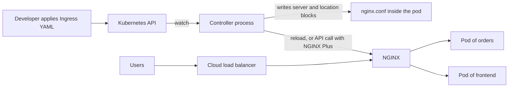

# Containers and microservices: gateway, images and Ingress

## Before this lesson

You should be comfortable with location matching and the trailing slash of `proxy_pass` ([How NGINX picks a location block](#/lesson/nginx/location-matching), [try_files, return, rewrite and the proxy_pass slash](#/lesson/nginx/try-files-rewrite-return)), rate limits per key ([Limiting request rate, connections and bandwidth](#/lesson/nginx/rate-conn-limits)), run-time DNS resolution ([Cloud deployments](#/lesson/nginx/cloud-deployments)) and templating ([Configuration management, templating and the API](#/lesson/nginx/automation-api)). If containers are new to you, read [What a container is](#/lesson/docker/what-is-a-container) and [Dockerfile instructions, one by one](#/lesson/docker/dockerfile-instructions) first. Kubernetes Ingress has its own lesson: [Ingress: host and path routing](#/lesson/kubernetes/ingress).

## In plain words

A large company used to be one open-plan office where everybody did a bit of everything. It has reorganised into small departments, each with one job: accounts, orders, deliveries. Each department sits in its own identical portable cabin that can be lifted onto a lorry and set down anywhere.

A visitor arriving at the site cannot be expected to know which cabin handles what, or that the orders team moved to a different corner yesterday. So there is a **reception desk**. Reception checks the visitor's badge, turns away people who come too often, and walks each request to the right cabin. Because cabins are added and moved all the time, reception keeps a **directory** that is updated automatically.

- The departments are **microservices**: small programs that each do one thing and talk to each other over the network.
- A cabin is a **container**: a program packaged with everything it needs so that it runs the same anywhere.
- Reception is an **API gateway**, a very common job for NGINX.
- The self-updating directory is **service discovery**.
- In Kubernetes, the most widely used system for running containers, reception that rewrites its own directory is called an **Ingress controller**.

For a backend or DevOps job this is everyday material: writing a gateway configuration, packaging NGINX in an image, feeding it settings from the environment, and explaining what an Ingress controller does.

## Part 1: NGINX as an API gateway

An **API** (application programming interface) is the set of URLs a program offers to other programs. An API gateway is the single public entrance to many services. It does the chores that every service would otherwise repeat: routing, TLS, checking who is calling, limiting how often, and answering errors in one consistent format.

Build it one layer at a time. The service names below (`users`, `orders`) are names the container platform resolves; more on that in Part 2.

### Layer 1: routing

```nginx
upstream users_svc  { zone users_svc 64k;  server users:8000; }
upstream orders_svc { zone orders_svc 64k; server orders:8000; }

server {
    listen 443 ssl;
    server_name api.shop.test;
    ssl_certificate     /etc/nginx/tls/api.crt;
    ssl_certificate_key /etc/nginx/tls/api.key;

    location /v1/users/ {
        proxy_pass http://users_svc/;
    }

    location /v1/orders/ {
        proxy_pass http://orders_svc/;
    }

    location / {
        return 404;
    }
}
```

- One `upstream` per service. A `zone` gives each group shared memory, which later features need.
- `location /v1/users/` with `proxy_pass http://users_svc/;` forwards the request with the matched prefix replaced by `/`. A call to `/v1/users/42` reaches the users service as `/42`. The service does not need to know the public layout or the version prefix.
- `location /` is the fallback. Anything that is not a published route is refused at the gateway and never reaches a service.

### Layer 2: one error format

API clients parse responses with code. An HTML error page from NGINX in the middle of JSON answers breaks them.

```nginx
    default_type application/json;
    proxy_intercept_errors on;

    error_page 401 = @e401;
    error_page 403 = @e403;
    error_page 404 = @e404;
    error_page 429 = @e429;
    error_page 500 502 503 504 = @e5xx;

    location @e401 { return 401 '{"status":401,"message":"Unauthorized"}\n'; }
    location @e403 { return 403 '{"status":403,"message":"Forbidden"}\n'; }
    location @e404 { return 404 '{"status":404,"message":"Resource not found"}\n'; }
    location @e429 { return 429 '{"status":429,"message":"Too many requests"}\n'; }
    location @e5xx { return 503 '{"status":503,"message":"Service unavailable"}\n'; }
```

- `default_type application/json;` labels responses that NGINX itself produces as JSON.
- `error_page CODE = @name;` hands any response with that code to a **named location**, a block that can only be reached internally. The `=` lets the named location choose the final status.
- `proxy_intercept_errors on;` applies the same treatment to error responses coming *from the services*, so that a stack trace from one of them never reaches a client.

### Layer 3: who is calling, and how often

```nginx
map $http_x_api_key $api_client {
    default            "";
    "k_7f3a9c2e51"     "mobile-app";
    "k_b81d04aa7c"     "partner-acme";
}

limit_req_zone $api_client zone=per_client:10m rate=20r/s;
limit_req_status 429;

server {
    # ... as above ...

    if ($api_client = "") { return 401; }
    limit_req zone=per_client burst=40 nodelay;
    client_max_body_size 256k;

    location /v1/orders/ {
        limit_except GET POST { deny all; }
        proxy_set_header X-Api-Client $api_client;
        proxy_pass http://orders_svc/;
    }
}
```

- The `map` turns the `X-Api-Key` request header into a client name. An unknown or missing key gives an empty string.
- `if ($api_client = "") { return 401; }` refuses callers without a valid key.
- `limit_req_zone $api_client ...` counts requests per client name, so each customer gets its own allowance however many addresses it calls from.
- `client_max_body_size 256k;` rejects oversized request bodies with 413 before a service sees them.
- `limit_except GET POST { deny all; }` allows only the listed methods on this route (`HEAD` comes with `GET`); others receive 403.
- `proxy_set_header X-Api-Client $api_client;` tells the service who the caller is, so that it does not have to check the key again.

A table of keys in a `map` is fine for a handful of partners. For real user authentication the gateway delegates with `auth_request` or validates JSON Web Tokens, as the authentication module showed (token validation built into NGINX is an NGINX Plus feature; `auth_request` and njs are open source).

Keep the pieces in separate files pulled in with `include`: one file of upstreams, one of error handlers, one per API. Reviews stay small and two teams rarely edit the same file.

### Simulate it

```python-run
ROUTES = [  # (prefix, service, allowed methods)
    ("/v1/users/",  "users_svc",  {"GET", "POST", "PATCH"}),
    ("/v1/orders/", "orders_svc", {"GET", "POST"}),
]
KEYS = {"k_7f3a9c2e51": "mobile-app", "k_b81d04aa7c": "partner-acme"}

def gateway(method, path, api_key=None, body_bytes=0):
    client = KEYS.get(api_key, "")
    if client == "":
        return 401, '{"status":401,"message":"Unauthorized"}'
    if body_bytes > 256 * 1024:
        return 413, "request body too large"
    best = None
    for prefix, service, methods in ROUTES:           # longest matching prefix wins
        if path.startswith(prefix) and (best is None or len(prefix) > len(best[0])):
            best = (prefix, service, methods)
    if best is None:
        return 404, '{"status":404,"message":"Resource not found"}'
    prefix, service, methods = best
    if method not in methods | ({"HEAD"} if "GET" in methods else set()):
        return 403, '{"status":403,"message":"Forbidden"}'
    upstream_path = "/" + path[len(prefix):]          # proxy_pass with a trailing slash
    return 200, f"{service} receives {method} {upstream_path} from {client}"

calls = [("GET", "/v1/users/42", "k_7f3a9c2e51"), ("GET", "/v1/users/42", None),
         ("DELETE", "/v1/orders/9", "k_b81d04aa7c"), ("POST", "/v1/orders/", "k_b81d04aa7c"),
         ("GET", "/v2/users/42", "k_7f3a9c2e51"), ("GET", "/admin", "k_7f3a9c2e51")]
for method, path, key in calls:
    print(f"{method:6} {path:14} -> {gateway(method, path, key)}")
```

Each refusal happens at the gateway. The services only ever see well-formed, authenticated, rate-limited requests on routes they own.

## Part 2: finding services that move

Containers are replaced constantly and receive a new address each time. Platforms therefore give each service a **DNS name**: Docker's built-in DNS server answers at `127.0.0.11` inside a container network, and Kubernetes has a cluster DNS service.

As the cloud lesson explained, NGINX resolves a name once when the configuration loads. In a container platform that is not good enough.

```nginx
resolver 127.0.0.11 valid=10s;

upstream orders_svc {
    zone orders_svc 64k;
    server orders:8000 resolve;
}
```

`resolver` names the DNS server and keeps each answer for ten seconds. `resolve` makes NGINX refresh the group in the background. When the orders service is scaled to five containers, DNS returns five addresses and NGINX balances across all of them without a reload.

An ordinary address record holds only an address, so the port must be written in the configuration. A **SRV record** (service record) also carries a **port**, a **priority** (lower numbers are preferred, higher ones are backups) and a **weight**. Orchestrators that assign random ports publish SRV records.

```nginx
upstream orders_svc {
    zone orders_svc 64k;
    server orders.service.internal service=http resolve;
}
```

`service=http` tells NGINX to look up the SRV record `_http._tcp.orders.service.internal` and take addresses, ports and weights from the answer. Note that no port is written. Both `resolve` and `service` were NGINX Plus features until open-source version **1.27.3**.

```python-run
def upstream_from_srv(records):
    """records: (priority, weight, port, target). Lowest priority value = primary servers."""
    best = min(r[0] for r in records)
    lines = []
    for priority, weight, port, target in sorted(records):
        role = "" if priority == best else " backup"
        lines.append(f"server {target}:{port} weight={weight}{role};")
    return lines

answer = [(10, 5, 31004, "node-a.internal"), (10, 5, 31877, "node-b.internal"),
          (10, 1, 30112, "node-c.internal"), (20, 1, 31560, "node-d.internal")]
print("\n".join(upstream_from_srv(answer)))
```

Three servers share the best priority and receive traffic according to their weights. The fourth has a worse priority and is used only when the others are down.

## Part 3: the official image

```bash
$ docker run -d --name web -p 8080:80 \
    -v "$PWD/site:/usr/share/nginx/html:ro" \
    -v "$PWD/conf.d:/etc/nginx/conf.d:ro" \
    nginx:1.29-alpine
```

- `docker run -d` starts a container in the background.
- `-p 8080:80` connects port 8080 of the host to port 80 inside the container.
- The two `-v` options mount a local folder of web pages and a local folder of configuration, read-only (`:ro`).
- `nginx:1.29-alpine` is the image and its **tag**. Pin a version; the tag `latest` changes under you.

Facts about the image that explain most surprises:

| Fact | Consequence |
|---|---|
| The main process is started as `nginx -g 'daemon off;'` | NGINX stays in the foreground. A container lives exactly as long as its main process, so the usual background mode would make it exit at once. |
| `/var/log/nginx/access.log` and `error.log` are links to the standard output and error streams | Logs are read with `docker logs web`, and the platform collects them. Nothing fills the container's disk. |
| Scripts in `/docker-entrypoint.d/` run before NGINX starts | This is how templates are rendered (Part 5). |
| Workers run as the `nginx` user, the master as root | For a fully non-root container use the `nginxinc/nginx-unprivileged` image, which listens on 8080. |
| `worker_processes auto;` counts the host's processors | In a container limited to one CPU on a 64-core host this starts 64 workers. Setting `NGINX_ENTRYPOINT_WORKER_PROCESSES_AUTOTUNE=1` makes the entrypoint respect the container's limit. |

One mistake deserves its own line: inside a container, `127.0.0.1` is **the container itself**. `proxy_pass http://127.0.0.1:8000;` from an NGINX container reaches nothing unless the application runs in that same container. Use the service name.

## Part 4: your own image

Mounting files is handy while developing. For deployment, build the configuration into an image so that one versioned artefact holds everything.

```dockerfile
FROM nginx:1.29-alpine
RUN rm /etc/nginx/conf.d/default.conf
COPY nginx.conf /etc/nginx/nginx.conf
COPY conf.d/ /etc/nginx/conf.d/
COPY site/ /usr/share/nginx/html/
HEALTHCHECK --interval=10s --timeout=2s CMD wget -qO- http://127.0.0.1/healthz || exit 1
EXPOSE 80
```

- `FROM` chooses the base image.
- `RUN rm ...` deletes the sample site so that it cannot answer by accident.
- The `COPY` lines add your main configuration file, the per-site configuration files and the web pages.
- `HEALTHCHECK` has Docker call a health URL every ten seconds; here `127.0.0.1` is correct, because the check runs inside the same container.
- `EXPOSE 80` documents the port.

In the build pipeline, run `docker run --rm IMAGE nginx -t` right after building. A configuration error then fails the build and never reaches a server.

> [!NOTE]
> **NGINX Plus.** There is no public Plus image to pull without credentials. You build one from a Dockerfile that installs the `nginx-plus` package from F5's repository, which requires your subscription's certificate and key. Pass them as build secrets (`RUN --mount=type=secret,...`) so that they are not stored in an image layer, and never push such an image to a public registry.

## Part 5: environment variables

Containers are configured through **environment variables**, named values handed to a process at start. NGINX's configuration language has no syntax for reading them: `$name` in `nginx.conf` means an NGINX variable computed per request, not something from the environment.

The official image bridges the gap. Any file in `/etc/nginx/templates/` whose name ends in `.template` is passed through `envsubst`, a small substitution tool, at start-up, and the result is written to `/etc/nginx/conf.d/` without the suffix.

```nginx
# templates/default.conf.template
upstream app {
    server ${APP_HOST}:${APP_PORT};
}
server {
    listen ${LISTEN_PORT};
    location / {
        proxy_pass http://app;
        proxy_set_header Host $host;
        proxy_set_header X-Real-IP $remote_addr;
    }
}
```

```yaml
# compose.yaml
services:
  web:
    image: nginx:1.29-alpine
    ports: ["8080:80"]
    volumes: ["./templates:/etc/nginx/templates:ro"]
    environment:
      APP_HOST: app
      APP_PORT: "8000"
      LISTEN_PORT: "80"
  app:
    build: ./app
```

The important detail: the image substitutes **only variables that are defined in the environment**. `${APP_HOST}` is replaced. `$host` and `$remote_addr` are left alone because no environment variables with those names exist, so NGINX's own variables survive.

```python-run
import re

def render(template, environment):
    def swap(match):
        name = match.group(1) or match.group(2)
        return environment[name] if name in environment else match.group(0)   # unknown: leave as is
    return re.sub(r"\$\{(\w+)\}|\$(\w+)", swap, template)

template = """server {
    listen ${LISTEN_PORT};
    location / {
        proxy_pass http://${APP_HOST}:${APP_PORT};
        proxy_set_header Host $host;
    }
}"""
print(render(template, {"APP_HOST": "app", "APP_PORT": "8000", "LISTEN_PORT": "80"}))
print("--- with a variable called 'host' in the environment ---")
print(render(template, {"APP_HOST": "app", "APP_PORT": "8000", "LISTEN_PORT": "80", "host": "oops"}).splitlines()[4])
```

The second print shows the trap: if the environment happens to contain a name that collides with an NGINX variable, the template is damaged. The image offers `NGINX_ENVSUBST_FILTER`, a pattern restricting which names are replaced, for that case.

Templates are rendered **once, at start**. To read the environment while handling a request, the core `env NAME;` directive keeps a variable for the worker processes (NGINX otherwise clears its environment, except for the time zone), and a scripting module such as njs reads it as `process.env.NAME`.

## Part 6: the Kubernetes Ingress controller

In Kubernetes, containers run in groups called **pods**, and a **Service** gives a set of pods one stable name. An **Ingress** is a document that states routing wishes for traffic entering the cluster:

```yaml
apiVersion: networking.k8s.io/v1
kind: Ingress
metadata:
  name: shop
  annotations:
    nginx.org/client-max-body-size: "4m"
spec:
  ingressClassName: nginx
  tls:
    - hosts: ["shop.test"]
      secretName: shop-tls
  rules:
    - host: shop.test
      http:
        paths:
          - path: /api/
            pathType: Prefix
            backend: { service: { name: orders, port: { number: 8000 } } }
          - path: /
            pathType: Prefix
            backend: { service: { name: frontend, port: { number: 80 } } }
```

Read it as: for the host `shop.test`, with the certificate stored in the secret `shop-tls`, send paths under `/api/` to the `orders` Service and everything else to `frontend`. The `annotations` entry is a vendor-specific extra, here raising the body size limit.

An Ingress by itself does nothing. It is a wish. An **Ingress controller** is a program that makes the wish come true, and several of them are built on NGINX:



The controller watches the cluster for Ingress documents, Services and pod addresses, translates them into `server`, `location` and `upstream` blocks, the same ones you have written by hand throughout this track, and reloads NGINX when something changes. With NGINX Plus, pod address changes go through the API, so no reload is needed.

Three projects are easy to confuse:

| Project | Maintainer | Status to know |
|---|---|---|
| `ingress-nginx` | the Kubernetes community | For years the most installed controller. The project announced its retirement, with maintenance ending in March 2026, so new clusters should not start on it. |
| NGINX Ingress Controller (`nginxinc/kubernetes-ingress`) | F5 NGINX | Open source, with an NGINX Plus edition. Annotations start with `nginx.org/`. |
| NGINX Gateway Fabric | F5 NGINX | Implements the **Gateway API**, the newer Kubernetes routing standard that is succeeding Ingress. |

Annotations differ between controllers (`nginx.ingress.kubernetes.io/...` for the community one), which is a frequent source of copy-and-paste failures. Whichever is in use, the most valuable debugging habit is to read the generated configuration: `kubectl exec` into the controller pod and run `nginx -T`.

## Part 7: metrics from a containerised NGINX

Container platforms usually collect metrics with Prometheus, which fetches a text page of numbers from every service at intervals. NGINX does not produce that format natively. The **NGINX Prometheus exporter** is a small companion container that reads NGINX's status endpoint (the open-source `stub_status` page, or the richer NGINX Plus API) and republishes it as Prometheus metrics such as `nginx_connections_active` and `nginx_http_requests_total`. The next module covers the status endpoint and what the numbers mean.

> [!INTERVIEW]
> "What does an Ingress controller do?" It is a control loop: it watches Ingress, Service and endpoint objects through the Kubernetes API, renders them into reverse-proxy configuration (for NGINX-based controllers, an `nginx.conf` with server blocks per host, locations per path and upstreams per Service), and applies it by reload or API call. Traffic enters through a cloud load balancer or node port to the controller's pods, which proxy straight to pod addresses. Add that an Ingress resource alone does nothing without a controller, and that the Gateway API is the successor.

## Pitfalls

- **`proxy_pass` to `127.0.0.1` from inside a container.** That is the NGINX container, not the application.
- **Service names resolved once.** After the application container restarts with a new address, NGINX returns 502 until reloaded. Use `resolver` with `resolve`.
- **Using the `latest` tag**, so that a rebuild silently changes the NGINX version.
- **Running NGINX as a background daemon in a container**, which makes the container stop immediately.
- **Writing logs to files inside the container** instead of the standard streams.
- **Expecting `$VAR` in `nginx.conf` to read the environment.** Use templates, or `env` plus njs.
- **Baking certificates, keys or licences into image layers.**
- **An HTML error page from the gateway** in a JSON API.
- **Forgetting the fallback `location /`**, which exposes whatever the default happens to be.
- **Mixing annotations from different Ingress controllers.** The wrong prefix is ignored without an error.

## Cheat sheet

| Goal | How |
|---|---|
| Route by path, hide the prefix | `location /v1/x/ { proxy_pass http://x_svc/; }` |
| Uniform JSON errors | `error_page 404 = @e404;` and `proxy_intercept_errors on;` |
| Limit per API client | `limit_req_zone $api_client ...;` with a `map` from the key header |
| Restrict methods | `limit_except GET POST { deny all; }` |
| Follow container addresses | `resolver 127.0.0.11 valid=10s;` and `server name:port resolve;` |
| Ports from DNS | `server name service=http resolve;` |
| Run the official image | `docker run -d -p 8080:80 nginx:1.29-alpine` |
| Environment into config | `/etc/nginx/templates/*.template` rendered by `envsubst` at start |
| Environment at request time | `env NAME;` and njs `process.env.NAME` |
| Test an image | `docker run --rm IMAGE nginx -t` |
| See an Ingress controller's config | `kubectl exec POD -- nginx -T` |
| Prometheus metrics | NGINX Prometheus exporter reading `stub_status` |

## Summary

- As an API gateway, NGINX routes by path to one upstream per service, gives errors one format, identifies callers and limits them.
- Services in containers move; give NGINX a `resolver` and use `resolve`, or SRV records with `service=`, both open source since 1.27.3.
- The official image runs NGINX in the foreground, logs to the standard streams and renders `*.template` files from environment variables at start.
- Build your own image for deployment and test it with `nginx -t` in the pipeline.
- An Ingress controller turns Kubernetes routing objects into NGINX configuration automatically. Know which controller you are running, and that the Gateway API is the direction of travel.

## Glossary

- **Annotation**: a key and value attached to a Kubernetes object, used for controller-specific settings.
- **API gateway**: the single entrance that routes, authenticates and limits calls to many services.
- **Container**: a packaged, isolated process with its own filesystem.
- **Entrypoint**: the script or program a container runs at start.
- **Environment variable**: a named value given to a process when it starts.
- **envsubst**: a tool that replaces `${NAME}` in text with environment values.
- **Gateway API**: the newer Kubernetes standard for traffic routing.
- **Image**: the read-only package a container is started from.
- **Ingress**: a Kubernetes object describing HTTP routing into the cluster.
- **Ingress controller**: the program that implements Ingress objects with a real proxy.
- **Microservice**: a small service with one responsibility.
- **Named location**: a `location @name` reachable only through internal redirects.
- **Pod**: the smallest unit Kubernetes runs, one or more containers together.
- **Service discovery**: finding the current addresses of a service automatically.
- **SRV record**: a DNS record carrying target, port, priority and weight.

## Check yourself

```quiz
[
  {"q": "`location /v1/users/ { proxy_pass http://users_svc/; }` receives `GET /v1/users/42/orders`. What path does the users service see?",
   "options": ["/v1/users/42/orders", "/42/orders", "/users/42/orders", "/"], "answer": 1,
   "explain": "With a URI part on proxy_pass (here the slash), the matched location prefix is replaced by it."},
  {"q": "An NGINX container has `proxy_pass http://127.0.0.1:8000;` and the application runs in another container. What happens?",
   "options": ["It works through the host", "502, because 127.0.0.1 is the NGINX container itself", "Docker rewrites the address", "404"], "answer": 1,
   "explain": "Each container has its own loopback interface. Use the application's service name."},
  {"q": "Why does the official image start NGINX with `daemon off;`?",
   "options": ["To save memory", "A container stops when its main process exits, and daemon mode makes the starting process exit", "To disable logging", "It is required for TLS"], "answer": 1,
   "explain": "In daemon mode the launching process forks and exits; the container runtime would see its main process end."},
  {"q": "A template contains `proxy_set_header Host $host;` and `server ${APP_HOST}:8000;`. Only APP_HOST is set in the environment. What does the image's rendering produce?",
   "options": ["Both are replaced; $host becomes empty", "Only ${APP_HOST} is replaced; $host is kept", "Neither is replaced", "The container fails to start"], "answer": 1,
   "explain": "The image's envsubst step substitutes only variables defined in the environment, so NGINX variables survive."},
  {"q": "What does `server orders.service.internal service=http resolve;` look up?",
   "options": ["An A record with port 80", "The SRV record _http._tcp.orders.service.internal", "A TXT record", "The hosts file"], "answer": 1,
   "explain": "service= switches to SRV lookups, which supply ports, priorities and weights."},
  {"q": "An Ingress object is applied to a cluster with no Ingress controller installed. What happens to traffic for that host?",
   "options": ["Kubernetes routes it itself", "Nothing; no component implements the Ingress", "It goes to the first pod", "The API rejects the object"], "answer": 1,
   "explain": "An Ingress is only a description. A controller must be running to turn it into proxy configuration."},
  {"q": "Which statement about the Kubernetes community's ingress-nginx project is current?",
   "options": ["It is the recommended choice for new clusters", "It was announced for retirement, with maintenance ending in March 2026", "It became NGINX Plus", "It never used NGINX"], "answer": 1,
   "explain": "The project announced its retirement; alternatives include F5's NGINX Ingress Controller and Gateway API implementations."}
]
```

> **Source:** DeJonghe, NGINX Cookbook, ch. 11 (NGINX as an API gateway, DNS SRV records, the official image, creating a Dockerfile, building an NGINX Plus image, environment variables, the Kubernetes Ingress controller, the Prometheus exporter). Docs: https://nginx.org/en/docs/http/ngx_http_upstream_module.html#service, https://hub.docker.com/_/nginx, https://docs.nginx.com/nginx-ingress-controller/, https://kubernetes.io/docs/concepts/services-networking/ingress/, https://gateway-api.sigs.k8s.io/, https://github.com/nginx/nginx-prometheus-exporter
