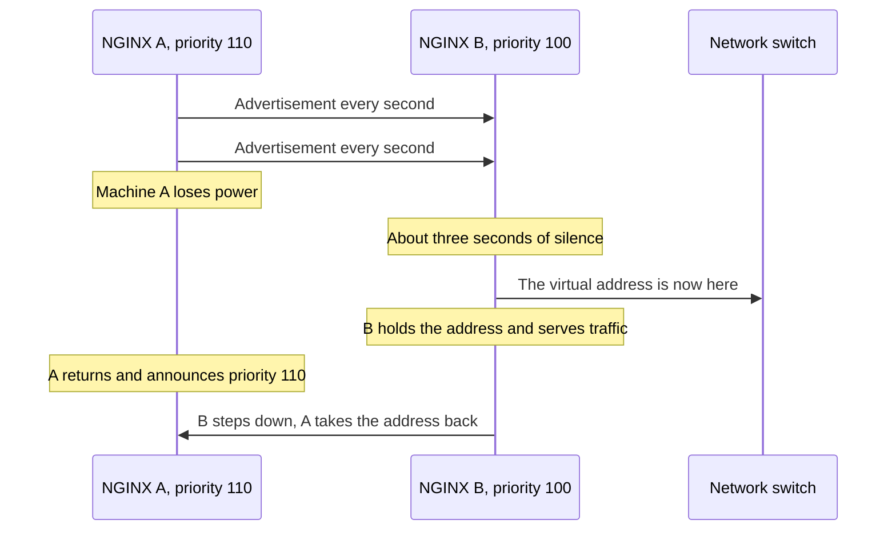
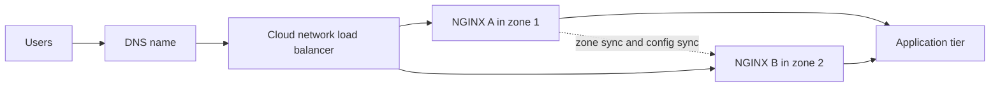

# High-availability deployment modes

## Before this lesson

You should understand health checks and failover between upstream servers ([Health checks, retries, draining and slow start](#/lesson/nginx/lb-health-checks)), shared memory zones and rate limits ([Limiting request rate, connections and bandwidth](#/lesson/nginx/rate-conn-limits)), sticky sessions ([TCP and UDP load balancing and sticky sessions](#/lesson/nginx/lb-tcp-udp-sticky)), how configuration is rolled out by tools ([Configuration management, templating and the API](#/lesson/nginx/automation-api)) and the cloud building blocks from [Cloud deployments](#/lesson/nginx/cloud-deployments).

## In plain words

A harbour has one lighthouse with one keeper. The keeper is excellent. The keeper also sleeps, falls ill and takes holidays, and on those nights the lamp is dark and ships are in danger. However good one keeper is, a single keeper is a **single point of failure**: one thing whose failure stops everything.

The harbour hires a second keeper. There are two ways to use two people.

- **One on duty, one on standby.** The standby keeper watches from the cottage. As long as the lamp flashes, nothing happens. If the flashes stop, the standby keeper climbs the tower and takes over the *same lamp*. Ships notice a few dark seconds at most. This is **active-passive**.
- **Two lighthouses, both lit.** Charts show both, and ships steer by whichever they can see. If one goes dark the other is still there. This is **active-active**.

So far in this track, NGINX has been the thing that protects you from an application server failing. But every request passes through NGINX, which makes NGINX itself the lighthouse with one keeper. This lesson is about running two or more NGINX machines so that losing one does not take the site down, and about the three things that make it harder than it sounds: moving the address, keeping the configuration identical, and sharing memory between machines.

Interviewers ask this as "your load balancer is a single point of failure; what do you do?". The NGINX Plus tooling for it is commercial, and this lesson shows the open-source equivalent each time.

## How much does a second machine buy?

**Availability** is the fraction of time a system works. It is usually quoted in "nines": 99.9% is "three nines".

Two rules cover most calculations:

- Components **in series**, where all must work, multiply: $A = A_1 \times A_2$. Chains are weaker than their parts.
- Components **in parallel**, where any one is enough, fail only when all fail: $A = 1 - (1 - A_1)(1 - A_2)$.

```python-run
MINUTES_PER_YEAR = 365 * 24 * 60

def downtime(availability):
    return (1 - availability) * MINUTES_PER_YEAR

def parallel(*parts):
    all_down = 1.0
    for a in parts:
        all_down *= (1 - a)
    return 1 - all_down

def series(*parts):
    total = 1.0
    for a in parts:
        total *= a
    return total

one = 0.995                                        # one machine: up 99.5% of the time
pair = parallel(one, one)
print(f"one NGINX machine      {one:.5%}   about {downtime(one):7.0f} minutes down per year")
print(f"a pair, either works   {pair:.5%}   about {downtime(pair):7.0f} minutes down per year")

app = parallel(0.99, 0.99, 0.99)                   # three application servers
print(f"one NGINX + app tier   {series(one, app):.5%}   about {downtime(series(one, app)):7.0f} minutes")
print(f"NGINX pair + app tier  {series(pair, app):.5%}   about {downtime(series(pair, app)):7.0f} minutes")
```

One machine at 99.5% is down for almost two days a year. A pair brings that to minutes, as long as the failover itself works and the machines do not fail together. The third line is the lesson's motivation in numbers: three redundant application servers behind a single NGINX are only as available as that NGINX.

The formula assumes failures are independent. Two machines on one power strip, or two machines given the same broken configuration at the same moment, fail together. Much of what follows is about keeping failures independent.

## Mode 1: active-passive with a floating address

### The idea

Clients connect to an IP address. If that address belongs to one machine and the machine dies, clients are stuck. A **virtual IP address** (also called a floating IP) is an extra address that belongs to the *pair* and is held by one machine at a time. When the holder fails, the other machine claims the address. Clients keep using the same address and never learn that anything moved.

The protocol that decides who holds the address is **VRRP**, the Virtual Router Redundancy Protocol. The usual Linux implementation is a small daemon called **keepalived**.

- Each machine has a **priority**. The highest becomes the **master** and holds the address.
- The master announces "I am alive" on the local network once a second. These announcements are called **advertisements**, or informally a **heartbeat**.
- A **backup** that hears nothing for about three intervals declares the master dead, adds the address to its own network interface, and broadcasts a message telling the network's switches where the address now lives.



### keepalived with open-source NGINX

On machine A, in `/etc/keepalived/keepalived.conf`:

```
vrrp_script chk_nginx {
    script "/usr/bin/curl -fs -o /dev/null http://127.0.0.1/healthz"
    interval 2
    fall 2
    rise 2
    weight -30
}

vrrp_instance shop_vip {
    state BACKUP
    interface eth0
    virtual_router_id 51
    priority 110
    advert_int 1
    virtual_ipaddress {
        192.0.2.100/24
    }
    track_script {
        chk_nginx
    }
}
```

This is keepalived's own configuration language, not NGINX's. Block by block:

- `vrrp_script chk_nginx { ... }` defines a health test. Every 2 seconds (`interval`) it asks the local NGINX for `/healthz`; `curl -f` exits with an error on an HTTP failure. After 2 failures in a row (`fall`) the test counts as failed, and after 2 successes (`rise`) as passing again.
- `weight -30` says: while the test is failing, lower this machine's priority by 30.
- `vrrp_instance shop_vip { ... }` describes one floating address.
- `state BACKUP` on both machines lets the priorities decide who leads, instead of hard-coding it.
- `interface eth0` is the network card the address will be added to.
- `virtual_router_id 51` is a number from 1 to 255 that both machines must share and that no other VRRP pair on that network may use.
- `priority 110` on A. Machine B's file is identical except for `priority 100`.
- `advert_int 1` sends an advertisement every second.
- `virtual_ipaddress` is the floating address clients use.
- `track_script` attaches the health test.

Why the health test matters: VRRP by itself notices a dead *machine*. A machine that is running with a crashed or misconfigured NGINX still sends advertisements and would keep the address while serving nothing. With the script, A's priority drops from 110 to 80 when NGINX stops answering, B's 100 is now higher, and B takes over.

Two conditions must hold on the network: both machines are in the same subnet, and the firewall between them allows VRRP (IP protocol number 112). If advertisements are blocked, each machine believes the other is dead and both claim the address. That condition is called **split brain**, and it produces erratic failures for clients.

By default the higher-priority machine takes the address back when it recovers, which is called **preemption** and causes a second brief interruption. Adding `nopreempt` leaves the address where it is until the next failure.

> [!NOTE]
> **NGINX Plus.** The commercial "HA mode" is this same mechanism, packaged: the `nginx-ha-keepalived` package installs keepalived with a health script for NGINX Plus, and an interactive `nginx-ha-setup` script writes the configuration on both machines. Nothing about the protocol differs.

### Simulate it: who holds the address, and how fast it moves

A backup waits three advertisement intervals plus a small **skew** before taking over. The skew is $(256 - \text{priority}) / 256$ seconds, so the best backup acts first.

```python-run
def holder(nodes):
    """nodes: name -> (base priority, machine up, nginx healthy). Highest effective priority wins."""
    alive = {n: base - (0 if healthy else 30) for n, (base, up, healthy) in nodes.items() if up}
    return max(alive, key=alive.get) if alive else None

def takeover_delay(priority, advert_int=1.0):
    return 3 * advert_int + (256 - priority) / 256

states = [
    ("both healthy",            {"A": (110, True, True),  "B": (100, True, True)}),
    ("nginx on A has crashed",  {"A": (110, True, False), "B": (100, True, True)}),
    ("machine A lost power",    {"A": (110, False, True), "B": (100, True, True)}),
    ("A is back",               {"A": (110, True, True),  "B": (100, True, True)}),
    ("both machines down",      {"A": (110, False, True), "B": (100, False, True)}),
]
for label, nodes in states:
    print(f"{label:24} -> address held by {holder(nodes)}")

print()
print(f"power loss on A: B waits {takeover_delay(100):.2f} s of silence before taking over")
print(f"nginx crash on A: health test needs fall x interval = {2 * 2} s, then about 1 s for the next advertisement")
```

Either way the interruption is a few seconds. Connections that were open on the failed machine are lost and clients reconnect; the address they reconnect to is unchanged. Problem `nginx-vrrp-master` has you follow the address through a whole sequence of failures and recoveries.

### The cost

In an active-passive pair the standby machine does nothing most of the time. That is the price of the simplest failover model. It also has a hidden risk: a standby that has not served traffic for a year may not work when called upon. Test failover on purpose, regularly.

## Mode 2: active-active

Here every machine serves traffic all the time. Something has to spread clients across them.

| Way of spreading | How it works | Limits |
|---|---|---|
| **DNS with several address records** | the name resolves to all the machines; health-checked DNS removes dead ones | cached answers keep pointing at a dead machine until the TTL expires |
| **A cloud load balancer in front** | a managed layer 4 balancer forwards to all NGINX machines and checks them | the standard answer in a cloud |
| **Two floating addresses** | A is master for address 1 and backup for 2; B the reverse; DNS lists both addresses | each machine can absorb the other's address on failure |
| **Network routing** | routers send packets for one address to several machines | needs control of the network equipment |

**Why floating addresses do not work in most clouds.** VRRP relies on a machine announcing to the local network that an address has moved. Cloud networks are virtual and ignore such announcements: an address belongs to an instance because the cloud's control system says so. On AWS EC2, for example, the options are to put a Network Load Balancer in front of the NGINX machines, or to have a failover script call the cloud's API to re-attach a reserved public address to the surviving instance. The load balancer is simpler and is what most teams do, which leads back to the "sandwich" of the previous lesson.

**The capacity rule.** In an active-active pair, when one machine fails the other receives everything. If each normally runs at 70% of its capacity, the survivor is asked for 140% and falls over too. With two machines, neither may run above half. In general, with $N$ machines and tolerance for one failure, keep each below $(N-1)/N$ of capacity.



The dotted line is the subject of the next two sections: the machines have to agree with each other.

## Keeping the configuration identical

Two machines with different configurations are worse than one. Failover then changes behaviour: a route that worked now returns 404, or a limit disappears. This is called **configuration drift**, and it is found at the worst possible moment.

> [!NOTE]
> **NGINX Plus.** The `nginx-sync` package provides a script for pushing configuration from one machine to its peers.

It works like this. One machine is named the primary. On it, the file `/etc/nginx-sync.conf` lists the peers and what to copy:

```
NODES="nginx-b.shop.internal nginx-c.shop.internal"
CONFPATHS="/etc/nginx/nginx.conf /etc/nginx/conf.d /etc/nginx/tls"
EXCLUDE="local-overrides.conf"
```

After editing and testing the configuration on the primary, an administrator runs `nginx-sync.sh`. For each peer the script copies the listed paths over SSH, backs up what was there, runs the configuration test on the peer and reloads it only if the test passes. `EXCLUDE` names files that are allowed to differ per machine.

With open-source NGINX the same result comes from the pipeline you already know: the configuration lives in Git, and a tool such as Ansible renders it and applies it to every machine, testing before each reload and updating one machine at a time. That approach is arguably better than a primary-and-peers script because no machine is special and every change is reviewed and recorded.

Whichever tool is used, two habits protect availability:

- **Roll out one machine at a time** and check it before continuing. Pushing a bad configuration to both machines at once turns two independent machines into one shared failure.
- **Compare the machines automatically.** A scheduled job that checksums the output of `nginx -T` on each machine and alerts on a difference catches drift early.

## Sharing state between machines

NGINX keeps some facts only in the memory of the machine that learned them:

- rate-limit counters (`limit_req` zones),
- the table of learned sticky sessions (NGINX Plus `sticky learn`),
- the key-value store (NGINX Plus),
- the response cache on disk.

With two machines, each has its own copy. The effect on rate limiting is easy to demonstrate.

```python-run
def allowed(requests, limit, nodes, spread):
    """Count requests allowed in one second when each node enforces `limit` by itself."""
    seen = [0] * nodes
    passed = 0
    for i in range(requests):
        node = i % nodes if spread == "round-robin" else 0     # "hash": one client always meets one node
        if seen[node] < limit:
            seen[node] += 1
            passed += 1
    return passed

burst = 60
print("limit is 10 requests per second per client; the client sends", burst)
print("one machine                          ->", allowed(burst, 10, 1, "round-robin"))
print("two machines, requests alternate     ->", allowed(burst, 10, 2, "round-robin"))
print("four machines, requests alternate    ->", allowed(burst, 10, 4, "round-robin"))
print("four machines, client hashed to one  ->", allowed(burst, 10, 4, "hash"))
print("four machines sharing one counter    ->", allowed(burst, 10, 1, "round-robin"))
```

A limit of 10 becomes 20 with two machines and 40 with four, because each machine counts only what it sees. The fourth line shows the open-source fix: if the layer in front sends each client consistently to the same NGINX machine, by hashing the client address, then each client's counter lives in one place and the limit holds. The last line is what real sharing gives.

> [!NOTE]
> **NGINX Plus.** Zone synchronisation (`zone_sync`) is commercial.

```nginx
stream {
    resolver 10.0.0.2 valid=20s;

    server {
        listen 10.0.1.11:9000;
        zone_sync;
        zone_sync_server nginx-cluster.shop.internal:9000 resolve;
        allow 10.0.1.0/24;
        deny  all;
    }
}

http {
    limit_req_zone $binary_remote_addr zone=per_ip:10m rate=10r/s sync;
}
```

- The `stream` block opens a dedicated TCP port on which cluster members talk to each other.
- `zone_sync;` turns synchronisation on for this listener.
- `zone_sync_server ... resolve;` names the cluster by a DNS name that lists every member; `resolve` keeps the member list current as machines join and leave.
- `allow` and `deny` restrict the port to the cluster's own network. It should also be encrypted (`zone_sync_ssl on;`) on any network you do not fully control.
- In `http`, adding `sync` to a zone opts it in. The same parameter exists on `sticky learn` zones and `keyval_zone`.

Synchronisation is **eventually consistent**: an update reaches the other members a moment later, not instantly, so a fast burst spread across machines can slightly exceed a limit. For rate limiting that is acceptable. It is also the mechanism behind the cluster-wide "sin bin" from the DDoS lesson.

Open-source alternatives, by kind of state:

| State | Without zone synchronisation |
|---|---|
| Rate limits | hash clients to one NGINX machine at the layer in front, or enforce limits in the application with a shared store such as Redis |
| Session stickiness | use a method that needs no memory: `ip_hash`, `hash` on a cookie, or cookie-based stickiness |
| Cache | each machine warms its own cache; accept the duplication, or put a shared cache tier or CDN in front |

## Upgrading without an outage

High availability is also about planned work. With two or more machines behind a balancer, upgrade one at a time: take it out of rotation, wait for its connections to drain, upgrade, test, and return it. On a single machine, NGINX can replace its own program file while running: sending the master process the `USR2` signal starts a new master with the new binary alongside the old one, `WINCH` then stops the old workers gracefully, and `QUIT` ends the old master. Package upgrade scripts normally do this for you.

> [!INTERVIEW]
> "NGINX is your single point of failure. How do you make it highly available?" Give two patterns and say when each fits. On your own network: an active-passive pair sharing a virtual IP through VRRP with keepalived, with a health script so that a dead NGINX process triggers failover, taking a few seconds. In a cloud, where floating addresses do not work: several NGINX instances across availability zones behind a managed network load balancer, each sized to carry the load when one is lost. Then name the two follow-on problems: identical configuration through automation, and per-machine state such as rate-limit counters, solved by NGINX Plus zone sync or by consistent hashing and external stores. Mention split brain and that failover must be tested.

## Pitfalls

- **Redundant application servers behind one NGINX.** The chain is as available as its weakest single link.
- **No health script in keepalived**, so the machine with a dead NGINX keeps the address.
- **VRRP blocked by a firewall**, producing split brain with both machines claiming the address.
- **Reusing a `virtual_router_id`** already used by another pair on that network.
- **Expecting a floating IP to work in a cloud network.** Use the provider's balancer or API.
- **Running active-active machines above half capacity**, so one failure overloads the survivor.
- **Pushing configuration to all machines at once.**
- **Forgetting that limits multiply** with the number of machines.
- **A standby that is never exercised.** Fail over deliberately on a schedule.
- **Both machines in one rack, zone or power circuit**, which makes their failures anything but independent.
- **No alert for "running on one machine".** A pair that silently lost a member has no redundancy left.

## Cheat sheet

| Need | Open source | NGINX Plus |
|---|---|---|
| Active-passive failover | keepalived with VRRP and a `vrrp_script` | `nginx-ha-keepalived`, `nginx-ha-setup` |
| Active-active entry | DNS records, a cloud load balancer, or two floating addresses | the same |
| Identical configuration | Git plus Ansible, one machine at a time | `nginx-sync.sh` with `/etc/nginx-sync.conf` |
| Shared rate limits | hash clients to a node; or count in the application | `zone_sync;` and `sync` on the zone |
| Shared sticky table | `ip_hash`, `hash`, cookie stickiness | `sticky learn ... sync` |
| Detect drift | compare `nginx -T` checksums | the same |
| Upgrade in place | `USR2`, `WINCH`, `QUIT` signals | the same |

## Summary

- A reverse proxy in front of everything is itself a single point of failure; two machines turn days of yearly downtime into minutes if their failures are independent.
- Active-passive pairs share a virtual IP through VRRP. keepalived moves the address in a few seconds, and a health script ties failover to NGINX working, not only to the machine being on.
- Active-active uses every machine and needs a spreader: DNS, a cloud load balancer or routing. Size for losing one.
- Clouds do not honour floating addresses; use their load balancers.
- Keep configurations identical by automation, and remember that counters, sticky tables and caches are per machine unless synchronised.

## Glossary

- **Active-active**: all machines serve traffic at the same time.
- **Active-passive**: one machine serves while another waits to take over.
- **Availability**: the fraction of time a system is working.
- **Configuration drift**: machines that should be identical slowly becoming different.
- **Eventually consistent**: copies agree after a short delay, not instantly.
- **Failover**: moving work from a failed machine to a healthy one.
- **Heartbeat**: a regular "I am alive" message.
- **keepalived**: a Linux daemon implementing VRRP and health scripts.
- **Preemption**: a recovered higher-priority machine taking the address back.
- **Single point of failure**: a component whose failure stops the whole system.
- **Split brain**: two machines each believing they are the master.
- **Virtual IP**: an address owned by a group and held by one member at a time.
- **VRRP**: the protocol by which machines elect the holder of a virtual IP.
- **Zone synchronisation**: NGINX Plus sharing of memory zones between machines.

## Check yourself

```quiz
[
  {"q": "Three application servers sit behind a single NGINX machine. What limits the availability of the whole system most?",
   "options": ["The slowest application server", "The single NGINX machine", "The number of worker processes", "The DNS TTL"], "answer": 1,
   "explain": "Components in series multiply, so the one non-redundant component caps the result."},
  {"q": "In a keepalived pair, machine A (priority 110) has a health script with weight -30 and machine B has priority 100. NGINX crashes on A but the machine stays up. Who holds the virtual IP?",
   "options": ["A, because the machine is still up", "B, because A's effective priority drops to 80", "Both", "Neither"], "answer": 1,
   "explain": "The failing script lowers A to 80, below B's 100, so B becomes master."},
  {"q": "What is split brain in a VRRP pair?",
   "options": ["One machine with two addresses", "Both machines claiming the virtual IP because they cannot hear each other", "The backup refusing to take over", "DNS returning two records"], "answer": 1,
   "explain": "If advertisements are blocked, each side assumes the other is dead and both become master."},
  {"q": "Why does a keepalived floating IP generally fail on AWS EC2?",
   "options": ["keepalived cannot be installed", "The virtual network ignores a machine announcing that an address moved", "EC2 has no private addresses", "VRRP needs IPv6"], "answer": 1,
   "explain": "Address ownership is decided by the cloud's control system. Use a load balancer or re-attach an address through the API."},
  {"q": "Two active-active NGINX machines each run at 75% of capacity. One fails. What happens?",
   "options": ["The survivor runs at 75%", "The survivor is asked for 150% and is overloaded", "Traffic halves", "DNS doubles the capacity"], "answer": 1,
   "explain": "All traffic lands on the survivor. With two machines neither should exceed 50%."},
  {"q": "A `limit_req` zone allows 10 r/s per address. Three open-source NGINX machines sit behind a round-robin balancer. How many requests per second can one address get through?",
   "options": ["10", "About 30", "About 3", "Unlimited"], "answer": 1,
   "explain": "Each machine keeps its own counters, so the effective limit is multiplied by the number of machines."},
  {"q": "Which of these is an NGINX Plus feature?",
   "options": ["keepalived", "ip_hash", "zone_sync", "nginx -T"], "answer": 2,
   "explain": "Zone synchronisation between cluster members is commercial. The others are open source or separate free software."}
]
```

> **Source:** DeJonghe, NGINX Cookbook, ch. 12 (NGINX Plus HA mode, load-balancing load balancers with DNS, load balancing on EC2, configuration synchronization, state sharing with zone sync). Docs: https://docs.nginx.com/nginx/admin-guide/high-availability/, https://nginx.org/en/docs/stream/ngx_stream_zone_sync_module.html, https://nginx.org/en/docs/control.html, https://www.keepalived.org/manpage.html, RFC 5798 (VRRP version 3)
