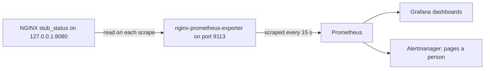

# Activity monitoring: stub status, dashboards and OpenTelemetry

## Before this lesson

You should know the master and worker processes and `worker_connections` ([Web servers, reverse proxies and load balancers from zero](#/lesson/nginx/what-nginx-is), [Installing NGINX and reading nginx.conf](#/lesson/nginx/install-and-config)), upstream groups with a `zone` ([HTTP load balancing and the balancing methods](#/lesson/nginx/lb-http-upstreams)), the NGINX Plus API ([Configuration management, templating and the API](#/lesson/nginx/automation-api)) and `split_clients` ([A/B testing, map, geo and finding the real client](#/lesson/nginx/split-geo-map)).

## In plain words

A car tells its driver how it is doing in three different ways.

- The **dashboard** shows a few numbers at a glance: speed, fuel, engine temperature. They are cheap to read and they tell you *that* something is wrong: the needle is in the red.
- The **service logbook** records every event with a date: each refuelling, each repair. It tells you *what happened* on one particular occasion.
- A **parcel tracking page** follows one item across many depots: collected here, sorted there, delivered at last, with the time spent at each stop. It tells you *where the time went* on a journey through several hands.

Software has the same three, and together they are called **observability**:

- **Metrics** are numbers sampled over time, like the dashboard.
- **Logs** are records of individual events, like the logbook. They are the next lesson.
- **Traces** follow one request through every service it touches, like parcel tracking.

NGINX sees every request entering a system, which makes it the best single place to measure from. This lesson covers the free status page, how to feed it to a monitoring system, what the commercial dashboard adds, and how NGINX takes part in tracing. Running a service without these is driving at night with the dashboard taped over, and "what would you monitor and alert on?" is asked in most operations interviews.

## Step 1: the stub status page

Open-source NGINX can publish seven numbers about itself through the `ngx_http_stub_status_module`. It is compiled into the official packages; confirm with `nginx -V 2>&1 | grep -o with-http_stub_status_module`.

```nginx
server {
    listen 127.0.0.1:8080;

    location = /stub_status {
        stub_status;
        access_log off;
        allow 127.0.0.1;
        deny all;
    }
}
```

- A separate `server` listening on `127.0.0.1` port 8080 is reachable only from the machine itself. Status pages reveal traffic levels and must never be public.
- `stub_status;` makes this location answer with the status text.
- `access_log off;` stops the monitoring system's own polling from filling the access log.
- `allow 127.0.0.1; deny all;` is a second lock in case the `listen` line is changed later.

```bash
$ curl -s http://127.0.0.1:8080/stub_status
Active connections: 187
server accepts handled requests
 4821033 4821033 19403377
Reading: 3 Writing: 22 Waiting: 162
```

What each number means:

| Number | Kind | Meaning |
|---|---|---|
| Active connections: 187 | gauge | client connections open right now, equal to Reading + Writing + Waiting |
| accepts: 4821033 | counter | client connections accepted since NGINX started |
| handled: 4821033 | counter | accepted connections that were then processed |
| requests: 19403377 | counter | client requests received since start |
| Reading: 3 | gauge | connections whose request header is being read |
| Writing: 22 | gauge | connections on which NGINX is sending a response, which includes waiting for an upstream |
| Waiting: 162 | gauge | idle keep-alive connections, open but with no request in progress |

Two words in the "Kind" column matter for the rest of the lesson. A **gauge** is a value that goes up and down, such as a temperature. A **counter** only ever increases (until a restart sets it back to zero), such as a car's mileage. A counter's raw value is meaningless; what you want is how fast it grows.

Four useful facts are hidden in those seven numbers:

1. **Requests per second** is the growth of `requests` between two readings divided by the seconds between them.
2. **Dropped connections** is `accepts - handled`. It should be zero. When it grows, NGINX accepted connections it could not serve, nearly always because `worker_connections` was exhausted.
3. **Requests per connection** is `requests / handled`. About 4 here: keep-alive is working. A value close to 1 means every request pays for a new connection.
4. **Saturation** is active connections compared with the ceiling of `worker_processes` multiplied by `worker_connections`.

A large `Waiting` number is harmless. Those are idle browsers holding a connection open, each costing a little memory.

### Simulate it: from two readings to rates

```python-run
import re

def parse(text):
    nums = [int(n) for n in re.findall(r"\d+", text)]
    keys = ["active", "accepts", "handled", "requests", "reading", "writing", "waiting"]
    return dict(zip(keys, nums))

def compare(before, after, seconds, max_connections):
    a, b = parse(before), parse(after)
    return {
        "requests per second": (b["requests"] - a["requests"]) / seconds,
        "new connections per second": (b["accepts"] - a["accepts"]) / seconds,
        "dropped in this interval": (b["accepts"] - b["handled"]) - (a["accepts"] - a["handled"]),
        "requests per connection": round((b["requests"] - a["requests"]) / max(1, b["handled"] - a["handled"]), 1),
        "connection slots in use": f'{b["active"] / max_connections:.0%}',
    }

first = """Active connections: 187
server accepts handled requests
 4821033 4821033 19403377
Reading: 3 Writing: 22 Waiting: 162"""
second = """Active connections: 3950
server accepts handled requests
 4829433 4829013 19433377
Reading: 40 Writing: 3610 Waiting: 300"""

for name, value in compare(first, second, seconds=60, max_connections=4096).items():
    print(f"{name:28} {value}")
```

Read the result as an operator would. Traffic is 500 requests per second. In this one minute 420 connections were accepted and not handled, slots are 96% in use, and `Writing` has jumped from 22 to 3,610. Thousands of connections are stuck in the writing state, which usually means NGINX is waiting on a slow upstream. The status page cannot say which upstream or why; it has told you where to look next.

The same seven values are available as variables (`$connections_active`, `$connections_reading`, `$connections_writing`, `$connections_waiting`), so they can be added to a log format.

## Step 2: deciding what to watch

A widely used checklist is the **four golden signals**:

| Signal | Question | Where NGINX provides it |
|---|---|---|
| **Traffic** | how much demand is there? | `requests` counter from stub status |
| **Errors** | what share of requests fail? | status codes in the access log, or the NGINX Plus API |
| **Latency** | how long do requests take? | `$request_time` and `$upstream_response_time` in the access log |
| **Saturation** | how full is the system? | active connections against the limit; dropped connections |

The honest summary: stub status gives traffic and saturation and nothing about errors or latency. Those come from the access log in open-source NGINX. A complete open-source setup therefore has two feeds, the status page for connection numbers and a log pipeline for status codes and timings.

Alerts worth having on day one:

| Alert | Why |
|---|---|
| the status page cannot be fetched | NGINX is down or hung |
| dropped connections above zero | connection slots are exhausted |
| active connections above 80% of the limit for five minutes | approaching exhaustion |
| share of 5xx responses above 1% for five minutes | users are seeing failures |
| 95th percentile request time above your target | users are waiting |
| requests per second far below normal for the hour | traffic is not arriving at all, perhaps DNS or the balancer in front |

The last one is easy to forget. A dead quiet graph is an outage too.

## Step 3: feeding Prometheus

**Prometheus** is the most common open-source metrics system. It works by **scraping**: every few seconds it fetches a plain-text page of metrics from each target and stores the values with a timestamp. NGINX's status page is not in that format, so a small translator called an **exporter** sits in between.



```bash
$ nginx-prometheus-exporter --nginx.scrape-uri=http://127.0.0.1:8080/stub_status &
$ curl -s http://127.0.0.1:9113/metrics | grep -v '^#' | head -n 5
nginx_connections_accepted 4.821033e+06
nginx_connections_active 187
nginx_connections_handled 4.821033e+06
nginx_connections_reading 3
nginx_connections_waiting 162
```

The exporter is started with the address of the status page and publishes the translation on port 9113. There is also `nginx_http_requests_total`, the request counter, and `nginx_up`, which is 1 when the exporter could read the status page and 0 when it could not.

Prometheus has a query language. The two queries you will write most often:

```
rate(nginx_http_requests_total[1m])
nginx_connections_accepted - nginx_connections_handled
```

`rate(counter[1m])` is the per-second growth of a counter over the last minute, and it copes with restarts. The second line is the dropped-connection count from Step 1.

```python-run
def rate(samples):
    """samples: list of (time_s, counter_value). Per-second increase, tolerating a reset to zero."""
    increase = 0
    for (_, prev), (_, cur) in zip(samples, samples[1:]):
        increase += cur - prev if cur >= prev else cur      # counter restarted: count from zero
    return increase / (samples[-1][0] - samples[0][0])

steady = [(0, 1000), (15, 8500), (30, 16000), (45, 23500), (60, 31000)]
reload = [(0, 1000), (15, 8500), (30, 2500), (45, 10000), (60, 17500)]
print("steady traffic :", rate(steady), "requests per second")
print("with a restart :", rate(reload), "requests per second")
naive = (reload[-1][1] - reload[0][1]) / 60
print("naive last minus first across the restart:", naive, "(wrong)")
```

At 30 seconds NGINX was restarted and the counter began again from zero. Subtracting the first value from the last gives a nonsense figure; handling the reset gives a sensible one. This is why monitoring systems insist on knowing whether a metric is a counter or a gauge.

## Step 4: what NGINX Plus adds

> [!NOTE]
> **NGINX Plus.** The live dashboard and the metrics API in this step are commercial.

```nginx
upstream shop_app {
    zone shop_app 64k;
    server 10.0.0.11:8000;
    server 10.0.0.12:8000;
}

server {
    listen 443 ssl;
    server_name shop.test;
    status_zone shop_site;

    location / {
        proxy_pass http://shop_app;
    }
}

server {
    listen 127.0.0.1:8080;

    location /api/ {
        api;
        allow 127.0.0.1;
        deny all;
    }
    location = /dashboard.html {
        root /usr/share/nginx/html;
    }
}
```

- `status_zone shop_site;` asks NGINX Plus to keep statistics for this virtual server under that name.
- The `zone` in the `upstream` block does the same for each server in the group.
- `api;` exposes a read-only REST interface. (`api write=on;` would allow changes as well and needs stronger protection.)
- `/dashboard.html` is a ready-made page shipped with NGINX Plus that draws the API's numbers live in a browser.

Compared with seven global numbers, the API reports **per server, per upstream member, per cache and per zone**:

```bash
$ curl -s http://127.0.0.1:8080/api/9/http/upstreams/shop_app | jq '.peers[] | {server, state, active, fails, responses}'
{
  "server": "10.0.0.11:8000",
  "state": "up",
  "active": 14,
  "fails": 0,
  "responses": { "1xx": 0, "2xx": 88214, "3xx": 902, "4xx": 411, "5xx": 3, "total": 89530 }
}
{
  "server": "10.0.0.12:8000",
  "state": "unavail",
  "active": 0,
  "fails": 27,
  "responses": { "1xx": 0, "2xx": 61190, "3xx": 640, "4xx": 300, "5xx": 955, "total": 63085 }
}
```

The `9` in the path is the API version. `jq` is a command-line tool that picks fields out of JSON. This one answer shows what stub status never could: the second server is marked unavailable after 27 failed attempts and produced almost all the 5xx responses. Errors by status class, the state of every upstream member, health-check results, response times, cache hit ratios and TLS handshake counts are all present, so a Plus installation can cover all four golden signals without parsing logs. The Prometheus exporter can read this API in place of the status page.

| | stub status | NGINX Plus API |
|---|---|---|
| Connection counts | yes, global | yes |
| Request counts | global total | per server zone and location zone |
| Status code classes | no | yes |
| Upstream member state and failures | no | yes |
| Response times | no | yes |
| Cache statistics | no | yes |

## Step 5: tracing with OpenTelemetry

### The idea

One click on "Place order" may pass through NGINX, an orders service, a payments service and a database. When it takes four seconds, metrics say that it was slow and logs on each machine show fragments. A **trace** stitches the fragments together.

- A **trace** is the whole journey of one request. It has a **trace ID**, 32 hexadecimal characters.
- A **span** is one step of the journey with a start time and a duration: "NGINX proxied to orders, 3.9 s". Each span has a **span ID** and the ID of its **parent**.
- **Context propagation** is how the IDs travel: each hop adds a request header called `traceparent` to its outgoing calls, with the layout `version-traceid-parentid-flags`.

**OpenTelemetry** is the open standard for all of this. It replaced the older OpenTracing project that the cookbook describes, whose NGINX module is no longer developed.

```python-run
import random

random.seed(7)
new_id = lambda nbytes: "".join(random.choice("0123456789abcdef") for _ in range(nbytes * 2))
spans = []

def handle(service, incoming, work_ms, calls=()):
    """Create a span for this hop, reusing the caller's trace ID, then call downstream services."""
    if incoming:
        _, trace_id, parent_id, _ = incoming.split("-")
    else:
        trace_id, parent_id = new_id(16), None            # first hop starts the trace
    span_id = new_id(8)
    outgoing = f"00-{trace_id}-{span_id}-01"              # the header sent to the next hop
    total = work_ms + sum(handle(*call[:1], outgoing, *call[1:]) for call in calls)
    spans.append((trace_id, span_id, parent_id, service, total))
    return total

handle("nginx", None, 2, calls=[("orders", 40, [("payments", 3800), ("database", 25)])])

trace = spans[0][0]
print("trace", trace)
def show(parent, depth):
    for _, span_id, p, service, ms in spans:
        if p == parent:
            print("  " * depth + f"{service:9} {ms:5} ms   span {span_id}")
            show(span_id, depth + 1)
show(None, 0)
```

Every span carries the same trace ID, and each child's parent is the span that called it. Drawn as a tree, the slow step is plain to see: nearly all of the 3.9 seconds was spent in `payments`.

### NGINX's part

The module is `ngx_otel_module`, open source, installed from the `nginx-module-otel` package and loaded dynamically.

```nginx
load_module modules/ngx_otel_module.so;

http {
    otel_exporter {
        endpoint otel-collector.shop.internal:4317;
    }
    otel_service_name shop-edge;

    split_clients "$otel_trace_id" $trace_sampled {
        10%  on;
        *    off;
    }

    server {
        listen 443 ssl;
        server_name shop.test;

        location /api/ {
            otel_trace         $trace_sampled;
            otel_trace_context propagate;
            otel_span_attr     app.request_id $request_id;
            proxy_pass http://shop_app;
        }
    }
}
```

- `otel_exporter { endpoint ...; }` says where finished spans are sent: an **OpenTelemetry Collector**, a relay service that forwards them to whichever tracing product you use. Port 4317 is the standard one for this protocol.
- `otel_service_name shop-edge;` is the name this NGINX appears under in traces. The default is `unknown_service:nginx`.
- `split_clients "$otel_trace_id" $trace_sampled { ... }` implements **sampling**: recording only a share of requests, here 10%, because tracing every request on a busy site is expensive.
- `otel_trace $trace_sampled;` switches tracing on or off per request (default `off`).
- `otel_trace_context propagate;` reads an incoming `traceparent` header if there is one and writes an updated one on the proxied request. The other values are `extract` (read only), `inject` (write only, starting a fresh trace) and the default `ignore`.
- `otel_span_attr app.request_id $request_id;` attaches an extra labelled value to the span, here NGINX's own request ID, so that a trace can be matched to its log line.

When a caller has already decided whether to sample, respect its decision with `otel_trace $otel_parent_sampled;`. The trace ID is available as `$otel_trace_id` and belongs in the access log, which links all three kinds of observation.

> [!INTERVIEW]
> "What would you monitor on an NGINX reverse proxy?" Organise the answer by the four golden signals. Traffic: requests per second from stub status. Errors: the share of 5xx and 4xx from the access log or the Plus API, split by upstream if possible. Latency: percentiles of `$request_time` and `$upstream_response_time`, compared, to tell a slow backend from a slow client. Saturation: active connections against `worker_processes` times `worker_connections`, and accepts minus handled, which must stay at zero. Add alerts for the status page being unreachable and for traffic dropping to nothing, and mention tracing with a propagated `traceparent` for multi-service latency.

## Pitfalls

- **A public status page.** Bind it to localhost or a private address and add `allow` and `deny`.
- **Graphing raw counters.** Graph their rate.
- **Reading `Writing` as "sending to clients".** It includes time spent waiting for the upstream.
- **Alarm at a high `Waiting` number.** Idle keep-alive connections are normal.
- **Expecting error rates from stub status.** It has no status codes.
- **Ignoring `accepts` minus `handled`.** It is the clearest sign of connection exhaustion.
- **Counters that reset on restart** read with a plain subtraction. A reload keeps them; a restart or upgrade does not.
- **Tracing 100% of traffic** on a busy site, or sampling independently at every hop so that traces arrive with missing spans. Decide at the edge and propagate.
- **`otel_trace_context` left at `ignore`**, so that NGINX appears in no trace and breaks the chain between caller and backend.
- **Using the OpenTracing module from old tutorials.** It is retired.

## Cheat sheet

| Goal | How | Edition |
|---|---|---|
| Basic status page | `location = /stub_status { stub_status; allow 127.0.0.1; deny all; }` | open source |
| Requests per second | change in `requests` divided by seconds | open source |
| Dropped connections | `accepts - handled` | open source |
| Prometheus metrics | `nginx-prometheus-exporter --nginx.scrape-uri=...` | open source |
| Request rate query | `rate(nginx_http_requests_total[1m])` | open source |
| Per-server statistics | `status_zone name;` | NGINX Plus |
| Metrics API | `location /api/ { api; }` then `/api/9/...` | NGINX Plus |
| Live dashboard | `/dashboard.html` | NGINX Plus |
| Send traces | `otel_exporter { endpoint host:4317; }` and `otel_trace on;` | open source module |
| Join an existing trace | `otel_trace_context propagate;` | open source module |
| Sample 10% | `split_clients "$otel_trace_id" $v { 10% on; * off; }` | open source module |

## Summary

- Metrics, logs and traces answer different questions: that something is wrong, what happened, and where the time went.
- `stub_status` gives seven numbers. From them come request rate, dropped connections, requests per connection and saturation, but no errors or latency.
- An exporter turns the status page into Prometheus metrics; treat counters as rates.
- NGINX Plus adds per-zone, per-upstream and per-status-code statistics through an API and a dashboard.
- The OpenTelemetry module makes NGINX a span in distributed traces and passes the `traceparent` header on.

## Glossary

- **Collector**: a relay that receives telemetry and forwards it to storage.
- **Context propagation**: passing trace identifiers from one service to the next.
- **Counter**: a metric that only increases.
- **Exporter**: a program that translates a system's statistics into a monitoring system's format.
- **Four golden signals**: traffic, errors, latency and saturation.
- **Gauge**: a metric that rises and falls.
- **Observability**: the ability to understand a system from its outputs.
- **OpenTelemetry**: the open standard for metrics, logs and traces.
- **Sampling**: recording only a fraction of requests.
- **Saturation**: how close a resource is to its limit.
- **Scrape**: one fetch of a metrics page by Prometheus.
- **Span**: one timed step within a trace.
- **Trace**: the full path of one request across services.
- **traceparent**: the request header carrying trace and span identifiers.

## Check yourself

```quiz
[
  {"q": "stub_status shows `accepts 90210, handled 90100`. What does the difference of 110 mean?",
   "options": ["110 requests returned errors", "110 connections were accepted but dropped, usually for lack of connection slots", "110 connections are idle", "110 requests are in progress"], "answer": 1,
   "explain": "handled falls behind accepts when a resource limit such as worker_connections is reached."},
  {"q": "Two readings 30 seconds apart show requests = 1,200,000 and then 1,215,000. What is the request rate?",
   "options": ["15,000 per second", "500 per second", "40,500 per second", "30 per second"], "answer": 1,
   "explain": "The counter grew by 15,000 in 30 seconds: 500 per second."},
  {"q": "Which golden signal can stub_status NOT provide?",
   "options": ["Traffic", "Saturation", "Errors", "Connection counts"], "answer": 2,
   "explain": "The page has no status codes. Error rates come from the access log or the NGINX Plus API."},
  {"q": "`Waiting: 4000` on a server with plenty of free slots most likely means:",
   "options": ["4,000 requests are queued for the upstream", "4,000 idle keep-alive connections, which is normal", "4,000 errors", "A DDoS attack"], "answer": 1,
   "explain": "Waiting counts idle keep-alive client connections with no request in progress."},
  {"q": "Why is a Prometheus counter queried with rate() instead of being graphed directly?",
   "options": ["Counters are strings", "Its absolute value depends on uptime; the growth per second is what is meaningful, and rate() handles resets", "rate() makes graphs smoother only", "Gauges cannot be graphed"], "answer": 1,
   "explain": "A counter climbs since start and returns to zero on restart; the rate is the useful quantity."},
  {"q": "What does `otel_trace_context propagate;` do?",
   "options": ["Ignores trace headers", "Reads an incoming traceparent and writes an updated one on the proxied request", "Starts a new trace for every request", "Sends logs to syslog"], "answer": 1,
   "explain": "propagate combines extract and inject, so NGINX joins the caller's trace and the backend continues it."},
  {"q": "Which feature requires NGINX Plus?",
   "options": ["stub_status", "The otel module", "status_zone with the live dashboard", "The Prometheus exporter reading stub_status"], "answer": 2,
   "explain": "Per-zone statistics, the API and the dashboard are commercial; the others work with open-source NGINX."}
]
```

> **Source:** DeJonghe, NGINX Cookbook, ch. 13 (stub status, the NGINX Plus monitoring dashboard, collecting metrics with the API), ch. 11 (Prometheus exporter) and ch. 14 (request tracing, OpenTracing). Docs: https://nginx.org/en/docs/http/ngx_http_stub_status_module.html, https://nginx.org/en/docs/http/ngx_http_api_module.html, https://nginx.org/en/docs/ngx_otel_module.html, https://github.com/nginx/nginx-prometheus-exporter, https://www.w3.org/TR/trace-context/, https://sre.google/sre-book/monitoring-distributed-systems/
