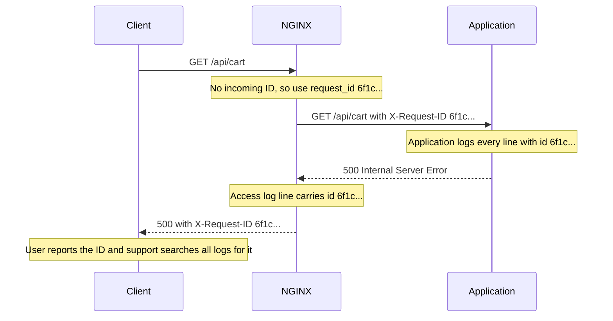

# Access logs, error logs and request tracing

## Before this lesson

You should have seen `log_format` and `access_log` in the stock configuration ([Installing NGINX and reading nginx.conf](#/lesson/nginx/install-and-config)), know how `map` builds a variable ([A/B testing, map, geo and finding the real client](#/lesson/nginx/split-geo-map)) and how a request is proxied to an upstream ([HTTP load balancing and the balancing methods](#/lesson/nginx/lb-http-upstreams)). The previous lesson, [Activity monitoring](#/lesson/nginx/activity-monitoring), covered metrics and traces; this one covers the third kind of evidence.

## In plain words

A busy café keeps two records.

The **till roll** prints one line for every sale: time, table, what was ordered, the price. Nobody reads it line by line on a normal day. At closing time it answers questions such as "how many coffees did we sell?" and "what did table 12 have at 3 pm?".

The **incident book** is written in only when something goes wrong: "14:05, fridge alarm", "14:20, card machine offline". It is short, and it is the first thing the manager opens when a customer complains.

Then there is the **order ticket**. Each order gets a number, and that number is written on the slip in the kitchen, on the tray and on the receipt. When a meal goes missing, the number lets you follow it from till to kitchen to table.

NGINX keeps the same three. The **access log** has one line per request. The **error log** records problems and warnings. A **request ID** is the ticket number that ties a line in NGINX's log to the matching line in the application's log.

Reading these files is how real faults are found. A person who can open an error log, read one line and say "the application refused the connection, so it is down or listening on another port" is valuable on any team, and interviewers test exactly that.

## The access log

### The default format

If you configure nothing, every request is written to the access log in a predefined format called `combined`:

```nginx
log_format combined '$remote_addr - $remote_user [$time_local] '
                    '"$request" $status $body_bytes_sent '
                    '"$http_referer" "$http_user_agent"';
```

`log_format NAME 'pattern';` defines a named recipe. Text is copied as written and every `$variable` is replaced by its value for that request. A real line:

```
203.0.113.9 - rosa [21/Nov/2026:14:02:11 +0800] "GET /products/42?ref=mail HTTP/2.0" 200 5123 "https://shop.test/" "Mozilla/5.0 (X11; Linux x86_64)"
```

| Piece | Variable | Meaning |
|---|---|---|
| `203.0.113.9` | `$remote_addr` | the client's address |
| `-` | (literal) | a historical placeholder, always a hyphen |
| `rosa` | `$remote_user` | the user name from HTTP basic authentication, or `-` |
| `[21/Nov/2026:14:02:11 +0800]` | `$time_local` | when the request finished, with the time zone offset |
| `"GET /products/42?ref=mail HTTP/2.0"` | `$request` | the request line: method, URI and protocol |
| `200` | `$status` | the response status code |
| `5123` | `$body_bytes_sent` | bytes of response body sent, headers excluded |
| `"https://shop.test/"` | `$http_referer` | the page that linked here, or `-` |
| `"Mozilla/5.0 ..."` | `$http_user_agent` | the client software's self-description |

A variable with no value is written as a hyphen.

### Simulate it: parsing a line

Log analysis starts by turning a line back into fields. A regular expression with one named group per field does it. Problem `nginx-log-parse` asks you to write this yourself.

```python-run
import re

COMBINED = re.compile(
    r'(?P<addr>\S+) - (?P<user>\S+) \[(?P<time>[^\]]+)\] '
    r'"(?P<method>\S+) (?P<uri>\S+) (?P<protocol>[^"]+)" '
    r'(?P<status>\d{3}) (?P<bytes>\d+) "(?P<referer>[^"]*)" "(?P<agent>[^"]*)"'
)

line = ('203.0.113.9 - rosa [21/Nov/2026:14:02:11 +0800] "GET /products/42?ref=mail HTTP/2.0" '
        '200 5123 "https://shop.test/" "Mozilla/5.0 (X11; Linux x86_64)"')

fields = COMBINED.match(line).groupdict()
fields["status"], fields["bytes"] = int(fields["status"]), int(fields["bytes"])
path, _, query = fields["uri"].partition("?")
for key, value in fields.items():
    print(f"{key:9} {value!r}")
print(f"{'path':9} {path!r}\n{'query':9} {query!r}")

broken = '198.51.100.4 - - [21/Nov/2026:14:02:12 +0800] "\\x16\\x03\\x01" 400 157 "-" "-"'
print("\nscanner noise matches the pattern?", bool(COMBINED.match(broken)))
```

The last line shows why parsers must tolerate failure. Scanners send bytes that are not HTTP at all; NGINX answers 400 and logs the garbage as the request, and the pattern expecting "method, space, URI, space, protocol" does not match it. A robust parser counts such lines and moves on.

### A format that is useful for operations

The combined format says nothing about how long a request took or which backend served it. Those are the first things you will want.

```nginx
log_format timed '$remote_addr [$time_iso8601] "$request" $status $body_bytes_sent '
                 'rt=$request_time uct=$upstream_connect_time uht=$upstream_header_time '
                 'urt=$upstream_response_time ua=$upstream_addr us=$upstream_status '
                 'cache=$upstream_cache_status id=$request_id';

access_log /var/log/nginx/access.log timed;
```

`access_log PATH FORMAT;` chooses the file and the recipe. The new variables:

| Variable | Meaning |
|---|---|
| `$time_iso8601` | the time as `2026-11-21T14:02:11+08:00`, which sorts and parses easily |
| `$request_time` | seconds, with millisecond resolution, from the first byte read from the client to the last byte sent to it |
| `$upstream_connect_time` | time to open the connection to the upstream, including a TLS handshake |
| `$upstream_header_time` | time until the upstream's response header had arrived |
| `$upstream_response_time` | time until the upstream's whole response had arrived |
| `$upstream_addr` | the address of the upstream server that was used |
| `$upstream_status` | the status code the upstream returned |
| `$upstream_cache_status` | `HIT`, `MISS`, `EXPIRED` and so on, from the caching lessons |
| `$request_id` | 32 random hexadecimal characters unique to this request |

```
203.0.113.9 [2026-11-21T14:02:11+08:00] "GET /api/cart HTTP/2.0" 200 812 rt=1.482 uct=0.001 uht=1.470 urt=1.471 ua=10.0.0.11:8000 us=200 cache=MISS id=6f1c0d5e9a7b4c21838e5d0a2b9c4f17
```

Reading the timings is a skill in itself:

- `rt` is close to `urt`: the time was spent waiting for the application. Here 1.471 of 1.482 seconds.
- `rt` much larger than `urt`: the application was quick and the time went on the client side, typically a slow connection receiving a large response, or a slow upload.
- `uct` large: opening the connection was slow. Suspect the network, the upstream's accept queue, or missing upstream keep-alive.
- `uht` close to `urt`: the application thought for a long time and then sent a small answer. A large gap between them means a big response body streaming over time.

When NGINX retried on a second server, the upstream variables hold several values separated by commas, one per attempt, for example `ua=10.0.0.11:8000, 10.0.0.12:8000 us=502, 200`. Seeing that in a log tells you retries are rescuing a failing server.

### JSON logs

Log collection systems prefer structured lines to free text.

```nginx
log_format json_line escape=json
    '{"time":"$time_iso8601","addr":"$remote_addr","method":"$request_method",'
    '"uri":"$request_uri","status":$status,"bytes":$body_bytes_sent,'
    '"rt":$request_time,"urt":"$upstream_response_time","upstream":"$upstream_addr",'
    '"agent":"$http_user_agent","id":"$request_id"}';
```

`escape=json` is the important part. Values such as the user agent are chosen by the client and may contain quotation marks or control characters. With this parameter NGINX escapes them so that each line stays valid JSON; without it, one hostile header can corrupt your log or inject a fake entry. `$upstream_response_time` is kept in quotes because it can be `-` or a comma-separated list, neither of which is a JSON number.

### Choosing what to log, and where

```nginx
map $status $loggable {
    ~^[23]   0;
    default  1;
}

server {
    access_log /var/log/nginx/shop.access.log timed buffer=64k flush=5s;
    access_log /var/log/nginx/shop.errors.log timed if=$loggable;

    location = /healthz {
        access_log off;
        return 200 "ok\n";
    }
}
```

- Several `access_log` lines at one level all apply, so one request can be written to more than one place.
- `buffer=64k flush=5s` collects lines in memory and writes them when 64 kilobytes have gathered or 5 seconds have passed. On a busy server this replaces thousands of small disk writes per second with a few large ones. The cost: the last few seconds of lines are lost if the machine crashes, and `tail -f` lags slightly.
- `if=$loggable` writes the line only when the variable is neither empty nor `0`. The `map` gives 0 to statuses starting with 2 or 3, so the second file receives only 4xx and 5xx responses.
- `access_log off;` in the health-check location keeps the load balancer's constant polling out of the log.

As with `add_header`, an `access_log` written inside a `location` replaces the ones inherited from outside.

## The error log

```nginx
error_log /var/log/nginx/error.log warn;
```

`error_log PATH LEVEL;` sets where diagnostic messages go and the least severe level to record. The levels, from least to most severe:

| Level | Typical content |
|---|---|
| `debug` | a step-by-step account of request processing; needs a special build |
| `info` | routine events, such as a client closing a connection early |
| `notice` | noteworthy but normal: start, reload, signals received |
| `warn` | something odd that did not stop the request: a response buffered to a temporary file, a rate-limit delay |
| `error` | a request failed: an upstream refused, a file was missing, a limit rejected |
| `crit`, `alert`, `emerg` | increasingly serious problems with NGINX itself, up to failing to start |

Choosing a level records that level and everything more severe. The default is `error`. The directive is allowed at the top level and inside `http`, `server` and `location`, so one troublesome site can have its own file and level.

Every line has the same anatomy:

```
2026/11/21 14:02:11 [error] 2177#2177: *48213 connect() failed (111: Connection refused) while connecting to upstream, client: 203.0.113.9, server: shop.test, request: "GET /api/cart HTTP/1.1", upstream: "http://127.0.0.1:8000/api/cart", host: "shop.test"
```

| Piece | Meaning |
|---|---|
| `2026/11/21 14:02:11` | local time |
| `[error]` | the level |
| `2177#2177` | process ID and thread ID of the worker |
| `*48213` | the connection number; all lines about one connection share it |
| `connect() failed (111: Connection refused)` | what went wrong, with the operating system's error number and text |
| `while connecting to upstream` | what NGINX was doing at the time |
| `client`, `server`, `request`, `upstream`, `host` | the context: who asked, which server block, for what, and which backend was tried |

The two middle pieces carry the diagnosis. "Connection refused while connecting to upstream" means nothing is listening at `127.0.0.1:8000`: the application is stopped or bound elsewhere. The next lesson catalogues these messages.

### Turning up the detail

- **`debug` level** prints dozens of lines per request: which location matched, each header, each rewrite step. It works only in a build made with `--with-debug` (check `nginx -V`; packages provide a separate `nginx-debug` binary). It is far too heavy to leave on for a whole busy server.
- **`debug_connection 203.0.113.9;`** inside the `events` block gives debug logging for connections from one address or network only. This is the safe way to investigate in production: debug your own address and nobody else's.
- **`rewrite_log on;`** records each step of `rewrite`, `return` and `if` processing at `notice` level, so the error log must be set to `notice` or lower to see it.

## Sending logs elsewhere

On one server, files are fine. With ten servers you want every log in one searchable place. **Syslog** is the long-established network protocol for shipping log lines, and NGINX can write to it directly.

```nginx
error_log  syslog:server=10.0.0.50:514,facility=local7,tag=nginx_shop,severity=warn warn;
access_log syslog:server=10.0.0.50:514,facility=local7,tag=nginx_shop,severity=info json_line;
access_log /var/log/nginx/access.log timed;
```

- `syslog:server=10.0.0.50:514` is the collector's address. Port 514 over UDP is the convention; a `unix:` socket path sends to a local syslog daemon instead.
- `facility=local7` is a category label that the collector uses for filing; `local0` to `local7` are free for applications.
- `tag=nginx_shop` is prefixed to each message so that lines from different programs can be told apart.
- `severity=info` is the syslog severity stamped on access-log messages. Error-log messages carry their own NGINX level.
- The third line keeps a local file as well.

UDP delivery is not guaranteed, so lines can be lost under load. Many teams therefore write files (or, in containers, the standard output stream) and let a collection agent such as Fluent Bit or Vector read and forward them, which survives a network pause.

## Request tracing with an ID

A request passes through NGINX and then the application, perhaps several services. Each writes its own log. To find all the lines for one request, they must share a value.

```nginx
map $http_x_request_id $trace_id {
    default $http_x_request_id;
    ""      $request_id;
}

server {
    location / {
        proxy_set_header X-Request-ID $trace_id;
        add_header       X-Request-ID $trace_id always;
        proxy_pass http://shop_app;
    }
}
```

- The `map` keeps an ID that arrived in the `X-Request-ID` header, for instance from a load balancer in front, and falls back to NGINX's own `$request_id` when there is none.
- `proxy_set_header` passes the ID to the application, which must include it in its own log lines.
- `add_header ... always` returns the ID to the client on every response, errors included. A user who reports a problem can quote it, and support can find the exact request.
- Put `$trace_id` in the `log_format` in place of `$request_id`.



Accept an incoming ID only from proxies you trust, and treat it as untrusted text otherwise. This simple header is the ancestor of the `traceparent` header from the monitoring lesson; many systems carry both.

### Simulate it: answering questions from a log

```python-run
import re, statistics

LOG = """\
10.1.1.5 [t] "GET /api/cart HTTP/2.0" 200 812 rt=0.120 urt=0.118 ua=10.0.0.11:8000 id=a1
10.1.1.5 [t] "GET /api/cart HTTP/2.0" 200 812 rt=0.095 urt=0.093 ua=10.0.0.12:8000 id=a2
10.1.1.9 [t] "GET /report.pdf HTTP/1.1" 200 9482113 rt=14.250 urt=0.310 ua=10.0.0.11:8000 id=a3
10.1.1.7 [t] "POST /api/pay HTTP/2.0" 502 157 rt=0.004 urt=0.003 ua=10.0.0.12:8000 id=a4
10.1.1.7 [t] "POST /api/pay HTTP/2.0" 504 167 rt=60.002 urt=60.001 ua=10.0.0.12:8000 id=a5
10.1.1.2 [t] "GET /api/search?q=tea HTTP/2.0" 200 4410 rt=2.870 urt=2.866 ua=10.0.0.11:8000 id=a6
10.1.1.2 [t] "GET /healthz HTTP/1.1" 200 3 rt=0.000 urt=- ua=- id=a7
"""
row = re.compile(r'(\S+) \[t\] "(\S+) (\S+) [^"]+" (\d+) (\d+) rt=(\S+) urt=(\S+) ua=(\S+) id=(\S+)')
entries = [row.match(line).groups() for line in LOG.splitlines()]

times = sorted(float(e[5]) for e in entries)
print("median request time:", statistics.median(times), "s   slowest:", times[-1], "s")
print("5xx share:", f"{sum(e[3].startswith('5') for e in entries) / len(entries):.0%}")
for addr, method, uri, status, size, rt, urt, ua, rid in entries:
    if urt == "-":
        verdict = "answered by NGINX itself"
    elif float(rt) - float(urt) > 1:
        verdict = "slow CLIENT side: upstream was quick"
    elif float(urt) > 1:
        verdict = "slow UPSTREAM " + ua
    elif status.startswith("5"):
        verdict = "quick FAILURE at upstream " + ua
    else:
        verdict = "fine"
    print(f"{rid}  {status}  rt={rt:>6}  urt={urt:>6}  {verdict}")
```

Three different kinds of slowness appear in seven lines. The PDF took 14 seconds, but the application produced it in 0.3 seconds: the client had a slow connection. The search took 2.9 seconds inside the application. The second payment waited exactly 60 seconds, the default `proxy_read_timeout`, before NGINX gave up with 504, while the first failed in 4 milliseconds with 502. Without the upstream timing column all of these would look the same: "slow" or "failed".

## Rotation, retention and privacy

**Rotation.** Logs grow until the disk is full unless they are cut into dated files and old ones deleted. On Linux the `logrotate` tool does this daily and the NGINX package installs a rule for it. One detail explains a classic surprise: NGINX holds its log files open, and renaming an open file does not change where a program writes. After renaming `access.log` to `access.log.1`, NGINX keeps writing into the renamed file. The rule therefore finishes by sending the master process the `USR1` signal (`nginx -s reopen` does the same), which makes NGINX close and reopen its logs under the original names, without dropping a single request.

**Retention and privacy.** Access logs contain IP addresses, which data-protection laws such as Singapore's PDPA and the European GDPR treat as personal data, and URLs, which sometimes carry things that should never be stored: password-reset tokens, session IDs in query strings. Keep logs only as long as there is a reason to, restrict who can read them, and avoid logging secrets in the first place by keeping them out of URLs. Never add `$http_authorization` or `$http_cookie` to a log format.

> [!INTERVIEW]
> "A user says the site was slow at 14:02. How do you investigate?" Find their requests in the access log by time and address, or by the request ID if they have one. Compare `$request_time` with `$upstream_response_time`: equal means the backend was slow, and `$upstream_addr` says which one; a large gap means the time went between NGINX and the client. Check `$upstream_cache_status` and `$status`. Then read the error log at that timestamp for upstream timeouts or refusals, and follow the request ID into the application's logs. Say which format you would have configured in advance, because the default `combined` format has none of those fields.

## Pitfalls

- **Keeping the default format** and discovering during an incident that there are no timings.
- **Hand-built JSON without `escape=json`**, which breaks, or can be forged, on the first quote in a header.
- **Logging secrets**: authorisation headers, cookies, tokens in query strings.
- **Debug level on a whole production server.** Use `debug_connection` for one address.
- **Expecting `rewrite_log` output at the default `error` level.** It is written at `notice`.
- **Buffered logs and impatience.** With `buffer=` and `flush=`, a line appears in the file a few seconds late.
- **An `access_log` in a location silently replacing the outer ones.**
- **Renaming or deleting a log by hand without `nginx -s reopen`**, after which NGINX writes to a file you can no longer see and the disk fills.
- **Relying on UDP syslog alone** for logs you must not lose.
- **Health checks and status polls flooding the log.** Switch them off per location.
- **Trusting a request ID header from the open internet** as if it were unique or safe.

## Cheat sheet

| Goal | Configuration |
|---|---|
| Define a format | `log_format name '...';` |
| Structured, safe format | `log_format name escape=json '{...}';` |
| Use a format | `access_log /path name;` |
| Fewer disk writes | `access_log /path name buffer=64k flush=5s;` |
| Log only some requests | `access_log /path name if=$variable;` |
| No log for a location | `access_log off;` |
| Total time and backend time | `$request_time`, `$upstream_response_time` |
| Which backend, what status | `$upstream_addr`, `$upstream_status` |
| Error log level | `error_log /path warn;` |
| Debug one client | `debug_connection 203.0.113.9;` in `events` |
| Trace rewrites | `rewrite_log on;` with `error_log ... notice;` |
| Ship to a collector | `access_log syslog:server=host:514,tag=name format;` |
| Correlate with the application | `proxy_set_header X-Request-ID $request_id;` |
| Reopen after rotation | `nginx -s reopen` (signal `USR1`) |

## Summary

- The access log holds one line per request in a format you define; the error log holds diagnostics at a chosen severity.
- Add timing and upstream variables before you need them. Comparing `$request_time` with `$upstream_response_time` separates backend slowness from client slowness.
- Use `escape=json` for structured logs, `if=` and `access_log off` to cut noise, and `buffer=` on busy servers.
- Error lines state what failed and what NGINX was doing. Raise detail narrowly with `debug_connection` and `rewrite_log`.
- A request ID passed to the application and returned to the client ties every system's lines together. Rotate with `USR1`, and treat logs as personal data.

## Glossary

- **Access log**: the file with one line per request.
- **Buffered logging**: collecting log lines in memory and writing them in batches.
- **Combined format**: NGINX's predefined access-log layout.
- **Error log**: the file of diagnostic messages, filtered by level.
- **Facility**: a syslog category label.
- **Log level**: the severity of a message, from `debug` to `emerg`.
- **Log rotation**: periodically starting a new log file and removing old ones.
- **Request ID**: a unique value attached to one request across systems.
- **Structured logging**: writing each entry as machine-readable fields, usually JSON.
- **Syslog**: a standard protocol for sending log messages to a collector.
- **Upstream response time**: how long the backend took, as measured by NGINX.

## Check yourself

```quiz
[
  {"q": "A log line shows `rt=9.800 urt=0.210`. Where did most of the time go?",
   "options": ["In the application", "Between NGINX and the client, such as a slow download", "In DNS", "In the TLS handshake to the upstream"], "answer": 1,
   "explain": "The upstream answered in 0.21 s. The remaining time was spent receiving from or sending to the client."},
  {"q": "A log line shows `ua=10.0.0.11:8000, 10.0.0.12:8000 us=502, 200`. What happened?",
   "options": ["Two requests were merged", "The first server failed and NGINX retried on the second, which succeeded", "The response was cached twice", "The client sent the request twice"], "answer": 1,
   "explain": "Upstream variables list one value per attempt, separated by commas."},
  {"q": "Why add `escape=json` to a JSON log_format?",
   "options": ["It compresses the log", "It escapes quotes and control characters in client-supplied values so that lines stay valid", "It sorts the fields", "It is required for syslog"], "answer": 1,
   "explain": "Headers such as User-Agent are attacker-controlled; unescaped quotes would break or forge entries."},
  {"q": "`error_log /var/log/nginx/error.log warn;` Which messages are written?",
   "options": ["Only warn", "warn and everything more severe", "warn and everything less severe", "All levels"], "answer": 1,
   "explain": "The level is a minimum: warn, error, crit, alert and emerg are recorded."},
  {"q": "You need debug-level detail for your own test requests on a busy production server. What is the right tool?",
   "options": ["error_log ... debug; for the whole server", "debug_connection with your address, on a debug-capable build", "rewrite_log on;", "access_log off;"], "answer": 1,
   "explain": "debug_connection limits debug logging to chosen client addresses and needs a build made with --with-debug."},
  {"q": "After `mv access.log access.log.1` with no further action, where does NGINX write new lines?",
   "options": ["A new access.log", "access.log.1, because it still holds the same open file", "Nowhere", "The error log"], "answer": 1,
   "explain": "Renaming does not affect an open file handle. `nginx -s reopen` makes NGINX open the original name again."},
  {"q": "Which line keeps load-balancer health probes out of the access log?",
   "options": ["`error_log off;`", "`access_log off;` inside the health-check location", "`log_not_found off;`", "`if=$loggable` with the variable always 1"], "answer": 1,
   "explain": "access_log off in that location disables access logging for those requests only."}
]
```

> **Source:** DeJonghe, NGINX Cookbook, ch. 14 (configuring access logs, configuring error logs, forwarding to syslog, request tracing), ch. 15 (buffering access logs) and ch. 17 (debugging configs). Docs: https://nginx.org/en/docs/http/ngx_http_log_module.html, https://nginx.org/en/docs/ngx_core_module.html#error_log, https://nginx.org/en/docs/syslog.html, https://nginx.org/en/docs/debugging_log.html, https://nginx.org/en/docs/http/ngx_http_upstream_module.html#variables
