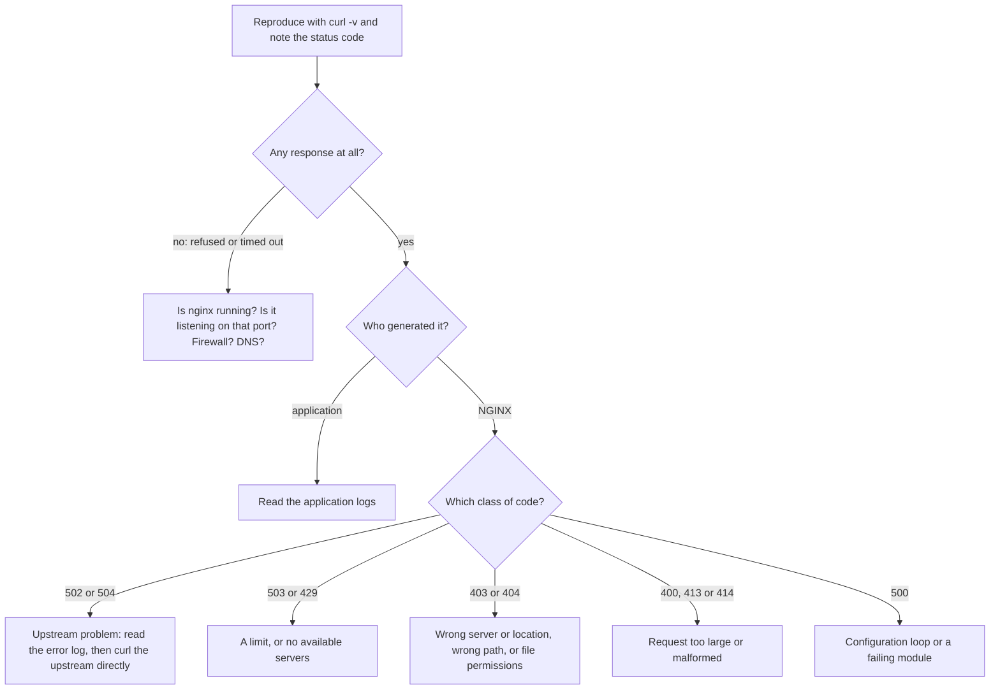

# A troubleshooting method and the gateway status codes

## Before this lesson

You need to be able to read both logs ([Access logs, error logs and request tracing](#/lesson/nginx/logging)), know how a server block and a location are chosen ([Serving a first static site](#/lesson/nginx/first-static-site), [How NGINX picks a location block](#/lesson/nginx/location-matching)), and how upstream timeouts and retries behave ([Health checks, retries, draining and slow start](#/lesson/nginx/lb-health-checks)). The command-line tools are introduced in [Network debugging tools: ping, traceroute, dig and curl](#/lesson/networking/cli-tools).

## In plain words

A patient walks into a clinic and says "I feel terrible". A poor doctor hands over the pills that helped the last patient. A good doctor asks where it hurts, takes a temperature, and orders the one test that separates the two likeliest causes. The good doctor is not cleverer. The good doctor has a **method**: gather the symptom precisely, narrow down where the problem is, and only then treat it, changing one thing at a time.

A web request passes through a chain: the client, DNS, perhaps a load balancer, NGINX, the application, the database. "The site is down" says nothing about which link failed. NGINX, sitting in the middle, is usually the messenger and often gets the blame. Its status codes and error log are in fact the best clues available, because they say which side of NGINX the fault is on.

The codes 502, 503 and 504 are known as **gateway errors**: they are what a proxy answers when the thing *behind* it misbehaves. Telling them apart is one of the most frequently asked operations questions, and on call it is the difference between restarting the right service in two minutes and restarting the wrong ones for an hour.

## The method

1. **Get the exact symptom.** Which URL, which status code, from which client, since when, for everyone or for some?
2. **Find out who produced the response.** NGINX, the application, or something in front of NGINX?
3. **Check NGINX is running with a valid configuration.**
4. **Check the request reaches NGINX and which block handles it.**
5. **Check the upstream directly**, bypassing NGINX.
6. **Read the error log at that timestamp.** It usually names the cause in one line.
7. **Change one thing, test, and write down what you did.**



### The toolbox

```bash
$ systemctl status nginx              # is the service running, and since when?
$ sudo nginx -t                       # is the configuration valid?
$ sudo nginx -T | less                # print the whole effective configuration, every include expanded
$ sudo ss -ltnp | grep nginx          # which addresses and ports is it listening on?
$ curl -sv -o /dev/null https://shop.test/api/cart
$ curl -s -o /dev/null -w '%{http_code} %{time_total}s\n' -H 'Host: shop.test' http://127.0.0.1/api/cart
$ curl -s -o /dev/null -w '%{http_code}\n' http://127.0.0.1:8000/api/cart
$ sudo tail -f /var/log/nginx/error.log
$ journalctl -u nginx --since "10 minutes ago"
```

- `nginx -T` (capital T) is the most underused command. With dozens of included files, it is the only reliable view of what NGINX is really running, and `grep` on its output answers "is there another server block with this name?".
- `ss -ltnp` lists listening TCP sockets with the owning process.
- The first `curl` shows the full exchange (`-v`), including which protocol and certificate were used.
- The second talks to NGINX on the machine itself while supplying the site name in the `Host` header. If this works and the public URL does not, the problem is in front of NGINX: DNS, a firewall, a load balancer.
- The third talks to the application directly. If this fails, NGINX is innocent.
- `journalctl -u nginx` shows what the service manager captured, which is where start-up failures appear when the error log itself could not be opened.

Those last two `curl` commands implement the single most powerful idea in troubleshooting a chain: **test each link separately**.

### Who generated the response?

An error page made by NGINX has a recognisable body: a title, the status text, and a line with the word `nginx` centred at the bottom. A JSON error or a styled page came from the application. Check the headers too: an application framework often adds its own, and a content delivery network in front adds its own again. In the access log, `$upstream_status` settles it: when it holds a number, the upstream produced a response; when it is `-`, NGINX answered by itself.

## The gateway codes

| Code | Name | Plain meaning | Usual cause |
|---|---|---|---|
| **502** | Bad Gateway | NGINX reached for the upstream and got nothing usable | the application is down, crashed mid-request, or sent a malformed answer |
| **503** | Service Unavailable | NGINX declined to pass the request on | a `limit_req` or `limit_conn` refusal at the default status, or a deliberate maintenance response |
| **504** | Gateway Timeout | NGINX waited for the upstream and gave up | the application is alive but too slow, or packets to it are being silently dropped |
| **499** | (NGINX only) | the *client* gave up and closed the connection before NGINX could answer | an impatient user, or a client or load balancer with a shorter timeout than the application needs |

The memory aid: **502 is "nobody answered properly", 504 is "somebody is there but too slow", 503 is "I am turning you away", 499 is "you left before I finished".**

499 is never sent to anyone, since the client has gone. It exists only in the access log. A wave of 499s with request times clustered at a round number, such as 30.000 seconds, means something in front of NGINX has a 30-second timeout.

### The error log tells them apart

| Error log message (shortened) | Status | What it means | First thing to check |
|---|---|---|---|
| `connect() failed (111: Connection refused) while connecting to upstream` | 502 | nothing is listening at that address and port | is the application running, and on that port? |
| `connect() failed (113: No route to host)` | 502 | the network cannot reach the upstream machine | firewall, security group, wrong address |
| `connect() to ... failed (13: Permission denied) while connecting to upstream` | 502 | the operating system forbade NGINX from connecting | SELinux: `setsebool -P httpd_can_network_connect 1` |
| `upstream prematurely closed connection while reading response header` | 502 | the application accepted the request and then hung up | application crash or worker killed; application's own timeout |
| `recv() failed (104: Connection reset by peer)` | 502 | the upstream reset the connection | application restart, or a stale keep-alive connection |
| `upstream sent too big header while reading response header` | 502 | the response headers did not fit in the buffer | raise `proxy_buffer_size`; look for huge cookies |
| `no live upstreams while connecting to upstream` | 502 | every server in the group is marked failed | the whole backend tier is down, or `max_fails` is too twitchy |
| `upstream timed out (110: Connection timed out) while connecting to upstream` | 504 | the connection attempt got no reply | packets dropped by a firewall; overloaded host |
| `upstream timed out (110: Connection timed out) while reading response header` | 504 | connected, but no response within `proxy_read_timeout` | slow query, deadlock, overloaded application |
| `limiting requests, excess: ... by zone "..."` | 503 or the configured status | rate limit hit | is the limit right? is the key the real client address? |
| `limiting connections by zone "..."` | 503 or the configured status | connection limit hit | same questions |

"Refused" and "timed out" during connection are worth a second look, because they separate two situations that feel the same to a user. A refusal is an active "no" from the target machine: the machine is up and nothing listens on the port. A timeout is silence: the machine is down, or a firewall is discarding the packets without a reply.

With several servers in an `upstream` group, NGINX tries the next one after an error or timeout (`proxy_next_upstream error timeout;` is the default), so the client sees 502 or 504 only when every attempt has failed. The error log shows one line per failed attempt even when the client received 200 in the end. Those lines are an early warning.

### Simulate it: which code will the client see?

```python-run
def outcome(refused=False, connect_s=0.001, first_byte_s=0.2, total_s=0.3, client_patience_s=120,
            proxy_connect_timeout=60, proxy_read_timeout=60):
    """One upstream server, no retries. Returns (seconds until decided, status, reason)."""
    if refused:
        t, status, why = connect_s, 502, "connect() failed: connection refused"
    elif connect_s > proxy_connect_timeout:
        t, status, why = proxy_connect_timeout, 504, "upstream timed out while connecting"
    elif first_byte_s - connect_s > proxy_read_timeout:
        t, status, why = connect_s + proxy_read_timeout, 504, "upstream timed out while reading response header"
    else:
        t, status, why = total_s, 200, "ok"
    if client_patience_s < t:
        return client_patience_s, 499, "client closed the connection first"
    return t, status, why

cases = {
    "healthy application":               dict(),
    "application stopped":               dict(refused=True),
    "firewall drops packets":            dict(connect_s=9999),
    "slow database query, 90 s":         dict(first_byte_s=90, total_s=90.1),
    "same, proxy_read_timeout 120":      dict(first_byte_s=90, total_s=90.1, proxy_read_timeout=120),
    "slow query, balancer waits 30 s":   dict(first_byte_s=90, total_s=90.1, client_patience_s=30),
}
for label, kw in cases.items():
    t, status, why = outcome(**kw)
    print(f"{label:34} -> {status} after {t:7.3f} s  ({why})")
```

Notice the timings as well as the codes. A stopped application fails in a millisecond. A firewall that drops packets takes the full 60 seconds of `proxy_connect_timeout`, which is why that default is usually lowered to a few seconds. Raising `proxy_read_timeout` turns the 504 into a 200 but leaves a 90-second request, which is rarely a real fix. And when the thing in front of NGINX is less patient than NGINX, the log shows 499 and the user sees whatever the front balancer returns. Problem `nginx-status-diagnosis` extends this model to several upstream servers tried one after another.

## The client-side codes NGINX produces

| Code | Error log or condition | Cause | Fix |
|---|---|---|---|
| 400 | request header or cookie too large; malformed request line | oversized cookies, or bytes that are not HTTP | `large_client_header_buffers`; clear cookies |
| 400 | `client sent plain HTTP request to HTTPS port` | `http://` used against port 443 | fix the link or redirect |
| 403 | `directory index of "/var/www/shop/" is forbidden` | the URI is a folder with no index file and `autoindex` is off | add the index file; check `root` and `index` |
| 403 | `open() "..." failed (13: Permission denied)` | the worker's user cannot read the file or enter a parent folder | permissions on the file and on *every* folder above it |
| 403 | `access forbidden by rule` | a `deny` matched | check `allow` and `deny`, and the real client address |
| 404 | `open() "..." failed (2: No such file or directory)` | the path NGINX built does not exist | the logged path shows how `root` or `alias` was applied |
| 405 | (none) | a method not allowed for a static file, such as POST | proxy that path to the application |
| 408 | (logged at info level) | the client was too slow sending the request | usually harmless |
| 413 | `client intended to send too large body: N bytes` | the body exceeds `client_max_body_size` | raise it in that location |
| 414 | (none) | the request line is longer than a large header buffer | shorten the URL; `large_client_header_buffers` |
| 500 | `rewrite or internal redirection cycle while internally redirecting to "..."` | `try_files` or `rewrite` loops, often a fallback file that does not exist | fix the fallback target |

Two of these repay attention. For a 404, the error log prints the **full filesystem path** NGINX tried to open; comparing it with where the file really is reveals most `root` versus `alias` mistakes at a glance. For a 403 caused by permissions, the file itself is often readable and a *parent directory* is not: the worker needs execute permission on every folder along the path, which `namei -l /var/www/shop/index.html` displays in one listing.

## When NGINX will not start or reload

| Message | Meaning | Fix |
|---|---|---|
| `bind() to 0.0.0.0:80 failed (98: Address already in use)` | another process holds the port | `ss -ltnp` to find it; often another web server or a stale NGINX |
| `unknown directive "..."` | a typo, or a module that is not loaded | spelling; `load_module`; is it an NGINX Plus directive? |
| `"..." directive is not allowed here` | right directive, wrong context | check which block it belongs in |
| `host not found in upstream "app"` | a hostname could not be resolved at load time | DNS, start order of containers, or use run-time resolution |
| `could not build server_names_hash, you should increase server_names_hash_bucket_size` | many or very long server names | set the directive as advised |
| `open() "/etc/nginx/tls/shop.key" failed (13: Permission denied)` | the master cannot read a file | ownership and mode |
| `N worker_connections are not enough` | all connection slots are in use | raise `worker_connections`; look for a connection leak or missing timeouts |
| `accept4() failed (24: Too many open files)` | the process hit its file descriptor limit | `worker_rlimit_nofile`; the service's limit |

A failed **reload** is gentler than it sounds. NGINX tests the new configuration first, and if it is invalid the old workers carry on with the old configuration. The site stays up and your change is not applied, which is a trap of its own: always look at the result of `nginx -t` or the journal after a reload.

## Debugging a configuration that "does the wrong thing"

Sometimes nothing is failing; the response is merely not the one you expected. The question is then which `server` and which `location` handled the request.

- **Label the blocks.** Temporarily add `add_header X-Debug-Location "api-prefix" always;` to the suspects, or in a test environment `return 200 "location A\n";`, and look at the response.
- **Walk the algorithm by hand**: exact match, then longest prefix, then regexes in file order unless `^~` stops them. Then remember inheritance: a block that declares its own `add_header` or `proxy_set_header` drops the inherited ones.
- **`rewrite_log on;`** with `error_log ... notice;` shows each rewrite step.
- **`debug_connection YOUR.IP;`** gives the full internal trace for your requests only, on a build with debug support.
- **Search the effective configuration**: `nginx -T | grep -n server_name` finds the duplicate or the default server you forgot.

### Simulate it: a first-response classifier

A table of known messages is how experienced engineers read an error log, and it is easy to put into code.

```python-run
import re

KNOWN = [  # (pattern, status, diagnosis, first check)
    (r"111: Connection refused\) while connecting to upstream", 502, "nothing listening on the upstream port", "is the app running on that port?"),
    (r"13: Permission denied\) while connecting to upstream",   502, "OS policy blocks the connection",         "SELinux httpd_can_network_connect"),
    (r"prematurely closed connection",                          502, "upstream hung up mid-request",            "application crash or its own timeout"),
    (r"too big header",                                         502, "response headers exceed the buffer",      "raise proxy_buffer_size"),
    (r"no live upstreams",                                      502, "all servers marked failed",               "state of the whole backend tier"),
    (r"timed out .* while connecting to upstream",              504, "no reply to the connection attempt",      "firewall or dead host"),
    (r"timed out .* while reading response header",             504, "upstream too slow",                       "slow queries, overload"),
    (r"limiting requests",                                      503, "rate limit refusal",                      "limit and key; set limit_req_status 429"),
    (r"too large body",                                         413, "body over client_max_body_size",          "raise it for that location"),
    (r"directory index of .* is forbidden",                     403, "folder without an index file",            "root, index, or try_files"),
    (r"13: Permission denied",                                  403, "worker cannot read the path",             "namei -l on the full path"),
    (r"2: No such file or directory",                           404, "file is not where NGINX looked",          "the path printed in the log"),
    (r"redirection cycle",                                      500, "try_files or rewrite loop",               "does the fallback file exist?"),
]

def diagnose(line):
    for pattern, status, what, check in KNOWN:
        if re.search(pattern, line):
            return f"{status}: {what}. Check: {check}"
    return "unrecognised: read the whole line, then search the documentation for the phrase"

for line in [
    '[error] 7#7: *12 connect() failed (111: Connection refused) while connecting to upstream, upstream: "http://127.0.0.1:8000/"',
    '[error] 7#7: *13 upstream timed out (110: Connection timed out) while reading response header from upstream',
    '[error] 7#7: *14 open() "/var/www/shop/assets/app.css" failed (2: No such file or directory)',
    '[error] 7#7: *15 connect() to 10.0.0.11:8000 failed (13: Permission denied) while connecting to upstream',
    '[error] 7#7: *16 rewrite or internal redirection cycle while internally redirecting to "/index.html"',
]:
    print(diagnose(line))
```

The order of the table matters, exactly as with regex locations: the specific "permission denied while connecting to upstream" must be tested before the general "permission denied", or a 502 would be reported as a 403.

## A worked incident

*Report: "Checkout fails for some users since about 14:00."*

1. **Symptom.** A test `POST` to the checkout URL returns 200 most times and 502 about one time in five. Ordinary page views never fail.
2. **Who?** The body is NGINX's own error page, and in the access log `$upstream_addr` for the 502 lines is always `10.0.0.12:8000`.
3. **NGINX itself.** Running, `nginx -t` passes, no reload since yesterday.
4. **Upstream directly.** A test order posted straight to `10.0.0.11:8000` answers 200. The same request to `10.0.0.12:8000` makes curl report "Empty reply from server": the application took the request and closed the connection without answering.
5. **Error log.** Repeated `upstream prematurely closed connection while reading response header from upstream ... upstream: "http://10.0.0.12:8000/checkout"`.
6. **Why were users affected at all, with two servers?** NGINX retries a failed request on the next server only when that is safe. A `POST` that has already been sent is not retried, because repeating it might charge a customer twice (the `non_idempotent` parameter of `proxy_next_upstream` overrides this). Page views are `GET` requests, which were retried on the healthy server without anybody noticing. And it was one in five, not one in two, because each failure marks the server unavailable for `fail_timeout`, after which it is tried again.
7. **Fix and follow-up.** The application log on `10.0.0.12` shows its worker being killed for running out of memory on a code version that only that server had received. Roll it back. Then add an alert on upstream errors per server, so that the next half-finished deployment is caught from the log before a user reports it.

The reasoning ran from symptom to side to link to log line. No configuration was changed until the cause was known.

> [!INTERVIEW]
> "What is the difference between 502 and 504, and how would you debug each?" 502 Bad Gateway: NGINX could not get a valid response; the upstream refused the connection, closed it early or sent something malformed. 504 Gateway Timeout: the upstream did not respond within `proxy_connect_timeout` or `proxy_read_timeout`. For both, read the error log line, which names the phase ("while connecting", "while reading response header") and the upstream address, then test that upstream directly with curl. For 502 look at whether the application is up and what its own log says; for 504 look at slow queries and load before touching timeouts. Add 503 (NGINX refusing, usually a limit) and 499 (the client left first) to show you know the whole family.

## Pitfalls

- **Restarting things before reading the error log.** The cause is usually written there.
- **Raising timeouts to hide a 504.** The request is still slow; find out why.
- **Assuming NGINX is at fault because its name is on the error page.** A 502 is NGINX reporting the application's failure.
- **Debugging through the load balancer or CDN only.** Test NGINX locally with a `Host` header, then the upstream directly.
- **Reading files in `conf.d` instead of `nginx -T`**, and missing an included file that overrides them.
- **Not checking a reload succeeded**, then chasing a change that was never applied.
- **Checking a file's permissions but not its parent folders'.**
- **Ignoring 499s.** In bulk they mean some timeout in front of you is shorter than your responses.
- **Leaving `proxy_connect_timeout` at 60 seconds**, so that a silently dead backend costs each request a minute.
- **Changing several things at once**, after which nobody knows which change fixed it.

## Cheat sheet

| Question | Command or clue |
|---|---|
| Is it running? | `systemctl status nginx` |
| Is the configuration valid? | `nginx -t` |
| What is the real configuration? | `nginx -T` |
| What is it listening on? | `ss -ltnp` |
| Does NGINX answer locally? | `curl -H 'Host: name' http://127.0.0.1/path` |
| Does the upstream answer? | `curl http://upstream:port/path` |
| Why did it fail? | `tail -f /var/log/nginx/error.log` |
| Who produced the status? | `$upstream_status` in the access log |
| 502 | upstream refused, closed early or answered badly |
| 503 | NGINX turned the request away: a limit or no capacity |
| 504 | upstream did not answer in time |
| 499 | the client closed first |
| 403 on a file | `namei -l` on the full path |
| 404 on a file | the path in the error log versus the real path |
| 500 from NGINX | a redirection cycle |

## Summary

- Work by method: precise symptom, who generated the response, NGINX's state, each link tested separately, then the error log.
- 502 means no valid answer from the upstream, 504 means no answer in time, 503 means NGINX refused, and 499 means the client left.
- The error log line states the failure and the phase; "refused" is an active no and "timed out" is silence.
- 403 and 404 for static files are path and permission questions that the logged path answers.
- A failed reload leaves the old configuration running. Use `nginx -T` to see what is truly in effect, and change one thing at a time.

## Glossary

- **Bad Gateway (502)**: a proxy received no valid response from the server behind it.
- **Connection refused**: the target machine answered that nothing is listening on that port.
- **Gateway error**: a 5xx status a proxy returns because of the upstream.
- **Gateway Timeout (504)**: a proxy gave up waiting for the server behind it.
- **Idempotent**: safe to repeat; `GET` is, `POST` generally is not.
- **Redirection cycle**: internal redirects that lead back to themselves.
- **Service Unavailable (503)**: the server is declining requests for now.
- **Timed out**: no reply arrived within the allowed time.
- **499**: NGINX's log-only code for a client that closed the connection early.

## Check yourself

```quiz
[
  {"q": "The error log says `connect() failed (111: Connection refused) while connecting to upstream`. Which status did the client get, and what is the likeliest cause?",
   "options": ["504; the application is slow", "502; nothing is listening on the upstream address and port", "503; a rate limit", "404; a missing file"], "answer": 1,
   "explain": "A refused connection is an immediate failure to reach the upstream: 502. The application is stopped or on a different port."},
  {"q": "Requests to one endpoint fail after exactly 60 seconds with 504. Which default is being hit?",
   "options": ["keepalive_timeout", "proxy_read_timeout", "client_header_timeout", "send_timeout"], "answer": 1,
   "explain": "proxy_read_timeout defaults to 60 s of waiting for the upstream's response."},
  {"q": "The access log shows many 499 entries with request times of almost exactly 30 seconds. What does this suggest?",
   "options": ["NGINX is crashing", "Something in front of NGINX, or the client, has a 30-second timeout and gives up first", "The disk is full", "TLS certificates expired"], "answer": 1,
   "explain": "499 means the client side closed the connection before NGINX could respond; a round number points to a timeout upstream of NGINX."},
  {"q": "`limit_req` rejects a request and no `limit_req_status` is set. Which status is returned?",
   "options": ["429", "502", "503", "504"], "answer": 2,
   "explain": "The default rejection status of the limit modules is 503."},
  {"q": "A static file returns 403. `ls -l` shows the file is world-readable. What should you check next?",
   "options": ["The gzip settings", "Execute permission on every parent directory for the worker's user", "The upstream block", "The DNS records"], "answer": 1,
   "explain": "The worker must be able to traverse each folder in the path; namei -l shows the permissions along it."},
  {"q": "You run `nginx -s reload` with a syntax error in a new file. What happens to the site?",
   "options": ["It goes down", "The old workers keep serving with the old configuration; the change is not applied", "NGINX applies the valid parts", "It restarts with defaults"], "answer": 1,
   "explain": "The master validates the new configuration first and keeps the old one when validation fails."},
  {"q": "Which command shows the complete configuration NGINX would load, with every include expanded?",
   "options": ["nginx -t", "nginx -T", "nginx -V", "nginx -s reopen"], "answer": 1,
   "explain": "-T tests and then dumps the full effective configuration; -t only tests, and -V shows build options."}
]
```

> **Source:** DeJonghe, NGINX Cookbook, ch. 14 (error logs, request tracing) and ch. 17 (debugging configs). Docs: https://nginx.org/en/docs/debugging_log.html, https://nginx.org/en/docs/http/request_processing.html, https://nginx.org/en/docs/http/ngx_http_proxy_module.html#proxy_next_upstream, https://nginx.org/en/docs/switches.html, RFC 9110 section 15 (status codes)
