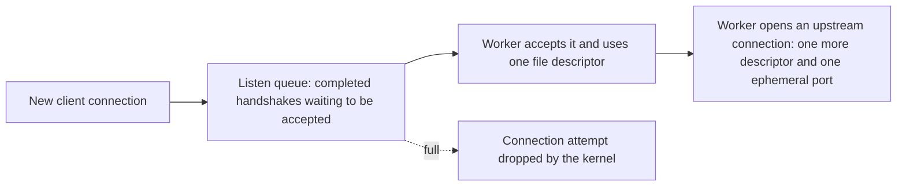

# Workers, connections, keepalive and OS tuning

## Before this lesson

You should remember the master process, the workers and the event loop ([Web servers, reverse proxies and load balancers from zero](#/lesson/nginx/what-nginx-is)), where `worker_processes` and `worker_connections` live in the file ([Installing NGINX and reading nginx.conf](#/lesson/nginx/install-and-config)), how an `upstream` block is written ([HTTP load balancing and the balancing methods](#/lesson/nginx/lb-http-upstreams)) and how to read the status page ([Activity monitoring](#/lesson/nginx/activity-monitoring)). The TCP background is in [TCP in practice: head-of-line blocking, Nagle, keep-alive and tuning](#/lesson/networking/tcp-tuning).

## In plain words

Think of a restaurant on a busy night.

- The **waiters** are NGINX's worker processes. A good waiter does not stand beside one table until the meal ends. They take an order, hand it to the kitchen, and move to the next table while the food cooks. One waiter can look after dozens of tables this way.
- The number of **tables each waiter may look after** is `worker_connections`.
- Every table needs a **page in the order pad**. When the pad runs out, no more tables can be taken, however idle the waiter is. Pages are **file descriptors**, the operating system's handles for open connections and files.
- **Guests waiting at the door** for a free table are the **listen queue**. When the lobby is full, newcomers are turned away at the street.
- A regular who orders course after course keeps their table instead of queueing again at the door each time. That is a **keep-alive connection**: one connection reused for many requests.

Performance tuning is the craft of finding which of these runs out first, the waiters, the tables, the order pad, the lobby or the kitchen, and enlarging *that one*. The first rule surprises people: NGINX's defaults are sensible, and most "tuning guides" copied from the internet make things no better or worse. You tune after measuring, and you change one thing at a time. Interviewers do not want a list of magic numbers. They want to hear you reason about bottlenecks.

## Rule zero: measure before and after

A **load test** sends artificial traffic at a system and records how it responds. The tools that generate the traffic are called **load drivers**: `wrk` and `ab` (ApacheBench) for quick command-line runs, and k6, Locust or JMeter for scripted scenarios with logins and think time.

```bash
$ wrk -t4 -c200 -d30s --latency https://staging.shop.test/api/products
  Latency Distribution
     50%   18.20ms
     75%   24.90ms
     90%   41.10ms
     99%  612.00ms
Requests/sec:   8421.37
```

- `-t4` uses four threads on the load-generating machine, `-c200` keeps 200 connections open, `-d30s` runs for thirty seconds, and `--latency` prints the distribution.
- **Requests/sec** is the throughput achieved.
- The **latency distribution** lists percentiles. "99% 612 ms" means 99 requests in 100 finished within 612 milliseconds, and one in 100 took longer.

A sound procedure:

1. Test a copy of production (never production itself without agreement), from a *different machine*, so the load driver does not compete with NGINX for the processor.
2. Record a **baseline** with the current configuration.
3. Change **one** setting.
4. Run the same test again and compare throughput, percentiles and error counts.
5. Keep the change only if the numbers improved. Write down what you did.

Why percentiles and not the average:

```python-run
import statistics

def percentile(values, p):
    ordered = sorted(values)
    rank = max(1, -(-len(ordered) * p // 100))        # nearest-rank method, rounded up
    return ordered[int(rank) - 1]

latencies_ms = [20] * 94 + [35] * 3 + [900, 1500, 2400]   # 100 requests; three hit a slow path
print("average        :", statistics.mean(latencies_ms), "ms")
for p in (50, 90, 95, 99):
    print(f"{p}th percentile:", percentile(latencies_ms, p), "ms")
```

The average, about 68 ms, describes no real request: most took 20 ms and a few took over a second. The 99th percentile exposes the slow tail that the average hides. A user who loads a page of 40 requests has a good chance of meeting that tail at least once, which is why operations teams set targets on the 95th and 99th percentiles.

## Workers

```nginx
worker_processes auto;
```

`worker_processes` is how many worker processes the master starts. The built-in default is 1. `auto` starts one per processor core, which is the right setting for nearly every server.

Why not more workers than cores? A worker never waits idle while it has events to handle. With one worker per core, each can run without interruption. With more, the operating system must keep pausing one to run another on the same core (a **context switch**), which costs time and gains nothing.

The thing that does hurt an event-driven worker is **blocking**: an operation that makes the whole process wait, during which every one of its thousands of connections waits too. The classic case is reading a large file from a slow disk. `aio threads;`, mentioned in the media lesson, hands such reads to a pool of helper threads so that the event loop keeps turning.

`worker_cpu_affinity auto;` pins each worker to its own core, a small gain on very busy machines. It is not needed otherwise.

## Connections and file descriptors

```nginx
worker_rlimit_nofile 20000;

events {
    worker_connections 8192;
}
```

- `worker_connections 8192;` is the largest number of connections **one worker** may have open at once. The built-in default is 512, and most packaged configurations set 1024. The count includes *everything*: client connections, and also the connections the worker opens to upstream servers.
- `worker_rlimit_nofile 20000;` raises the limit on open file descriptors for each worker. Every connection uses one descriptor, and so does every open file being served.

From these come the two formulas interviewers ask for:

$$\text{maximum connections} = \text{number of workers} \times \text{connections per worker}$$

When NGINX is a reverse proxy, each client request in progress uses **two** connections, one to the client and one to the upstream, so the number of clients served at the same moment is about half of that. Either way each client also needs roughly two descriptors (socket plus file, or socket plus socket), so `worker_rlimit_nofile` should be at least twice `worker_connections`.

```python-run
def capacity(worker_processes, worker_connections, nofile_limit, proxying):
    conns_per_client = 2 if proxying else 1              # client side + upstream side
    fds_per_client = 2                                   # socket + file, or socket + socket
    per_worker = min(worker_connections // conns_per_client, nofile_limit // fds_per_client)
    bottleneck = "worker_connections" if worker_connections // conns_per_client <= nofile_limit // fds_per_client else "file descriptors"
    return worker_processes * per_worker, bottleneck

setups = [
    ("defaults, static files",        dict(worker_processes=1, worker_connections=512,  nofile_limit=1024, proxying=False)),
    ("4 cores, packaged config",      dict(worker_processes=4, worker_connections=1024, nofile_limit=1024, proxying=True)),
    ("4 cores, connections raised",   dict(worker_processes=4, worker_connections=8192, nofile_limit=1024, proxying=True)),
    ("4 cores, both raised",          dict(worker_processes=4, worker_connections=8192, nofile_limit=20000, proxying=True)),
]
for label, kw in setups:
    clients, limit = capacity(**kw)
    print(f"{label:30} about {clients:6} simultaneous clients (limited by {limit})")
```

The third line is the classic mistake: `worker_connections` was raised eightfold and capacity did not move, because the descriptor limit of 1024 was the real ceiling. Problem `nginx-worker-capacity` has you write this calculation.

How each limit announces itself in the error log:

| Message | Limit reached | Remedy |
|---|---|---|
| `8192 worker_connections are not enough` | connection slots | raise `worker_connections`, and find out why so many are open |
| `accept4() failed (24: Too many open files)` | file descriptors | raise `worker_rlimit_nofile`; under systemd also `LimitNOFILE` for the service |

On the status page, `accepts` running ahead of `handled` is the same event seen from outside.

Before raising either number, ask why so many connections exist. Idle keep-alive connections are cheap, at a few kilobytes of memory each. Thousands of connections stuck in the `Writing` state mean a slow upstream, and more slots only delay the collapse.

Three related switches in the `events` block rarely need touching: `multi_accept on;` lets a worker accept all waiting connections in one go instead of one per turn of the loop; `accept_mutex` (off by default since 1.11.3) made workers take turns accepting; and the `reuseport` parameter of `listen` gives each worker its own listening socket so that the kernel spreads new connections evenly, which can help on machines with many cores.

## Keep-alive towards clients

Opening a connection is expensive. TCP needs a round trip, and TLS needs at least one more plus cryptographic work on both sides. On a mobile network with a 150 ms round trip, that is roughly a third of a second before the first byte of the request can even be sent. **Keep-alive** (in HTTP/1.1, a *persistent connection*) keeps the connection open after a response so that the next request skips all of it.

```nginx
http {
    keepalive_timeout  75s;
    keepalive_requests 1000;
    keepalive_time     1h;
}
```

These are the defaults, written out:

- `keepalive_timeout 75s;` closes a connection after it has been idle for 75 seconds.
- `keepalive_requests 1000;` closes a connection after it has served 1,000 requests, so that memory tied to one connection is released from time to time.
- `keepalive_time 1h;` closes a connection after one hour in total, however active.

All three apply to HTTP/2 and HTTP/3 connections as well. The trade is memory against handshakes: a longer timeout keeps more idle connections in memory and saves more handshakes. The defaults suit most sites. Two situations call for a change: behind a load balancer the timeout must exceed the balancer's own idle timeout (as explained in the cloud lesson), and a server under memory pressure from a great many idle clients may lower it.

On the status page, requests divided by handled connections tells you whether keep-alive is working. A value near 1 means every request is opening a new connection.

## Keep-alive towards upstreams

This is the single most valuable performance setting for a reverse proxy, and for most of NGINX's history it was off unless configured.

Until version 1.29.7 the proxy module spoke HTTP/1.0 to upstreams and sent `Connection: close`: **a new TCP connection for every proxied request**. At a thousand requests per second that is a thousand handshakes per second with a machine in the next rack.

```nginx
upstream shop_app {
    server 10.0.0.11:8000;
    server 10.0.0.12:8000;
    keepalive 32;
}

server {
    location / {
        proxy_http_version 1.1;
        proxy_set_header Connection "";
        proxy_pass http://shop_app;
    }
}
```

- `keepalive 32;` lets **each worker** keep up to 32 **idle** connections to this group open for reuse. It is not a cap on the total number of connections; under load a worker opens as many as it needs and afterwards keeps 32 of them.
- `proxy_http_version 1.1;` is required because persistent connections are a feature of HTTP/1.1.
- `proxy_set_header Connection "";` removes the `Connection: close` header that NGINX would otherwise send to the upstream.

From 1.29.7 onward, HTTP/1.1 and a keep-alive pool of 32 are the defaults and the three lines are no longer necessary. A great many servers run older versions, so you must be able to recognise and write them. Two more directives inside `upstream` mirror the client side: `keepalive_requests` (1,000) and `keepalive_timeout` (60 seconds) for the pooled connections.

### Why it matters twice: ephemeral ports

Each outgoing connection needs a local port number, taken from the **ephemeral port range**, which on Linux is 32768 to 60999 by default: 28,232 ports. After a connection closes, its port stays reserved for about 60 seconds in a state called `TIME_WAIT`, a safety period that stops stray late packets from confusing a new connection. So towards one upstream address and port, a machine can open at most about $28232 / 60 \approx 470$ new connections per second, sustained. Beyond that the error log shows `connect() failed (99: Cannot assign requested address) while connecting to upstream` and clients get 502. Upstream keep-alive removes the problem at its root because connections are reused instead of opened.

### Simulate it: how big should the pool be?

```python-run
def new_connections(bursts, burst_size, pool_size):
    """Each burst needs `burst_size` connections at once; afterwards at most `pool_size` stay open."""
    idle = opened = 0
    for _ in range(bursts):
        reused = min(idle, burst_size)
        opened += burst_size - reused
        idle = min(pool_size, burst_size)       # the rest are closed when the burst ends
    return opened

BURSTS, SIZE = 600, 12                          # one minute of traffic: 10 bursts a second, 12 requests each
total = BURSTS * SIZE
for pool in (0, 4, 12, 32):
    opened = new_connections(BURSTS, SIZE, pool)
    print(f"keepalive {pool:2}: {opened:5} new upstream connections for {total} requests "
          f"({opened / total:.0%} of requests paid for a handshake)")
```

With no pool, every request opens a connection. A pool smaller than the usual burst helps in proportion. Once the pool is at least as large as the number of requests a worker typically has in flight to that group, almost nothing is opened after the first burst, and making it larger changes nothing. That is how to size it: about the typical concurrency per worker, not a huge number "to be safe", because each idle connection also occupies a slot on the application server.

## The operating system's limits

Sometimes the limit is outside NGINX, in the kernel. These settings are read and changed with the `sysctl` command and made permanent in a file under `/etc/sysctl.d/`.



| Setting | What it limits | Symptom when too low |
|---|---|---|
| `net.core.somaxconn` | the largest listen queue any socket may have (4096 on current kernels, 128 on old ones) | under sudden load, new connections are slow or dropped while NGINX itself looks idle |
| `listen ... backlog=N` (NGINX) | the queue NGINX asks for; 511 by default on Linux, and never more than `somaxconn` | the same |
| `net.ipv4.tcp_max_syn_backlog` | half-open connections still in the handshake | drops during connection storms |
| `fs.file-max` | open files for the whole machine | "too many open files" although the per-process limit looks fine |
| `net.ipv4.ip_local_port_range` | the ephemeral ports for outgoing connections | "Cannot assign requested address" towards upstreams |

How to tell that the listen queue is overflowing: the kernel counts it. `nstat -az TcpExtListenOverflows` shows the number of connection attempts dropped because a queue was full, and `ss -lnt` shows each listening socket's queue limit in the `Send-Q` column. A count that grows during traffic spikes is evidence; then raise `somaxconn` and add `backlog=` to the `listen` line together, since the smaller of the two applies.

```bash
$ sysctl net.core.somaxconn net.ipv4.ip_local_port_range
net.core.somaxconn = 4096
net.ipv4.ip_local_port_range = 32768	60999
$ echo 'net.ipv4.ip_local_port_range = 10240 65000' | sudo tee /etc/sysctl.d/90-nginx.conf
$ sudo sysctl --system
```

The first command prints two current values. The second writes a wider port range to a settings file, and the third loads all settings files.

A warning that belongs here: internet tuning lists also recommend a dozen kernel switches with dramatic names. Several are harmful behind address-translating networks, and at least one was removed from Linux years ago for that reason. Change a kernel setting only when you have seen the symptom it cures and understand what it does.

## Putting it in order

When a load test shows a ceiling, look for the bottleneck in this order:

1. **The application.** Compare `$upstream_response_time` with `$request_time`. If the backend is the slow part, no NGINX setting will help; caching might.
2. **Processor.** Are the NGINX workers at 100% of a core each? Then TLS or compression is the cost; add cores.
3. **Connection reuse.** Is upstream keep-alive on? Is client keep-alive working?
4. **Slots and descriptors.** Any "not enough" or "too many open files" lines?
5. **Kernel queues and ports.** Any listen overflows or address errors?
6. **Network and disk.** Is the link full? Is the disk busy with logs or temporary files? The next lesson covers these.

> [!INTERVIEW]
> "How many concurrent connections can your NGINX handle, and how would you raise it?" State the formula: `worker_processes` times `worker_connections`, halved for proxying because each request needs an upstream connection too. Then the less-known constraint: each connection needs a file descriptor, so `worker_rlimit_nofile` (and the service's limit) must be at least double `worker_connections`. Then show judgement: before raising numbers, check why connections pile up, because thousands in the writing state point to a slow upstream. Finish with upstream keep-alive as the highest-value proxy setting and the ephemeral-port exhaustion it prevents.

## Pitfalls

- **Tuning without a baseline**, so that nobody can say whether a change helped.
- **Load-testing from the server itself**, where the driver and NGINX fight for the processor.
- **Reading averages** and missing the slow tail.
- **More workers than cores.**
- **Raising `worker_connections` without the descriptor limit**, which changes nothing.
- **Forgetting that upstream connections count** against `worker_connections`.
- **`keepalive` in `upstream` without `proxy_http_version 1.1` and an empty `Connection` header** on versions before 1.29.7; the pool is then never used.
- **Treating `keepalive 32` as a limit on connections.** It bounds idle ones only; `max_conns` is the limit.
- **A huge upstream keep-alive pool** that pins idle connections on an application server with few worker slots.
- **Raising `backlog=` without `somaxconn`**, or the reverse.
- **Pasting kernel settings from a blog post.**

## Cheat sheet

| Goal | Setting |
|---|---|
| One worker per core | `worker_processes auto;` |
| More connections per worker | `events { worker_connections 8192; }` |
| Enough descriptors | `worker_rlimit_nofile 20000;` (at least twice the connections) |
| Maximum clients, static | workers × connections |
| Maximum clients, proxy | workers × connections ÷ 2 |
| Client keep-alive | `keepalive_timeout 75s; keepalive_requests 1000;` |
| Upstream keep-alive | `keepalive 32;` with `proxy_http_version 1.1;` and `proxy_set_header Connection "";` |
| Per-worker listen sockets | `listen 443 ssl reuseport;` |
| Longer listen queue | `net.core.somaxconn` and `listen ... backlog=N` |
| More outgoing ports | `net.ipv4.ip_local_port_range` |
| Quick load test | `wrk -t4 -c200 -d30s --latency URL` |

## Summary

- Measure first with a load driver, compare percentiles, and change one setting at a time.
- Use one worker per core. Capacity is workers times `worker_connections`, halved when proxying, and bounded by file descriptors.
- Keep-alive saves handshakes on both sides. Towards upstreams it also prevents running out of ephemeral ports; it is automatic from 1.29.7 and needs three lines before that.
- The kernel has its own limits: listen queue, descriptors and port range. Raise them on evidence only.
- Most bottlenecks are in the application; NGINX settings cannot fix a slow backend.

## Glossary

- **Backlog**: the queue of completed connections waiting for a program to accept them.
- **Baseline**: a measurement taken before a change, for comparison.
- **Blocking**: an operation that makes a whole process wait.
- **Context switch**: the operating system pausing one process to run another.
- **Ephemeral port**: a temporary local port used for an outgoing connection.
- **File descriptor**: the operating system's handle for an open file or connection.
- **Keep-alive**: reusing one connection for several requests.
- **Load driver**: a tool that generates test traffic.
- **Percentile**: the value below which a given share of measurements fall.
- **somaxconn**: the kernel's ceiling on listen queue length.
- **Throughput**: the amount of work completed per unit of time.
- **TIME_WAIT**: the period after closing during which a port stays reserved.

## Check yourself

```quiz
[
  {"q": "worker_processes 4; worker_connections 2048; NGINX is a reverse proxy and descriptors are plentiful. About how many clients can be served at the same moment?",
   "options": ["2,048", "4,096", "8,192", "16,384"], "answer": 1,
   "explain": "4 × 2,048 = 8,192 connections, and each proxied client uses two of them, giving about 4,096."},
  {"q": "worker_connections is raised from 1,024 to 16,384 but the error log now shows `accept4() failed (24: Too many open files)`. What was forgotten?",
   "options": ["worker_processes", "The file descriptor limit, worker_rlimit_nofile", "keepalive_timeout", "gzip"], "answer": 1,
   "explain": "Every connection needs a descriptor; the per-process limit must be raised to at least twice worker_connections."},
  {"q": "In an upstream block on NGINX 1.24, what does `keepalive 16;` mean?",
   "options": ["At most 16 connections to the group", "Each worker keeps up to 16 idle connections open for reuse", "Connections close after 16 seconds", "16 requests per connection"], "answer": 1,
   "explain": "It sizes the cache of idle connections per worker. It does not cap the total; max_conns does that."},
  {"q": "On NGINX 1.24 an upstream block has `keepalive 16;` but every proxied request still opens a new connection. What is the usual cause?",
   "options": ["worker_processes is too low", "proxy_http_version 1.1 and an empty Connection header are missing", "The upstream uses TLS", "keepalive_timeout is 75 s"], "answer": 1,
   "explain": "Before 1.29.7 the proxy module used HTTP/1.0 with Connection: close unless both lines were set."},
  {"q": "The error log shows `connect() failed (99: Cannot assign requested address) while connecting to upstream` under heavy load. What ran out?",
   "options": ["Memory", "Ephemeral ports for outgoing connections", "Worker processes", "Disk space"], "answer": 1,
   "explain": "Each new upstream connection needs a local port, and closed ones linger in TIME_WAIT. Upstream keep-alive is the fix."},
  {"q": "A load test reports an average of 60 ms and a 99th percentile of 2.1 s. What does that say?",
   "options": ["All requests take about 60 ms", "Most requests are fast, but one in a hundred takes over two seconds", "The test is invalid", "The server is idle"], "answer": 1,
   "explain": "The average hides the tail; percentiles show that a slow path affects 1% of requests."},
  {"q": "Why is `worker_processes` normally set to the number of cores and not higher?",
   "options": ["NGINX refuses more", "Extra workers only add context switches, since an event-driven worker can already keep a core busy", "Each worker needs its own port", "Memory limits"], "answer": 1,
   "explain": "One non-blocking worker per core uses the processor fully; more workers compete for the same cores."}
]
```

> **Source:** DeJonghe, NGINX Cookbook, ch. 15 (automating tests with load drivers, keeping connections open to clients, keeping connections open upstream, OS tuning). Docs: https://nginx.org/en/docs/ngx_core_module.html#worker_connections, https://nginx.org/en/docs/http/ngx_http_core_module.html#keepalive_timeout, https://nginx.org/en/docs/http/ngx_http_upstream_module.html#keepalive, https://nginx.org/en/docs/http/ngx_http_proxy_module.html#proxy_http_version, https://www.kernel.org/doc/html/latest/networking/ip-sysctl.html
