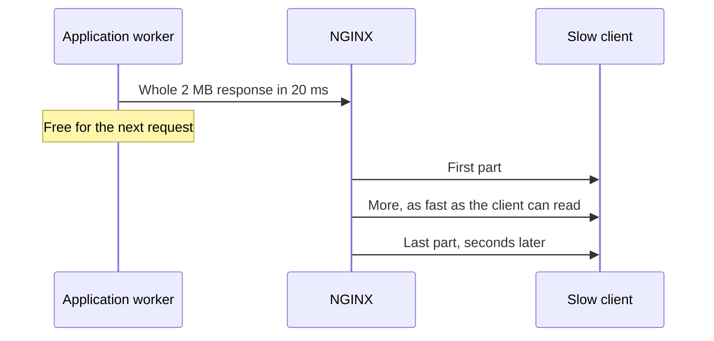

# Buffering, sendfile, gzip, brotli and file caches

## Before this lesson

Read [Workers, connections, keepalive and OS tuning](#/lesson/nginx/perf-connections) first; its rule of measuring before changing applies here too. You should also know how static files are served ([Serving a first static site](#/lesson/nginx/first-static-site)), how a response is proxied ([HTTP load balancing and the balancing methods](#/lesson/nginx/lb-http-upstreams)) and how the access log can be buffered ([Access logs, error logs and request tracing](#/lesson/nginx/logging)).

## In plain words

Three scenes from a restaurant kitchen.

**The pass.** The cook finishes a dish in four minutes. If the cook had to stand holding the plate until a slow waiter came to carry it, the stove would sit idle. So there is a shelf, the *pass*: the cook puts the plate down and starts the next order at once, and the waiter collects it when ready. In NGINX the shelf is a **buffer**, a piece of memory that holds data between a fast producer and a slow consumer. The cook is your application, and the waiter is a phone on a weak mobile signal.

**The vacuum packer.** A caterer sending soup across town can pour it into bulky tubs or spend a moment vacuum-packing it flat. Packing costs effort and saves van space. That is **compression**: spending some processor time to send fewer bytes.

**The store-room list.** A cook who checks the store-room for salt on every single order wastes steps. A list on the wall saying which shelf holds what, re-checked once a minute, saves the walk. That is a **file cache**: remembering facts about files so as not to ask the operating system each time.

These three ideas account for most of what "performance settings" means in NGINX beyond connection handling. Each has a cost, which is why none is a free "make it faster" switch, and interviewers like them because the trade-offs show whether you understand what the proxy is doing.

## Part 1: buffering responses from the application

### What happens by default

`proxy_buffering` is `on` unless you say otherwise. With it on, NGINX reads the application's response **as fast as the application can produce it**, stores it, and sends it to the client at whatever pace the client manages. The application is finished the moment it has handed over the last byte.



Why this is so valuable: application servers have few workers. A typical Python or Ruby application runs perhaps eight worker processes, and each handles one request at a time. Without buffering, a worker is tied up for as long as the *client* takes to download, so a handful of slow phones could occupy all eight. NGINX holds a waiting client connection for a few kilobytes of memory. Letting NGINX do the waiting is half the reason reverse proxies exist.

### Simulate it

```python-run
def app_worker_busy_s(response_kb, app_kb_per_s, client_kb_per_s, buffering):
    """Seconds one application worker spends on one response."""
    if buffering:
        return response_kb / app_kb_per_s          # NGINX absorbs it at the application's speed
    return response_kb / min(app_kb_per_s, client_kb_per_s)   # the app can go no faster than the client reads

APP_WORKERS = 8
print("client speed   buffering   worker busy   requests per second the app can serve")
for client_speed in (50_000, 500, 50):             # fibre, decent mobile, poor mobile (kB/s)
    for buffering in (True, False):
        busy = app_worker_busy_s(2_000, 100_000, client_speed, buffering)
        print(f"{client_speed:8} kB/s   {'on ' if buffering else 'off'}        {busy:8.2f} s   {APP_WORKERS / busy:10.1f}")
```

For the client on a poor connection, turning buffering off makes each 2-megabyte response hold an application worker for 40 seconds, and the whole application can then serve one such request every five seconds. With buffering on, client speed does not affect the application at all.

### The directives

```nginx
location / {
    proxy_buffering         on;
    proxy_buffer_size       8k;
    proxy_buffers           16 8k;
    proxy_busy_buffers_size 16k;
    proxy_max_temp_file_size 1024m;
    proxy_pass http://shop_app;
}
```

- `proxy_buffer_size 8k;` is the buffer for the **first part** of the response, which contains the headers. The default is one memory page, 4 or 8 kilobytes depending on the machine. If the application's response headers do not fit, which happens with very large cookies, the request fails with 502 and the error log says `upstream sent too big header`. Raising this value is the cure.
- `proxy_buffers 16 8k;` is the number and size of the in-memory buffers for the rest of the response, per request. The default is 8 buffers of one page. Here a response of up to 128 kilobytes is held entirely in memory.
- `proxy_busy_buffers_size 16k;` limits how much buffered data may be in the middle of being sent to the client while NGINX is still reading from the upstream.
- `proxy_max_temp_file_size 1024m;` (the default) comes into play when the response is larger than all the memory buffers: the overflow is written to a temporary file on disk, up to this size.

That temporary file is worth knowing about. The error log reports it at `warn` level as `an upstream response is buffered to a temporary file`. An occasional line is harmless. A constant stream means large responses are going through the disk, and either the buffers should be larger or those responses should not go through the application at all.

### When to switch it off

Buffering assumes the response is a finite thing to be delivered when ready. Some responses are streams that should reach the client piece by piece as they are produced: **Server-Sent Events** (a long-lived response on which a server pushes updates), long polling, a progress feed, a model generating text token by token. Buffered, the client sees nothing until a buffer fills.

```nginx
location /events/ {
    proxy_buffering off;
    proxy_read_timeout 1h;
    proxy_pass http://shop_app;
}
```

The application can also decide for itself by sending the response header `X-Accel-Buffering: no`, which NGINX obeys for that response only. That is tidier when only some responses from a path are streams.

### The request direction

The mirror image applies to uploads. `proxy_request_buffering on;` (the default) makes NGINX read the **entire request body** from the client before it contacts the application at all. A slow upload therefore never occupies an application worker. Bodies larger than `client_body_buffer_size` (8 or 16 kilobytes by default) are spooled to a temporary file, with a similar `warn` line in the log. Switch it off only for very large uploads that the application wants to process as they arrive; doing so also removes NGINX's ability to retry the request on another server, since the body is no longer held.

## Part 2: sending files efficiently

```nginx
http {
    sendfile    on;
    tcp_nopush  on;
    tcp_nodelay on;
}
```

- **`sendfile on;`** Ordinarily, sending a file means reading it from the kernel's file cache into NGINX's memory and then writing it from NGINX's memory back into the kernel's network buffers: two copies and two switches between program and kernel for each chunk. With `sendfile`, NGINX asks the kernel to move the bytes from file to socket directly. The data never enters NGINX's memory. The built-in default is `off`; nearly every packaged configuration turns it on. It applies to files served from disk, not to proxied responses.
- **`tcp_nopush on;`** takes effect only together with `sendfile`. It tells the kernel to wait until a packet is full before sending, so that the response headers and the start of the file leave in one packet instead of a tiny one followed by a full one.
- **`tcp_nodelay on;`** (already the default) does the opposite for small writes on keep-alive connections: send immediately, do not wait to collect more. The two coexist; NGINX applies each at the stage where it helps.

`sendfile_max_chunk` (2 megabytes by default) limits how much one call may send, so that a single fast download cannot hog a worker.

One real-world trap: with `sendfile on`, files on some network or virtual-machine shared folders are served stale or corrupted after being edited, because the kernel shortcut bypasses the layer that notices the change. On a development machine with such a shared folder, turn `sendfile` off.

## Part 3: compression

### How it is negotiated

The browser states what it can decode in a request header, and the server labels what it sent:

```
Request:   Accept-Encoding: gzip, deflate, br, zstd
Response:  Content-Encoding: gzip
           Vary: Accept-Encoding
```

`gzip` is the universal method. `br` is **Brotli**, a newer method that makes text roughly 15 to 25 percent smaller than gzip does. `Vary: Accept-Encoding` tells caches along the way that the response differs depending on that request header, so that a compressed copy is never handed to a client that cannot read it.

### gzip in NGINX

```nginx
http {
    gzip            on;
    gzip_comp_level 5;
    gzip_min_length 1024;
    gzip_types      text/plain text/css application/json application/javascript
                    application/xml image/svg+xml;
    gzip_vary       on;
    gzip_proxied    any;
}
```

- `gzip on;` The default is `off`.
- `gzip_comp_level 5;` Levels run from 1 (fastest) to 9 (smallest). The default is 1. The simulation below shows why a middle value is the usual choice.
- `gzip_min_length 1024;` Do not compress responses shorter than this many bytes, judged from the `Content-Length` header. The default is 20. Tiny responses fit in one packet anyway, and compressing them can make them larger.
- `gzip_types ...;` The MIME types to compress. **The default list is `text/html` only**, which surprises nearly everyone: with a bare `gzip on;` your stylesheets, scripts and JSON go out uncompressed. `text/html` is always included and must not be listed again.
- `gzip_vary on;` adds the `Vary: Accept-Encoding` header.
- `gzip_proxied any;` By default NGINX does **not** compress a response when the request arrived through another proxy, which it detects by a `Via` request header. Behind a content delivery network or load balancer that adds `Via`, compression silently stops. `any` compresses regardless.

A few fixed rules are built in. A response is compressed only if its status is 200, 403 or 404; only if the client sent `Accept-Encoding` with `gzip`; only on HTTP/1.1 or later unless `gzip_http_version` says otherwise; and never if it already carries a `Content-Encoding`. Problem `nginx-gzip-decision` has you put all of these into one function.

**What not to compress.** JPEG and PNG images, video, PDF and ZIP files, and WOFF2 fonts are compressed already. Running gzip over them burns processor time and saves nothing.

### Simulate it: what compression buys and costs

Python's `zlib` module implements the same algorithm as gzip.

```python-run
import random, time, zlib

random.seed(3)
words = ["product", "price", "stock", "tea", "kettle", "mug", "ceramic", "review", "rating", "delivery"]
rows = "".join(f'<tr class="item"><td>{random.choice(words)} {i}</td><td>{random.randint(5, 99)}.00</td></tr>\n'
               for i in range(3000))
html = ("<html><body><table>\n" + rows + "</table></body></html>").encode()
already_compressed = random.randbytes(len(html))        # stands in for a JPEG: no patterns left

print(f"original HTML: {len(html):,} bytes")
for level in (1, 5, 9):
    start = time.perf_counter()
    for _ in range(20):
        out = zlib.compress(html, level)
    ms = (time.perf_counter() - start) / 20 * 1000
    print(f"  level {level}: {len(out):7,} bytes ({len(out) / len(html):.0%} of original)  {ms:6.2f} ms")

packed = zlib.compress(already_compressed, 5)
print(f"random bytes at level 5: {len(already_compressed):,} -> {len(packed):,} bytes (no gain)")

tiny = b'{"ok":true}'
print(f"tiny JSON: {len(tiny)} -> {len(zlib.compress(tiny, 5))} bytes (it grew)")
```

Three lessons in one run. Text shrinks dramatically, to around a tenth of its size here, and even the fastest level achieves most of that. Higher levels make the output a little smaller and take several times longer on every response: the step from level 1 to level 9 gains a few percent of the original size for many times the processor time, which is why a middle level is the usual choice for responses compressed on the fly. Data without patterns does not shrink, and a tiny response grows because of the format's fixed overhead.

### Compress once, serve many times

For static files, compressing on every request is wasted work. `gzip_static on;` makes NGINX look for a ready-made file with `.gz` added to the name and send that when the client accepts gzip.

```nginx
location /assets/ {
    gzip_static on;
    expires 1y;
    add_header Cache-Control "public, immutable";
}
```

The build pipeline produces `app.js.gz` next to `app.js` at the highest level, once, and NGINX serves it with no processor cost. It needs the `ngx_http_gzip_static_module`, which is in the official packages. The same block sets a one-year browser cache lifetime, appropriate for files whose names contain a version fingerprint: the fastest request is the one the browser never makes.

### Brotli

Brotli is not part of the core NGINX source. It comes as a separate module, `ngx_brotli`, originally from Google, which is compiled as a dynamic module and loaded with `load_module`. Some distributions package it, and NGINX Plus offers it as a supported dynamic module.

```nginx
load_module modules/ngx_http_brotli_filter_module.so;
load_module modules/ngx_http_brotli_static_module.so;

http {
    brotli            on;
    brotli_comp_level 5;
    brotli_types      text/plain text/css application/json application/javascript image/svg+xml;
    brotli_static     on;
}
```

The directives mirror the gzip ones. Keep gzip configured as well: when a client accepts both, the Brotli module answers, and clients that only know gzip still get gzip. Browsers accept Brotli only over HTTPS. Brotli's highest levels are very slow, which makes it ideal for precompressed static files (`brotli_static`) and a moderate level sensible for dynamic responses.

> [!WARNING]
> Compressing responses that contain both a secret (such as an anti-forgery token) and text controlled by an attacker, over TLS, enables a family of attacks known as BREACH: the attacker learns the secret from how well the response compresses. The usual defences are in the application, by masking tokens differently on each response. Be aware of it before compressing pages that echo user input beside secrets.

## Part 4: remembering facts about files

Every static request makes NGINX ask the operating system several questions: does this file exist, how big is it, when was it modified, and please open it. On a site serving thousands of small files per second these calls add up.

```nginx
http {
    open_file_cache          max=10000 inactive=30s;
    open_file_cache_valid    60s;
    open_file_cache_min_uses 2;
    open_file_cache_errors   on;
}
```

- `open_file_cache max=10000 inactive=30s;` keeps information on up to 10,000 files, dropping an entry that has not been used for 30 seconds. The default is `off`.
- `open_file_cache_valid 60s;` re-checks each entry against the real file every 60 seconds (the default).
- `open_file_cache_min_uses 2;` keeps an entry only if it is requested at least twice within the `inactive` period, so one-off requests do not fill the cache.
- `open_file_cache_errors on;` also remembers failures such as "no such file", which makes floods of requests for missing files cheap.

Be exact about what is stored: open file descriptors, sizes, modification times, and whether paths exist. **Not the file contents.** Those are cached by the operating system's page cache, which needs no configuration.

The cost is staleness. For up to the `valid` period, NGINX may act on old information.

```python-run
def serve(requests, file_changes_at, valid_s):
    """For each request time, report which version of the file's metadata NGINX uses."""
    checked_at, cached_version = None, None
    out = []
    for now in requests:
        real = "v2" if now >= file_changes_at else "v1"
        if checked_at is None or now - checked_at >= valid_s:
            checked_at, cached_version = now, real        # re-validate against the disk
        out.append((now, cached_version, real))
    return out

for now, used, real in serve(requests=[0, 20, 45, 59, 61, 90], file_changes_at=30, valid_s=60):
    flag = "" if used == real else "   <- stale"
    print(f"t={now:3}s  NGINX uses {used}, disk has {real}{flag}")
```

The file is replaced at 30 seconds, and the requests at 45 and 59 seconds still use the old information, until the entry is re-checked at 61. If a file was overwritten in place with different contents, a mismatch between the cached size and the real file can produce truncated responses during that window. The remedy is to deploy static files **atomically**: upload a new folder and switch a symbolic link, or use fingerprinted file names so that a file's content never changes under the same name.

## Part 5: the rest of the list

| Setting | What it saves | Note |
|---|---|---|
| `access_log ... buffer=64k flush=5s;` | a disk write per request | covered in the logging lesson |
| `expires` and `Cache-Control` on static files | whole requests | browser and CDN caching beat any server tuning |
| `ssl_session_cache shared:SSL:10m;` | full TLS handshakes for returning clients | one megabyte holds about 4,000 sessions |
| `proxy_cache` | application work | the caching module of this track |
| `aio threads;` with `directio` | workers blocked on slow disk reads | for large files |

## A combined example

```nginx
http {
    sendfile on;
    tcp_nopush on;

    gzip on;
    gzip_comp_level 5;
    gzip_min_length 1024;
    gzip_vary on;
    gzip_proxied any;
    gzip_types text/plain text/css application/json application/javascript application/xml image/svg+xml;

    open_file_cache max=10000 inactive=30s;
    open_file_cache_errors on;

    server {
        listen 443 ssl;
        server_name shop.test;

        location /assets/ {
            root /var/www/shop;
            gzip_static on;
            expires 1y;
            add_header Cache-Control "public, immutable";
        }

        location /events/ {
            proxy_buffering off;
            proxy_read_timeout 1h;
            proxy_pass http://shop_app;
        }

        location / {
            proxy_buffer_size 8k;
            proxy_buffers 16 8k;
            proxy_pass http://shop_app;
        }
    }
}
```

Static assets are sent with the kernel shortcut, precompressed, and cached by browsers for a year. The event stream is unbuffered. Everything else is buffered so that application workers are released at once, and compressed on the way out.

> [!INTERVIEW]
> "What does `proxy_buffering` do, and when would you turn it off?" With it on, NGINX reads the upstream's response at full speed into memory buffers, spilling to a temporary file if needed, and feeds the client at the client's pace. That frees scarce application workers from slow clients, which is a main reason to put NGINX in front of an application server. Turn it off for responses that must arrive incrementally: Server-Sent Events, long polling, streamed generation. Mention `X-Accel-Buffering: no` for per-response control, `proxy_buffer_size` for the "too big header" 502, and that request buffering does the same job for uploads.

## Pitfalls

- **A bare `gzip on;`**, which compresses only `text/html`. List the types.
- **Compressing images, video and archives**, which costs processor time for nothing.
- **No compression behind a CDN or balancer** because `gzip_proxied` was left at `off`.
- **Level 9 on dynamic responses.** Spend it on precompressed static files instead.
- **Forgetting `gzip_vary`**, so that a shared cache serves compressed bytes to a client that cannot decode them.
- **Buffering a stream**, so that events arrive in clumps or not at all.
- **Turning buffering off everywhere "for speed"**, which ties application workers to the slowest clients.
- **Ignoring the temporary-file warnings** when most responses are larger than the memory buffers.
- **`sendfile on` with shared folders in a development virtual machine**, serving stale files.
- **`open_file_cache` with in-place file edits**, giving stale or truncated responses for a minute.
- **Expecting Brotli in a stock build.** `brotli on;` fails as an unknown directive unless the module is loaded.

## Cheat sheet

| Goal | Setting |
|---|---|
| Free the app from slow clients | `proxy_buffering on;` (default) |
| Fix "upstream sent too big header" | `proxy_buffer_size 16k;` |
| Keep larger responses in memory | `proxy_buffers 16 8k;` |
| Stream a response | `proxy_buffering off;` or header `X-Accel-Buffering: no` |
| Stream an upload | `proxy_request_buffering off;` |
| Zero-copy file sending | `sendfile on; tcp_nopush on;` |
| Compress text | `gzip on; gzip_types ...; gzip_comp_level 5; gzip_min_length 1024;` |
| Compress behind a proxy | `gzip_proxied any; gzip_vary on;` |
| Serve precompressed files | `gzip_static on;`, `brotli_static on;` |
| Brotli | load the `ngx_brotli` modules, then `brotli on;` |
| Cache file metadata | `open_file_cache max=10000 inactive=30s;` |
| Browser caching | `expires 1y; add_header Cache-Control "public, immutable";` |

## Summary

- Response buffering lets NGINX wait on slow clients so that the application does not. It is on by default; turn it off only for streams.
- `proxy_buffer_size` holds the headers, `proxy_buffers` the body, and anything larger goes to a temporary file.
- `sendfile` moves file bytes inside the kernel; `tcp_nopush` fills packets.
- gzip is off by default and covers only `text/html` until `gzip_types` is set. Use a middle level, skip tiny and already-compressed responses, and precompress static files. Brotli needs an extra module.
- `open_file_cache` remembers descriptors and metadata, not contents, at the price of up to a minute of staleness.

## Glossary

- **Brotli**: a compression method that beats gzip on text; `br` in headers.
- **Buffer**: memory holding data between a producer and a consumer of different speeds.
- **Compression level**: the trade between output size and processor time.
- **Content-Encoding**: the response header naming the compression applied.
- **gzip**: the universally supported compression method for HTTP.
- **Open file cache**: NGINX's memory of file descriptors and metadata.
- **Page cache**: the operating system's in-memory copy of recently read file contents.
- **Precompression**: compressing files once at build time.
- **sendfile**: a kernel call that copies from a file to a socket without passing through the program.
- **Server-Sent Events**: a long-lived HTTP response used to push updates to a browser.
- **Temporary file**: disk space used when data does not fit in memory buffers.
- **Vary**: the response header listing request headers that change the response.

## Check yourself

```quiz
[
  {"q": "With default settings, an application sends a 3 MB response in 30 ms to NGINX, and the client downloads at 100 kB/s. For how long is the application worker occupied?",
   "options": ["About 30 seconds", "About 30 milliseconds", "Until the client disconnects", "Zero"], "answer": 1,
   "explain": "proxy_buffering is on by default: NGINX takes the response at the application's speed and delivers it to the client itself."},
  {"q": "The configuration has only `gzip on;`. Which of these responses is compressed?",
   "options": ["application/json", "text/css", "text/html", "All text types"], "answer": 2,
   "explain": "The default gzip_types is text/html alone. Other types must be listed explicitly."},
  {"q": "NGINX sits behind a CDN that adds a `Via` header to requests. JSON responses are no longer compressed. Which directive fixes it?",
   "options": ["gzip_vary on;", "gzip_proxied any;", "gzip_static on;", "gzip_http_version 1.0;"], "answer": 1,
   "explain": "gzip_proxied defaults to off, which disables compression for requests that arrived through a proxy."},
  {"q": "Server-Sent Events from the application reach the browser in large delayed clumps. What is the likely cause?",
   "options": ["gzip_min_length", "proxy_buffering is on for that location", "sendfile is off", "open_file_cache"], "answer": 1,
   "explain": "Buffering holds the stream until buffers fill. Turn it off for that location or send X-Accel-Buffering: no."},
  {"q": "A 502 appears with `upstream sent too big header` in the error log. Which setting should be raised?",
   "options": ["proxy_buffers", "proxy_buffer_size", "client_max_body_size", "large_client_header_buffers"], "answer": 1,
   "explain": "proxy_buffer_size holds the first part of the upstream response, including its headers."},
  {"q": "What does `open_file_cache` store?",
   "options": ["File contents", "Compressed copies of files", "Open descriptors and metadata such as size and modification time", "Proxied responses"], "answer": 2,
   "explain": "It caches descriptors, metadata and lookup errors. Contents are cached by the operating system's page cache."},
  {"q": "Why is `gzip_comp_level 9` a poor choice for dynamic responses?",
   "options": ["Browsers cannot decode level 9", "It costs much more processor time per response for a very small extra saving", "It disables keep-alive", "It only works with HTTP/2"], "answer": 1,
   "explain": "Most of the size reduction is achieved by middle levels; the top levels pay a lot of CPU for a few percent."}
]
```

> **Source:** DeJonghe, NGINX Cookbook, ch. 15 (buffering responses, buffering access logs) and ch. 4 (cache performance). Docs: https://nginx.org/en/docs/http/ngx_http_proxy_module.html#proxy_buffering, https://nginx.org/en/docs/http/ngx_http_core_module.html#sendfile, https://nginx.org/en/docs/http/ngx_http_gzip_module.html, https://nginx.org/en/docs/http/ngx_http_gzip_static_module.html, https://nginx.org/en/docs/http/ngx_http_core_module.html#open_file_cache, https://github.com/google/ngx_brotli
