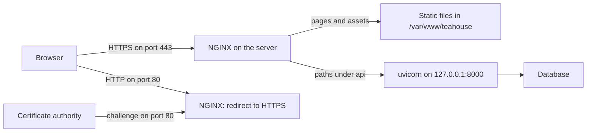
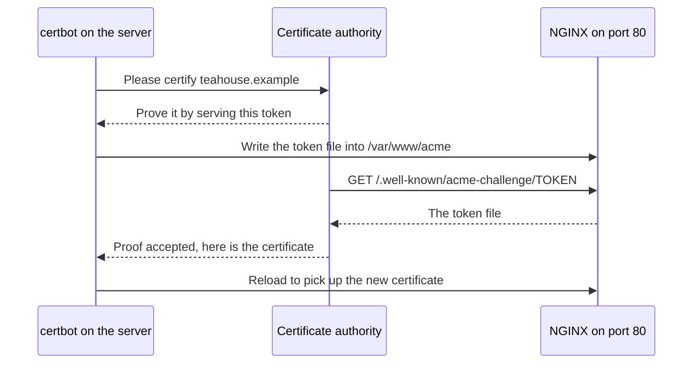

# Project part 1: reverse proxy, TLS and redirects

## Before this lesson

This project uses the earlier modules as building blocks. You need server blocks and `try_files` ([Serving a first static site](#/lesson/nginx/first-static-site), [try_files, return, rewrite and the proxy_pass slash](#/lesson/nginx/try-files-rewrite-return)), location matching ([How NGINX picks a location block](#/lesson/nginx/location-matching)), proxy headers ([HTTP load balancing and the balancing methods](#/lesson/nginx/lb-http-upstreams)) and the TLS directives ([TLS, HTTPS redirects, HSTS and upstream encryption](#/lesson/nginx/tls-https-hsts)). The application side is covered in the FastAPI track's [Workers, Docker and running in production](#/lesson/fastapi/deploy-docker), and the service manager in [Environments, cron, systemd and log inspection](#/lesson/linux-cli/env-cron-systemd-logs).

## In plain words

So far each lesson examined one tool on the workbench. A project is where you build the cabinet.

Imagine opening a small shop in a rented unit. Before the first customer arrives you need a sign over the door so people can find you (a **domain name**), a front counter where everybody is greeted (**NGINX**), a back room where the real work happens and where customers never go (the **application**), a lock and a trading licence on the wall so customers know the shop is genuine (**TLS** and a **certificate**), and notices on the old side entrance saying "please use the front door" (**redirects**).

This lesson and the next build one complete, realistic deployment step by step: a small web shop called Teahouse on a single rented server. Part 1 gets it online correctly: static pages, a reverse proxy to the application, HTTPS with an automatically renewed certificate, and clean redirects. Part 2 hardens and operates it.

Why do this by hand when platforms can do it for you? Because "put an app behind NGINX with HTTPS" is the task junior backend and DevOps engineers are handed in their first month, and "walk me through how you would deploy this" is how interviewers find out whether you have ever done it. Every step ends with a check, because a professional deployment is one where you verified each layer before adding the next.

## The target

| Item | Value in this project |
|---|---|
| Server | one small Linux virtual machine, Ubuntu, public address `203.0.113.10` |
| Domain | `teahouse.example` and `www.teahouse.example` |
| Front end | static files in `/var/www/teahouse` (HTML, CSS, JavaScript built elsewhere) |
| Application | a FastAPI program served by uvicorn on `127.0.0.1:8000`, answering under `/api/` |
| Goal | everything on `https://teahouse.example`, nothing reachable any other way |

`teahouse.example` stands in for a domain you own; `.example` is reserved for documentation and cannot be registered. `203.0.113.10` is likewise a documentation address.



## Step 0: prepare the ground

**DNS.** At your domain registrar, create two **A records**, entries mapping a name to an IPv4 address: `teahouse.example` and `www.teahouse.example`, both pointing to `203.0.113.10`.

**Firewall and NGINX.**

```bash
$ sudo ufw allow 22/tcp && sudo ufw allow 80/tcp && sudo ufw allow 443/tcp && sudo ufw enable
$ sudo apt update && sudo apt install -y nginx
$ sudo rm /etc/nginx/sites-enabled/default
$ dig +short teahouse.example
203.0.113.10
```

- `ufw` is Ubuntu's firewall front end. Three ports are opened: 22 for SSH administration, 80 for HTTP, 443 for HTTPS. Port 8000 is deliberately **not** opened.
- The packaged default site is removed so that it cannot answer by accident.
- `dig +short` asks DNS for the name and prints the address. Do not continue until this shows your server; certificate issuance depends on it.

## Step 1: serve the static site over HTTP

Start with the smallest thing that can work. Create `/etc/nginx/conf.d/teahouse.conf`:

```nginx
server {
    listen 80;
    listen [::]:80;
    server_name teahouse.example www.teahouse.example;

    root /var/www/teahouse;
    index index.html;

    location / {
        try_files $uri $uri/ =404;
    }
}
```

- `listen 80;` and `listen [::]:80;` accept IPv4 and IPv6 connections.
- `server_name` lists both names this block answers for.
- `root` is the folder URLs are mapped into; `index` is the file used for a folder.
- `try_files $uri $uri/ =404;` serves the file if it exists, then tries it as a folder, and otherwise returns 404.

```bash
$ sudo mkdir -p /var/www/teahouse && echo '<h1>Teahouse</h1>' | sudo tee /var/www/teahouse/index.html
$ sudo nginx -t && sudo systemctl reload nginx
$ curl -s http://teahouse.example/
<h1>Teahouse</h1>
```

`nginx -t && systemctl reload nginx` is the habit to build: the reload runs only if the test passes. **Check before continuing:** the page loads from another machine, not only from the server.

## Step 2: run the application privately

The application needs to keep running after you log out and restart if it crashes. That is the job of **systemd**, Linux's service manager. A unit file, `/etc/systemd/system/teahouse.service`:

```ini
[Unit]
Description=Teahouse API
After=network.target

[Service]
User=teahouse
WorkingDirectory=/srv/teahouse
ExecStart=/srv/teahouse/venv/bin/uvicorn app.main:app --host 127.0.0.1 --port 8000 --workers 2 --proxy-headers
Restart=on-failure

[Install]
WantedBy=multi-user.target
```

The lines that matter for NGINX:

- `User=teahouse` runs the application as its own unprivileged account.
- `--host 127.0.0.1` binds to the **loopback address**, reachable only from the same machine. Together with the firewall, this makes NGINX the only way in. Binding to `0.0.0.0` would expose the raw application on port 8000.
- `--proxy-headers` tells uvicorn to believe the `X-Forwarded-*` headers that NGINX will send, so that the application knows the real client address and scheme.
- `Restart=on-failure` brings it back after a crash.

```bash
$ sudo systemctl daemon-reload && sudo systemctl enable --now teahouse
$ curl -s http://127.0.0.1:8000/api/health
{"status":"ok"}
```

**Check before continuing:** the application answers locally. If this fails, nothing NGINX does will help; this is the "test each link separately" rule from the troubleshooting lesson.

## Step 3: proxy /api/ to the application

Put the headers every proxied location needs into a reusable file, `/etc/nginx/snippets/proxy-headers.conf`:

```nginx
proxy_http_version 1.1;
proxy_set_header Host              $host;
proxy_set_header X-Real-IP         $remote_addr;
proxy_set_header X-Forwarded-For   $proxy_add_x_forwarded_for;
proxy_set_header X-Forwarded-Proto $scheme;
proxy_set_header Connection        "";
```

- `Host $host` passes the site name the browser asked for; without it the application sees `127.0.0.1:8000` and builds wrong links.
- `X-Real-IP` and `X-Forwarded-For` carry the client's address, since the application otherwise sees every request coming from NGINX.
- `X-Forwarded-Proto $scheme` says whether the browser used `http` or `https`, which the application needs for redirects and secure cookies.
- `proxy_http_version 1.1` and the empty `Connection` header enable keep-alive towards the application on every NGINX version.

Now extend the site file:

```nginx
upstream teahouse_app {
    server 127.0.0.1:8000;
    keepalive 16;
}

server {
    # ... listen, server_name, root, index as before ...

    location /api/ {
        include snippets/proxy-headers.conf;
        proxy_connect_timeout 3s;
        proxy_read_timeout    30s;
        client_max_body_size  2m;
        proxy_pass http://teahouse_app;
    }

    location / {
        try_files $uri $uri/ =404;
    }
}
```

- The `upstream` block names the application and keeps up to 16 idle connections for reuse. Naming it now makes adding a second instance in part 2 a one-line change.
- `location /api/` matches every URI beginning with `/api/`.
- `proxy_pass http://teahouse_app;` has **no path after the name**, so the URI is passed unchanged: `/api/products` reaches the application as `/api/products`. That suits an application whose routes include the `/api` prefix. If its routes did not, the line would be `proxy_pass http://teahouse_app/;` to strip the prefix.
- `proxy_connect_timeout 3s;` If the application does not accept the connection within three seconds, fail fast instead of waiting the default 60.
- `proxy_read_timeout 30s;` No normal API call here should take longer.
- `client_max_body_size 2m;` Request bodies up to 2 megabytes; anything larger receives 413.

```bash
$ sudo nginx -t && sudo systemctl reload nginx
$ curl -s http://teahouse.example/api/health
{"status":"ok"}
$ curl -s -o /dev/null -w '%{http_code}\n' http://203.0.113.10:8000/api/health
000
```

The first check proves the proxy works. The second proves port 8000 is unreachable from outside: `000` is curl's way of saying no HTTP response arrived.

## Step 4: HTTPS with a free, automatic certificate

### How Let's Encrypt checks that you own the name

**Let's Encrypt** is a certificate authority that issues certificates free of charge to anyone who can prove control of a domain, using an automated protocol called **ACME**. The simplest proof is the **HTTP-01 challenge**: the authority gives your ACME client a random token, the client places a small file at `http://YOUR-DOMAIN/.well-known/acme-challenge/TOKEN`, and the authority fetches it from the public internet. Only someone controlling the web server for that name could have put it there.

Two consequences: port 80 must stay reachable, and NGINX must serve that one path as plain files even after everything else is redirected.



### Get the certificate

Add the challenge location to the port-80 server, reload, then run **certbot**, the standard ACME client:

```nginx
    location ^~ /.well-known/acme-challenge/ {
        root /var/www/acme;
        default_type text/plain;
    }
```

`^~` makes this prefix win over any regular-expression location, so no later rule can intercept the challenge.

```bash
$ sudo mkdir -p /var/www/acme && sudo nginx -t && sudo systemctl reload nginx
$ sudo apt install -y certbot
$ sudo certbot certonly --webroot -w /var/www/acme \
    -d teahouse.example -d www.teahouse.example \
    --deploy-hook "systemctl reload nginx"
```

- `certonly` obtains the certificate without touching the NGINX configuration, which we keep under our own control.
- `--webroot -w /var/www/acme` tells certbot where to write the token files.
- Each `-d` adds a name to the certificate.
- `--deploy-hook` is a command certbot runs after every successful issuance or renewal. Without the reload, NGINX would keep serving the old certificate from memory until someone noticed.

The files appear under `/etc/letsencrypt/live/teahouse.example/`: `fullchain.pem` (your certificate plus the intermediate) and `privkey.pem` (the private key).

Such certificates are deliberately short-lived, 90 days for many years and getting shorter, so renewal has to be automatic. The certbot package installs a timer that attempts renewal twice a day and acts only when a certificate is near expiry. Prove the whole loop works now, not in three months:

```bash
$ sudo certbot renew --dry-run
Congratulations, all simulated renewals succeeded
```

Recent NGINX versions also have an official ACME module that obtains certificates from inside NGINX itself. Certbot remains the most widely used approach and works with every version.

### The HTTPS server

Shared TLS settings go in `/etc/nginx/snippets/tls.conf`:

```nginx
ssl_protocols TLSv1.2 TLSv1.3;
ssl_session_cache shared:SSL:10m;
ssl_session_timeout 1d;
ssl_session_tickets off;
```

Only current protocol versions are allowed, and a shared session cache lets returning visitors skip the full handshake.

## Step 5: redirects, and the final shape

The site should have exactly one address: `https://teahouse.example`. Three other ways of reaching it exist, and each must lead there:

| Request | Answer |
|---|---|
| `http://teahouse.example/x` | 301 to `https://teahouse.example/x` |
| `http://www.teahouse.example/x` | 301 to `https://teahouse.example/x` |
| `https://www.teahouse.example/x` | 301 to `https://teahouse.example/x` |
| anything for another hostname, or the bare IP | connection closed |

Choosing one name, the **canonical** name, matters for search engines and for cookies. The complete `/etc/nginx/conf.d/teahouse.conf` for part 1:

```nginx
upstream teahouse_app {
    server 127.0.0.1:8000;
    keepalive 16;
}

# 1. Catch-all: unknown hostnames and requests by IP address
server {
    listen 80 default_server;
    listen [::]:80 default_server;
    listen 443 ssl default_server;
    listen [::]:443 ssl default_server;
    server_name _;
    ssl_reject_handshake on;
    return 444;
}

# 2. Port 80 for our names: ACME challenge, everything else to HTTPS
server {
    listen 80;
    listen [::]:80;
    server_name teahouse.example www.teahouse.example;

    location ^~ /.well-known/acme-challenge/ {
        root /var/www/acme;
        default_type text/plain;
    }
    location / {
        return 301 https://teahouse.example$request_uri;
    }
}

# 3. HTTPS for www: redirect to the canonical name
server {
    listen 443 ssl;
    listen [::]:443 ssl;
    http2 on;
    server_name www.teahouse.example;

    ssl_certificate     /etc/letsencrypt/live/teahouse.example/fullchain.pem;
    ssl_certificate_key /etc/letsencrypt/live/teahouse.example/privkey.pem;
    include snippets/tls.conf;

    return 301 https://teahouse.example$request_uri;
}

# 4. The site
server {
    listen 443 ssl;
    listen [::]:443 ssl;
    http2 on;
    server_name teahouse.example;

    ssl_certificate     /etc/letsencrypt/live/teahouse.example/fullchain.pem;
    ssl_certificate_key /etc/letsencrypt/live/teahouse.example/privkey.pem;
    include snippets/tls.conf;

    add_header Strict-Transport-Security "max-age=300" always;

    root /var/www/teahouse;
    index index.html;

    location /api/ {
        include snippets/proxy-headers.conf;
        proxy_connect_timeout 3s;
        proxy_read_timeout    30s;
        client_max_body_size  2m;
        proxy_pass http://teahouse_app;
    }

    location / {
        try_files $uri $uri/ =404;
    }
}
```

Block by block:

1. **The catch-all** is the `default_server` for both ports. Scanners that connect by IP address, and other people's domains pointed at your server by mistake, end here. On port 80 they get 444, a closed connection. On port 443, `ssl_reject_handshake on;` refuses the TLS handshake for unknown names, so no certificate is needed for this block and yours is not shown to strangers.
2. **Port 80** serves the ACME challenge and redirects everything else with one hop straight to the canonical HTTPS name. `$request_uri` preserves the path and query string.
3. **HTTPS for `www`** needs the certificate, because the browser completes the TLS handshake before it can be told to go elsewhere. That is why the certificate covers both names.
4. **The site.** HSTS starts with `max-age=300`, five minutes. It tells browsers to use HTTPS only, and a long value cannot be taken back, so raise it to a year only after a week of everything working.

### Simulate it: trace any request through the configuration

```python-run
OURS = {"teahouse.example", "www.teahouse.example"}

def respond(scheme, host, path):
    if host not in OURS:
        return "block 1: handshake rejected" if scheme == "https" else "block 1: 444, connection closed"
    if scheme == "http":
        if path.startswith("/.well-known/acme-challenge/"):
            return "block 2: 200, token file from /var/www/acme"
        return f"block 2: 301 -> https://teahouse.example{path}"
    if host == "www.teahouse.example":
        return f"block 3: 301 -> https://teahouse.example{path}"
    if path.startswith("/api/"):
        return f"block 4: proxied to 127.0.0.1:8000 as {path}"
    file = path.split("?")[0]                               # the query string is not part of the file name
    return f"block 4: static file /var/www/teahouse{file if file != '/' else '/index.html'}"

def follow(scheme, host, path, limit=5):
    hops = []
    for _ in range(limit):
        answer = respond(scheme, host, path)
        hops.append(f"{scheme}://{host}{path}  =>  {answer}")
        if "301 -> " not in answer:
            break
        scheme, rest = answer.split("301 -> ")[1].split("://")
        host, _, tail = rest.partition("/")
        path = "/" + tail
    return hops

for start in [("http", "www.teahouse.example", "/tea/oolong?size=50g"), ("https", "teahouse.example", "/api/products"),
              ("http", "teahouse.example", "/.well-known/acme-challenge/abc123"), ("http", "203.0.113.10", "/"),
              ("https", "evil.example", "/")]:
    print("\n".join(follow(*start)), "\n")
```

The first trace is the important one: the worst-case visitor, arriving at `http://www`, reaches the site after a **single** redirect. A common weaker design sends them to `https://www` first and then to the bare name, two round trips before any content.

## Verify the whole thing

```bash
$ curl -sI http://www.teahouse.example/tea | grep -iE '^(HTTP|location)'
HTTP/1.1 301 Moved Permanently
Location: https://teahouse.example/tea
$ curl -sI https://www.teahouse.example/tea | grep -iE '^(HTTP|location)'
HTTP/2 301
location: https://teahouse.example/tea
$ curl -sI https://teahouse.example/ | grep -iE '^(HTTP|strict)'
HTTP/2 200
strict-transport-security: max-age=300
$ curl -s https://teahouse.example/api/health
{"status":"ok"}
$ curl -s -o /dev/null -w '%{http_code}\n' http://203.0.113.10/
000
$ echo | openssl s_client -connect teahouse.example:443 -servername teahouse.example 2>/dev/null | openssl x509 -noout -dates -subject
notBefore=Nov 21 02:10:44 2026 GMT
notAfter=Feb 19 02:10:43 2027 GMT
subject=CN = teahouse.example
```

Each command tests one promise from the table: both redirects, HSTS on the site, the API through the proxy, silence for requests by IP, and a certificate with the right name and dates. The last command opens a TLS connection and prints the certificate's validity period; `notAfter` is the date to put on a monitoring alert.

> [!INTERVIEW]
> "Walk me through putting a web application behind NGINX with HTTPS." A structured answer: point DNS at the server and open ports 80 and 443 only; run the application bound to localhost under a service manager; write a server block that serves static files and proxies the API path with `Host`, `X-Forwarded-For` and `X-Forwarded-Proto`; obtain a certificate with an ACME client using the HTTP-01 challenge, with a reload hook on renewal; add an HTTPS server, redirect HTTP and the non-canonical name in one hop, and enable HSTS gradually; add a default server that drops unknown hosts. Say that you test after every step and name the test.

## Pitfalls

- **Requesting a certificate before DNS points at the server.** The challenge fails, and repeated failures hit the authority's rate limits.
- **Redirecting all of port 80 including the challenge path**, which breaks renewal three months later when nobody is watching.
- **No reload after renewal.** The new certificate sits on disk while NGINX serves the old one until it expires.
- **The application bound to `0.0.0.0`** with port 8000 open, bypassing every protection NGINX provides.
- **Forgetting `X-Forwarded-Proto`**, after which the application generates `http://` links or loops redirecting to HTTPS.
- **A redirect chain of two or three hops** where one would do.
- **A one-year HSTS value on day one**, before every subdomain is known to work over HTTPS.
- **No default server**, so that the first block in the file answers for any hostname pointed at your address.
- **A trailing slash added to `proxy_pass` without intending it**, silently stripping `/api` from every request.
- **Editing and reloading without `nginx -t`.**

## Summary

- Build in layers and test each one: DNS, static site, application alone, proxy, certificate, HTTPS, redirects.
- The application listens on the loopback address; NGINX on ports 80 and 443 is the only public entrance.
- A snippet of proxy headers tells the application the original host, client and scheme.
- Let's Encrypt proves domain control through a file under `/.well-known/acme-challenge/` on port 80; certbot renews automatically and must reload NGINX afterwards.
- One canonical HTTPS name, reached in a single redirect from every other form, with a catch-all server that refuses everything else.

## Glossary

- **A record**: a DNS entry mapping a name to an IPv4 address.
- **ACME**: the protocol by which certificates are requested and issued automatically.
- **Canonical name**: the single preferred hostname for a site.
- **certbot**: a widely used ACME client.
- **Deploy hook**: a command run after a certificate is issued or renewed.
- **HTTP-01 challenge**: proving domain control by serving a token over HTTP.
- **Let's Encrypt**: a free, automated certificate authority.
- **Loopback address**: `127.0.0.1`, reachable only from the machine itself.
- **Snippet**: a small configuration file meant to be included in several places.
- **systemd unit**: a file describing a service for Linux's service manager.
- **Webroot**: the folder an ACME client writes challenge files into.

## Check yourself

```quiz
[
  {"q": "Why is uvicorn started with `--host 127.0.0.1` in this project?",
   "options": ["It is faster than 0.0.0.0", "So that the application is reachable only from the same machine, through NGINX", "TLS requires it", "systemd requires it"], "answer": 1,
   "explain": "Binding to loopback keeps the raw application off the public network; NGINX becomes the single entrance."},
  {"q": "`location /api/ { proxy_pass http://teahouse_app; }` receives `/api/products?page=2`. What does the application see?",
   "options": ["/products?page=2", "/api/products?page=2", "/", "/api/"], "answer": 1,
   "explain": "Without a URI part on proxy_pass the original request URI is passed unchanged."},
  {"q": "For the HTTP-01 challenge to work at renewal time, what must stay true?",
   "options": ["Port 443 must be closed", "Port 80 must serve /.well-known/acme-challenge/ as files, not redirect it", "The application must be stopped", "HSTS must be disabled"], "answer": 1,
   "explain": "The authority fetches the token over plain HTTP from that path."},
  {"q": "Certbot renews the certificate but browsers still see the old one for weeks. What was missed?",
   "options": ["A DNS change", "Reloading NGINX after renewal, for example with a deploy hook", "Opening port 8000", "Deleting the old files"], "answer": 1,
   "explain": "NGINX loads certificates when the configuration is loaded; a reload makes it read the renewed files."},
  {"q": "Why does the server block for `https://www.teahouse.example`, which only redirects, need a certificate?",
   "options": ["It does not", "The TLS handshake completes before any HTTP response, including a redirect, can be sent", "Redirects are encrypted twice", "HSTS demands it"], "answer": 1,
   "explain": "The browser verifies the certificate for www during the handshake, before it ever sees the 301."},
  {"q": "A visitor types `http://www.teahouse.example/tea`. With the final configuration, how many redirects occur before content is served?",
   "options": ["0", "1", "2", "3"], "answer": 1,
   "explain": "The port-80 server redirects directly to the canonical https://teahouse.example URL."},
  {"q": "What is the purpose of the `default_server` block with `return 444` and `ssl_reject_handshake on`?",
   "options": ["To speed up TLS", "To drop requests for unknown hostnames or the bare IP address", "To serve the ACME challenge", "To enable HTTP/2"], "answer": 1,
   "explain": "Requests whose Host or SNI matches none of our names fall into the default server, which closes the connection."}
]
```

> **Source:** DeJonghe, NGINX Cookbook, ch. 1 (serving static content, graceful reload), ch. 2 (HTTP load balancing), ch. 7 (client-side encryption, HTTPS redirects, HSTS) and ch. 17 (includes for clean configs). Docs: https://nginx.org/en/docs/http/ngx_http_proxy_module.html, https://nginx.org/en/docs/http/ngx_http_ssl_module.html#ssl_reject_handshake, https://nginx.org/en/docs/http/configuring_https_servers.html, https://letsencrypt.org/docs/challenge-types/, https://eff-certbot.readthedocs.io/, https://www.uvicorn.org/deployment/
