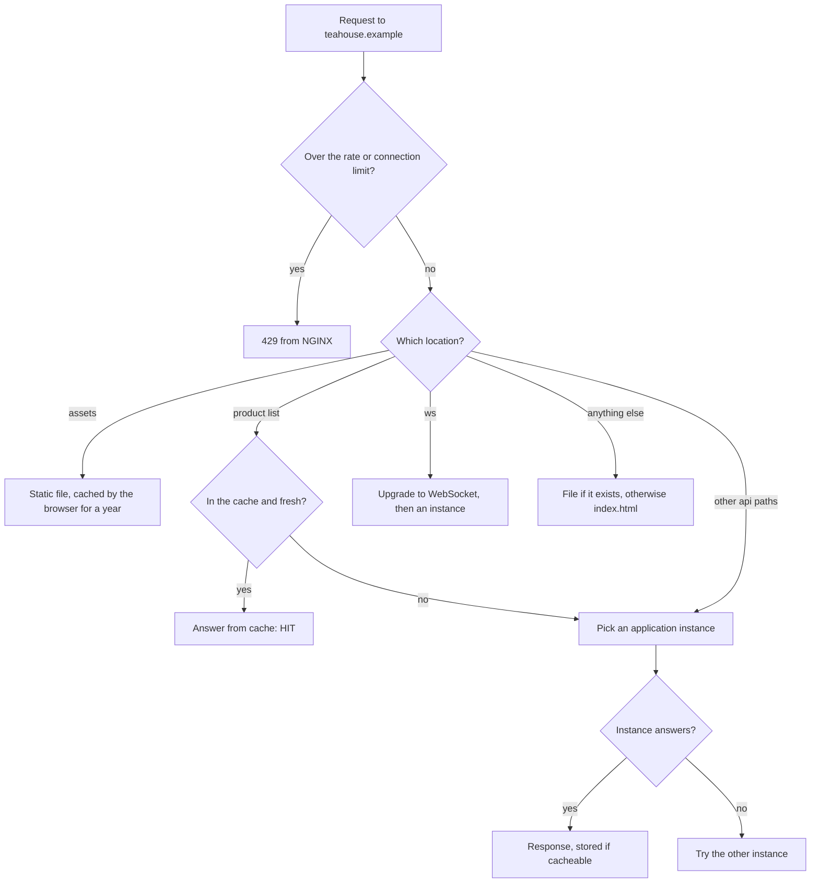

# Project part 2: static files, limits, WebSockets and operations

## Before this lesson

This lesson continues [Project part 1: reverse proxy, TLS and redirects](#/lesson/nginx/project-proxy-tls) and adds one layer from each of these: [Limiting request rate, connections and bandwidth](#/lesson/nginx/rate-conn-limits), [Proxy caching: zones, keys and validity](#/lesson/nginx/cache-basics), [Health checks, retries, draining and slow start](#/lesson/nginx/lb-health-checks), [HTTP/2, HTTP/3, server push and gRPC](#/lesson/nginx/http2-http3-grpc) for WebSocket, [Access logs, error logs and request tracing](#/lesson/nginx/logging) and [Buffering, sendfile, gzip, brotli and file caches](#/lesson/nginx/perf-buffers-compression).

## In plain words

The shop from part 1 is open. The door has a lock, the sign is up, and customers can find the counter. Opening day is not the hard part of running a shop. The hard part is every day after it.

A shop that lasts has things a newly opened one lacks. Regulars do not queue for items kept ready on the shelf (**caching**). One customer cannot empty the stockroom or block the till for an hour (**limits**). There is a notebook recording every sale and every mishap (**logs**). When one member of staff steps out, another covers and the customers never notice (**health checks and rolling restarts**). And there is a folder under the counter that says what to do when the lights go out (**a runbook**).

Part 2 adds those to the Teahouse deployment. None of them changes what the site does. All of them change how it behaves on a bad day, which is what separates a demonstration from a service someone can be on call for. In interviews, this is the difference between "I have followed a tutorial" and "I have run something".

## Where we are and where we are going

At the end of part 1 the site block served static files and proxied `/api/`. By the end of this lesson the same server will also:

| Addition | Purpose |
|---|---|
| long-lived caching and compression for assets | faster pages, fewer requests |
| a ten-second cache for the public product list | absorb traffic spikes |
| rate and connection limits, stricter on login | contain abuse |
| a WebSocket location | live order updates |
| security headers, version hidden | reduce exposure |
| JSON access log with timings and a request ID | be able to diagnose |
| two application instances with passive health checks | restart without downtime |
| a health endpoint, status page and routine procedures | operate it |



## Step 6: shared definitions

Zones, formats and maps belong to the `http` level, so they go into their own file, `/etc/nginx/conf.d/00-http.conf`. The `00-` prefix makes it load before the site file, since `conf.d` is read in alphabetical order.

```nginx
log_format json_line escape=json
    '{"time":"$time_iso8601","id":"$request_id","addr":"$remote_addr",'
    '"method":"$request_method","uri":"$request_uri","status":$status,'
    '"bytes":$body_bytes_sent,"rt":$request_time,"urt":"$upstream_response_time",'
    '"upstream":"$upstream_addr","cache":"$upstream_cache_status","agent":"$http_user_agent"}';

limit_req_zone  $binary_remote_addr zone=general:10m rate=20r/s;
limit_req_zone  $binary_remote_addr zone=login:10m   rate=10r/m;
limit_conn_zone $binary_remote_addr zone=perip:10m;
limit_req_status  429;
limit_conn_status 429;

proxy_cache_path /var/cache/nginx/teahouse levels=1:2 keys_zone=teahouse:10m
                 max_size=500m inactive=10m use_temp_path=off;

map $http_upgrade $connection_upgrade {
    default upgrade;
    ""      close;
}

map "$http_authorization$cookie_session" $skip_cache {
    default 1;
    ""      0;
}

gzip on;
gzip_comp_level 5;
gzip_min_length 1024;
gzip_vary on;
gzip_types text/plain text/css application/json application/javascript image/svg+xml;
```

Every piece has appeared in an earlier lesson. In order: a JSON log format with timings, cache status and a request ID; two rate-limit zones and one connection zone, all keyed by client address, answering 429; a cache store of at most 500 megabytes whose entries are dropped after ten unused minutes; the WebSocket helper map; a map that produces 1 when a request carries an `Authorization` header or a `session` cookie, meaning "this user is logged in, do not use the shared cache"; and compression for text types.

## Step 7: static assets and the single-page fallback

```nginx
    location /assets/ {
        expires 1y;
        add_header Cache-Control "public, immutable";
        include snippets/security-headers.conf;
        try_files $uri =404;
    }

    location / {
        try_files $uri $uri/ /index.html;
    }
```

- The build tool gives asset files names containing a fingerprint of their content, such as `app.3f9c2a.js`. A changed file gets a new name, so the old name can be cached **for ever**: `expires 1y;` plus `immutable` tells the browser not to ask again.
- `try_files $uri =404;` inside `/assets/` is deliberate. A missing script must be a 404.
- `location /` now ends in `/index.html` instead of `=404`. The front end is a **single-page application**: its JavaScript draws pages such as `/tea/oolong` in the browser, and no file by that name exists on disk. Falling back to `index.html` lets a visitor who reloads on such a page get the application, which then shows the right view.

The two rules must not be merged. If assets also fell back to `index.html`, a mistyped script URL would return HTML with status 200, and the browser would report a baffling syntax error at the first `<` of the page instead of a clear 404.

## Step 8: a small cache for the busiest endpoint

The product list is the same for every anonymous visitor and is requested on every page view.

```nginx
    location /api/products {
        proxy_cache           teahouse;
        proxy_cache_key       "$scheme$host$request_uri";
        proxy_cache_valid     200 10s;
        proxy_cache_lock      on;
        proxy_cache_use_stale updating error timeout http_502 http_503 http_504;
        proxy_cache_bypass    $skip_cache;
        proxy_no_cache        $skip_cache;
        add_header X-Cache-Status $upstream_cache_status always;
        include snippets/security-headers.conf;
        include snippets/proxy-headers.conf;
        proxy_pass http://teahouse_app;
    }
```

- `proxy_cache teahouse;` uses the zone defined in step 6.
- `proxy_cache_key` identifies an entry by scheme, host and full URI including the query string, so `?page=2` is stored separately from `?page=1`.
- `proxy_cache_valid 200 10s;` keeps successful answers for ten seconds. Prices can therefore be up to ten seconds out of date, a decision to agree with the business, not to make silently.
- `proxy_cache_lock on;` lets one request refresh an expired entry while the others wait for it.
- `proxy_cache_use_stale ...` serves the last good copy while a refresh is under way, and also when the application is failing. During a short application outage, the product list stays up.
- `proxy_cache_bypass` and `proxy_no_cache` with `$skip_cache`: logged-in users neither read from nor write to the shared cache.
- `X-Cache-Status` exposes `HIT`, `MISS`, `EXPIRED`, `STALE` or `BYPASS` in a response header, which makes the cache testable with curl.

## Step 9: limits

```nginx
    limit_req  zone=general burst=40 nodelay;
    limit_conn perip 30;

    location = /api/login {
        limit_req zone=login   burst=5  nodelay;
        limit_req zone=general burst=40 nodelay;
        include snippets/proxy-headers.conf;
        proxy_pass http://teahouse_app;
    }
```

- At server level: 20 requests per second per address with a burst of 40 served at once, and at most 30 requests in progress per address.
- The login endpoint gets an exact-match location with a far stricter zone, ten per minute, to slow password guessing. Because a location that declares `limit_req` does not inherit the server's, the general limit is repeated.

Start any new limit with `limit_req_dry_run on;` for a few days and read the log, as the limits lesson advised. Offices and mobile networks put many people behind one address.

## Step 10: WebSocket for live order status

```nginx
    location /ws/ {
        proxy_http_version 1.1;
        proxy_set_header Host              $host;
        proxy_set_header X-Real-IP         $remote_addr;
        proxy_set_header X-Forwarded-For   $proxy_add_x_forwarded_for;
        proxy_set_header X-Forwarded-Proto $scheme;
        proxy_set_header Upgrade           $http_upgrade;
        proxy_set_header Connection        $connection_upgrade;
        proxy_read_timeout 1h;
        proxy_pass http://teahouse_app;
    }
```

This location does **not** include the proxy-headers snippet. The snippet sets `Connection` to an empty string for keep-alive, which is the opposite of what an upgrade needs, and declaring the header twice would send both. Writing the headers out is clearer than fighting an include. `proxy_read_timeout 1h;` keeps quiet sockets open; the application should still send a ping every minute or so.

## Step 11: headers and exposure

`/etc/nginx/snippets/security-headers.conf`:

```nginx
add_header Strict-Transport-Security "max-age=31536000" always;
add_header X-Content-Type-Options    "nosniff" always;
add_header X-Frame-Options           "DENY" always;
add_header Referrer-Policy           "strict-origin-when-cross-origin" always;
```

- HSTS has been raised from the trial value to one year, after a week without problems.
- `nosniff` stops browsers from guessing a content type different from the one declared.
- `X-Frame-Options DENY` forbids other sites from embedding yours in a frame, a defence against clickjacking.
- `Referrer-Policy` limits how much of your URLs is revealed to other sites.

The snippet is included at server level **and again in every location that has its own `add_header`** (`/assets/` and `/api/products` above). This is the `add_header` inheritance rule from the security module, and it is the most common way security headers go missing: someone adds one header in one location and silently removes four.

At server level, `server_tokens off;` removes the version number from the `Server` header and from error pages.

## Step 12: two application instances and health checks

One application process means every restart is a short outage. Run two, on ports 8000 and 8001 (with systemd, a template unit `teahouse@.service` started as `teahouse@8000` and `teahouse@8001`).

```nginx
upstream teahouse_app {
    zone teahouse_app 64k;
    server 127.0.0.1:8000 max_fails=2 fail_timeout=10s;
    server 127.0.0.1:8001 max_fails=2 fail_timeout=10s;
    keepalive 16;
}
```

and in the proxied locations, through the snippet:

```nginx
proxy_next_upstream       error timeout http_502 http_503;
proxy_next_upstream_tries 2;
```

- `max_fails=2 fail_timeout=10s` is the **passive health check**: two failed attempts within ten seconds mark an instance as unavailable for the next ten seconds, after which NGINX tries it again with a real request.
- `proxy_next_upstream` lists the failures after which a request is offered to the other instance: connection errors, timeouts, and 502 or 503 answers. Requests with non-idempotent methods such as `POST` are retried only if nothing had been sent yet, which covers the refused connection of a restarting instance.
- `proxy_next_upstream_tries 2;` allows each request at most two attempts.
- Open-source NGINX learns about failures from real traffic. Active probing on a schedule (`health_check`) is an NGINX Plus feature.

A **rolling restart** is now safe: restart one instance, wait until its health URL answers, let NGINX's failure mark on it expire, then restart the other.

```bash
$ sudo systemctl restart teahouse@8000 && until curl -sf http://127.0.0.1:8000/api/health >/dev/null; do sleep 1; done
$ sleep 12
$ sudo systemctl restart teahouse@8001 && until curl -sf http://127.0.0.1:8001/api/health >/dev/null; do sleep 1; done
```

`curl -f` exits with an error while the instance is not answering 200, so the `until` loop waits for it. The `sleep 12` is a little longer than `fail_timeout`; the simulation below shows what goes wrong without it.

### Simulate it: a rolling restart seen by clients

```python-run
def rolling_restart(seconds=20, down={8000: (3, 6), 8001: (15, 18)}, max_fails=2, fail_timeout=10):
    fails = {8000: [], 8001: []}                 # times of recent failures per instance
    marked_until = {8000: -1, 8001: -1}
    turn, client_errors, retries = 0, 0, 0
    for t in range(seconds):
        for _ in range(4):                       # four requests each second
            order = [8000, 8001] if turn % 2 == 0 else [8001, 8000]
            turn += 1
            candidates = [p for p in order if marked_until[p] <= t] or order
            for attempt, port in enumerate(candidates[:2]):
                start, end = down[port]
                if start <= t < end:             # connection refused: instance is restarting
                    fails[port] = [x for x in fails[port] if x > t - fail_timeout] + [t]
                    if len(fails[port]) >= max_fails:
                        marked_until[port], fails[port] = t + fail_timeout, []
                    if attempt == 0 and len(candidates) > 1:
                        retries += 1
                        continue                 # proxy_next_upstream: try the other one
                    client_errors += 1
                break
        state = ", ".join(f"{p} {'DOWN' if down[p][0] <= t < down[p][1] else 'up'}" for p in (8000, 8001))
        print(f"t={t:2}s  {state:22} skipped by NGINX: {[p for p in marked_until if marked_until[p] > t]}")
    print(f"\nrequests retried on the other instance: {retries}   errors seen by clients: {client_errors}")

rolling_restart()
```

While an instance restarts, the first two requests sent to it are refused, retried on the other one, and never seen by a client. After those two failures NGINX stops trying that instance for ten seconds. Clients see no errors at all.

Now change the second entry of `down` to `8001: (8, 11)` and run it again. The first instance came back at second 6, yet clients now see errors. The reason is in the right-hand column: NGINX still has port 8000 marked as failed until second 13, so when 8001 goes down at second 8 there is nowhere to send the requests it refuses. A real NGINX logs `no live upstreams` at that moment. This is why the restart commands above wait longer than `fail_timeout` between the two instances, and why a short `fail_timeout` suits instances that restart quickly.

## Step 13: the site block, complete

```nginx
server {
    listen 443 ssl;
    listen [::]:443 ssl;
    http2 on;
    server_name teahouse.example;

    ssl_certificate     /etc/letsencrypt/live/teahouse.example/fullchain.pem;
    ssl_certificate_key /etc/letsencrypt/live/teahouse.example/privkey.pem;
    include snippets/tls.conf;
    include snippets/security-headers.conf;
    server_tokens off;

    access_log /var/log/nginx/teahouse.access.log json_line buffer=32k flush=5s;
    error_log  /var/log/nginx/teahouse.error.log warn;

    limit_req  zone=general burst=40 nodelay;
    limit_conn perip 30;

    root /var/www/teahouse;
    index index.html;

    location = /healthz {
        access_log off;
        default_type text/plain;
        return 200 "ok\n";
    }

    location /assets/       { ... step 7 ... }
    location = /api/login   { ... step 9 ... }
    location /api/products  { ... step 8 ... }
    location /ws/           { ... step 10 ... }

    location /api/ {
        include snippets/proxy-headers.conf;
        proxy_connect_timeout 3s;
        proxy_read_timeout    30s;
        client_max_body_size  2m;
        proxy_pass http://teahouse_app;
    }

    location / {
        try_files $uri $uri/ /index.html;
    }
}
```

Trace a few requests through the location rules to confirm the layout: `/api/login` hits the exact match; `/api/products?page=2` matches both `/api/` and `/api/products` and the longer prefix wins; `/api/cart` falls to `/api/`; `/tea/oolong` matches only `/` and receives `index.html`.

### Simulate it: limits and cache working together

```python-run
class Edge:
    def __init__(self):
        self.bucket = {}                    # address -> (excess, last_ms): general zone, 20 r/s, burst 40
        self.cache = {}                     # key -> expiry_ms
        self.app_calls = 0

    def request(self, t_ms, addr, path, logged_in=False):
        excess, last = self.bucket.get(addr, (-1.0, t_ms))
        excess = max(0.0, excess - 20 * (t_ms - last) / 1000) + 1 if addr in self.bucket else 0.0
        if excess > 40:
            return "429"
        self.bucket[addr] = (excess, t_ms)
        if path.startswith("/api/products"):
            if logged_in:
                self.app_calls += 1
                return "200 BYPASS"
            if self.cache.get(path, -1) > t_ms:
                return "200 HIT"
            self.cache[path] = t_ms + 10_000
            self.app_calls += 1
            return "200 MISS"
        self.app_calls += 1
        return "200 from the application"

edge, results = Edge(), {}
for i in range(300):                                        # a burst: 300 requests in 300 ms
    r = edge.request(i, "203.0.113.9" if i % 10 == 0 else "198.51.100.7", "/api/products")
    results[r] = results.get(r, 0) + 1
print("burst of 300 anonymous requests for the product list:", results)
print("requests that reached the application:", edge.app_calls)
print("logged-in user          ->", edge.request(400, "192.0.2.44", "/api/products", logged_in=True))
print("anonymous, 11 s later   ->", edge.request(11_400, "192.0.2.44", "/api/products"))
```

Of 300 requests arriving in a third of a second from two addresses, the limiter refuses the excess from the noisier address, the cache answers the rest, and the application is asked exactly once. That one line of output is the argument for putting NGINX in front of an application.

## Step 14: operating it

**Changing the configuration.** The files live in a Git repository. A change is edited there, reviewed, copied to the server, and applied with the same four commands every time:

```bash
$ sudo nginx -t && sudo systemctl reload nginx
$ sudo tail -n 5 /var/log/nginx/error.log
$ curl -s -o /dev/null -w '%{http_code}\n' https://teahouse.example/healthz
$ curl -sI https://teahouse.example/api/products | grep -i x-cache-status
```

Test, reload, look for new errors, and prove the site still answers. To undo, revert the commit and run the same commands.

**Watching it.**

| What | How |
|---|---|
| Is NGINX answering? | an external uptime service requests `/healthz` every minute |
| Is the application answering? | the same service requests `/api/health` through NGINX |
| Connection numbers | `stub_status` on `127.0.0.1:8080`, scraped by the exporter |
| Errors and latency | the JSON access log: share of 5xx, 95th percentile of `rt` |
| Certificate | an alert when fewer than 20 days remain; `certbot renew --dry-run` monthly |
| Disk | logs and `/var/cache/nginx` both grow; alert at 80% full |

**Housekeeping that is already done for you, and worth knowing about.** The package's `logrotate` rule rotates the logs daily, compresses old ones and signals NGINX to reopen its files. Certbot's timer renews the certificate, and the deploy hook from part 1 reloads NGINX. The cache manager process keeps the cache under `max_size`.

**A runbook.** Write the first response to each likely alarm before it rings:

| Symptom | First checks |
|---|---|
| 502 on `/api/` | `systemctl status teahouse@8000 teahouse@8001`; error log for "connection refused" |
| 504 on `/api/` | `urt` in the access log; application and database load |
| Many 429 | which addresses; is the limit too tight; is it an attack |
| Browser certificate warning | `openssl s_client` dates; `certbot renew`; was NGINX reloaded |
| Site unreachable, server fine | DNS records; firewall; the provider's status page |
| Disk full | log sizes; cache size; `logrotate` state |
| Stale prices | cache validity is ten seconds by design; check `X-Cache-Status` |

> [!INTERVIEW]
> "You have one server running NGINX and an application. How do you deploy a new application version without downtime?" Run at least two application instances behind an `upstream` group. Restart them one at a time, waiting for each to pass its health URL before touching the next. NGINX's passive checks (`max_fails`, `fail_timeout`) and `proxy_next_upstream` send requests refused by the restarting instance to the other, so clients see nothing. Reloading NGINX itself is already graceful. Then name the limits honestly: a single server is still a single point of failure, requests that were in progress on the old instance must be allowed to finish, and database changes must work with both versions at once.

## Pitfalls

- **Falling back to `index.html` for assets**, turning missing files into confusing 200 responses.
- **Caching responses for logged-in users** by forgetting the bypass, which shows one customer another's data.
- **Adding an `add_header` in one location and losing the security headers there.**
- **Including a snippet that sets `Connection ""` in the WebSocket location.**
- **Enforcing a new rate limit without a dry run**, locking out an office behind one address.
- **Restarting both application instances together**, or restarting the second while NGINX still has the first marked as failed.
- **A health endpoint that is rate-limited or logged**, producing false alarms and noisy logs.
- **Buffered access logs and a hurried `tail`.** Lines appear up to five seconds late.
- **No alert on certificate expiry** because "renewal is automatic". Automation fails silently.
- **Configuration edited on the server and never committed**, so the next deployment overwrites it.

## Summary

- Fingerprinted assets are cached for a year; application routes fall back to `index.html`; the two rules are kept separate.
- A ten-second cache with locking and stale serving shields the busiest endpoint and bypasses logged-in users.
- General and login-specific rate limits and a connection cap answer 429; introduce them with a dry run.
- WebSocket needs its own headers and a long read timeout; security headers must be repeated wherever `add_header` appears.
- Two application instances, passive health checks and retries make rolling restarts invisible. Operations means a fixed change procedure, monitoring on the four signals, and a written runbook.

## Glossary

- **Clickjacking**: tricking a user into clicking a hidden framed page.
- **Fingerprinted file name**: a name containing a hash of the file's content.
- **Passive health check**: judging a server by the outcome of real requests.
- **Rolling restart**: restarting instances one at a time so that service continues.
- **Runbook**: written first steps for each expected alarm.
- **Single-page application**: a site whose pages are drawn in the browser by JavaScript.
- **Smoke test**: a quick check that the basics work after a change.
- **Template unit**: a systemd unit file that can be started several times with a parameter.
- **Uptime check**: an external service that requests a URL on a schedule.

## Check yourself

```quiz
[
  {"q": "Why does `/assets/` use `try_files $uri =404;` while `/` uses `try_files $uri $uri/ /index.html;`?",
   "options": ["Assets are larger", "A missing asset must be a 404, while unknown page paths belong to the single-page application", "try_files cannot be used twice", "index.html is cached for a year"], "answer": 1,
   "explain": "Falling back to index.html for a missing script would return HTML with 200 and cause confusing browser errors."},
  {"q": "A logged-in user requests `/api/products`. With `proxy_cache_bypass $skip_cache;` and `proxy_no_cache $skip_cache;`, what happens?",
   "options": ["Served from cache", "Fetched from the application and not stored", "Rejected with 401", "Fetched and stored for everyone"], "answer": 1,
   "explain": "bypass skips reading the cache; no_cache skips writing. Personal responses stay out of the shared cache."},
  {"q": "The `/api/login` location declares its own `limit_req zone=login ...;`. Why is the general zone listed again there?",
   "options": ["It is not needed", "limit_req directives are inherited only when the location declares none", "The login zone is smaller", "nodelay requires two zones"], "answer": 1,
   "explain": "Like add_header, a level that declares limit_req does not inherit those of the outer level."},
  {"q": "Why does the WebSocket location not include the proxy-headers snippet?",
   "options": ["Snippets cannot be used with WebSocket", "The snippet sets Connection to empty, which conflicts with the upgrade header", "WebSocket does not use the Host header", "It would disable TLS"], "answer": 1,
   "explain": "An upgrade needs Connection: upgrade; the snippet's empty Connection header is for keep-alive."},
  {"q": "With `max_fails=2 fail_timeout=10s`, an instance refuses two connections within a few seconds. What does NGINX do?",
   "options": ["Removes it permanently", "Stops sending it requests for 10 seconds, then tries again", "Restarts it", "Returns 503 to everyone"], "answer": 1,
   "explain": "The passive check marks it unavailable for fail_timeout, after which a real request probes it."},
  {"q": "During a rolling restart, a GET request is sent to the instance that is down. What does the client see with `proxy_next_upstream error timeout;`?",
   "options": ["502", "A normal response from the other instance", "504", "A redirect"], "answer": 1,
   "explain": "A connection error makes NGINX try the next server in the group, transparently to the client."},
  {"q": "Which sequence is the right habit after editing the configuration?",
   "options": ["restart, then test", "nginx -t, reload, check the error log, smoke-test a URL", "reload twice", "delete the cache, restart"], "answer": 1,
   "explain": "Test before reloading, then confirm that no new errors appear and the site still answers."}
]
```

> **Source:** DeJonghe, NGINX Cookbook, ch. 2 (passive health checks), ch. 3 (limiting connections and rate), ch. 4 (caching zones, cache locking, cache bypass, cache performance), ch. 14 (access logs) and ch. 15 (keeping connections open upstream, buffering access logs). Docs: https://nginx.org/en/docs/http/ngx_http_proxy_module.html#proxy_cache_use_stale, https://nginx.org/en/docs/http/ngx_http_upstream_module.html#max_fails, https://nginx.org/en/docs/http/websocket.html, https://nginx.org/en/docs/http/ngx_http_headers_module.html, https://developer.mozilla.org/en-US/docs/Web/HTTP/Headers
