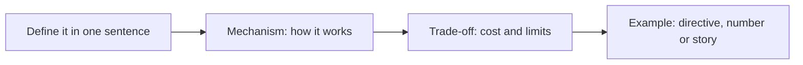
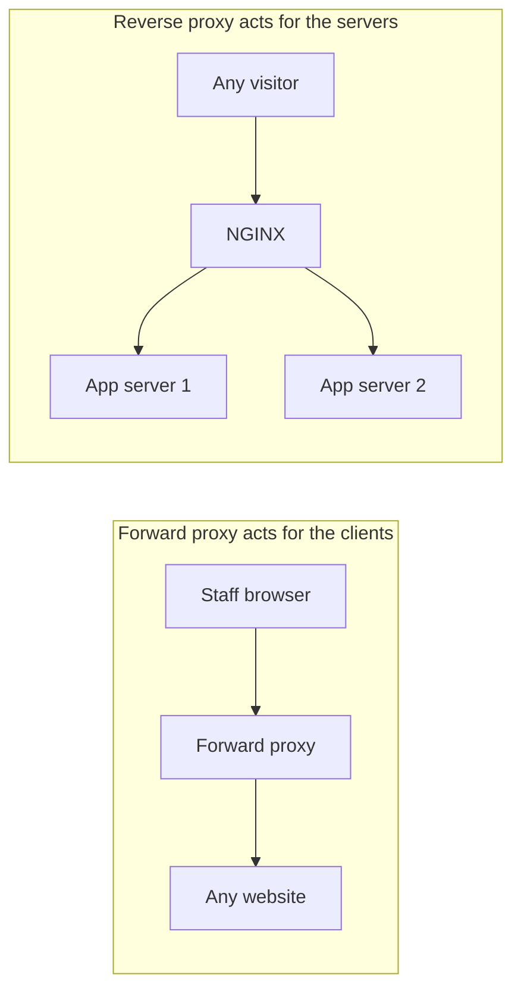
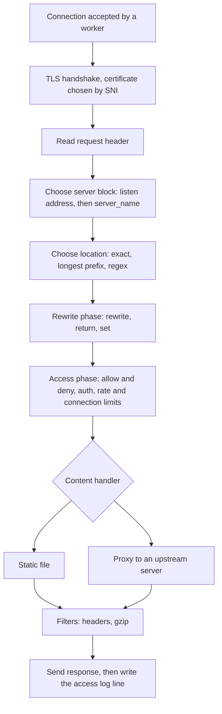

# Interview essentials: concepts and comparisons

## Before this lesson

This lesson gathers the whole track into the questions an interviewer for a backend or DevOps role is likely to ask. It leans most on [Web servers, reverse proxies and load balancers from zero](#/lesson/nginx/what-nginx-is), [HTTP load balancing and the balancing methods](#/lesson/nginx/lb-http-upstreams), [Limiting request rate, connections and bandwidth](#/lesson/nginx/rate-conn-limits), [Proxy caching: zones, keys and validity](#/lesson/nginx/cache-basics), [TLS, HTTPS redirects, HSTS and upstream encryption](#/lesson/nginx/tls-https-hsts) and [Workers, connections, keepalive and OS tuning](#/lesson/nginx/perf-connections). If an answer below is unfamiliar, the linked lesson has the full explanation.

## In plain words

A driving examiner does not only check whether you arrive. They watch whether you look in the mirror before pulling out. Two candidates can reach the same destination, and one of them passes.

Technical interviews work the same way. "What is a reverse proxy?" has a one-sentence answer that most candidates can give. What the interviewer listens for is everything around it: whether you can say *how* it works, *why* someone would choose it, what it *costs*, and whether you have *seen it* in practice. A memorised definition sounds like arriving without checking the mirror.

This lesson gives model answers to the concept and comparison questions. Do not memorise the wording. Learn the shape, and say it in your own words. The next lesson covers the other half of an interview: debugging scenarios and "what does this configuration do?" puzzles.

## The shape of a good answer

Use four moves, in this order, and stop when you have made them:

1. **Define** it in one plain sentence.
2. **Explain the mechanism**: what happens, step by step.
3. **Give the trade-off**: what it costs, or when you would not use it.
4. **Anchor it** with a concrete example, a directive name, or a number.



An answer of four to six sentences that makes all four moves beats two minutes of everything you know. If the interviewer wants more, they will ask, and you have shown them where the depth is.

## Core concepts

### "What is NGINX and what is it used for?"

> NGINX is an event-driven server for HTTP and for plain TCP and UDP traffic. People use it in a handful of roles, often several at once: a **web server** that sends static files; a **reverse proxy** that receives requests and forwards them to application servers; a **load balancer** that spreads those requests over several servers; a **cache** for responses; and the place where **TLS** is terminated. Because it sits in front of everything, it is also where teams put cross-cutting concerns such as rate limiting, access control, compression and logging. I have used it in front of an application server to serve the static front end, proxy the API, terminate HTTPS and apply rate limits.

Replace the last sentence with something true about you. A project like the one in the previous two lessons counts.

### "What is the difference between a forward proxy and a reverse proxy?"

> Both sit between clients and servers; the difference is whose side they are on. A **forward proxy** acts for clients: a company's outbound proxy that staff browsers go through to reach the internet. The servers do not know who the real client is. A **reverse proxy** acts for servers: clients connect to it thinking it is the site, and it forwards to application servers the client never sees. NGINX is used almost entirely as a reverse proxy. The benefits are a single public entry point, the ability to add or replace backends freely, and one place for TLS, caching and limits.



### "How does NGINX handle tens of thousands of connections?"

> With an event-driven, non-blocking design. A **master** process reads the configuration and manages a small fixed set of **worker** processes, normally one per core. Each worker runs an event loop: it asks the kernel, through `epoll` on Linux, which of its thousands of connections have something to do, handles those briefly without ever waiting on one, and loops. A connection that is idle costs a few kilobytes of memory and no processor time. The older model, one process or thread per connection, pays memory and context switches for every connection, including the idle ones. The limit in NGINX is `worker_processes` times `worker_connections`, and the weakness is anything that blocks a worker, such as slow disk reads, which is what thread pools are for.

The simulation makes the memory argument concrete. The figures are rough, on purpose.

```python-run
def memory_mb(connections, model, cores=4):
    if model == "thread per connection":
        return connections * 1.0            # about 1 MB of stack and bookkeeping per thread
    workers_mb = cores * 10                 # a few fixed worker processes
    return workers_mb + connections * 0.01  # about 10 kB of state per connection

def context_switch_pressure(active, model, cores=4):
    runnable = active if model == "thread per connection" else min(active, cores)
    return max(0, runnable - cores)         # things wanting a core beyond what exists

print("connections  active   model                    memory     waiting for a core")
for total, active in [(1_000, 50), (10_000, 500), (50_000, 2_000)]:
    for model in ("thread per connection", "event loop"):
        print(f"{total:10}  {active:6}   {model:22} {memory_mb(total, model):8.0f} MB   {context_switch_pressure(active, model):6}")
```

At 50,000 mostly idle connections the thread model needs tens of gigabytes and has thousands of threads competing for four cores. The event loop needs a few hundred megabytes and never has more runnable processes than cores. This problem, serving ten thousand clients on one machine, was known as **C10k**, and it is the reason NGINX was written.

### "Why put NGINX in front of an application server such as Gunicorn, uvicorn or Node?"

> Because the two are good at different things. Application servers have a small number of workers, each expensive. NGINX **buffers**: it reads a slow client's upload completely before passing it on, and takes the application's response at full speed and feeds it to the slow client itself, so application workers are never held by a slow network. It also serves static files without touching the application, terminates TLS, compresses, caches, limits abusive clients, and lets me restart application instances behind it without dropping connections. The cost is one more component to configure and monitor.

### "What happens when a request arrives at NGINX?"

> The kernel completes the TCP handshake and a worker accepts the connection; for HTTPS the TLS handshake follows, using the server name from SNI to pick a certificate. The worker reads the request header. It chooses a **server block**: first by the address and port of the `listen` directive, then by matching the `Host` header against `server_name` in the order exact, leading wildcard, trailing wildcard, regex, and otherwise the default server. Within it, it chooses a **location**: exact match, else the longest prefix, unless a regex matches and the prefix was not marked `^~`. The request then passes through phases: rewrites, access checks and limits, then the content handler, which is a static file, a `return`, or a proxy to an upstream chosen by the balancing method. The response flows back through filters that add headers and compress, and when the last byte is sent the access log line is written.



## Load balancing

### "Which load-balancing methods does NGINX have, and when would you use each?"

| Method | Directive | Chooses | Use when |
|---|---|---|---|
| Round robin | (default) | each server in turn, respecting `weight` | servers and requests are similar |
| Least connections | `least_conn;` | the server with the fewest active connections | request durations vary widely |
| IP hash | `ip_hash;` | by client address | simple stickiness is needed |
| Generic hash | `hash $key consistent;` | by any key, on a hash ring | cache servers, or stickiness by user ID or URL |
| Random with two choices | `random two least_conn;` | the better of two random picks | several balancers act independently |
| Least time | `least_time header;` | lowest response time and fewest connections | servers differ in speed (NGINX Plus, or recent open source) |

> Round robin is the default and is fine when every request costs about the same. If durations vary, say most take 50 milliseconds and some take five seconds, round robin can pile slow requests onto one server, and `least_conn` adapts by looking at what is in progress. When a client must keep returning to the same server I would use a hash, with the `consistent` parameter so that adding or removing a server remaps only a small share of keys. I would also say that stickiness is a workaround: the better fix is to keep session state outside the application servers.

```python-run
import itertools

def simulate(method, durations, servers=3):
    """Requests arrive one per tick; each occupies its server for `duration` ticks."""
    busy_until = [[] for _ in range(servers)]          # finish times of requests in progress
    rr = itertools.cycle(range(servers))
    worst_queue = 0
    for now, duration in enumerate(durations):
        for s in range(servers):
            busy_until[s] = [t for t in busy_until[s] if t > now]
        active = [len(b) for b in busy_until]
        choice = next(rr) if method == "round robin" else active.index(min(active))
        busy_until[choice].append(now + duration)
        worst_queue = max(worst_queue, len(busy_until[choice]))
    return worst_queue

mixed = [30 if i % 3 == 0 else 1 for i in range(90)]   # every third request is slow
print("most requests in progress on one server at once")
print("  round robin      :", simulate("round robin", mixed))
print("  least connections:", simulate("least conn", mixed))
```

Every third request is slow, and with three servers round robin sends every slow request to the same one. Least connections notices the pile-up and spreads it. The example is contrived to make the effect obvious, but the same thing happens in milder form with real traffic.

### "What is the difference between layer 4 and layer 7 load balancing?"

> The layers are those of the network model. A **layer 4** balancer works on connections: it sees addresses and ports, picks a backend when a connection opens and relays bytes without understanding them. It is fast and works for any protocol, including databases. A **layer 7** balancer understands HTTP: it can route by host, path, header or cookie, retry a failed request on another server, cache, rewrite and terminate TLS. In NGINX these are the `stream` module and the `http` module. A typical design puts a simple layer 4 balancer at the edge for availability and NGINX at layer 7 behind it for the logic. One consequence worth knowing: with long-lived multiplexed connections such as gRPC, a layer 4 balancer pins all of a client's calls to one backend.

### "How do health checks work?"

> Open-source NGINX uses **passive** checks: it watches real requests. With `max_fails=3 fail_timeout=30s`, three failed attempts within 30 seconds take a server out of rotation for 30 seconds, after which a live request tries it again. `proxy_next_upstream` decides which failures cause a retry on another server. **Active** checks, where NGINX sends its own probe requests on a schedule and can require a particular status or body, are an NGINX Plus feature. The weakness of passive checks is that a real user's request is the probe.

## Comparisons

### "NGINX or Apache?"

| | NGINX | Apache httpd |
|---|---|---|
| Concurrency model | event-driven workers | process or thread per connection in the classic modes; an event mode exists |
| Static files and many idle connections | very efficient | heavier |
| Dynamic content | proxies to a separate application process | can run code inside the server, such as `mod_php` |
| Per-directory configuration | none; central files only | `.htaccess` files read on each request |
| Configuration reload | graceful by default | graceful available |

> NGINX's event model makes it the stronger choice as a reverse proxy and for many simultaneous connections. Apache's strengths are running application code inside the server and `.htaccess`, which lets users of shared hosting change settings without touching the main configuration; that same feature costs a file lookup on every request. Many sites run both: NGINX in front, Apache behind for a legacy application.

### "NGINX, HAProxy, Envoy or a cloud load balancer?"

| Tool | Strength | Typical place |
|---|---|---|
| **NGINX** | web server, proxy, cache and balancer in one; simple files | the edge of a service, or in front of an application |
| **HAProxy** | pure load balancing with very detailed health checks and statistics in the free version | dedicated balancer tiers |
| **Envoy** | configured dynamically through APIs, deep observability | service meshes and Kubernetes gateways |
| **Cloud load balancer** | managed, scales and survives zone failures without your effort | the outermost layer in a cloud |

> They overlap, and the honest answer is that the choice follows the job and the team's skills. If I also need to serve files and cache, NGINX. If I need only balancing with rich health checks, HAProxy. If the configuration changes every few seconds and is driven by a control plane, Envoy. In a cloud I would start with the managed balancer for availability and put NGINX behind it for anything its rules cannot express.

### "What does NGINX Plus add over open-source NGINX?"

> The commercial edition adds operational features around the same core: active health checks; a REST API to change upstreams without a reload, with a live dashboard and detailed per-upstream metrics; a key-value store; JWT validation and single sign-on built in; clustering through zone synchronisation, so rate limits and sessions are shared between instances; cache purging; and commercial support. Some things that used to be Plus-only have moved into open source in recent releases, DNS re-resolution of upstream names with `resolve` for example, so I would check the current documentation before claiming a feature needs Plus.

That last sentence is worth saying. It is accurate, and it shows a habit interviewers value.

## Operations

### "What happens on `nginx -s reload`? Is there downtime?"

> No downtime. The master process receives the `HUP` signal, re-reads and validates the configuration, and if it is valid starts **new workers** with it. It then tells the **old workers** to stop accepting connections and exit once their current requests finish. For a moment both generations run side by side. If the new configuration is invalid, the master keeps the old workers and nothing changes. A restart, by contrast, stops everything and drops connections. The one thing to watch is long-lived connections such as WebSockets, which keep old workers alive until they close; `worker_shutdown_timeout` bounds that.

### "How does the rate limiter work?"

> It is a leaky bucket per key, usually the client address, held in a shared memory zone. A rate such as `10r/s` is enforced as one request per 100 milliseconds. `burst` is the bucket's depth: that many extra requests are accepted. By default they are delayed so that output is smooth; with `nodelay` they are forwarded at once while still occupying burst slots that drain at the configured rate. Requests beyond the burst are rejected with 503, or 429 if `limit_req_status` is set. Counters are per instance, so three NGINX machines enforce three times the limit unless clients are pinned to one machine or the zones are synchronised.

### "How does caching work, and how do you avoid a stampede?"

> NGINX stores upstream responses on disk under a key, by default built from scheme, host and URI, with metadata in a shared memory zone. Validity comes from the upstream's `Cache-Control` and `Expires` headers or from `proxy_cache_valid`. A **stampede** is what happens when a popular entry expires and many requests all go to the application at once. `proxy_cache_lock on;` lets one request fetch while the others wait, and `proxy_cache_use_stale updating;` serves the old copy to everyone else during the refresh. I would also make sure personalised responses bypass the cache.

### "How many clients can one NGINX serve?"

> At most `worker_processes` times `worker_connections`, and about half of that as a reverse proxy, since each request needs a connection to the upstream as well. Each connection needs a file descriptor, so `worker_rlimit_nofile` must be at least double `worker_connections`. In practice the application behind it saturates long before NGINX does.

## Rapid-fire facts

| Question | Answer |
|---|---|
| Default `worker_connections` | 512 (packages usually set 1024) |
| Default status for a rate-limited request | 503 |
| Default `client_max_body_size` | 1 megabyte; larger bodies get 413 |
| Default `proxy_read_timeout` | 60 seconds |
| Default `keepalive_timeout` | 75 seconds |
| Default `gzip_types` | `text/html` only |
| Test the configuration | `nginx -t` |
| Print the whole effective configuration | `nginx -T` |
| Signal for reload | `HUP` |
| Signal to reopen logs | `USR1` |
| NGINX's "close without answering" status | 444 |
| NGINX's "client went away" status | 499 |
| Enable HTTP/2 on current versions | `http2 on;` |
| What `return 301` needs for the full URL | `$request_uri` |

> [!INTERVIEW]
> When you do not know an answer, say what you do know and how you would find out: "I have not used the stream module in production. I know it balances raw TCP and UDP without parsing HTTP, and I would check the documentation for how its health checks differ." A bounded, honest answer scores better than a confident wrong one, and far better than silence.

## Pitfalls

- **Reciting directives without saying why.** "I would set `proxy_buffering on`" means little; "so that slow clients do not hold application workers" is the answer.
- **Claiming a commercial feature for open-source NGINX**, such as active health checks or built-in JWT validation.
- **Saying NGINX is "faster than Apache"** with no mechanism. Talk about the event model and idle connections.
- **Confusing forward and reverse proxies.** Remember whose side each is on.
- **"Reload has downtime."** It does not; know the worker hand-over.
- **Forgetting the halving** in the capacity formula for proxied traffic.
- **Recommending sticky sessions as a design**, without noting that shared session storage is the real fix.
- **Answering a comparison with a winner.** Give criteria and say when each fits.
- **Talking for three minutes.** Make the four moves and stop.

## Summary

- Shape each answer: definition, mechanism, trade-off, example.
- NGINX is an event-driven server used as web server, reverse proxy, load balancer, cache and TLS terminator; its design keeps idle connections almost free.
- Know the balancing methods and what each is for, layer 4 against layer 7, and passive against active health checks.
- Compare tools by criteria: Apache for in-process code and `.htaccess`, HAProxy for pure balancing, Envoy for API-driven configuration, cloud balancers for managed availability.
- Reload is graceful; limits are leaky buckets per key; caching needs a lock and stale serving; capacity is workers times connections, halved for proxying.

## Glossary

- **C10k**: the problem of serving ten thousand simultaneous clients on one machine.
- **Control plane**: the system that computes and distributes configuration to proxies.
- **Cross-cutting concern**: a need shared by every service, such as TLS or logging.
- **Event loop**: a cycle of asking which connections are ready and handling each briefly.
- **Forward proxy**: a proxy acting on behalf of clients.
- **Layer 4**: the transport layer, where connections and ports live.
- **Layer 7**: the application layer, where HTTP lives.
- **Non-blocking**: never waiting on one connection while others have work.
- **Reverse proxy**: a proxy acting on behalf of servers.
- **Service mesh**: a set of proxies placed beside every service and managed centrally.
- **Stampede**: many requests regenerating the same expired cache entry at once.
- **TLS termination**: ending the encrypted connection at the proxy.

## Check yourself

```quiz
[
  {"q": "Which description of a reverse proxy is correct?",
   "options": ["It hides clients from servers", "It accepts requests on behalf of servers and forwards them to backends the client never sees", "It only caches", "It works only at layer 4"], "answer": 1,
   "explain": "A reverse proxy is on the servers' side; a forward proxy is on the clients' side."},
  {"q": "Why can one NGINX worker hold thousands of connections?",
   "options": ["It starts a thread for each", "It uses an event loop and non-blocking I/O, so idle connections cost only memory", "It queues them on disk", "The kernel handles HTTP for it"], "answer": 1,
   "explain": "The worker asks the kernel which connections are ready and handles only those, never waiting on any single one."},
  {"q": "Request durations vary from 20 ms to 10 s. Which method suits best?",
   "options": ["Round robin", "least_conn", "ip_hash", "A backup server"], "answer": 1,
   "explain": "Least connections takes requests in progress into account, so slow requests do not pile up on one server."},
  {"q": "During `nginx -s reload` with a valid configuration, what happens to requests in progress?",
   "options": ["They are dropped", "Old workers finish them and then exit, while new workers take new connections", "They are restarted", "They wait until the reload finishes"], "answer": 1,
   "explain": "The master starts new workers and gracefully retires the old ones; no connection is cut."},
  {"q": "Which feature belongs to NGINX Plus and not to open-source NGINX?",
   "options": ["least_conn", "proxy_cache", "Active health checks with the health_check directive", "limit_req"], "answer": 2,
   "explain": "Open source has passive checks through max_fails and fail_timeout; scheduled probes are commercial."},
  {"q": "A layer 4 balancer is placed in front of gRPC servers. What is the known drawback?",
   "options": ["It cannot carry TLS", "All calls on one long-lived connection go to a single backend", "It rewrites headers", "It disables HTTP/2"], "answer": 1,
   "explain": "Layer 4 balancing picks a backend per connection, and gRPC multiplexes many calls on one connection."},
  {"q": "What do `proxy_cache_lock on;` and `proxy_cache_use_stale updating;` achieve together?",
   "options": ["They encrypt the cache", "One request refreshes an expired entry while others get the old copy, preventing a stampede", "They purge the cache", "They disable caching for logged-in users"], "answer": 1,
   "explain": "The lock limits refreshes to one request; stale serving keeps everyone else answered meanwhile."},
  {"q": "In the four-move answer shape, what comes after explaining the mechanism?",
   "options": ["A second definition", "The trade-off: cost and limits", "A list of all directives", "A question back to the interviewer"], "answer": 1,
   "explain": "Define, explain the mechanism, state the trade-off, then anchor with an example."}
]
```

> **Source:** DeJonghe, NGINX Cookbook, ch. 1-4, 7 and 15 (basics, load balancing, traffic management, caching, security, performance tuning). Docs: https://nginx.org/en/docs/beginners_guide.html, https://nginx.org/en/docs/http/request_processing.html, https://nginx.org/en/docs/control.html, https://nginx.org/en/docs/http/load_balancing.html, https://docs.nginx.com/nginx/, http://www.kegel.com/c10k.html
