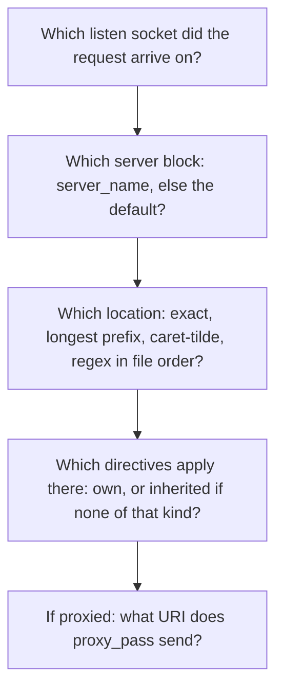

# Interview essentials: 502, 504 and location puzzles

## Before this lesson

Read [Interview essentials: concepts and comparisons](#/lesson/nginx/interview-concepts) first. This lesson applies [How NGINX picks a location block](#/lesson/nginx/location-matching), [try_files, return, rewrite and the proxy_pass slash](#/lesson/nginx/try-files-rewrite-return), [Serving a first static site and choosing a server block](#/lesson/nginx/first-static-site), [A troubleshooting method and the gateway status codes](#/lesson/nginx/troubleshooting) and [Cloud deployments](#/lesson/nginx/cloud-deployments).

## In plain words

A cooking exam has two parts. In the first, the examiner asks you to explain what makes bread rise. In the second, they hand you a loaf that came out flat and ask what went wrong, or show you a recipe and ask what it will produce before anything goes in the oven.

The previous lesson was the first part. This is the second, and for operations roles it carries more weight. It comes in two forms:

- **Scenarios**: "Users are getting 502s since the last deployment. What do you do?" There is no single right answer. The interviewer is watching whether you narrow the problem down in a sensible order, or guess.
- **Puzzles**: a few lines of configuration and a URL. "Which block handles this request?" These do have one right answer, decided by rules you have already learned. People who have only copied configurations get them wrong, and people who know the rules get them right in seconds.

Both reward the same habit: slow down, apply the rules in order, and say your reasoning aloud.

## Part A: debugging scenarios

For every scenario the skeleton is the one from the troubleshooting lesson: exact symptom, who produced the response, test each link, read the error log, change one thing. The model answers below fill in that skeleton.

### 1. "After a deployment, the site returns 502."

> A 502 means NGINX could not get a valid response from the upstream, so I look at the application first, not at NGINX. I check whether the application process is running and listening on the address and port in the `upstream` or `proxy_pass` line, and request it directly with curl from the NGINX machine. Then I read NGINX's error log: "connection refused" means nothing is listening, often because the new version failed to start or listens on a different port or socket path; "prematurely closed connection" means it accepted the request and crashed; "no live upstreams" means every server is marked failed. If the application is healthy when called directly, I check that the configuration still points at the right address, and on Red Hat-family systems whether SELinux is blocking the connection.

### 2. "One endpoint returns 504 after about a minute. Everything else is fine."

> 504 after sixty seconds is the default `proxy_read_timeout` expiring: the application accepted the request and did not answer in time. Because only one endpoint is affected, the cause is in what that endpoint does, typically a slow database query or a call to another service. I would confirm with `$upstream_response_time` in the access log, then look at the application and database. I would not start by raising the timeout, because that only makes users wait longer. If the work really takes minutes, such as a report export, the right design is to return immediately and do the work in the background; if I must raise the timeout, I do it for that location only.

### 3. "Intermittent 502s, about one request in a thousand, behind a cloud load balancer."

> Rare, random 502s with a healthy application usually come from connection reuse or from DNS. First case: the balancer keeps idle connections to NGINX and NGINX's `keepalive_timeout` is shorter than the balancer's idle timeout, so the balancer sometimes sends a request on a connection NGINX is closing. Those 502s are generated by the balancer and appear in its logs, not in NGINX's. The fix is a `keepalive_timeout` longer than the balancer's. The same race exists between NGINX and the application when upstream keep-alive is on and the application's keep-alive timeout is shorter than NGINX's. Second case: NGINX resolved an upstream hostname once at start and the addresses have since changed; the fix is a `resolver` with the `resolve` parameter. I would tell the cases apart by where the 502 is logged and which upstream address appears.

### 4. "The access log is full of status 499."

> 499 is NGINX's own code for "the client closed the connection before I could respond". Nothing was sent. A few are normal: people navigate away. A lot of them, especially with request times clustered at a round number such as 30 seconds, mean that something in front of NGINX gives up before the application answers: a load balancer's timeout, an API client's timeout, a mobile application. So the real problem is slow responses, and I would look at upstream response times for those requests.

### 5. "File uploads fail with 413."

> 413 Content Too Large comes from NGINX: the request body exceeded `client_max_body_size`, which defaults to one megabyte. The error log line says `client intended to send too large body`. I would raise the limit only in the location that accepts uploads, not globally, and check that any proxy in front and the application itself allow the same size.

### 6. "The application sees every user coming from the same IP address."

> The application sees NGINX's address because NGINX opens the connection to it. NGINX must pass the client's address in headers, `X-Real-IP` and `X-Forwarded-For`, and the application must be configured to trust them from NGINX only. If NGINX's own logs also show one address, NGINX is itself behind a balancer or CDN; then the realip module restores the client address, with `set_real_ip_from` limited to the trusted proxy ranges and `real_ip_header` naming the header, or the PROXY protocol for a layer 4 balancer. Getting this right matters for rate limits and access rules too, since they are keyed by address.

### 7. "After moving behind a load balancer that terminates TLS, the site redirects in an endless loop."

> The balancer speaks HTTPS to browsers and plain HTTP to NGINX. NGINX, or the application, sees `http`, redirects to `https`, the browser comes back through the balancer as plain HTTP again, and so on. The fix is to decide by the header the balancer sets: redirect only when `X-Forwarded-Proto` is `http`, and forward that header to the application instead of NGINX's own `$scheme`.

### 8. "I changed the configuration and nothing happened."

> In order: was it reloaded, and did the reload succeed? A reload with an invalid file leaves the old configuration running, so I check `nginx -t` and the journal. Is the file I edited included at all? `nginx -T` prints the effective configuration, and I can search it for my change. Is the request handled by the block I edited, or by another server block or a more specific location? Is a cache, in NGINX, a CDN or the browser, returning an old response? A permanent redirect in particular is remembered by browsers.

### 9. "A WebSocket connection drops after exactly one minute of silence."

> That is `proxy_read_timeout`, sixty seconds by default, which closes a proxied connection when the upstream sends nothing. Either raise it in the WebSocket location or have the application send periodic pings, preferably both. I would also confirm that the `Upgrade` and `Connection` headers are forwarded and that HTTP/1.1 is used towards the upstream.

### 10. "The site is slow. Is it NGINX?"

> I would find where the time goes before answering. In the access log, compare `$request_time` with `$upstream_response_time`. If they are nearly equal, the time is in the application. If the request time is much larger, the time is between NGINX and the client: large responses on slow connections, or missing compression. On the NGINX machine I would look at processor use per worker, at `accepts` against `handled` on the status page, and at whether upstream keep-alive is on. In my experience NGINX is rarely the bottleneck, but I would show that with numbers instead of asserting it.

## Part B: configuration puzzles

Work every puzzle through the same five questions, in order. Most wrong answers come from skipping one.



### Puzzle 1: prefix against regex

```nginx
location /images/           { return 200 "A\n"; }
location ~ \.(png|jpg)$     { return 200 "B\n"; }
```

*Which block handles `/images/logo.png`?* **B.** NGINX remembers the longest matching prefix, `/images/`, then tries regexes. A matching regex beats a plain prefix. To make A win, write `location ^~ /images/`, which tells NGINX not to consult regexes when this prefix is the longest match.

### Puzzle 2: two regexes

```nginx
location ~ ^/api/           { return 200 "A\n"; }
location ~ \.json$          { return 200 "B\n"; }
```

*Which handles `/api/data.json`?* **A.** Both match, and among regexes the **first in the file** wins. Length and specificity play no part. Swapping the two lines changes the answer.

### Puzzle 3: the exact match that does not stick

```nginx
location = / { index index.html; add_header X-From "exact"; }
location /   { add_header X-From "prefix"; }
```

*A browser requests `/`. Which `X-From` header comes back?* **"prefix".** The request matches the exact location, where `index` finds `index.html` and performs an **internal redirect** to `/index.html`. Location matching runs again for the new URI, which is not exactly `/`, so the prefix location serves the file. Internal redirects, from `index`, `try_files`, `error_page` and `rewrite ... last`, always restart location selection.

### Puzzle 4: a prefix without a slash

```nginx
location /api { proxy_pass http://backend; }
```

*Does this handle `/apiary/list`?* **Yes.** A prefix location is a plain string comparison, and `/apiary/list` begins with `/api`. Write `location /api/` to mean the folder, and add `location = /api` if the bare path matters.

### Simulate it: check any location puzzle

```python-run
import re

def choose(locations, uri):
    """locations: (modifier, pattern, label) in file order. Returns the label that handles uri."""
    for mod, pat, label in locations:
        if mod == "=" and uri == pat:
            return label
    best = None
    for mod, pat, label in locations:
        if mod in ("", "^~") and uri.startswith(pat) and (best is None or len(pat) > len(best[1])):
            best = (mod, pat, label)
    if best and best[0] == "^~":
        return best[2]
    for mod, pat, label in locations:
        if mod in ("~", "~*") and re.search(pat, uri, re.I if mod == "~*" else 0):
            return label
    return best[2] if best else "no location: handled at server level"

puzzle1 = [("", "/images/", "A prefix"), ("~", r"\.(png|jpg)$", "B regex")]
puzzle1_fixed = [("^~", "/images/", "A prefix with ^~"), ("~", r"\.(png|jpg)$", "B regex")]
puzzle2 = [("~", r"^/api/", "A first regex"), ("~", r"\.json$", "B second regex")]
puzzle3 = [("=", "/", "exact"), ("", "/", "prefix")]
puzzle4 = [("", "/api", "api prefix")]

print("1 ", choose(puzzle1, "/images/logo.png"))
print("1'", choose(puzzle1_fixed, "/images/logo.png"))
print("2 ", choose(puzzle2, "/api/data.json"))
print("3 ", choose(puzzle3, "/"), "-> then, after the index redirect:", choose(puzzle3, "/index.html"))
print("4 ", choose(puzzle4, "/apiary/list"))
print("5 ", choose([("", "/docs/", "docs"), ("~*", r"\.PDF$", "pdf")], "/docs/guide.pdf"))
```

Change the lists and the URIs to test your own cases before an interview. The function is twenty lines because the algorithm is short; the difficulty is only in remembering its order.

### Puzzle 5: the proxy_pass slash

For a request to `/app/users?id=7`, what does the upstream receive?

| Configuration | Upstream receives | Why |
|---|---|---|
| `location /app/ { proxy_pass http://backend; }` | `/app/users?id=7` | no URI part: passed unchanged |
| `location /app/ { proxy_pass http://backend/; }` | `/users?id=7` | the matched prefix is replaced by `/` |
| `location /app/ { proxy_pass http://backend/v2/; }` | `/v2/users?id=7` | the prefix is replaced by `/v2/` |
| `location /app/ { proxy_pass http://backend/v2; }` | `/v2users?id=7` | replaced by `/v2`, and the slash is lost |
| `location /app { proxy_pass http://backend/; }` | `//users?id=7` | `/app` replaced by `/`, leaving the next slash |

The rule in one sentence: **if `proxy_pass` has anything after the host, even a single slash, the part of the URI matched by the location is replaced by it; if it has nothing, the URI is passed as it came.** Keep the trailing slashes of the location and of `proxy_pass` matched: both or neither.

### Puzzle 6: root against alias

For a request to `/static/app.css`, which file is opened?

| Configuration | File | Why |
|---|---|---|
| `location /static/ { root /var/www/site; }` | `/var/www/site/static/app.css` | `root` **appends the whole URI** |
| `location /static/ { alias /var/www/assets/; }` | `/var/www/assets/app.css` | `alias` **replaces the matched prefix** |
| `location /static/ { alias /var/www/assets; }` | `/var/www/assetsapp.css` | no trailing slash on the alias |

A well-known security mistake hides in the mismatched form `location /static { alias /var/www/assets/; }`. The URI `/static../secret.txt` matches the prefix `/static`, the remainder `../secret.txt` is appended to the alias, and the path climbs out of the folder. Slashes on both, always.

```python-run
def upstream_uri(location, proxy_pass, request_uri):
    path, mark, query = request_uri.partition("?")
    host, slash, uri_part = proxy_pass.split("://", 1)[1].partition("/")
    new_path = path if not slash else "/" + uri_part + path[len(location):]
    return new_path + mark + query

def file_opened(location, directive, value, uri):
    return value + uri if directive == "root" else value + uri[len(location):]

print("proxy_pass variants for /app/users?id=7")
for loc, target in [("/app/", "http://backend"), ("/app/", "http://backend/"), ("/app/", "http://backend/v2/"),
                    ("/app/", "http://backend/v2"), ("/app", "http://backend/")]:
    print(f"  location {loc:6} proxy_pass {target:20} -> {upstream_uri(loc, target, '/app/users?id=7')}")

print("files for /static/app.css")
for loc, directive, value in [("/static/", "root", "/var/www/site"), ("/static/", "alias", "/var/www/assets/"),
                              ("/static/", "alias", "/var/www/assets")]:
    print(f"  location {loc:9} {directive:5} {value:17} -> {file_opened(loc, directive, value, '/static/app.css')}")
print("  traversal:", file_opened("/static", "alias", "/var/www/assets/", "/static../secret.txt"))
```

### Puzzle 7: the missing header

```nginx
server {
    add_header X-Frame-Options "DENY";

    location /assets/ {
        add_header Cache-Control "public, max-age=31536000";
    }
}
```

*Does a response from `/assets/` carry `X-Frame-Options`?* **No.** `add_header` directives are inherited from the outer level **only if the current level has none of its own**. The location declares one, so it gets only that one. The same rule applies to `proxy_set_header`, `limit_req` and `access_log`. A second trap in the same directive: without the `always` parameter, `add_header` applies only to successful and redirect responses, so error pages lack the header.

### Puzzle 8: which server block?

```nginx
server { listen 80;              server_name shop.test;      return 200 "A\n"; }
server { listen 80;              server_name *.shop.test;    return 200 "B\n"; }
server { listen 192.0.2.10:80;   server_name admin.shop.test; return 200 "C\n"; }
```

The machine has addresses `192.0.2.10` and `192.0.2.11`.

- *`Host: www.shop.test` arriving on `192.0.2.11`?* **B**, by the wildcard.
- *`Host: other.example` arriving on `192.0.2.11`?* **A.** No name matches, no block is marked `default_server`, so the **first block in the file** for that socket is the default.
- *`Host: www.shop.test` arriving on `192.0.2.10`?* **C.** NGINX first narrows the candidates to the server blocks whose `listen` best matches the address and port the connection came in on. A block that names the address is more specific than one that listens on every address, so only C is considered there, and as the only candidate it is the default whatever the `Host` header says.

The last answer surprises most people: the `listen` address is checked before `server_name`.

### Puzzle 9: if inside a location

```nginx
location / {
    try_files $uri $uri/ /index.html;
    if ($http_x_debug) {
        add_header X-Debug "1";
    }
}
```

*A request arrives for `/tea/oolong` with an `X-Debug` header. What happens?* **404 instead of `index.html`.** An `if` block inside a location behaves like a nested location: when its condition is true, the request is handled with the `if` block's own configuration, and `try_files` is not carried into it. This is the origin of the saying "if is evil". Inside a location, the only reliably safe things to put in an `if` are `return` and `rewrite ... last`. For everything else compute a variable with `map` and use it in a normal directive.

### Puzzle 10: last, break and return

```nginx
location /old/ {
    rewrite ^/old/(.*)$ /new/$1 last;
}
location /new/ {
    proxy_pass http://backend;
}
```

*What does a client requesting `/old/page` see?* **The response for `/new/page`, with status 200 and no change in the address bar.** `rewrite ... last` changes the URI internally and restarts location matching, which lands in `/new/`. With `break` in place of `last`, processing would continue inside `/old/` with the new URI, and since that location has no content handler NGINX would look for a file. With `permanent`, or better `return 301 /new/$1` in a regex location, the *browser* is told to go to the new address.

Two rules of thumb: use `return` when the client should be redirected, since it is faster and clearer than `rewrite`; and remember that a `rewrite ... last` whose result matches the same location loops, which NGINX stops after ten rounds with a 500.

### Puzzle 11: burst arithmetic

```nginx
limit_req_zone $binary_remote_addr zone=z:10m rate=2r/s;
location /api/ { limit_req zone=z burst=5 nodelay; }
```

*Ten requests arrive from one address at the same instant. How many succeed, and what do the others get?* **Six succeed** (one within the rate plus five of burst), **four receive 503**, because no `limit_req_status` is set. *One second later, how many more can pass at once?* **Two**: the bucket has drained by two.

> [!INTERVIEW]
> When given a configuration puzzle, do not answer at once. Say the order aloud: "First the listen socket, then server_name, then the location: exact, longest prefix, check for caret-tilde, then regexes in file order." Then apply it. Interviewers give credit for the method even when a detail slips, and saying it aloud is also how you catch the slip yourself. For a scenario, start with "the first thing I would check is" and name the log line or command, not the fix.

## Pitfalls

- **Answering "regex" or "longest match" from memory** without walking the algorithm.
- **Forgetting internal redirects**: `index`, `try_files` and `error_page` restart location matching.
- **Mixing up `root` and `alias`**, or leaving their slashes unmatched.
- **Adding or removing the `proxy_pass` slash without meaning to.**
- **Assuming headers and limits accumulate across levels.** A level that declares any drops the inherited ones.
- **Putting anything but `return` or `rewrite` in a location-level `if`.**
- **Blaming NGINX for a 502 or 504** before testing the upstream.
- **Raising a timeout as the first response to a 504.**
- **Reading 499 as a server error.** The client left.
- **Forgetting that the `listen` address narrows the candidates before `server_name` is looked at.**

## Cheat sheet

| Situation | Remember |
|---|---|
| Prefix and regex both match | the regex wins unless the prefix has `^~` |
| Two regexes match | the first in the file wins |
| Exact match on `/` with `index` | the internal redirect lands in another location |
| `proxy_pass` with a URI part | replaces the matched location prefix |
| `proxy_pass` without a URI part | passes the original URI |
| `root` | path = root + full URI |
| `alias` | path = alias + URI after the location prefix |
| A level declares `add_header` | inherited `add_header` lines are dropped |
| No name matches | `default_server`, else the first block for that socket |
| `rewrite ... last` | new URI, location search restarts |
| `rewrite ... break` | new URI, stay in this location |
| `rate=2r/s burst=5 nodelay`, 10 at once | 6 pass, 4 rejected |
| 502 | upstream gave no valid answer |
| 504 | upstream gave no answer in time |
| 499 | client closed first |
| 413 | body over `client_max_body_size` |

## Summary

- Scenarios are answered with a method: symptom, who produced it, each link tested, the error log line, one change.
- 502 points at an upstream that is down or crashing, 504 at one that is slow, 499 at an impatient client, and rare 502s behind a balancer at timeouts or stale DNS.
- Location puzzles follow one algorithm: exact, longest prefix, `^~`, regexes in file order, with internal redirects restarting it.
- `proxy_pass` with a URI part and `alias` both replace the matched prefix; `root` and a bare `proxy_pass` do not.
- Directives such as `add_header` are inherited all-or-nothing; `if` in a location is safe only with `return` and `rewrite`; the `listen` address is matched before `server_name`.

## Glossary

- **Content handler**: the part of NGINX that produces the response in a location.
- **Internal redirect**: a change of URI inside NGINX that restarts location selection without the client knowing.
- **Path traversal**: reaching files outside the intended folder with `..` segments.
- **Prefix location**: a location matched by plain string comparison from the start of the URI.
- **Puzzle question**: an interview question with one answer derivable from rules.
- **Scenario question**: an open interview question about how you would investigate.
- **Trailing slash**: the final `/` of a path, significant in `location`, `proxy_pass` and `alias`.
- **URI part**: whatever follows the host and port in a `proxy_pass` value.

## Check yourself

```quiz
[
  {"q": "`location /downloads/ {...}` and `location ~* \\.zip$ {...}`. Which handles `/downloads/tools.ZIP`?",
   "options": ["The prefix, because it is longer", "The regex, because a matching regex beats a plain prefix", "Neither", "Both, in order"], "answer": 1,
   "explain": "The longest prefix is remembered, then regexes are tried; ~* ignores case, so the regex matches and wins."},
  {"q": "`location /svc/ { proxy_pass http://backend/api/; }` receives `/svc/items/9`. What does the backend see?",
   "options": ["/svc/items/9", "/api/items/9", "/items/9", "/api/svc/items/9"], "answer": 1,
   "explain": "With a URI part on proxy_pass, the matched prefix /svc/ is replaced by /api/."},
  {"q": "`location /media/ { alias /data/files/; }` receives `/media/a/b.png`. Which file is opened?",
   "options": ["/data/files/media/a/b.png", "/data/files/a/b.png", "/data/filesa/b.png", "/media/a/b.png"], "answer": 1,
   "explain": "alias replaces the location prefix with its value; root would have appended the whole URI."},
  {"q": "A server sets three `add_header` lines. One location sets a fourth. How many of the four appear on responses from that location?",
   "options": ["Four", "Three", "One", "None"], "answer": 2,
   "explain": "Declaring add_header in the location drops the inherited ones; only the location's own header is sent."},
  {"q": "`rate=5r/s burst=10 nodelay` with no limit_req_status. Twenty requests arrive at once from one address. What is the result?",
   "options": ["20 pass", "11 pass, 9 get 503", "10 pass, 10 get 429", "5 pass, 15 get 503"], "answer": 1,
   "explain": "One within the rate plus ten of burst are accepted; the rest are rejected with the default status 503."},
  {"q": "Rare 502s are returned by a cloud load balancer in front of NGINX, and NGINX's logs show nothing. NGINX has `keepalive_timeout 10s;`, the balancer's idle timeout is 60 s. What is the fix?",
   "options": ["Raise worker_connections", "Set keepalive_timeout above the balancer's idle timeout", "Disable gzip", "Add more upstream servers"], "answer": 1,
   "explain": "NGINX closes idle connections the balancer still considers usable; the balancer's next request on one fails."},
  {"q": "In a location with `try_files`, why is `if ($arg_debug) { add_header X-Debug 1; }` dangerous?",
   "options": ["add_header is not allowed in if", "When the condition is true the request is handled by the if block's configuration, which does not include try_files", "It disables logging", "Variables cannot be tested in if"], "answer": 1,
   "explain": "A location-level if acts like a nested location. Use map and ordinary directives; keep if for return and rewrite."},
  {"q": "Two server blocks listen on port 80 with different names and neither is marked default_server. A request arrives with an unknown Host header. Which block answers?",
   "options": ["Neither; 404", "The first one defined in the configuration", "The last one defined", "A random one"], "answer": 1,
   "explain": "Without default_server, the first server block for that listen socket is the default."}
]
```

> **Source:** DeJonghe, NGINX Cookbook, ch. 2, 3, 7, 14 and 17 (load balancing, limits, redirects, logs, debugging configs). Docs: https://nginx.org/en/docs/http/ngx_http_core_module.html#location, https://nginx.org/en/docs/http/request_processing.html, https://nginx.org/en/docs/http/ngx_http_proxy_module.html#proxy_pass, https://nginx.org/en/docs/http/ngx_http_rewrite_module.html, https://nginx.org/en/docs/http/ngx_http_core_module.html#alias
