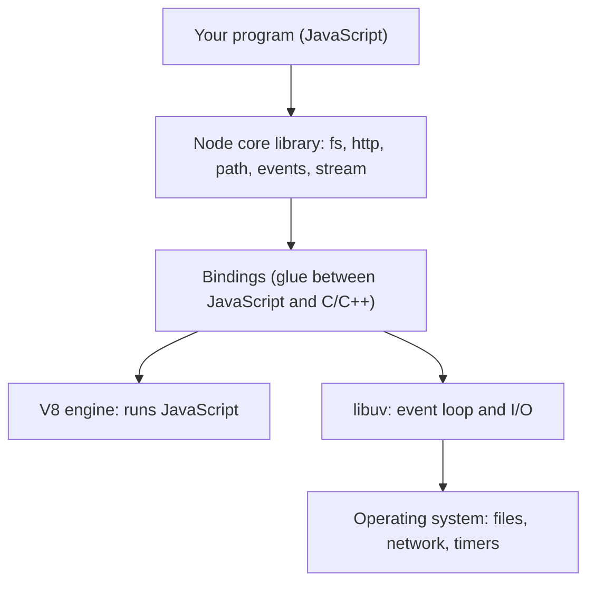

# What Node.js is: install, run a script, read a file

## In plain words

Think of a car engine. Inside a car it turns wheels. Lift the same engine into a boat and it turns a propeller instead. The engine did not change; what it is connected to did.

JavaScript started life inside web browsers, where it is connected to a page: buttons, text boxes, images. **Node.js** (usually shortened to **Node**) is a program that takes the same JavaScript engine out of the browser and connects it to the rest of the computer instead: files on disk, the network, other programs, the keyboard and screen of a terminal. The language is the one you already know. The surroundings are different.

Why it matters for a job: Node is one of the most widely used ways to write **back-end** code, meaning the programs that run on a server, answer requests from web pages and phone apps, talk to databases and send emails. It is also what runs almost every front-end tool (bundlers, linters, test runners). If you write JavaScript professionally, you will run Node every day, even if you never build a server.

> **Before this lesson:** you should be comfortable with variables, functions, objects and arrays from the JavaScript track, for example [Functions and scope](#/lesson/javascript/functions-scope) and [Objects, arrays and mutability](#/lesson/javascript/objects-arrays). A first look at promises ([Callbacks and promises](#/lesson/javascript/callbacks-promises)) helps but is not required; this track explains them again from the beginning.

## What Node is made of

Three terms first, each defined before we use it.

- A **runtime** is a program that runs your program. Your code is text; something has to read that text and carry out the instructions. A browser is a runtime for JavaScript, and Node is another one.
- An **engine** is the part of a runtime that understands the language itself: it parses your code, turns it into machine instructions and manages memory. Node uses **V8**, the same engine as the Chrome browser.
- **I/O** stands for input/output: any exchange of data with the world outside your program's memory. Reading a file is input. Sending a web response is output.

V8 alone knows nothing about files or networks; the JavaScript language has no such features. Node adds them with two more layers:

- **libuv**, a library written in C that asks the operating system to do I/O and reports back when it is finished. It also contains the *event loop*, the part that decides which piece of your JavaScript runs next. Later lessons study it in depth.
- The **core library**: JavaScript modules that ship with Node, such as `fs` (file system), `http` (web servers and clients) and `path` (file-path handling).



A **module** is a file of code that other files can load. A **binding** is a piece of glue code that lets JavaScript call a function written in another language.

### The same language, a different environment

| | Browser | Node.js |
|---|---|---|
| Purpose | Show a page to one user | Run programs on a computer or server |
| Has `document`, `window`, the DOM | Yes | No |
| Can read and write files freely | No (sandboxed for safety) | Yes |
| Can open a network server | No | Yes |
| Global object | `window` (also `globalThis`) | `globalThis` |
| Loads code with | `<script>` tags, ES modules | ES modules and CommonJS modules |
| Who chooses the JavaScript version | Each visitor's browser | You, by choosing the Node version |

The last row is a quiet advantage. On a server you decide which version of Node runs, so you know exactly which language features exist.

> [!NOTE]
> Trying `document.querySelector(...)` in Node fails with `ReferenceError: document is not defined`. There is no page. In the other direction, `require("fs")` does not work in a browser. Knowing which environment a piece of code is meant for removes a whole class of confusion.

## Installing Node

1. Go to [nodejs.org](https://nodejs.org) and download the release marked **LTS**. LTS means *long-term support*: a version line that receives fixes for years and is the safe default for real projects. The other release, "Current", has the newest features and a shorter life.
2. Run the installer and accept the defaults.
3. Open a **terminal** (a text window where you type commands: *Terminal* on macOS and Linux, *PowerShell* or *Windows Terminal* on Windows) and check the installation:

```text
$ node --version
v22.11.0
$ npm --version
10.9.0
```

The `$` stands for the terminal's prompt; you type only what comes after it. Your numbers will differ. The installer gave you two commands: `node`, the runtime, and `npm`, the package manager covered in the next lesson.

> [!TIP]
> Professional developers often work on several projects that need different Node versions. A **version manager** such as `nvm`, `fnm` or Volta installs many versions side by side and switches between them with one command. You do not need one today; remember that the tool exists.

## Talking to Node directly: the REPL

Type `node` with nothing after it and press Enter. You get a prompt where every line you type is run at once:

```text
$ node
Welcome to Node.js v22.11.0.
> 2 + 3
5
> const city = "Lisbon"
undefined
> city.toUpperCase()
'LISBON'
> .exit
```

This is called a **REPL**: *read, evaluate, print, loop*. It reads a line, evaluates it, prints the result and waits for the next one. The `undefined` after `const city = ...` is not an error: a declaration produces no value, and the REPL prints the value of each line. Leave with `.exit` or by pressing Ctrl+C twice.

The REPL is handy for quick experiments. Real programs live in files.

## Your first script

Create a folder for your experiments, and inside it a file called `hello.js` containing:

```javascript
const name = "Node";
console.log(`Hello from ${name}!`);
console.log("2 + 2 =", 2 + 2);
```

Run it from a terminal opened in that folder:

```text
$ node hello.js
Hello from Node!
2 + 2 = 4
```

Line by line:

- `const name = "Node";` creates a binding, exactly as in the browser.
- `console.log(...)` exists in Node too. In a browser it writes to the developer console; in Node it writes to the terminal. Technically it writes to **standard output** (often written *stdout*), the default channel where a command-line program puts its results.
- When the last line has run and nothing else is waiting to happen, Node exits by itself.

The page you are reading can run JavaScript too. The box below is editable; press Run.

```js-run
const name = "the lesson page";
console.log(`Hello from ${name}!`);
console.log("2 + 2 =", 2 + 2);
```

> [!NOTE]
> The runnable boxes on this site execute inside your browser, not inside Node. Language features (functions, promises, classes) behave identically, so we use them for experiments. Features that only Node has, such as `fs`, are shown as static code with their real output, and are modelled here with small stand-ins written by hand.

### Re-running while you edit

Stopping and restarting a script after every change gets tiring. Node can watch the file for you:

```text
$ node --watch hello.js
```

Each time you save `hello.js`, Node runs it again. Stop with Ctrl+C.

## What a Node program can see

### `process`: the running program itself

A **process** is one running instance of a program. Node gives your code a global object called `process` that describes it. A *global* is a name available everywhere without loading anything.

```javascript
// info.js
console.log("Node version:", process.version);
console.log("Platform:", process.platform);
console.log("Current folder:", process.cwd());
console.log("Arguments:", process.argv.slice(2));
console.log("HOME variable:", process.env.HOME ?? process.env.USERPROFILE);
```

```text
$ node info.js --port 8080 demo
Node version: v22.11.0
Platform: linux
Current folder: /home/ana/experiments
Arguments: [ '--port', '8080', 'demo' ]
HOME variable: /home/ana
```

- `process.cwd()` returns the **current working directory**: the folder the terminal was in when you started the program.
- `process.argv` is the list of words on the command line. Element 0 is the path of `node`, element 1 is the path of your script, and the rest are your **arguments**. `slice(2)` skips the first two.
- `process.env` holds **environment variables**: named settings supplied by the operating system or by whoever started the program, such as passwords and port numbers. They are always strings.

Turning arguments into something useful is ordinary array work. This model runs here because it uses no Node-only feature:

```js-run
// Pretend this is process.argv.slice(2)
const args = ["--port", "8080", "demo.txt", "--verbose"];

function parseArgs(list) {
  const options = {};
  const files = [];
  for (let i = 0; i < list.length; i++) {
    const word = list[i];
    if (!word.startsWith("--")) { files.push(word); continue; }
    const key = word.slice(2);
    const next = list[i + 1];
    if (next === undefined || next.startsWith("--")) options[key] = true;
    else { options[key] = next; i++; }
  }
  return { options, files };
}

console.log(parseArgs(args));
```

A word starting with `--` is treated as an option. If the following word is a plain value it becomes the option's value (and `i++` skips it); otherwise the option is a flag set to `true`. Everything else is collected as a file name. Move `"demo.txt"` to the end of the list and run again: it becomes the value of `verbose`, because this little parser cannot know which options take a value. Real parsers are told in advance. Node also ships a ready-made version of this as `util.parseArgs`.

### Exit codes

When a program ends it hands a small number to whoever started it: the **exit code**. Zero means success; anything else means failure. Scripts and deployment tools rely on this to know whether a step worked.

```javascript
if (process.argv.length < 3) {
  console.error("Usage: node greet.js <name>");
  process.exitCode = 1;        // finish normally, but report failure
} else {
  console.log("Hi,", process.argv[2]);
}
```

`console.error` writes to **standard error** (*stderr*), a second output channel reserved for problems, so that error messages do not get mixed into the program's real output.

## Loading built-in modules

Node's features are grouped into core modules that you load by name. Modern Node supports two loading syntaxes, and you will meet both for years to come.

```javascript
// ES module syntax (the standard one, also used in browsers)
import { readFile } from "node:fs/promises";
import path from "node:path";

// CommonJS syntax (the original Node one)
const { readFile } = require("node:fs/promises");
const path = require("node:path");
```

The `node:` prefix says "this is a built-in module, not something downloaded". It is optional for old modules (`"fs"` works) but makes the intent clear.

Which syntax does a file use? By default a `.js` file is CommonJS. A file is treated as an ES module when its name ends in `.mjs`, or when the nearest `package.json` file contains `"type": "module"` (the next lesson creates that file). The module system has a whole module of this track; for now, copy the pattern of each example.

## Reading a file

Create `notes.txt` next to your script:

```text
Buy milk
Call the plumber
Learn Node
```

### Version 1: wait for it (synchronous)

```javascript
// read-sync.js
const fs = require("node:fs");

const text = fs.readFileSync("notes.txt", "utf8");
const lines = text.trim().split("\n");
console.log(`There are ${lines.length} notes. The first is: ${lines[0]}`);
```

```text
$ node read-sync.js
There are 3 notes. The first is: Buy milk
```

- `fs.readFileSync(path, encoding)` reads the entire file and returns its content. **Synchronous** means the program stops on that line until the disk has delivered the data.
- `"utf8"` is the **encoding**: the rule for turning the file's bytes into characters. Leave it out and you get a **Buffer**, Node's object for raw bytes, which prints like `<Buffer 42 75 79 ...>`.
- `trim()` removes the final newline so `split("\n")` does not produce an empty last element.

### Version 2: do not wait (asynchronous)

Stopping the whole program is fine for a small script. A server that stops is a server that ignores every other user while one file loads. So nearly every Node function that does I/O has an **asynchronous** form: it starts the work, returns immediately, and delivers the result later.

```javascript
// read-async.mjs
import { readFile } from "node:fs/promises";

console.log("1. asking for the file");
const text = await readFile("notes.txt", "utf8");
console.log("2. got", text.length, "characters");
```

```text
$ node read-async.mjs
1. asking for the file
2. got 37 characters
```

`readFile` from `node:fs/promises` returns a **promise**: an object standing for a result that will arrive later. `await` pauses *this piece of code* until the promise has its value, while Node remains free to do other work. (Using `await` at the top level of a file requires an ES module, hence the `.mjs` name.)

The older style passes a **callback**, a function for Node to call when the result is ready:

```javascript
const fs = require("node:fs");

fs.readFile("notes.txt", "utf8", (err, text) => {
  if (err) { console.error("Could not read:", err.message); return; }
  console.log("got", text.length, "characters");
});
console.log("this line runs first");
```

```text
this line runs first
got 37 characters
```

The order surprises almost everyone the first time. `fs.readFile` only *starts* the read; the next line runs immediately; the callback runs later, when the data has arrived.

### A model you can run

The browser has no `fs`, so here is a pretend disk. The fake `readFile` waits a few milliseconds with `setTimeout`, then calls back, which is how the real one behaves from your program's point of view:

```js-run
const disk = { "notes.txt": "Buy milk\nCall the plumber\nLearn Node\n" };

function readFile(name, callback) {
  setTimeout(() => {
    if (!(name in disk)) {
      const error = new Error(`ENOENT: no such file or directory, open '${name}'`);
      error.code = "ENOENT";
      callback(error);
    } else {
      callback(null, disk[name]);
    }
  }, 20);
}

console.log("A: asking for notes.txt");
readFile("notes.txt", (err, text) => {
  console.log("C: file arrived with", text.trim().split("\n").length, "lines");
});
readFile("missing.txt", (err) => {
  console.log("D: second read failed with code", err.code);
});
console.log("B: the script reached its last line");
```

The output order is A, B, C, D. Both reads were *started* before either finished. Change the delay from `20` to `0` and run again: B still comes before C, because a callback never interrupts code that is already running.

### When things go wrong

Ask for a file that does not exist and Node reports an error object with a `code`:

```text
Error: ENOENT: no such file or directory, open 'nope.txt'
```

`ENOENT` is a code from the operating system meaning "error: no entry", that is, nothing has that name. Others you will meet early: `EACCES` (permission denied) and `EISDIR` (that is a directory, not a file). Handle them with `try`/`catch` around `await`, or by checking the `err` argument of a callback:

```javascript
import { readFile } from "node:fs/promises";

try {
  const text = await readFile("nope.txt", "utf8");
  console.log(text);
} catch (error) {
  if (error.code === "ENOENT") console.log("No notes yet.");
  else throw error;                 // an error we did not expect: do not hide it
}
```

### Which folder is `notes.txt` in?

A relative path such as `"notes.txt"` is resolved against the **current working directory**, not against the folder of the script. Run `node scripts/read.js` from the parent folder and Node looks for `notes.txt` in the parent folder. To find a file that sits next to the script, build the path from the script's own location:

```javascript
// ES modules (recent Node versions)
import path from "node:path";
const file = path.join(import.meta.dirname, "notes.txt");

// CommonJS
const file2 = require("node:path").join(__dirname, "notes.txt");
```

`path.join` glues path pieces together using the right separator for the operating system (`/` or `\`).

### Writing a file

```javascript
import { writeFile, appendFile } from "node:fs/promises";

await writeFile("out.txt", "first line\n");      // creates or replaces the file
await appendFile("out.txt", "second line\n");    // adds to the end
```

## Pitfalls

- **Expecting browser objects.** `window`, `document`, `alert` and `localStorage` do not exist in Node.
- **Forgetting the encoding.** `readFile(path)` with no encoding gives a Buffer, and `buffer.split` is not a function. Pass `"utf8"` or call `.toString()`.
- **Assuming code after an asynchronous call runs after its result.** It runs before. Put the dependent code inside the callback or after an `await`.
- **Relative paths.** They depend on where the command was started. Use `import.meta.dirname` or `__dirname` for files that belong to the program.
- **Using `...Sync` functions in a server.** They freeze every user. They are fine in start-up code and small scripts.
- **Mixing module syntaxes.** `require` inside an ES module, or `import` inside a CommonJS file, fails with a clear but alarming error. Check the file extension and `package.json`.

> [!WARNING]
> Node programs run with *your* permissions. A script can delete files, read private keys and send them over the network. Read scripts from the internet before running them, and never paste a command you do not understand into a terminal.

> [!INTERVIEW]
> **"What is Node.js?"** A good answer in three sentences: "Node.js is a JavaScript runtime built on the V8 engine. It adds an event loop and non-blocking I/O through libuv, plus a core library for files, networking and processes. It runs JavaScript on one main thread and stays responsive by never waiting for I/O; that makes it well suited to network services that handle many connections at once." Expect the follow-up "Is Node single-threaded?" The honest answer: your JavaScript runs on one thread, while libuv uses a small pool of helper threads and the operating system for the waiting.

## Cheat sheet

| Task | Command or code |
|---|---|
| Check the installation | `node --version` |
| Open the REPL | `node` (leave with `.exit`) |
| Run a script | `node file.js` |
| Re-run on every save | `node --watch file.js` |
| Command-line arguments | `process.argv.slice(2)` |
| Environment variable | `process.env.NAME` |
| Report failure | `process.exitCode = 1` |
| Load a core module (ES module) | `import fs from "node:fs"` |
| Load a core module (CommonJS) | `const fs = require("node:fs")` |
| Read a text file, promise style | `await readFile(path, "utf8")` from `node:fs/promises` |
| Read a text file, blocking | `fs.readFileSync(path, "utf8")` |
| Path next to the script | `path.join(import.meta.dirname, "x.txt")` |

## Summary

- Node.js is a runtime: the V8 engine for the language, libuv for the event loop and I/O, and a core library on top.
- The language is the same as in the browser. The environment differs: no DOM, but files, networking and processes.
- `node file.js` runs a script; `process` describes the running program (arguments, environment, working directory, exit code).
- I/O functions come in a blocking `Sync` form and non-blocking forms using callbacks or promises. The non-blocking forms let one program serve many users.
- Asynchronous results arrive later: code after the call runs first.

## Glossary

- **Runtime**: a program that executes your code and provides its surroundings.
- **Engine (V8)**: the component that parses and runs JavaScript itself.
- **libuv**: the C library inside Node that performs I/O and runs the event loop.
- **I/O**: input/output; exchanging data with disk, network or other programs.
- **Core module**: a module that ships with Node, such as `fs` or `http`.
- **REPL**: an interactive prompt that runs each line as you type it.
- **Process**: one running instance of a program.
- **Working directory**: the folder a process was started in; relative paths start there.
- **Environment variable**: a named string setting given to a process from outside.
- **Exit code**: the number a process returns when it ends; 0 means success.
- **Synchronous / asynchronous**: waiting for a result on the spot / receiving it later through a callback or promise.
- **Callback**: a function passed to another function to be called later.
- **Promise**: an object that stands for a result that is not available yet.
- **Buffer**: Node's object for a sequence of raw bytes.
- **Encoding**: the rule mapping bytes to characters, for example UTF-8.

```quiz
[
  {"q": "Which statement best describes Node.js?", "options": ["A new programming language similar to JavaScript", "A JavaScript runtime that connects the V8 engine to files, network and processes", "A web browser without a window", "A database for JavaScript objects"], "answer": 1,
   "explain": "Node is a runtime. The language is ordinary JavaScript run by V8; libuv and the core library add I/O."},
  {"q": "You run `node app.js --fast data.csv`. What is `process.argv[2]`?", "options": ["\"app.js\"", "\"data.csv\"", "\"--fast\"", "undefined"], "answer": 2,
   "explain": "Index 0 is the node executable, index 1 the script path, and index 2 the first real argument."},
  {"q": "In what order do these log?\n\n`console.log('A'); fs.readFile('f.txt', 'utf8', () => console.log('B')); console.log('C');`", "options": ["A, B, C", "A, C, B", "B, A, C", "It depends on the file size"], "answer": 1,
   "explain": "readFile only starts the read and returns. The callback can run only after the current code has finished, so C always comes before B."},
  {"q": "`fs.readFileSync('notes.txt')` is called with no encoding. What does it return?", "options": ["A string", "A Buffer of raw bytes", "A promise", "undefined"], "answer": 1,
   "explain": "Without an encoding Node cannot know how to turn bytes into characters, so it hands back the bytes as a Buffer."},
  {"q": "A script in `/app/tools/read.js` calls `readFile('notes.txt')`. You start it with `cd /app && node tools/read.js`. Which file is opened?", "options": ["/app/tools/notes.txt", "/app/notes.txt", "/notes.txt", "The one closest to node itself"], "answer": 1,
   "explain": "Relative paths are resolved against the current working directory (/app), not against the script's folder."},
  {"q": "Why should a web server avoid `readFileSync` while handling requests?", "options": ["It is deprecated", "It cannot read large files", "It blocks the single JavaScript thread, so no other request is served until it returns", "It does not report errors"], "answer": 2,
   "explain": "Your JavaScript runs on one thread. A blocking call stops everything else for its whole duration."},
  {"q": "What does the error code ENOENT mean?", "options": ["Permission denied", "The path does not exist", "The disk is full", "The file is empty"], "answer": 1,
   "explain": "ENOENT comes from the operating system: there is no entry with that name."},
  {"q": "Which of these exists in Node but not in a browser page?", "options": ["console.log", "setTimeout", "process.env", "Promise"], "answer": 2,
   "explain": "process is a Node global describing the running program. The other three exist in both environments."}
]
```

> **Source:** Casciaro & Mammino, *Node.js Design Patterns* 3e, ch. 1 (topics only; wording and examples are original). Node.js documentation: https://nodejs.org/docs/latest/api/fs.html, https://nodejs.org/docs/latest/api/process.html, https://nodejs.org/docs/latest/api/cli.html
