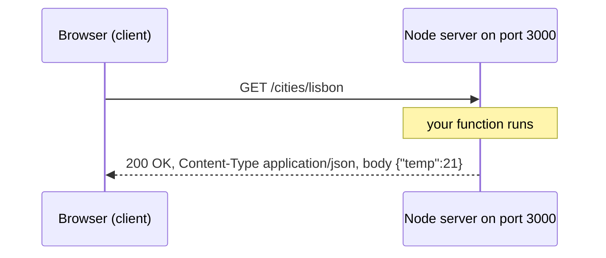

# npm, package.json and your first HTTP server

## In plain words

Nobody cooks a restaurant menu from raw wheat and live chickens. A kitchen buys ingredients that other people prepared, and it keeps a written list of what it buys so that tomorrow's cook can order the same things.

**npm** is the ingredient market for JavaScript: a huge public collection of ready-made code, plus the command-line tool that fetches it. **package.json** is the written list: a small file in your project that names the project and records which outside code it needs. Together they let you build on other people's work and let anyone else recreate your project exactly.

The second half of this lesson uses what you install nothing for: Node's built-in `http` module. You will write a program that listens for requests from a browser and answers them. That is a **web server**, and it is the reason most people learn Node.

Why it matters for a job: every Node project you will ever join has a `package.json`. Reading it is how you learn what a project is, how to start it and how to test it. And "write an endpoint that returns JSON" is the daily bread of back-end work.

> **Before this lesson:** complete [What Node.js is: install, run a script, read a file](#/lesson/nodejs/what-is-node). You need to be able to run `node file.js` in a terminal.

## Packages and the registry

A **package** is a folder of code with a `package.json` file that describes it. A **dependency** is a package your project needs in order to work. The **npm registry** is the public server that stores more than two million packages; the `npm` command, installed together with Node, downloads from it.

There are other package managers that read the same `package.json` and the same registry, mainly **pnpm** and **Yarn**. They differ in speed and disk usage, not in the ideas. Learn npm first; the rest transfer.

## Creating a project

Make an empty folder, open a terminal in it and run:

```text
$ npm init -y
Wrote to /home/ana/weather-api/package.json
```

`init` creates `package.json`; `-y` accepts the default answer to every question. Open the file:

```json
{
  "name": "weather-api",
  "version": "1.0.0",
  "description": "",
  "main": "index.js",
  "scripts": {
    "test": "echo \"Error: no test specified\" && exit 1"
  },
  "license": "ISC"
}
```

It is **JSON**: a strict text format for data that looks like a JavaScript object, with double quotes around every key and no trailing commas. The important fields:

| Field | Meaning |
|---|---|
| `name`, `version` | Identity of the package. Required only if you publish it |
| `type` | `"module"` makes `.js` files ES modules; absent or `"commonjs"` makes them CommonJS |
| `main` / `exports` | Which file other code gets when it loads this package |
| `scripts` | Named shell commands, run with `npm run <name>` |
| `dependencies` | Packages needed to *run* the program |
| `devDependencies` | Packages needed only while *developing* (test runners, linters) |
| `engines` | Which Node versions the project supports |

Add one line so that our files can use `import` and top-level `await`:

```json
  "type": "module",
```

## Installing a dependency

Suppose we want coloured terminal output and choose a small package called `picocolors`:

```text
$ npm install picocolors
added 1 package, and audited 2 packages in 1s
```

Three things changed in the folder.

1. A directory **`node_modules/`** appeared, containing the downloaded code. When your code says `import pc from "picocolors"`, Node looks in there.
2. `package.json` gained a `dependencies` entry: `"picocolors": "^1.1.1"`.
3. A file **`package-lock.json`** appeared. It records the *exact* version of every package that was installed, including the dependencies of your dependencies.

```javascript
// colour.js
import pc from "picocolors";
console.log(pc.green("It works"), pc.bold("and this is bold"));
```

Tools used only during development are installed with a flag so they land in `devDependencies`:

```text
$ npm install --save-dev eslint
```

### Which files do you share?

`node_modules` can hold hundreds of megabytes and can always be rebuilt from the two JSON files. So the convention is:

- **Commit** `package.json` and `package-lock.json` to version control.
- **Do not commit** `node_modules`. Put it in `.gitignore`.

A colleague who downloads your project runs one command and gets the same tree:

```text
$ npm install      # reads package.json and the lock file
$ npm ci           # stricter: installs exactly the lock file, used on build servers
```

## Semantic versioning: what `^1.1.1` means

Versions on npm follow **semantic versioning** (**semver**): three numbers, `MAJOR.MINOR.PATCH`, each with a promise attached.

| Part | Increases when | Example |
|---|---|---|
| PATCH | A bug is fixed, nothing else changes | `1.1.1` → `1.1.2` |
| MINOR | A feature is added in a backwards-compatible way | `1.1.2` → `1.2.0` |
| MAJOR | Something changes that can break existing users | `1.2.0` → `2.0.0` |

`package.json` does not usually pin one version. It gives a **range**:

| Range | Accepts | Idea |
|---|---|---|
| `1.4.2` | exactly `1.4.2` | pinned |
| `~1.4.2` | `1.4.2` up to, not including, `1.5.0` | patches only |
| `^1.4.2` | `1.4.2` up to, not including, `2.0.0` | anything that should not break (npm's default) |
| `^0.4.2` | `0.4.2` up to, not including, `0.5.0` | before `1.0.0` a minor bump may break, so the caret is stricter |
| `>=1.2.0 <2.0.0` | both conditions | explicit bounds |
| `*` | anything | rarely a good idea |

Versions must be compared as numbers, part by part. This is a classic small bug, so run it:

```js-run
function compareVersions(a, b) {
  const pa = a.split(".").map(Number);
  const pb = b.split(".").map(Number);
  for (let i = 0; i < 3; i++) {
    if (pa[i] !== pb[i]) return pa[i] < pb[i] ? -1 : 1;
  }
  return 0;
}

console.log("as text:    '1.10.0' > '1.9.0' is", "1.10.0" > "1.9.0");
console.log("as numbers: compare gives", compareVersions("1.10.0", "1.9.0"));

function satisfiesCaret(version, base) {
  const [major] = base.split(".").map(Number);
  const upper = `${major + 1}.0.0`;
  return compareVersions(version, base) >= 0 && compareVersions(version, upper) < 0;
}
for (const v of ["1.4.1", "1.4.2", "1.9.0", "2.0.0"]) {
  console.log(v, "satisfies ^1.4.2 ?", satisfiesCaret(v, "1.4.2"));
}
```

- `split(".").map(Number)` turns `"1.10.0"` into `[1, 10, 0]`.
- The loop finds the first part that differs and decides there.
- As text, `"1.10.0"` sorts *before* `"1.9.0"`, because the character `1` comes before `9`. Text comparison is wrong for versions.
- `satisfiesCaret` handles majors of 1 and above only. The problem [Does this version satisfy the npm range?](#/problem/node-semver-satisfies) asks for the full rules.

> [!WARNING]
> A range means "the newest version that fits", so two installs made on different days could differ. The **lock file** removes that risk by recording the exact versions. Deleting `package-lock.json` to "fix" an install throws that safety away.

## Scripts and npx

The `scripts` section gives names to commands:

```json
  "scripts": {
    "start": "node server.js",
    "dev": "node --watch server.js",
    "test": "node --test"
  }
```

```text
$ npm start          # runs "start" (no "run" needed for start and test)
$ npm run dev        # other names need "run"
```

Inside a script, programs installed in `node_modules/.bin` are on the path, so `"lint": "eslint ."` works without a global install. To run such a program by hand use **npx**: `npx eslint .` runs the local copy, and if the package is not installed, npx downloads it temporarily.

> [!TIP]
> Avoid `npm install -g` (global installs) for project tools. A global tool has one version for the whole machine and is invisible in `package.json`, so your colleagues get a different one. Local `devDependencies` plus scripts keep everyone on the same version.

## How the web talks: a two-minute tour of HTTP

**HTTP** (HyperText Transfer Protocol) is the set of rules browsers and servers use to talk. A **client** (browser, phone app, another server) sends a **request**; the **server** sends back a **response**.

A request has a **method** (`GET` to read, `POST` to create, `PUT`/`PATCH` to change, `DELETE` to remove), a **path** such as `/cities/lisbon`, **headers** (named extra information) and sometimes a **body** (the data being sent). A response has a **status code** (`200` OK, `201` created, `400` bad request, `404` not found, `500` server error), headers and usually a body.

A server waits for requests on a **port**: a number from 1 to 65535 that identifies one program on a machine, the way a flat number identifies one door in a building. **localhost** is the name for "this same computer".



## Your first server

Create `server.js`:

```javascript
import http from "node:http";

const server = http.createServer((req, res) => {
  res.statusCode = 200;
  res.setHeader("Content-Type", "text/plain; charset=utf-8");
  res.end("Hello from my first server\n");
});

server.listen(3000, () => {
  console.log("Listening on http://localhost:3000");
});
```

```text
$ node server.js
Listening on http://localhost:3000
```

Open `http://localhost:3000` in a browser and the text appears. Line by line:

- `http.createServer(handler)` builds a server object. The function you pass, the **request handler**, is called once for every incoming request.
- `req` (the request) lets you read the method, the path and the headers. `res` (the response) is what you write the answer into.
- `res.statusCode = 200` sets the status; `res.setHeader("Content-Type", ...)` tells the client what kind of data follows.
- `res.end(text)` sends the body and finishes the response. **Every request must end in a call to `res.end`**, otherwise the browser waits until it gives up.
- `server.listen(3000, callback)` starts waiting on port 3000 and calls the callback once the port is open.

Notice the program does not exit. A listening server is "something still waiting to happen", so Node stays alive. Stop it with Ctrl+C.

### Answering different paths with JSON

One handler receives every request, so *it* decides what each address means. That decision is called **routing**.

```javascript
import http from "node:http";

const cities = { lisbon: { temp: 21 }, oslo: { temp: 4 } };

function sendJson(res, status, data) {
  res.writeHead(status, { "Content-Type": "application/json" });
  res.end(JSON.stringify(data));
}

const server = http.createServer((req, res) => {
  const url = new URL(req.url, "http://localhost");

  if (req.method === "GET" && url.pathname === "/cities") {
    return sendJson(res, 200, Object.keys(cities));
  }
  const match = url.pathname.match(/^\/cities\/([a-z]+)$/);
  if (req.method === "GET" && match) {
    const city = cities[match[1]];
    return city ? sendJson(res, 200, city) : sendJson(res, 404, { error: "unknown city" });
  }
  sendJson(res, 404, { error: "not found" });
});

server.listen(3000);
```

```text
$ curl -i http://localhost:3000/cities/oslo
HTTP/1.1 200 OK
Content-Type: application/json

{"temp":4}
$ curl http://localhost:3000/cities/atlantis
{"error":"unknown city"}
```

- `req.url` holds only the path and query string (for example `/cities?sort=temp`). `new URL(req.url, base)` parses it; `url.pathname` is the path without the query, and `url.searchParams.get("sort")` reads a query value.
- `res.writeHead(status, headers)` sets the status and headers in one call.
- `JSON.stringify` turns the object into text. A response body is always text or bytes, never a live object.
- The final `sendJson(res, 404, ...)` is the catch-all, so no request is left unanswered.
- `curl` is a command-line HTTP client; `-i` also prints the status line and headers.

### A model you can run

The routing decision is plain JavaScript. Below, fake request and response objects stand in for the real ones so you can experiment on this page:

```js-run
const cities = { lisbon: { temp: 21 }, oslo: { temp: 4 } };

function handler(req, res) {
  const url = new URL(req.url, "http://localhost");
  if (req.method === "GET" && url.pathname === "/cities") {
    const names = Object.keys(cities);
    if (url.searchParams.get("sort") === "temp") names.sort((a, b) => cities[a].temp - cities[b].temp);
    return res.json(200, names);
  }
  const match = url.pathname.match(/^\/cities\/([a-z]+)$/);
  if (req.method === "GET" && match) {
    const city = cities[match[1]];
    return city ? res.json(200, city) : res.json(404, { error: "unknown city" });
  }
  res.json(404, { error: "not found" });
}

function fakeRequest(method, url) {
  const res = { json(status, data) { console.log(method, url, "->", status, JSON.stringify(data)); } };
  handler({ method, url }, res);
}

fakeRequest("GET", "/cities");
fakeRequest("GET", "/cities?sort=temp");
fakeRequest("GET", "/cities/oslo");
fakeRequest("GET", "/cities/atlantis");
fakeRequest("POST", "/cities");
```

Try adding a city, or a `DELETE` route. This is also how handlers are tested in real projects: call the function with made-up inputs and look at what it writes.

### Reading data that the client sends

A request body does not arrive in one piece. It arrives as a series of **chunks** (pieces of bytes), because it may be large and the network delivers it gradually. The request object can be looped over to collect them:

```javascript
async function readJsonBody(req) {
  let text = "";
  for await (const chunk of req) text += chunk;   // one chunk at a time
  return JSON.parse(text);
}

// inside an async handler:
if (req.method === "POST" && url.pathname === "/cities") {
  try {
    const body = await readJsonBody(req);
    cities[body.name] = { temp: body.temp };
    return sendJson(res, 201, { ok: true });
  } catch {
    return sendJson(res, 400, { error: "body must be valid JSON" });
  }
}
```

`for await` is a loop over values that arrive over time; the streams module of this track explains the machinery. `JSON.parse` throws on malformed input, and input from the network is malformed sooner or later, so it sits in a `try` block and answers `400`.

> [!NOTE]
> Nobody writes large applications against bare `http`. Frameworks such as Express and Fastify provide routing, body parsing and error handling. They are thin layers over exactly what you see here, and the final module of this track introduces them. Knowing the bare layer makes the frameworks easy to understand.

## Pitfalls

- **`Error: listen EADDRINUSE: address already in use :::3000`.** Another program (often your own server in a forgotten terminal) already holds the port. Stop it or choose another port.
- **A request that never finishes.** Some code path forgot `res.end()`. Give every handler a final catch-all response.
- **`ERR_HTTP_HEADERS_SENT`.** You tried to send a second response after the first; usually a missing `return` after `sendJson(...)`.
- **Editing code and seeing no change.** A running server keeps the old code in memory. Restart it, or use `node --watch`.
- **Committing `node_modules`**, or forgetting to commit the lock file.
- **Trusting input.** `JSON.parse` on a request body can throw; an uncaught exception in a handler can take the whole server down.
- **Installing whatever a search suggests.** Check the package's name letter by letter, its download count and its repository. Misspelled look-alike packages that steal data (*typosquatting*) are a real attack. `npm audit` lists known vulnerabilities in what you have installed.

> [!INTERVIEW]
> **"What is the difference between `dependencies` and `devDependencies`, and what is `package-lock.json` for?"** Dependencies are needed at run time; devDependencies only for building and testing, and a production install (`npm ci --omit=dev`) skips them. `package.json` holds *ranges*; the lock file holds the *exact resolved versions* of the full dependency tree, so every machine installs identical code. A frequent follow-up: **"`^1.2.3` versus `~1.2.3`?"** Caret allows minor and patch updates below `2.0.0`; tilde allows patch updates below `1.3.0`. For `0.x` versions the caret behaves like the tilde.

## Cheat sheet

| Task | Command or code |
|---|---|
| Start a project | `npm init -y` |
| Add a runtime dependency | `npm install <name>` |
| Add a development tool | `npm install --save-dev <name>` |
| Recreate `node_modules` exactly | `npm ci` |
| Run a script | `npm run <name>` (`npm start`, `npm test`) |
| Run a package's command | `npx <command>` |
| List known vulnerabilities | `npm audit` |
| Create a server | `http.createServer((req, res) => { ... })` |
| Start listening | `server.listen(3000)` |
| Method and path | `req.method`, `new URL(req.url, "http://localhost").pathname` |
| Send JSON | `res.writeHead(200, {"Content-Type": "application/json"}); res.end(JSON.stringify(data))` |

## Summary

- npm downloads packages from a public registry into `node_modules`; `package.json` lists what the project needs and how to run it.
- Semantic versioning gives meaning to `MAJOR.MINOR.PATCH`; ranges such as `^1.4.2` accept compatible updates; the lock file pins exact versions.
- Scripts in `package.json` are the standard entry points: `npm start`, `npm test`, `npm run dev`.
- An HTTP server is a function called once per request with `req` and `res`. It must always end the response.
- Routing is deciding what to do from the method and the path. Bodies arrive in chunks and must be validated.

## Glossary

- **Package**: a folder of code described by a `package.json`.
- **Dependency**: a package your project needs.
- **Registry**: the server that stores published packages.
- **`node_modules`**: the folder where installed packages live.
- **Lock file**: `package-lock.json`, the exact versions that were installed.
- **Semantic versioning (semver)**: the `MAJOR.MINOR.PATCH` convention and its promises.
- **Range**: a rule such as `^1.4.2` describing which versions are acceptable.
- **npx**: a tool that runs a command provided by a package.
- **HTTP**: the request/response protocol of the web.
- **Method**: the verb of a request, such as `GET` or `POST`.
- **Status code**: the three-digit outcome of a response, such as `200` or `404`.
- **Header**: a named piece of extra information on a request or response.
- **Port**: a number identifying one listening program on a machine.
- **localhost**: the network name of the computer you are on.
- **Request handler**: the function a server calls for each request.
- **Routing**: choosing what to do based on method and path.
- **Chunk**: one piece of a body that arrives gradually.

```quiz
[
  {"q": "Which files should be committed to version control?", "options": ["package.json only", "package.json and package-lock.json", "package.json, package-lock.json and node_modules", "node_modules only"], "answer": 1,
   "explain": "The two JSON files are enough to rebuild node_modules exactly, so the large folder itself stays out of the repository."},
  {"q": "Your package.json says `\"express\": \"^4.18.2\"`. Which version can npm install?", "options": ["4.17.9", "4.21.0", "5.0.0", "Only 4.18.2"], "answer": 1,
   "explain": "The caret accepts anything from 4.18.2 up to but not including 5.0.0."},
  {"q": "What does `\"^0.3.1\"` accept?", "options": ["0.3.1 up to but not including 1.0.0", "0.3.1 up to but not including 0.4.0", "Only 0.3.1", "Any 0.x version"], "answer": 1,
   "explain": "For versions below 1.0.0 the caret keeps the left-most non-zero part fixed, here the minor."},
  {"q": "A browser tab stays loading forever when it calls your server. The most likely cause?", "options": ["The port number is too high", "A code path never calls res.end()", "JSON.stringify was used", "The server uses ES modules"], "answer": 1,
   "explain": "A response is finished only by res.end(). Without it the client keeps waiting."},
  {"q": "In what order do these log when the file runs and one browser request arrives afterwards?\n\n`console.log('A'); http.createServer((req, res) => { console.log('B'); res.end(); }).listen(3000, () => console.log('C')); console.log('D');`", "options": ["A, B, C, D", "A, C, D, B", "A, D, C, B", "A, D, B, C"], "answer": 2,
   "explain": "A and D are synchronous. C runs once the port is open, a moment later. B runs only when a request arrives."},
  {"q": "What is `package-lock.json` for?", "options": ["It prevents other people from editing package.json", "It records the exact versions of the whole dependency tree so installs are reproducible", "It stores npm passwords", "It lists files to exclude from publishing"], "answer": 1,
   "explain": "Ranges allow drift; the lock file pins what was resolved."},
  {"q": "Where does a tool used only for testing belong?", "options": ["dependencies", "devDependencies", "scripts", "engines"], "answer": 1,
   "explain": "devDependencies are skipped by production installs, which keeps deployed code smaller and safer."},
  {"q": "You start the server and get EADDRINUSE. What does it mean?", "options": ["The URL is malformed", "Another process is already listening on that port", "The firewall blocked Node", "The handler threw an exception"], "answer": 1,
   "explain": "Only one program can listen on a given port of an address at a time."}
]
```

> **Source:** Casciaro & Mammino, *Node.js Design Patterns* 3e, ch. 1–2 (topics only; wording and examples are original). Documentation: https://docs.npmjs.com/cli/v10/configuring-npm/package-json, https://semver.org, https://nodejs.org/docs/latest/api/http.html
