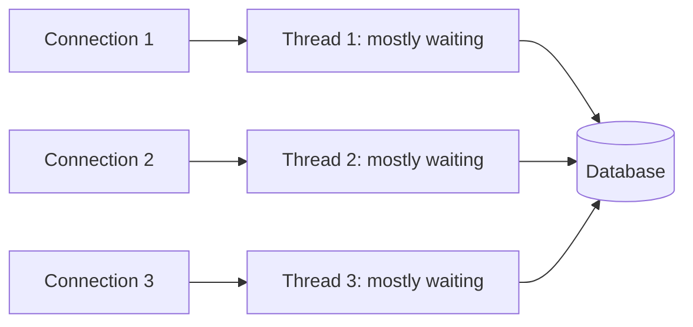
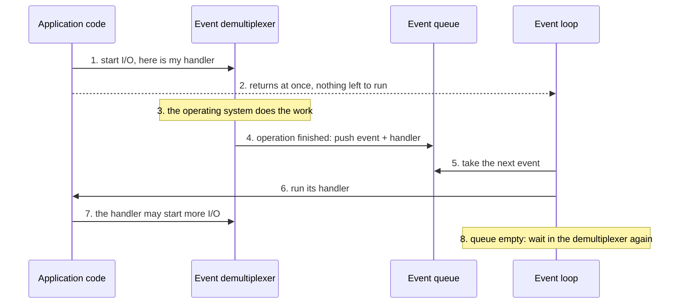
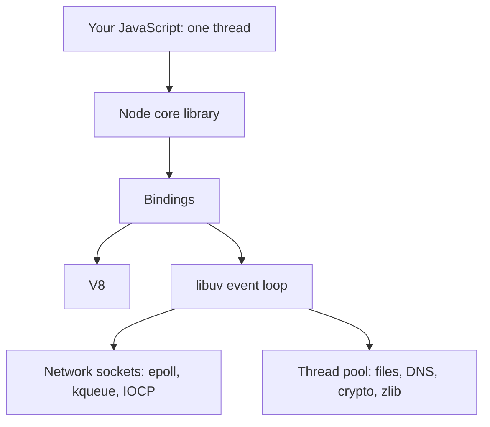
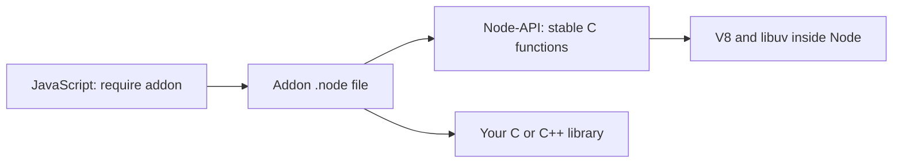

# Philosophy, non-blocking I/O and the reactor pattern

## In plain words

Picture a small restaurant with a single waiter. A bad waiter takes an order from table 1, walks to the kitchen and stands there until the food is cooked, while tables 2 to 9 wave their arms. A good waiter hands the order to the kitchen, goes straight to the next table, and returns to table 1 only when the kitchen rings the bell.

The good waiter never works faster. They stop *waiting*. That is the whole idea of Node.js: one worker (one thread running your JavaScript) who never stands still while a disk or a network is busy, and a bell system that says which order is ready. The bell system has a formal name, the **reactor pattern**, and this lesson builds it from the ground up.

Why it matters for a job: "How does Node handle thousands of connections with one thread?" is probably the most common Node interview question. More practically, every performance problem in a Node service (a frozen server, a slow endpoint that slows all the others) is explained by the model in this lesson.

> **Before this lesson:** read [What Node.js is: install, run a script, read a file](#/lesson/nodejs/what-is-node) and [npm, package.json and your first HTTP server](#/lesson/nodejs/npm-first-server). You should know what a callback is (a function passed to be called later) and have seen `setTimeout`.

## The Node way of building things

Before the mechanics, a word on taste. Node has a recognisable culture, and knowing it helps you read other people's packages and design your own. Four habits stand out.

1. **A small core.** Node itself ships only the essentials: files, networking, processes, streams, a few utilities. Things other platforms build in (web frameworks, database drivers, template engines) live outside, in packages, where they can compete and evolve without waiting for a Node release. This lean area maintained by the Node project is sometimes called *the core*, and everything else *userland*.
2. **Small modules.** A package is expected to do one thing well. Many popular packages are a few dozen lines. Small pieces are easier to understand, test and replace. The price is a long dependency list, which is why the lock file and `npm audit` from the previous lesson matter.
3. **A small surface.** A good module exposes very little: often one function or one class. The fewer ways there are to use something, the fewer ways there are to misuse it, and the freer the author is to change the inside.
4. **Pragmatism over perfection.** JavaScript is a loose language, and Node code tends to prefer a working, readable solution over an elaborate, theoretically complete one. Design patterns in this track are tools for specific problems, not rules to apply everywhere.

Keep these in mind; the pattern lessons later in the track are these four habits applied again and again.

## Why I/O decides everything

**I/O** (input/output) means moving data between your program's memory and the outside: a disk, a network, another program. Compared with computation, I/O is astonishingly slow. Rough orders of magnitude:

| Operation | Typical time | If one CPU step took 1 second |
|---|---|---|
| One simple CPU instruction | under 1 nanosecond | 1 second |
| Reading from memory (RAM) | about 100 nanoseconds | a couple of minutes |
| Reading from a fast disk (SSD) | about 100 microseconds | more than a day |
| A request to a database on the same network | about 1 millisecond | weeks |
| A request to a server in another country | about 100 milliseconds | years |

A nanosecond is a billionth of a second, a microsecond a millionth, a millisecond a thousandth. The lesson of the table: a typical web request is almost entirely *waiting*. The program asks a database something, and for a period that is an eternity in CPU terms it has nothing to compute. What a platform does during that wait defines its character.

## Approach 1: blocking I/O and one thread per connection

A call is **blocking** when it does not return until the operation has finished. The program is parked on that line.

```javascript
// pseudo-code in a blocking style
const data = socket.read();     // parked here until bytes arrive
process(data);
```

A **thread** is an independent line of execution inside a program; the operating system switches the CPU between threads so they appear to run at once. If reading blocks, one thread can serve only one connection at a time, so the traditional answer is: give every connection its own thread.



This works and is easy to reason about, since each thread reads top to bottom. The costs appear at scale:

- Every thread reserves memory for its own call stack, commonly around a megabyte. Ten thousand idle connections cost gigabytes for threads that are doing nothing.
- Switching the CPU from one thread to another (a **context switch**) takes time. With thousands of threads the machine spends real effort on switching alone.
- Threads share memory, so two of them can modify the same data at the same moment. Preventing that requires locks, and lock mistakes produce some of the hardest bugs in software.

## Approach 2: non-blocking I/O, done naively

Operating systems also offer **non-blocking** calls: ask for data, and if none is ready the call returns *immediately* with a "nothing yet" answer. One thread could then look after many connections by asking each in turn:

```javascript
// pseudo-code: polling in a loop
while (connections.length > 0) {
  for (const connection of connections) {
    const data = connection.tryRead();     // returns at once
    if (data === NOTHING_YET) continue;    // ask again next round
    handle(data);
  }
}
```

This technique is called **busy-waiting** or **polling**. It removes the thread per connection, but the loop spins at full speed asking questions whose answer is almost always "nothing yet". One CPU core burns at 100% to accomplish nothing.

## Approach 3: let the operating system watch

The fix is to stop asking and be told. Modern operating systems provide a mechanism to which you hand a whole list of resources (network sockets, files, pipes) and say: *put me to sleep and wake me when at least one of them has something for me*. It returns the ones that are ready. This is called a **synchronous event demultiplexer**, or event notification interface.

The phrase sounds heavy; take it apart. *Multiplexing* is combining many signals into one channel; *demultiplexing* is splitting them apart again. Here, events from many resources arrive through one waiting call, and are then dealt out one by one. *Synchronous* refers only to that single call: the thread does block on it, but it blocks once for *all* resources instead of once per resource, and uses no CPU while asleep.

Each operating system has its own version: **epoll** on Linux, **kqueue** on macOS and the BSD family, and **I/O completion ports (IOCP)** on Windows.

```javascript
// pseudo-code: one thread, many resources, no spinning
watched.add(socketA, FOR_READ);
watched.add(socketB, FOR_READ);
watched.add(fileC, FOR_READ);

while (true) {
  const readyEvents = demultiplexer.wait(watched);   // sleeps until something is ready
  for (const event of readyEvents) {
    const data = event.resource.read();              // guaranteed not to block
    handle(event.resource, data);
  }
}
```

One thread, no wasted CPU, no locks, because only one piece of handling code runs at a time. The loop at the bottom is the embryo of the **event loop**.

## The reactor pattern

Node packages this idea in a design called the **reactor pattern**. Its rule: *attach a handler (a callback) to every I/O operation; the handler is invoked when the operation produces an event.* The program does not wait for I/O; it *reacts* to it.

The moving parts:

- **Application**: your code. It asks for I/O and supplies a handler.
- **Event demultiplexer**: watches the resources on behalf of the application.
- **Event queue**: a line where completed operations wait, each paired with its handler.
- **Event loop**: takes entries from the queue one at a time and runs their handlers.



Follow the numbers. In step 2 control returns to the loop immediately, which is what "non-blocking" means for your code. In step 6 a handler runs **to completion**: nothing interrupts it, and no second handler starts until it returns. Step 7 is how programs keep going, since a handler usually starts the next operation. When there is nothing left to watch and nothing in the queue, the loop has no reason to exist and the Node process exits. That is why a script ends by itself and a listening server does not.

### A reactor you can run

The model below is a complete miniature reactor, about thirty lines. Time is simulated with a counter so the run is instant and repeatable.

```js-run
const demultiplexer = {
  pending: [],                                   // operations the "OS" is working on
  watch(readyAt, result, handler) { this.pending.push({ readyAt, result, handler }); },
  wait() {                                       // sleep until the next operation completes
    const soonest = Math.min(...this.pending.map((op) => op.readyAt));
    const ready = this.pending.filter((op) => op.readyAt === soonest);
    this.pending = this.pending.filter((op) => op.readyAt !== soonest);
    return { time: soonest, ready };
  },
};

const eventQueue = [];
let clock = 0;

// "Non-blocking" API offered to the application: returns immediately.
function readFromNetwork(name, takesMs, handler) {
  demultiplexer.watch(clock + takesMs, `data from ${name}`, handler);
}

// ---- application code ----
readFromNetwork("database", 30, (data) => {
  console.log(`t=${clock}ms handling: ${data}`);
  readFromNetwork("cache", 5, (more) => console.log(`t=${clock}ms handling: ${more}`));
});
readFromNetwork("payment API", 80, (data) => console.log(`t=${clock}ms handling: ${data}`));
readFromNetwork("disk", 30, (data) => console.log(`t=${clock}ms handling: ${data}`));
console.log(`t=${clock}ms main script finished, three operations in flight`);

// ---- the event loop ----
while (demultiplexer.pending.length > 0) {
  const { time, ready } = demultiplexer.wait();
  clock = time;
  for (const op of ready) eventQueue.push(op);
  while (eventQueue.length > 0) {
    const event = eventQueue.shift();
    event.handler(event.result);                 // runs to completion
  }
}
console.log(`t=${clock}ms nothing left to watch: the process would exit`);
```

Read it in three parts.

- `demultiplexer.watch` records an operation and when it will be ready. `wait` jumps to the earliest completion and returns everything that finished at that moment, the simulated version of sleeping in epoll.
- `readFromNetwork` is the kind of function Node gives you. It registers the operation with a handler and **returns at once**; look at the first line of output, printed at `t=0` while three operations are still in flight.
- The `while` loop at the bottom is the event loop: wait, move completed operations into the queue, run each handler.

Three operations of 30, 80 and 30 milliseconds finish in 80 milliseconds of simulated time, not 140, because the waiting overlaps. The handler for the database starts a fourth operation (step 7 of the diagram), which completes at 35.

### Seeing it with real timers

The same effect with real time. Each fake query takes 100 ms. Started one after the other, three would take about 300 ms. Started together, they take about 100 ms:

```js-run
const query = (name) => new Promise((resolve) => setTimeout(() => resolve(name + " rows"), 100));

const started = Date.now();
const results = await Promise.all([query("users"), query("orders"), query("stock")]);
console.log(results);
console.log("three 100 ms queries took about", Math.round((Date.now() - started) / 10) * 10, "ms");
```

`Promise.all` waits for several promises at once; later lessons cover it properly. The point here is the total.

## libuv: the engine room

Each operating system has a different demultiplexer, and they disagree in the details. Worse, some kinds of I/O cannot be done in a non-blocking way at all on some systems; ordinary files on Linux and macOS are the classic case. Hiding all of this is the job of **libuv**, the C library at the heart of Node. libuv:

- wraps epoll, kqueue and IOCP behind one interface, so Node behaves alike everywhere;
- implements the event loop and its queues;
- keeps a small **thread pool** (four threads by default) to which it hands operations that cannot be made non-blocking: file-system calls, DNS lookups through the system resolver, and some CPU-heavy built-ins such as password hashing and compression. A pool thread blocks so that the main thread does not have to, and when it finishes, the result is put in the event queue like any other event.

So the accurate statement is: **your JavaScript runs on one thread; Node as a whole uses a few more.** From your code's point of view, everything still arrives as an event handled one at a time.

The full recipe for Node is therefore four ingredients: **V8** to run JavaScript, **libuv** for the loop and I/O, a set of **bindings** that expose libuv and other low-level features to JavaScript, and the **core library** written in JavaScript on top.



## Running native code: addons, Node-API and WebAssembly

JavaScript, even on a fast engine like V8, is not the right tool for every job. Sometimes you need a feature JavaScript simply does not have, sometimes you already own a large library written in another language, and sometimes a computation is so heavy that every saved millisecond counts. Node gives you two doors out of JavaScript and into faster or lower-level code. First, some terms.

- **Native code** is a program already translated into the machine instructions of one specific processor, usually from C, C++ or Rust. It runs directly on the processor with no engine in between. Think of a book printed in the reader's own language, as opposed to one that needs a live interpreter reading aloud.
- A **native addon** is a native-code file (it ends in `.node`) that Node can load like a module, so that JavaScript can call the functions inside it.
- An **ABI** (application binary interface) is the agreement about how already-compiled pieces of code talk to each other at the machine level: where arguments are placed, how structures are laid out in memory. It is the binary cousin of an API. If the ABI changes, a file compiled yesterday no longer fits today's program, even though the source code would still compile.

### Why bother?

There are four common reasons, and they are worth knowing because an interviewer may ask "when would you leave JavaScript?"

1. **Reuse.** Decades of excellent libraries exist in C and C++: image processing, databases, cryptography, compression. Wrapping one is far cheaper than rewriting it. A company with a large legacy C++ code base can reach it from Node without migrating anything.
2. **Hardware and operating-system features.** Talking to a USB device, a serial port or a special driver needs native code. This is a big reason Node became popular for hobby robotics and the Internet of Things (everyday devices connected to a network).
3. **Raw speed for CPU-bound work.** Earlier in this lesson you saw that long computation blocks the event loop. Native code runs the heavy part faster, and an addon can also do the work on its own thread so the loop stays free.
4. **Code shared across languages**, which is also where WebAssembly comes in (below).

### Door 1: native addons and Node-API

An addon is a small piece of C or C++ glue that registers functions with Node. Your JavaScript then loads the compiled file and calls them as if they were ordinary functions:

```javascript
// Loading a compiled addon: the file name ends in .node
const fastHash = require("./build/Release/fast_hash.node");
console.log(fastHash.hash("hello"));   // runs C++ code, returns a JavaScript value
```

Here `require` is the CommonJS loader; ES modules reach addons through `createRequire`. Both are covered in the modules lessons. This snippet is not runnable in the browser, since there is no compiled file; it only shows the shape.

**The compatibility problem.** In the early days, addons talked directly to V8's internal C++ classes. V8 changes with every Node release, so an addon often had to be rewritten or at least recompiled for each new Node version. Imagine a phone charger whose plug changes shape every year: every device would need a new cable.

**Node-API (older name: N-API)** is the fix. It is a C interface, built into Node and maintained by the Node team, that sits between your addon and the engine. The addon calls Node-API functions (create a string, read an argument, throw an error) and never touches V8 directly. Because the Node-API functions keep a stable ABI, a compiled addon keeps working when you upgrade Node, without recompiling. Node-API is versioned: each Node release supports a known set of Node-API versions, and an addon states the lowest version it needs. In practice:

- Write C directly against Node-API, or use `node-addon-api`, an official C++ wrapper that is friendlier.
- Build with a tool such as `node-gyp` or `cmake-js`, which needs a C/C++ compiler on the machine.
- Package authors often ship **prebuilt binaries** for common operating systems so that users never need a compiler. Stable ABI makes this practical: one binary per operating system and processor, not one per Node version.



> [!WARNING]
> Native code is powerful and unforgiving. A bug in JavaScript throws an exception you can catch. A bug in native code (a bad pointer, a memory leak) can crash the entire Node process with no warning, and it can open security holes. Native code also runs with the full permissions of the process. Reach for it only when the benefit is clear.

### Door 2: WebAssembly

**WebAssembly** (**Wasm**) is a compact, low-level instruction format designed to be a compilation target. You write in C, C++, Rust or another language, compile to a `.wasm` file, and any engine that understands WebAssembly can run it: browsers and Node alike. V8 runs it at near-native speed.

The key difference from an addon is safety and portability. Wasm runs in a **sandbox** (a fenced area): it can only touch its own memory and only call functions you deliberately hand to it. It cannot open files or crash the process through a stray pointer. And one `.wasm` file runs on every operating system and processor, so there is nothing to compile on the user's machine.

Here is a real, runnable WebAssembly module. The numbers are the raw bytes of a tiny module exporting a function `add`; in practice a compiler produces these bytes for you:

```js-run
const bytes = new Uint8Array([
  0,97,115,109, 1,0,0,0,                    // header: the magic word "\0asm" and version 1
  1,7,1,96,2,127,127,1,127,                 // one function type: two 32-bit ints in, one out
  3,2,1,0,                                  // one function, using that type
  7,7,1,3,97,100,100,0,0,                   // export it under the name "add"
  10,9,1,7,0,32,0,32,1,106,11               // body: read both inputs, add them, return
]);

const module = await WebAssembly.instantiate(bytes);   // compile and prepare the module
const { add } = module.instance.exports;               // the exported function
console.log("add(2, 3) =", add(2, 3));
console.log("add(40, 2) =", add(40, 2));
```

`WebAssembly.instantiate` takes the bytes, checks that they are valid, compiles them and returns an instance. `exports` holds what the module chose to expose, and each export is callable like a normal JavaScript function. In a real project you would load a file instead: `await WebAssembly.instantiate(await readFile("lib.wasm"), imports)` in Node, where `imports` is the object of JavaScript functions the module is allowed to call.

A limit worth knowing: Wasm only passes simple numbers across the boundary. Strings and objects are copied through the module's linear memory, and tools such as `wasm-bindgen` (for Rust) generate that glue. Crossing the boundary has a cost, so Wasm pays off when one call does a lot of work, not when you call a tiny function a million times.

### Which door should you use?

| Question | Native addon (Node-API) | WebAssembly |
|---|---|---|
| Speed | Fastest; can use threads and SIMD freely | Near native, single-threaded unless set up otherwise |
| Safety | A bug can crash the process | Sandboxed |
| Portability | Compile per operating system and processor | One file runs everywhere |
| Access to OS, hardware, drivers | Full | None, except what you pass in |
| Install experience | Needs prebuilt binaries or a compiler | Plain file, nothing to build |
| Runs in the browser too | No | Yes |

A simple rule of thumb: try plain JavaScript first, and measure. If you need a hardware driver or an existing C/C++ library with system access, use a Node-API addon. If you need portable, safe, fast computation (image codecs, parsers, cryptography), choose WebAssembly. And if the problem is only that CPU work blocks the loop, remember that worker threads (a later lesson) may be enough with no native code at all.

> [!INTERVIEW]
> **"What is Node-API and why does it matter?"** "It is a stable C interface that Node provides for native addons. Addons call Node-API instead of V8's internals, and its ABI stays stable across Node versions, so a compiled addon does not need to be rebuilt for each release. That makes distributing prebuilt binaries realistic." Follow-up: **"WebAssembly or an addon?"** "WebAssembly when I want sandboxed, portable computation; an addon when I need OS or hardware access, threads, or an existing native library."

## The cost of the model: do not block the loop

There is exactly one waiter. If the waiter stops to peel potatoes for a minute, nobody is served for a minute. A handler that computes for a long time has the same effect: no other handler can run, no request is accepted, no timer fires.

```js-run
const started = Date.now();
setTimeout(() => console.log("timer asked for 10 ms, fired after", Date.now() - started, "ms"), 10);

let total = 0;                                  // a "CPU-bound" task: pure computation
while (Date.now() - started < 200) total += 1;
console.log("heavy loop finished after", Date.now() - started, "ms");
```

The timer wanted 10 ms and got roughly 200. Work that needs the processor for a long time is called **CPU-bound**; work that mostly waits is **I/O-bound**. Node excels at I/O-bound services and needs extra tools (worker threads, child processes, covered in the advanced recipes module) for CPU-bound work.

> [!WARNING]
> In a server, a single slow synchronous operation (a giant `JSON.parse`, a badly written regular expression, `fs.readFileSync` on a big file, a loop over millions of items) delays **every** connected user, not only the one who triggered it. Watching for long handlers is a central part of Node performance work.

> [!TIP]
> A quick mental test for any line of code: *is it waiting, or is it computing?* Waiting should be asynchronous and costs the loop nothing. Computing occupies the loop for its full duration; keep each stretch short.

## Pitfalls

- **"Node is single-threaded, so it uses only one core and cannot scale."** One process runs JavaScript on one thread, but it handles many connections concurrently, and several processes can be run side by side (see the scalability module).
- **"Asynchronous means parallel."** No. Your handlers never run at the same time as each other. The *waiting* overlaps; the JavaScript does not.
- **"Asynchronous code is faster."** A single operation takes as long as before. What improves is how many operations can be in flight together.
- **Assuming file operations are free.** They go through the thread pool, which has four threads by default. Thousands of simultaneous file reads queue up behind each other.
- **Forgetting that handlers run to completion.** There is no interruption in the middle of a function, which removes many locking problems but means long functions hurt everyone.

> [!INTERVIEW]
> **"Explain how Node handles many concurrent requests on a single thread."** Model answer: "Node uses non-blocking I/O with the reactor pattern. When my code starts an I/O operation it registers a callback and returns immediately. libuv asks the operating system, through epoll, kqueue or IOCP, to watch all the open resources. When an operation completes, its callback is queued, and the event loop runs queued callbacks one at a time on the single JavaScript thread. Since requests spend nearly all their time waiting for I/O, one thread can interleave thousands of them. The weakness is CPU-bound work, which blocks the loop and must be moved to worker threads or other processes."

## Cheat sheet

| Term | One-line meaning |
|---|---|
| Blocking I/O | The call returns only when the operation is done; the thread is parked |
| Thread per connection | Classic model: simple code, costly in memory and context switches |
| Non-blocking I/O | The call returns at once; the result is delivered later |
| Busy-waiting (polling) | Asking again and again in a loop; wastes CPU |
| Event demultiplexer | OS facility that watches many resources and reports the ready ones |
| epoll, kqueue, IOCP | The demultiplexers of Linux, macOS/BSD and Windows |
| Reactor pattern | A handler per I/O operation, an event queue, and a loop that runs handlers |
| Event loop | The loop that takes events and runs their handlers one at a time |
| libuv | Node's C library: event loop, cross-platform I/O, thread pool |
| Thread pool | Four helper threads by default for files, DNS, crypto, compression |
| I/O-bound / CPU-bound | Mostly waiting / mostly computing |

## Summary

- Node's culture favours a small core, small single-purpose modules, small interfaces and pragmatic solutions.
- I/O is thousands to millions of times slower than computation, so a server's design is mostly about how it waits.
- Blocking I/O needs one thread per connection; naive non-blocking I/O wastes CPU by polling.
- An event demultiplexer lets one thread sleep until any of many resources is ready. The reactor pattern adds a handler per operation, a queue and a loop.
- libuv implements this on every operating system and adds a thread pool for operations that cannot be non-blocking.
- Your JavaScript runs one handler at a time, to completion. Never keep the loop busy for long.

## Glossary

- **Thread**: an independent line of execution inside a process.
- **Context switch**: the operating system moving a CPU from one thread to another.
- **Blocking / non-blocking**: a call that waits for completion / a call that returns immediately.
- **Polling (busy-waiting)**: repeatedly checking whether something is ready.
- **Event**: a notification that something happened, such as data arriving.
- **Synchronous event demultiplexer**: an OS service that waits on many resources at once and returns those with events.
- **Handler**: the callback attached to an operation, run when its event arrives.
- **Event queue**: where completed operations wait for their handlers to be run.
- **Event loop**: the loop that processes the event queue.
- **Reactor pattern**: the design that combines demultiplexer, queue, loop and handlers.
- **libuv**: the library providing Node's event loop and I/O.
- **Thread pool**: a fixed set of helper threads for blocking work.
- **CPU-bound**: limited by computation, not by waiting.
- **Userland**: the ecosystem of packages outside Node's core.
- **Native code**: machine instructions for a specific processor, usually compiled from C, C++ or Rust.
- **Native addon**: a compiled `.node` file that JavaScript can load and call.
- **ABI**: the binary-level agreement that lets separately compiled code work together.
- **Node-API (N-API)**: Node's stable C interface for addons; its stable ABI means no rebuild per Node version.
- **WebAssembly (Wasm)**: a portable, sandboxed, low-level instruction format that engines run at near-native speed.
- **Sandbox**: a fenced environment that limits what code inside can touch.

```quiz
[
  {"q": "What does the event demultiplexer do?", "options": ["Runs JavaScript callbacks in parallel on many cores", "Watches many resources at once and reports which have events ready", "Compiles JavaScript to machine code", "Splits a file into chunks"], "answer": 1,
   "explain": "It lets one thread wait on all resources in a single call and returns the ready ones, so no polling is needed."},
  {"q": "Why is busy-waiting a poor way to do non-blocking I/O?", "options": ["It needs one thread per connection", "It keeps a CPU core spinning while almost every check answers \"nothing yet\"", "It cannot read from sockets", "It loses data"], "answer": 1,
   "explain": "Polling works, but it burns CPU to ask useless questions. The demultiplexer sleeps instead."},
  {"q": "In the reactor pattern, when does a handler run?", "options": ["Immediately when the I/O is requested", "On a separate thread as soon as data arrives", "When the event loop takes its completed event from the queue", "Only after all other I/O has finished"], "answer": 2,
   "explain": "Completed operations are queued with their handlers; the loop runs them one at a time."},
  {"q": "In what order do these log?\n\n`console.log('A'); setTimeout(() => console.log('B'), 0); let x = 0; for (let i = 0; i < 1e8; i++) x += i; console.log('C');`", "options": ["A, B, C", "A, C, B", "B, A, C", "A, then B and C at the same time"], "answer": 1,
   "explain": "The timer's callback can run only when the current code has returned to the event loop. The long loop delays it; C is logged first."},
  {"q": "Which work does libuv send to its thread pool?", "options": ["Every network socket read", "File-system operations and some CPU-heavy built-ins such as hashing and compression", "All JavaScript callbacks", "Timers"], "answer": 1,
   "explain": "Sockets use the OS demultiplexer directly. Operations that cannot be non-blocking go to the pool."},
  {"q": "Three independent 200 ms database calls are started at the same moment from one Node handler. Roughly how long until all three results are back?", "options": ["About 200 ms", "About 400 ms", "About 600 ms", "It depends on the number of CPU cores"], "answer": 0,
   "explain": "The waiting overlaps. No JavaScript runs during it, so one thread is enough."},
  {"q": "Which task is a poor fit for a single Node process?", "options": ["A chat server with 20,000 mostly idle connections", "An API that forwards requests to a database", "Resizing thousands of large images inside request handlers", "Serving static files"], "answer": 2,
   "explain": "Image resizing is CPU-bound; it would block the loop for every other user unless moved to workers."},
  {"q": "\"Node is single-threaded.\" Which refinement is most accurate?", "options": ["Node uses exactly one thread for everything", "JavaScript runs on one thread, while libuv also uses a small thread pool and the OS for I/O", "Each request gets its own thread", "Each callback runs on a random thread"], "answer": 1,
   "explain": "Your code sees one thread and one event at a time; helper threads exist underneath."},
  {"q": "What is the main benefit of Node-API for addon authors?", "options": ["It makes C++ code run on the JavaScript thread", "A compiled addon keeps working across Node versions without being rebuilt", "It removes the need for a compiler", "It lets addons run in the browser"], "answer": 1,
   "explain": "Node-API has a stable ABI and hides V8's internals, so the same binary works across Node releases. A compiler is still needed to build the addon in the first place."},
  {"q": "You need to read from a USB device from Node. Which option fits?", "options": ["WebAssembly, because it can open any device", "A native addon, because it has full operating-system access", "Plain JavaScript only; it is impossible", "A larger libuv thread pool"], "answer": 1,
   "explain": "WebAssembly is sandboxed and cannot touch hardware unless you pass functions in. A native addon runs with the process's full permissions."},
  {"q": "Which is true of a WebAssembly module compared with a native addon?", "options": ["It must be recompiled for each operating system", "It can crash the process through a bad pointer", "It runs sandboxed and the same file works on every platform", "It cannot be used from Node"], "answer": 2,
   "explain": "Wasm is portable and sandboxed. Both properties are its main selling points over addons."}
]
```

> **Source:** Casciaro & Mammino, *Node.js Design Patterns* 3e, ch. 1 (topics only; wording and examples are original). Documentation: https://nodejs.org/en/learn/asynchronous-work/overview-of-blocking-vs-non-blocking, https://docs.libuv.org/en/v1.x/design.html
