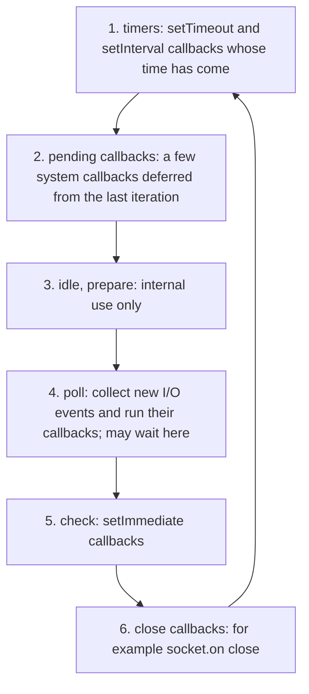

# The event loop in detail: phases, microtasks and the thread pool

## In plain words

A postal worker walks the same round every day: first the letterboxes on Timer Street, then the big sorting office where most of the mail is, then Check Lane, then Close Road, and back to the start. At each stop they deliver everything waiting there before moving on. They also carry a small urgent-notes pouch, and after **every single delivery** they empty that pouch before doing anything else.

Node's **event loop** is that round. The stops are called *phases*, each with its own queue of callbacks. The urgent pouch is the pair of queues for `process.nextTick` and promise callbacks. Once you know the round and the pouch rule, you can predict the order in which any Node program runs its callbacks.

Why it matters for a job: "what does this print, and in what order?" is a standard interview exercise, and it is standard because the same knowledge explains real bugs: a callback that fires too early, a server starved by a tight loop of promises, a timer that is always late.

> **Before this lesson:** you need the reactor model from [Philosophy, non-blocking I/O and the reactor pattern](#/lesson/nodejs/nonblocking-reactor). Knowing that `promise.then(fn)` calls `fn` later is enough about promises for now; the JavaScript track covers them in [The event loop, tasks and microtasks](#/lesson/javascript/event-loop-microtasks) from the browser's angle.

## From one queue to several

The previous lesson drew the event loop with a single event queue. Real Node has several, because different kinds of callbacks deserve different treatment: a timer should be checked against the clock, a network callback should run as soon as the data is there, a "run this right after I/O" request should not have to wait for a clock at all.

A full turn of the loop is called an **iteration** (older texts say *tick*). In every iteration the loop visits its **phases** in a fixed order. In each phase it runs the callbacks waiting in that phase's queue, then moves on.



| Phase | What runs there | You schedule it with |
|---|---|---|
| **timers** | Callbacks of timers whose delay has passed | `setTimeout`, `setInterval` |
| **pending callbacks** | Some operating-system level callbacks postponed from the previous iteration (for example certain TCP errors) | not directly |
| **idle, prepare** | Internal bookkeeping | not directly |
| **poll** | Callbacks for completed I/O: file reads, incoming network data, new connections | any asynchronous I/O call |
| **check** | Callbacks registered to run right after the poll phase | `setImmediate` |
| **close callbacks** | Handlers for resources that were closed abruptly | `'close'` events |

**TCP** is the protocol that carries most internet connections; you do not need its details here.

Two phases deserve a closer look.

**Poll** is where the loop spends its life. If I/O callbacks are queued, it runs them. If the queue is empty, the loop decides what to do: when `setImmediate` callbacks are waiting it moves on to the check phase; otherwise it **waits here** for I/O to arrive, but no longer than the time remaining until the nearest timer. This waiting is the "sleep in the demultiplexer" from the last lesson, and it is why an idle Node process uses no CPU.

**Timers** are not precise. `setTimeout(fn, 100)` means "run `fn` no sooner than about 100 ms from now". The callback has to wait for the loop to come round to the timers phase, and if some other callback is hogging the thread, it waits longer. Also, a delay of `0` is turned into `1` millisecond.

## The two urgent queues: `process.nextTick` and microtasks

Two more queues are not phases at all. They are processed **between** callbacks, wherever the loop happens to be.

- The **nextTick queue** holds callbacks passed to `process.nextTick(fn)`.
- The **microtask queue** holds promise reactions (the functions given to `.then`, `.catch`, `.finally`, and the continuation of an `async` function after `await`) and callbacks passed to `queueMicrotask(fn)`.

The rule, since Node 11: after the main script finishes, and after **each individual callback** in any phase, Node

1. runs every callback in the nextTick queue, including ones added while doing so;
2. then runs every microtask, including ones added while doing so;
3. if step 2 put something in the nextTick queue, goes back to step 1;
4. only when both are empty does the loop continue with the next callback or phase.

So the priority order is: **synchronous code, then `process.nextTick`, then promise microtasks, then the phases.**

> [!NOTE]
> The name is a historical accident. `process.nextTick` does not wait for the next loop iteration; it runs *before* the loop continues. `setImmediate` is the one that runs on the next visit to the check phase. If the two were named today, their names would probably be swapped. The Node documentation itself recommends `setImmediate` or `queueMicrotask` for most uses, because they are easier to reason about.

## The classic ordering puzzle

```javascript
// order.js (a CommonJS file)
setTimeout(() => console.log("timeout"), 0);
setImmediate(() => console.log("immediate"));
process.nextTick(() => console.log("nextTick"));
Promise.resolve().then(() => console.log("promise"));
console.log("sync");
```

```text
$ node order.js
sync
nextTick
promise
timeout
immediate
```

Reasoning, step by step:

1. The main script runs to its last line. The four scheduling calls only *register* callbacks. The one synchronous `console.log` prints `sync`.
2. The script is finished, so the urgent queues are emptied: nextTick first (`nextTick`), then microtasks (`promise`).
3. The loop starts. Timers phase: is the 1 ms timer due? Usually yes by now, so `timeout`. Poll: nothing. Check: `immediate`.

The last two lines carry a warning. **From the main script, the order of `setTimeout(fn, 0)` and `setImmediate(fn)` is not guaranteed.** If the process reaches the timers phase in under a millisecond, the timer is not due yet, the loop goes on to the check phase, and `immediate` prints first. Run the file several times on a busy machine and you may see both orders.

Inside an I/O callback the order *is* guaranteed:

```javascript
const fs = require("node:fs");

fs.readFile(__filename, () => {
  setTimeout(() => console.log("timeout"), 0);
  setImmediate(() => console.log("immediate"));
});
```

```text
immediate
timeout
```

The callback of `readFile` runs in the **poll** phase. The next phase is **check**, so the immediate always goes first; the timer has to wait for the next iteration.

> [!INTERVIEW]
> **"`setImmediate` versus `setTimeout(fn, 0)` versus `process.nextTick`?"** Answer: "`process.nextTick` runs before the event loop continues, right after the current operation, ahead of promise callbacks. Promise callbacks (microtasks) come next. `setTimeout(fn, 0)` runs in the timers phase once at least 1 ms has passed. `setImmediate` runs in the check phase, right after poll. From the main module the timer and the immediate can come in either order; from inside an I/O callback the immediate always comes first."

### One difference between CommonJS and ES modules

In a CommonJS file, as shown, `nextTick` beats `promise`. In an **ES module** (`.mjs`, or `"type": "module"`), the top-level code itself runs as part of a promise job, because ES modules are loaded asynchronously. The microtask queue is therefore already being drained when your code runs, and the promise callback gets ahead:

```text
$ node order.mjs
sync
promise
nextTick
timeout
immediate
```

Inside callbacks, where almost all real code runs, the two module systems behave identically. The lesson: do not write programs that depend on the relative order of `nextTick` and promises at the top level.

## A model of the loop you can run

`process.nextTick` and `setImmediate` do not exist in the browser that runs this page, so the box below contains a small **simulator** of the loop with virtual time: four phase queues, the two urgent queues, and the drain rule. The program at the bottom uses a fake `node` object with the same vocabulary as the real thing.

```js-run
function createLoop() {
  const ticks = [], micros = [], timers = [], io = [], immediates = [], closing = [];
  let now = 0, seq = 0;
  const node = {
    nextTick: (fn) => ticks.push(fn),
    queueMicrotask: (fn) => micros.push(fn),
    setTimeout: (fn, ms = 0) => timers.push({ fn, due: now + Math.max(1, ms), seq: seq++ }),
    setImmediate: (fn) => immediates.push(fn),
    readFile: (fn, takesMs = 2) => io.push({ fn, due: now + takesMs, seq: seq++ }),
    onClose: (fn) => closing.push(fn),
  };
  function drain() {                               // the urgent queues
    while (ticks.length || micros.length) {
      while (ticks.length) ticks.shift()();
      while (micros.length) micros.shift()();
    }
  }
  function runDue(queue) {
    const due = queue.filter((x) => x.due <= now).sort((a, b) => a.due - b.due || a.seq - b.seq);
    for (const item of due) { queue.splice(queue.indexOf(item), 1); item.fn(); drain(); }
  }
  function run(main) {
    main(node);
    drain();                                       // after the main script
    while (timers.length || io.length || immediates.length || closing.length) {
      runDue(timers);                              // phase: timers
      if (!immediates.length && !closing.length) { // phase: poll (may sleep)
        const next = Math.min(...timers.map((t) => t.due), ...io.map((t) => t.due));
        if (next !== Infinity && next > now) now = next;
      }
      runDue(io);
      for (const fn of immediates.splice(0)) { fn(); drain(); }   // phase: check
      for (const fn of closing.splice(0)) { fn(); drain(); }      // phase: close
    }
  }
  return { run };
}

console.log("--- program 1: the classic puzzle ---");
createLoop().run((node) => {
  node.setTimeout(() => console.log("timeout"), 0);
  node.setImmediate(() => console.log("immediate"));
  node.nextTick(() => console.log("nextTick"));
  node.queueMicrotask(() => console.log("promise"));
  console.log("sync");
});

console.log("--- program 2: inside an I/O callback ---");
createLoop().run((node) => {
  node.readFile(() => {
    console.log("file read");
    node.setTimeout(() => console.log("timeout"), 0);
    node.setImmediate(() => console.log("immediate"));
    node.queueMicrotask(() => {
      console.log("promise");
      node.nextTick(() => console.log("nextTick queued by a promise"));
    });
    node.nextTick(() => console.log("nextTick"));
  });
});
```

How to read the simulator:

- Each scheduling function only pushes onto a queue. Timers and I/O remember a `due` time on the virtual clock `now`.
- `drain()` is the urgent-pouch rule: all ticks, then all microtasks, repeated until both are empty.
- `run` executes the main script, drains, then walks the phases. In the poll step, if nothing is waiting in check or close, the clock jumps forward to the next timer or I/O completion; that is the loop sleeping.
- `immediates.splice(0)` takes a snapshot, so an immediate scheduled during the check phase waits for the next iteration.

In program 1 the model starts the loop at virtual time 0, when the 1 ms timer is not yet due, so `immediate` comes before `timeout`: one of the two orders real Node can produce. Program 2 shows the guaranteed order. Notice `nextTick queued by a promise` printing straight after `promise` and before `immediate`: the drain rule goes back to the nextTick queue. The problems [Event loop order: one flat script](#/problem/node-event-loop-flat) and [Event loop order: nested callbacks](#/problem/node-event-loop-nested) ask you to build this model yourself.

### The part browsers and Node share

Microtasks before timers is common to both environments, so this runs for real:

```js-run
setTimeout(() => console.log("5. timer"), 0);
queueMicrotask(() => console.log("3. microtask A"));
Promise.resolve()
  .then(() => console.log("4. promise callback (also a microtask)"))
  .then(() => console.log("4b. chained: queued only when the previous one finished"));
console.log("1. first line");
console.log("2. last line of the script");
```

The second `.then` is not queued at the start. It is queued when the first `.then` callback has completed, and it still runs before the timer, because the microtask queue is emptied completely before the loop moves on.

## Starving the loop

"Emptied completely, including items added meanwhile" has a dark side. A callback that keeps re-queuing itself on an urgent queue never lets the loop reach its phases:

```javascript
function spin() {
  process.nextTick(spin);      // the nextTick queue is never empty
}
spin();
setTimeout(() => console.log("never printed"), 0);
```

No timer fires, no request is accepted, no file callback runs. This is called **starvation**. Promises can do the same thing. The box below shows a bounded version: 50,000 chained microtasks all run before a timer that was registered first.

```js-run
const started = Date.now();
setTimeout(() => console.log("timer finally ran after", Date.now() - started, "ms"), 0);

let count = 0;
function again() {
  count++;
  if (count < 50000) queueMicrotask(again);
  else console.log("50000 microtasks done; only now can the loop move on");
}
again();
```

If you need to split a long job into slices and let I/O in between, use `setImmediate` (in Node) or `setTimeout`, which hand control back to the loop:

```javascript
function processInSlices(items, done) {
  let i = 0;
  function slice() {
    const end = Math.min(i + 1000, items.length);
    for (; i < end; i++) handle(items[i]);
    if (i < items.length) setImmediate(slice);   // let pending I/O run first
    else done();
  }
  slice();
}
```

> [!WARNING]
> A recursive `process.nextTick` or an endless chain of already-resolved promises freezes a server as surely as `while (true) {}`. The CPU graph shows 100% and nothing is answered.

## The thread pool, seen from the loop

Operations that cannot be non-blocking (file system, system DNS lookups, `crypto.pbkdf2`, `zlib`) are executed on libuv's thread pool: four threads by default. Each finished job is delivered as an event in the poll phase. A real experiment makes the pool visible:

```javascript
const crypto = require("node:crypto");
const start = Date.now();
for (let i = 1; i <= 6; i++) {
  crypto.pbkdf2("secret", "salt", 400000, 64, "sha512", () => {
    console.log(`hash ${i} done after ${Date.now() - start} ms`);
  });
}
```

```text
hash 1 done after 410 ms
hash 3 done after 415 ms
hash 2 done after 421 ms
hash 4 done after 430 ms
hash 6 done after 818 ms
hash 5 done after 826 ms
```

Four hashes finish together, and the last two finish one "round" later: they had to wait for a free thread. (On a machine with fewer than four cores the first group is slower.) The pool size can be changed with the environment variable `UV_THREADPOOL_SIZE`, set before Node starts.

> [!TIP]
> Network sockets do **not** use the thread pool; they go straight through epoll, kqueue or IOCP. That is why Node can hold tens of thousands of connections with four pool threads. If an application does heavy file or crypto work and feels slow under load, the pool is the first place to look.

## Pitfalls

- **Relying on timer precision.** Delays are minimums. Under load a "10 ms" timer can fire after hundreds.
- **Relying on `setTimeout(0)` versus `setImmediate` order from the main module.** It varies from run to run.
- **Believing `await` yields to I/O.** `await` on something already resolved continues in a microtask, which runs before any I/O callback. A loop of such awaits can starve the loop.
- **Using `process.nextTick` as a general "do it later".** Reach for `queueMicrotask` or `setImmediate`; keep `nextTick` for the narrow case of running before anything else, explained in the callbacks lesson.
- **Top-level order differing between `.js` and `.mjs` files.** Promise callbacks run before `nextTick` callbacks at the top level of an ES module.
- **Forgetting that `setInterval` keeps the process alive.** A pending timer is a reason for the loop to continue. Call `clearInterval`, or `timer.unref()` to tell Node not to wait for it.

## Cheat sheet

| Call | Runs | Typical use |
|---|---|---|
| synchronous code | immediately, to completion | everything |
| `process.nextTick(fn)` | after the current operation, before promises and before the loop continues | make an API consistently asynchronous, emit an event right after construction |
| `queueMicrotask(fn)`, `.then(fn)`, after `await` | after the nextTick queue, before the loop continues | promise machinery |
| `setTimeout(fn, ms)` | timers phase, at least `ms` (minimum 1) later | delays, timeouts |
| `setImmediate(fn)` | check phase, right after poll | yield to I/O, slice long jobs |
| I/O callback | poll phase, when the operation completes | files, network |
| `'close'` handler | close callbacks phase | clean-up |

Order of priority: **sync → nextTick → microtasks → timers → poll (I/O) → check → close**, and the two urgent queues are emptied after every callback.

## Summary

- The loop repeats six phases; the ones you use are timers, poll, check and close.
- `process.nextTick` callbacks and promise microtasks are not phases. They run after the main script and after every callback, nextTick first.
- `setImmediate` beats a zero timer inside an I/O callback; from the main module their order is undefined.
- Urgent queues are emptied completely, so a self-refilling queue starves timers and I/O.
- File, DNS, crypto and compression work runs on a four-thread pool and returns through the poll phase.

## Glossary

- **Iteration (tick)**: one full turn of the event loop through all phases.
- **Phase**: a stage of the loop with its own callback queue.
- **Timers phase**: where due `setTimeout`/`setInterval` callbacks run.
- **Poll phase**: where I/O callbacks run and where the loop waits when idle.
- **Check phase**: where `setImmediate` callbacks run.
- **Close callbacks phase**: where handlers for closed resources run.
- **nextTick queue**: callbacks registered with `process.nextTick`.
- **Microtask**: a promise reaction or `queueMicrotask` callback.
- **Macrotask**: informal name for a callback run by a phase (timer, I/O, immediate).
- **Drain**: to empty a queue completely.
- **Starvation**: phases never getting a turn because an urgent queue never empties.
- **`UV_THREADPOOL_SIZE`**: environment variable that sets the size of libuv's thread pool.

```quiz
[
  {"q": "In what order do these log in a CommonJS file?\n\n`setTimeout(() => console.log('T'), 0); Promise.resolve().then(() => console.log('P')); process.nextTick(() => console.log('N')); console.log('S');`", "options": ["S, N, P, T", "S, P, N, T", "N, S, P, T", "S, T, N, P"], "answer": 0,
   "explain": "Synchronous code first, then the nextTick queue, then promise microtasks, then the timers phase."},
  {"q": "Inside the callback of `fs.readFile`, you call `setTimeout(a, 0)` and then `setImmediate(b)`. Which runs first?", "options": ["a, always", "b, always", "Either, it varies", "Neither runs"], "answer": 1,
   "explain": "I/O callbacks run in the poll phase; the check phase comes next, so the immediate wins. The timer waits for the next iteration."},
  {"q": "From the main module, `setTimeout(a, 0); setImmediate(b);`. Which runs first?", "options": ["a, always", "b, always", "It is not guaranteed", "They run at the same time"], "answer": 2,
   "explain": "It depends on whether 1 ms has passed when the loop first reaches the timers phase."},
  {"q": "In what order do these log?\n\n`Promise.resolve().then(() => { console.log('A'); process.nextTick(() => console.log('B')); }).then(() => console.log('C')); setImmediate(() => console.log('D'));`", "options": ["A, B, C, D", "A, C, B, D", "A, C, D, B", "D, A, B, C"], "answer": 1,
   "explain": "Microtasks are drained fully before returning to the nextTick queue: A, then C (queued when A finished), then B. D waits for the check phase."},
  {"q": "What happens with `function f() { process.nextTick(f); } f();` in a server?", "options": ["Nothing noticeable", "A stack overflow error", "The event loop is starved: no I/O or timers run", "Node exits immediately"], "answer": 2,
   "explain": "The nextTick queue never becomes empty, so the loop never reaches its phases. There is no stack growth because each call returns first."},
  {"q": "Six `crypto.pbkdf2` calls are started at once with default settings on an 8-core machine. How do they complete?", "options": ["All six together", "One at a time", "Four together, then the remaining two", "Two together, three times"], "answer": 2,
   "explain": "The libuv thread pool has four threads by default; the last two jobs wait for a free thread."},
  {"q": "`setTimeout(fn, 100)` guarantees that fn runs...", "options": ["exactly 100 ms later", "no sooner than about 100 ms later", "within 100 ms", "on a separate thread after 100 ms"], "answer": 1,
   "explain": "A timer's delay is a minimum. The callback waits for the loop to reach the timers phase."},
  {"q": "Which call is the right tool to break a long computation into slices while letting I/O callbacks run in between?", "options": ["process.nextTick", "queueMicrotask", "setImmediate", "Promise.resolve().then"], "answer": 2,
   "explain": "Only setImmediate (or a timer) returns control to the loop's phases. The other three run before the loop continues."}
]
```

> **Source:** Casciaro & Mammino, *Node.js Design Patterns* 3e, ch. 1 and 3 (topics only; wording and examples are original). Documentation: https://nodejs.org/en/learn/asynchronous-work/event-loop-timers-and-nexttick, https://nodejs.org/docs/latest/api/process.html#processnexttickcallback-args, https://nodejs.org/docs/latest/api/timers.html
