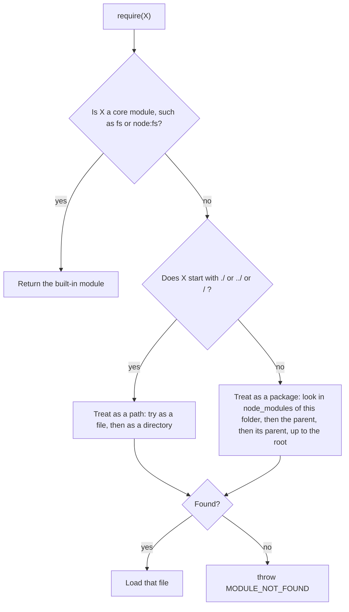
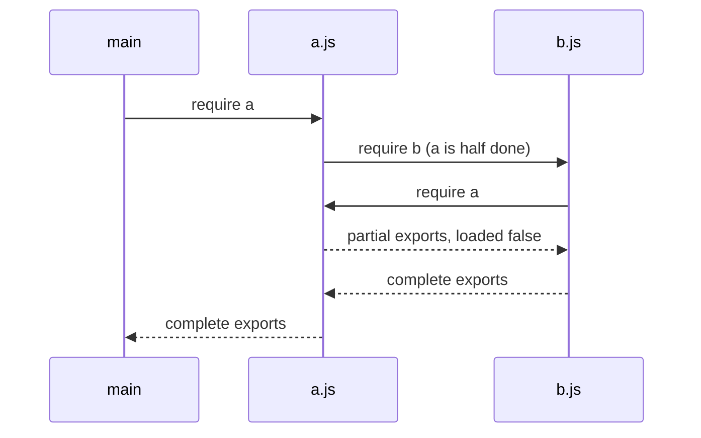

# CommonJS: require, resolution, the cache and cycles

## In plain words

A workshop where every tool lies in one heap on the floor works for one person and five tools. With fifty people and five thousand tools it needs labelled drawers: each drawer holds related tools, has a name on the front, and shows only its handle, not its insides.

A **module** is a drawer for code: one file with its own private variables, which hands out only what it chooses to. A **module system** is the set of rules for how one file names another, how the other file is found, and what comes back. Node has two module systems. This lesson covers the original one, **CommonJS** (often shortened to CJS), the one that uses `require` and `module.exports`. The next lesson covers ES modules.

Why it matters for a job: a large part of the npm registry and of existing company code is CommonJS, and its behaviour explains daily puzzles: "why is this import `undefined`?", "why did my config load only once?", "which copy of this library am I getting?". Interviewers like to ask how `require` works because the answer shows whether you understand the platform or only use it.

> **Before this lesson:** you need closures (a function remembering the variables around it) from [Closures and recursion](#/lesson/javascript/closures-recursion), and you should have run scripts with Node as in [What Node.js is](#/lesson/nodejs/what-is-node). The JavaScript track's [ES modules and CommonJS](#/lesson/javascript/es-modules-commonjs) gives a shorter first look.

## Why modules exist

A module system has four jobs:

1. **Splitting** a program into files that can be developed and tested separately.
2. **Reuse**: the same file can serve several projects.
3. **Encapsulation**: hiding the inner workings and showing only a deliberate public face, called the module's **interface** or **API**.
4. **Dependency management**: stating clearly which other modules a file needs, so they can be loaded in the right order.

Early JavaScript had none of this. Every `<script>` on a page shared one global space, and two libraries that both defined `utils` silently overwrote each other.

### The trick that came first: the revealing module pattern

Before any official module system, developers got privacy from the one tool the language had: function scope. Wrap code in a function that runs immediately, and return only what should be public.

```js-run
const counterModule = (() => {
  let count = 0;                         // private: invisible outside
  const format = (n) => `count is ${n}`; // private helper

  return {                               // the public interface
    increment() { count += 1; return format(count); },
    reset() { count = 0; },
  };
})();

console.log(counterModule.increment());
console.log(counterModule.increment());
console.log("count from outside:", counterModule.count);
```

- `(() => { ... })()` defines a function and calls it at once. This is an **IIFE**, an *immediately invoked function expression*.
- `count` and `format` live in that function's scope. Nothing outside can reach them, which is why the last line prints `undefined`.
- The returned object is the only way in. The methods still see `count` because they are closures.

This is called the **revealing module pattern**, and CommonJS is, at heart, this pattern applied automatically to every file.

## How `require` works: build it yourself

The best way to understand `require` is to write a small one. Node cannot be imported into this page, so the model below keeps its "files" in an object, mapping a file name to its source text.

```js-run
const files = {
  "/app/main.js": `
    const tax = require("/app/tax.js");
    console.log("main: 100 with tax =", tax.withTax(100));
    const again = require("/app/tax.js");
    console.log("main: same object both times?", tax === again);
  `,
  "/app/tax.js": `
    console.log("tax.js is being executed");
    const RATE = 0.2;                       // private to this module
    module.exports = { withTax: (amount) => amount * (1 + RATE) };
  `,
};

const cache = {};

function requireModule(filename) {
  if (cache[filename]) return cache[filename].exports;      // 1. cached? done

  const module = { exports: {}, id: filename };             // 2. fresh module record
  cache[filename] = module;                                  // 3. cache it BEFORE running

  const wrapper = new Function("module", "exports", "require", "console", files[filename]);
  wrapper(module, module.exports, requireModule, console);  // 4. run the file's code

  return module.exports;                                     // 5. hand back its exports
}

requireModule("/app/main.js");
```

Every step corresponds to something real Node does.

1. **Check the cache.** A module that was loaded before is not run again.
2. **Create the module record**: an object with an `exports` property that starts as an empty object.
3. **Store it in the cache first.** This ordering looks odd and turns out to be essential for circular dependencies, below.
4. **Wrap and run.** `new Function(...)` turns the file's text into a function whose parameters are `module`, `exports` and `require`. That is why those three names exist in every CommonJS file without being globals: they are *arguments*. And since the file's code runs inside a function, its top-level variables (`RATE`) are private.
5. **Return `module.exports`**, whatever the file left there.

The output shows `tax.js is being executed` once, even though it was required twice, and the two results are the same object.

Real Node wraps each file like this (you can see it in error stack traces):

```javascript
(function (exports, require, module, __filename, __dirname) {
  // your file's code
});
```

So `__filename` (the file's full path) and `__dirname` (its folder) are two more wrapper arguments.

> [!NOTE]
> `require` is **synchronous**: it reads the file and runs it on the spot, and only then returns. That is acceptable at start-up, when files are read from the local disk once. It also means a module cannot finish initialising "later": whatever is assigned to `module.exports` after an asynchronous step is invisible to code that required the module earlier. The advanced recipes module deals with components that need asynchronous start-up.

## `module.exports` versus `exports`

`exports` is nothing more than a second name for the object that `module.exports` starts with. Two ways of exporting follow.

```javascript
// Style 1: add properties to the existing object
exports.add = (a, b) => a + b;
exports.PI = 3.14159;

// Style 2: replace the whole thing
module.exports = function area(r) { return 3.14159 * r * r; };
```

The trap: assigning to the *variable* `exports` does nothing useful.

```js-run
function runFile(body) {
  const module = { exports: {} };
  body(module, module.exports);
  return module.exports;
}

const good = runFile((module, exports) => { exports.hello = () => "hi"; });
const broken = runFile((module, exports) => { exports = { hello: () => "hi" }; });
const replaced = runFile((module, exports) => { module.exports = { hello: () => "hi" }; });

console.log("exports.hello = ...        ->", Object.keys(good));
console.log("exports = {...}            ->", Object.keys(broken));
console.log("module.exports = {...}     ->", Object.keys(replaced));
```

`exports = {...}` only points the local parameter at a new object; `module.exports`, the thing `require` returns, still holds the original empty object. Rule: **add properties through `exports`, or replace through `module.exports`; never reassign bare `exports`.**

## Common export shapes

| Shape | Code | When it fits |
|---|---|---|
| Named exports | `exports.parse = ...; exports.format = ...` | A toolbox of related functions |
| A single function | `module.exports = function slugify(text) {...}` | The module does one thing; the clearest possible interface |
| A class | `module.exports = class Cache {...}` | Callers create their own instances and may extend it |
| An instance | `module.exports = new Cache()` | One shared, stateful object for the whole program (see the singleton lesson) |

Exporting one function matches the "small surface" habit from the platform lesson: there is exactly one obvious way to use the module. A function can still carry extras as properties (`module.exports.defaults = {...}`).

There is a fifth, riskier shape: a module that exports nothing and instead **modifies** another module or a global object. This is called *monkey patching*. It is occasionally useful in tests, where a fake replaces a real function, and dangerous elsewhere, because the change affects every user of the patched module and is invisible at the place where the damage shows.

## Finding the file: the resolving algorithm

`require("something")` receives a string, the **specifier**. Node must turn it into one exact file. The rules depend on the form of the specifier.



**As a file**, Node tries the exact name, then with `.js`, `.json` and `.node` added. **As a directory**, it looks for a `package.json` with a `main` field and loads that; failing that, `index.js`.

**As a package**, Node climbs. From `/home/ana/shop/src/cart/total.js`, `require("lodash")` checks:

```text
/home/ana/shop/src/cart/node_modules/lodash
/home/ana/shop/src/node_modules/lodash
/home/ana/shop/node_modules/lodash        <- usually found here
/home/ana/node_modules/lodash
/home/node_modules/lodash
/node_modules/lodash
```

This climbing rule has an elegant consequence. Each package can have its **own** `node_modules` folder, so two packages can depend on different, incompatible versions of a third without conflict:

```text
shop/
  node_modules/
    pkg-a/
      node_modules/
        chalk/         (version 4, seen by pkg-a)
    pkg-b/
      node_modules/
        chalk/         (version 5, seen by pkg-b)
```

When code inside `pkg-a` requires `chalk`, the nearest `node_modules` wins, so it gets version 4. Many ecosystems cannot do this at all. `require.resolve("lodash")` tells you which file a specifier resolves to without loading it, which is the quickest way to debug "which copy am I getting?". The problem [Where does require() find the file?](#/problem/node-module-resolution) has you implement these rules.

> [!TIP]
> Always start local files with `./` or `../`. `require("utils")` looks for a *package* called utils in `node_modules`; `require("./utils")` looks for your file.

## The module cache

After the first load, a module lives in `require.cache`, keyed by its resolved file name. Consequences:

- A module's top-level code runs **once per process**, however many files require it.
- Everyone who requires the module receives the **same object**. State kept in the module (a counter, a connection, a configuration object) is shared.
- The key is the full path, so the same package installed in two different `node_modules` folders is two modules with two separate states.

```javascript
// counter.js
let hits = 0;
module.exports = { hit: () => ++hits };

// a.js
require("./counter").hit();     // 1

// b.js (loaded later in the same process)
console.log(require("./counter").hit());   // 2, not 1
```

## Circular dependencies

A **circular dependency** (or *cycle*) exists when module A requires B and B, directly or through others, requires A. It usually signals that two modules are too tangled, but it happens in real projects, and CommonJS has a defined, slightly surprising behaviour for it.

Recall step 3 of our loader: the module is cached *before* its code runs. So when the cycle closes, `require` finds a cache entry and returns the module's exports **as they are at that moment**: partially filled.

```js-run
const files = {
  "main": `
    const a = require("a");
    const b = require("b");
    console.log("main sees a:", JSON.stringify(a));
    console.log("main sees b:", JSON.stringify(b));
  `,
  "a": `
    exports.loaded = false;
    const b = require("b");
    exports.sawB = "b.loaded was " + b.loaded;
    exports.loaded = true;
  `,
  "b": `
    exports.loaded = false;
    const a = require("a");
    exports.sawA = "a.loaded was " + a.loaded;
    exports.loaded = true;
  `,
};

const cache = {};
function require(name) {
  if (cache[name]) return cache[name].exports;
  const module = (cache[name] = { exports: {} });
  console.log("  start", name);
  new Function("module", "exports", "require", "console", files[name])(module, module.exports, require, console);
  console.log("  end", name);
  return module.exports;
}
require("main");
```

Trace it.

1. `main` requires `a`. `a` starts and sets `loaded = false`.
2. `a` requires `b`. `b` starts and sets its own `loaded = false`.
3. `b` requires `a`. `a` is in the cache but **unfinished**; `b` receives `{ loaded: false }`.
4. `b` records `a.loaded was false`, finishes and sets `loaded = true`.
5. Back in `a`: it sees a complete `b` (`b.loaded was true`) and finishes.



Which module sees the incomplete one depends on **which is loaded first**. Swap the two `require` lines in `main` and the roles swap. In a big project, where load order is the result of dozens of files, that makes cycle bugs appear and disappear when unrelated code moves.

A second trap: if `a` later does `module.exports = somethingNew`, then `b` is left holding the *old* object forever, because it copied the reference before the replacement. The problem [Predict the output of circular requires](#/problem/node-require-cycle) explores both effects.

> [!WARNING]
> The symptom of a cycle is rarely an error at load time. It is `TypeError: x.someFunction is not a function` or a mysterious `undefined`, much later, in a module that looks correct. When an import is unexpectedly empty, suspect a cycle.

Cures, from best to worst: move the shared piece into a third module that both import; pass the dependency in as a function argument instead of requiring it (see dependency injection); or, as a stopgap, call `require` inside the function that needs it, so it runs after loading has finished.

> [!INTERVIEW]
> **"What happens when you call `require('./x')`?"** Answer in order: "Node resolves the specifier to an absolute file name. It checks `require.cache`; on a hit it returns the cached `module.exports`. Otherwise it creates a module object, puts it in the cache, wraps the file's source in a function with the parameters `exports, require, module, __filename, __dirname`, runs it synchronously and returns `module.exports`. Since the module is cached before it runs, a circular require gets a partially populated exports object instead of an infinite loop."

## Pitfalls

- **`exports = ...`** silently exports nothing. Use `module.exports = ...`.
- **Forgetting `./`** and getting `Cannot find module 'helpers'`.
- **Assuming a fresh copy.** Modules are cached; mutating an imported object changes it for every other importer.
- **Two copies of one library** in different `node_modules` folders: `instanceof` checks fail across them and shared state is not shared.
- **Case-insensitive file systems.** `require("./User")` and `require("./user")` both work on Windows and macOS, create two cache entries, and fail on Linux servers.
- **Cycles** that work until someone reorders two imports.
- **Asynchronous initialisation inside a module**: exports assigned in a callback arrive after importers have already read them.

## Cheat sheet

| Thing | Meaning |
|---|---|
| `require(spec)` | Resolve, load once (synchronously), return `module.exports` |
| `module.exports = value` | Replace what the module exports |
| `exports.name = value` | Add one named export |
| `__filename`, `__dirname` | This file's path and folder |
| `require.resolve(spec)` | Show which file would be loaded |
| `require.cache` | Loaded modules, keyed by absolute path |
| `"./x"`, `"../x"`, `"/x"` | A path: file first (`x`, `x.js`, `x.json`), then directory (`package.json` main, `index.js`) |
| `"name"` | Core module if one exists, else `node_modules/name` here and in each parent folder |
| Cycle | The module loaded second sees a partial `exports` of the first |

## Summary

- Modules give code privacy, reuse and explicit dependencies. CommonJS achieves privacy by wrapping each file in a function.
- `require` resolves a specifier, returns the cached module if there is one, otherwise creates, caches, runs and returns it, all synchronously.
- `exports` is an alias of the initial `module.exports`; reassigning the alias exports nothing.
- Paths are tried as a file and then as a directory; package names are searched in `node_modules` folders from the current directory upwards, which lets different versions coexist.
- Caching makes every module a shared, run-once object and makes circular requires return partial exports.

## Glossary

- **Module**: a file of code with its own scope and an explicit public interface.
- **CommonJS (CJS)**: Node's original module system, using `require` and `module.exports`.
- **IIFE**: a function that is defined and called immediately to create a private scope.
- **Revealing module pattern**: returning a public object from a private function scope.
- **Specifier**: the string given to `require` or `import`.
- **Resolving algorithm**: the rules that turn a specifier into a file path.
- **Core module**: a module built into Node.
- **Module wrapper**: the function Node puts around each CommonJS file.
- **Module cache**: the table of already loaded modules.
- **Circular dependency (cycle)**: modules that require each other, directly or indirectly.
- **Monkey patching**: changing another module's or a global object's behaviour at run time.

```quiz
[
  {"q": "A file contains only `exports = { run() {} };`. What does `require` of that file return?", "options": ["{ run }", "An empty object", "undefined", "It throws"], "answer": 1,
   "explain": "Reassigning the local variable exports does not touch module.exports, which still holds the original empty object."},
  {"q": "Files a.js and b.js both call `require('./config')`. How many times does config.js run?", "options": ["Twice", "Once; the second require gets the cached exports", "Once per function call", "It depends on file size"], "answer": 1,
   "explain": "After the first load the module is in the cache, keyed by its resolved path."},
  {"q": "In what order do these log? main.js: `console.log('1'); const x = require('./x'); console.log('3');` and x.js: `console.log('2'); setTimeout(() => console.log('4'), 0);`", "options": ["1, 3, 2, 4", "1, 2, 3, 4", "1, 2, 4, 3", "2, 1, 3, 4"], "answer": 1,
   "explain": "require is synchronous: x.js runs completely (logging 2 and registering the timer) before main continues with 3. The timer fires afterwards."},
  {"q": "From `/srv/app/lib/db.js`, where does `require('pg')` look first?", "options": ["/srv/app/node_modules/pg", "/srv/app/lib/node_modules/pg", "/node_modules/pg", "/srv/app/lib/pg.js"], "answer": 1,
   "explain": "The search starts in the requiring file's own directory and climbs towards the root."},
  {"q": "main requires a; a requires b; b requires a and reads `a.ready`, which a sets to true on its last line. What does b see?", "options": ["true", "undefined", "A thrown error", "It never finishes loading"], "answer": 1,
   "explain": "b receives a's partial exports from the cache. a has not reached its last line, so the property does not exist yet."},
  {"q": "Why are `require`, `module` and `__dirname` available in every CommonJS file?", "options": ["They are properties of globalThis", "They are parameters of the wrapper function Node puts around the file", "They are JavaScript keywords", "They are imported automatically from node:module"], "answer": 1,
   "explain": "Each file is wrapped in a function (exports, require, module, __filename, __dirname) and called with those values."},
  {"q": "`require('./util')` when both `util.js` and `util/index.js` exist loads...", "options": ["util/index.js", "util.js", "Both, merged", "Neither; it throws"], "answer": 1,
   "explain": "A path is tried as a file (exact name, then with extensions) before it is tried as a directory."},
  {"q": "Which export shape gives the smallest, clearest interface for a module that does one thing?", "options": ["Many named exports", "module.exports set to a single function", "Patching a global object", "Exporting nothing"], "answer": 1,
   "explain": "One exported function leaves exactly one way to use the module."}
]
```

> **Source:** Casciaro & Mammino, *Node.js Design Patterns* 3e, ch. 2 (topics only; wording and examples are original). Documentation: https://nodejs.org/docs/latest/api/modules.html
