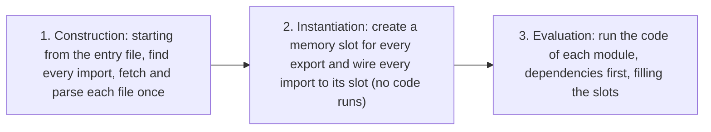

# ES modules in Node: live bindings, loading phases and interop

## In plain words

CommonJS works like borrowing a photocopy: you ask a module for something, it hands you a copy of the page as it looks right now, and if the original is updated later your copy stays the same.

**ES modules** (ESM, short for ECMAScript modules; ECMAScript is the official name of the JavaScript standard) work like a window into the other room. `import { price } from "./shop.js"` does not copy `price`. It connects your name `price` to the exporter's variable, so you always see its current value, but you can only look, not change it. And before any furniture is moved, the building's whole floor plan is drawn up: every `import` and `export` in every file is read and connected *before a single line of code runs*.

Why it matters for a job: ES modules are the standard for JavaScript everywhere: browsers, Node, Deno, Bun and every bundler. New Node code is increasingly written in ESM while most existing code is CommonJS, so in practice you must be able to read both, know how they differ and know how one loads the other.

> **Before this lesson:** read [CommonJS: require, resolution, the cache and cycles](#/lesson/nodejs/commonjs-modules), especially the cache and circular dependency sections. Promises at the level of "`await` waits for a result" are enough.

## Turning ES modules on

Node decides per file which module system applies:

| File | Treated as |
|---|---|
| `something.mjs` | ES module, always |
| `something.cjs` | CommonJS, always |
| `something.js` with `"type": "module"` in the nearest `package.json` | ES module |
| `something.js` otherwise | CommonJS |

"Nearest" means the first `package.json` found walking up from the file's folder. Recent Node versions can also detect ESM syntax in an ambiguous `.js` file, but stating the type explicitly is clearer and faster.

## The syntax

### Named exports and imports

A **named export** attaches a name to a value the module makes public. A module can have many.

```javascript
// temperature.js
export const FREEZING_C = 0;

export function toFahrenheit(celsius) {
  return celsius * 9 / 5 + 32;
}

function roundTo(value, digits) {         // not exported: private
  return Number(value.toFixed(digits));
}
```

```javascript
// main.js
import { toFahrenheit, FREEZING_C } from "./temperature.js";
import { toFahrenheit as cToF } from "./temperature.js";   // rename on the way in
import * as temperature from "./temperature.js";            // everything, as one namespace object

console.log(toFahrenheit(FREEZING_C));       // 32
console.log(temperature.toFahrenheit(100));  // 212
```

- The braces in `import { ... }` list the names you want. This is not object destructuring, although it looks similar; it is its own syntax.
- `as` renames, which resolves clashes between two modules exporting the same name.
- `import * as ns` collects all exports into a **namespace object**.
- Importing a name that the module does not export is an error **before the program starts**: `SyntaxError: The requested module './temperature.js' does not provide an export named 'toKelvin'`.

### Default exports

A module may also mark one value as its **default export**: the "main thing" of the file. The importer picks any name for it and uses no braces.

```javascript
// logger.js
export default class Logger {
  log(message) { console.log(`[${new Date().toISOString()}] ${message}`); }
}
export const LEVELS = ["debug", "info", "error"];   // default and named can be mixed
```

```javascript
import Logger, { LEVELS } from "./logger.js";
import AnyNameILike from "./logger.js";             // same class, different local name
```

Technically the default export is an export whose name is `default`. Many teams prefer named exports throughout: the name is fixed in one place, editors can auto-complete and rename it reliably, and tools can remove unused named exports from a browser bundle (a technique called *tree shaking*). A default export suits a module with one obvious purpose.

### Specifiers in ESM are stricter

```javascript
import { helper } from "./helper.js";     // correct: extension required
import { helper } from "./helper";        // ERR_MODULE_NOT_FOUND in Node ESM
import fs from "node:fs";                 // core module
import express from "express";            // package from node_modules
```

CommonJS guesses extensions and `index.js`; ESM does not. Relative specifiers must spell out the full file name.

### Imports that happen at run time

Ordinary `import` statements are **static**: they must sit at the top level of the file, and the specifier must be a plain string, not a variable. That restriction is what allows the floor plan to be drawn in advance. When you need to decide at run time, use the **dynamic import** function `import()`, which returns a promise for the namespace object:

```javascript
const language = process.env.APP_LANG ?? "en";
const { default: messages } = await import(`./messages-${language}.js`);
console.log(messages.welcome);
```

Uses: loading a language file or a plugin chosen by configuration, postponing a heavy module until it is needed, and loading an ES module from a CommonJS file. Note `await` at the top level of the file: **top-level await** works in ES modules and not in CommonJS.

## How ES modules are loaded: three phases

CommonJS discovers dependencies while running code: it meets a `require`, stops, loads, continues. ESM separates the work into three phases over the whole **dependency graph** (the network of who imports whom).



1. **Construction (parsing).** Starting at the entry point, Node reads each file, finds its `import` statements, and repeats for the files they name, visiting each file once. No code runs.
2. **Instantiation (linking).** For every exported name, a slot is reserved in memory. Every import is connected to the exporter's slot. The slots are empty.
3. **Evaluation.** Code runs, bottom-up: a module's dependencies run before it. As code runs, the slots get their values.

Since phases 1 and 2 need no execution, Node and other tools know the complete shape of the program beforehand. That is called **static analysis**, and it enables early errors for misspelled imports, safe cycles and tree shaking.

## Live, read-only bindings

A **binding** is the connection between a name and a value. In CommonJS, `const { count } = require("./counter")` copies the current value into a new local variable. In ESM, the imported name and the exported variable share one slot: the importer sees every later change. The importer may not assign to it.

```javascript
// counter.js
export let count = 0;
export function increment() { count += 1; }
```

```javascript
// main.js
import { count, increment } from "./counter.js";
console.log(count);     // 0
increment();
console.log(count);     // 1   <- the import followed the change
count = 10;             // TypeError: Assignment to constant variable.
```

The page cannot load separate module files, so the model below imitates both behaviours with plain objects. A getter is a property that runs a function each time it is read, which is how the "window" is simulated.

```js-run
function makeCounterModule() {
  let count = 0;
  const increment = () => { count += 1; };
  return {
    commonjs: { count, increment },                     // exports.count = count  (a copy of 0)
    esm: { get count() { return count; }, increment },  // a live view of the variable
  };
}

const cjs = makeCounterModule().commonjs;
cjs.increment(); cjs.increment();
console.log("CommonJS style, after two increments: count =", cjs.count);

const esm = makeCounterModule().esm;
esm.increment(); esm.increment();
console.log("ES module style, after two increments: count =", esm.count);

const frozenView = Object.freeze({ get count() { return esm.count; } });
try { (function () { "use strict"; frozenView.count = 99; })(); }
catch (error) { console.log("assigning to an import:", error.constructor.name); }
```

The CommonJS-style object exported the *number* `0` at the moment of export; later increments change the private variable but not the copy. The ESM-style object looks at the variable itself. The last lines show the read-only side: an import can be observed, never assigned.

## Circular dependencies, revisited

In CommonJS a cycle hands one module a half-filled object, and which module suffers depends on load order. ESM does better because of phase 2: by the time any code runs, every import is already wired to its slot. A function that is called *after* loading finishes always finds complete modules, whatever the order.

What can still fail is reading a binding **during** evaluation, before its exporter has run. The slot exists but is empty, and JavaScript reports that as a `ReferenceError`: the *temporal dead zone*, the same rule that forbids using a `let` variable before its declaration line.

```javascript
// a.js
import { fromB } from "./b.js";
export const fromA = "value from a";
console.log("a sees:", fromB);
```

```javascript
// b.js
import { fromA } from "./a.js";
export const fromB = "value from b";
console.log("b sees:", fromA);       // ReferenceError: Cannot access 'fromA' before initialization
```

Running `a.js`: `a` depends on `b`, so `b` is evaluated first, and it reads `fromA` whose slot is still empty. Compare with CommonJS, which would have printed `undefined` and carried on. A loud error at the exact line is easier to debug than a silent `undefined` discovered three files later.

The model below reproduces the three phases for the same two modules, and then shows the safe case: using an import inside a function that runs later.

```js-run
const EMPTY = Symbol("uninitialised");
const slots = { "a.fromA": EMPTY, "b.fromB": EMPTY, "b.describeA": EMPTY };   // phase 2: slots exist, empty

const read = (slot) => {
  if (slots[slot] === EMPTY) throw new ReferenceError(`Cannot access '${slot}' before initialization`);
  return slots[slot];
};

const moduleBodies = {
  // b imports fromA; it does not read it at the top level, only inside a function
  b() {
    slots["b.fromB"] = "value from b";
    slots["b.describeA"] = () => "b can see: " + read("a.fromA");
    console.log("b evaluated");
  },
  a() {
    slots["a.fromA"] = "value from a";
    console.log("a evaluated, a sees:", read("b.fromB"));
  },
};

// phase 3: evaluation, dependencies first (a imports b, so b runs first)
moduleBodies.b();
try { console.log("eager read from b's top level:", read("a.fromA")); }
catch (error) { console.log("eager read too early ->", error.message); }
moduleBodies.a();
console.log("later call ->", read("b.describeA")());
```

> [!TIP]
> In ESM, a cycle is harmless as long as the modules only *use* each other's exports inside functions called later, and do not read them at the top level while loading. That covers most real cycles (two classes that refer to each other, for instance).

## What is different inside an ES module

| | CommonJS | ES module |
|---|---|---|
| Strict mode | Optional (`"use strict"`) | Always on, cannot be disabled |
| `require`, `module`, `exports` | Available | Not defined |
| `__filename`, `__dirname` | Available | Not defined; use `import.meta.filename` and `import.meta.dirname` |
| `this` at the top level | `module.exports` | `undefined` |
| Top-level `await` | Not allowed | Allowed |
| Loading | Synchronous, on demand | Asynchronous, graph analysed first |
| Imported values | Copies of properties of one object | Live read-only bindings |
| File extension in relative paths | Optional | Required |
| Import a JSON file | `require("./data.json")` | `import data from "./data.json" with { type: "json" }` |

**Strict mode** is a stricter variant of JavaScript that turns silent mistakes into errors, such as assigning to an undeclared variable. `import.meta` is an object with information about the current module; `import.meta.url` is its address as a `file://` URL, and the `dirname`/`filename` properties are newer conveniences. On older Node versions the same paths are computed like this:

```javascript
import { fileURLToPath } from "node:url";
import path from "node:path";

const __filename = fileURLToPath(import.meta.url);
const __dirname = path.dirname(__filename);
```

## Interoperability: mixing the two systems

Real projects mix both, so the crossing points matter.

**ES module importing CommonJS: works.** The whole `module.exports` becomes the default export. Node also tries to detect named exports by scanning the CommonJS source, which succeeds for common patterns and fails for unusual ones.

```javascript
// legacy.cjs
module.exports = { connect() { return "connected"; }, VERSION: "2.1" };
```

```javascript
// app.mjs
import legacy from "./legacy.cjs";            // always works: default = module.exports
import { connect } from "./legacy.cjs";      // works when Node can detect the name statically
console.log(legacy.VERSION, connect());
```

If a named import from a CommonJS package fails with "Named export not found", import the default and take the property from it.

**CommonJS loading an ES module: historically no, now partly yes.** For years `require()` of an ES module threw `ERR_REQUIRE_ESM`, because `require` is synchronous and ESM loading is not. The portable solution is dynamic import, which works in CommonJS:

```javascript
// tool.cjs
async function main() {
  const { default: chalk } = await import("chalk");   // an ESM-only package
  console.log(chalk.green("loaded from CommonJS"));
}
main();
```

Current Node versions (22.12 and later) additionally allow `require()` of an ES module directly, provided that module and its dependencies do not use top-level `await`; the result is the namespace object. Check the Node version a project targets before relying on it.

**The reverse helper.** Inside an ES module you can build a `require` function when you need one, for example to load a JSON file or an old addon:

```javascript
import { createRequire } from "node:module";
const require = createRequire(import.meta.url);
const pkg = require("./package.json");
```

**Packages that serve both.** A library can ship two builds and let Node choose through the `exports` field of its `package.json`:

```json
{
  "name": "tiny-lib",
  "exports": {
    "import": "./dist/index.mjs",
    "require": "./dist/index.cjs"
  }
}
```

> [!WARNING]
> A package loaded once through `import` and once through `require` can end up existing **twice** in memory, as two separate instances with separate state (the *dual package hazard*). Singletons, caches and `instanceof` checks then misbehave. Library authors avoid it by keeping state in one shared CommonJS file that both builds load.

> [!INTERVIEW]
> **"What are the differences between CommonJS and ES modules?"** Hit four points. (1) *Timing*: `require` is a function executed at run time, synchronously; `import` declarations are static and resolved before execution, with the graph loaded asynchronously. (2) *Values*: CommonJS exports an object whose properties are copied by the importer; ESM exports live, read-only bindings. (3) *Environment*: ESM is always strict, has no `require`/`__dirname`, and supports top-level `await`. (4) *Cycles*: CommonJS yields partial exports; ESM wires bindings first, so cycles work unless a binding is read before initialisation, which throws a ReferenceError.

## Pitfalls

- **Missing file extension** in a relative import: `ERR_MODULE_NOT_FOUND`.
- **`require is not defined in ES module scope`** after adding `"type": "module"`. Convert the file, rename it to `.cjs`, or use `createRequire`.
- **`Cannot use import statement outside a module`**: the file is being treated as CommonJS.
- **Expecting `import` to be conditional.** Static imports cannot sit inside `if` or `try`; use `await import()`.
- **Default import of a CommonJS module is the whole exports object**, not a property called `default`.
- **Mutating what you import.** You cannot reassign an imported binding; export a setter function if outside code must change the value.
- **Relying on evaluation order between siblings.** Dependencies run before dependents; do not assume more than that.

## Cheat sheet

| Goal | Syntax |
|---|---|
| Export by name | `export const x = 1;` / `export function f() {}` / `export { a, b as c };` |
| Export a default | `export default something;` |
| Re-export from another file | `export { x } from "./other.js";` / `export * from "./other.js";` |
| Import names | `import { x, y as z } from "./file.js";` |
| Import the default | `import anyName from "./file.js";` |
| Import everything | `import * as ns from "./file.js";` |
| Import for side effects only | `import "./setup.js";` |
| Import at run time | `const ns = await import(specifier);` |
| This file's folder | `import.meta.dirname` |
| Make a `require` in ESM | `createRequire(import.meta.url)` |
| Mark a project as ESM | `"type": "module"` in `package.json` |

## Summary

- ES modules are the standard module system; Node selects them by `.mjs` or `"type": "module"`.
- Imports and exports are static declarations, which lets Node build and link the whole dependency graph before running anything.
- Loading has three phases: construction, instantiation, evaluation.
- Imports are live read-only bindings to the exporter's variables, not copies.
- Cycles are wired safely; reading a binding before its module has run throws a ReferenceError.
- ESM can import CommonJS (as a default export); CommonJS reaches ESM through `await import()`, or `require` on recent Node versions.

## Glossary

- **ES module (ESM)**: a file using the standard `import`/`export` syntax.
- **Named export / default export**: an export identified by its name / the single unnamed main export.
- **Namespace object**: the object holding all exports of a module, from `import * as ns`.
- **Static import**: an `import` declaration resolved before execution.
- **Dynamic import**: the `import()` function, returning a promise at run time.
- **Top-level await**: using `await` outside any function in an ES module.
- **Dependency graph**: the modules of a program and the import links between them.
- **Construction, instantiation, evaluation**: the three loading phases.
- **Live binding**: an import that always reflects the exporter's current value.
- **Temporal dead zone**: the period in which a binding exists but has no value yet; reading it throws.
- **Strict mode**: the stricter variant of JavaScript, always active in ES modules.
- **`import.meta`**: an object describing the current module.
- **Tree shaking**: removing unused exports from a bundle.
- **Dual package hazard**: one package loaded as two instances, once per module system.

```quiz
[
  {"q": "counter.js has `export let n = 0; export const inc = () => { n++; };`. main.js runs `import { n, inc } from './counter.js'; inc(); console.log(n);`. What is printed?", "options": ["0", "1", "undefined", "A TypeError"], "answer": 1,
   "explain": "Imports are live bindings: n in main.js is the same slot as n in counter.js."},
  {"q": "What happens with `import { n } from './counter.js'; n = 5;`?", "options": ["n becomes 5 in both modules", "n becomes 5 only in the importing module", "TypeError: assignment to constant variable", "The line is ignored"], "answer": 2,
   "explain": "Imported bindings are read-only for the importer."},
  {"q": "In what order do these log? main.mjs: `console.log('main'); import './dep.mjs';` and dep.mjs: `console.log('dep');`", "options": ["main, dep", "dep, main", "Only main", "It is not defined"], "answer": 1,
   "explain": "Static imports are processed before the importing module's code runs, wherever they appear in the file, and dependencies are evaluated first."},
  {"q": "Which statement about the three loading phases is correct?", "options": ["Code runs during construction", "During instantiation imports are connected to export slots without running code", "Evaluation runs the entry file first and its dependencies afterwards", "The phases run once per import statement"], "answer": 1,
   "explain": "Linking happens before any execution; evaluation then runs dependencies before dependents."},
  {"q": "In an ES module, how do you get the folder of the current file?", "options": ["__dirname", "process.cwd()", "import.meta.dirname (or derive it from import.meta.url)", "module.path"], "answer": 2,
   "explain": "__dirname is a CommonJS wrapper argument and does not exist in ESM. process.cwd() is the working directory, which is something else."},
  {"q": "A CommonJS file needs a package that is published only as an ES module and must run on older Node versions. What works?", "options": ["require('pkg')", "const pkg = await import('pkg') inside an async function", "import pkg from 'pkg' at the top of the .cjs file", "Nothing; it is impossible"], "answer": 1,
   "explain": "Dynamic import() is available in CommonJS and returns a promise for the module namespace."},
  {"q": "`import settings from './settings.cjs'` where the file has `module.exports = { port: 80 }`. What is `settings`?", "options": ["undefined", "{ port: 80 }", "{ default: { port: 80 } }", "80"], "answer": 1,
   "explain": "The default import of a CommonJS module is its entire module.exports value."},
  {"q": "Modules a and b import each other. b's top-level code reads a `const` exported by a, and a is the entry point. What happens?", "options": ["b sees undefined", "b sees the final value", "ReferenceError: cannot access before initialization", "An infinite loop"], "answer": 2,
   "explain": "b is evaluated first; a's binding exists but is still uninitialised, so reading it throws."}
]
```

> **Source:** Casciaro & Mammino, *Node.js Design Patterns* 3e, ch. 2 (topics only; wording and examples are original). Documentation: https://nodejs.org/docs/latest/api/esm.html, https://nodejs.org/docs/latest/api/packages.html, https://nodejs.org/docs/latest/api/modules.html#loading-ecmascript-modules-using-require
