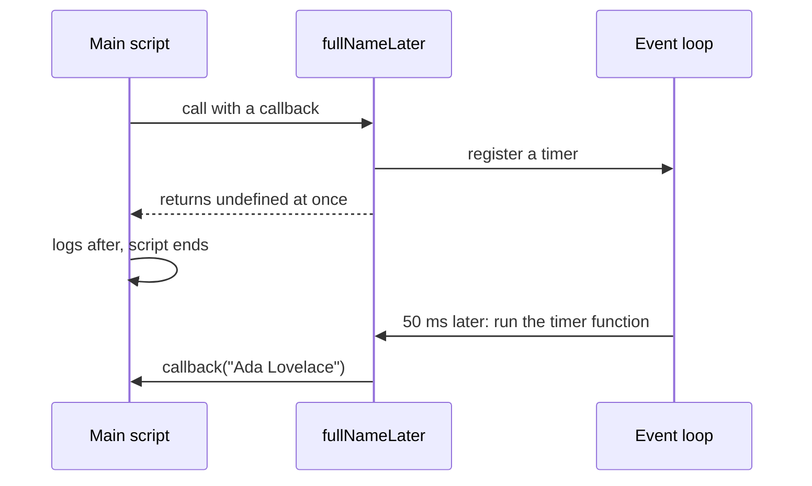

# The callback pattern and its conventions

## In plain words

You order a cake at a bakery that is not ready yet. You do not stand at the counter for two hours. You leave your phone number and say: "call me when it's done". Then you go about your day, and at some later moment your phone rings.

A **callback** is that phone number in code: a function you hand to another function so that it can call you back with the result. It is the oldest and most basic way of dealing with operations that finish later, and it is what everything else in Node (events, promises, `async`/`await`, streams) is built on.

Why it matters for a job: you will write promises and `async`/`await` far more often than raw callbacks. But the Node core library, thousands of packages and every event handler still use callbacks, and their conventions (error first, callback last, never sometimes-synchronous) are assumed knowledge. Several classic production bugs, such as a callback called twice, come from breaking these rules.

> **Before this lesson:** you need functions as values and closures from [Functions and scope](#/lesson/javascript/functions-scope) and [Closures and recursion](#/lesson/javascript/closures-recursion), and the event-loop picture from [The event loop in detail](#/lesson/nodejs/event-loop-phases), in particular `process.nextTick`, microtasks and `setImmediate`.

## Two ways to hand back a result

### Direct style

The style you already know: a function computes something and gives it back with `return`.

```js-run
function fullName(first, last) {
  return `${first} ${last}`;
}
console.log(fullName("Ada", "Lovelace"));
```

This is called **direct style**. The caller waits on the line of the call and receives the value there.

### Continuation-passing style

The alternative: the function receives one extra argument, a function, and delivers its result by *calling* it.

```js-run
function fullNameCps(first, last, callback) {
  callback(`${first} ${last}`);
}

console.log("before");
fullNameCps("Ada", "Lovelace", (name) => console.log("result:", name));
console.log("after");
```

The callback represents "what to do next with the result", and computer scientists call that a **continuation**. Passing it in is therefore called **continuation-passing style**, abbreviated **CPS**.

This particular function is **synchronous CPS**: the callback has already been invoked by the time `fullNameCps` returns, so the output is `before`, `result`, `after`. There is no advantage over `return` here. CPS earns its keep when the result is not available yet.

### Asynchronous CPS

```js-run
function fullNameLater(first, last, callback) {
  setTimeout(() => callback(`${first} ${last}`), 50);   // stands in for a slow lookup
}

console.log("before");
fullNameLater("Ada", "Lovelace", (name) => console.log("result:", name));
console.log("after");
```

Now the output is `before`, `after`, `result`. The steps:

1. `fullNameLater` is called. It asks for a timer and **returns immediately**; its own return value is `undefined` and nobody uses it.
2. `console.log("after")` runs. The main script ends, and control goes back to the event loop.
3. Fifty milliseconds later the loop runs the timer's callback, which invokes our callback with the name.

The callback's variables (`first`, `last`) are still there after the function returned, thanks to closures. This is the moment where closures stop being a curiosity and become the thing that makes asynchronous programming possible.



### Not every callback is a continuation

A function parameter does not make something CPS. In `[1, 2, 3].map((n) => n * 2)` the arrow function is called to transform each element, and the result of `map` still comes back with `return`. Whether a callback is a continuation, and whether it runs now or later, cannot be seen from the call; it must be stated in the documentation of the function. That leads to the most important rule of this lesson.

## Rule: a function is always synchronous or always asynchronous

Consider a price lookup that remembers answers it has already fetched. Remembering results to avoid repeating work is called **caching**.

```js-run
const cache = new Map();

function getPrice(product, callback) {
  if (cache.has(product)) {
    callback(cache.get(product));              // synchronous path
    return;
  }
  setTimeout(() => {                           // asynchronous path
    const price = product.length * 10;
    cache.set(product, price);
    callback(price);
  }, 20);
}

function watchPrice(product) {
  const listeners = [];
  getPrice(product, (price) => listeners.forEach((listener) => listener(price)));
  return { onPrice: (listener) => listeners.push(listener) };
}

watchPrice("laptop").onPrice((price) => console.log("first watcher got", price));

setTimeout(() => {
  watchPrice("laptop").onPrice((price) => console.log("second watcher got", price));
  console.log("second watcher registered; did it ever print a price?");
}, 100);
```

Run it. The first watcher receives the price. The second never does. Why?

- `watchPrice` calls `getPrice` and *then* returns an object on which the caller registers a listener.
- The first time, the price is not cached. `getPrice` goes down the asynchronous path, so by the time the callback fires, `onPrice` has long since added the listener. Fine.
- The second time, the price *is* cached. `getPrice` calls back **synchronously**, in the middle of `watchPrice`, when `listeners` is still empty. The notification goes to nobody, and the listener registered a moment later waits forever.

Nothing throws. The program works on the first use and loses data on the second, depending on the state of a cache. A function like `getPrice`, synchronous under some conditions and asynchronous under others, is the source of this class of bug. The Node community has a nickname for writing such a function: *unleashing Zalgo*, after an internet horror character, because of the chaos it lets loose.

### Fix 1: make it purely synchronous

If the work can be done synchronously, use direct style and drop the callback altogether. It is simpler and can never be mis-timed. The cost is that synchronous I/O blocks the event loop, so this suits start-up code and command-line tools, not request handlers.

### Fix 2: make it purely asynchronous

Keep the callback, and on the fast path **defer** the call so that it too happens after the current code has finished:

```js-run
const cache = new Map();

function getPrice(product, callback) {
  if (cache.has(product)) {
    queueMicrotask(() => callback(cache.get(product)));   // deferred: always async now
    return;
  }
  setTimeout(() => {
    const price = product.length * 10;
    cache.set(product, price);
    callback(price);
  }, 20);
}

function watchPrice(product) {
  const listeners = [];
  getPrice(product, (price) => listeners.forEach((listener) => listener(price)));
  return { onPrice: (listener) => listeners.push(listener) };
}

watchPrice("laptop").onPrice((price) => console.log("first watcher got", price));
setTimeout(() => {
  watchPrice("laptop").onPrice((price) => console.log("second watcher got", price));
}, 100);
```

Both watchers are notified. In Node the traditional tool for this deferral is `process.nextTick`:

```javascript
if (cache.has(product)) {
  process.nextTick(() => callback(cache.get(product)));
  return;
}
```

Three ways to defer exist, and the previous lesson explained their timing:

| Tool | When the callback runs | Note |
|---|---|---|
| `process.nextTick(fn)` | Right after the current operation, before promise callbacks and before any I/O | Node only. This is its legitimate use |
| `queueMicrotask(fn)` | After the nextTick queue, still before any I/O | Works in browsers too |
| `setImmediate(fn)` | In the check phase, after pending I/O callbacks | Lets I/O go first; cannot starve the loop |

> [!WARNING]
> An API whose callback fires "sometimes now, sometimes later" forces every caller to write code that works in both cases, and nobody does. If you write a function that takes a callback, decide which kind it is and keep that promise on every code path.

## Node's callback conventions

So that any callback-based function can be used without reading its source, Node code follows a small set of rules.

### 1. The callback is the last parameter

```javascript
fs.readFile(filename, options, callback);     // options may be left out; the callback stays last
```

The call then reads well even when the callback is written in place as a long arrow function.

### 2. The error is the first argument of the callback

A function that returns later cannot `throw` to its caller: the caller has already moved on. So errors travel through the callback, in the **first** position, and the result in the second. This is called an **error-first callback**.

```javascript
const fs = require("node:fs");

fs.readFile("settings.json", "utf8", (err, text) => {
  if (err) {
    console.error("could not read settings:", err.message);
    return;
  }
  console.log("settings loaded,", text.length, "characters");
});
```

On success `err` is `null` (or `undefined`). On failure `err` is an object, by convention always an instance of `Error`, never a bare string or number, because an `Error` carries a message and a stack trace. **Check `err` first, every time.**

### 3. Propagating errors

When your own callback-style function calls another and that one fails, pass the error along to *your* callback and stop:

```js-run
const fakeDisk = { "ok.json": '{"port": 8080}', "broken.json": '{"port": 80' };

function readFile(name, callback) {            // a stand-in for fs.readFile
  setTimeout(() => {
    if (!(name in fakeDisk)) return callback(new Error(`ENOENT: no such file '${name}'`));
    callback(null, fakeDisk[name]);
  }, 10);
}

function readJson(name, callback) {
  readFile(name, (err, text) => {
    if (err) return callback(err);             // 1. propagate the read error

    let data;
    try {
      data = JSON.parse(text);                 // 2. a synchronous function that throws
    } catch (parseError) {
      return callback(parseError);             //    convert the throw into a callback error
    }
    callback(null, data);                      // 3. success, outside the try block
  });
}

for (const file of ["ok.json", "missing.json", "broken.json"]) {
  readJson(file, (err, data) => {
    if (err) console.log(file, "-> error:", err.message.slice(0, 40));
    else console.log(file, "-> data:", JSON.stringify(data));
  });
}
```

Three details carry the weight here.

- `return callback(err);` uses `return` to **leave the function**. Without it, execution would continue and call the callback a second time with garbage. "Callback called twice" is the classic bug of this style.
- `JSON.parse` throws when the text is malformed. The `try`/`catch` turns the exception into a callback error, so the caller has one place to look.
- The success call `callback(null, data)` is deliberately **outside** the `try` block. If it were inside and the caller's callback threw, our `catch` would grab that unrelated error and call the callback again.

### 4. Never let an exception escape from an asynchronous callback

A `try`/`catch` around the call that *starts* an asynchronous operation does not protect the callback, because the callback runs later, on a different call stack: a fresh one that starts in the event loop.

```javascript
try {
  setTimeout(() => {
    throw new Error("boom");                   // not caught by the try below
  }, 10);
} catch (err) {
  console.log("never reached");
}
```

```text
/home/ana/app/demo.js:3
    throw new Error("boom");
    ^
Error: boom
    at Timeout._onTimeout (/home/ana/app/demo.js:3:11)
    at listOnTimeout (node:internal/timers:581:17)
Node.js v22.11.0
```

The stack trace shows no line of your surrounding function; it begins inside Node's timer code. An exception that reaches the event loop this way is an **uncaught exception**. Node prints it to standard error and **terminates the process** with a non-zero exit code. For a server, that means every connected user is cut off.

There is a last-resort hook:

```javascript
process.on("uncaughtException", (err) => {
  console.error("fatal:", err);     // log it somewhere durable
  process.exit(1);                  // then stop: the application state can no longer be trusted
});
```

After an uncaught exception some operation was abandoned halfway: a file left open, a half-written record, a lock never released. The safe policy, known as **fail fast**, is to log, exit, and let a supervisor (a process manager or container platform) start a clean process. Catching the event and carrying on as if nothing happened leads to stranger failures later.

> [!TIP]
> When wrapping synchronous code that may throw inside a callback-style function, keep the `try` block as small as possible: wrap only the throwing call, and invoke the callback afterwards.

> [!INTERVIEW]
> **"What is an error-first callback, and why does Node use it?"** "It is a callback whose first parameter is reserved for an error and whose following parameters carry the result: `(err, data) => {}`. Asynchronous functions cannot report failure with `throw`, because by the time the failure is known the caller's stack frame is gone. Putting the error first makes the check hard to forget and gives every API the same shape, which is also what allows `util.promisify` to convert any such function into one that returns a promise." A likely follow-up is **"What is wrong with a function that calls its callback synchronously only when the value is cached?"**, answered by the Zalgo section above.

## Pitfalls

- **Forgetting `return` after `callback(err)`**, so the callback fires twice.
- **Calling the callback inside a `try` block**, so an exception thrown by the caller's code triggers a second call from the `catch`.
- **Mixing synchronous and asynchronous delivery** depending on a cache or a condition.
- **Throwing inside an asynchronous callback**, which crashes the process.
- **Ignoring `err`** and using a result that is `undefined`.
- **Passing a non-Error** (`callback("failed")`): no stack trace, and `err instanceof Error` checks stop working.
- **Deferring with a recursive `process.nextTick`** in a loop and starving I/O; use `setImmediate` when the amount of deferred work is unbounded.

## Cheat sheet

| Convention | In code |
|---|---|
| Callback comes last | `doWork(input, options, callback)` |
| Error comes first | `(err, result) => { if (err) return handle(err); ... }` |
| Error is an `Error` | `callback(new Error("reason"))` |
| Success | `callback(null, result)` |
| Propagate and stop | `if (err) return callback(err);` |
| Throwing code | wrap only it in `try`/`catch`, call back afterwards |
| Always asynchronous | defer the fast path with `process.nextTick` / `queueMicrotask` / `setImmediate` |
| Last-resort handler | `process.on("uncaughtException", ...)`, log and exit |

## Summary

- A callback is a function passed in to receive a result. Delivering results this way is continuation-passing style.
- CPS can be synchronous or asynchronous; a given function must be consistently one or the other.
- A sometimes-synchronous function loses events silently; fix it with direct style or with deferred execution.
- Node conventions: callback last, error first, errors are `Error` objects, propagate with `return callback(err)`.
- `try`/`catch` does not reach across asynchronous boundaries. An exception thrown in a callback is uncaught and ends the process; log and restart instead of continuing.

## Glossary

- **Callback**: a function passed to another function to be invoked later with a result.
- **Direct style**: returning results with `return`.
- **Continuation**: a function representing what happens next with a result.
- **Continuation-passing style (CPS)**: delivering results by calling a continuation.
- **Synchronous / asynchronous CPS**: the callback runs before / after the function returns.
- **Caching**: storing results to avoid recomputing or refetching them.
- **Deferred execution**: scheduling a function to run later instead of calling it now.
- **Error-first callback**: a callback whose first argument is an error or `null`.
- **Propagating an error**: passing an error on to your own caller.
- **Uncaught exception**: an exception that reaches the event loop with no handler.
- **Fail fast**: stopping immediately on an unrecoverable error instead of limping on.

```quiz
[
  {"q": "In what order do these log?\n\n`function f(cb) { cb('X'); } console.log('A'); f((v) => console.log(v)); console.log('B');`", "options": ["A, B, X", "A, X, B", "X, A, B", "A, B only"], "answer": 1,
   "explain": "f is synchronous CPS: it invokes the callback before returning."},
  {"q": "In what order do these log in Node?\n\n`function g(cb) { process.nextTick(() => cb('X')); } console.log('A'); g((v) => console.log(v)); console.log('B');`", "options": ["A, X, B", "A, B, X", "X, A, B", "B, A, X"], "answer": 1,
   "explain": "The callback is deferred to the nextTick queue, which runs after the current script has finished."},
  {"q": "Why is a function that calls back synchronously on a cache hit and asynchronously on a miss dangerous?", "options": ["It is slower", "Callers cannot know whether code after the call runs before or after the callback, so listeners can be registered too late", "It leaks memory", "It breaks the error-first convention"], "answer": 1,
   "explain": "Code written for one timing silently misbehaves under the other, depending on run-time state."},
  {"q": "What is the conventional signature of a Node callback?", "options": ["(result, err)", "(err, result)", "(result) with errors thrown", "({ err, result })"], "answer": 1,
   "explain": "Error first, then the result or results."},
  {"q": "What is wrong here?\n\n`readFile(name, (err, text) => { if (err) callback(err); callback(null, text.length); });`", "options": ["Nothing", "After an error the callback is invoked a second time, and text is undefined", "The error should be thrown", "callback must be called with three arguments"], "answer": 1,
   "explain": "Without return, execution continues past the error branch. Write `if (err) return callback(err);`."},
  {"q": "A function wraps `setTimeout(() => { throw new Error('x'); }, 0)` in try/catch. What happens?", "options": ["The catch block handles it", "The error is ignored", "The exception is uncaught and the process terminates", "The timer is retried"], "answer": 2,
   "explain": "The callback runs later on a new call stack, outside the try block. An uncaught exception ends the Node process."},
  {"q": "Why should `callback(null, data)` sit outside the try block that wraps JSON.parse?", "options": ["For speed", "So that an exception thrown inside the caller's callback is not caught by our catch and reported as a parse error with a second call", "Because callbacks cannot run inside try blocks", "Because null would be converted to an Error"], "answer": 1,
   "explain": "The try block should cover only the call that is expected to throw."},
  {"q": "What is the recommended reaction to an 'uncaughtException' event in a server?", "options": ["Ignore it and continue", "Log the error and exit so that a supervisor restarts a clean process", "Call the failed callback again", "Raise the thread pool size"], "answer": 1,
   "explain": "After an uncaught exception the application's state is unknown. Fail fast and restart."}
]
```

> **Source:** Casciaro & Mammino, *Node.js Design Patterns* 3e, ch. 3 (topics only; wording and examples are original). Documentation: https://nodejs.org/docs/latest/api/errors.html#error-first-callbacks, https://nodejs.org/docs/latest/api/process.html#event-uncaughtexception
