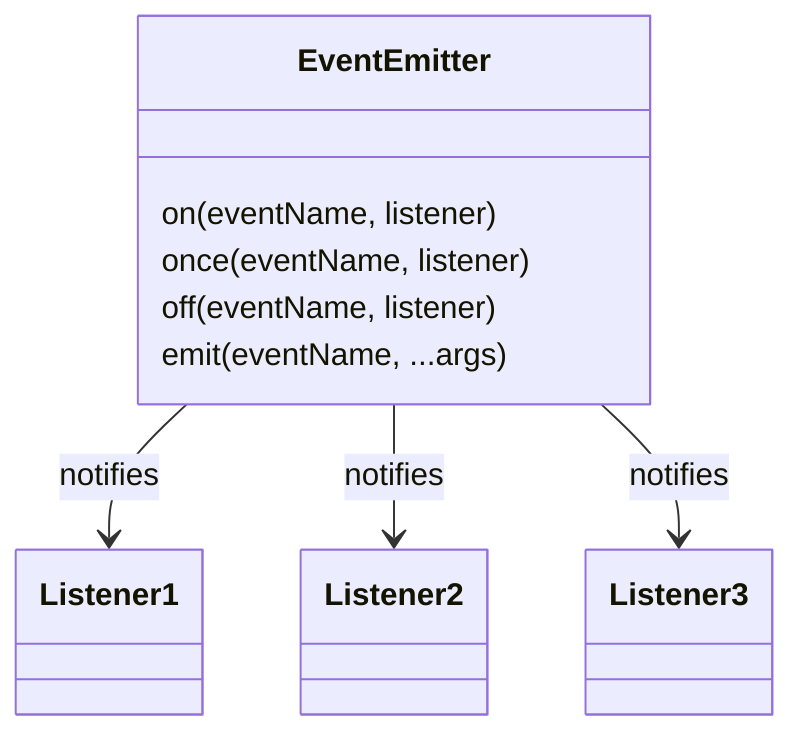

# The observer pattern and EventEmitter

## In plain words

A radio station does not phone its listeners one by one. It broadcasts, and whoever has tuned in hears it. The station does not know or care how many radios are on; listeners come and go without telling the presenter.

In code this arrangement is called the **observer pattern**: an object (the *subject*) announces that something happened, and any number of interested functions (the *observers*, or *listeners*) are called. Node's built-in implementation is a class named **`EventEmitter`**, and it is everywhere: an HTTP server announces `"request"`, a stream announces `"data"` and `"end"`, a process announces `"exit"`.

A callback answers the question "what is the result of this one operation?" once, to one receiver. An event emitter says "this kind of thing happened", possibly many times, to anyone who subscribed.

Why it matters for a job: you will attach listeners to emitters from your first day with Node (`server.on("listening", ...)`). Designing your own emitters well, and knowing how they leak memory when misused, is a common interview topic and a common source of production incidents.

> **Before this lesson:** read [The callback pattern and its conventions](#/lesson/nodejs/callback-pattern); the "always synchronous or always asynchronous" rule returns here. You need classes and `extends` from [Prototypes, classes and encapsulation](#/lesson/javascript/prototypes-classes).

## The pattern

Definitions first:

- An **event** is a named notification that something happened, such as `"connected"` or `"file-saved"`, optionally carrying data.
- The **subject** (in Node: the **emitter**) is the object that produces events.
- An **observer** (in Node: a **listener**) is a function registered to be called when a given event occurs.
- To **emit** an event is to trigger it, which calls its listeners.



Languages with a classical object-oriented style implement this with interfaces and concrete observer classes. In JavaScript a listener is a plain function, so the pattern shrinks to four methods.

## The four essential methods

```javascript
import { EventEmitter } from "node:events";

const doorbell = new EventEmitter();

doorbell.on("ring", (who) => console.log(`Someone is at the door: ${who}`));
doorbell.once("ring", () => console.log("(first ring only) turning on the porch light"));

doorbell.emit("ring", "the postman");
doorbell.emit("ring", "a neighbour");
```

```text
Someone is at the door: the postman
(first ring only) turning on the porch light
Someone is at the door: a neighbour
```

| Method | What it does |
|---|---|
| `on(event, listener)` | Registers a listener for every future occurrence. Returns the emitter, so calls can be chained |
| `once(event, listener)` | Registers a listener that is removed automatically after its first call |
| `emit(event, ...args)` | Calls every listener of that event, in registration order, passing the arguments. Returns `true` if there was at least one listener |
| `off(event, listener)` | Removes a listener. The older name `removeListener` does the same |

Event names are ordinary strings (or symbols) that you invent. Listeners do not follow the error-first rule: they receive whatever arguments were passed to `emit`.

## Build one to see how it works

The whole mechanism is a map from event name to an array of functions. This runs on the page:

```js-run
class MiniEmitter {
  constructor() { this.listeners = new Map(); }

  on(event, listener) {
    if (!this.listeners.has(event)) this.listeners.set(event, []);
    this.listeners.get(event).push(listener);
    return this;
  }

  once(event, listener) {
    const wrapper = (...args) => {
      this.off(event, wrapper);
      listener(...args);
    };
    wrapper.original = listener;                 // so off(event, listener) can still find it
    return this.on(event, wrapper);
  }

  off(event, listener) {
    const list = this.listeners.get(event) || [];
    const index = list.findLastIndex((fn) => fn === listener || fn.original === listener);
    if (index !== -1) list.splice(index, 1);
    return this;
  }

  emit(event, ...args) {
    const list = this.listeners.get(event) || [];
    if (event === "error" && list.length === 0) throw args[0];
    for (const listener of [...list]) listener(...args);   // iterate over a copy
    return list.length > 0;
  }
}

const doorbell = new MiniEmitter();
doorbell.on("ring", (who) => console.log("at the door:", who));
doorbell.once("ring", () => console.log("(first ring only) porch light on"));

console.log("had listeners?", doorbell.emit("ring", "the postman"));
console.log("had listeners?", doorbell.emit("ring", "a neighbour"));
console.log("had listeners?", doorbell.emit("knock"));
```

Reading the class:

- `on` creates the array for an event the first time and pushes the function.
- `once` registers a small **wrapper** function that removes itself and then calls the real listener. Removal comes first, so that if the listener emits the same event again it is not called twice.
- `off` removes one registration, the most recently added match, as Node does.
- `emit` loops over a **copy** of the array (`[...list]`). Listeners may add or remove listeners while the loop is running, and iterating the original while it changes would skip entries.
- The line about `"error"` is a special rule, explained next.

The problem [Build a mini EventEmitter](#/problem/node-mini-emitter) asks you to write this from an empty function.

## The special `"error"` event

An emitter cannot return an error and has no single callback to give it to. The convention is to emit an event named `"error"` with an `Error` object. Node treats that name specially: **if `"error"` is emitted and no listener is registered for it, the error is thrown**, which usually crashes the process.

```javascript
const emitter = new EventEmitter();
emitter.emit("error", new Error("disk unreachable"));
// Uncaught Error: disk unreachable   -> the process exits
```

The reasoning is that a silently ignored failure is worse than a crash. The practical rule: **always attach an `"error"` listener** to any emitter that can fail (streams, sockets, servers, child processes).

## Making your own objects observable

Using a bare `EventEmitter` is rare. Normally a class with a real job extends it, so that its instances can announce what they are doing. Here is a download tracker; this is real Node code:

```javascript
import { EventEmitter } from "node:events";

class Download extends EventEmitter {
  constructor(url, totalBytes) {
    super();                                   // sets up the listener storage
    this.url = url;
    this.totalBytes = totalBytes;
    this.received = 0;
  }

  receive(bytes) {
    if (bytes < 0) {
      this.emit("error", new Error("negative chunk size"));
      return;
    }
    this.received += bytes;
    this.emit("progress", Math.round((this.received / this.totalBytes) * 100));
    if (this.received >= this.totalBytes) this.emit("done", this.url);
  }
}

const download = new Download("https://example.com/big.zip", 400);
download
  .on("progress", (percent) => console.log(`${percent}%`))
  .on("done", (url) => console.log("finished", url))
  .on("error", (err) => console.error("failed:", err.message));

download.receive(100);
download.receive(300);
```

```text
25%
100%
finished https://example.com/big.zip
```

The class concentrates on downloading. A progress bar, a logger and a statistics collector can each subscribe without the class knowing they exist, and that independence between parts is called **loose coupling**. The same structure appears all over the core library: `http.Server`, every stream, `net.Socket` and `child_process.ChildProcess` are all `EventEmitter` subclasses.

## Events are delivered synchronously

A frequent misunderstanding: "events are asynchronous". `emit` itself is an ordinary synchronous function. It calls each listener in turn, and only then returns.

```js-run
class MiniEmitter {
  constructor() { this.map = new Map(); }
  on(e, fn) { (this.map.get(e) ?? this.map.set(e, []).get(e)).push(fn); return this; }
  emit(e, ...args) { for (const fn of [...(this.map.get(e) ?? [])]) fn(...args); }
}

const emitter = new MiniEmitter();
emitter.on("step", () => console.log("  listener 1"));
emitter.on("step", () => console.log("  listener 2"));

console.log("before emit");
emitter.emit("step");
console.log("after emit");
```

The output is `before emit`, the two listeners, then `after emit`. Consequences:

- A slow listener delays the emitter and all later listeners.
- An exception thrown by a listener propagates out of `emit`, and the remaining listeners are skipped.
- A listener registered *after* an event was emitted misses it. Events are not stored.

The last point is the same trap as in the callbacks lesson. An emitter that emits during its own constructor cannot be heard by anybody, because the caller has not had a chance to call `on` yet:

```js-run
class MiniEmitter {
  constructor() { this.map = new Map(); }
  on(e, fn) { (this.map.get(e) ?? this.map.set(e, []).get(e)).push(fn); return this; }
  emit(e, ...args) { for (const fn of [...(this.map.get(e) ?? [])]) fn(...args); }
}

class EagerConnection extends MiniEmitter {
  constructor() { super(); this.emit("ready"); }                         // too early: no listeners yet
}
class PoliteConnection extends MiniEmitter {
  constructor() { super(); queueMicrotask(() => this.emit("ready")); }   // deferred
}

new EagerConnection().on("ready", () => console.log("eager: ready (you will not see this)"));
new PoliteConnection().on("ready", () => console.log("polite: ready"));
console.log("both objects constructed");
```

In Node the deferral is traditionally written `process.nextTick(() => this.emit("ready"))`. The rule: whichever timing an emitter uses for an event, synchronous or asynchronous, it must use it consistently, and anything emitted as a direct result of construction must be deferred.

## Listeners and memory leaks

A **memory leak** is memory that a program holds on to although it will never use it again; in a long-running server, leaks accumulate until the process slows down or is killed.

An emitter keeps a reference to every listener function, and each listener keeps alive every variable in its closure. So as long as the emitter lives, everything its listeners can reach lives too. The typical leak looks innocent:

```javascript
// A leak: one new listener per request, never removed
server.on("request", (req, res) => {
  const bigBuffer = loadUserData(req);                    // large per-request data
  config.on("change", () => refresh(bigBuffer, res));     // config lives for the whole process
  res.end("ok");
});
```

`config` exists for the lifetime of the program. Every request adds a listener that holds `bigBuffer` and `res`. After a million requests there are a million listeners and a million buffers, and each `change` event calls all of them.

Node gives a hint when this happens. If more than **10** listeners are registered for one event on one emitter, it prints:

```text
(node:4242) MaxListenersExceededWarning: Possible EventEmitter memory leak detected.
11 change listeners added to [Config]. MaxListeners is 10. Use emitter.setMaxListeners() to increase limit
```

It is a warning, not an error, and ten is only a rule of thumb; some emitters legitimately need more, and `emitter.setMaxListeners(n)` raises the limit. Treat the warning as a question: is something registering in a loop or per request?

Defences:

- Use `once` for one-shot notifications.
- Remove listeners with `off` when the interested party is finished. That requires keeping a reference to the *same function* you registered; an identical-looking new arrow function is a different object.
- Prefer short-lived emitters; when the emitter itself becomes unreachable, its listeners go with it.

> [!WARNING]
> `emitter.off("data", () => handle())` removes nothing. It passes a brand-new function that was never registered. Store the listener in a variable and pass that variable to both `on` and `off`.

## Emitter or callback?

| Situation | Better fit |
|---|---|
| One result, delivered once | Callback (or promise) |
| The same kind of thing happens many times | Emitter |
| Several different kinds of things can happen (`progress`, `done`, `error`) | Emitter |
| Several independent parts want to be notified | Emitter |
| The caller needs the result to continue its own logic | Callback (or promise) |

The two also combine. A function can take a callback for the final result and *return* an emitter for the details along the way. Many libraries work like this: the simple user passes a callback, the demanding user listens for fine-grained events.

```javascript
function importRows(file, callback) {
  const events = new EventEmitter();
  parseRows(file, {
    onRow: (row) => events.emit("row", row),
    onEnd: (count) => callback(null, count),
    onError: (err) => callback(err),
  });
  return events;
}

importRows("people.csv", (err, count) => console.log(err ?? `${count} rows imported`))
  .on("row", (row) => console.log("row:", row.name));
```

## Bridges to promises

Two helpers in `node:events` connect emitters to `async`/`await`, which later lessons cover in depth:

```javascript
import { once, on } from "node:events";

await once(server, "listening");             // a promise for the next occurrence of one event
for await (const [chunk] of on(socket, "data")) {   // a loop over every occurrence
  console.log("received", chunk.length, "bytes");
}
```

`once(emitter, name)` also rejects if the emitter emits `"error"` while you wait, so the failure is not lost.

> [!TIP]
> Name events in the past tense or as a noun for things that happened (`"saved"`, `"connection"`), and document the arguments each event carries. An emitter's event list is its public interface, exactly like a function's parameters.

> [!INTERVIEW]
> **"Is `EventEmitter.emit` synchronous or asynchronous?"** Synchronous: listeners run in registration order before `emit` returns. Asynchrony comes from *when* the emitter calls `emit`, typically from an I/O callback. Follow-ups: **"What happens when an `'error'` event has no listener?"** The error is thrown, and if nothing catches it the process exits. **"How do emitters cause memory leaks?"** Listeners registered on a long-lived emitter are never collected, along with everything in their closures; Node warns at more than ten listeners per event.

## Pitfalls

- **No `"error"` listener** on something that can fail.
- **Registering after emitting**, so the event is missed.
- **Emitting synchronously from a constructor.**
- **Removing a listener with a different function object** than the one registered.
- **Adding listeners per request to a process-wide emitter.**
- **Throwing inside a listener**: later listeners do not run and the emitter's own code is interrupted.
- **Arrow-function listeners and `this`**: with a regular `function` listener, `this` is the emitter; with an arrow function it is not.

## Cheat sheet

| Goal | Code |
|---|---|
| Import | `import { EventEmitter, once, on } from "node:events"` |
| Listen | `emitter.on("name", fn)` |
| Listen one time | `emitter.once("name", fn)` |
| Stop listening | `emitter.off("name", fn)` (same function object) |
| Announce | `emitter.emit("name", arg1, arg2)` |
| Report failure | `emitter.emit("error", new Error("..."))` |
| Count listeners | `emitter.listenerCount("name")` |
| Raise the warning limit | `emitter.setMaxListeners(50)` |
| Make a class observable | `class X extends EventEmitter { constructor() { super(); } }` |
| Await one event | `await once(emitter, "name")` |
| Defer an early event | `process.nextTick(() => this.emit("ready"))` |

## Summary

- The observer pattern lets a subject notify any number of listeners without knowing them. `EventEmitter` is Node's version: `on`, `once`, `off`, `emit`.
- An emitter is a map from event name to an array of functions; `emit` calls them synchronously, in order.
- `"error"` is special: emitted without a listener, it throws.
- Classes extend `EventEmitter` to announce progress and state changes, which keeps them loosely coupled to whoever listens.
- Listeners keep their closures alive; unremoved listeners on long-lived emitters are a classic memory leak.
- Use callbacks or promises for single results, emitters for repeated or varied events.

## Glossary

- **Observer pattern**: a subject notifying registered observers when its state changes.
- **Event**: a named notification, optionally with data.
- **Emitter (subject)**: the object that produces events.
- **Listener (observer)**: a function registered to react to an event.
- **Emit**: to trigger an event, calling its listeners.
- **Wrapper function**: a function that adds behaviour around another function, as `once` does.
- **Loose coupling**: parts that work together while knowing little about each other.
- **Memory leak**: memory retained although it is no longer needed.
- **MaxListeners**: the per-event listener count (10 by default) above which Node prints a warning.

```quiz
[
  {"q": "In what order do these log?\n\n`e.on('x', () => console.log('1')); console.log('2'); e.emit('x'); console.log('3');`", "options": ["1, 2, 3", "2, 1, 3", "2, 3, 1", "2, 3 only"], "answer": 1,
   "explain": "Registering does not call the listener. emit calls it synchronously, before the next statement runs."},
  {"q": "What happens when `emitter.emit('error', new Error('x'))` runs and no 'error' listener exists?", "options": ["Nothing", "emit returns false", "The error is thrown, which normally crashes the process", "A warning is printed"], "answer": 2,
   "explain": "The 'error' event is special: unhandled, it becomes a thrown exception."},
  {"q": "What is printed?\n\n`e.once('go', () => console.log('A')); e.on('go', () => console.log('B')); e.emit('go'); e.emit('go');`", "options": ["A B A B", "A B B", "B A B", "A B"], "answer": 1,
   "explain": "The once listener runs on the first emit and is removed; the on listener runs both times."},
  {"q": "Why does `emitter.off('data', () => handle())` fail to remove the listener registered with `emitter.on('data', () => handle())`?", "options": ["off is deprecated", "The two arrow functions are different function objects", "Listeners cannot be removed", "off needs a third argument"], "answer": 1,
   "explain": "Removal matches by identity. Keep the function in a variable and pass the same reference to on and off."},
  {"q": "A class emits 'ready' synchronously in its constructor. Callers write `new Thing().on('ready', fn)`. What happens?", "options": ["fn runs immediately", "fn never runs, because the event was emitted before the listener was attached", "fn runs twice", "An error is thrown"], "answer": 1,
   "explain": "Events are not stored. Defer the emit with process.nextTick or queueMicrotask."},
  {"q": "What does MaxListenersExceededWarning tell you?", "options": ["The process will exit", "More than 10 listeners were added for one event on one emitter, which may indicate a leak", "The emitter stopped emitting", "Listeners are being called too slowly"], "answer": 1,
   "explain": "It is a hint that code may be registering listeners repeatedly without removing them."},
  {"q": "Which situation calls for an EventEmitter and not a single callback?", "options": ["Reading one configuration file at start-up", "Reporting upload progress several times, then completion or failure", "Computing a hash of a string", "Looking up one user by id"], "answer": 1,
   "explain": "Repeated notifications of several kinds are what emitters are for."},
  {"q": "One listener throws during `emit`. What happens to listeners registered after it?", "options": ["They still run", "They are skipped, because the exception propagates out of emit", "They run on the next tick", "They are removed permanently"], "answer": 1,
   "explain": "emit is a plain synchronous loop; an exception interrupts it."}
]
```

> **Source:** Casciaro & Mammino, *Node.js Design Patterns* 3e, ch. 3 (topics only; wording and examples are original). Documentation: https://nodejs.org/docs/latest/api/events.html
