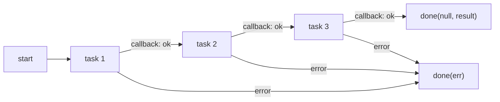

# Callback hell, its cures and sequential execution

## In plain words

A recipe is a list of steps in order: boil the water, *then* add the pasta, *then* drain it. In ordinary code "then" is free: you write one line under another. With asynchronous operations each step ends at some unknown later moment, so the next step has to be placed *inside* the callback of the previous one. Do that five times and the code marches diagonally across the screen, each step buried deeper than the last. Programmers call the result **callback hell** or the *pyramid of doom*.

This lesson shows why it happens, how plain discipline cures most of it, and then builds the first of three fundamental **control-flow patterns**: running asynchronous tasks strictly one after another. *Control flow* means the order in which the pieces of a program run.

Why it matters for a job: you will mostly write `async`/`await`, which hides this machinery. But the machinery is what `await` does underneath, old code and many libraries still expose callbacks, and "run these tasks one at a time / all at once / at most N at once" is a question you will answer weekly in any back-end role, whatever syntax you use.

> **Before this lesson:** you must know the conventions from [The callback pattern and its conventions](#/lesson/nodejs/callback-pattern): error-first callbacks, `return callback(err)`, and always-asynchronous delivery.

## The running example

Throughout this lesson and the next we use a small backup tool. It must (1) list the files in a folder, (2) read each file, (3) compress it and (4) upload it. None of the real services exist on this page, so the model uses stand-ins that take a few milliseconds and follow Node's conventions exactly.

```js-run
// ---- a pretend environment: every function is error-first and truly asynchronous ----
const disk = { "a.txt": "alpha alpha alpha", "b.txt": "bravo", "c.txt": "charlie charlie" };
const later = (ms, fn) => setTimeout(fn, ms);

function listFiles(callback) { later(10, () => callback(null, Object.keys(disk))); }
function readFile(name, callback) {
  later(10, () => (name in disk ? callback(null, disk[name]) : callback(new Error("ENOENT " + name))));
}
function compress(text, callback) { later(10, () => callback(null, text.replace(/(\w+)( \1)+/g, "$1*"))); }
function upload(name, data, callback) { later(10, () => callback(null, { name, bytes: data.length })); }

// ---- the task, written the naive way ----
function backupFirstFile(done) {
  listFiles((err, names) => {
    if (err) {
      done(err);
    } else {
      readFile(names[0], (err, text) => {
        if (err) {
          done(err);
        } else {
          compress(text, (err, small) => {
            if (err) {
              done(err);
            } else {
              upload(names[0], small, (err, receipt) => {
                if (err) {
                  done(err);
                } else {
                  done(null, receipt);
                }
              });
            }
          });
        }
      });
    }
  });
}

backupFirstFile((err, receipt) => console.log(err ? "failed: " + err.message : receipt));
```

The function works. Now look at its shape.

## What is wrong with the pyramid

- **It is hard to read.** The eye cannot tell where one step ends; the closing brackets at the bottom (`}); } }); } });`) say nothing.
- **Names collide.** Every level declares its own `err`. An inner `err` hides the outer one (this is called *shadowing*), and it becomes easy to check or pass the wrong variable.
- **Error handling is repeated at every level**, and each repetition is a chance to forget one.
- **Everything is one unit.** No step can be tested or reused alone.
- **Memory.** Each inner function is a closure that keeps all the variables of the enclosing levels alive until the last callback has run.

The cause is not callbacks as such. It is defining every callback **in place**, at the point of use, combined with `if/else` nesting.

## The cure: callback discipline

Three habits remove most of the nesting without any library.

1. **Exit early.** Handle the error with `return` and stop, instead of wrapping the success case in `else`.
2. **Give callbacks names and move them out.** A named function declared at the top level cannot nest, appears by name in stack traces, and can be tested.
3. **Split into small functions with one job each**, every one of them an ordinary error-first function.

Applying only rule 1:

```javascript
function backupFirstFile(done) {
  listFiles((err, names) => {
    if (err) return done(err);
    readFile(names[0], (err, text) => {
      if (err) return done(err);
      compress(text, (err, small) => {
        if (err) return done(err);
        upload(names[0], small, done);          // pass our callback straight through
      });
    });
  });
}
```

Half the lines are gone. Note the last step: `upload` already calls its callback with `(err, receipt)`, the shape `done` expects, so `done` can be handed over directly.

Applying rules 2 and 3 as well:

```js-run
const disk = { "a.txt": "alpha alpha alpha", "b.txt": "bravo", "c.txt": "charlie charlie" };
const later = (ms, fn) => setTimeout(fn, ms);
function listFiles(callback) { later(10, () => callback(null, Object.keys(disk))); }
function readFile(name, callback) { later(10, () => (name in disk ? callback(null, disk[name]) : callback(new Error("ENOENT " + name)))); }
function compress(text, callback) { later(10, () => callback(null, text.replace(/(\w+)( \1)+/g, "$1*"))); }
function upload(name, data, callback) { later(10, () => callback(null, { name, bytes: data.length })); }

// One reusable unit: back up a single named file.
function backupFile(name, callback) {
  readFile(name, (err, text) => {
    if (err) return callback(err);
    compress(text, (err, small) => {
      if (err) return callback(err);
      upload(name, small, callback);
    });
  });
}

// The original task is now two short steps.
function backupFirstFile(callback) {
  listFiles((err, names) => {
    if (err) return callback(err);
    backupFile(names[0], callback);
  });
}

backupFirstFile((err, receipt) => console.log(err ? "failed: " + err.message : receipt));
backupFile("nope.txt", (err) => console.log("second call ->", err.message));
```

`backupFile` is short, flat enough to read, testable alone, and reusable; the next sections call it many times. This is the main lesson about callback hell: **it is cured by decomposition**, the same tool that cures any oversized function.

> [!TIP]
> When a callback only checks the error and forwards the result, do not write it. `upload(name, small, callback)` replaces `upload(name, small, (err, r) => { if (err) return callback(err); callback(null, r); })`.

## Control flow pattern 1: sequential execution

**Sequential** means one task at a time, in a fixed order, each starting only after the previous one has completed. There are two flavours.

### A known set of steps

When the steps are known in advance and each feeds the next, write a chain of named functions, each of which starts the following one:

```javascript
function step1(callback) {
  listFiles((err, names) => {
    if (err) return callback(err);
    step2(names, callback);
  });
}
function step2(names, callback) { /* ... calls step3 ... */ }
function step3(data, callback) { /* ... finally calls callback(null, result) ... */ }
```



### Sequential iteration over a collection

Now the real task: back up **every** file, one after another. The number of files is known only at run time, so the steps cannot be written out by hand. A `for` loop does not work either:

```javascript
for (const name of names) {
  backupFile(name, (err) => { /* ... */ });   // starts ALL backups at once
}
```

`backupFile` returns immediately, so the loop races through the whole list and every backup is in flight together. That is *parallel* execution (next lesson), not sequential.

The technique for sequential iteration is a function that processes one item and, in the callback, **calls itself for the next index**:

```js-run
const disk = { "a.txt": "alpha alpha alpha", "b.txt": "bravo", "c.txt": "charlie charlie" };
const later = (ms, fn) => setTimeout(fn, ms);
const started = Date.now();
const stamp = () => String(Math.round((Date.now() - started) / 10) * 10).padStart(3) + " ms";

function backupFile(name, callback) {
  console.log(stamp(), "start ", name);
  later(30, () => {
    if (!(name in disk)) return callback(new Error("ENOENT " + name));
    console.log(stamp(), "finish", name);
    callback(null, { name, bytes: disk[name].length });
  });
}

function backupAll(names, callback) {
  const receipts = [];

  function iterate(index) {
    if (index === names.length) return callback(null, receipts);   // 1. nothing left: finished
    backupFile(names[index], (err, receipt) => {                   // 2. do item number `index`
      if (err) return callback(err);                               // 3. stop at the first error
      receipts.push(receipt);
      iterate(index + 1);                                          // 4. only now start the next
    });
  }

  iterate(0);
}

backupAll(["a.txt", "b.txt", "c.txt"], (err, receipts) => {
  console.log(stamp(), err ? "failed: " + err.message : "all done: " + JSON.stringify(receipts));
});
```

Read `iterate` slowly; it is the heart of the pattern.

1. **Stop condition.** When `index` has reached the length of the list, every item is done; report success.
2. **Process one item.**
3. **On error, stop.** The callback is invoked with the error and `iterate` is not called again, so the remaining items never start.
4. **Continue from inside the callback.** `iterate(index + 1)` runs only after the current item has finished. That placement is what makes the flow sequential.

The timestamps show it: `a` finishes at about 30 ms, and only then does `b` start. Three tasks of 30 ms take 90 ms in total.

This looks like recursion, and a newcomer may worry about the call stack growing. It does not: `backupFile` is asynchronous, so by the time its callback runs, the earlier `iterate` call has long since returned. Each step starts on a fresh stack from the event loop.

> [!WARNING]
> That argument fails if a task calls its callback **synchronously**. Then `iterate` really does call itself before returning, and a list of 100,000 items ends in `RangeError: Maximum call stack size exceeded`. This is a second, very practical reason for the rule "an asynchronous API is always asynchronous".

### The pattern, generalised

Written once as a reusable helper:

```js-run
function eachSeries(items, worker, done) {
  const results = [];
  function iterate(index) {
    if (index === items.length) return done(null, results);
    worker(items[index], (err, result) => {
      if (err) return done(err, results);
      results.push(result);
      iterate(index + 1);
    });
  }
  iterate(0);
}

// usage: any error-first async function can be the worker
const square = (n, callback) => setTimeout(() => {
  if (n < 0) return callback(new Error("negative input " + n));
  console.log("squared", n);
  callback(null, n * n);
}, 15);

eachSeries([1, 2, 3], square, (err, results) => {
  console.log("first run :", err ? err.message : results);
  eachSeries([4, -5, 6], square, (err, results) => {
    console.log("second run:", err.message, "| finished before the error:", results, "| 6 was never started");
  });
});
```

In words: *sequential iteration is an iterator function that invokes the next item in the collection from the completion callback of the current one.* The same skeleton gives several useful variants:

- **Map**: collect the results in order, as above.
- **Reduce**: pass the result of each task into the next (an *accumulator*), for example adding up file sizes.
- **Find**: stop early as soon as one task reports a match.
- **Waterfall**: a list of *different* functions, each receiving the previous result.

The problem [Run tasks one after another (virtual time)](#/problem/node-run-sequential) asks you to compute what such a sequence does with durations and a failure.

### When is sequential the right choice?

| Use sequential when | Because |
|---|---|
| Each step needs the previous step's output | There is no other valid order |
| Order of side effects matters (database migrations, appending to a log) | Running out of order corrupts the result |
| The resource must not be hit by several requests at once | A fragile API, a rate limit, a single file |
| You want to stop cleanly at the first failure | Later tasks are never started |

Its cost is time: the total duration is the **sum** of all durations. If the tasks are independent, the next lesson's patterns are far faster.

## A note on libraries

For years the npm package `async` was the standard toolbox for these patterns (`async.series`, `async.eachSeries`, `async.waterfall`, `async.parallel`, `async.eachLimit`), and you will meet it in older codebases. Today promises and `async`/`await` cover the same ground with built-in syntax. Writing the helpers once by hand, as above, means you understand what such a library or keyword is doing for you.

> [!INTERVIEW]
> **"What is callback hell and how do you avoid it?"** "Deeply nested anonymous callbacks, where each asynchronous step is defined inside the previous one's callback. It hurts readability, repeats error handling and keeps large closures alive. Without changing technology: return early on errors, extract named functions, split into small reusable error-first functions. With newer technology: promises and `async`/`await` flatten the code." A good follow-up question to expect: **"Why doesn't a `for` loop run asynchronous callback tasks in sequence?"** Because each call returns immediately, so the loop starts all of them before any has finished.

## Pitfalls

- **Using a `for` loop or `forEach`** and believing the tasks ran in order.
- **Forgetting the stop condition** in `iterate`, which then calls the worker with `undefined`.
- **Continuing after an error**: calling `iterate(index + 1)` without the `return` in the error branch.
- **Calling `done` more than once**, for example on error and again at the end.
- **Synchronous workers** causing stack overflow on long lists.
- **Shadowed `err` variables** in nested callbacks; with named functions the problem disappears.
- **Sequential by habit.** Running independent tasks one by one wastes time; choose the pattern deliberately.

## Cheat sheet

| Need | Technique |
|---|---|
| Less nesting | `if (err) return callback(err);` |
| Flat code | named functions, one job each |
| Forward a result unchanged | pass `callback` itself as the callback |
| Fixed steps in order | chain: each function calls the next from its callback |
| A list, one at a time | `iterate(index)`: stop condition, do one, on success `iterate(index + 1)` |
| Stop at first failure | `return done(err)` and do not continue |
| Total time | sum of the task durations |
| Reusable helper | `eachSeries(items, worker, done)` |

## Summary

- Callback hell comes from nesting anonymous callbacks; it damages readability, error handling and memory use.
- Discipline cures it: early returns, named functions, small single-purpose functions.
- Sequential execution of a fixed set of steps is a chain of functions.
- Sequential iteration over a collection uses an `iterate(index)` function that continues from inside the completion callback and stops on the first error.
- A plain loop starts everything at once; that is parallel, not sequential.
- Sequential flow is the safest and the slowest pattern: total time is the sum of the parts.

## Glossary

- **Control flow**: the order in which parts of a program execute.
- **Callback hell (pyramid of doom)**: code made unreadable by deeply nested callbacks.
- **Shadowing**: an inner variable hiding an outer one with the same name.
- **Early return**: leaving a function as soon as a condition (often an error) is met.
- **Sequential execution**: tasks run one at a time, each after the previous completes.
- **Sequential iteration**: applying an asynchronous task to each item of a collection in order.
- **Iterator function**: here, the helper that processes one index and schedules the next.
- **Accumulator**: a value carried from one step to the next, as in reduce.
- **Waterfall**: a sequence in which each task receives the previous task's result.

```quiz
[
  {"q": "Each `save` takes 20 ms and is asynchronous. In what order do these log?\n\n`for (const n of [1, 2]) save(n, () => console.log('saved', n)); console.log('loop done');`", "options": ["saved 1, saved 2, loop done", "loop done, saved 1, saved 2", "saved 1, loop done, saved 2", "loop done only"], "answer": 1,
   "explain": "The loop only starts the operations and finishes immediately; the callbacks run later."},
  {"q": "In the `iterate(index)` pattern, where must `iterate(index + 1)` be called to get sequential execution?", "options": ["Right after the call that starts the task", "Inside the task's completion callback, after the error check", "In a setInterval", "Before the stop condition"], "answer": 1,
   "explain": "Only inside the callback is the current task known to be finished."},
  {"q": "Three tasks take 30, 50 and 20 ms. Run sequentially, how long until all are done?", "options": ["50 ms", "100 ms", "30 ms", "20 ms"], "answer": 1,
   "explain": "Sequential time is the sum of the durations."},
  {"q": "Which change reduces nesting the most with the least effort?", "options": ["Adding more comments", "Replacing if/else with `if (err) return callback(err);`", "Using var instead of const", "Wrapping everything in try/catch"], "answer": 1,
   "explain": "The early return removes one level of indentation per step."},
  {"q": "`eachSeries([a, b, c], worker, done)`: the worker fails on b. What happens to c?", "options": ["It runs anyway", "It never starts", "It runs after done is called", "It runs twice"], "answer": 1,
   "explain": "On error the pattern calls done and does not schedule the next index."},
  {"q": "Why can sequential iteration with a worker that calls back synchronously overflow the stack on a long list?", "options": ["Callbacks use more memory than promises", "Each iterate call is still on the stack when the next begins, so depth grows with the list length", "The event loop has a limit of 10,000 callbacks", "Arrays cannot hold that many items"], "answer": 1,
   "explain": "With a truly asynchronous worker each step starts on a fresh stack; with a synchronous one the calls nest."},
  {"q": "When should you choose sequential execution over parallel execution?", "options": ["Always, because it is faster", "When tasks depend on each other or must not overlap", "Only for CPU-bound work", "Never"], "answer": 1,
   "explain": "Dependencies, ordering of side effects and fragile resources call for sequence; independent tasks do not."},
  {"q": "`upload(name, data, (err, r) => { if (err) return cb(err); cb(null, r); })` can be shortened to...", "options": ["upload(name, data)", "upload(name, data, cb)", "cb(upload(name, data))", "upload(cb, name, data)"], "answer": 1,
   "explain": "A callback that only forwards error and result is equivalent to passing cb itself."}
]
```

> **Source:** Casciaro & Mammino, *Node.js Design Patterns* 3e, ch. 4 (topics only; wording and examples are original). Documentation: https://nodejs.org/en/learn/asynchronous-work/javascript-asynchronous-programming-and-callbacks
