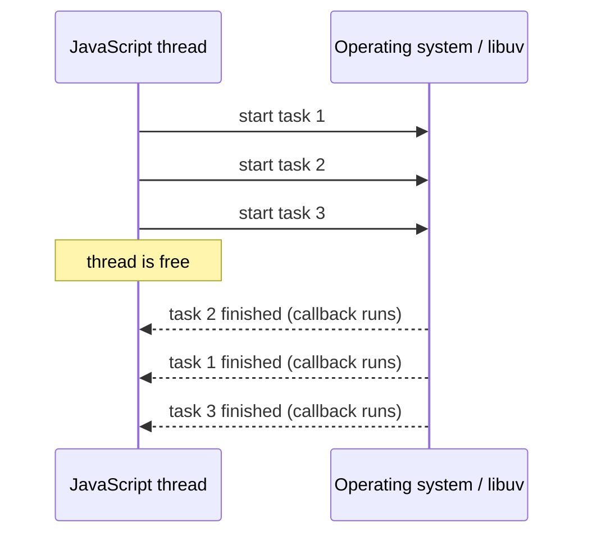
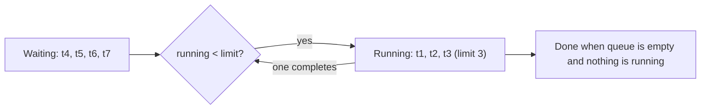

# Parallel execution, race conditions and limited concurrency

## In plain words

On laundry day you do not stand in front of the washing machine until it finishes and only then switch on the dishwasher. You start both, and the kettle too, and then deal with each as it beeps. Nothing got faster; the waiting overlaps. That is **parallel execution** of asynchronous tasks, and in Node it comes almost for free.

Two complications follow. If two people both glance into the fridge, both see no milk and both go and buy some, you end up with two bottles: a **race condition**. And if you start forty appliances at once, the fuse blows: you need a rule such as "at most three running at a time", which is **limited concurrency**.

Why it matters for a job: running independent I/O at once is the cheapest performance gain in back-end work, often turning seconds into milliseconds. Doing it without a limit is one of the most common ways to take down a database or get blocked by an external API. Both the technique and its guard rail are expected knowledge.

> **Before this lesson:** read [Callback hell, its cures and sequential execution](#/lesson/nodejs/callback-hell-sequential); we continue the backup example and the `iterate` idea. You need the event-loop model from [Philosophy, non-blocking I/O and the reactor pattern](#/lesson/nodejs/nonblocking-reactor).

## Parallel or concurrent?

Two words that are often mixed up:

- **Parallel** work happens literally at the same instant, on different CPU cores.
- **Concurrent** work is *in progress* during overlapping periods, although the program may be handling only one piece at any instant.

Your JavaScript runs on one thread, so two callbacks never execute at the same instant. What overlaps is the waiting, done by the operating system and libuv. Strictly, then, Node tasks run concurrently, not in parallel. The Node community nevertheless says "parallel execution" for "start several asynchronous tasks without waiting for each other", and this lesson follows that usage.



Notice that the completions arrive in whatever order the tasks happen to finish.

## Control flow pattern 2: parallel execution

The recipe has three parts: **start everything**, **count the completions**, **report once**.

```js-run
const started = Date.now();
const stamp = () => String(Math.round((Date.now() - started) / 10) * 10).padStart(3) + " ms";

// stand-in for an upload: takes a different time per file
const durations = { "a.txt": 60, "b.txt": 20, "c.txt": 40 };
function backupFile(name, callback) {
  setTimeout(() => {
    if (!(name in durations)) return callback(new Error("ENOENT " + name));
    console.log(stamp(), "finished", name);
    callback(null, name.toUpperCase());
  }, durations[name] ?? 10);
}

function backupAllParallel(names, done) {
  if (names.length === 0) return queueMicrotask(() => done(null, []));   // nothing to wait for

  const results = new Array(names.length);
  let completed = 0;
  let failed = false;

  names.forEach((name, index) => {
    backupFile(name, (err, result) => {
      if (failed) return;                        // a previous task already reported an error
      if (err) { failed = true; return done(err); }
      results[index] = result;                   // store by position, not by arrival
      completed += 1;
      if (completed === names.length) done(null, results);
    });
  });
}

backupAllParallel(["a.txt", "b.txt", "c.txt"], (err, results) => {
  console.log(stamp(), "all done:", results);
});
```

The pieces, one at a time:

- `names.forEach(...)` starts every task immediately. Unlike the last lesson, this is on purpose.
- `completed` counts finished tasks. When it equals the number of tasks, everything is done. There is no "last callback" to hook into, because the last task to *start* is not necessarily the last to *finish*.
- `results[index] = result` writes each result into the slot of its own position. The output array is therefore in input order (`A.TXT`, `B.TXT`, `C.TXT`) although the tasks finished in the order b, c, a.
- `failed` guarantees that `done` is called **once**. Without it, two failing tasks would each call `done(err)`, or a failure would be followed by a "success" from the completion counter.
- The empty-list case is handled first; otherwise the counter would never reach zero matches and `done` would never be called. It is deferred with `queueMicrotask` so the function stays always-asynchronous.

Total time is about 60 ms: the **longest** task, not the sum (120 ms). In one sentence, the pattern is: *start all the tasks, and call the final callback when a counter of completions reaches the number of tasks, or immediately on the first error.*

> [!NOTE]
> On the first error the other tasks are **not cancelled**. They were already started and will run to their end; their results are ignored. Stopping work that is in flight needs explicit support, covered in the lesson on cancellation. The problem [Run tasks in parallel (virtual time)](#/problem/node-run-parallel) makes you compute exactly this.

## Race conditions without threads

A **race condition** is a bug in which the result depends on the timing of events that the program does not control. In multi-threaded languages they occur when two threads touch the same memory at once, and they are defended against with locks. Node has one JavaScript thread and no such simultaneous access, so it is tempting to think races cannot happen.

They can. A callback runs to completion without interruption, but *between* two callbacks anything may happen. The dangerous shape is always the same: **check something, then do an asynchronous step, then act on the check**. By the time the asynchronous step returns, the thing you checked may have changed.

```js-run
const cloud = new Set();                    // files that exist in the backup storage
let uploads = 0;

function existsInCloud(name, callback) { setTimeout(() => callback(null, cloud.has(name)), 20); }
function upload(name, callback) { setTimeout(() => { uploads++; cloud.add(name); callback(null); }, 30); }

function backupOnce(name, callback) {
  existsInCloud(name, (err, exists) => {      // 1. check
    if (exists) return callback(null, "skipped");
    upload(name, () => callback(null, "uploaded"));   // 2. act on a check that may be stale
  });
}

// Two parts of the program ask for the same file at nearly the same moment.
backupOnce("report.pdf", (err, outcome) => console.log("request 1:", outcome));
backupOnce("report.pdf", (err, outcome) => console.log("request 2:", outcome));

setTimeout(() => console.log("uploads performed:", uploads, "(expected 1)"), 120);
```

Both requests ask "does it exist?" before either has uploaded. Both hear "no". Both upload. In real systems this is a file written twice, a customer charged twice, or two rows where a unique one was expected.

The cure uses the property that *is* guaranteed: synchronous code is never interrupted. Record your intention **synchronously, before the first asynchronous step**, so that the second request sees it.

```js-run
const cloud = new Set();
let uploads = 0;
function existsInCloud(name, callback) { setTimeout(() => callback(null, cloud.has(name)), 20); }
function upload(name, callback) { setTimeout(() => { uploads++; cloud.add(name); callback(null); }, 30); }

const inProgress = new Set();                 // names somebody is already handling

function backupOnce(name, callback) {
  if (inProgress.has(name)) return queueMicrotask(() => callback(null, "already in progress"));
  inProgress.add(name);                       // claimed synchronously: no gap for a second request

  existsInCloud(name, (err, exists) => {
    if (exists) { inProgress.delete(name); return callback(null, "skipped"); }
    upload(name, () => { inProgress.delete(name); callback(null, "uploaded"); });
  });
}

backupOnce("report.pdf", (err, outcome) => console.log("request 1:", outcome));
backupOnce("report.pdf", (err, outcome) => console.log("request 2:", outcome));
setTimeout(() => console.log("uploads performed:", uploads), 120);
```

The check (`inProgress.has`) and the claim (`inProgress.add`) sit next to each other with no asynchronous step between them, so no other callback can slip in.

> [!WARNING]
> This protects one Node process. With several processes or servers, an in-memory `Set` is invisible to the others, and the guard must live in something shared: a unique constraint or transaction in the database, or a lock in a store such as Redis. Race conditions across processes are among the hardest bugs to reproduce, because they appear only under load.

## Why "everything at once" is dangerous

Unbounded parallelism works in a test with five items and fails in production with fifty thousand:

- **Resource limits.** Every open file and network connection uses a *file descriptor*, a numbered handle given out by the operating system, and each process has a quota. Open too many and calls fail with `EMFILE: too many open files`.
- **Memory.** Fifty thousand pending operations mean fifty thousand buffers and closures alive together.
- **The other side.** A database has a maximum number of connections; an API allows so many requests per second and answers the rest with `429 Too Many Requests` or bans you. Flooding a service until it cannot respond is, in effect, a *denial-of-service* attack on your own dependency.
- **Unbounded input.** If the number of tasks is decided by a user's request, a single malicious request can exhaust the server.

The answer is to cap the number of tasks in flight.

## Control flow pattern 3: limited concurrency

**Concurrency** here means the number of tasks running at one moment. The algorithm:

1. Start tasks until the limit is reached.
2. Each time a task completes, start the next waiting one, so the number in flight stays at the limit as long as work remains.
3. When no task is running and none is waiting, finish.



```js-run
const started = Date.now();
const stamp = () => String(Math.round((Date.now() - started) / 10) * 10).padStart(3) + " ms";

function eachLimit(items, limit, worker, done) {
  const results = new Array(items.length);
  let nextIndex = 0, running = 0, completed = 0, failed = false;
  if (items.length === 0) return queueMicrotask(() => done(null, results));

  function launch() {
    while (running < limit && nextIndex < items.length) {   // 1. fill the free slots
      const index = nextIndex++;
      running++;
      worker(items[index], (err, result) => {
        if (failed) return;
        if (err) { failed = true; return done(err); }
        results[index] = result;
        running--;
        completed++;
        if (completed === items.length) return done(null, results);   // 3. finished
        launch();                                            // 2. a slot is free: refill
      });
    }
  }
  launch();
}

const jobs = [["a", 50], ["b", 10], ["c", 10], ["d", 10]];
const worker = ([name, ms], callback) => {
  console.log(stamp(), "start ", name);
  setTimeout(() => { console.log(stamp(), "finish", name); callback(null, name); }, ms);
};

eachLimit(jobs, 2, worker, (err, results) => console.log(stamp(), "all done:", results));
```

Watch the output (timestamps are rounded and may be a few milliseconds off on your machine). With a limit of 2, `a` and `b` start at 0. When `b` finishes at 10 ms, `c` starts **at once**, without waiting for `a`. Then `d`. The slow task `a` occupies one slot throughout while the three quick ones take turns in the other. Everything is done at 50 ms.

Compare with a tempting shortcut: cut the list into batches of 2 and run each batch in parallel, one batch after another. Batch `[a, b]` takes 50 ms (one slot sits idle for 40 of them), then `[c, d]` takes 10: total 60 ms. A proper limiter never leaves a slot empty while work is waiting. The problem [Run tasks with a concurrency limit (virtual time)](#/problem/node-run-limited) is built on this difference.

Setting the limit to 1 gives sequential execution; setting it to the number of items gives the parallel pattern. Limited concurrency is the general case and the other two are its extremes.

## A queue shared by the whole program

`eachLimit` limits one collection. Often the limit must be **global**: at most four uploads in total, whichever part of the program requests them, including tasks that create further tasks (a backup of a folder finds sub-folders and schedules those). For that, the limiter becomes an object that lives as long as the program: a **task queue**.

```js-run
class TaskQueue {
  constructor(concurrency) {
    this.concurrency = concurrency;
    this.running = 0;
    this.waiting = [];
    this.onEmpty = null;
    this.onError = null;
  }

  push(task) {                                 // a task is a function taking a completion callback
    this.waiting.push(task);
    queueMicrotask(() => this.next());         // always asynchronous
    return this;
  }

  next() {
    if (this.running === 0 && this.waiting.length === 0) return this.onEmpty?.();
    while (this.running < this.concurrency && this.waiting.length > 0) {
      const task = this.waiting.shift();
      this.running++;
      task((err) => {
        if (err) this.onError?.(err);          // report, but keep the queue alive
        this.running--;
        queueMicrotask(() => this.next());
      });
    }
  }
}

const queue = new TaskQueue(2);
const started = Date.now();
const stamp = () => String(Math.round((Date.now() - started) / 10) * 10).padStart(3) + " ms";

function backupFolder(name, depth) {
  queue.push((done) => {
    console.log(stamp(), "start ", name);
    setTimeout(() => {
      console.log(stamp(), "finish", name);
      if (depth < 2) {                         // a finished task discovers two more
        backupFolder(name + "/x", depth + 1);
        backupFolder(name + "/y", depth + 1);
      }
      if (name.endsWith("x/y")) return done(new Error("disk error in " + name));
      done();
    }, 20);
  });
}

queue.onError = (err) => console.log(stamp(), "error reported:", err.message);
queue.onEmpty = () => console.log(stamp(), "queue is empty: backup complete");
backupFolder("root", 0);
```

Points to notice:

- A task is a function that receives one argument, `done`, and calls it when finished. The queue does not care what the task does.
- `next()` is the `launch` loop from before, living in an object. It runs after every `push` and after every completion.
- Tasks add more tasks while the queue is running; all of them respect the same limit of 2.
- An error is reported through `onError` and the queue **continues**. Whether one failure should stop everything is a design decision; many real queues keep going and collect errors.

In real Node code the two hooks would be events: `class TaskQueue extends EventEmitter`, with `this.emit("error", err)` and `this.emit("empty")`, so that several parts of the program can listen.

> [!TIP]
> How large should the limit be? There is no universal number. Start small (4 to 16 for network calls is common), measure, and stay below the limits of the service you call. For tasks hitting the libuv thread pool (files, DNS, crypto) remember that only four run at a time by default, whatever your limit says.

> [!INTERVIEW]
> **"How would you download 10,000 URLs in Node?"** Not sequentially (too slow) and not all at once (file descriptors, memory, rate limits). Use a concurrency limit: keep N requests in flight, start a new one whenever one completes, collect results by index, decide what to do on errors (fail fast or collect), and add retries with backoff for transient failures. Mention that batching in chunks of N is inferior to a sliding window. If asked **"Can race conditions happen in single-threaded Node?"**, answer yes: between an asynchronous check and the action based on it, and give the double-upload example.

## Pitfalls

- **Calling the final callback more than once** when several tasks fail.
- **Never calling it** for an empty list.
- **Collecting results with `push`**, which gives arrival order, not input order.
- **Assuming parallel tasks finish in the order they started.**
- **Check, await, act** without a synchronous claim in between.
- **Unbounded parallelism over user-controlled input.**
- **Batching** instead of a sliding window.
- **A limit per function when the resource is shared**: three functions each "limited to 10" can together open 30 connections.

## Cheat sheet

| Pattern | Total time | Tasks in flight | Use when |
|---|---|---|---|
| Sequential | sum of durations | 1 | order matters, or tasks depend on each other |
| Parallel | longest duration | all | few independent tasks, known small number |
| Limited | between the two | at most N | many independent tasks, or a shared resource |

| Ingredient | Purpose |
|---|---|
| `completed` counter | know when all tasks are done |
| `results[index] = value` | keep results in input order |
| `failed` flag | call the final callback exactly once |
| synchronous "claim" (`Set.add`) before async work | prevent check-then-act races |
| `running` counter and `while (running < limit)` | sliding concurrency window |
| long-lived `TaskQueue` | one global limit, tasks may add tasks |

## Summary

- Starting asynchronous tasks without waiting for each other makes their waiting overlap; total time becomes the longest task.
- The parallel pattern needs a completion counter, results stored by index and a guard so the final callback fires once.
- Race conditions exist in Node between an asynchronous check and a later action. Claim work synchronously before the first asynchronous step.
- Unlimited parallelism exhausts file descriptors, memory and other people's servers.
- Limited concurrency keeps at most N tasks in flight and refills a slot the moment it frees. A task queue applies one limit across a whole program.

## Glossary

- **Parallel execution (Node usage)**: starting several asynchronous tasks so that they are in progress together.
- **Concurrency**: tasks in progress during overlapping periods; also, the number of them at one moment.
- **Race condition**: a result that depends on uncontrolled timing.
- **Check-then-act**: testing a condition and acting on it later, when it may no longer hold.
- **File descriptor**: an operating-system handle for an open file or connection; limited per process.
- **`EMFILE`**: the error for "too many open files".
- **Denial of service**: making a service unavailable by overwhelming it.
- **Concurrency limit**: the maximum number of tasks allowed in flight.
- **Sliding window**: refilling a slot as soon as it frees, as opposed to fixed batches.
- **Task queue**: an object that holds waiting tasks and runs them under a limit.

```quiz
[
  {"q": "Three independent async tasks take 30, 50 and 20 ms and are started together. When is the last one done?", "options": ["After 100 ms", "After 50 ms", "After 20 ms", "After 30 ms"], "answer": 1,
   "explain": "In parallel the total is the longest duration."},
  {"q": "Tasks x (40 ms), y (10 ms) and z (25 ms) are started in that order with the parallel pattern, and each logs its name on completion. In what order do they log?", "options": ["x, y, z", "y, z, x", "z, y, x", "y, x, z"], "answer": 1,
   "explain": "Completion order follows duration when all start together: 10, 25, 40."},
  {"q": "Why does the parallel pattern store results with `results[index] = value`?", "options": ["It is faster than push", "So the results are in input order regardless of completion order", "To avoid memory leaks", "Arrays cannot be pushed to inside callbacks"], "answer": 1,
   "explain": "Tasks complete in an unpredictable order; indexing keeps each result in its own slot."},
  {"q": "Can a race condition occur in single-threaded Node code?", "options": ["No, never", "Yes: other callbacks can run between an asynchronous check and the action that relies on it", "Only when using worker threads", "Only with promises"], "answer": 1,
   "explain": "Callbacks are not interrupted, but state can change between two of them."},
  {"q": "Tasks a (50 ms), b, c, d (10 ms each) run with a concurrency limit of 2 using a sliding window. When does c start?", "options": ["At 0 ms", "At 10 ms", "At 50 ms", "At 60 ms"], "answer": 1,
   "explain": "a and b start at 0. b finishes at 10 ms and frees a slot, which c takes immediately."},
  {"q": "With the same tasks, how long does fixed batching ([a, b] then [c, d]) take compared with the sliding window?", "options": ["Both 50 ms", "Batching 60 ms, sliding window 50 ms", "Batching 50 ms, sliding window 60 ms", "Both 80 ms"], "answer": 1,
   "explain": "The first batch lasts 50 ms while one slot idles; the second adds 10 ms. The window finishes everything within a's 50 ms."},
  {"q": "What does EMFILE indicate?", "options": ["A file is empty", "The process has too many files or sockets open", "A module could not be found", "The file name is too long"], "answer": 1,
   "explain": "Each open file or connection uses a file descriptor, and the per-process quota was exceeded."},
  {"q": "In the parallel pattern, what happens to the other tasks when one fails first?", "options": ["They are cancelled automatically", "They keep running; their results are ignored", "They restart", "They fail with the same error"], "answer": 1,
   "explain": "Already-started asynchronous operations are not cancelled unless the code implements cancellation."}
]
```

> **Source:** Casciaro & Mammino, *Node.js Design Patterns* 3e, ch. 4 (topics only; wording and examples are original). Documentation: https://nodejs.org/docs/latest/api/errors.html#common-system-errors
