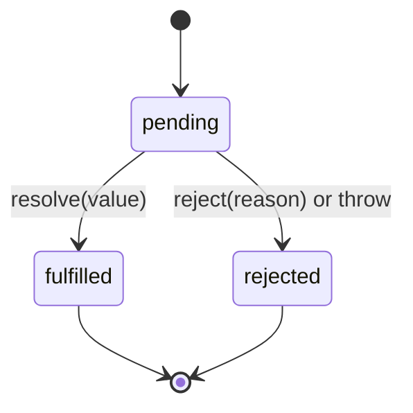

# Promises and promisification

## In plain words

At a busy food counter you pay and receive a buzzer. The buzzer is not your meal. It is an object that *stands for* the meal: you can carry it to a table, hand it to a friend, and plan what to do when it goes off. Eventually it does one of two things, exactly once: it buzzes (your food is ready) or the staff come over to say the kitchen ran out.

A **promise** is that buzzer: a JavaScript object representing the eventual result of an asynchronous operation. With callbacks you hand your "what next" to the function and lose control of it. With a promise the function hands *you* an object, and you decide what to attach to it, when, and how many times.

Why it matters for a job: promises are the foundation of `async`/`await`, which is how nearly all modern Node code is written. Every `await` operates on a promise. Reading stack traces, combining operations with `Promise.all`, converting old callback APIs, and avoiding unhandled rejections all require knowing what a promise is.

> **Before this lesson:** read [The callback pattern and its conventions](#/lesson/nodejs/callback-pattern) (error-first callbacks, the sometimes-synchronous bug) and [Callback hell, its cures and sequential execution](#/lesson/nodejs/callback-hell-sequential). Microtasks from [The event loop in detail](#/lesson/nodejs/event-loop-phases) explain the timing.

## The three states

A promise is always in exactly one of three states:

- **pending**: the operation has not finished;
- **fulfilled**: it finished successfully, and the promise holds a **value**;
- **rejected**: it failed, and the promise holds a **reason**, by convention an `Error`.

A promise that is fulfilled or rejected is called **settled**. Settling happens once and is permanent: a fulfilled promise never becomes rejected, and its value never changes.



## Using a promise: `then`, `catch`, `finally`

```js-run
// A function that returns a promise (we will write such functions ourselves in a moment).
const getUser = (id) => new Promise((resolve, reject) => {
  setTimeout(() => (id > 0 ? resolve({ id, name: "Ada" }) : reject(new Error("invalid id " + id))), 30);
});

getUser(7).then((user) => console.log("fulfilled with", user));

getUser(-1)
  .then((user) => console.log("this is skipped"))
  .catch((error) => console.log("rejected with:", error.message))
  .finally(() => console.log("finally runs in both cases"));

console.log("promises created; this line prints first");
```

- `promise.then(onFulfilled)` registers a function to receive the value.
- `promise.catch(onRejected)` registers a function to receive the reason. It is a short form of `then(undefined, onRejected)`.
- `promise.finally(fn)` registers a function for clean-up that runs either way and receives no argument.
- Registering does not block. The last line of the script prints first.

You may call `then` on the same promise many times, and long after it settled; each handler still gets the value. That is one improvement over events, which are lost if you subscribe late.

## Chaining: every `then` returns a new promise

This is the idea that makes promises worth having. `then` does not return the same promise; it returns a **new** one, which settles according to what your handler does:

| Your handler... | The promise returned by `then`... |
|---|---|
| returns a plain value `x` | is fulfilled with `x` |
| returns another promise `p` | waits for `p` and adopts its outcome |
| throws an error `e` | is rejected with `e` |
| is missing for the outcome that occurred | passes that outcome through unchanged |

```js-run
const wait = (ms, value) => new Promise((resolve) => setTimeout(() => resolve(value), ms));

wait(20, 5)
  .then((n) => { console.log("step 1 got", n); return n * 2; })          // returns a value
  .then((n) => { console.log("step 2 got", n); return wait(20, n + 1); }) // returns a promise
  .then((n) => { console.log("step 3 got", n); throw new Error("step 3 failed"); })
  .then((n) => console.log("step 4 is skipped"))
  .catch((error) => { console.log("caught:", error.message); return "recovered"; })
  .then((value) => console.log("after catch the chain continues with:", value));
```

Trace it:

1. Step 1 returns `10`, so the next promise is fulfilled with 10.
2. Step 2 returns a promise; the chain *waits* for it and continues with its value, 11. This is how asynchronous steps are put in sequence without nesting.
3. Step 3 throws. The promise it produces is rejected.
4. Step 4 has no rejection handler, so the rejection passes straight through it.
5. `catch` receives the error. It returns a value, which means the problem is handled: the chain is fulfilled again and continues.

Compare the shape with the callback pyramid of two lessons ago: a flat list of steps, and **one** error handler for all of them. An error anywhere jumps to the nearest `catch` below, as with `try`/`catch` in synchronous code.

> [!WARNING]
> The most common promise bug is a missing `return`. In `.then((n) => { wait(20, n); })` the handler returns `undefined`, so the chain does not wait for the inner promise and the next step receives `undefined`. If a handler starts asynchronous work, it must **return** the promise.

## Promises always call back asynchronously

Handlers given to `then` are never invoked on the spot, even if the promise is already settled. They are queued as **microtasks** and run after the current synchronous code has finished.

```js-run
const ready = Promise.resolve("already settled");
console.log("1");
ready.then((v) => console.log("3:", v));
console.log("2");
```

The "sometimes synchronous, sometimes asynchronous" bug from the callbacks lesson cannot happen with promises: the timing is always asynchronous. That guarantee is part of the specification all implementations follow, known as **Promises/A+**.

The same specification defines a **thenable**: any object with a `then` method. Promise machinery treats thenables as promises, which is why promises from different libraries, and from before promises were built into the language, can be mixed and chained.

## Creating promises

### Ready-made ones

```javascript
Promise.resolve(42);                    // a promise already fulfilled with 42
Promise.reject(new Error("nope"));      // a promise already rejected
```

`Promise.resolve(x)` is also the way to normalise a value that may or may not be a promise.

### From scratch: the constructor

```js-run
function delay(ms) {
  return new Promise((resolve, reject) => {
    if (typeof ms !== "number" || ms < 0) {
      reject(new TypeError("ms must be a non-negative number"));
      return;
    }
    setTimeout(() => resolve(new Date().getMilliseconds()), ms);
  });
}

const started = Date.now();
delay(40).then(() => console.log("40 ms later, measured:", Date.now() - started >= 39));
delay("soon").catch((error) => console.log("rejected:", error.message));
```

`new Promise(executor)` calls your **executor** function immediately, passing two functions:

- `resolve(value)` fulfils the promise (or, given a promise, makes it follow that one);
- `reject(reason)` rejects it.

Only the first call counts; later calls to either are ignored. If the executor throws, the promise is rejected with the thrown error.

You need the constructor only at the boundary with something that is *not* promise-based: timers, events, callback APIs. Wrapping code that already returns a promise in `new Promise` is a well-known anti-pattern that adds nothing and tends to lose errors.

## Promisification

Converting a callback-style function into one that returns a promise is called **promisification**. Since Node callbacks follow strict conventions (callback last, error first), the conversion can be written once for all functions:

```js-run
function promisify(callbackStyleFunction) {
  return function promisified(...args) {
    return new Promise((resolve, reject) => {
      callbackStyleFunction(...args, (err, result) => {   // append our own callback
        if (err) return reject(err);
        resolve(result);
      });
    });
  };
}

// An old-style function following the Node conventions:
function lookupStock(product, callback) {
  setTimeout(() => {
    if (product === "unicorn") return callback(new Error("no such product"));
    callback(null, product.length * 3);
  }, 20);
}

const lookupStockAsync = promisify(lookupStock);

lookupStockAsync("kettle").then((n) => console.log("kettles in stock:", n));
lookupStockAsync("unicorn").catch((error) => console.log("failed:", error.message));
```

How it works: `promisify` returns a new function. When called, that function creates a promise and calls the original with the caller's arguments **plus one extra callback at the end**. That callback translates the error-first convention into `reject` or `resolve`.

Node ships this function, with more care for edge cases:

```javascript
import { promisify } from "node:util";
import { randomBytes } from "node:crypto";

const randomBytesAsync = promisify(randomBytes);
const bytes = await randomBytesAsync(16);
console.log(bytes.toString("hex"));        // e.g. 9f1c0e4a7b3d5a61c2e8f0a4b6d7c813
```

Most core modules also offer promise versions directly, so you rarely promisify them yourself:

```javascript
import { readFile } from "node:fs/promises";
import { setTimeout as sleep } from "node:timers/promises";
import { lookup } from "node:dns/promises";

await sleep(100);
const text = await readFile("notes.txt", "utf8");
```

Promisification relies on the conventions. A function that passes several results to its callback, or does not put the callback last, needs a hand-written wrapper. A function that calls its callback more than once should not be promisified at all: a promise settles once and the later calls would vanish silently. The problem [What does the promisified call settle to?](#/problem/node-promisify) explores these cases.

## Sequential execution with promises

A fixed sequence is a chain, as shown above. For a list of items known only at run time, build the chain in a loop: keep one promise variable and keep replacing it with "itself, then the next task".

```js-run
const started = Date.now();
const stamp = () => String(Math.round((Date.now() - started) / 10) * 10).padStart(3) + " ms";
const upload = (name) => new Promise((resolve) => {
  console.log(stamp(), "start ", name);
  setTimeout(() => { console.log(stamp(), "finish", name); resolve(name.toUpperCase()); }, 30);
});

const files = ["a.txt", "b.txt", "c.txt"];
const results = [];

let chain = Promise.resolve();                     // an already-fulfilled starting point
for (const file of files) {
  chain = chain.then(() => upload(file)).then((result) => results.push(result));
}
chain.then(() => console.log(stamp(), "all done:", results));
```

Each loop turn hangs one more link on the chain; nothing is uploaded during the loop itself. `upload(file)` is called inside a `then` handler, so it runs only when the previous link has settled. The same construction is often written with `reduce`:

```javascript
files.reduce((chain, file) => chain.then(() => upload(file)), Promise.resolve());
```

> [!TIP]
> Notice the difference between `chain.then(upload(file))` and `chain.then(() => upload(file))`. The first *calls* `upload` immediately, while building the chain, and passes its result to `then`; all uploads start at once. The second passes a function to be called later. A promise represents work that has **already been started**; to delay work, wrap it in a function.

## Parallel execution with promises

Starting several operations at once is nothing more than calling the functions; each returns a promise at once. `Promise.all` then combines them:

```js-run
const started = Date.now();
const fetchPart = (name, ms, fail = false) => new Promise((resolve, reject) =>
  setTimeout(() => (fail ? reject(new Error(name + " failed")) : resolve(name)), ms));

const results = await Promise.all([fetchPart("profile", 60), fetchPart("orders", 20), fetchPart("ads", 40)]);
console.log(results, "after about", Math.round((Date.now() - started) / 10) * 10, "ms");

const settled = await Promise.allSettled([fetchPart("profile", 30), fetchPart("ads", 10, true)]);
console.log(settled.map((s) => s.status + ":" + (s.value ?? s.reason.message)));

const fastest = await Promise.race([fetchPart("mirror-1", 50), fetchPart("mirror-2", 15)]);
console.log("race winner:", fastest);

const firstOk = await Promise.any([fetchPart("primary", 10, true), fetchPart("backup", 30)]);
console.log("any:", firstOk);
```

(`await` pauses until a promise settles; the next lesson treats it properly.) The four combinators:

| Method | Fulfils when | Rejects when | Result |
|---|---|---|---|
| `Promise.all(list)` | all fulfil | **any** rejects (immediately) | array of values, in input order |
| `Promise.allSettled(list)` | all have settled | never | array of `{status, value}` or `{status, reason}` |
| `Promise.race(list)` | the first to settle fulfils | the first to settle rejects | that first outcome |
| `Promise.any(list)` | the first one fulfils | all reject (`AggregateError`) | the first value |

`Promise.all` gives results in the order of the input, not the order of completion: the counter and the indexed results array from the callback version are built in. When it rejects early, the other operations are not stopped; they continue and their results are discarded. Limiting how many run at once needs more machinery and is the subject of the lesson after next.

> [!INTERVIEW]
> **"What is a promise and how is it better than a callback?"** "A promise is an object representing the eventual result of an asynchronous operation; it is pending, then fulfilled with a value or rejected with a reason, exactly once. Advantages: handlers are always called asynchronously, so no sometimes-sync bugs; chains are flat; errors propagate to the nearest `catch` including thrown exceptions; a result can be consumed by several parties and after the fact; and combinators such as `Promise.all` express parallel flows." Typical follow-up: **"Implement `promisify`."** Write the eight lines above and state the assumptions: callback last, error first, called once.

## Pitfalls

- **Missing `return` inside `then`**: the chain does not wait.
- **Nesting `then` inside `then`**, recreating the pyramid. Return the inner promise and continue at the outer level.
- **`then(doWork())` instead of `then(() => doWork())`**: the work starts immediately.
- **Wrapping an existing promise in `new Promise`.** Return it directly.
- **No `catch` at the end of a chain**: the rejection becomes *unhandled* and, in current Node versions, terminates the process. The pitfalls lesson covers this.
- **A `catch` in the middle** that returns normally "repairs" the chain; later steps run with the catch's return value. Re-throw if the error is not really handled.
- **Assuming `Promise.all` cancels the others** on failure.
- **Rejecting with a string.** Use `Error` objects so that a stack trace exists.

## Cheat sheet

| Goal | Code |
|---|---|
| React to success / failure | `p.then(onValue)` / `p.catch(onError)` |
| Clean up either way | `p.finally(cleanup)` |
| Create from a callback API | `new Promise((resolve, reject) => { ... })` |
| Convert a Node-style function | `util.promisify(fn)` |
| Core APIs as promises | `node:fs/promises`, `node:timers/promises`, `node:dns/promises` |
| Already-settled promises | `Promise.resolve(v)`, `Promise.reject(err)` |
| Sequence over a list | `list.reduce((p, x) => p.then(() => work(x)), Promise.resolve())` |
| All in parallel, fail fast | `Promise.all(list.map(work))` |
| All in parallel, collect every outcome | `Promise.allSettled(...)` |
| First to settle / first to succeed | `Promise.race(...)` / `Promise.any(...)` |

## Summary

- A promise is an object for a future result: pending, then fulfilled or rejected, once and for all.
- `then` returns a new promise determined by its handler's return value or thrown error, which gives flat chains with a single error handler.
- Handlers always run asynchronously as microtasks.
- `new Promise(executor)` bridges non-promise code; `util.promisify` converts any conventional callback API; core modules offer `promises` variants.
- A promise is work already in progress: wrap it in a function to postpone it. Chains built in a loop give sequential flow; `Promise.all` and its siblings give parallel flow.

## Glossary

- **Promise**: an object representing the eventual result of an asynchronous operation.
- **Pending / fulfilled / rejected**: not finished / succeeded with a value / failed with a reason.
- **Settled**: no longer pending.
- **Handler (reaction)**: a function registered with `then`, `catch` or `finally`.
- **Chain**: a series of `then` calls, each working on the promise returned by the previous one.
- **Executor**: the function passed to `new Promise`, which receives `resolve` and `reject`.
- **Thenable**: any object with a `then` method.
- **Promises/A+**: the specification describing how `then` must behave.
- **Promisification**: converting a callback-style function to one returning a promise.
- **Combinator**: a function combining several promises, such as `Promise.all`.
- **`AggregateError`**: an error that wraps several errors, used by `Promise.any`.

```quiz
[
  {"q": "In what order do these log?\n\n`console.log('A'); Promise.resolve().then(() => console.log('B')); console.log('C');`", "options": ["A, B, C", "A, C, B", "B, A, C", "A, C only"], "answer": 1,
   "explain": "then handlers always run asynchronously, as microtasks, after the current synchronous code."},
  {"q": "What does the last handler receive?\n\n`Promise.resolve(1).then((x) => { x + 1; }).then((y) => console.log(y));`", "options": ["2", "1", "undefined", "A rejected promise"], "answer": 2,
   "explain": "The first handler has a block body with no return statement, so it returns undefined."},
  {"q": "What is printed?\n\n`Promise.reject(new Error('x')).then(() => console.log('A')).catch(() => console.log('B')).then(() => console.log('C'));`", "options": ["A, B, C", "B, C", "B", "C"], "answer": 1,
   "explain": "The first then is skipped. catch handles the rejection and returns normally, so the chain is fulfilled again and C runs."},
  {"q": "`Promise.all([p1, p2, p3])` where p2 rejects after 10 ms and the others fulfil after 50 ms. What happens?", "options": ["It fulfils after 50 ms with two values", "It rejects after about 10 ms; p1 and p3 keep running and their results are ignored", "It rejects after 50 ms", "It cancels p1 and p3"], "answer": 1,
   "explain": "Promise.all rejects as soon as any input rejects. It has no means of cancelling the others."},
  {"q": "Which call starts all three uploads at once instead of one after another?", "options": ["chain = chain.then(() => upload(f)) in a loop", "chain = chain.then(upload(f)) in a loop", "files.reduce((p, f) => p.then(() => upload(f)), Promise.resolve())", "None of them"], "answer": 1,
   "explain": "upload(f) is evaluated immediately while the chain is being built; then receives its result, not a function."},
  {"q": "What assumptions does a generic promisify make about the function it wraps?", "options": ["It returns a promise already", "Its last parameter is a callback that is called once with (err, result)", "It is synchronous", "It takes exactly one argument"], "answer": 1,
   "explain": "Promisification relies on the Node conventions: callback last, error first, single invocation."},
  {"q": "An executor calls `resolve(1); reject(new Error('late')); resolve(2);`. What is the promise's final state?", "options": ["Fulfilled with 1", "Rejected with 'late'", "Fulfilled with 2", "Pending"], "answer": 0,
   "explain": "A promise settles once; every later resolve or reject call is ignored."},
  {"q": "Which combinator never rejects?", "options": ["Promise.all", "Promise.race", "Promise.any", "Promise.allSettled"], "answer": 3,
   "explain": "allSettled waits for every input and reports each outcome as an object with a status."}
]
```

> **Source:** Casciaro & Mammino, *Node.js Design Patterns* 3e, ch. 5 (topics only; wording and examples are original). Documentation: https://nodejs.org/docs/latest/api/util.html#utilpromisifyoriginal, https://developer.mozilla.org/en-US/docs/Web/JavaScript/Reference/Global_Objects/Promise, https://promisesaplus.com
