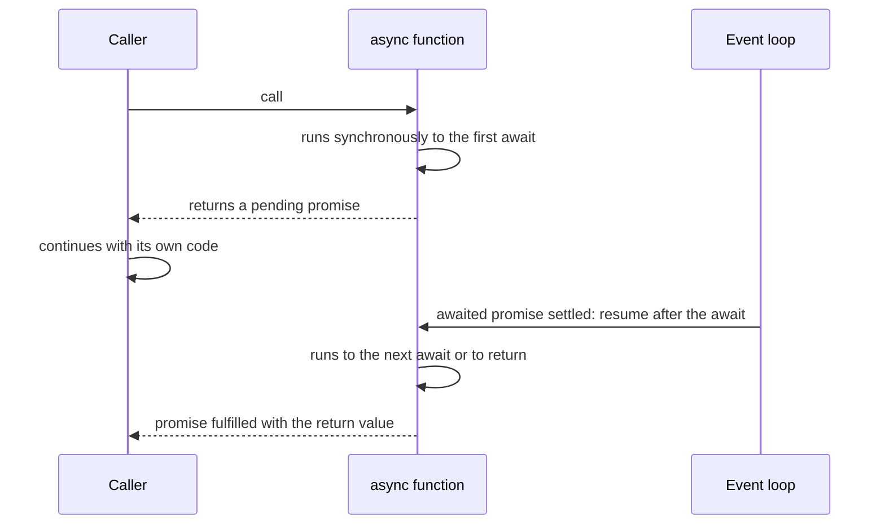

# Async/await: sequential and parallel flows

## In plain words

You are following a recipe and reach "let the dough rise for an hour". You put a bookmark in the book and go and do other things. When the timer rings you open the book at the bookmark and carry on from the next line, with the flour still on the table where you left it.

`await` is that bookmark. Inside a function marked `async`, the word `await` in front of a promise means: *pause this function here, let the rest of the program run, and continue from this exact spot, with all my local variables intact, when the promise has its result*. The code reads from top to bottom like ordinary synchronous code, yet nothing blocks.

Why it matters for a job: `async`/`await` is the default way to write asynchronous JavaScript today. The syntax is easy to pick up, which is exactly why its traps (accidentally sequential code, a missing `await`, `forEach` with an async callback) are among the most frequent bugs in code reviews and the most frequent questions in interviews.

> **Before this lesson:** you need promises: states, `then`/`catch`, chaining and `Promise.all`, from [Promises and promisification](#/lesson/nodejs/promises-promisification). The three control-flow patterns come from [Callback hell, its cures and sequential execution](#/lesson/nodejs/callback-hell-sequential) and [Parallel execution, race conditions and limited concurrency](#/lesson/nodejs/parallel-limited-callbacks).

## Async functions

Putting `async` in front of a function changes two things.

1. The function **always returns a promise**. Whatever you `return` becomes the fulfilment value; whatever you `throw` becomes the rejection reason.
2. Inside it you may use `await`.

```js-run
async function answer() {
  return 42;
}
async function broken() {
  throw new Error("something went wrong");
}

const result = answer();
console.log("answer() returned a promise?", result instanceof Promise);
result.then((value) => console.log("its value:", value));
broken().catch((error) => console.log("broken() rejected with:", error.message));
```

Even though `answer` contains no asynchronous work at all, calling it gives a promise, not `42`. This catches people out: `if (isAdmin(user))` is always true when `isAdmin` is an async function, because a promise object is truthy.

## The `await` expression

`await promise` suspends the surrounding async function until the promise settles. If it fulfils, the `await` expression evaluates to the value. If it rejects, `await` **throws** the reason at that line.

```js-run
const delay = (ms, value) => new Promise((resolve) => setTimeout(() => resolve(value), ms));

async function brewCoffee() {
  console.log("  1. grinding");
  const grounds = await delay(30, "ground beans");     // paused here for 30 ms
  console.log("  2. got", grounds, "- now heating water");
  const water = await delay(30, "hot water");
  return `coffee from ${grounds} and ${water}`;
}

console.log("A: before calling");
const promise = brewCoffee();
console.log("B: brewCoffee has returned a pending promise; the script goes on");
promise.then((cup) => console.log("C:", cup));
```

Follow the order of the output: `A`, then `1. grinding`, then `B`, then later `2.` and `C`.

- Calling an async function runs its body **synchronously up to the first `await`**. That is why `1. grinding` appears before `B`.
- At the first `await` the function is suspended and returns its pending promise to the caller. The caller continues: `B`.
- When the awaited promise settles, the rest of the function is scheduled as a microtask and resumes.



Only the async function waits. The thread does not: timers fire, requests are served, other async functions make progress. `await` is syntax for `then`; the two pieces of code below do the same thing.

```javascript
// with then
function loadProfile(id) {
  return getUser(id).then((user) => getOrders(user).then((orders) => ({ user, orders })));
}

// with await
async function loadProfile(id) {
  const user = await getUser(id);
  const orders = await getOrders(user);
  return { user, orders };
}
```

The second version keeps `user` available in later steps without nesting, which chains struggle with.

> [!NOTE]
> `await` works on any value. A non-promise such as `await 5` is wrapped in a resolved promise first, so the function still pauses for one microtask. And `await` is allowed only inside async functions and at the top level of ES modules; in a CommonJS file's top level it is a syntax error.

## Error handling: one `try`/`catch` for everything

Since a rejection becomes a thrown exception at the `await`, ordinary `try`/`catch`/`finally` handles asynchronous failures and synchronous exceptions together.

```js-run
const delay = (ms) => new Promise((resolve) => setTimeout(resolve, ms));

async function fetchConfig(source) {
  await delay(20);
  if (source === "offline") throw new Error("network unreachable");     // asynchronous failure
  return source === "corrupt" ? "{not json" : '{"retries": 3}';
}

async function loadConfig(source) {
  try {
    const text = await fetchConfig(source);
    const config = JSON.parse(text);                                    // may throw synchronously
    return config;
  } catch (error) {
    console.log(`  [${source}] using defaults because: ${error.message.slice(0, 32)}`);
    return { retries: 1 };
  } finally {
    console.log(`  [${source}] finished trying`);
  }
}

console.log(await loadConfig("server"));
console.log(await loadConfig("offline"));
console.log(await loadConfig("corrupt"));
```

One `catch` covers the rejected promise from `fetchConfig` and the exception from `JSON.parse`. With callbacks those needed two separate mechanisms.

### The `return` versus `return await` trap

```js-run
const failLater = () => new Promise((_, reject) => setTimeout(() => reject(new Error("too late")), 20));

async function withoutAwait() {
  try {
    return failLater();            // the promise leaves the function while still pending
  } catch (error) {
    return "caught locally";
  }
}

async function withAwait() {
  try {
    return await failLater();      // the function waits here, inside the try block
  } catch (error) {
    return "caught locally";
  }
}

console.log("without await:", await withoutAwait().catch((e) => "escaped to the caller: " + e.message));
console.log("with await   :", await withAwait());
```

`return failLater()` hands the pending promise straight out. The function has left its `try` block by the time the rejection happens, so the local `catch` never sees it. `return await` keeps the function inside the `try` until the promise settles. Rule: **inside `try`/`catch`, write `return await`.** Outside a `try` block the two behave the same.

## Sequential execution

With `await`, sequence is the default: write the steps one under another. For a collection, use an ordinary loop.

```js-run
const started = Date.now();
const stamp = () => String(Math.round((Date.now() - started) / 10) * 10).padStart(3) + " ms";
const upload = async (name) => {
  console.log(stamp(), "start ", name);
  await new Promise((resolve) => setTimeout(resolve, 30));
  console.log(stamp(), "finish", name);
  return name.toUpperCase();
};

const results = [];
for (const file of ["a.txt", "b.txt", "c.txt"]) {
  results.push(await upload(file));          // the loop itself pauses here
}
console.log(stamp(), "sequential result:", results);
```

Compare this with the `iterate(index)` function from the callbacks lesson. The loop, the early exit on error (an exception leaves the loop) and the result collection are all plain language features again. `for`, `while` and `for...of` all work with `await`.

### The `forEach` trap

```js-run
const save = async (n) => { await new Promise((r) => setTimeout(r, 20)); console.log("  saved", n); };

console.log("with forEach:");
[1, 2, 3].forEach(async (n) => {
  await save(n);
});
console.log("  forEach returned immediately; nothing has been saved yet");

await new Promise((r) => setTimeout(r, 60));

console.log("with for...of:");
for (const n of [1, 2, 3]) await save(n);
console.log("  loop finished; everything is saved");
```

`forEach` calls your callback for each element and **ignores what it returns**. An async callback returns a promise; `forEach` throws it away and moves on. The result: all three saves start at once, nothing waits for them, and any rejection has no handler. The same applies to `map`, `filter` and `reduce`: array methods do not understand promises. Use `for...of` for sequence, or `map` plus `Promise.all` for parallelism, never `forEach` with `async`.

## Parallel execution

Remember from the last lesson: a promise is work already started. To run tasks in parallel, **start them all first, then await them together**.

```js-run
const started = Date.now();
const ms = () => Math.round((Date.now() - started) / 10) * 10;
const query = async (name, time) => { await new Promise((r) => setTimeout(r, time)); return name + " rows"; };

// Accidentally sequential: each await finishes before the next query starts.
const t0 = ms();
const a1 = await query("users", 50);
const b1 = await query("orders", 50);
console.log("one after another:", ms() - t0, "ms");

// Parallel: both are started, then both are awaited.
const t1 = ms();
const [a2, b2] = await Promise.all([query("users", 50), query("orders", 50)]);
console.log("Promise.all      :", ms() - t1, "ms", [a2, b2]);

// Parallel over a list: map to promises, then await them all.
const t2 = ms();
const tables = ["users", "orders", "stock", "prices"];
const all = await Promise.all(tables.map((table) => query(table, 50)));
console.log("map + Promise.all:", ms() - t2, "ms for", all.length, "queries");
```

Two independent 50 ms queries take 100 ms when awaited one by one and 50 ms together. "Accidentally sequential" independent awaits are the most common performance mistake in async code; whenever you see consecutive `await` lines, ask whether the second really needs the first one's result.

### Start-then-await-in-a-loop is not the same

```javascript
const promises = tables.map((table) => query(table));   // all started: good
const results = [];
for (const promise of promises) {
  results.push(await promise);                           // awaited one at a time: risky
}
```

This does run in parallel, and on the happy path it gives the right answer. The problem is failure. While the loop is waiting on the first promise, the third one may reject. Nobody is listening to the third promise yet, so Node sees a rejection without a handler and reports an **unhandled rejection**, which by default ends the process. `Promise.all` attaches handlers to every promise immediately and rejects as soon as any of them does. Prefer `Promise.all`.

> [!TIP]
> Choosing a combinator: `Promise.all` when you need every result and one failure makes the whole thing pointless; `Promise.allSettled` when each item succeeds or fails independently (sending 100 emails); `Promise.race` for timeouts; `Promise.any` for "first mirror that answers".

## A timeout helper: `race` in practice

```js-run
const delay = (ms, value) => new Promise((resolve) => setTimeout(() => resolve(value), ms));

function withTimeout(promise, ms) {
  let timer;
  const timeout = new Promise((_, reject) => {
    timer = setTimeout(() => reject(new Error(`timed out after ${ms} ms`)), ms);
  });
  return Promise.race([promise, timeout]).finally(() => clearTimeout(timer));
}

try {
  console.log(await withTimeout(delay(20, "fast answer"), 100));
  console.log(await withTimeout(delay(200, "slow answer"), 50));
} catch (error) {
  console.log("gave up:", error.message);
}
```

`Promise.race` settles with whichever promise settles first. The `finally` clears the timer so it does not keep the process alive. The slow operation itself is not stopped, only abandoned; real cancellation is covered in the advanced recipes module.

## Async functions where nobody awaits them

Many APIs call your function and ignore its return value: `emitter.on("data", handler)`, `setTimeout`, `array.forEach`, and older frameworks' route handlers. If the handler is `async` and throws, the resulting rejected promise has no owner.

```javascript
server.on("request", async (req, res) => {
  const user = await findUser(req);      // if this rejects, nothing catches it
  res.end(user.name);
});
```

Wrap the body of such handlers in `try`/`catch` and turn failures into a response, a log line or an `"error"` event:

```javascript
server.on("request", async (req, res) => {
  try {
    const user = await findUser(req);
    res.end(user.name);
  } catch (error) {
    res.statusCode = 500;
    res.end("internal error");
  }
});
```

> [!WARNING]
> A missing `await` produces no error message. `saveOrder(order);` without `await` starts the save and immediately continues; the function may send "saved!" to the user before the save has happened, and a failure of the save becomes an unhandled rejection. Linters have a rule for this (`no-floating-promises` in TypeScript projects); turn it on.

> [!INTERVIEW]
> **"What does `await` do? Does it block?"** "It suspends the enclosing async function until the promise settles and then resumes it in a microtask, yielding the value or throwing the rejection reason. It does not block the thread; the event loop keeps running other callbacks." Classic follow-ups: **"Why is `forEach` with an async callback a bug?"** (the returned promises are ignored, so nothing is awaited and errors are unhandled), **"`return` versus `return await`?"** (the latter is needed inside `try`/`catch` for the local handler to see the rejection), and **"Make these two awaits faster"** (`Promise.all` when independent).

## Pitfalls

- **Forgetting `await`** and working with a promise object instead of its value (`"[object Promise]"` in output, conditions that are always true).
- **Independent operations awaited one by one.**
- **`forEach`/`map`/`filter` with async callbacks** expecting sequence or waiting.
- **`return promise` inside `try`** bypassing the local `catch`.
- **Starting promises and awaiting them in a loop**, risking unhandled rejections.
- **Async event handlers without `try`/`catch`.**
- **Unbounded `Promise.all(hugeList.map(...))`**: that is unlimited concurrency; the next lesson adds a limit.
- **Mixing styles** in one function (`await` here, `.then` there) without need; pick one.

## Cheat sheet

| Goal | Code |
|---|---|
| Declare | `async function f() {}`, `const f = async () => {}` |
| Wait for a result | `const value = await promise;` |
| Handle errors | `try { await work(); } catch (err) { ... } finally { ... }` |
| Return from inside `try` | `return await work();` |
| Steps in sequence | consecutive `await` lines |
| List in sequence | `for (const x of list) await work(x);` |
| List in parallel | `await Promise.all(list.map((x) => work(x)))` |
| Independent results | `const [a, b] = await Promise.all([getA(), getB()]);` |
| Every outcome, no fail-fast | `await Promise.allSettled(...)` |
| Timeout | `Promise.race([work(), rejectAfter(ms)])` |
| Pause | `await new Promise((r) => setTimeout(r, ms))` or `timers/promises` |

## Summary

- An async function always returns a promise; `return` fulfils it, `throw` rejects it.
- `await` suspends only the function, resumes it in a microtask, and turns rejections into exceptions, so `try`/`catch` covers synchronous and asynchronous failures alike.
- The body runs synchronously until the first `await`.
- Loops with `await` give sequential flow; start-all plus `Promise.all` gives parallel flow.
- Array methods ignore returned promises; `forEach` with an async callback is a bug.
- Use `return await` inside `try`, and never leave a promise without something handling its rejection.

## Glossary

- **Async function**: a function declared with `async`; it returns a promise and may contain `await`.
- **`await`**: an operator that suspends an async function until a promise settles.
- **Suspend / resume**: pausing a function with its local state kept, and continuing it later.
- **Top-level await**: `await` outside any function, allowed in ES modules.
- **Accidentally sequential**: independent operations awaited one after another without need.
- **Floating promise**: a promise that nothing awaits or handles.
- **Unhandled rejection**: a rejected promise with no rejection handler.
- **Fail fast**: stopping at the first failure, as `Promise.all` does.

```quiz
[
  {"q": "In what order do these log?\n\n`async function f() { console.log('1'); await null; console.log('2'); } console.log('A'); f(); console.log('B');`", "options": ["A, 1, 2, B", "A, 1, B, 2", "A, B, 1, 2", "1, A, B, 2"], "answer": 1,
   "explain": "The body runs synchronously up to the first await (1). Then the caller continues (B). The remainder resumes in a microtask (2)."},
  {"q": "`async function isAdmin() { return false; }` What does `if (isAdmin()) console.log('yes')` do?", "options": ["Prints nothing", "Prints yes, because a promise object is truthy", "Throws a TypeError", "Prints false"], "answer": 1,
   "explain": "Without await the condition tests the promise itself, which is an object and therefore truthy."},
  {"q": "Each `save` takes 20 ms. In what order do these log?\n\n`[1, 2].forEach(async (n) => { await save(n); console.log('saved', n); }); console.log('done');`", "options": ["saved 1, saved 2, done", "done, saved 1, saved 2", "saved 1, done, saved 2", "done only"], "answer": 1,
   "explain": "forEach does not wait for the promises its callback returns, so 'done' prints first; both saves finish about 20 ms later."},
  {"q": "Two independent requests take 80 ms each. How long does `const a = await getA(); const b = await getB();` take?", "options": ["About 80 ms", "About 160 ms", "About 40 ms", "It depends on CPU cores"], "answer": 1,
   "explain": "getB is not started until getA has finished. Use Promise.all to run them together in about 80 ms."},
  {"q": "Inside try/catch, why prefer `return await work()` over `return work()`?", "options": ["It is faster", "Without await the pending promise leaves the function, so a later rejection is not caught by the local catch", "return work() is a syntax error", "await converts the value to JSON"], "answer": 1,
   "explain": "The local catch only sees errors that occur while the function is still inside the try block."},
  {"q": "What does `await` do to the event loop while a function is suspended?", "options": ["It blocks it", "Nothing: other callbacks, timers and requests continue to run", "It pauses all timers", "It moves the function to another thread"], "answer": 1,
   "explain": "Only the async function is paused; the thread returns to the loop."},
  {"q": "Which code runs the uploads strictly one after another?", "options": ["files.forEach(async (f) => await upload(f))", "await Promise.all(files.map(upload))", "for (const f of files) await upload(f);", "files.map(async (f) => await upload(f))"], "answer": 2,
   "explain": "Only the for...of loop is suspended by await between iterations."},
  {"q": "Why is `const ps = items.map(start); for (const p of ps) await p;` riskier than `await Promise.all(items.map(start))`?", "options": ["It is sequential", "A promise that rejects before the loop reaches it has no handler yet and causes an unhandled rejection", "It uses more memory", "It cannot return results"], "answer": 1,
   "explain": "Promise.all attaches handlers to all promises immediately; the loop attaches them one at a time."}
]
```

> **Source:** Casciaro & Mammino, *Node.js Design Patterns* 3e, ch. 5 (topics only; wording and examples are original). Documentation: https://developer.mozilla.org/en-US/docs/Web/JavaScript/Reference/Statements/async_function, https://nodejs.org/docs/latest/api/timers.html#timers-promises-api
