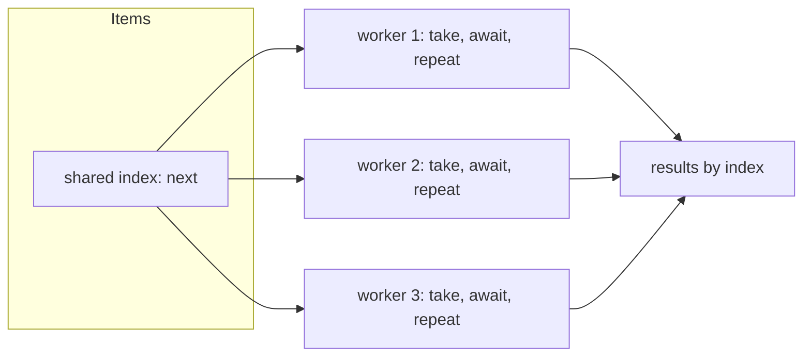

# Limited concurrency and async pitfalls

## In plain words

A supermarket with six checkouts and sixty customers does not serve them one at a time (too slow), and it does not try to serve all sixty at the same instant (impossible). Six are served at once, and each time a checkout becomes free the next person in line steps forward. That is **limited concurrency**, and with promises it takes about fifteen lines.

The second half of this lesson is a tour of the potholes on the async road: failures nobody is listening for, retry loops that hammer a struggling service, and loops that quietly consume memory until the process dies. Each is easy to avoid once you have seen it.

Why it matters for a job: "process these 50,000 records without melting the database" is a real task in the first months of most back-end jobs. And the pitfalls here are behind a large share of production incidents in Node services: a crash from an unhandled rejection, a memory graph that only goes up, a retry storm after a brief outage.

> **Before this lesson:** you need [Async/await: sequential and parallel flows](#/lesson/nodejs/async-await-flows) and the idea of a concurrency limit from [Parallel execution, race conditions and limited concurrency](#/lesson/nodejs/parallel-limited-callbacks).

## Why `Promise.all` is not enough

`await Promise.all(items.map(work))` starts **every** task at once. For ten items that is perfect. For ten thousand it opens ten thousand connections, as discussed in the callbacks module. `Promise.all` has no option for a limit, because it never starts anything: it receives promises, which are operations *already in flight*. To limit concurrency we must control **when tasks are started**, which means working with functions that create promises, not with promises.

## Version 1: a pool of workers

The shortest correct limiter: create N "workers". Each worker is an async function that, in a loop, takes the next unprocessed item and awaits it. When the items run out, the workers finish.

```js-run
async function mapLimit(items, limit, worker) {
  const results = new Array(items.length);
  let next = 0;                                   // index of the next item nobody has taken

  async function runWorker() {
    while (next < items.length) {
      const index = next++;                       // take an item: synchronous, so no two workers get the same one
      results[index] = await worker(items[index], index);
    }
  }

  const workers = Array.from({ length: Math.min(limit, items.length) }, runWorker);
  await Promise.all(workers);                     // wait until every worker has run out of items
  return results;
}

// ---- demo ----
const started = Date.now();
const stamp = () => String(Math.round((Date.now() - started) / 10) * 10).padStart(3) + " ms";
const resize = async ([name, ms]) => {
  console.log(stamp(), "start ", name);
  await new Promise((resolve) => setTimeout(resolve, ms));
  console.log(stamp(), "finish", name);
  return name + ".thumb";
};

const photos = [["a", 60], ["b", 20], ["c", 20], ["d", 20], ["e", 20]];
const thumbs = await mapLimit(photos, 2, resize);
console.log(stamp(), "result:", thumbs);
```

How it works:

- `next` is shared by all workers. `const index = next++` reads and increments in one synchronous step. No `await` sits between the read and the write, so two workers cannot take the same index. This is the "claim synchronously" rule from the race-condition section.
- `Array.from({ length: n }, runWorker)` calls `runWorker` n times, giving n promises, one per worker.
- Each worker pulls items until none are left. With a limit of 2 there are never more than two tasks in flight, and a slot is refilled the moment its task completes: in the output, `c` starts as soon as `b` finishes, while `a` is still running.
- Results are stored by index, so the output order matches the input order.
- If a task rejects, its worker's promise rejects and `Promise.all` rejects. The other workers finish their current task and, in this simple version, keep taking items; add a shared `failed` flag checked in the `while` condition if you want them to stop.



## Version 2: a reusable queue object

The worker pool handles one list. When tasks arrive over time from different places (every incoming request may need a thumbnail), the limit must live in a long-lived object. This is the promise version of the `TaskQueue` from the callbacks module. Its public method takes a **function that returns a promise** and itself returns a promise for that task's result.

```js-run
class TaskQueue {
  constructor(concurrency) {
    this.concurrency = concurrency;
    this.running = 0;
    this.waiting = [];
  }

  run(task) {                                     // task: () => Promise
    return new Promise((resolve, reject) => {
      this.waiting.push(() => task().then(resolve, reject));   // remember how to start it
      this.next();
    });
  }

  next() {
    while (this.running < this.concurrency && this.waiting.length > 0) {
      const start = this.waiting.shift();
      this.running++;
      start().finally(() => {                     // success or failure: free the slot
        this.running--;
        this.next();
      });
    }
  }
}

const queue = new TaskQueue(2);
const started = Date.now();
const stamp = () => String(Math.round((Date.now() - started) / 10) * 10).padStart(3) + " ms";
const job = (name, ms, fail) => () => new Promise((resolve, reject) => {
  console.log(stamp(), "start ", name);
  setTimeout(() => (fail ? reject(new Error(name + " broke")) : resolve(name + " ok")), ms);
});

const outcomes = await Promise.allSettled([
  queue.run(job("A", 40)),
  queue.run(job("B", 20, true)),
  queue.run(job("C", 20)),
  queue.run(job("D", 20)),
]);
console.log(stamp(), outcomes.map((o) => o.value ?? o.reason.message));
```

The interesting line is in `run`. The caller gets a new promise at once. What goes into the waiting list is a small function that, when called later, starts the real task and forwards its outcome to that promise with `then(resolve, reject)`. So each caller awaits its own task and receives its own result or error, while the queue decides the timing. `B` fails, and the queue carries on: `finally` frees the slot either way.

This is the one legitimate place for `new Promise` around promise code: the task is *not started yet*, and we need a promise for it now.

> [!TIP]
> In real projects, reach for a maintained package (`p-limit`, `p-queue`, `p-map`) before writing your own. `const limit = pLimit(4); await Promise.all(items.map((item) => limit(() => work(item))));` is the whole pattern. Write it by hand in interviews and to understand the libraries.

The problem [A task queue with priorities and a concurrency limit](#/problem/node-priority-queue) extends this queue with arrival times and priorities.

## Pitfall 1: unhandled rejections

An **unhandled rejection** is a promise that rejects while no rejection handler is attached to it. Since nobody is listening, the error would vanish, which is how bugs hide for months. Node therefore treats it as fatal: since version 15 the default behaviour is to print the error and **terminate the process** with a non-zero exit code.

```javascript
async function refreshCache() {
  throw new Error("cache server down");
}
refreshCache();                 // no await, no catch
console.log("continuing...");
```

```text
continuing...
/home/ana/app/job.js:2
  throw new Error("cache server down");
        ^
Error: cache server down
    at refreshCache (/home/ana/app/job.js:2:9)
Node.js v22.11.0
```

The usual ways to create one:

| Cause | Example |
|---|---|
| A floating promise | `sendEmail(user);` with no `await` and no `.catch` |
| An async callback where the caller ignores the result | `emitter.on("x", async () => {...})`, `forEach(async ...)` |
| Promises started and awaited later, one by one | `const ps = list.map(start); for (const p of ps) await p;` |
| A `.then` without a final `.catch` | `load().then(render);` |

Rule: **every promise must end in an `await` inside a `try`, or in a `.catch`**, or be returned to a caller who does one of those.

When work is deliberately not awaited, a *fire-and-forget* call such as writing an audit record that should not delay the response, attach a handler explicitly so the intent is visible:

```javascript
audit(event).catch((error) => logger.warn({ error }, "audit failed"));
```

A process-wide hook exists for logging and crash reporting, not for carrying on:

```javascript
process.on("unhandledRejection", (reason) => {
  logger.fatal({ reason }, "unhandled rejection");
  process.exit(1);
});
```

## Pitfall 2: retries that make things worse

Network calls fail for passing reasons: a restart, a brief overload. Retrying is reasonable. Retrying *immediately and forever* is how a small outage becomes a large one: thousands of clients all hammer a service that is trying to recover. Three rules make retries polite.

1. **A maximum number of attempts.**
2. **Exponential backoff**: wait longer after each failure (100 ms, 200 ms, 400 ms, …) up to a cap.
3. **Jitter**: add randomness to each wait so that clients which failed together do not retry together.

```js-run
const sleep = (ms) => new Promise((resolve) => setTimeout(resolve, ms));

async function retry(task, { retries = 4, baseMs = 20, factor = 2, maxMs = 200, jitter = 0 } = {}) {
  for (let attempt = 0; ; attempt++) {
    try {
      return await task(attempt);
    } catch (error) {
      if (attempt >= retries || error.permanent) throw error;       // give up: out of attempts, or pointless
      const backoff = Math.min(maxMs, baseMs * factor ** attempt);
      const wait = Math.round(backoff * (1 - jitter * Math.random()));
      console.log(`  attempt ${attempt + 1} failed (${error.message}); waiting ${wait} ms`);
      await sleep(wait);
    }
  }
}

let calls = 0;
const flaky = async () => {
  calls++;
  if (calls < 4) throw new Error("503 service unavailable");
  return "response on call " + calls;
};
console.log(await retry(flaky));

const forbidden = async () => { throw Object.assign(new Error("403 forbidden"), { permanent: true }); };
console.log(await retry(forbidden).catch((e) => "not retried: " + e.message));
```

- The loop has no end condition of its own; it leaves by `return` (success) or `throw` (giving up).
- `return await task()` inside `try` is essential; without `await` the rejection would escape the `catch`.
- A wait happens only when another attempt will follow.
- `error.permanent` stands for "retrying cannot help": a validation error or a 403 will fail identically next time. Retry only **transient** failures (timeouts, connection resets, 502/503/504 responses).
- Set `jitter: 0.5` to see randomised waits.

> [!WARNING]
> Retrying an operation that is not **idempotent** can do damage. Idempotent means that doing it twice has the same effect as doing it once: reading a record, or setting a value. "Charge the customer 20 euros" is not idempotent; if the first attempt succeeded but its response was lost, the retry charges twice. Such operations need an *idempotency key* that lets the server recognise the duplicate.

The problem [Retry with exponential backoff](#/problem/node-retry-backoff) asks for the exact schedule of waits.

## Pitfall 3: the infinite promise chain that leaks memory

Some tasks run forever: poll a queue, check a sensor every second. A natural way to write "do it, then do it again" with promises is recursion:

```javascript
// Leaks memory
function pollForever() {
  return checkQueue().then(() => pollForever());
}
```

Each `then` handler **returns the promise of the next round**. By the chaining rules, the promise from this round must therefore wait for the next round's promise, which waits for the one after, and so on without end. No promise in this chain can ever settle, each one holds a reference to the next, and none can be released by the garbage collector (the part of the engine that frees memory nothing refers to). Memory grows a little on every iteration until the process is killed, perhaps days later. The async version with `return` has the same defect:

```javascript
// Also leaks
async function pollForever() {
  await checkQueue();
  return pollForever();
}
```

The fixes all break the "this promise depends on the next one" link:

```javascript
// Best: an ordinary loop. One function call, one promise, constant memory.
async function pollForever() {
  while (true) {
    await checkQueue();
  }
}

// Alternative: do not return the next round's promise (errors must then be handled inside).
function pollForever() {
  checkQueue().then(() => { pollForever(); }).catch(handleError);
}
```

The loop version is also the easiest to read, and an exception leaves the loop and rejects the single outer promise, so failures are not lost. This model counts rounds to show a loop in action; it stops after a few iterations so the page can display the result:

```js-run
let checks = 0;
const checkQueue = async () => { await new Promise((r) => setTimeout(r, 5)); checks++; };

async function pollUntil(limit) {
  while (checks < limit) {
    await checkQueue();
    if (checks % 10 === 0) console.log("checked", checks, "times; still one function call, one promise");
  }
  return "stopped after " + checks + " checks";
}
console.log(await pollUntil(30));
```

## Pitfall 4: more traps in brief

**An async function as a promise executor.**

```javascript
new Promise(async (resolve, reject) => {
  const data = await load();        // if this rejects, the outer promise stays pending forever
  resolve(data);
});
```

The constructor ignores the promise returned by the async executor, so a rejection inside it is both unhandled and never passed to `reject`. Write a plain async function instead.

**Swallowed errors.** An empty `catch {}` or `.catch(() => {})` makes failures invisible. At the very least log; better, handle the specific error you expect and re-throw the rest.

**Sequential awaits in a hot path.** Covered last lesson; it is the top performance pitfall.

**Awaiting in a tight loop on data that is already available.** Each `await` on an already-settled promise continues in a microtask, and the microtask queue is drained before any I/O callback runs. A loop of a million such awaits blocks the server like a synchronous loop would. Yield to the loop occasionally with `await setImmediate()` from `node:timers/promises` when processing large in-memory collections.

**Shared state across awaits.** Between `const balance = await getBalance()` and `await setBalance(balance - 10)` another request may have changed the balance: the check-then-act race again. Use atomic database operations or transactions for such updates.

> [!INTERVIEW]
> **"Implement a function that runs async tasks with at most N in parallel."** The worker-pool `mapLimit` above is the expected answer; explain why `next++` is safe (single thread, no await between read and write) and why batching with `Promise.all` on slices is worse (a slow task blocks its whole batch). **"What happens on an unhandled promise rejection in Node?"** Since v15 the process exits with an error by default; older versions only warned. **"How would you retry a failing HTTP call?"** Bounded attempts, exponential backoff with jitter, only for transient errors and idempotent operations.

## Pitfalls

- **`Promise.all` over an unbounded list** as a substitute for a limiter.
- **Passing promises instead of task functions** to a limiter: the work has already started.
- **A limiter per call site** when the limited resource is shared.
- **Floating promises** and async callbacks without `try`/`catch`.
- **Retrying non-idempotent or permanently failing operations**, or retrying without backoff.
- **Recursive `return next()` in endless async loops.**
- **An `async` executor** inside `new Promise`.
- **Empty `catch` blocks.**

## Cheat sheet

| Need | Technique |
|---|---|
| Limit over one list | N workers, each `while (next < items.length) { const i = next++; results[i] = await work(items[i]); }` |
| Limit across the program | `queue.run(() => work(x))` returning a promise per task |
| Library | `p-limit`, `p-queue`, `p-map` |
| No lost failures | `await` in `try`, or `.catch`, on every promise |
| Deliberate fire-and-forget | `task().catch(logIt)` |
| Polite retries | max attempts, `min(cap, base * factor ** attempt)`, jitter, transient errors only |
| Endless async task | `while (true) { await step(); }`, never `return step().then(loop)` |
| Yield to I/O in long loops | `await setImmediate()` from `node:timers/promises` |

## Summary

- `Promise.all` cannot limit concurrency because promises are work already started; a limiter must control when task *functions* are called.
- A worker pool over a shared index is the shortest limiter; a queue object with `run(task)` applies one limit to tasks from anywhere.
- An unhandled rejection terminates a modern Node process; give every promise an owner.
- Retry transient failures only, with a bounded number of attempts, exponential backoff and jitter, and beware of non-idempotent operations.
- An endless recursive promise chain where each round returns the next never settles and leaks memory; use a loop.

## Glossary

- **Task function**: a function that starts an operation and returns its promise when called.
- **Worker pool**: a fixed number of loops that each pull tasks from a shared source.
- **Unhandled rejection**: a rejected promise with no handler attached.
- **Floating promise**: a promise that is neither awaited, returned nor given a `catch`.
- **Fire-and-forget**: starting an operation without waiting for its result.
- **Transient failure**: a failure that may succeed if tried again later.
- **Exponential backoff**: multiplying the wait after each failed attempt.
- **Jitter**: randomness added to waits so clients do not retry in step.
- **Idempotent**: safe to perform more than once with the same effect as once.
- **Garbage collector**: the engine component that frees memory no longer referenced.
- **Memory leak**: memory that stays referenced, and therefore allocated, without being needed.

```quiz
[
  {"q": "Why can't `Promise.all` limit how many tasks run at once?", "options": ["It is too slow", "It receives promises, which represent operations that have already been started", "It only accepts two promises", "It runs tasks sequentially"], "answer": 1,
   "explain": "Limiting means controlling when work starts, so a limiter must be given functions, not promises."},
  {"q": "In the worker-pool limiter, why is `const index = next++` safe without locks?", "options": ["JavaScript numbers are atomic objects", "No await occurs between reading and incrementing, and synchronous code is never interrupted", "Each worker has its own copy of next", "Promise.all prevents conflicts"], "answer": 1,
   "explain": "On a single thread, a synchronous read-and-update cannot interleave with another worker."},
  {"q": "Tasks A (60 ms), B, C, D (20 ms each) run through a queue with concurrency 2, started in that order. When does D start?", "options": ["At 0 ms", "At 20 ms", "At 40 ms", "At 60 ms"], "answer": 2,
   "explain": "A and B start at 0. B ends at 20 and C starts; C ends at 40 and D starts, while A is still running."},
  {"q": "What happens by default in current Node versions when a promise rejects with no handler?", "options": ["Nothing", "A warning only", "The error is printed and the process exits with a non-zero code", "The promise is retried"], "answer": 2,
   "explain": "Since Node 15 unhandled rejections are fatal by default."},
  {"q": "With baseMs 100, factor 2, cap 1000 and no jitter, what are the waits before retries 1 to 5?", "options": ["100, 100, 100, 100, 100", "100, 200, 400, 800, 1000", "100, 200, 300, 400, 500", "200, 400, 800, 1600, 3200"], "answer": 1,
   "explain": "Each wait doubles: 100, 200, 400, 800, then 1600 is capped at 1000."},
  {"q": "Which operation is unsafe to retry blindly?", "options": ["GET /users/7", "PUT /users/7 with the full new record", "POST /payments charging 20 euros", "DELETE /sessions/abc"], "answer": 2,
   "explain": "Charging is not idempotent: if the first request succeeded but the response was lost, a retry charges twice."},
  {"q": "Why does `function loop() { return step().then(() => loop()); }` leak memory when it runs forever?", "options": ["then allocates timers", "Each promise waits for the next one, so the chain never settles and can never be freed", "Recursion overflows the stack", "step is called twice per round"], "answer": 1,
   "explain": "Returning the next round's promise links the promises into an ever-growing unresolved chain."},
  {"q": "In what order do these log?\n\n`const q = new TaskQueue(1); q.run(async () => console.log('A')); q.run(async () => console.log('B')); console.log('C');`\n\n(TaskQueue as defined in the lesson.)", "options": ["A, B, C", "C, A, B", "A, C, B", "C, B, A"], "answer": 2,
   "explain": "run() calls next() synchronously, which starts the first task at once (A). The second waits for a free slot, which is released in a microtask, after the script's last line (C), then B."}
]
```

> **Source:** Casciaro & Mammino, *Node.js Design Patterns* 3e, ch. 5 (topics only; wording and examples are original). Documentation: https://nodejs.org/docs/latest/api/process.html#event-unhandledrejection, https://nodejs.org/docs/latest/api/cli.html#--unhandled-rejectionsmode
