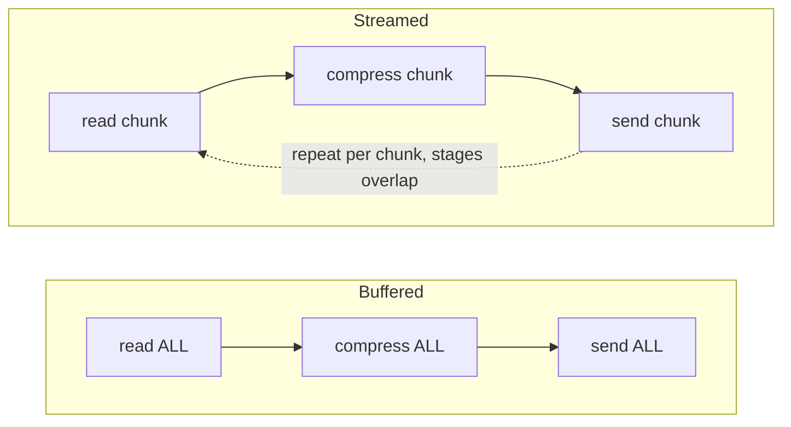
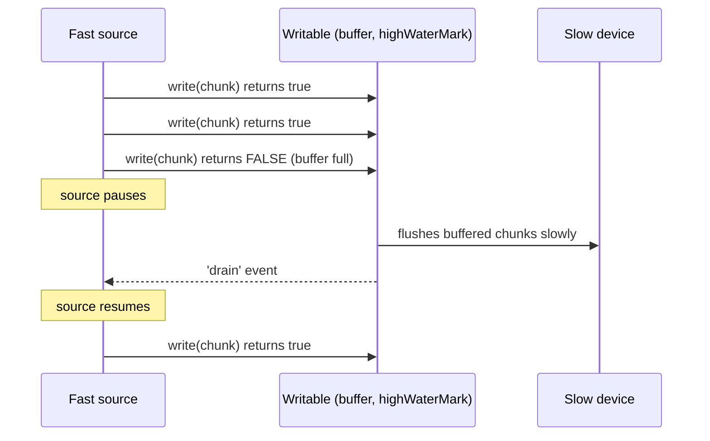

# Why streams: readable, writable and backpressure

## In plain words

To move water from a lake to your garden you can fill a tank, carry the tank, and empty it. The tank must be as big as all the water you need, and not a drop reaches the garden until the tank has made the whole trip. Or you can lay a hose: water flows through continuously, a little at a time, the first drops arrive almost at once, and the hose never holds more than a hose-full, however much the lake contains.

A **stream** is a hose for data. Instead of loading a whole file or a whole network response into memory and then working on it (the tank, called **buffering**), a stream delivers the data in small pieces called **chunks**, and you process each piece as it arrives. The hose also has a tap: when the far end cannot keep up, the near end must slow down. That mechanism is called **backpressure**, and it is the idea people most often get wrong.

Why it matters for a job: every HTTP request and response in Node is a stream. So are files, compression, encryption and standard input and output. Uploading a 4 GB video through a server with 512 MB of memory is possible only with streams. "What is backpressure?" and "streams versus buffers?" are staple interview questions.

> **Before this lesson:** you need [The observer pattern and EventEmitter](#/lesson/nodejs/observer-eventemitter), since every stream is an event emitter, and `for await` loops over promises from [Async/await: sequential and parallel flows](#/lesson/nodejs/async-await-flows). A **Buffer** is Node's object for a block of raw bytes, met in [What Node.js is](#/lesson/nodejs/what-is-node).

## Buffering versus streaming

Task: count the lines of a web-server log file.

```javascript
// Buffered: read everything, then work
import { readFile } from "node:fs/promises";

const text = await readFile("access.log", "utf8");
console.log(text.split("\n").length - 1, "lines");
```

```javascript
// Streamed: work on each chunk as it arrives
import { createReadStream } from "node:fs";

let lines = 0;
for await (const chunk of createReadStream("access.log")) {
  for (const byte of chunk) if (byte === 10) lines++;     // 10 is the byte for "\n"
}
console.log(lines, "lines");
```

With a 2 MB file both are fine. With a 20 GB file the first one fails outright:

```text
RangeError [ERR_FS_FILE_TOO_LARGE]: File size (21474836480) is greater than 2 GiB
```

Three separate advantages are at work.

**Space.** The buffered version needs memory proportional to the file. The streamed version holds one chunk at a time (64 KB by default for files), whether the file is 2 MB or 20 GB. Buffers and strings also have hard maximum sizes in V8, so some inputs cannot be buffered at any price. And on a server, memory use multiplies by the number of simultaneous users: 100 uploads of 50 MB each, buffered, is 5 GB.

**Time.** A stream can pass the first chunk onward while the rest is still being read. Picture a server that reads a file, compresses it and sends it. Buffered, each stage waits for the previous stage to finish the whole file. Streamed, the stages overlap like an assembly line: while chunk 5 is being read, chunk 4 is being compressed and chunk 3 is on the network. The receiver sees the first byte almost immediately.



**Composability.** Streams share one small interface, so they connect like plumbing parts. Adding encryption to "read, compress, send" means inserting one more section of pipe; nothing else changes. The next lesson is about that.

## The four kinds of stream

All streams come from `node:stream` and all are `EventEmitter` instances.

| Kind | Direction | Everyday examples |
|---|---|---|
| **Readable** | A source you read from | `fs.createReadStream`, an incoming HTTP request on a server, `process.stdin` |
| **Writable** | A destination you write to | `fs.createWriteStream`, an HTTP response on a server, `process.stdout` |
| **Duplex** | Both, two independent sides | a network socket |
| **Transform** | Both, where output is computed from input | gzip compression, encryption |

Streams run in one of two modes. In **binary mode**, the default, chunks are Buffers or strings. In **object mode**, a chunk can be any JavaScript value, which turns streams into a general tool for processing sequences of records.

This lesson covers Readable and Writable; Duplex and Transform come next.

## Readable streams

### Reading with `for await` (the recommended way)

Every Readable is an *async iterable*: a `for await` loop takes one chunk per turn, and the loop body may itself `await`.

```javascript
import { createReadStream } from "node:fs";

const stream = createReadStream("access.log", { encoding: "utf8", highWaterMark: 1024 });
let chunks = 0, characters = 0;
for await (const chunk of stream) {
  chunks++;
  characters += chunk.length;
}
console.log(`${characters} characters in ${chunks} chunks`);
```

```text
5310 characters in 6 chunks
```

- `encoding: "utf8"` makes the stream produce strings instead of Buffers.
- `highWaterMark` is the size of the stream's internal buffer in bytes; here it also caps the chunk size at 1024.
- If the stream fails (file missing, disk error), the loop throws, so `try`/`catch` works. If you `break` out early, the stream is closed for you.

A chunk boundary can fall **anywhere**: in the middle of a line, a word, even inside one multi-byte character when no encoding is set. Code that needs whole lines must glue chunks together itself, which the problem [Reassemble lines from stream chunks](#/problem/node-lines-from-chunks) practises.

### Reading with events

The older interface uses events and has two modes of its own.

**Flowing mode**: attach a `"data"` listener and chunks are pushed to you as fast as they can be produced.

```javascript
stream.on("data", (chunk) => console.log("got", chunk.length, "bytes"));
stream.on("end", () => console.log("no more data"));
stream.on("error", (err) => console.error("failed:", err.message));
```

**Paused mode**: attach a `"readable"` listener and pull data out yourself with `stream.read()` until it returns `null`.

```javascript
stream.on("readable", () => {
  let chunk;
  while ((chunk = stream.read()) !== null) console.log("pulled", chunk.length, "bytes");
});
```

Flowing mode is short to write but gives you no natural way to say "wait"; `stream.pause()` and `stream.resume()` exist for that. `for await` handles the waiting for you, which is why it is preferred.

### Making your own Readable

Often you do not need a class at all: `Readable.from` turns any array, generator or async generator into a stream.

```javascript
import { Readable } from "node:stream";

async function* countdown(from) {
  for (let n = from; n > 0; n--) {
    await new Promise((resolve) => setTimeout(resolve, 100));
    yield `${n}\n`;
  }
}

Readable.from(countdown(3)).pipe(process.stdout);
```

```text
3
2
1
```

For full control, pass a `read` function to the constructor. Node calls it whenever it wants more data; you answer by calling `this.push(chunk)`, and `this.push(null)` signals the end.

```javascript
import { Readable } from "node:stream";

function randomLetters(total) {
  let produced = 0;
  return new Readable({
    read(size) {
      if (produced >= total) return this.push(null);          // end of stream
      const letter = String.fromCharCode(97 + Math.floor(Math.random() * 26));
      produced++;
      this.push(letter);
    },
  });
}

for await (const chunk of randomLetters(5)) process.stdout.write(chunk.toString() + " ");
```

`push` returns `false` when the stream's internal buffer is full; a well-behaved source stops producing until `read` is called again. That is backpressure on the reading side.

## Writable streams

```javascript
import { createWriteStream } from "node:fs";

const out = createWriteStream("report.txt");
out.write("first line\n");
out.write("second line\n");
out.end("last line\n");                        // optional final chunk, then no more writes
out.on("finish", () => console.log("everything has been flushed to disk"));
out.on("error", (err) => console.error("write failed:", err.message));
```

- `write(chunk)` hands a chunk to the stream. It returns a boolean, discussed next.
- `end()` says "that was the last chunk". Writing after `end` is an error.
- `"finish"` fires when all data has been handed to the underlying system.

Custom Writables take a `write` function with three parameters: the chunk, its encoding, and a callback to invoke when the chunk has been dealt with. Node does not send the next chunk until you call it.

```javascript
import { Writable } from "node:stream";

const slowConsole = new Writable({
  write(chunk, encoding, callback) {
    setTimeout(() => {
      console.log("wrote:", chunk.toString().trim());
      callback();                              // ready for the next chunk; pass an Error to fail
    }, 100);
  },
});
```

## Backpressure

Here is the problem in one sentence: **a fast source connected to a slow destination**. A disk can deliver hundreds of megabytes per second; a mobile network connection accepts perhaps one. Where does the difference go?

Every Writable has an internal buffer where chunks wait until the slow device takes them. If the source keeps writing regardless, that buffer grows without limit, and the "streaming" program ends up holding the whole file in memory after all, only less visibly.

The protocol that prevents it has two parts:

1. **`write()` returns `false`** when the internal buffer has reached the stream's `highWaterMark` (64 KB by default for byte streams in current versions, 16 KB before Node 22; 16 objects in object mode). The chunk *is* accepted; the return value is a request: "please stop for now".
2. When the buffer has emptied, the stream emits **`"drain"`**: "you may continue".



`highWaterMark` is a threshold, not a hard wall: nothing stops a program from continuing to write after `false`. The mechanism works only if the writer cooperates.

### See it happen

The model below is a small Writable written from scratch, with a buffer, a high-water mark, a slow "device" and a drain signal. Two producers write 40 chunks into it: one ignores the return value of `write`, one respects it.

```js-run
class MiniWritable {
  constructor({ highWaterMark, msPerChunk }) {
    this.highWaterMark = highWaterMark;
    this.msPerChunk = msPerChunk;
    this.buffer = [];
    this.buffered = 0;                 // characters waiting
    this.peak = 0;
    this.flushing = false;
    this.drainWaiters = [];
    this.written = 0;
  }
  write(chunk) {
    this.buffer.push(chunk);
    this.buffered += chunk.length;
    this.peak = Math.max(this.peak, this.buffered);
    if (!this.flushing) this.flush();
    return this.buffered < this.highWaterMark;          // false = "please stop"
  }
  async flush() {                                       // the slow device
    this.flushing = true;
    while (this.buffer.length > 0) {
      await new Promise((resolve) => setTimeout(resolve, this.msPerChunk));
      this.buffered -= this.buffer.shift().length;
      this.written++;
    }
    this.flushing = false;
    this.drainWaiters.splice(0).forEach((resolve) => resolve());   // 'drain'
  }
  drained() { return new Promise((resolve) => this.drainWaiters.push(resolve)); }
}

const chunks = Array.from({ length: 40 }, (_, i) => `chunk-${String(i).padStart(2, "0")}|`);   // 9 characters each

async function careless(dest) {
  for (const chunk of chunks) dest.write(chunk);        // return value ignored
  await dest.drained();
}
async function careful(dest) {
  for (const chunk of chunks) {
    if (!dest.write(chunk)) await dest.drained();       // wait for 'drain'
  }
  if (dest.buffered > 0) await dest.drained();
}

const a = new MiniWritable({ highWaterMark: 36, msPerChunk: 2 });
await careless(a);
console.log("ignoring backpressure : peak buffer", a.peak, "characters,", a.written, "chunks written");

const b = new MiniWritable({ highWaterMark: 36, msPerChunk: 2 });
await careful(b);
console.log("respecting backpressure: peak buffer", b.peak, "characters,", b.written, "chunks written");
```

Both producers deliver all 40 chunks. The careless one piles all 360 characters into the buffer at once; with a real file that number is the size of the file. The careful one never holds more than about the high-water mark of 36. Same result, bounded memory.

In real Node the careful producer looks like this:

```javascript
import { once } from "node:events";

async function writeAll(dest, chunks) {
  for (const chunk of chunks) {
    if (!dest.write(chunk)) await once(dest, "drain");
  }
  dest.end();
  await once(dest, "finish");
}
```

Good news: you rarely write this loop. `source.pipe(dest)` and `pipeline(source, dest)`, covered next, do it for you: they pause the source when `write` returns `false` and resume it on `"drain"`. The loop matters when *you* are the source, generating data in code.

> [!WARNING]
> The classic leak: `readable.on("data", (chunk) => writable.write(chunk))`. The return value of `write` is ignored, so when the writable is slower than the readable (a file sent to a slow client), memory grows until the process dies. Use `pipeline`, or `pause()`/`resume()` with `"drain"`.

### A real server, two ways

```javascript
import http from "node:http";
import { readFile } from "node:fs/promises";
import { createReadStream } from "node:fs";
import { pipeline } from "node:stream/promises";

http.createServer(async (req, res) => {
  if (req.url === "/buffered") {
    res.end(await readFile("holiday-video.mp4"));       // whole file in memory, per request
  } else {
    res.setHeader("Content-Type", "video/mp4");
    try {
      await pipeline(createReadStream("holiday-video.mp4"), res);   // constant memory
    } catch {
      res.destroy();                                    // client went away or the read failed
    }
  }
}).listen(3000);
```

With ten clients downloading a 1 GB file, the buffered route needs about 10 GB; the streamed route needs under a megabyte and starts sending immediately.

> [!TIP]
> Reach for streams when the data is large, of unknown size, or arriving over time, and when you can process it piece by piece. For a small configuration file, `readFile` is simpler and perfectly fine. Streaming is a tool for scale, not a rule for everything.

> [!INTERVIEW]
> **"What is backpressure and how does Node handle it?"** "It is what happens when a producer is faster than its consumer. A Writable buffers incoming chunks; when the buffer reaches `highWaterMark`, `write()` returns `false`, and the producer should stop until the `'drain'` event. On the readable side, `push()` returning `false` plays the same role. `pipe` and `pipeline` implement the protocol automatically. Ignore it and memory grows without bound." Related: **"Streams versus buffers?"** Buffers hold everything in memory at once: simple, but memory grows with the data and nothing happens until loading completes. Streams process chunk by chunk with constant memory and early first output, at the cost of more complex code.

## Pitfalls

- **Ignoring the return value of `write`** in a loop or a `"data"` handler.
- **Assuming a chunk is a line, a record or a whole message.** Boundaries are arbitrary.
- **Decoding multi-byte text chunk by chunk** with `chunk.toString()`: a character split across chunks becomes garbage. Set an encoding on the stream, which uses a decoder that remembers partial characters.
- **No `"error"` handler.** Streams are emitters: an unhandled `"error"` crashes the process.
- **Forgetting `end()`** on a Writable: `"finish"` never fires and files may stay open.
- **Buffering the whole stream "to make it easy"** (`chunks.push(chunk)` then `Buffer.concat`) on input whose size an outsider controls. Enforce a maximum.
- **Treating `highWaterMark` as a hard limit.** It is a hint that works only if respected.

## Cheat sheet

| Goal | Code |
|---|---|
| Read a file as a stream | `fs.createReadStream(path, { encoding, highWaterMark })` |
| Consume any Readable | `for await (const chunk of readable) { ... }` |
| Stream from an iterable | `Readable.from(iterable)` |
| Custom Readable | `new Readable({ read() { this.push(data); /* this.push(null) to end */ } })` |
| Write to a file as a stream | `fs.createWriteStream(path)` |
| Write with backpressure | `if (!w.write(chunk)) await once(w, "drain");` |
| Finish writing | `w.end(); await once(w, "finish");` |
| Custom Writable | `new Writable({ write(chunk, encoding, callback) { ...; callback(); } })` |
| Records instead of bytes | `{ objectMode: true }` |
| Events: Readable | `data`, `end`, `error`, `close`, `readable` |
| Events: Writable | `drain`, `finish`, `error`, `close` |

## Summary

- Buffering loads everything before processing; streaming processes chunk by chunk, with constant memory, early output and stages that overlap in time.
- Four kinds exist: Readable, Writable, Duplex and Transform; chunks are bytes by default or any value in object mode.
- Consume Readables with `for await`; the event interface offers flowing (`data`) and paused (`readable` + `read()`) modes.
- A Writable buffers chunks up to `highWaterMark`; `write()` returning `false` asks the producer to wait for `"drain"`.
- Backpressure is cooperative. `pipe` and `pipeline` cooperate for you; hand-written loops must do it themselves.

## Glossary

- **Stream**: an object that delivers or accepts data piece by piece over time.
- **Chunk**: one piece of data travelling through a stream.
- **Buffering**: collecting all data in memory before using it.
- **Buffer**: Node's type for a block of raw bytes.
- **Readable / Writable**: a stream you read from / write to.
- **Binary mode / object mode**: chunks are bytes or strings / chunks are arbitrary values.
- **Flowing mode / paused mode**: data is pushed via `data` events / pulled with `read()`.
- **Internal buffer**: the queue inside a stream where chunks wait.
- **`highWaterMark`**: the buffer size at which a stream signals it is full.
- **Backpressure**: the signal from a slow consumer telling a fast producer to wait.
- **`drain`**: the event telling a producer it may write again.
- **Async iterable**: an object usable in a `for await` loop.

```quiz
[
  {"q": "What is the main memory advantage of streaming a 10 GB file over reading it with readFile?", "options": ["Streams compress the data", "Only about one chunk is held in memory at a time, regardless of file size", "Streams use the GPU", "Streams store the file on disk twice"], "answer": 1,
   "explain": "Memory use depends on the chunk size and buffers, not on the total size of the data."},
  {"q": "`writable.write(chunk)` returns false. What does that mean?", "options": ["The chunk was rejected and must be written again", "The stream is closed", "The chunk was accepted, but the internal buffer is at or above highWaterMark and the producer should wait for 'drain'", "An error occurred"], "answer": 2,
   "explain": "false is a request to pause, not a failure. The chunk is already buffered."},
  {"q": "What is wrong with `readable.on('data', (c) => writable.write(c))`?", "options": ["Nothing", "It ignores backpressure: if the writable is slower, its buffer grows without bound", "data events deliver strings only", "write cannot be called from an event handler"], "answer": 1,
   "explain": "The return value of write is discarded, so the fast source is never paused."},
  {"q": "In what order do these log?\n\n`const w = createWriteStream('f'); w.on('finish', () => console.log('F')); w.write('a'); w.end('b'); console.log('E');`", "options": ["F, E", "E, F", "E only", "F only"], "answer": 1,
   "explain": "write and end only queue the data and return. 'finish' is emitted later, after the data has been flushed, so E prints first."},
  {"q": "A Readable delivers a text file in chunks. Which assumption is safe?", "options": ["Each chunk is exactly one line", "Each chunk ends at a word boundary", "Chunk boundaries can fall anywhere, even inside a line", "All chunks have the same length"], "answer": 2,
   "explain": "Chunks are cut by size and arrival, with no regard for the content's structure."},
  {"q": "Which loop writes many chunks while respecting backpressure?", "options": ["for (const c of chunks) w.write(c);", "for (const c of chunks) if (!w.write(c)) await once(w, 'drain');", "chunks.forEach((c) => w.end(c));", "w.write(chunks.join(''))"], "answer": 1,
   "explain": "It pauses whenever write returns false and continues on the drain event."},
  {"q": "How does a custom Readable signal that there is no more data?", "options": ["this.push(null)", "this.end()", "return false from read", "this.emit('finish')"], "answer": 0,
   "explain": "Pushing null marks the end of the stream; consumers then see the 'end' event or the loop finishes."},
  {"q": "What does object mode change?", "options": ["Chunks may be any JavaScript value, and highWaterMark counts objects", "The stream becomes synchronous", "Backpressure is disabled", "Only JSON strings are allowed"], "answer": 0,
   "explain": "Object mode lets streams carry records; the buffer limit is then a number of objects (16 by default)."}
]
```

> **Source:** Casciaro & Mammino, *Node.js Design Patterns* 3e, ch. 6 (topics only; wording and examples are original). Documentation: https://nodejs.org/docs/latest/api/stream.html, https://nodejs.org/en/learn/modules/backpressuring-in-streams
