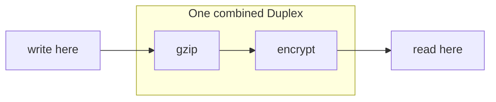
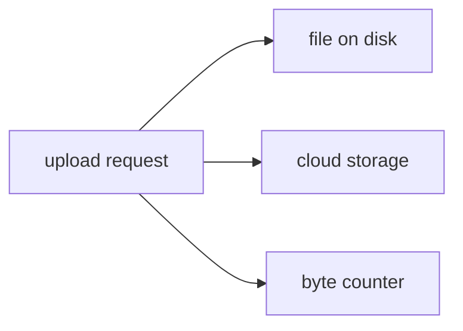
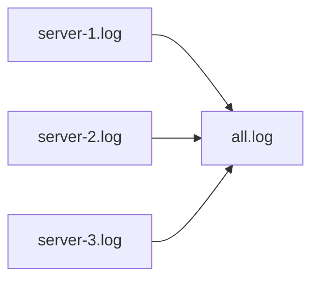
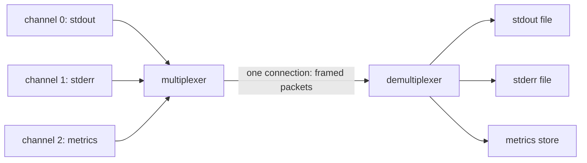

# Stream patterns: concurrency, combining, forking, merging, multiplexing

## In plain words

Plumbing is more than straight pipes. A plumber joins several pipes into one unit, splits one pipe into two with a T-piece, brings two pipes together into one, and runs hot and cold water to the same room. The pipes are standard; the value is in how they are arranged.

Streams have the same repertoire. You can bundle several streams so they look like one (**combining**), send one source to several destinations (**forking**), feed several sources into one destination (**merging**), and carry several independent conversations over a single connection (**multiplexing**). On top of that, a stream stage can work on several chunks at once instead of strictly one at a time (**concurrency**). This lesson walks through each arrangement with the reason you would want it.

Why it matters for a job: these are the building blocks of data pipelines, log shippers, upload services and protocol implementations. Interviewers at companies that process files or events at scale like to ask "how would you process a 50 GB file where each row needs an API call?", and the answer is a stream with limited concurrency.

> **Before this lesson:** read [Why streams: readable, writable and backpressure](#/lesson/nodejs/streams-readable-writable) and [Duplex, transform and pipeline](#/lesson/nodejs/transform-pipeline). The concurrency ideas come from [Limited concurrency and async pitfalls](#/lesson/nodejs/async-limits-pitfalls).

## Streams as a control-flow tool

A Transform's `transform` function is asynchronous: it is not asked for the next chunk until it calls its callback. So a stream processes chunks **sequentially by default**, in order, one at a time. A pipeline in object mode is therefore a ready-made replacement for the sequential-iteration pattern, with backpressure included.

```javascript
import { pipeline } from "node:stream/promises";
import { Readable } from "node:stream";

await pipeline(
  Readable.from(["a.txt", "b.txt", "c.txt"]),
  async function* (names) {
    for await (const name of names) yield await uploadFile(name);   // one at a time, in order
  },
  async function (receipts) {
    for await (const receipt of receipts) console.log("uploaded", receipt.name);
  },
);
```

Sequential is safe and slow. If each chunk needs a 100 ms network call and there are a million chunks, that is more than a day. The calls are independent, so they can overlap.

### Unordered concurrent processing

The idea: `transform` starts the asynchronous work and calls its callback **immediately**, without waiting for the work to finish, so the next chunk arrives at once. Results are pushed whenever they complete, which means the output order can differ from the input order. Two details need care: a limit on how many tasks are in flight, and `flush` must wait until all of them have finished.

```javascript
import { Transform } from "node:stream";

class ConcurrentTransform extends Transform {
  constructor(concurrency, worker) {
    super({ objectMode: true });
    this.concurrency = concurrency;
    this.worker = worker;                  // async (item) => result
    this.running = 0;
    this.resume = null;                    // the callback we are holding back when full
    this.finish = null;                    // flush's callback, called when the last task ends
  }

  _transform(item, encoding, callback) {
    this.running++;
    this.worker(item).then(
      (result) => { this.push(result); this.onTaskDone(); },
      (error) => this.destroy(error),
    );
    if (this.running < this.concurrency) callback();     // room left: ask for the next item now
    else this.resume = callback;                         // full: hold the callback = backpressure
  }

  _flush(callback) {
    if (this.running > 0) this.finish = callback;        // wait for the stragglers
    else callback();
  }

  onTaskDone() {
    this.running--;
    const resume = this.resume;
    this.resume = null;
    if (resume) resume();                                // a slot is free: accept another item
    if (this.running === 0 && this.finish) this.finish();
  }
}
```

The limit is enforced with nothing but the transform's own callback. Not calling it is how a stream says "do not send me more yet", and the upstream stages slow down accordingly. Everything you learned about limited concurrency reappears here in stream clothing.

### Ordered concurrent processing

Sometimes the work may overlap but the output must keep the input order (the rows of a file that is being rewritten, for example). The technique: run tasks concurrently, but keep the finished results in a buffer, and release them strictly in input order. A result that finishes early waits for all the earlier ones.

The price is that one slow task holds back every result behind it, and those results occupy memory while they wait.

### A model of both, to run

The same two behaviours, written as functions over async iterables so that they run on this page. `mapUnordered` yields results as they complete; `mapOrdered` yields them in input order.

```js-run
const sleep = (ms) => new Promise((resolve) => setTimeout(resolve, ms));
const started = Date.now();
const stamp = () => String(Math.round((Date.now() - started) / 10) * 10).padStart(3) + " ms";

async function* mapUnordered(source, limit, worker) {
  const inFlight = new Set();
  const settle = (promise) => {                        // a promise that resolves to its own result
    const tracked = promise.then((value) => { inFlight.delete(tracked); return value; });
    inFlight.add(tracked);
  };
  for await (const item of source) {
    settle(worker(item));
    if (inFlight.size >= limit) yield await Promise.race(inFlight);   // full: wait for any one
  }
  while (inFlight.size > 0) yield await Promise.race(inFlight);        // the stragglers
}

async function* mapOrdered(source, limit, worker) {
  const queue = [];                                    // promises, in input order
  for await (const item of source) {
    queue.push(worker(item));
    if (queue.length >= limit) yield await queue.shift();             // always the OLDEST one
  }
  while (queue.length > 0) yield await queue.shift();
}

const prices = { tea: 90, bread: 10, jam: 10, milk: 10 };             // lookup time in ms
const lookup = async (product) => { await sleep(prices[product]); return product; };
const products = ["tea", "bread", "jam", "milk"];

const a = [];
for await (const p of mapUnordered(products, 2, lookup)) a.push(`${p}@${stamp().trim()}`);
console.log("unordered, limit 2:", a.join("  "));

const t = Date.now();
const b = [];
for await (const p of mapOrdered(products, 2, lookup)) b.push(p);
console.log("ordered,   limit 2:", b.join("  "), `(took about ${Math.round((Date.now() - t) / 10) * 10} ms)`);
```

- In `mapUnordered`, each started task is tracked in a set and removes itself when done. When the set is full, `Promise.race` waits for whichever finishes first, and that result is yielded. `bread`, `jam` and `milk` come out before the slow `tea`.
- In `mapOrdered`, results leave through `queue.shift()`, always the oldest. `tea` comes out first although it finished last of the early ones.
- In both, the generator stops pulling from `source` while it is at the limit. That pause is the backpressure.

Recent Node versions offer the ordered variant built in: `readable.map(fn, { concurrency: 4 })`.

> [!TIP]
> Choose unordered when results are independent (checking links, sending notifications): it gives the best throughput. Choose ordered when the output must line up with the input. Choose sequential when each item depends on the one before.

## Combining streams

A pipeline of four transforms is an implementation detail you may not want every caller to see. **Combining** packages a pipeline as a single stream: writing to the combined stream writes to the first inner stream; reading from it reads from the last; an error in *any* inner stream surfaces on the combined one.



```javascript
import { compose } from "node:stream";
import { createGzip, createGunzip } from "node:zlib";
import { createCipheriv, createDecipheriv } from "node:crypto";

export const pack = (key, iv) => compose(createGzip(), createCipheriv("aes-256-ctr", key, iv));
export const unpack = (key, iv) => compose(createDecipheriv("aes-256-ctr", key, iv), createGunzip());

// A caller sees one stream and one place where errors appear:
await pipeline(createReadStream("backup.tar"), pack(key, iv), createWriteStream("backup.tar.gz.enc"));
```

`compose` gives modularity (one name for a multi-step operation), encapsulation (the steps can change without touching callers) and single-point error handling. Order matters: compress before encrypting, since encrypted data looks random and does not compress.

## Forking a stream

**Forking** sends the same data to more than one destination: write an upload to disk *and* to cloud storage *and* count its bytes, reading the source once. Pipe the same Readable into several Writables.



```javascript
import { PassThrough } from "node:stream";

const toDisk = createWriteStream("/uploads/video.mp4");
const toCloud = cloudStorage.createUploadStream("video.mp4");

request.pipe(toDisk);
request.pipe(toCloud);
```

Three things to know before using it.

- **The slowest branch sets the pace.** Backpressure from any destination pauses the source for all of them. A fork runs at the speed of its slowest consumer.
- **Every branch receives the same chunk objects.** If one branch modifies a Buffer in place, the others see the change. Treat chunks as read-only.
- **Late branches miss data.** A destination attached after the data has begun flowing gets only what comes afterwards. To attach consumers at different times, pipe the source into `PassThrough` streams immediately and hand those out.

Error handling needs thought too: if one branch fails, should the others continue? `pipe` does not decide for you; handle `"error"` on every branch and state the policy in code.

## Merging streams

**Merging** is the reverse: several sources flow into one destination, for instance log files from five servers written into one archive.



The catch is the end. `pipe` normally calls `end()` on the destination when its source ends, so the first source to finish would close the destination while the others are still writing. Pass `{ end: false }` and end the destination yourself when the **last** source has finished:

```javascript
function merge(sources, destination) {
  let open = sources.length;
  for (const source of sources) {
    source.pipe(destination, { end: false });
    source.on("end", () => { if (--open === 0) destination.end(); });
    source.on("error", (err) => destination.destroy(err));
  }
}
```

Chunks from different sources **interleave** in arrival order. For line-based text that garbles lines unless each source is first split into whole lines (a line-splitting transform per source, then merge in object mode). If you want the sources one after another instead of mixed, that is concatenation: process them sequentially.

## Multiplexing and demultiplexing

Suppose a program must send three independent streams (say, the standard output, the error output and a metrics feed of a remote job) to another machine. Opening three network connections works but costs set-up time and resources, and connections are sometimes scarce. **Multiplexing** (mux) combines several logical streams, called **channels**, into one physical stream. **Demultiplexing** (demux) separates them again at the other end.

It differs from merging in one way: the data is labelled, so the receiver can tell the channels apart. The usual technique is **packet framing**: wrap every chunk in a small envelope that states which channel it belongs to and how long it is.

```text
+-----------+----------------+----------------------+
| channel   | payload length | payload              |
| 1 byte    | 4 bytes        | <length> bytes       |
+-----------+----------------+----------------------+
```

The length is essential. The single shared connection is itself a byte stream with arbitrary chunk boundaries, so the receiver may get half a packet, or two and a half packets, in one chunk. With the length in the header it knows where each payload ends.



A real multiplexer in Node, for byte streams:

```javascript
function multiplex(sources, destination) {
  let open = sources.length;
  sources.forEach((source, channel) => {
    source.on("data", (chunk) => {
      const header = Buffer.alloc(5);
      header.writeUInt8(channel, 0);                 // which channel
      header.writeUInt32BE(chunk.length, 1);         // how many payload bytes follow
      destination.write(Buffer.concat([header, chunk]));
    });
    source.on("end", () => { if (--open === 0) destination.end(); });
  });
}
```

(For brevity this version ignores backpressure from `destination`; a production version pauses each source when `write` returns `false`.) The demultiplexer is the harder half, because of partial packets. This model uses strings, with a header of the form `channel:length|`, and feeds the receiver deliberately awkward chunks:

```js-run
const frame = (channel, payload) => `${channel}:${payload.length}|${payload}`;

// --- sender: three logical streams, interleaved into one ---
const wire = [
  frame(0, "build started"), frame(2, "cpu=41"), frame(1, "warning: slow disk"),
  frame(0, "build finished"), frame(2, "cpu=97"),
].join("");
console.log("on the wire:", wire);

// The network cuts the data wherever it likes:
const networkChunks = [wire.slice(0, 9), wire.slice(9, 30), wire.slice(30, 31), wire.slice(31)];

// --- receiver: a stateful demultiplexer ---
function createDemultiplexer(onPacket) {
  let pending = "";
  return function receive(chunk) {
    pending += chunk;
    while (true) {
      const bar = pending.indexOf("|");
      if (bar === -1) return;                               // header not complete yet
      const [channel, length] = pending.slice(0, bar).split(":").map(Number);
      if (pending.length < bar + 1 + length) return;        // payload not complete yet
      onPacket(channel, pending.slice(bar + 1, bar + 1 + length));
      pending = pending.slice(bar + 1 + length);            // keep the rest for the next round
    }
  };
}

const channels = { 0: [], 1: [], 2: [] };
const receive = createDemultiplexer((channel, payload) => channels[channel].push(payload));
for (const chunk of networkChunks) {
  receive(chunk);
  console.log(`after chunk of ${String(chunk.length).padStart(2)} characters:`, JSON.stringify(channels));
}
```

The receiver keeps whatever it could not yet interpret in `pending`. After the first 9-character chunk no packet is complete, so nothing is delivered; later chunks complete several packets at once. This "accumulate, then extract every complete packet" loop is the same carry-over idea as the line splitter, and it is how every binary network protocol is parsed.

Multiplexing is not limited to bytes. In object mode, adding a field such as `channel` or `type` to each object and routing on it at the other end does the same job without framing.

> [!WARNING]
> Never assume one `write` on the sending side arrives as one `data` event on the receiving side. TCP, the protocol under most connections, delivers a stream of bytes, not messages. Any protocol that needs message boundaries must put them in the data: a length prefix, or a delimiter such as a newline.

> [!INTERVIEW]
> **"How would you process a huge file where every record needs a slow API call?"** "A pipeline: read stream, a transform that splits it into records, then a transform with limited concurrency that performs the calls, unordered if the output order is irrelevant, then a writable for the results. Backpressure keeps memory constant, the concurrency limit protects the API, and `pipeline` gives one place to handle errors and clean up." **"What is multiplexing?"** Carrying several logical streams over one physical stream by framing each chunk with a channel id and a length, and splitting them apart on the receiving side.

## Pitfalls

- **Unlimited concurrency inside a transform**: calling the callback immediately with no cap reads the whole source as fast as possible and starts every task at once.
- **Forgetting to wait in `flush`** for in-flight tasks: the stream ends and their results are lost.
- **Expecting order from the unordered pattern.**
- **Forking and mutating chunks** in one branch.
- **Forking without considering the slowest branch**, which throttles all the others.
- **Merging without `{ end: false }`**, so the first source to finish closes the destination.
- **Merging byte streams of text** and getting lines cut into each other.
- **Framing without a length or delimiter**, relying on chunk boundaries that the network does not preserve.

## Cheat sheet

| Pattern | Purpose | Key technique |
|---|---|---|
| Sequential | order and dependency | the default: call back when the chunk is done |
| Unordered concurrent | throughput | start work, call back at once, cap in-flight tasks, wait in `flush` |
| Ordered concurrent | throughput with order kept | run concurrently, release results in input order |
| Combine | hide a pipeline behind one stream | `compose(a, b, c)` |
| Fork | one source, several destinations | `src.pipe(d1); src.pipe(d2);` (slowest sets the pace) |
| Merge | several sources, one destination | `pipe(dest, { end: false })`, end after the last source |
| Multiplex | several channels over one stream | frame = channel id + length + payload |
| Demultiplex | split the channels again | accumulate bytes, extract complete frames, route by channel |

## Summary

- Streams process sequentially by default; a transform that calls back early and tracks in-flight work gives concurrency, with a limit enforced by withholding the callback.
- Unordered concurrency maximises throughput; ordered concurrency buffers finished results to preserve input order.
- Combining packages a pipeline as one stream with one error channel.
- Forking duplicates a source to several destinations at the pace of the slowest; merging joins several sources and needs explicit end handling.
- Multiplexing shares one connection among labelled channels using framed packets; the receiver must cope with packets split across chunks.

## Glossary

- **Throughput**: the amount of work completed per unit of time.
- **Unordered / ordered concurrent stream**: a stage processing several chunks at once, emitting results as they finish / in input order.
- **Combined stream**: several streams wrapped so that they behave as one.
- **Fork**: piping one source into several destinations.
- **Merge**: piping several sources into one destination.
- **Interleave**: to mix items from several sources in arrival order.
- **Channel**: one logical stream inside a shared connection.
- **Multiplexing (mux) / demultiplexing (demux)**: combining channels into one stream / separating them again.
- **Packet**: one framed unit of data.
- **Framing**: marking message boundaries inside a byte stream, usually with a header holding a length.
- **TCP**: the protocol providing reliable byte streams between machines.

```quiz
[
  {"q": "How does a Transform limit its own concurrency?", "options": ["By sleeping in a loop", "By not calling the transform callback while it is at its limit, so no further chunk is delivered", "By closing the source", "By lowering highWaterMark to 0"], "answer": 1,
   "explain": "The callback is the 'send me the next chunk' signal; withholding it applies backpressure upstream."},
  {"q": "Items a (40 ms), b (10 ms), c (10 ms) pass through an unordered concurrent stage with a limit of 2. In what order do results come out?", "options": ["a, b, c", "b, c, a", "c, b, a", "b, a, c"], "answer": 1,
   "explain": "a and b start together; b finishes at 10 ms, c starts and finishes at 20 ms, and a finishes last at 40 ms."},
  {"q": "The same items through an ordered concurrent stage with a limit of 2 come out as...", "options": ["a, b, c", "b, c, a", "b, a, c", "c, a, b"], "answer": 0,
   "explain": "Ordered mode holds finished results until all earlier ones have been emitted."},
  {"q": "A source is forked to a fast disk and a slow network upload. How fast does the source flow?", "options": ["At the speed of the fastest destination", "At the speed of the slowest destination", "At the average speed", "Unthrottled"], "answer": 1,
   "explain": "Backpressure from any branch pauses the shared source."},
  {"q": "Why pass `{ end: false }` when merging several sources into one destination with pipe?", "options": ["To disable backpressure", "Otherwise the first source to finish would end the destination while others are still writing", "To make the merge ordered", "To avoid errors being emitted"], "answer": 1,
   "explain": "pipe ends the destination by default when its source ends; with several sources you must end it after the last one."},
  {"q": "What is the essential difference between merging and multiplexing?", "options": ["Multiplexing is faster", "Multiplexed data is labelled with its channel so it can be separated again", "Merging needs two connections", "There is none"], "answer": 1,
   "explain": "A merge loses the origin of each chunk; a mux keeps it in a frame header."},
  {"q": "Why does a frame header contain the payload length?", "options": ["For compression", "Because chunk boundaries on the wire are arbitrary, the receiver needs to know where each payload ends", "To detect the channel", "To sort the packets"], "answer": 1,
   "explain": "One write may arrive as several chunks, or several writes as one; the length restores message boundaries."},
  {"q": "A demultiplexer has received `1:5|hel`. What should it do?", "options": ["Deliver 'hel' to channel 1", "Throw an error", "Keep the bytes and wait for more, since the 5-character payload is incomplete", "Discard the data"], "answer": 2,
   "explain": "Only complete packets are delivered; the remainder is kept until the next chunk arrives."}
]
```

> **Source:** Casciaro & Mammino, *Node.js Design Patterns* 3e, ch. 6 (topics only; wording and examples are original). Documentation: https://nodejs.org/docs/latest/api/stream.html#streamcomposestreams, https://nodejs.org/docs/latest/api/stream.html#readablemapfn-options, https://nodejs.org/docs/latest/api/buffer.html
