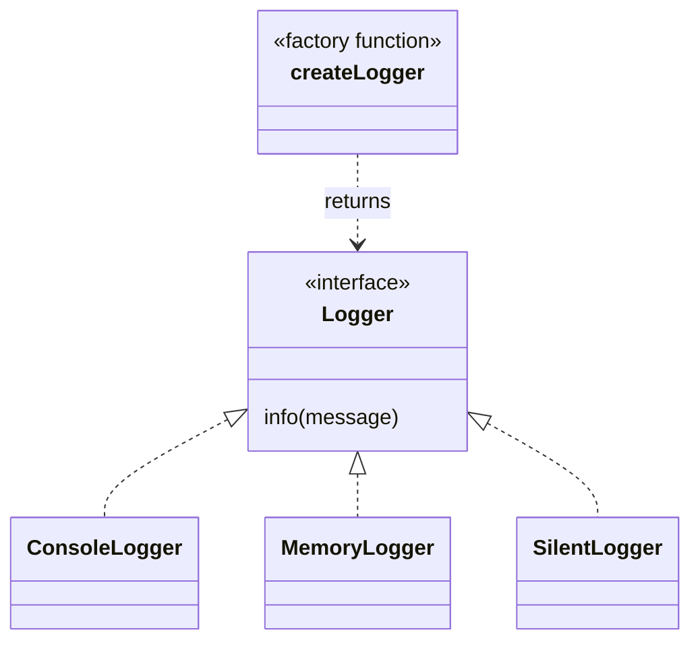

# Factory, builder and revealing constructor

## In plain words

Three everyday scenes, one for each pattern in this lesson.

At a coffee counter you say "a flat white, please". You do not walk behind the counter, pick a machine and steam the milk. The barista decides how it is made and hands you a cup. That is a **factory**: one function you ask for an object, which hides how and from what the object is created.

Ordering a custom pizza, you call out choices in any order ("thin base, no olives, extra cheese, large") and only when you say "that's all" does the cook check the order makes sense and make it. That is a **builder**: an object that collects options step by step and produces the finished thing at the end.

A notary seals a letter in front of you. While it is open you may write in it; once sealed, nobody can, including you. That is the **revealing constructor**: an object that lets its creator, and only its creator, touch its insides, and only at the moment of creation.

All three are **creational design patterns**. A *design pattern* is a named, reusable solution to a problem that keeps coming up in software design. *Creational* patterns deal with how objects come into existence.

Why it matters for a job: patterns are shared vocabulary. "Make that a factory so we can swap the implementation in tests" is a sentence you will hear in code review. You already use all three daily: `http.createServer()` is a factory, query libraries are builders, and `new Promise((resolve, reject) => ...)` is a revealing constructor.

> **Before this lesson:** you need classes, closures and private fields (`#name`) from [Prototypes, classes and encapsulation](#/lesson/javascript/prototypes-classes) and [Closures and recursion](#/lesson/javascript/closures-recursion), and promises from [Promises and promisification](#/lesson/nodejs/promises-promisification).

## Factory

### The problem with `new`

`new SomeClass()` welds the calling code to one specific class. Suppose logging is written like this in forty files:

```javascript
const logger = new ConsoleLogger("orders");
```

Later you want logs written to a file in production and silenced in tests. Now forty call sites must change, and each must contain the decision logic.

### The pattern

Wrap creation in a function. Callers ask the function; the function decides.

```js-run
class ConsoleLogger {
  constructor(name) { this.name = name; }
  info(message) { console.log(`[${this.name}] ${message}`); }
}
class MemoryLogger {                                  // collects lines, e.g. for tests
  constructor(name) { this.name = name; this.lines = []; }
  info(message) { this.lines.push(`[${this.name}] ${message}`); }
}
const silentLogger = { info() {} };                   // not even a class

function createLogger(name, { mode = "console" } = {}) {
  if (mode === "silent") return silentLogger;
  if (mode === "memory") return new MemoryLogger(name);
  return new ConsoleLogger(name);
}

const log = createLogger("orders");
log.info("order 17 accepted");

const testLog = createLogger("orders", { mode: "memory" });
testLog.info("order 18 accepted");
console.log("captured for the test:", testLog.lines);

createLogger("orders", { mode: "silent" }).info("this goes nowhere");
```

- Callers know one name, `createLogger`, and one promise: "the result has an `info` method".
- The factory may return instances of different classes, a shared object, or a plain object literal. The caller cannot tell and does not need to.
- The choice of implementation lives in **one place**.

JavaScript makes this especially easy because it does not check types by class. An object is acceptable if it has the methods you are going to call. This is known as **duck typing**: "if it walks like a duck and quacks like a duck, treat it as a duck".



An **interface** here means the set of methods the callers rely on. JavaScript has no keyword for it; it is an agreement, sometimes written down in documentation or TypeScript types.

### A factory as a tool for privacy

Factories combine naturally with closures to produce objects whose internal state cannot be reached from outside, without any class at all:

```js-run
function createRateCounter(limitPerWindow) {
  let count = 0;                                  // private: only the two functions below can see it

  return {
    hit() {
      if (count >= limitPerWindow) return false;
      count += 1;
      return true;
    },
    reset() { count = 0; },
  };
}

const counter = createRateCounter(2);
console.log(counter.hit(), counter.hit(), counter.hit());   // third call is over the limit
console.log("can outside code read the count?", counter.count);
```

`count` exists only in the closure. Modern classes can achieve the same with private fields (`#count`); the factory version works everywhere and needs no `new` or `this`.

### When a factory earns its place

| Use a factory when | Example |
|---|---|
| The concrete type depends on configuration or environment | console, file or silent logger |
| Construction needs steps a constructor should not do | reading options, registering the object somewhere |
| You may want to return a cached or shared instance | one connection per database URL |
| You want to keep the class itself private to the module | export `createX`, not `class X` |
| Tests need to substitute something simpler | a memory logger |

In the Node core library the convention is a function named `create…`: `http.createServer()`, `fs.createReadStream()`, `crypto.createHash()`. Exporting a factory and not the class also keeps a module's public surface small, as the platform lesson recommended. The problem [A shape factory with private counters](#/problem/node-factory) lets you practise it.

> [!TIP]
> Do not add a factory "to be safe" where `new Thing()` is used in one place and has one implementation. A pattern is a cost (one more layer to read) paid to get a benefit. If the benefit is not needed yet, the plain constructor is the better code.

## Builder

### The problem: constructors with too many parameters

```javascript
const email = new Email("ana@example.com", "bo@example.com", null, null, "Invoice", "See attached", true, false, 3);
```

What is the seventh argument? Which of those `null`s is the CC? Was `true` "high priority" or "request read receipt"? A constructor with many parameters, several of them optional or related to each other, is unreadable at the call site and easy to get wrong.

Passing one options object (`new Email({ to, subject, ... })`) fixes the readability. A **builder** goes further when there are rules *between* options, steps that can be repeated, or helpful shortcuts to offer.

### The pattern

A separate object with one small method per aspect of the configuration. Each method records its input and returns the builder itself, so calls can be chained; this style is called a **fluent interface**. A final `build()` validates everything and creates the real object.

```js-run
class Email {
  constructor(fields) { Object.assign(this, fields); Object.freeze(this); }
}

class EmailBuilder {
  #fields = { to: [], cc: [], subject: "", body: "", attachments: [], priority: "normal" };

  from(address) { this.#fields.from = address; return this; }
  to(...addresses) { this.#fields.to.push(...addresses); return this; }
  cc(...addresses) { this.#fields.cc.push(...addresses); return this; }
  subject(text) { this.#fields.subject = text; return this; }
  body(text) { this.#fields.body = text; return this; }
  attach(filename) { this.#fields.attachments.push(filename); return this; }
  urgent() { this.#fields.priority = "high"; return this; }       // a readable shortcut

  build() {
    const f = this.#fields;
    if (!f.from) throw new Error("an email needs a sender: call from()");
    if (f.to.length === 0) throw new Error("an email needs at least one recipient: call to()");
    if (f.attachments.length > 0 && f.body === "") throw new Error("attachments need a body explaining them");
    return new Email(structuredClone(f));
  }
}

const email = new EmailBuilder()
  .from("ana@example.com")
  .to("bo@example.com", "cy@example.com")
  .subject("Invoice 2024-11")
  .body("Please find the invoice attached.")
  .attach("invoice.pdf")
  .urgent()
  .build();
console.log(email);

try {
  new EmailBuilder().to("bo@example.com").build();
} catch (error) {
  console.log("rejected:", error.message);
}
```

Reading the class:

- `#fields` is a private field holding everything collected so far, with sensible defaults.
- Every setter ends with `return this`. That one line is what makes `a().b().c()` possible.
- Methods carry meaning that bare parameters cannot: `.urgent()` is clearer than a boolean in position seven; `.to()` may be called several times and accumulates.
- `build()` is the single checkpoint. It can check rules that involve several fields together, such as "attachments need a body", which no individual setter could decide, because the calls may come in any order.
- The product is created complete and then frozen, so no half-configured `Email` ever exists. `structuredClone` makes a deep copy so later use of the builder cannot alter an email already built.

### Guidelines for a good builder

1. Split a complicated construction into small, named steps.
2. Let one method set several related parameters at once where that prevents inconsistent combinations (for example `.smtp(host, port)`).
3. Do validation and type conversion inside the builder so the product's constructor stays trivial.
4. Keep the builder and the product separate objects: the builder is mutable and temporary, the product is consistent from birth.

Builders are everywhere in the Node ecosystem. HTTP client libraries let you write `request.post(url).set("Accept", "application/json").send(data)`; SQL query builders such as Knex chain `.select().from().where()`; test libraries build expectations the same way. The problem [A fluent query builder](#/problem/node-builder) asks you to write one.

> [!WARNING]
> A builder that assembles SQL, shell commands or HTML by gluing strings together invites **injection** attacks, in which user input is interpreted as code. Real query builders emit placeholders (`WHERE id = ?`) and pass the values separately. A builder makes an API pleasant; it does not make unsafe concatenation safe.

## Revealing constructor

### You have used it already

```javascript
const promise = new Promise((resolve, reject) => {
  setTimeout(() => resolve("done"), 100);
});
```

Look at what this design achieves. A promise must be settled by *someone*, yet code that merely receives a promise must not be able to settle it; otherwise any consumer could resolve somebody else's promise with a fake value. So `resolve` and `reject` are not methods on the object. They are handed to a function, the **executor**, that you pass to the constructor, and to nobody else.

That is the pattern: **the constructor takes a function and calls it with the object's private capabilities as arguments.** The private parts are revealed to the constructing code and stay hidden from everyone who gets the finished object.

```text
const object = new SomeClass(function executor(...revealedMembers) {
  // only this code can use the private capabilities
});
```

### Example: an event source only its creator can trigger

Suppose a module watches the temperature of a machine and lets other code subscribe to readings. Subscribers must not be able to fake a reading. With a plain `EventEmitter`, anyone holding the object can call `emit`. A revealing constructor gives out `emit` once, to the creator:

```js-run
class ReadOnlySignal {
  #listeners = [];

  constructor(executor) {
    const emit = (value) => this.#listeners.forEach((listener) => listener(value));
    executor(emit);                        // reveal the private capability, here and nowhere else
  }

  subscribe(listener) {
    this.#listeners.push(listener);
    return () => { this.#listeners = this.#listeners.filter((l) => l !== listener); };
  }
}

// The module that owns the sensor creates the signal and keeps emit to itself:
const temperature = new ReadOnlySignal((emit) => {
  let reading = 20;
  const timer = setInterval(() => {
    reading += 7;
    emit(reading);
    if (reading > 40) clearInterval(timer);
  }, 20);
});

// Any other module can listen, and that is all it can do:
const unsubscribe = temperature.subscribe((value) => console.log("reading:", value));
console.log("emit available to consumers?", typeof temperature.emit);
console.log("public members:", Object.getOwnPropertyNames(ReadOnlySignal.prototype));
```

- Inside the constructor, `emit` is an ordinary local function that closes over the private listener list.
- The executor is called immediately and receives `emit`. It may use it now or keep it for later, as the timer does.
- The finished object has one public method, `subscribe`. No property or method gives access to `emit`.

The same shape gives **immutable objects that are convenient to initialise**: the executor receives functions that modify the object, and after construction no modifier is reachable, so the object can be passed around freely without defensive copies.

### When to use it

Reach for a revealing constructor when an object has capabilities that must exist but must not be public: settling a promise, emitting on a signal, writing into something that will be read-only afterwards. It gives strong encapsulation with very little code. It suits these foundational, low-level pieces; ordinary application classes rarely need it.

## The three side by side

| | Factory | Builder | Revealing constructor |
|---|---|---|---|
| Problem solved | Callers tied to a concrete class | Too many, interrelated construction options | Some capabilities must be creator-only |
| Shape | `createThing(options)` | `new ThingBuilder().a().b().build()` | `new Thing((secretPower) => {...})` |
| Hides | Which implementation is used | The order and validation of options | Internal state and mutators |
| Seen in Node | `http.createServer`, `createReadStream` | HTTP clients, query builders | `new Promise(executor)` |

> [!INTERVIEW]
> **"What is the factory pattern and why use it over `new`?"** "A factory is a function that creates and returns objects, hiding the concrete class and the construction logic. It decouples callers from implementations, so the implementation can vary by configuration or be replaced in tests; it can return cached instances; and with closures it can enforce private state. In JavaScript it relies on duck typing: any object with the expected methods will do." Expect **"When would you choose a builder?"**: many optional or dependent parameters, repeated steps, or cross-field validation that should happen once, in `build()`.

## Pitfalls

- **Factories that return objects with different shapes.** If one branch returns an object lacking a method the callers use, the error appears far away. All products must honour the same interface.
- **A factory hiding expensive or global side effects**, such as opening a connection on every call when callers assume it is cheap.
- **Forgetting `return this`** in a builder method: the next call in the chain fails with "cannot read properties of undefined".
- **Validating in setters** and so making the result depend on call order.
- **Reusing a builder after `build()`** while it shares arrays with the product; copy in `build()`.
- **Leaking the revealed capability**, for instance by storing `emit` on `this` "for convenience". That undoes the pattern.
- **Pattern for pattern's sake.** Three layers of factories around one class make code harder to follow and no more flexible.

## Cheat sheet

| Need | Reach for |
|---|---|
| Choose an implementation in one place | `function createX(options) { return condition ? new A() : new B(); }` |
| Private state without classes | factory + closure |
| Export a small surface | export `createX`, keep `class X` private |
| Readable construction with many options | builder with fluent setters and `build()` |
| Chainable method | end it with `return this;` |
| Cross-field rules | check them in `build()` |
| Creator-only capability | `constructor(executor) { executor(privateFn); }` |
| Read-only object for consumers | expose only query methods; reveal mutators to the executor |

## Summary

- Creational patterns control how objects are made. A factory puts creation behind a function, so the implementation can vary without touching callers.
- Factories plus closures give private state; exporting a factory keeps a module's interface small.
- A builder replaces a long parameter list with named, chainable steps and validates once in `build()`.
- A revealing constructor passes private capabilities to an executor function at construction time, as `new Promise` does, keeping them from consumers.
- Use each pattern when its specific problem is present, not by default.

## Glossary

- **Design pattern**: a named, reusable solution to a recurring design problem.
- **Creational pattern**: a pattern concerned with creating objects.
- **Factory**: a function that creates objects and hides the concrete type.
- **Duck typing**: accepting any object that has the required methods, whatever its class.
- **Interface**: the set of methods and properties that users of an object rely on.
- **Encapsulation**: hiding an object's internals behind a deliberate public interface.
- **Builder**: an object that gathers configuration in steps and creates the product in a final step.
- **Fluent interface**: an API whose methods return the object itself so calls can be chained.
- **Product**: the object a builder or factory produces.
- **Revealing constructor**: a constructor that hands private capabilities to a function supplied by the creator.
- **Executor**: the function passed to such a constructor.
- **Injection**: an attack in which input is interpreted as code or commands.

```quiz
[
  {"q": "What is the main benefit of `createLogger()` over `new ConsoleLogger()` spread through a codebase?", "options": ["It runs faster", "The choice of concrete implementation lives in one place and can change without touching callers", "It uses less memory", "It makes the logger asynchronous"], "answer": 1,
   "explain": "A factory decouples callers from the concrete class."},
  {"q": "A factory returns `{ info() {} }` in one branch and `new FileLogger()` in another. Why is that acceptable in JavaScript?", "options": ["Both are instances of Object", "Callers rely only on the methods being present (duck typing), not on the class", "The factory converts them to the same class", "It is not acceptable"], "answer": 1,
   "explain": "Any object honouring the expected interface is a valid product."},
  {"q": "What makes `builder.a().b().build()` possible?", "options": ["Each method returns `this`", "Each method returns a promise", "The class extends Array", "The methods are static"], "answer": 0,
   "explain": "Returning the builder from every setter lets the next call be chained onto it."},
  {"q": "Where should a builder check a rule such as \"offset requires limit\"?", "options": ["In the offset setter", "In the limit setter", "In build(), when all options are known", "In the product's methods at use time"], "answer": 2,
   "explain": "Setters can be called in any order, so cross-field rules can only be judged when configuration is complete."},
  {"q": "In `new Promise((resolve, reject) => {...})`, why are resolve and reject not methods of the promise object?", "options": ["For performance", "So that only the code that creates the promise can settle it, not the code that receives it", "Because methods cannot be asynchronous", "It is a historical accident"], "answer": 1,
   "explain": "That is the revealing constructor pattern: capabilities are revealed to the executor only."},
  {"q": "In what order do these log?\n\n`console.log('A'); const s = new ReadOnlySignal((emit) => { console.log('B'); emit(1); }); s.subscribe((v) => console.log('C' + v)); console.log('D');`\n\n(ReadOnlySignal as defined in the lesson.)", "options": ["A, B, C1, D", "A, B, D", "A, D, B, C1", "A, B, D, C1"], "answer": 1,
   "explain": "The executor runs synchronously inside the constructor (B) and emits before anyone has subscribed, so C1 never prints."},
  {"q": "Which is the weakest reason to introduce a factory?", "options": ["Tests need to swap in a fake implementation", "The concrete class depends on configuration", "There is one class, created in one place, with no variation expected", "Instances should be cached and shared"], "answer": 2,
   "explain": "Without variation or decoupling needs, the plain constructor is clearer."},
  {"q": "How does `createRateCounter` keep `count` private?", "options": ["With Object.freeze", "count is a local variable captured by the returned functions; no property exposes it", "By naming it with an underscore", "With a Symbol key"], "answer": 1,
   "explain": "The closure keeps the variable alive and unreachable from outside."}
]
```

> **Source:** Casciaro & Mammino, *Node.js Design Patterns* 3e, ch. 7 (topics only; wording and examples are original). Documentation: https://nodejs.org/docs/latest/api/http.html#httpcreateserveroptions-requestlistener, https://developer.mozilla.org/en-US/docs/Web/JavaScript/Reference/Global_Objects/Promise/Promise
