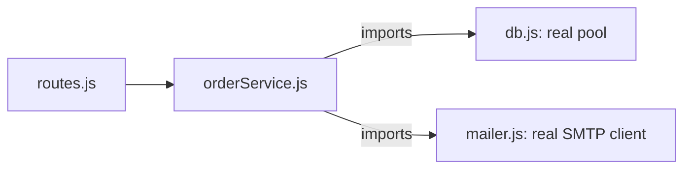
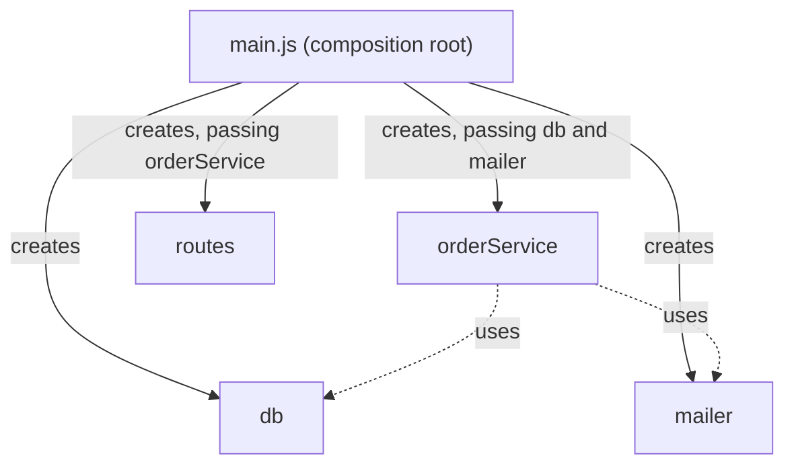

# Singleton, module wiring and dependency injection

## In plain words

A town has one water company. Every house is connected to the same network; nobody builds a private reservoir. In a program, some things should likewise exist exactly once and be shared by everyone: the pool of database connections, the configuration, the logger. An object that exists once per application is called a **singleton**.

Now, how does each house get its water? In one town, every house is built with a pipe that runs straight to *that particular* reservoir; changing supplier means rebuilding houses. In another town, each house has a standard inlet, and whoever sets up the street connects a supply to it. The house does not know or care where the water comes from; for an inspection, a test tank can be plugged in. The second arrangement is **dependency injection**: an object does not fetch the things it needs, it is *given* them from outside.

Why it matters for a job: how the parts of an application get hold of each other, known as **wiring**, decides whether the code can be tested without a real database and whether a part can be reused elsewhere. "What is dependency injection and why use it?" is asked in almost every back-end interview, in any language.

> **Before this lesson:** you need the module cache from [CommonJS: require, resolution, the cache and cycles](#/lesson/nodejs/commonjs-modules) and [ES modules in Node](#/lesson/nodejs/es-modules-node), and the factory pattern from [Factory, builder and revealing constructor](#/lesson/nodejs/factory-builder-revealing).

## Singleton

### Why have only one?

Three typical reasons:

- **Shared state.** A cache or an in-memory counter is useful only if everyone reads and writes the same one.
- **A limited resource.** A database pool opens, say, ten connections. Ten copies of the pool would open a hundred.
- **Coordinated access.** One object that serialises writes to a file prevents two parts of the program from writing over each other.

### In Node, a module is already a singleton

Classical object-oriented languages need a ceremony for this (a private constructor, a static `getInstance()` method). Node needs none, because of a fact from the modules lessons: **a module is evaluated once, and every importer receives the same exports.**

```javascript
// db.js
import { Pool } from "pg";

export const db = new Pool({ connectionString: process.env.DATABASE_URL, max: 10 });
```

```javascript
// orders.js                          // users.js
import { db } from "./db.js";         import { db } from "./db.js";
```

The line `new Pool(...)` runs the first time anything imports `db.js`. `orders.js` and `users.js` get the very same pool object. Exporting an **instance** from a module is the Node singleton.

The model below imitates a module cache so you can watch "evaluated once" happen:

```js-run
const moduleCache = new Map();
function importModule(name, body) {                 // a stand-in for the module loader
  if (!moduleCache.has(name)) {
    console.log(`  (evaluating ${name} for the first time)`);
    moduleCache.set(name, body());
  }
  return moduleCache.get(name);
}

const dbModule = () => {
  let queries = 0;
  return { db: { query(sql) { queries++; return `result of "${sql}"`; }, stats: () => ({ queries }) } };
};

// Two different "files" import the same module:
const fromOrders = importModule("db.js", dbModule).db;
const fromUsers = importModule("db.js", dbModule).db;

fromOrders.query("SELECT * FROM orders");
fromUsers.query("SELECT * FROM users");

console.log("same object?", fromOrders === fromUsers);
console.log("stats seen from users.js:", fromUsers.stats());
```

The body ran once; both importers share one object and one counter.

### The small print

The cache key is the module's **resolved file path**. The "once" is therefore once per file, not once per package name. If your application's dependency tree contains two copies of the same package, which happens when two of your dependencies require incompatible versions of it, each copy lives in a different folder, is a different module, and has its own instance:

```text
app/
  node_modules/
    my-db/            (version 2: instance A)
    reporting/
      node_modules/
        my-db/        (version 1: instance B)
```

Code in `app` and code in `reporting` now talk to two different "singletons". The same can happen when one package is loaded both as CommonJS and as an ES module. In practice this matters mainly to people writing libraries; application code that exports an instance from one of its own files is safe.

A blunt escape hatch exists, storing the instance on the global object (`globalThis.myDb ??= new Database()`), which guarantees one instance per process at the price of a global name that anything can overwrite. Treat it as a last resort.

> [!WARNING]
> "One per process" is not "one per application". A service that runs as four processes, or on three servers, has four or three of every singleton. A counter kept in a module variable counts only what its own process saw. Anything that must be unique across the whole deployment belongs in a shared store such as a database or Redis.

## Wiring, style 1: importing singletons directly

Take an order service that needs a database and a mailer. The direct approach: each module imports the instances it needs.

```javascript
// orderService.js
import { db } from "./db.js";
import { mailer } from "./mailer.js";

export async function placeOrder(customerId, items) {
  const order = await db.insert("orders", { customerId, items });
  await mailer.send(customerId, `Order ${order.id} confirmed`);
  return order;
}
```



This is short, obvious to read, and how most small Node applications start. It is a fine choice while the program is small.

Its cost is **tight coupling**: `orderService.js` is welded to those exact two files. The consequences surface as the code grows:

- **Testing.** To test `placeOrder` you must have a real database and a real mail server, or use tools that intercept the module loader and swap `./db.js` for a fake. Such mocking tools exist and work, but the tests then depend on file paths and on loader internals.
- **Reuse.** The service cannot run against a different database, or with a second mailer for another brand, without editing it.
- **Hidden requirements.** Nothing in the function's signature says it needs a database; you must read the imports.

## Wiring, style 2: dependency injection

A **dependency** is anything a piece of code needs in order to do its job. **Dependency injection** (DI) means the code does not obtain its dependencies itself; some outside party supplies them, usually as constructor or factory arguments.

```javascript
// orderService.js: no imports of db or mailer
export function createOrderService({ db, mailer }) {
  return {
    async placeOrder(customerId, items) {
      const order = await db.insert("orders", { customerId, items });
      await mailer.send(customerId, `Order ${order.id} confirmed`);
      return order;
    },
  };
}
```

The module now exports a factory. What it needs is spelled out in its parameter list. Who calls the factory? One place in the application, usually the entry file, creates all the real objects and passes them to each other. That place is called the **composition root**, and the party that supplies dependencies is called the **injector**.

```javascript
// main.js: the composition root
import { createDb } from "./db.js";
import { createMailer } from "./mailer.js";
import { createOrderService } from "./orderService.js";
import { createRoutes } from "./routes.js";

const db = createDb(process.env.DATABASE_URL);
const mailer = createMailer(process.env.SMTP_URL);
const orderService = createOrderService({ db, mailer });
const routes = createRoutes({ orderService });
```



The service depends on *an object with `insert`* and *an object with `send`*, not on particular modules. The decision of which concrete objects to use has moved outwards, to the caller. This reversal is called **inversion of control**.

### The payoff: testing with fakes

```js-run
function createOrderService({ db, mailer }) {
  return {
    async placeOrder(customerId, items) {
      if (items.length === 0) throw new Error("an order needs at least one item");
      const order = await db.insert("orders", { customerId, items });
      await mailer.send(customerId, `Order ${order.id} confirmed`);
      return order;
    },
  };
}

// ---- a test, with hand-made fakes; no database, no mail server ----
const saved = [];
const sent = [];
const fakeDb = { async insert(table, row) { const stored = { id: saved.length + 1, ...row }; saved.push(stored); return stored; } };
const fakeMailer = { async send(to, text) { sent.push({ to, text }); } };

const service = createOrderService({ db: fakeDb, mailer: fakeMailer });

const order = await service.placeOrder("cust-7", ["tea", "milk"]);
console.log("returned:", order);
console.log("rows saved:", saved.length, "| mail sent:", sent[0].text);

// A second test: what if the mail server is down?
const brokenMailer = { async send() { throw new Error("SMTP unreachable"); } };
const service2 = createOrderService({ db: fakeDb, mailer: brokenMailer });
await service2.placeOrder("cust-8", ["jam"]).catch((error) => console.log("failure surfaced:", error.message));
console.log("...but the order row was saved anyway:", saved.length, "rows. A real bug the test exposed.");
```

The test created the service with two ten-line objects. It runs in a millisecond, needs no network, and can simulate situations that are hard to produce with real systems, such as the mail server failing after the row was saved. A fake standing in for a real dependency is called a **test double**.

### The costs of DI

Dependency injection is not free:

- **More wiring code**, and it must be executed in the right order: a thing must exist before it can be passed to its dependants.
- **Indirection.** Reading `orderService.js` no longer tells you which database it talks to; you have to look at the composition root.
- **Deep graphs get tedious.** With fifty services the root becomes a long list of constructor calls.

### Three ways to inject

| Style | Looks like | Note |
|---|---|---|
| Constructor or factory injection | `new Service(db, mailer)`, `createService({ db, mailer })` | The default. Dependencies are complete from the start |
| Property (setter) injection | `service.mailer = mailer` after creation | Useful to break a cycle between two objects; the object is briefly incomplete |
| Parameter injection | `placeOrder(order, { db })` | Good for a single function with one or two dependencies |

## DI containers

When manual wiring becomes long, a **dependency injection container** automates it. You *register* each component under a name together with the names of what it needs. When asked for a component, the container builds its dependencies first, recursively, caches each instance (so each is a singleton), and passes them in.

```js-run
function createContainer() {
  const registrations = new Map();           // name -> { dependencies, factory }
  const instances = new Map();
  const resolving = [];                      // the chain currently being built, to detect cycles

  return {
    register(name, dependencies, factory) { registrations.set(name, { dependencies, factory }); },
    resolve(name) {
      if (instances.has(name)) return instances.get(name);
      if (!registrations.has(name)) throw new Error(`nothing registered as "${name}"`);
      if (resolving.includes(name)) throw new Error(`cycle: ${[...resolving, name].join(" -> ")}`);

      resolving.push(name);
      const { dependencies, factory } = registrations.get(name);
      const instance = factory(...dependencies.map((dep) => this.resolve(dep)));
      resolving.pop();

      instances.set(name, instance);
      console.log("  built", name);
      return instance;
    },
  };
}

const container = createContainer();
container.register("config", [], () => ({ dbUrl: "postgres://localhost/shop" }));
container.register("logger", ["config"], () => ({ info: (m) => console.log("  [log]", m) }));
container.register("db", ["config", "logger"], (config, logger) => ({ url: config.dbUrl, logger }));
container.register("orderService", ["db", "logger"], (db, logger) => ({ place: () => logger.info("order stored in " + db.url) }));

container.resolve("orderService").place();
console.log("logger built once?", container.resolve("logger") === container.resolve("db").logger);

container.register("a", ["b"], () => ({}));
container.register("b", ["a"], () => ({}));
try { container.resolve("a"); } catch (error) { console.log(error.message); }
```

- `resolve` is a depth-first walk of the dependency graph: build what I need, then build me. The output shows `config` built first and `orderService` last, although we asked only for the last one.
- `instances` makes every component a singleton within the container.
- `resolving` holds the names currently under construction. Meeting a name that is already in that list means the registrations form a cycle, which no build order can satisfy; reporting the chain beats a stack overflow.

The problem [Dependency injection: resolution order and cycles](#/problem/node-di-container) asks you to implement exactly this walk.

Containers also bring their own cost: dependencies are named by strings, so a typo fails at run time, and "where does this come from?" becomes harder to answer by reading. Libraries such as `awilix` and `inversify`, and frameworks such as NestJS, provide full containers. Many Node teams stay with a hand-written composition root for a long time, and that is a respectable choice.

> [!NOTE]
> A related idea is the **service locator**: instead of receiving dependencies, a component is handed the container and asks it for what it needs (`container.resolve("db")` inside the service). It removes wiring code but hides the dependencies again and ties every component to the container. Prefer injection; keep `resolve` calls inside the composition root.

## Choosing

| Situation | Reasonable choice |
|---|---|
| Script or small service, few modules | Import singletons directly |
| Code you want to unit-test without infrastructure | Inject at least the I/O dependencies (database, HTTP clients, clock) |
| A reusable library | Accept dependencies; never import the application's instances |
| Large application, many components | DI with a composition root, perhaps a container |

A practical middle path: write business logic as factories that take their dependencies, and keep one small file that creates the real instances and exports the wired-up result. You get the testability without a framework.

> [!TIP]
> Time and randomness are dependencies too. A function that calls `Date.now()` or `Math.random()` directly is hard to test. Pass in a `clock` (`{ now: () => Date.now() }`) or an id generator and tests become deterministic.

> [!INTERVIEW]
> **"What is dependency injection?"** "A technique where a component receives its dependencies from outside, typically through its constructor or factory, instead of creating or importing them itself. It decouples the component from concrete implementations, which makes it testable with fakes and reusable with different implementations. The wiring happens in a composition root or a DI container. The trade-off is extra indirection and wiring code." **"How do you make a singleton in Node?"** "Export an instance from a module; the module cache guarantees one evaluation per resolved path. Caveats: duplicate package copies or mixed module systems produce several instances, and it is per process, not per cluster."

## Pitfalls

- **Assuming a module singleton is global** across duplicated packages, processes or servers.
- **Singletons with hidden mutable state** make tests influence each other; reset or recreate them between tests, or inject them.
- **Creating real connections at import time**: importing a file for a type or a helper then opens a database connection. Export a factory, or connect lazily.
- **Injecting the container itself** into services.
- **Injecting everything**, including pure helper functions that have no side effects. Inject what touches the outside world.
- **Cycles in the dependency graph.** They usually mean two components should be split or merged; setter injection only papers over it.
- **A composition root spread across many files**, which defeats the "one place that knows everything" benefit.

## Cheat sheet

| Concept | In code |
|---|---|
| Singleton | `export const db = new Pool(...)` in its own module |
| Direct wiring | `import { db } from "./db.js"` inside the consumer |
| Injectable component | `export function createService({ db, mailer }) { ... }` |
| Composition root | one file that creates instances and passes them along |
| Test double | `createService({ db: fakeDb, mailer: fakeMailer })` |
| Container registration | `container.register(name, [dependencyNames], factory)` |
| Container resolution | depth-first: resolve dependencies, call factory, cache |
| Cycle detection | keep a stack of names being resolved; a repeat is a cycle |

## Summary

- A singleton is one shared instance. In Node, exporting an instance from a module gives one per process, because modules are cached by resolved path.
- Duplicate package copies, mixed module systems and multiple processes each produce separate instances.
- Importing singletons directly is the simplest wiring and couples modules tightly.
- Dependency injection passes dependencies in from a composition root, making components testable with fakes and reusable, at the price of more wiring and indirection.
- A DI container automates the wiring by resolving a dependency graph depth-first, caching instances and detecting cycles.

## Glossary

- **Singleton**: an object of which exactly one instance exists (per process).
- **Wiring**: connecting the components of an application to each other.
- **Dependency**: something a component needs in order to work.
- **Tight / loose coupling**: components that depend on each other's concrete details / only on a small agreed interface.
- **Dependency injection (DI)**: supplying a component's dependencies from outside.
- **Injector**: the code that supplies the dependencies.
- **Composition root**: the single place where the application's objects are created and connected.
- **Inversion of control**: moving a decision (here, which dependency to use) from a component to its caller.
- **Test double (fake, mock, stub)**: a simplified stand-in for a dependency in tests.
- **DI container**: a registry that builds components and their dependencies automatically.
- **Dependency graph**: components and the "needs" relations between them.
- **Service locator**: a pattern in which components ask a registry for their dependencies.

```quiz
[
  {"q": "How do you create a singleton in Node without any special pattern code?", "options": ["Use a static getInstance method", "Export an instance from a module; the module cache hands the same object to every importer", "Freeze the class", "Store it in a JSON file"], "answer": 1,
   "explain": "A module is evaluated once per resolved path, so an exported instance is shared."},
  {"q": "Your app and one of its dependencies each have their own copy of package `my-cache` in different node_modules folders. How many instances of its exported singleton exist?", "options": ["One", "Two", "None", "One per function call"], "answer": 1,
   "explain": "The cache key is the resolved file path, and the two copies have different paths."},
  {"q": "What is the main testing benefit of `createOrderService({ db, mailer })` over importing db and mailer inside the module?", "options": ["It runs faster in production", "A test can pass in simple fakes without touching the module loader or real infrastructure", "It removes the need for tests", "It makes the service synchronous"], "answer": 1,
   "explain": "Injected dependencies can be replaced by test doubles through ordinary arguments."},
  {"q": "What is a composition root?", "options": ["The first test file", "The single place where real instances are created and passed to the components that need them", "The root folder of node_modules", "A base class for services"], "answer": 1,
   "explain": "It is where the object graph is assembled, typically the application's entry file."},
  {"q": "With the lesson's container and registrations app -> [db, logger], db -> [config, logger], logger -> [config], config -> [], in what order are components built by resolve('app')?", "options": ["app, db, logger, config", "config, db, logger, app", "config, logger, db, app", "db, config, logger, app"], "answer": 2,
   "explain": "Depth-first: app needs db, which needs config (built), then logger (config is cached; logger built), then db is built; app's logger is cached; app is built last."},
  {"q": "How does a container detect a circular dependency?", "options": ["By counting registrations", "By keeping the list of names currently being resolved and noticing one appear again", "By a timeout", "It cannot"], "answer": 1,
   "explain": "A name already on the in-progress stack means the walk has returned to where it started."},
  {"q": "A module keeps `let requestCount = 0` and the service runs as 4 processes. What does one process's counter show?", "options": ["All requests to the service", "Only the requests that process handled", "Zero", "Four times the real number"], "answer": 1,
   "explain": "Module state is per process. Deployment-wide values need a shared store."},
  {"q": "Which is a real cost of dependency injection?", "options": ["Components cannot be tested", "More wiring code and more indirection when tracing where a dependency comes from", "It prevents using classes", "It requires a framework"], "answer": 1,
   "explain": "DI trades simplicity of reading for flexibility and testability."}
]
```

> **Source:** Casciaro & Mammino, *Node.js Design Patterns* 3e, ch. 7 (topics only; wording and examples are original). Documentation: https://nodejs.org/docs/latest/api/modules.html#caching, https://nodejs.org/docs/latest/api/packages.html#dual-package-hazard
