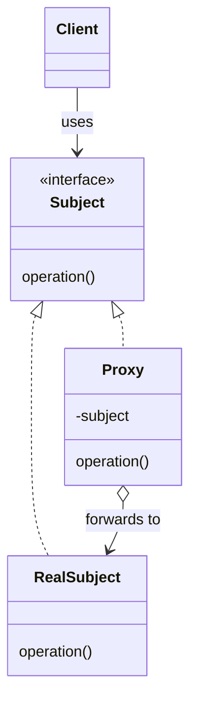

# The proxy pattern

## In plain words

A company director has an assistant. Letters and calls for the director go to the assistant first. The assistant can turn away a salesman (protection), answer a routine question from notes without disturbing the director (caching), keep a record of who called (logging), or pass the matter straight through. To the outside world the assistant *is* the director's office: same address, same phone number.

A **proxy** in software is that assistant: an object that stands in front of another object, called the **subject**, has the **same interface**, and controls access to it. Code that uses the proxy cannot tell the difference, and does not need to change.

The proxy is the first of three **structural design patterns** in this module. Structural patterns are about how objects are put together to form larger structures. All three (proxy, decorator, adapter) *wrap* one object in another; they differ in purpose.

Why it matters for a job: validation layers, caching layers, access control, logging and metrics around a client, lazy database connections, and the "reactive" objects of front-end frameworks are all proxies. JavaScript also has a built-in `Proxy` type with unusual powers, and interviewers like to probe it.

> **Before this lesson:** you need classes and object property access from [Prototypes, classes and encapsulation](#/lesson/javascript/prototypes-classes), and the idea of an interface from [Factory, builder and revealing constructor](#/lesson/nodejs/factory-builder-revealing).

## The shape of the pattern



The client talks to "something with `operation()`". The proxy implements that same method; inside, it does its extra work and **forwards** the call to the real subject. Forwarding a call to another object is also called **delegation**.

What a proxy typically adds:

| Purpose | What the proxy does |
|---|---|
| **Validation** | Checks the input before letting it reach the subject |
| **Security** | Checks that the caller is allowed to perform the operation |
| **Caching** | Returns a stored result when it has one, calls the subject otherwise |
| **Lazy initialisation** | Creates an expensive subject only when it is first really needed |
| **Logging and metrics** | Records calls, arguments, durations |
| **Remote access** | Makes an object on another machine look local |

There are three ways to build a proxy in JavaScript. We will implement the same small example with each.

## The example

A bank account with a balance. The rule to enforce from outside, without editing the class: no withdrawal may exceed the balance.

```js-run
class Account {
  constructor(owner, balance) { this.owner = owner; this.balance = balance; }
  deposit(amount) { this.balance += amount; return this.balance; }
  withdraw(amount) { this.balance -= amount; return this.balance; }
  describe() { return `${this.owner}: ${this.balance}`; }
}

const account = new Account("Ana", 100);
console.log(account.withdraw(250));        // -150: the class happily goes negative
```

## Technique 1: object composition

Write a new class that holds a reference to the subject and has the same methods. Methods that need extra behaviour add it; the rest forward unchanged.

```js-run
class Account {
  constructor(owner, balance) { this.owner = owner; this.balance = balance; }
  deposit(amount) { this.balance += amount; return this.balance; }
  withdraw(amount) { this.balance -= amount; return this.balance; }
  describe() { return `${this.owner}: ${this.balance}`; }
}

class SafeAccount {
  constructor(account) { this.account = account; }       // the subject

  withdraw(amount) {                                      // proxied: adds a check
    if (amount > this.account.balance) throw new Error(`insufficient funds: balance is ${this.account.balance}`);
    return this.account.withdraw(amount);
  }
  deposit(amount) { return this.account.deposit(amount); }   // delegated unchanged
  describe() { return this.account.describe(); }             // delegated unchanged
  get balance() { return this.account.balance; }             // properties need delegating too
}

const real = new Account("Ana", 100);
const safe = new SafeAccount(real);

console.log(safe.withdraw(30));
try { safe.withdraw(250); } catch (error) { console.log("blocked:", error.message); }
console.log(safe.describe(), "| original object untouched and still usable:", real.describe());
```

**Composition** means building an object out of other objects by holding references to them, as opposed to inheriting from them.

- Advantage: the subject is not modified at all. This is the safest technique, and other code holding the original `account` is unaffected.
- Disadvantage: **every** method and property must be delegated by hand, even when only one needs to change. Forget one and the proxy is incomplete. With a large interface that is a lot of boring code, and it must be kept in step with the subject.

A factory function returning an object literal does the same job without a class: `const createSafeAccount = (account) => ({ withdraw(amount) {...}, deposit: (a) => account.deposit(a), ... })`.

## Technique 2: object augmentation

Replace the method **on the subject itself** with a new function that does the extra work and then calls the original. This is also called *monkey patching*.

```js-run
class Account {
  constructor(owner, balance) { this.owner = owner; this.balance = balance; }
  deposit(amount) { this.balance += amount; return this.balance; }
  withdraw(amount) { this.balance -= amount; return this.balance; }
}

function makeSafe(account) {
  const originalWithdraw = account.withdraw;             // keep the real method
  account.withdraw = function (amount) {                 // overwrite it on this one instance
    if (amount > this.balance) throw new Error("insufficient funds");
    return originalWithdraw.call(this, amount);
  };
  return account;
}

const account = makeSafe(new Account("Ana", 100));
console.log(account.withdraw(30), account.deposit(5));
try { account.withdraw(999); } catch (error) { console.log("blocked:", error.message); }
```

`originalWithdraw.call(this, amount)` invokes the saved function with `this` set to the account.

- Advantage: only the method you care about is touched; nothing has to be delegated.
- Disadvantage: the subject is **mutated**. Any other code that shares this object now gets the new behaviour whether it wanted it or not, and two libraries patching the same method can trample each other. Use it only on objects you own entirely, typically ones you have created yourself a moment earlier.

## Technique 3: the built-in `Proxy` object

JavaScript provides a general mechanism for exactly this job. `new Proxy(target, handler)` creates an object that looks like `target`, while every fundamental operation on it (reading a property, writing one, deleting, checking `in`, calling it as a function) can be intercepted by a function in `handler`. Those interceptor functions are called **traps**.

```js-run
class Account {
  constructor(owner, balance) { this.owner = owner; this.balance = balance; }
  deposit(amount) { this.balance += amount; return this.balance; }
  withdraw(amount) { this.balance -= amount; return this.balance; }
  describe() { return `${this.owner}: ${this.balance}`; }
}

function createSafeAccount(account) {
  return new Proxy(account, {
    get(target, property, receiver) {
      if (property === "withdraw") {
        return (amount) => {                                   // a replacement method
          if (amount > target.balance) throw new Error("insufficient funds");
          return target.withdraw(amount);
        };
      }
      return Reflect.get(target, property, receiver);          // everything else: default behaviour
    },
  });
}

const real = new Account("Ana", 100);
const safe = createSafeAccount(real);

console.log(safe.withdraw(30), safe.deposit(5), safe.describe(), safe.owner);
try { safe.withdraw(999); } catch (error) { console.log("blocked:", error.message); }
console.log("safe instanceof Account:", safe instanceof Account);
```

Step by step:

- The `get` trap runs for **every** property read on the proxy, including reading a method before calling it. `safe.withdraw(30)` is two operations: read the property `withdraw`, then call the result.
- For `withdraw` the trap returns a new function containing the check. For anything else it returns `Reflect.get(...)`, which performs the normal property read. `Reflect` is a built-in object with one function per trap that carries out the default behaviour.
- Nothing was delegated by hand: `deposit`, `describe` and `owner` work without being mentioned. If `Account` gains ten more methods, the proxy needs no change.
- The subject is not mutated; `real` behaves as before.
- `instanceof` still reports `true`, because the proxy passes the prototype chain through.

The most useful traps:

| Trap | Intercepts | Example |
|---|---|---|
| `get(target, prop, receiver)` | reading `proxy.x` | default values, method wrapping, logging |
| `set(target, prop, value, receiver)` | writing `proxy.x = v` | validation, change notification |
| `has(target, prop)` | `"x" in proxy` | hiding properties |
| `deleteProperty(target, prop)` | `delete proxy.x` | protecting fields |
| `ownKeys(target)` | `Object.keys(proxy)` | hiding or adding keys |
| `apply(target, thisArg, args)` | calling `proxy(...)` when the target is a function | timing, memoising |

A `set` trap must return `true` to say the write was accepted; returning `false` makes the assignment throw a `TypeError` in strict mode.

### Things only `Proxy` can do

Because it intercepts the language's basic operations, `Proxy` can express behaviours that no hand-written wrapper can, such as reacting to properties **that do not exist yet**.

**A validating record.** Every write is checked against a schema, for any property name:

```js-run
function createValidated(schema) {
  return new Proxy({}, {
    set(target, property, value) {
      if (!(property in schema)) throw new Error(`unknown field "${property}"`);
      if (typeof value !== schema[property]) throw new Error(`"${property}" must be a ${schema[property]}`);
      target[property] = value;
      return true;
    },
  });
}

const user = createValidated({ name: "string", age: "number" });
user.name = "Ana";
user.age = 31;
for (const attempt of [() => (user.age = "old"), () => (user.email = "a@b.c")]) {
  try { attempt(); } catch (error) { console.log("rejected:", error.message); }
}
console.log(JSON.stringify(user));
```

**A change observer.** Wrap a plain object so that a callback is told about every modification. This is the mechanism underneath the *reactive* state of front-end frameworks such as Vue, where changing a value updates the screen.

```js-run
function observe(target, onChange) {
  return new Proxy(target, {
    set(obj, property, value) {
      const previous = obj[property];
      if (previous === value) return true;               // no real change: stay quiet
      obj[property] = value;
      onChange({ property, previous, value });
      return true;
    },
    deleteProperty(obj, property) {
      if (property in obj) {
        const previous = obj[property];
        delete obj[property];
        onChange({ property, previous, value: undefined });
      }
      return true;
    },
  });
}

const settings = observe({ theme: "light", volume: 3 }, (change) => {
  console.log(`audit: ${change.property} ${JSON.stringify(change.previous)} -> ${JSON.stringify(change.value)}`);
});

settings.theme = "dark";
settings.volume = 3;            // same value: nothing logged
settings.language = "pt";       // a brand-new property is noticed too
delete settings.volume;
```

The code that changes `settings` uses ordinary assignments. It has no idea an audit log is being written. The problem [A validating, logging proxy](#/problem/node-proxy) combines both ideas.

**A timing proxy for functions**, using the `apply` trap:

```js-run
function timed(fn, report) {
  return new Proxy(fn, {
    apply(target, thisArg, args) {
      const start = Date.now();
      try {
        return Reflect.apply(target, thisArg, args);
      } finally {
        report(`${target.name}(${args.join(", ")}) took ${Date.now() - start} ms`);
      }
    },
  });
}

function slowSquare(n) { const end = Date.now() + 15; while (Date.now() < end); return n * n; }
const measured = timed(slowSquare, console.log);
console.log("result:", measured(12));
```

### Limits of `Proxy`

- **It cannot be fully emulated** in old environments, which mattered for browsers years ago and rarely matters now.
- **Identity.** `proxy !== target`. If some code stores the target in a `Map` or `Set` and you later look up the proxy, it is not found.
- **Private fields.** A method that uses a `#private` field fails when called with `this` being the proxy (`TypeError: Cannot read private member`). Call such methods on the target (`target.method(...)`), as the account example does.
- **Cost.** Every trapped operation is a function call. That is irrelevant for a configuration object and noticeable inside a loop that runs millions of times.
- **Surprise.** An object on which reading a property has side effects is hard to debug. Use the power sparingly and document it.

## Comparing the three techniques

| | Composition | Augmentation | Built-in `Proxy` |
|---|---|---|---|
| Subject modified? | No | **Yes** | No |
| Must every member be delegated by hand? | **Yes** | No | No |
| Can intercept property access and unknown properties? | No | No | Yes |
| Good for | A few methods, a clear and explicit wrapper | A quick patch on an object you own | Whole-object behaviour: validation, observation, logging |

Default to composition when the interface is small, because it is the most explicit and has no surprises. Use `Proxy` when you need to intercept *everything* or to react to property access. Keep augmentation for objects no one else shares.

## A practical proxy: a caching client

To finish, a realistic composition proxy around an asynchronous client. Calls for a key already fetched are answered from memory:

```js-run
const realClient = {
  calls: 0,
  async getUser(id) {
    this.calls++;
    await new Promise((resolve) => setTimeout(resolve, 20));
    return { id, name: "User " + id };
  },
};

function createCachingClient(client) {
  const cache = new Map();                       // id -> promise of the user
  return {
    getUser(id) {
      if (!cache.has(id)) cache.set(id, client.getUser(id));
      return cache.get(id);
    },
  };
}

const client = createCachingClient(realClient);
const users = await Promise.all([client.getUser(1), client.getUser(1), client.getUser(2), client.getUser(1)]);
console.log(users.map((u) => u.name), "| real calls made:", realClient.calls);
```

Storing the **promise**, not the result, means that even requests arriving while the first is still in flight share it. That idea returns as request batching in the advanced recipes module. A production version would also evict entries and would not keep failed promises.

> [!TIP]
> A proxy must be honest: same methods, same argument and return types, same error conventions as the subject. If callers have to know they are talking to a wrapper, it has stopped being a proxy.

> [!WARNING]
> When you augment or proxy an object that other modules share (a core module, a singleton), every user is affected. That is how monitoring tools add instrumentation, and also how hard-to-trace bugs are created. Wrap at the edge of your own code and hand the wrapper only to those who should see it.

> [!INTERVIEW]
> **"What is the proxy pattern? How would you implement one in JavaScript?"** "A proxy is an object with the same interface as another object, the subject, that controls access to it: validation, access control, caching, lazy creation, logging. Three implementations: composition, where a wrapper holds the subject and delegates each method; augmentation, where the subject's methods are replaced in place; and the built-in `Proxy` with traps such as `get` and `set`, which intercepts every operation without manual delegation and without mutating the subject." A frequent follow-up: **"What is `Reflect` for?"** It provides the default implementation of each trapped operation, so a trap can do its extra work and then let the normal behaviour happen.

## Pitfalls

- **Forgetting to delegate a member** in a composition proxy; the client gets `undefined is not a function`.
- **Mutating shared objects** by augmentation.
- **A `set` trap that does not return `true`.**
- **Forgetting that method calls go through `get`**: logging every `get` logs method lookups as well as data reads.
- **Losing `this`**: returning `target[prop]` for a method and calling it detached. Use `Reflect.get` with the receiver, or bind.
- **Comparing or storing proxies and targets interchangeably.**
- **Proxying objects with private fields** without routing calls to the target.
- **Caching without limits or invalidation.**

## Cheat sheet

| Goal | Code |
|---|---|
| Composition proxy | `class P { constructor(s) { this.s = s; } op(x) { /* extra */ return this.s.op(x); } }` |
| Augmentation | `const orig = obj.op; obj.op = function (...a) { /* extra */ return orig.apply(this, a); };` |
| Built-in proxy | `new Proxy(target, { get(t, p, r) { return Reflect.get(t, p, r); } })` |
| Validate writes | `set(t, p, v) { check(p, v); t[p] = v; return true; }` |
| Observe changes | call a callback inside `set` and `deleteProperty` |
| Wrap a function | `new Proxy(fn, { apply(t, thisArg, args) { return Reflect.apply(t, thisArg, args); } })` |
| Default behaviour of a trap | the `Reflect` function with the same name |

## Summary

- A proxy has the subject's interface and controls access to it, for validation, security, caching, lazy creation, logging or remoting.
- Composition wraps and delegates explicitly, leaving the subject untouched; augmentation replaces methods on the subject; the built-in `Proxy` intercepts operations through traps.
- `Proxy` with `Reflect` can validate, observe and log any property access, including properties not known in advance.
- Choose the least powerful technique that does the job, and keep the proxy indistinguishable from the subject for its clients.

## Glossary

- **Structural pattern**: a pattern about composing objects into larger structures.
- **Proxy**: a stand-in object that controls access to another object.
- **Subject (target)**: the object behind the proxy.
- **Delegation (forwarding)**: passing a call on to another object.
- **Composition**: building objects from other objects by reference.
- **Object augmentation (monkey patching)**: modifying an existing object by replacing its methods.
- **`Proxy` (built-in)**: a JavaScript object that intercepts operations on a target.
- **Handler**: the object holding a `Proxy`'s traps.
- **Trap**: a handler function that intercepts one kind of operation.
- **`Reflect`**: a built-in object whose functions perform the default behaviour of each operation.
- **Reactive object**: an object that triggers updates when it changes.
- **Lazy initialisation**: delaying the creation of something until first use.

```quiz
[
  {"q": "What defines a proxy, as opposed to any wrapper?", "options": ["It is always asynchronous", "It exposes the same interface as its subject and controls access to it", "It inherits from the subject's class", "It converts one interface into another"], "answer": 1,
   "explain": "Same interface is the key property; converting interfaces is the adapter's job."},
  {"q": "Which technique modifies the subject itself?", "options": ["Object composition", "Object augmentation", "The built-in Proxy", "None of them"], "answer": 1,
   "explain": "Augmentation overwrites methods on the original object, affecting everyone who shares it."},
  {"q": "What is the main drawback of a composition proxy for an object with 40 methods when only one needs changing?", "options": ["It mutates the subject", "All 40 methods must be delegated by hand", "It cannot be tested", "It is slower than a Proxy"], "answer": 1,
   "explain": "Composition forwards explicitly, member by member."},
  {"q": "In what order do these log?\n\n`const p = new Proxy({ hi() { console.log('M'); } }, { get(t, k, r) { console.log('G'); return Reflect.get(t, k, r); } }); console.log('A'); p.hi(); console.log('B');`", "options": ["A, M, G, B", "A, G, M, B", "G, A, M, B", "A, M, B"], "answer": 1,
   "explain": "Calling p.hi() first reads the property hi through the get trap (G), then invokes the returned function (M)."},
  {"q": "What must a `set` trap return to signal success?", "options": ["The new value", "undefined", "true", "The target"], "answer": 2,
   "explain": "Returning a falsy value makes the assignment fail, with a TypeError in strict mode."},
  {"q": "What is `Reflect.get(target, prop, receiver)` used for inside a get trap?", "options": ["To disable the trap", "To perform the normal property read after or instead of custom logic", "To clone the target", "To freeze the property"], "answer": 1,
   "explain": "Reflect functions carry out the default behaviour corresponding to each trap."},
  {"q": "Which task can the built-in Proxy do that a hand-written wrapper class cannot?", "options": ["Call the subject's methods", "React to reads and writes of properties that were not known when the wrapper was written", "Hold a reference to the subject", "Throw errors"], "answer": 1,
   "explain": "Traps intercept operations for any property name, including ones added later."},
  {"q": "The caching client stores the promise returned by `getUser(id)` instead of the resolved user. What does that achieve?", "options": ["Nothing useful", "Concurrent requests for the same id share one call, even before it has completed", "The cache never fills", "Errors are retried automatically"], "answer": 1,
   "explain": "The promise exists from the moment the call starts, so later callers can await the same one."}
]
```

> **Source:** Casciaro & Mammino, *Node.js Design Patterns* 3e, ch. 8 (topics only; wording and examples are original). Documentation: https://developer.mozilla.org/en-US/docs/Web/JavaScript/Reference/Global_Objects/Proxy, https://developer.mozilla.org/en-US/docs/Web/JavaScript/Reference/Global_Objects/Reflect
