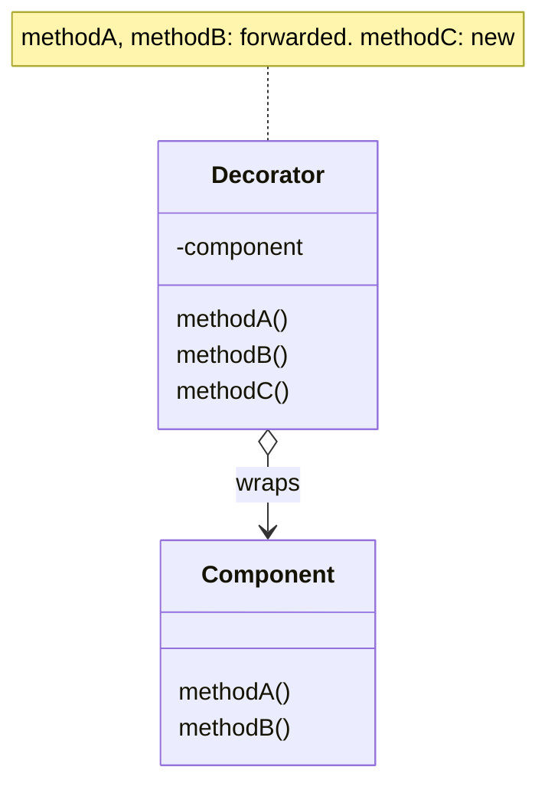
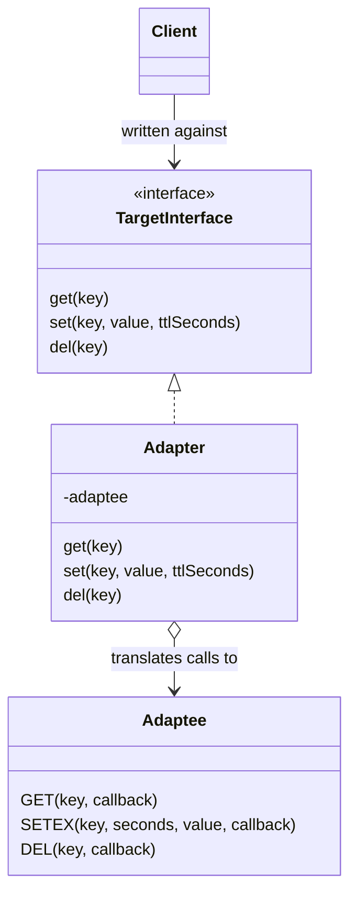

# Decorator and adapter

## In plain words

You buy a plain phone. You put it in a case with a card pocket and clip on a ring holder. It is the same phone, it still makes calls, but it can now do more: carry a card, stand on a table. You did not open the phone or buy a new model. That is a **decorator**: a wrapper that *adds abilities* to an existing object, without changing the object and without subclassing it.

Now you travel abroad and your charger's plug does not fit the wall socket. You do not rewire the hotel or cut the cable. You use a travel plug: one shape on one side, another shape on the other. That is an **adapter**: a wrapper that makes an object usable through a *different interface*, the one the rest of the code expects.

Together with the proxy from the last lesson, these complete the trio of wrapping patterns.

Why it matters for a job: adding retries, timeouts, logging or caching around a client without editing it is decorator work, done constantly. Supporting two databases, two payment providers or two storage back-ends behind one interface is adapter work, and it is what makes replacing a vendor a small change instead of a rewrite.

> **Before this lesson:** read [The proxy pattern](#/lesson/nodejs/proxy-pattern); the three implementation techniques (composition, augmentation, built-in `Proxy`) are reused here. Promises and `async`/`await` from [Async/await: sequential and parallel flows](#/lesson/nodejs/async-await-flows) appear in the examples.

## Decorator

### Definition

A **decorator** wraps an object (the *component*) and extends its behaviour: it keeps the existing interface working and adds new operations or enriches existing ones. Unlike inheritance, the extension applies to **one instance**, at **run time**, and several decorators can be stacked in any combination.



Why not subclass? Suppose a storage class needs optional caching, optional logging and optional encryption. With inheritance you would need `CachedStorage`, `LoggedStorage`, `EncryptedStorage`, `CachedLoggedStorage`, `CachedEncryptedStorage`… one class per combination. With decorators you write three small wrappers and combine them as needed.

### Technique 1: composition

The component here is a small key-value store. The decorator adds two operations it never had, `increment` and `getMany`, built on top of the existing `get` and `set`.

```js-run
function createStore() {                         // the component
  const data = new Map();
  return {
    async get(key) { return data.has(key) ? data.get(key) : null; },
    async set(key, value) { data.set(key, value); },
  };
}

function withExtras(store) {                     // the decorator
  return {
    get: (key) => store.get(key),                // existing interface: forwarded
    set: (key, value) => store.set(key, value),

    async increment(key, by = 1) {               // new ability
      const next = ((await store.get(key)) ?? 0) + by;
      await store.set(key, next);
      return next;
    },
    async getMany(keys) {                        // new ability
      return Promise.all(keys.map((key) => store.get(key)));
    },
  };
}

const store = withExtras(createStore());
await store.set("greeting", "hello");
await store.increment("visits");
await store.increment("visits", 4);
console.log(await store.getMany(["greeting", "visits", "missing"]));
```

As with the composition proxy, the original store is untouched and every existing method must be forwarded by hand.

### Technique 2: augmentation

Attach the new methods directly to the component:

```javascript
function addExtras(store) {
  store.increment = async function (key, by = 1) {
    const next = ((await this.get(key)) ?? 0) + by;
    await this.set(key, next);
    return next;
  };
  return store;
}
```

Short, with nothing to forward, but it mutates the object: every other holder of this store sees `increment` appear, and a later decorator adding a method of the same name silently replaces it. Many "plugin" systems work this way (`plugin(instance)` returns the instance with new methods), which is convenient and is also why plugin name clashes exist.

### Technique 3: the built-in `Proxy`

Use a `get` trap that answers for the new names and lets everything else through:

```js-run
function withExtras(store) {
  const extras = {
    async increment(key, by = 1) {
      const next = ((await store.get(key)) ?? 0) + by;
      await store.set(key, next);
      return next;
    },
  };
  return new Proxy(store, {
    get(target, property, receiver) {
      if (property in extras) return extras[property];
      return Reflect.get(target, property, receiver);
    },
  });
}

const base = { data: new Map(), async get(k) { return this.data.get(k) ?? null; }, async set(k, v) { this.data.set(k, v); } };
const store = withExtras(base);
console.log(await store.increment("n"), await store.increment("n", 10), "| base has increment?", "increment" in base);
```

No mutation and no manual forwarding, at the cost of the indirection discussed last lesson.

### Decorating functions

In everyday Node code the thing being decorated is very often a single async function: "fetch this URL", "run this query". A function decorator is a higher-order function: it takes a function and returns a new one with the same call signature and extra behaviour.

```js-run
const sleep = (ms) => new Promise((resolve) => setTimeout(resolve, ms));

// The component: an unreliable remote call.
let attempts = 0;
async function fetchQuote(symbol) {
  attempts++;
  await sleep(10);
  if (attempts % 3 !== 0) throw new Error("upstream timeout");      // fails two times out of three
  return { symbol, price: 101.5 };
}

// Three independent decorators. Each returns a function with the same signature.
const withRetry = (fn, retries) => async (...args) => {
  for (let attempt = 0; ; attempt++) {
    try { return await fn(...args); }
    catch (error) { if (attempt >= retries) throw error; }
  }
};

const withLogging = (fn, log) => async (...args) => {
  log(`-> ${fn.name || "call"}(${args.join(", ")})`);
  try { const result = await fn(...args); log(`<- ok`); return result; }
  catch (error) { log(`<- failed: ${error.message}`); throw error; }
};

const withCache = (fn) => {
  const cache = new Map();
  return async (...args) => {
    const key = JSON.stringify(args);
    if (!cache.has(key)) cache.set(key, await fn(...args));
    return cache.get(key);
  };
};

// Stack them. Reading inside-out: log each real attempt, retry around that, cache around everything.
const getQuote = withCache(withRetry(withLogging(fetchQuote, (line) => console.log("   ", line)), 3));

console.log(await getQuote("ACME"));
console.log(await getQuote("ACME"), "(second call: served by the cache, no log lines)");
```

Points to take from this:

- Each decorator knows nothing about the others, or about `fetchQuote`. They can be reused around any async function.
- **Order matters.** Logging is innermost, so every attempt is logged, including the failures that the retry hides. Put the cache innermost and you would cache only single attempts; put it outermost, as here, and a cached answer skips retry and logging entirely.
- The caller's code is `getQuote("ACME")` in every case. Behaviour was added without the caller or the original function changing.

The problem [Stack decorators around a service](#/problem/node-decorator) makes you reason about this ordering.

> [!NOTE]
> You may have seen `@something` written above a class or method in TypeScript or in frameworks such as NestJS. That *decorator syntax* is a way of applying functions like these to classes and methods at definition time. It shares the name and the idea of wrapping, and is a language feature still in the process of being standardised for JavaScript. The pattern in this lesson needs no special syntax.

### Where is the line between proxy and decorator?

Structurally they are the same thing: a wrapper that forwards. The difference is intent.

- A **proxy** keeps the interface identical and *controls access* to the subject. A client must not notice it.
- A **decorator** *adds or enriches* behaviour; the wrapped object can do more than before.

A wrapper that validates arguments is a proxy; one that adds `increment` is a decorator; one that adds retries could be argued either way. In JavaScript, where both are written with the same three techniques, the names are often used interchangeably. Do not lose sleep over the classification. What matters in a design discussion is being able to say which of the two jobs a wrapper is doing.

## Adapter

### Definition

An **adapter** lets an object, the **adaptee**, be used through a different interface: the one the **client** was written for. Nothing is added and nothing is guarded; calls are *translated*.



You reach for an adapter when:

- your code expects one interface and a library offers another;
- you want to be able to **swap implementations** (in-memory in tests, Redis in production; one payment provider today, another next year);
- old and new code must cooperate during a migration.

### Example: one cache interface, two very different back-ends

The application wants a tiny promise-based cache interface:

```text
cache.get(key)                      -> Promise of the value, or null
cache.set(key, value, ttlSeconds)   -> Promise
cache.del(key)                      -> Promise
```

Two things are available that could store the data, neither with that interface: a plain `Map`, and a remote key-value client in an older style, with upper-case command names, error-first callbacks, and strings only. We write one adapter for each.

```js-run
// ---------- Adaptee 1: a plain Map (synchronous, any value, no expiry) ----------
function createMapCacheAdapter(map = new Map(), now = () => Date.now()) {
  return {
    async get(key) {
      const entry = map.get(key);
      if (!entry) return null;
      if (entry.expiresAt !== null && entry.expiresAt <= now()) { map.delete(key); return null; }
      return entry.value;
    },
    async set(key, value, ttlSeconds = null) {
      map.set(key, { value, expiresAt: ttlSeconds === null ? null : now() + ttlSeconds * 1000 });
    },
    async del(key) { map.delete(key); },
  };
}

// ---------- Adaptee 2: an old-style remote client (callbacks, strings only) ----------
function createLegacyClient() {
  const data = {};
  const later = (fn) => setTimeout(fn, 5);
  return {
    GET(key, callback) { later(() => callback(null, key in data ? data[key] : null)); },
    SETEX(key, seconds, text, callback) {
      if (typeof text !== "string") return later(() => callback(new Error("ERR value must be a string")));
      data[key] = text; later(() => callback(null, "OK"));
    },
    SET(key, text, callback) { data[key] = text; later(() => callback(null, "OK")); },
    DEL(key, callback) { delete data[key]; later(() => callback(null, 1)); },
  };
}

function createLegacyCacheAdapter(client) {
  const call = (command, ...args) => new Promise((resolve, reject) => {     // callback -> promise
    client[command](...args, (err, reply) => (err ? reject(err) : resolve(reply)));
  });
  return {
    async get(key) {
      const text = await call("GET", key);
      return text === null ? null : JSON.parse(text);                        // string -> value
    },
    async set(key, value, ttlSeconds = null) {
      const text = JSON.stringify(value);                                    // value -> string
      if (ttlSeconds === null) await call("SET", key, text);
      else await call("SETEX", key, ttlSeconds, text);                       // different command, different argument order
    },
    async del(key) { await call("DEL", key); },
  };
}

// ---------- The client code: written once, against the cache interface ----------
async function getProfile(cache, userId) {
  const cached = await cache.get("profile:" + userId);
  if (cached) return { ...cached, from: "cache" };
  const profile = { id: userId, name: "User " + userId };     // pretend this was a slow database query
  await cache.set("profile:" + userId, profile, 60);
  return { ...profile, from: "database" };
}

for (const [label, cache] of [["Map adapter", createMapCacheAdapter()], ["legacy adapter", createLegacyCacheAdapter(createLegacyClient())]]) {
  const first = await getProfile(cache, 7);
  const second = await getProfile(cache, 7);
  console.log(`${label.padEnd(14)}: first from ${first.from}, second from ${second.from}`);
}
```

Look at what each adapter translates:

- **Calling convention.** The legacy client uses error-first callbacks; the adapter's `call` helper turns each command into a promise. That helper is promisification, which is itself a small adapter between two conventions for asynchronous results.
- **Names and argument order.** `set(key, value, ttl)` becomes `SETEX(key, seconds, text)`, with the arguments in a different order, or `SET` when there is no expiry.
- **Data format.** The client stores only strings, so the adapter serialises with `JSON.stringify` and parses on the way back.
- **Missing features.** A `Map` has no expiry, so its adapter implements time-to-live itself, storing an expiry time next to each value.

`getProfile` was written once and works unchanged with both. Tests can pass the Map adapter; production passes the adapter for the real service. Combined with the dependency injection of the previous module, this is how applications stay independent of a specific vendor. The problem [Adapt a string store to a collection API](#/problem/node-adapter) is an exercise in the same translation.

### Adapters you already use

- `util.promisify(fn)` adapts a callback-style function to the promise style; `util.callbackify` goes the other way.
- `Readable.fromWeb()` and `Readable.toWeb()` adapt between Node streams and the web-standard streams used by `fetch`.
- `events.once(emitter, name)` adapts an event to a promise.
- Database libraries ship adapters or "drivers" so the same query code can run against PostgreSQL, MySQL or SQLite; logging libraries have "transports" for console, files and remote services.

> [!TIP]
> Define the target interface from what **your application needs**, not from what the first library happens to offer. Keep it small. An interface with three methods can be adapted to almost anything; one that mirrors a vendor's forty methods ties you to that vendor even with an adapter in between.

> [!WARNING]
> An adapter cannot give the adaptee guarantees it does not have. If one back-end's "set if absent" is atomic and the other must be emulated with a read followed by a write, the emulation has a race condition (check-then-act). Write down such differences next to the interface, or callers will rely on behaviour that only one implementation provides. This is called a *leaky abstraction*.

## The three wrappers compared

| | Proxy | Decorator | Adapter |
|---|---|---|---|
| Interface seen by the client | Same as the subject | Same, plus more | **Different** from the wrapped object |
| Purpose | Control access | Add or enrich behaviour | Make an incompatible object fit |
| Typical examples | validation, caching, lazy creation, access checks | retries, logging, new helper methods | callback API as promises, vendor A behind your interface |
| Stackable? | Yes | Yes, and commonly | Usually one per adaptee |

> [!INTERVIEW]
> **"Explain decorator, proxy and adapter. How do they differ?"** "All three wrap an object. A proxy presents the same interface and controls access. A decorator presents the same interface with additional behaviour or methods, per instance and stackable, as an alternative to subclassing. An adapter presents a different interface, the one the client expects, translating calls to the wrapped object." Then give one example of each from your own experience. A good follow-up to prepare: **"How would you make your code independent of a specific cache or payment provider?"** Define a small interface, write an adapter per provider, and inject the chosen adapter.

## Pitfalls

- **Decorator order chosen by accident.** Cache outside retry or inside? Decide which behaviour you want and comment it.
- **Decorators that change the call signature** stop being stackable. Keep input and output shapes the same.
- **Losing function metadata**: a wrapped function has a different `name` and `length`, and loses `this` unless the decorator uses `fn.apply(this, args)`.
- **Hiding errors in a decorator** (a logging wrapper that forgets to re-throw).
- **Augmentation name clashes** between plugins.
- **Fat target interfaces** copied from one vendor.
- **Leaky adapters**: differences in atomicity, ordering, limits or error types showing through.
- **Putting business logic in an adapter.** It should translate, nothing more, or each new adapter has to duplicate that logic.

## Cheat sheet

| Goal | Sketch |
|---|---|
| Add a method, composition | `const d = { ...forwarders, extra() { /* uses component */ } }` |
| Add a method, augmentation | `component.extra = function () {...}` (mutates) |
| Add a method, `Proxy` | `get(t, p, r) { return p in extras ? extras[p] : Reflect.get(t, p, r); }` |
| Decorate a function | `const withX = (fn) => async (...args) => { /* before */ const r = await fn(...args); /* after */ return r; }` |
| Stack decorators | `withCache(withRetry(withLogging(fn)))` (outermost runs first) |
| Adapter | object implementing the target interface, each method translating to the adaptee |
| Callback API to promises | `util.promisify(fn)` |
| Swappable back-end | small interface + one adapter per back-end + injection |

## Summary

- A decorator wraps a component to add or enrich behaviour for one instance at run time; decorators stack, and their order changes the result.
- Function decorators (higher-order functions around async functions) are the most common form in Node: retry, timeout, logging, caching.
- Proxy and decorator share their implementation techniques and differ in intent: controlling access versus adding behaviour.
- An adapter exposes a different interface from the object it wraps, translating names, arguments, calling conventions and data formats.
- A small application-defined interface plus adapters and dependency injection makes back-ends swappable.

## Glossary

- **Decorator**: a wrapper that adds behaviour or operations to an object or function.
- **Component**: the object being decorated.
- **Higher-order function**: a function that takes or returns functions.
- **Stacking**: applying several decorators, each wrapping the previous result.
- **Plugin**: an extension that adds capabilities to an object or library.
- **Adapter**: a wrapper that converts one interface into another.
- **Adaptee**: the object with the incompatible interface.
- **Target interface**: the interface the client expects.
- **Serialise**: convert a value to text or bytes for storage or transport.
- **Time-to-live (TTL)**: how long a stored value remains valid.
- **Leaky abstraction**: an interface through which differences of the underlying implementations can be observed.

```quiz
[
  {"q": "Which statement best separates a decorator from an adapter?", "options": ["A decorator is faster", "A decorator keeps the interface and adds behaviour; an adapter changes the interface to the one a client expects", "An adapter can be stacked, a decorator cannot", "A decorator only works on classes"], "answer": 1,
   "explain": "Adding versus translating is the distinction."},
  {"q": "Why prefer decorators over subclasses for optional caching, logging and encryption?", "options": ["Subclasses are slower", "Each combination would need its own subclass, while decorators combine freely per instance", "Decorators use less memory", "JavaScript has no inheritance"], "answer": 1,
   "explain": "Three independent options give eight combinations; three wrappers cover them all."},
  {"q": "`const f = withCache(withRetry(withLogging(fetchQuote)))`. A second call with the same argument hits the cache. Which wrappers run their logic for that second call?", "options": ["All three", "Only withCache", "withCache and withRetry", "None"], "answer": 1,
   "explain": "The outermost wrapper answers from its cache and never calls the inner ones."},
  {"q": "In what order do these log?\n\n`const a = (fn) => () => { console.log('a-in'); fn(); console.log('a-out'); }; const b = (fn) => () => { console.log('b-in'); fn(); console.log('b-out'); }; a(b(() => console.log('core')))();`", "options": ["a-in, b-in, core, b-out, a-out", "b-in, a-in, core, a-out, b-out", "a-in, a-out, b-in, b-out, core", "core, b-in, b-out, a-in, a-out"], "answer": 0,
   "explain": "The outermost decorator (a) runs first and finishes last; the wrapped function is in the middle."},
  {"q": "What does the legacy cache adapter translate?", "options": ["Only method names", "Calling convention (callbacks to promises), method names and argument order, and data format (values to strings)", "Nothing; it only forwards", "Only errors"], "answer": 1,
   "explain": "An adapter bridges every difference between the target interface and the adaptee."},
  {"q": "The Map has no expiry feature, yet the target interface has a TTL. What should the Map adapter do?", "options": ["Ignore the TTL silently", "Implement expiry itself, for example by storing an expiry time with each value", "Throw on every set", "Extend Map.prototype"], "answer": 1,
   "explain": "The adapter must honour the target interface, emulating what the adaptee lacks, or document the gap."},
  {"q": "Which built-in is itself an adapter?", "options": ["Array.prototype.map", "util.promisify", "JSON.stringify", "setTimeout"], "answer": 1,
   "explain": "It converts the callback convention into the promise convention."},
  {"q": "What is the risk of the augmentation technique for decorators?", "options": ["It cannot add methods", "It mutates a possibly shared object, and two plugins may overwrite each other's methods", "It requires Proxy support", "It breaks promises"], "answer": 1,
   "explain": "Changing the object in place affects every holder of it."}
]
```

> **Source:** Casciaro & Mammino, *Node.js Design Patterns* 3e, ch. 8 (topics only; wording and examples are original). Documentation: https://nodejs.org/docs/latest/api/util.html#utilpromisifyoriginal, https://nodejs.org/docs/latest/api/stream.html#streamreadablefromwebreadablestream-options
