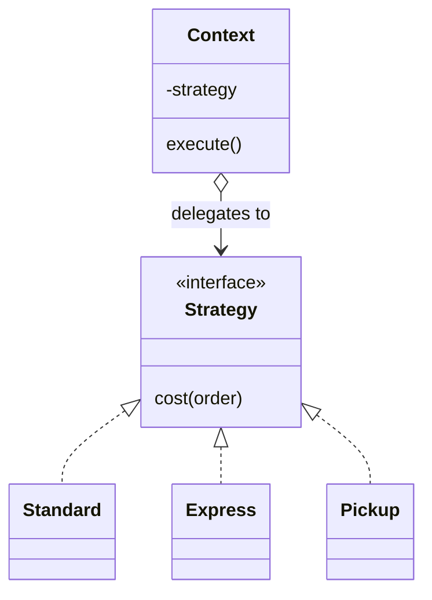
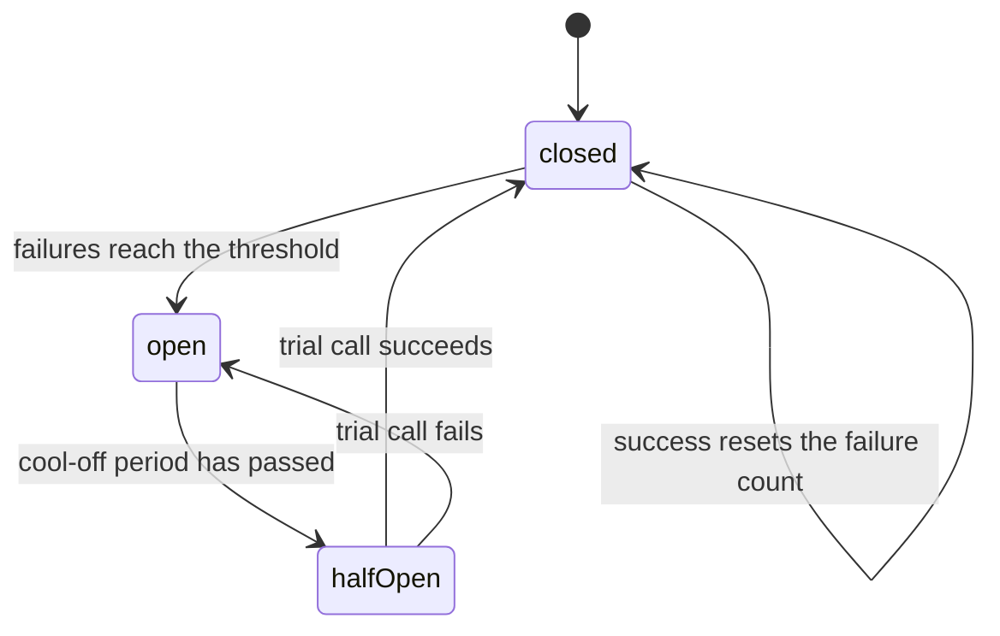
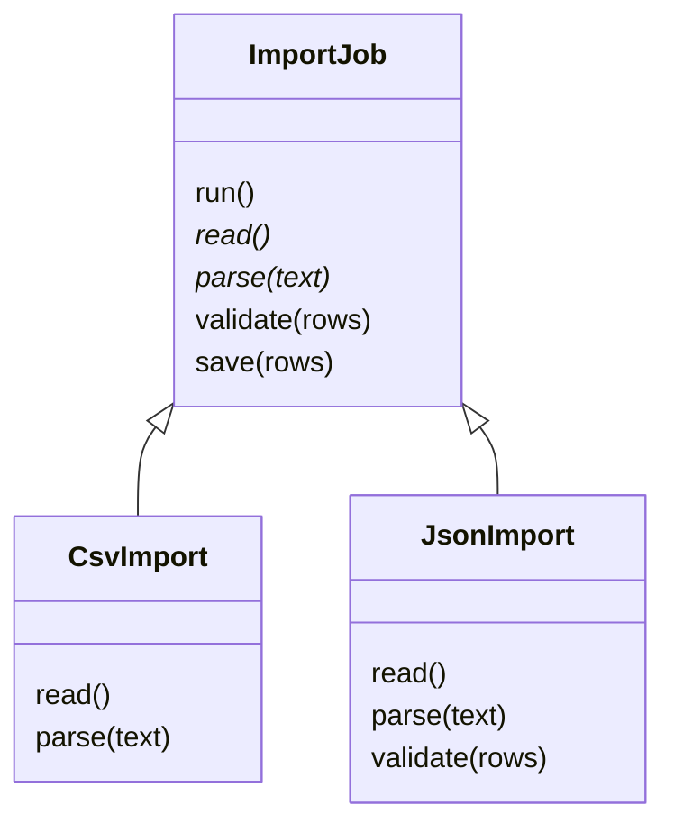

# Strategy, state and template

## In plain words

A navigation app asks how you want to travel: fastest, shortest, or avoiding tolls. The trip, the map and the screen are the same in each case; only the rule for choosing the route is swapped. That is the **strategy** pattern: one fixed piece of code delegates a single varying decision to an interchangeable part.

A traffic light behaves differently depending on its colour, and the colours follow each other by rule. Nobody chooses the next colour from outside; the light moves itself from one behaviour to the next. That is the **state** pattern: an object whose behaviour changes when its internal condition changes.

A tax form has the same sections for everyone, in the same order, with blanks that each person fills in differently. That is the **template** pattern: a fixed sequence of steps, some of which are left to be supplied.

These are **behavioural design patterns**: they deal with how objects divide responsibilities and talk to each other. All three attack the same enemy, a function swollen with `if`/`else if` branches for every variant.

Why it matters for a job: payment providers, authentication methods, export formats, retry policies and feature variants are all strategies in practice. Order workflows and connection handling are state machines. And every time you implement `_transform` in a stream or a lifecycle method in a framework, you are filling in a template.

> **Before this lesson:** you need classes and inheritance (`extends`, `super`) from [Symbols, iterators, accessors and inheritance](#/lesson/javascript/symbols-iterators-inheritance), functions as values, and promises from [Async/await: sequential and parallel flows](#/lesson/nodejs/async-await-flows).

## Strategy

### The problem

```javascript
function shippingCost(order, method) {
  if (method === "standard") {
    return order.weightKg <= 2 ? 4 : 4 + (order.weightKg - 2) * 1.5;
  } else if (method === "express") {
    return 12 + order.weightKg * 2;
  } else if (method === "pickup") {
    return 0;
  } else if (method === "drone") {
    // ... added last month
  }
  throw new Error("unknown method");
}
```

Every new shipping method means editing this function. All the methods' logic is tangled in one place, none can be tested alone, and two developers adding methods at once collide in the same lines.

### The pattern

Split the code into two roles.

- The **context** holds the logic that never changes: here, computing an order total.
- A **strategy** is one interchangeable implementation of the part that varies. All strategies have the same shape, so the context can use any of them without knowing which.



In JavaScript a strategy does not need a class. Functions are values, so a strategy can be a plain function, and a set of strategies a plain object.

```js-run
// Strategies: same input, same kind of output, different rule.
const shippingStrategies = {
  standard: (order) => (order.weightKg <= 2 ? 4 : 4 + (order.weightKg - 2) * 1.5),
  express: (order) => 12 + order.weightKg * 2,
  pickup: () => 0,
};

// Context: knows how to total an order; delegates the shipping rule.
function createCheckout(shippingStrategy) {
  return {
    total(order) {
      const goods = order.items.reduce((sum, item) => sum + item.price * item.qty, 0);
      return { goods, shipping: shippingStrategy(order), total: goods + shippingStrategy(order) };
    },
  };
}

const order = { weightKg: 4, items: [{ price: 20, qty: 2 }, { price: 5, qty: 1 }] };

for (const name of Object.keys(shippingStrategies)) {
  console.log(name.padEnd(9), createCheckout(shippingStrategies[name]).total(order));
}

// A new strategy is added without touching the context or the other strategies:
shippingStrategies.freeOver40 = (o) => (o.items.reduce((s, i) => s + i.price * i.qty, 0) > 40 ? 0 : shippingStrategies.standard(o));
console.log("freeOver40", createCheckout(shippingStrategies.freeOver40).total(order));
```

- `shippingStrategies` maps a name to a function. The `if` chain has turned into a table lookup.
- `createCheckout` receives a strategy and calls it. It contains no method names at all.
- Adding `freeOver40` touched neither the checkout nor the existing rules. This is the benefit usually described as *open for extension, closed for modification*.
- Each strategy is a small pure function, easy to test alone.

Passing the strategy into the context is the dependency injection of the creational module again. Strategy is DI applied to *behaviour*.

### When to use it

| Sign | Example |
|---|---|
| A conditional selects between whole algorithms | pricing rules, sorting orders, compression formats |
| Variants are added over time | payment providers, export formats |
| Users or configuration pick the variant at run time | "sort by price / rating / date" |
| Libraries want to be extended by their users | authentication libraries accept "strategies" for passwords, tokens, social login |

Do not use it for a two-way `if` that is unlikely to grow. A lookup table for two entries is more to read than the `if` it replaces. The problem [Pluggable discount strategies](#/problem/node-strategy) is a compact exercise.

> [!TIP]
> When looking a strategy up by a name that comes from user input, check with `Object.hasOwn(table, name)`. The expression `table[name]` is also truthy for inherited names such as `"constructor"` and `"toString"`, which would then be called as if they were strategies.

## State

### From strategy to state

The **state** pattern is a strategy that changes by itself. The context still delegates to an interchangeable object, but now those objects represent the *conditions* the context can be in, and the context (or the state objects) switches between them as events occur. The caller never picks.

A **state machine** is a model with a fixed set of states, exactly one of which is current, and rules called **transitions** that say which event moves it from one state to another.

### Example: a circuit breaker

When a remote service is down, calling it again and again wastes time (each call waits for a timeout) and keeps the struggling service under load. A **circuit breaker** wraps the calls and has three states:

- **closed**: normal. Calls go through. Consecutive failures are counted; too many and the breaker *opens*.
- **open**: calls fail immediately without touching the service, until a cooling-off period has passed.
- **half-open**: after the cool-off, one trial call is allowed. Success closes the breaker; failure opens it again.

(The naming comes from electricity: a closed circuit lets current flow.)



Written with one object per state, each implementing the same method, `call(fn)`:

```js-run
class CircuitBreaker {
  constructor({ threshold, coolOffMs, now = () => Date.now() }) {
    this.threshold = threshold;
    this.coolOffMs = coolOffMs;
    this.now = now;
    this.failures = 0;
    this.openedAt = 0;
    this.states = { closed: new ClosedState(this), open: new OpenState(this), halfOpen: new HalfOpenState(this) };
    this.state = this.states.closed;
  }
  changeState(name) {
    console.log(`      [breaker] -> ${name}`);
    this.state = this.states[name];
    this.state.enter?.();
  }
  call(fn) { return this.state.call(fn); }          // the context delegates to the current state
}

class ClosedState {
  constructor(breaker) { this.breaker = breaker; }
  enter() { this.breaker.failures = 0; }
  async call(fn) {
    try {
      const result = await fn();
      this.breaker.failures = 0;
      return result;
    } catch (error) {
      if (++this.breaker.failures >= this.breaker.threshold) this.breaker.changeState("open");
      throw error;
    }
  }
}

class OpenState {
  constructor(breaker) { this.breaker = breaker; }
  enter() { this.breaker.openedAt = this.breaker.now(); }
  async call(fn) {
    if (this.breaker.now() - this.breaker.openedAt < this.breaker.coolOffMs) {
      throw new Error("circuit open: call rejected without contacting the service");
    }
    this.breaker.changeState("halfOpen");
    return this.breaker.call(fn);                    // let this call be the trial
  }
}

class HalfOpenState {
  constructor(breaker) { this.breaker = breaker; }
  async call(fn) {
    try {
      const result = await fn();
      this.breaker.changeState("closed");
      return result;
    } catch (error) {
      this.breaker.changeState("open");
      throw error;
    }
  }
}

// ---- demo with a controllable clock and a service that is down for a while ----
let time = 0;
let serviceUp = false;
const service = async () => { if (!serviceUp) throw new Error("service down"); return "200 OK"; };
const breaker = new CircuitBreaker({ threshold: 2, coolOffMs: 100, now: () => time });

async function attempt(label) {
  try { console.log(`t=${String(time).padStart(3)} ${label}:`, await breaker.call(service)); }
  catch (error) { console.log(`t=${String(time).padStart(3)} ${label}: ${error.message}`); }
}

await attempt("call 1");
await attempt("call 2");            // second failure: opens
time = 50;  await attempt("call 3");   // rejected instantly
time = 120; await attempt("call 4");   // cool-off over: trial, still down, opens again
serviceUp = true;
time = 150; await attempt("call 5");   // rejected: cool-off restarted at 120
time = 230; await attempt("call 6");   // trial succeeds: closed
await attempt("call 7");
```

What the structure buys:

- `CircuitBreaker.call` is one line. It has no idea how many states exist.
- Each state class contains only the behaviour of that one condition, and the transitions out of it. To understand "what happens while open?" you read ten lines, not a function full of flags.
- `enter()` gives each state a place for work to do on arrival, such as recording the time.
- The clock is injected (`now`), so the demo and tests control time instead of waiting for it.

The alternative is one method with `if (this.state === "open") ... else if ...` in it, plus the same checks repeated in every other method the object has. With three states and one method that is tolerable, and the problem [A circuit breaker state machine](#/problem/node-state-machine) is in fact solved that way. As the number of states and methods grows, branches multiply and state objects stay flat.

A second classic use in Node is a client that must cope with a lost connection: in an "offline" state it queues outgoing messages, in an "online" state it sends them, and on reconnecting it flushes the queue. Callers call `send()` and never ask which state the client is in.

> [!WARNING]
> Draw the state diagram before writing a state machine, and check every state for every event. Bugs in such code are almost always a missing transition ("what if the trial call is still running when a second request arrives?") or two flags that disagree (`isOpen` and `isClosed` both true). One variable holding one current state makes impossible combinations impossible.

## Template

### The pattern

The **template** pattern fixes the *skeleton* of an algorithm in a base class and leaves certain steps to be filled in by subclasses. The base class method that runs the steps in order is the **template method**; the steps to be supplied are sometimes called **hooks** or abstract methods.

JavaScript has no `abstract` keyword, so the base class usually supplies a step that throws ("you must implement this"), or a harmless default.



```js-run
class ImportJob {
  // The template method: the order of steps is decided here, once.
  async run() {
    const text = await this.read();
    const rows = this.parse(text);
    const valid = this.validate(rows);
    const saved = await this.save(valid);
    return `${this.constructor.name}: read ${rows.length}, saved ${saved}, rejected ${rows.length - saved}`;
  }

  // Steps every subclass must provide:
  async read() { throw new Error(`${this.constructor.name} must implement read()`); }
  parse(text) { throw new Error(`${this.constructor.name} must implement parse()`); }

  // Steps with a sensible default that a subclass may override:
  validate(rows) { return rows.filter((row) => row.name && Number.isFinite(row.price)); }
  async save(rows) { return rows.length; }                         // pretend to write to a database
}

class CsvImport extends ImportJob {
  constructor(text) { super(); this.text = text; }
  async read() { return this.text; }
  parse(text) {
    const [header, ...lines] = text.trim().split("\n");
    const keys = header.split(",");
    return lines.map((line) => {
      const cells = line.split(",");
      return { name: cells[keys.indexOf("name")], price: Number(cells[keys.indexOf("price")]) };
    });
  }
}

class JsonImport extends ImportJob {
  constructor(text) { super(); this.text = text; }
  async read() { return this.text; }
  parse(text) { return JSON.parse(text); }
  validate(rows) { return super.validate(rows).filter((row) => row.price > 0); }   // extends the default
}

class BrokenImport extends ImportJob {}

console.log(await new CsvImport("name,price\ntea,3.5\n,2\nmilk,abc\njam,4").run());
console.log(await new JsonImport('[{"name":"tea","price":3.5},{"name":"gift","price":0}]').run());
console.log(await new BrokenImport().run().catch((error) => "error: " + error.message));
```

- `run()` is written once and is the only place that knows the sequence read, parse, validate, save. No subclass can accidentally save before validating.
- `CsvImport` supplies the two required steps and inherits the rest.
- `JsonImport` overrides `validate` and calls `super.validate(rows)` to keep the default checks and add one.
- A subclass that forgets a required step fails with a message that names the missing method.

### Template in the wild

You met this pattern in the streams module without the name. To create a custom stream you extend `Readable`, `Writable` or `Transform` and implement `_read`, `_write` or `_transform`. The base class owns the hard, fixed part of the algorithm (buffering, backpressure, events), and your method supplies the one step that differs. The leading underscore is the Node convention for "implement this, never call it". Web frameworks that ask you to implement lifecycle methods, and test frameworks with `beforeEach`/`afterEach`, use the same idea.

### Template or strategy?

Both let one part of an algorithm vary. They differ in mechanism and in timing.

| | Template | Strategy |
|---|---|---|
| Variation supplied by | a subclass (inheritance) | an object or function passed in (composition) |
| Chosen | when the class is defined | at run time, and can be swapped |
| Number of varying steps | several steps of one skeleton | usually one decision |
| Coupling | subclass depends on the base class's internals | context and strategy share only a small interface |

Modern JavaScript leans towards composition. The import job could equally be a function `runImport({ read, parse, validate, save })` taking its steps as arguments, which is the strategy form of the same idea and is easier to test and combine. Use the template form when you are extending a framework that is built on it, or when the steps genuinely share state through `this`.

> [!INTERVIEW]
> **"Strategy versus state?"** "Structurally the same: a context delegates to an interchangeable object. With strategy, the client chooses the algorithm and it normally stays fixed; with state, the object represents the context's current condition and is replaced by the context itself, or by the states, as transitions occur." **"Strategy versus template?"** Composition and run-time choice versus inheritance and a choice fixed at definition. **"What is a circuit breaker?"** A state machine (closed, open, half-open) around a remote call that fails fast while the dependency is unhealthy and probes it after a cool-off.

## Pitfalls

- **Strategies with different shapes.** If one needs extra arguments the context must special-case it, and the pattern has collapsed. Agree on one signature; pass a single options object if needs differ.
- **Looking up strategies with `table[name]`** on user input without an own-property check.
- **State spread across booleans** (`isConnecting`, `isConnected`, `isClosing`) that can contradict each other.
- **Transitions scattered** through the codebase, so nobody can list them. Keep them inside the states or in one transition table.
- **Forgetting the clock.** Time-based states are untestable unless the time source is injected.
- **Deep template hierarchies.** A subclass of a subclass of a template, each overriding parts, is very hard to follow. One level is usually the limit.
- **Subclasses calling steps in their own order**, bypassing the template method. Only the base class should orchestrate.

## Cheat sheet

| Pattern | Core idea | Minimal form in JavaScript |
|---|---|---|
| Strategy | swap one algorithm | `const strategies = { a: fn, b: fn }; context(strategies[name])` |
| State | behaviour follows internal state | `this.state = this.states.x; method() { return this.state.method(); }` |
| Template | fixed skeleton, variable steps | base class `run()` calling `this.step1()`, `this.step2()` implemented by subclasses |

| Question | Answer |
|---|---|
| Who selects the variant? | Strategy: the client. State: the object itself. Template: the subclass author |
| When? | Strategy: run time. State: on each transition. Template: at class definition |
| Built with | Strategy and state: composition. Template: inheritance |

## Summary

- Behavioural patterns organise who does what. Strategy, state and template each replace a growing conditional with interchangeable parts.
- Strategy separates a stable context from swappable algorithms with one shared signature; in JavaScript a strategy is often a function in a lookup table.
- State is a strategy that the object changes itself as it moves through a state machine; one object per state keeps each condition's behaviour and transitions together. The circuit breaker is the standard example in service code.
- Template fixes the order of steps in a base class and lets subclasses fill them in; Node's stream base classes work this way.
- Prefer composition (strategy) unless a framework's design or shared state calls for inheritance (template).

## Glossary

- **Behavioural pattern**: a pattern about how objects interact and share responsibilities.
- **Context**: the object that holds the unchanging logic and delegates the variable part.
- **Strategy**: an interchangeable implementation of the variable part.
- **State machine**: a model with a set of states, one current state, and transitions between them.
- **Transition**: a rule that moves a state machine from one state to another on an event.
- **Circuit breaker**: a wrapper that stops calling a failing dependency for a while.
- **Closed / open / half-open**: the breaker's normal, blocking and probing states.
- **Template method**: a base-class method that runs a fixed sequence of steps.
- **Hook (abstract method)**: a step left for subclasses to implement.
- **Composition / inheritance**: building behaviour by combining objects / by extending classes.

```quiz
[
  {"q": "What does the strategy pattern replace?", "options": ["Loops", "A conditional that selects among whole algorithms inside one function", "Asynchronous code", "Class constructors"], "answer": 1,
   "explain": "The branches become separate interchangeable strategies with a common interface."},
  {"q": "In the shipping example, what must change to add a new shipping method?", "options": ["The checkout context", "Every existing strategy", "Only a new strategy function is added to the table", "The order object"], "answer": 2,
   "explain": "The context and existing strategies are untouched; that is the point of the pattern."},
  {"q": "How does the state pattern differ from strategy?", "options": ["State uses inheritance", "In state, the object switches its own behaviour object as its condition changes; in strategy the client picks one", "State cannot be asynchronous", "They are unrelated"], "answer": 1,
   "explain": "Same structure, different owner of the choice."},
  {"q": "A breaker has threshold 2 and cool-off 100 ms. Calls fail at t=0 and t=10. What happens to a call at t=60?", "options": ["It reaches the service", "It is rejected immediately without contacting the service", "It closes the breaker", "It waits 40 ms"], "answer": 1,
   "explain": "The breaker opened at t=10; until t=110 calls fail fast."},
  {"q": "The same breaker gets a call at t=120 and the service is still down. What state follows?", "options": ["closed", "half-open permanently", "open again, with the cool-off restarting at 120", "It throws and stays half-open"], "answer": 2,
   "explain": "The trial call in half-open failed, so the breaker reopens and records the new time."},
  {"q": "In the template pattern, where is the order of the steps defined?", "options": ["In each subclass", "In the template method of the base class", "In the caller", "In a configuration file"], "answer": 1,
   "explain": "The base class owns the skeleton; subclasses only supply steps."},
  {"q": "In what order do these log?\n\n`class Base { run() { console.log('start'); this.step(); console.log('end'); } step() { console.log('base step'); } } class Sub extends Base { step() { console.log('sub step'); super.step(); } } new Sub().run();`", "options": ["start, base step, end", "start, sub step, base step, end", "sub step, start, base step, end", "start, sub step, end"], "answer": 1,
   "explain": "run is inherited and calls this.step, which resolves to Sub's override; that logs and then calls the base implementation."},
  {"q": "Which Node feature is an example of the template pattern?", "options": ["Promise.all", "Implementing _transform in a class that extends Transform", "require.cache", "process.nextTick"], "answer": 1,
   "explain": "The stream base class runs the fixed algorithm and calls your _transform for the variable step."}
]
```

> **Source:** Casciaro & Mammino, *Node.js Design Patterns* 3e, ch. 9 (topics only; wording and examples are original). Documentation: https://nodejs.org/docs/latest/api/stream.html#api-for-stream-implementers
