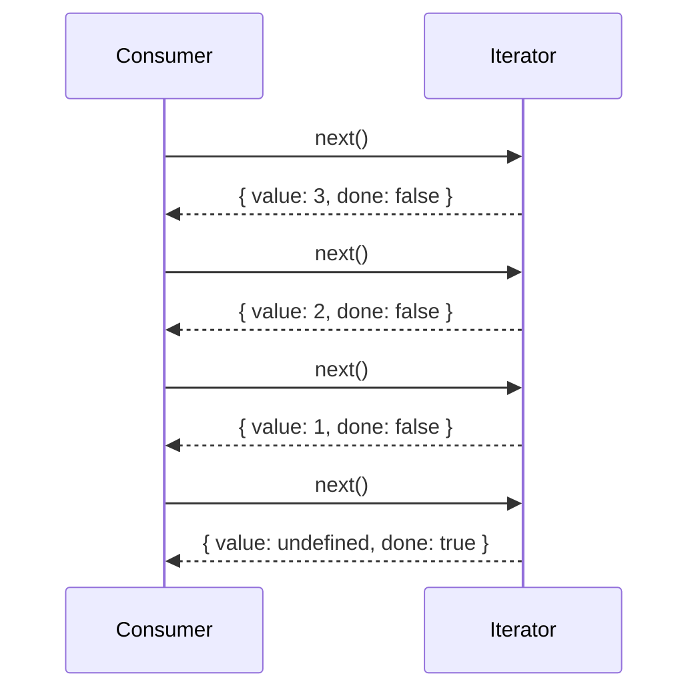

# Iterators, generators and async iterators

## In plain words

A deck of cards, a queue at a bakery and the pages of a book are organised very differently, yet all three can be gone through "one at a time, from the start, until there are no more". You do not need to know how the book is bound in order to turn the next page.

The **iterator** pattern gives every collection that same single gesture: *give me the next item*. Code that consumes items does not care whether they come from an array, a tree, a file, a database cursor or a formula that invents them on the spot. JavaScript builds this pattern into the language (it is what `for...of` uses), adds **generators** as a remarkably short way to write iterators, and extends both to values that arrive over time with **async iterators**.

Why it matters for a job: `for await (const chunk of stream)` and "loop over every page of this API" are everyday Node code, and both are async iteration. Generators let you process data sets too large to hold in memory, lazily. Interviewers often ask candidates to make a custom object work with `for...of`, or to explain what `yield` does.

> **Before this lesson:** you need objects, classes and symbols at the level of [Symbols, iterators, accessors and inheritance](#/lesson/javascript/symbols-iterators-inheritance), and `async`/`await` from [Async/await: sequential and parallel flows](#/lesson/nodejs/async-await-flows). The streams lessons used `for await` already; here it is explained.

## The iterator protocol

A **protocol** is an agreement about the shape of an object: which methods it has and what they return. The **iterator protocol** is tiny. An **iterator** is any object with a method `next()` that returns an object with two properties:

- `done`: `false` while there are items, `true` when the sequence is finished;
- `value`: the current item (or, when `done` is true, an optional final value).

```js-run
function createCountdown(from) {
  let current = from;
  return {
    next() {
      if (current <= 0) return { done: true, value: undefined };
      return { done: false, value: current-- };
    },
  };
}

const iterator = createCountdown(3);
console.log(iterator.next());
console.log(iterator.next());
console.log(iterator.next());
console.log(iterator.next());      // finished
console.log(iterator.next());      // still finished: asking again is harmless
```

The iterator carries a little state (`current`), the bookmark, and each call to `next()` advances it. Nothing is computed until someone asks; an iterator is **lazy**.



Two optional methods exist for early exits: `return()`, called by the consumer when it stops before the end (so the iterator can release resources such as an open file), and `throw()`.

## The iterable protocol

Calling `next()` by hand is tedious. The language can do it for you, provided it knows how to *obtain* an iterator from your object. An **iterable** is an object that has a method stored under the special key `Symbol.iterator`, and that method returns an iterator. A **symbol** is a unique key that cannot clash with ordinary string property names; `Symbol.iterator` is one of a handful defined by the language.

```js-run
class Playlist {
  #songs = [];
  add(title) { this.#songs.push(title); return this; }

  [Symbol.iterator]() {                    // the iterable protocol
    let index = 0;
    const songs = this.#songs;
    return {                               // a fresh iterator on every call
      next: () => (index < songs.length ? { done: false, value: songs[index++] } : { done: true, value: undefined }),
    };
  }
}

const playlist = new Playlist().add("Intro").add("Second Song").add("Finale");

for (const song of playlist) console.log("playing", song);

console.log("spread:", [...playlist]);
const [first, ...others] = playlist;
console.log("destructured:", first, "| then", others.length, "more");
console.log("as a Set:", new Set(playlist).size, "| Array.from:", Array.from(playlist, (s) => s.length));
```

Once `Playlist` is iterable, every language feature that consumes iterables works on it: `for...of`, the spread operator `...`, array destructuring, `Array.from`, the `Map` and `Set` constructors, `Promise.all`, and more. The private array stays private; consumers get items without seeing how they are stored.

Each call to `[Symbol.iterator]()` returns a **new** iterator, so two loops over the same playlist do not disturb each other. Arrays, strings, maps and sets are built-in iterables on the same terms.

> [!NOTE]
> Iterator versus iterable: the iterable is the book, the iterator is a bookmark in it. A book can have many bookmarks. Many built-in iterators are *also* iterable (their `[Symbol.iterator]()` returns themselves), which is why you can loop over `map.entries()` directly.

## Generators

Writing an iterator by hand means keeping the state yourself and returning `{ done, value }` objects. A **generator function** does all of that for you. It is declared with `function*`, and inside it the keyword `yield` hands a value to the consumer and **pauses the function** at that line, with all its local variables preserved. The next call to `next()` resumes it right after the `yield`.

```js-run
function* countdown(from) {
  console.log("  (generator body starts)");
  for (let n = from; n > 0; n--) {
    yield n;                               // pause here, hand n to the consumer
    console.log(`  (resumed after yielding ${n})`);
  }
  console.log("  (generator body ends)");
}

const generator = countdown(2);            // nothing runs yet
console.log("created; now calling next()");
console.log(generator.next());
console.log(generator.next());
console.log(generator.next());
```

Follow the output carefully:

1. Calling `countdown(2)` does **not** run the body. It returns a **generator object**, which is both an iterator and an iterable.
2. The first `next()` runs the body up to the first `yield` and returns `{ value: 2, done: false }`.
3. The second `next()` resumes after that `yield`, logs the "resumed" line, loops, and stops at the next `yield`.
4. The third `next()` resumes, finishes the loop and the function; with nothing more to yield it returns `{ value: undefined, done: true }`.

This "pause in the middle of a function and continue later" ability is the same one `await` uses. Async functions were in fact designed as generators that are resumed automatically when a promise settles.

### Generators as iterator implementations

The whole `[Symbol.iterator]` method of `Playlist` shrinks to this:

```javascript
*[Symbol.iterator]() {
  for (const song of this.#songs) yield song;
}
```

or, delegating to another iterable with `yield*`:

```javascript
*[Symbol.iterator]() {
  yield* this.#songs;                      // yield every item of the array, one by one
}
```

### Laziness and infinite sequences

A generator computes each value only when asked, so it can describe a sequence with no end, and helpers can transform sequences item by item without building intermediate arrays.

```js-run
function* naturals() {                     // 1, 2, 3, ... forever
  let n = 1;
  while (true) yield n++;
}
function* filter(source, test) { for (const item of source) if (test(item)) yield item; }
function* map(source, fn) { for (const item of source) yield fn(item); }
function* take(source, count) {
  if (count <= 0) return;
  for (const item of source) {
    yield item;
    if (--count === 0) return;             // stop pulling: the infinite source is never exhausted
  }
}

let examined = 0;
const counted = map(naturals(), (n) => { examined++; return n; });
const firstFiveSquaresOfMultiplesOf7 = take(map(filter(counted, (n) => n % 7 === 0), (n) => n * n), 5);

console.log([...firstFiveSquaresOfMultiplesOf7]);
console.log("numbers examined:", examined, "(not infinity)");
```

Each stage **pulls** from the stage before it. When `take` has its five items it returns, nothing asks for more, and the infinite `naturals` generator stops where it is. Only 35 numbers were ever produced. With arrays and `.filter().map()` you would have to create the full list first, which here is impossible. Recent JavaScript versions provide such helpers as built-in iterator methods (`iterator.map(...)`, `.filter(...)`, `.take(...)`).

### Talking back to a generator

`next` can also send a value *into* the generator: the argument of `next(x)` becomes the result of the `yield` expression that was paused. `return(v)` ends it early; `throw(err)` raises an error at the paused `yield`.

```js-run
function* runningAverage() {
  let sum = 0, count = 0;
  let input = yield "ready";               // the first next() stops here
  while (true) {
    sum += input; count++;
    input = yield sum / count;             // hand back the average, wait for the next number
  }
}

const average = runningAverage();
console.log(average.next().value);         // "ready"
console.log(average.next(10).value);       // 10
console.log(average.next(20).value);       // 15
console.log(average.next(60).value);       // 30
console.log(average.return("stopped"));    // { value: "stopped", done: true }
```

Two-way generators are less common in application code, but they are how `async`/`await` was built before it became syntax, and the next modules use them once for cancellation.

## Async iterators

Everything so far is synchronous: `next()` returns its item at once. A paginated web API, a database cursor or a network stream cannot do that; each item needs waiting for. The **async iterator protocol** is the same idea with one change: `next()` returns a **promise** of `{ value, done }`. An **async iterable** has a method under `Symbol.asyncIterator` that returns an async iterator, and the loop that consumes it is `for await...of`.

### Async generators

Add `async` to a generator function and you may use both `await` and `yield` inside. This is by far the easiest way to produce an async iterable.

```js-run
// A pretend remote API that returns results one page at a time.
const database = Array.from({ length: 7 }, (_, i) => `customer-${i + 1}`);
let requests = 0;
async function fetchPage(cursor = 0, pageSize = 3) {
  requests++;
  await new Promise((resolve) => setTimeout(resolve, 15));
  const items = database.slice(cursor, cursor + pageSize);
  const nextCursor = cursor + pageSize < database.length ? cursor + pageSize : null;
  return { items, nextCursor };
}

// The async generator hides the paging completely.
async function* allCustomers() {
  let cursor = 0;
  while (cursor !== null) {
    const page = await fetchPage(cursor);          // wait for the network
    yield* page.items;                             // hand out the items one by one
    cursor = page.nextCursor;
  }
}

for await (const customer of allCustomers()) {
  console.log(customer, `(requests so far: ${requests})`);
  if (customer === "customer-4") break;            // early exit: the third page is never fetched
}
console.log("total requests:", requests);
```

- The consumer writes an ordinary-looking loop and never sees pages, cursors or requests.
- Fetching is **lazy**: page 2 is requested only when the loop has used up page 1. Breaking out after the fourth customer means the third page is never fetched. Compare that with a function that downloads all pages into an array before returning.
- The loop body may itself `await`; the generator stays paused meanwhile. That is backpressure, for free.
- Errors thrown inside the generator (a failed request) surface at the `for await` line and can be caught with `try`/`catch`.

The problem [A lazy page-flattening iterator](#/problem/node-iterator) is the synchronous skeleton of this example.

### Async iteration in Node

Node's own asynchronous sources implement the protocol:

```javascript
import { createReadStream } from "node:fs";
import { createInterface } from "node:readline";
import { on } from "node:events";
import { setInterval as every } from "node:timers/promises";

// 1. Any Readable stream: one chunk per turn.
for await (const chunk of createReadStream("access.log")) console.log(chunk.length);

// 2. Lines of a file, however large.
const lines = createInterface({ input: createReadStream("access.log"), crlfDelay: Infinity });
for await (const line of lines) if (line.includes(" 500 ")) console.log(line);

// 3. Events from an emitter, as a never-ending loop.
for await (const [request] of on(server, "request")) console.log(request.url);

// 4. A tick every second.
for await (const _ of every(1000)) console.log(new Date().toISOString());
```

And in the other direction, an async generator can be turned into a stream with `Readable.from(generator())`, or used directly as a stage in `pipeline`, as the transform lesson showed. Streams and async iterators are two views of the same thing: a sequence of values arriving over time, consumed at the reader's pace.

> [!TIP]
> Prefer an async generator over a hand-written stream class or event emitter when you are *producing* a sequence in code. It is shorter, handles backpressure by construction, and reports errors through ordinary exceptions.

> [!WARNING]
> `for await` processes items **one at a time**. That is correct for ordered or dependent work, and slow for independent work such as "call an API for each of 10,000 rows". For that, combine iteration with a concurrency limit, as in the lesson on limited concurrency. Also remember that a `for await` over an endless source (such as `on(emitter, ...)`) never finishes on its own: nothing after the loop runs unless you `break` or abort it.

> [!INTERVIEW]
> **"What is the difference between an iterator and an iterable?"** "An iterator has a `next()` method returning `{ value, done }` and holds a position. An iterable has a `[Symbol.iterator]()` method that returns an iterator; that is what `for...of`, spread and destructuring call." **"What does `yield` do?"** "It pauses a generator function, passing a value to the caller of `next()`; the function resumes from that point on the following `next()`, with its local state intact. Generators are therefore lazy." **"How do you iterate over paginated results?"** An async generator that awaits each page and yields its items, consumed with `for await`.

## Pitfalls

- **Expecting a generator to run when called.** `gen()` only creates the generator object; the body starts at the first `next()`.
- **Re-using an exhausted generator.** A generator object can be iterated once. To loop again, call the generator function again (an iterable *class* returns a fresh iterator each time, which avoids this).
- **Spreading an infinite iterable** (`[...naturals()]`) hangs until memory runs out. Limit it first.
- **Using `for...in`** (which lists property keys) where `for...of` (which iterates values) was meant.
- **Forgetting `async`** on a generator that needs `await`, or using plain `for...of` on an async iterable (`TypeError: ... is not iterable`).
- **Breaking out without clean-up.** If a generator holds a resource, release it in a `finally` block; `break` triggers the iterator's `return()`, which runs `finally`.
- **Sequential `for await` over independent tasks** when throughput matters.

## Cheat sheet

| Thing | Shape |
|---|---|
| Iterator | `{ next() { return { value, done }; } }` |
| Iterable | `{ [Symbol.iterator]() { return iterator; } }` |
| Generator function | `function* name() { yield value; }` |
| Delegate to another iterable | `yield* other;` |
| Make a class iterable | `*[Symbol.iterator]() { yield* this.items; }` |
| Async iterator | `next()` returns `Promise<{ value, done }>` |
| Async iterable | `{ [Symbol.asyncIterator]() { ... } }` |
| Async generator | `async function* name() { const x = await f(); yield x; }` |
| Consume | `for (const x of iterable)` / `for await (const x of asyncIterable)` |
| Other consumers | `[...it]`, `const [a, b] = it`, `Array.from(it)`, `new Map(it)`, `new Set(it)` |
| Node sources | streams, `readline` interfaces, `events.on`, `timers/promises` `setInterval` |
| Generator to stream | `Readable.from(generator())` |

## Summary

- The iterator pattern separates *going through* a collection from how it is stored. An iterator exposes `next()` returning `{ value, done }`; an iterable provides iterators through `Symbol.iterator`.
- `for...of`, spread, destructuring and many constructors consume any iterable.
- Generator functions (`function*` with `yield`) are pausable functions that implement the protocol automatically and lazily, which makes infinite and pipelined sequences practical.
- Async iterators return promises from `next()`; async generators and `for await` handle values that arrive over time, such as pages, lines and stream chunks, with laziness, backpressure and normal error handling.
- Node streams, readline, emitters and timers all offer async iteration.

## Glossary

- **Protocol**: an agreed shape that objects follow so that other code can use them.
- **Iterator**: an object with `next()` that returns items one at a time.
- **Iterable**: an object that can produce an iterator via `Symbol.iterator`.
- **Symbol**: a unique property key; `Symbol.iterator` and `Symbol.asyncIterator` are predefined ones.
- **Lazy evaluation**: computing a value only when it is requested.
- **Generator function**: a `function*` whose execution can pause at `yield`.
- **Generator object**: what calling a generator function returns; an iterator and iterable in one.
- **`yield` / `yield*`**: hand out one value and pause / hand out every value of another iterable.
- **Async iterator / async iterable**: the promise-returning variants of the two protocols.
- **Async generator**: an `async function*`, able to `await` and `yield`.
- **Cursor**: a marker for a position in a large result set, used to request the next page.
- **Pull-based**: the consumer asks for each item, as opposed to items being pushed at it.

```quiz
[
  {"q": "What must an object have to be used in `for...of`?", "options": ["A length property", "A next() method", "A method under Symbol.iterator that returns an iterator", "It must extend Array"], "answer": 2,
   "explain": "for...of calls [Symbol.iterator]() to obtain an iterator and then calls next() on it."},
  {"q": "In what order do these log?\n\n`function* g() { console.log('A'); yield 1; console.log('B'); } const it = g(); console.log('C'); it.next(); console.log('D'); it.next();`", "options": ["A, C, D, B", "C, A, D, B", "C, A, B, D", "A, B, C, D"], "answer": 1,
   "explain": "Calling g() runs nothing. The first next() runs to the yield (A). After D, the second next() resumes and logs B."},
  {"q": "What does `[...take(naturals(), 3)]` produce, where naturals yields 1, 2, 3, ... forever and take stops after n items?", "options": ["An infinite loop", "[1, 2, 3]", "[]", "A TypeError"], "answer": 1,
   "explain": "take pulls only three values and then returns, so the infinite generator is never asked for more."},
  {"q": "A generator object has been fully consumed by one for...of loop. What does a second loop over the same object do?", "options": ["Repeats all the values", "Runs zero iterations", "Throws an error", "Restarts the generator"], "answer": 1,
   "explain": "A generator object is a one-shot iterator; call the generator function again for a new one."},
  {"q": "What does `next()` return for an async iterator?", "options": ["{ value, done }", "A promise of { value, done }", "A callback", "A stream"], "answer": 1,
   "explain": "That single difference is why it must be consumed with for await."},
  {"q": "In the paginated example, why is the third page never requested when the loop breaks at customer-4?", "options": ["The server refused", "The async generator is lazy: it only runs up to the next yield when the consumer asks for another item", "for await caches pages", "break throws an error in the generator"], "answer": 1,
   "explain": "Nothing asks for a seventh item, so the code that would fetch the next page never executes."},
  {"q": "What does `const x = yield 5;` evaluate x to when the consumer calls `it.next(42)` to resume?", "options": ["5", "42", "undefined", "{ value: 5, done: false }"], "answer": 1,
   "explain": "The argument passed to next() becomes the value of the paused yield expression."},
  {"q": "Which statement about `for await (const row of rows)` is true?", "options": ["It processes all rows in parallel", "It processes one row at a time, waiting for the loop body before requesting the next", "It only works on arrays", "It blocks the event loop"], "answer": 1,
   "explain": "Async iteration is sequential and pull-based; it suspends the function, not the thread."}
]
```

> **Source:** Casciaro & Mammino, *Node.js Design Patterns* 3e, ch. 9 (topics only; wording and examples are original). Documentation: https://developer.mozilla.org/en-US/docs/Web/JavaScript/Reference/Iteration_protocols, https://nodejs.org/docs/latest/api/events.html#eventsonemitter-eventname-options, https://nodejs.org/docs/latest/api/readline.html
