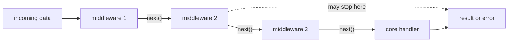
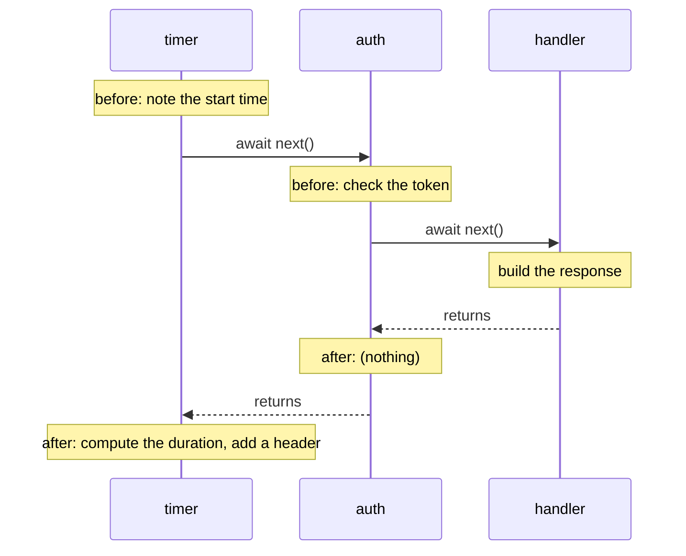
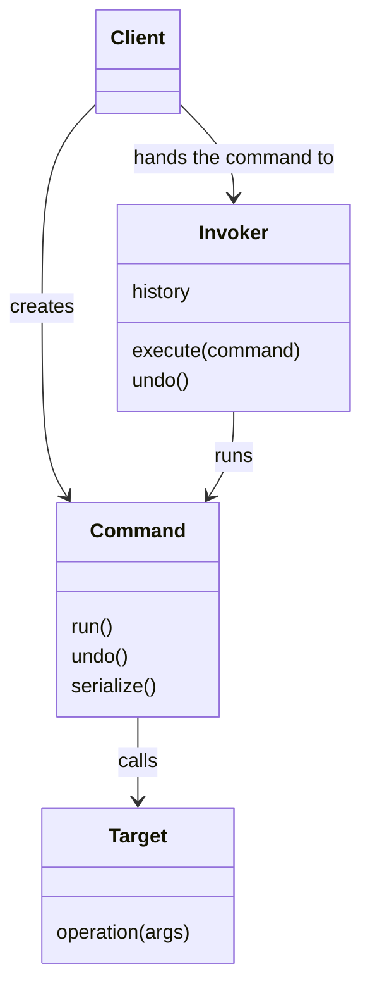

# Middleware and command

## In plain words

At an airport every passenger passes the same series of stations: ticket check, passport control, security scan, boarding gate. Each station does one job, may add something (a stamp), may turn you back, and otherwise waves you on to the next. Stations can be added or reordered without rebuilding the airport. In software that chain of stations is called **middleware**: a sequence of small functions that every request passes through on its way to being handled.

In a restaurant the waiter does not shout your order at the cook. They write it on a slip. The slip can wait in a line, be given to a different cook, be kept for the bill, or be cancelled before it is cooked. Turning a request into a thing you can hold is the **command** pattern: an object that describes an action to perform, separate from actually performing it.

Why it matters for a job: every Node web framework (Express, Fastify, Koa, NestJS) is organised around middleware; you will write some in your first week. Commands are the idea underneath undo/redo, job queues, audit logs and "retry this later", which appear in almost every back-end system.

> **Before this lesson:** you need closures and higher-order functions, `async`/`await` from [Async/await: sequential and parallel flows](#/lesson/nodejs/async-await-flows), and the first HTTP server from [npm, package.json and your first HTTP server](#/lesson/nodejs/npm-first-server).

## Middleware

### Where the word comes from

In the HTTP lesson one handler function did everything: parse the URL, read the body, check the route, build the response. Real applications need the same chores on every request: logging, parsing JSON bodies, checking who the user is, compressing the response, catching errors. Writing those inside each route handler would repeat them hundreds of times.

Express, the most widely used Node web framework, made a simple idea popular: register a list of functions; each receives the request, the response and a function called `next`. A function does its part and calls `next()` to pass control on, or sends a response and does not call it.

```javascript
import express from "express";
const app = express();

app.use((req, res, next) => {                 // 1. logging
  console.log(req.method, req.url);
  next();
});

app.use(express.json());                      // 2. parse JSON bodies into req.body

app.use((req, res, next) => {                 // 3. authentication
  if (req.headers.authorization !== "Bearer secret-token") {
    return res.status(401).json({ error: "not logged in" });     // stop: next() is not called
  }
  req.user = { id: 7 };                       // enrich the request for later stations
  next();
});

app.get("/profile", (req, res) => {           // 4. the actual handler
  res.json({ id: req.user.id });
});

app.use((err, req, res, next) => {            // 5. error handler: four parameters
  console.error(err);
  res.status(500).json({ error: "internal error" });
});
```

Three things each function may do: **read or modify** the request and response objects (step 3 adds `req.user`), **end the cycle** by sending a response (the 401), or **pass control** with `next()`. Calling `next(err)` with an argument skips ahead to the error-handling middleware, recognised by its four parameters.

### Middleware as a general pattern

Strip away HTTP and what remains is a reusable design: **a pipeline of processing units, each of which receives some data, can transform it, can stop the pipeline, and can be added or removed independently.** It combines two older patterns: *intercepting filter* (pre- and post-processing around a core handler) and *chain of responsibility* (passing a request along a chain until someone handles it).

The component that stores the functions and runs them is often called a **middleware manager**. New functions are registered with `use()`.



The pattern suits any situation with a stream of similar items needing a configurable series of treatments: validating and enriching messages from a queue, pre-processing commands in a command-line tool, transforming jobs before they run.

### The onion model

In Express, a middleware cannot easily do something *after* the rest of the chain has finished, because `next()` returns before later asynchronous work is complete. The framework Koa refined the idea: `next` returns a **promise** that settles when everything downstream is done. A middleware that writes `await next()` therefore has a "before" part and an "after" part, wrapped around the rest like the layers of an onion.



The function that makes this work is short. It is the heart of every onion-style framework, so it is worth reading slowly.

```js-run
function compose(middlewares) {
  return function run(context) {
    function dispatch(index) {
      if (index === middlewares.length) return Promise.resolve();     // past the last one: nothing left
      const middleware = middlewares[index];
      let called = false;
      const next = () => {
        if (called) return Promise.reject(new Error("next() called multiple times"));
        called = true;
        return dispatch(index + 1);                                   // run the rest of the chain
      };
      try {
        return Promise.resolve(middleware(context, next));            // works for sync and async middleware
      } catch (error) {
        return Promise.reject(error);
      }
    }
    return dispatch(0);
  };
}

// ---- three middlewares and a handler ----
const sleep = (ms) => new Promise((resolve) => setTimeout(resolve, ms));

async function timer(ctx, next) {
  const started = Date.now();
  ctx.log.push("timer: before");
  await next();
  ctx.log.push(`timer: after (downstream took about ${Math.round((Date.now() - started) / 10) * 10} ms)`);
}

async function errorBoundary(ctx, next) {
  try {
    await next();
  } catch (error) {
    ctx.log.push("errorBoundary: caught " + error.message);
    ctx.status = 500;
    ctx.body = { error: "something went wrong" };
  }
}

async function auth(ctx, next) {
  ctx.log.push("auth: before");
  if (ctx.token !== "secret") { ctx.status = 401; ctx.body = { error: "not logged in" }; return; }   // stop
  ctx.user = { id: 7 };
  await next();
}

async function handler(ctx) {
  ctx.log.push("handler");
  await sleep(20);
  if (ctx.path === "/crash") throw new Error("database exploded");
  ctx.status = 200;
  ctx.body = { hello: "user " + ctx.user.id };
}

const app = compose([timer, errorBoundary, auth, handler]);

for (const request of [{ path: "/profile", token: "secret" }, { path: "/profile", token: "wrong" }, { path: "/crash", token: "secret" }]) {
  const ctx = { ...request, log: [] };
  await app(ctx);
  console.log(`${request.path} with token "${request.token}" -> ${ctx.status} ${JSON.stringify(ctx.body)}`);
  for (const line of ctx.log) console.log("     ", line);
}
```

How `compose` works:

- `dispatch(index)` runs middleware number `index` and gives it a `next` function. That `next`, when called, runs `dispatch(index + 1)`: everything further down the chain.
- Since `next()` returns the promise of the rest of the chain, `await next()` resumes only when all inner layers have finished. That gives each middleware its "after" phase.
- A middleware that returns without calling `next` (as `auth` does for a bad token) cuts the chain short; the handler never runs, but outer layers still complete their "after" part.
- An error thrown anywhere inside rejects the promise that some outer layer is awaiting. `errorBoundary` catches it with ordinary `try`/`catch`. One middleware placed near the top handles the failures of everything below it.
- The `called` flag catches a classic bug, calling `next()` twice, which would run the rest of the chain twice.

The single shared object passed to every layer is conventionally called the **context** (`ctx`). Layers communicate by reading and writing it: `auth` sets `ctx.user`, `handler` reads it.

Order is part of the program. `timer` first, so it measures everything. `errorBoundary` before the layers whose errors it should catch. `auth` before any handler that needs `ctx.user`. The problem [Run a middleware chain (the onion model)](#/problem/node-middleware-onion) has you implement the dispatch logic and predict such orders.

> [!WARNING]
> Three bugs account for most middleware trouble: forgetting to call `next()` (the request hangs until it times out), calling it twice (the handler runs twice, usually ending in "headers already sent"), and calling `next()` without `await` or `return` in async middleware, so that errors thrown downstream are not seen by your `try`/`catch` and the "after" code runs too early.

> [!TIP]
> Keep each middleware single-purpose and unaware of the others, and let it declare what it needs from the context. A middleware that only works when three specific others ran before it, in an exact order, is a hidden dependency waiting to break.

## Command

### The idea

Normally, calling a method is immediate and leaves nothing behind: `account.withdraw(50)` happens and is gone. The **command** pattern turns an invocation into an **object** holding everything needed to perform it later: which object to act on (the **target**, or *receiver*), which operation, and with which arguments. The code that decides *what* should happen is thereby separated from the code that makes it happen, called the **invoker**.



Once an invocation is a piece of data, a surprising number of things become possible:

| Capability | How |
|---|---|
| **Run it later** | keep it in a queue or schedule it |
| **Undo it** | the command knows how to reverse itself |
| **Record it** | a history of commands is an audit log |
| **Send it elsewhere** | serialise it and let another process or machine run it |
| **Retry it** | run the same object again after a failure |
| **Cancel it** | remove it from the queue before it runs |
| **Group it** | run several as one unit and roll back if one fails |

### The simplest command: a task

In JavaScript the lightest form of a command is a function with its arguments already captured, by a closure or with `bind`:

```javascript
const task = () => warehouse.remove("tea", 5);           // closure
const sameTask = warehouse.remove.bind(warehouse, "tea", 5);   // bind

queue.push(task);        // somebody else will call it, at some other time
```

You have used this all along: the `TaskQueue` of the concurrency lessons stored exactly such functions. A task supports "run it later" and nothing else. For undo, logging or sending over a network, the command needs to be a richer object.

### A full command: stock adjustments with undo

A warehouse keeps stock levels. Each change is a command object that can run, undo itself, and describe itself as plain data.

```js-run
// The target: knows nothing about commands.
class Warehouse {
  #stock = new Map();
  add(product, qty) { this.#stock.set(product, (this.#stock.get(product) ?? 0) + qty); }
  remove(product, qty) {
    const have = this.#stock.get(product) ?? 0;
    if (qty > have) throw new Error(`cannot remove ${qty} ${product}: only ${have} in stock`);
    this.#stock.set(product, have - qty);
  }
  snapshot() { return JSON.stringify(Object.fromEntries(this.#stock)); }
}

// Commands: each pairs an action with its reverse and can describe itself.
const commands = {
  receive: (warehouse, { product, qty }) => ({
    run: () => warehouse.add(product, qty),
    undo: () => warehouse.remove(product, qty),
    serialize: () => ({ type: "receive", args: { product, qty } }),
  }),
  ship: (warehouse, { product, qty }) => ({
    run: () => warehouse.remove(product, qty),
    undo: () => warehouse.add(product, qty),
    serialize: () => ({ type: "ship", args: { product, qty } }),
  }),
};

// The invoker: runs commands and remembers them.
class Invoker {
  #done = [];
  #undone = [];
  log = [];
  execute(command) {
    command.run();                                 // if this throws, nothing is recorded
    this.#done.push(command);
    this.#undone.length = 0;                       // a new action discards the redo history
    this.log.push(command.serialize());
  }
  undo() { const c = this.#done.pop(); if (c) { c.undo(); this.#undone.push(c); } }
  redo() { const c = this.#undone.pop(); if (c) { c.run(); this.#done.push(c); } }
}

const warehouse = new Warehouse();
const invoker = new Invoker();

invoker.execute(commands.receive(warehouse, { product: "tea", qty: 10 }));
invoker.execute(commands.ship(warehouse, { product: "tea", qty: 4 }));
console.log("after receive 10, ship 4:", warehouse.snapshot());

invoker.undo();
console.log("after undo             :", warehouse.snapshot());
invoker.redo();
console.log("after redo             :", warehouse.snapshot());

try { invoker.execute(commands.ship(warehouse, { product: "tea", qty: 99 })); }
catch (error) { console.log("rejected               :", error.message); }

console.log("audit log:", JSON.stringify(invoker.log));
```

Reading it by role:

- **Target.** `Warehouse` has ordinary methods and no idea that commands exist.
- **Commands.** Each factory returns an object with `run`, `undo` and `serialize`. The command for shipping knows that its reverse is adding the same quantity back.
- **Invoker.** It keeps two stacks. `execute` runs a command and pushes it on the "done" stack; `undo` pops it, reverses it, and pushes it on the "undone" stack; `redo` moves it back. A failed command throws before being recorded, so history contains only things that happened.
- **Client.** The lines at the bottom decide *what* to do and hand it to the invoker.

Because every change went through the invoker, a complete audit log exists as a by-product.

### Commands as data: replay and remote execution

`serialize()` returns a plain object with a `type` and `args`. A plain object can be written to a file, stored in a database, or sent over a network. On the other side, a lookup table turns it back into a runnable command.

```js-run
class Warehouse {
  stock = {};
  add(p, q) { this.stock[p] = (this.stock[p] ?? 0) + q; }
  remove(p, q) { if ((this.stock[p] ?? 0) < q) throw new Error("not enough " + p); this.stock[p] -= q; }
}
const handlers = {
  receive: (w, { product, qty }) => w.add(product, qty),
  ship: (w, { product, qty }) => w.remove(product, qty),
};

// Yesterday's log, as it might be read from a file or a message queue:
const savedLog = '[{"type":"receive","args":{"product":"tea","qty":10}},{"type":"ship","args":{"product":"tea","qty":4}},{"type":"receive","args":{"product":"jam","qty":2}}]';

const rebuilt = new Warehouse();
for (const { type, args } of JSON.parse(savedLog)) {
  if (!Object.hasOwn(handlers, type)) throw new Error("unknown command type " + type);
  handlers[type](rebuilt, args);
}
console.log("state rebuilt purely from the log:", JSON.stringify(rebuilt.stock));
```

Starting from nothing and re-applying the saved commands reproduces the state. This is the basis of several important techniques:

- **Job queues.** A web server puts `{ type: "sendEmail", args: {...} }` on a queue and answers the user immediately; a separate worker process takes commands off the queue and runs them. The messaging module builds this.
- **Event sourcing.** The log of changes is the primary data, and the current state is derived from it, which gives a perfect history and the ability to rebuild state as of any moment.
- **Remote procedure calls.** A client sends a command over the network to be executed by a server, as collaborative editors and multiplayer games do.

The problem [Commands with undo and redo](#/problem/node-command-undo) asks you to implement the two-stack invoker.

> [!WARNING]
> Never turn a received command into code with `eval`, and never use `type` as an unchecked key into an arbitrary object (`handlers[type]` would be truthy for `"constructor"`). Look the type up in an explicit table with an own-property check, and validate `args` before running. A command arriving from outside is untrusted input.

### When is a command worth it?

A command object costs more code than a direct call. Pay that price only when you need at least one of its capabilities: undo, queuing, logging, retrying, or sending the action somewhere else. For "call this later" alone, a plain function is enough.

Undo deserves a warning of its own. It is straightforward when the reverse of an action is known and local, as with stock counts. It becomes hard when an action has effects outside your control (an email cannot be unsent) or when other changes have happened since. Real systems often use a *compensating action* instead: a new command that makes up for the old one, such as issuing a refund.

> [!INTERVIEW]
> **"What is middleware?"** "A function in a chain that receives the request context and a `next` function. It can read or change the context, end the processing by responding, or call `next` to pass control on. Frameworks compose the chain so that cross-cutting concerns such as logging, authentication, parsing and error handling live in separate, reusable units. In the onion model `next()` returns a promise, so code after `await next()` runs on the way back out." Be ready to write `compose`. **"What is the command pattern good for?"** "It represents an invocation as an object, which decouples deciding from executing and enables queuing, scheduling, undo/redo, audit logs, retries and remote execution. A job queue is the command pattern across processes."

## Pitfalls

- **Not calling `next()`**, or calling it twice.
- **`next()` without `await`/`return`** in async middleware.
- **Order mistakes**: an error handler registered after the routes it cannot wrap (onion style) or before them (Express style needs it *last*); authentication after the handler it should protect.
- **Middleware that does too much** or depends on undocumented context fields.
- **Sharing mutable state between requests** by storing it in a module variable instead of on the per-request context.
- **Commands holding live references** (to sockets, to open transactions) cannot be serialised or replayed.
- **Undo that assumes nothing else changed.**
- **Unvalidated command types and arguments** from outside.

## Cheat sheet

| Middleware | |
|---|---|
| Express signature | `(req, res, next) => { ...; next(); }` |
| Express error handler | `(err, req, res, next) => { ... }`, registered last |
| Onion signature | `async (ctx, next) => { before; await next(); after; }` |
| Stop the chain | respond and return without calling `next` |
| Register | `app.use(fn)` |
| Compose | `dispatch(i)` runs `middlewares[i](ctx, () => dispatch(i + 1))` |

| Command | |
|---|---|
| Task (simplest) | `() => target.method(args)` |
| Full command | `{ run(), undo(), serialize() }` |
| Invoker | `execute(c) { c.run(); done.push(c); undone.length = 0; }` |
| Undo / redo | pop from one stack, reverse or re-run, push on the other |
| As data | `{ type: "ship", args: {...} }` + a table of handlers |

## Summary

- Middleware arranges cross-cutting processing as a chain of small functions sharing a context; each can modify it, stop, or pass control with `next()`.
- In the onion model `next()` returns a promise for the rest of the chain, giving each layer a before and an after phase and making error handling a `try`/`catch` in an outer layer.
- A compose function with a recursive `dispatch` is the entire mechanism.
- The command pattern turns an invocation into an object: a plain closure for deferred execution, or an object with `run`, `undo` and `serialize` for history, undo and transport.
- Serialised commands are the foundation of job queues, audit logs and event sourcing, and must be validated like any external input.

## Glossary

- **Middleware**: a function in a processing chain that can inspect, modify, stop or pass on a request.
- **`next`**: the function a middleware calls to hand control to the rest of the chain.
- **Context (`ctx`)**: the per-request object shared by all middleware.
- **Middleware manager**: the component that registers and runs middleware.
- **Onion model**: middleware in which code after `await next()` runs on the way back out.
- **Cross-cutting concern**: a need that applies across many handlers, such as logging or authentication.
- **Command**: an object representing an action to perform.
- **Target (receiver)**: the object a command acts on.
- **Invoker**: the component that executes commands and may keep their history.
- **Task**: a function with its arguments already bound, the simplest command.
- **Serialise**: to convert to plain data that can be stored or transmitted.
- **Compensating action**: a later action that offsets an earlier one that cannot be undone.
- **Event sourcing**: storing the sequence of changes as the primary record.

```quiz
[
  {"q": "In Express-style middleware, what happens if a function neither sends a response nor calls next()?", "options": ["The next middleware runs anyway", "The request hangs until the client gives up", "Express throws an error", "The server restarts"], "answer": 1,
   "explain": "Control is never passed on and nothing answers the client."},
  {"q": "With onion middleware [a, b] and a handler, each logging 'in' before `await next()` and 'out' after, in what order do the logs appear?", "options": ["a-in, a-out, b-in, b-out, handler", "a-in, b-in, handler, b-out, a-out", "handler, a-in, b-in, b-out, a-out", "a-in, b-in, handler, a-out, b-out"], "answer": 1,
   "explain": "Layers are entered in order and left in reverse order, like nested function calls."},
  {"q": "In the lesson's chain [timer, errorBoundary, auth, handler], the handler throws. Which lines are logged afterwards?", "options": ["Nothing; the process crashes", "errorBoundary's caught message, then timer's after message", "auth's after message only", "timer's after message, then errorBoundary's"], "answer": 1,
   "explain": "The rejection travels outward: auth does not catch it, errorBoundary does, and then timer's await completes normally."},
  {"q": "Why does compose guard against next() being called twice by one middleware?", "options": ["For performance", "A second call would run the rest of the chain, including the handler, a second time", "Promises cannot be awaited twice", "To free memory"], "answer": 1,
   "explain": "Each call to next dispatches the downstream middleware again."},
  {"q": "What is the essential move of the command pattern?", "options": ["Making functions asynchronous", "Representing an invocation as an object that can be stored, passed around and executed later", "Replacing classes with closures", "Caching results"], "answer": 1,
   "explain": "Once the action is a thing, it can be queued, logged, undone or sent elsewhere."},
  {"q": "An invoker has executed A, B, C, then undo, undo, then a new command D. What can redo bring back?", "options": ["C", "B then C", "Nothing", "D"], "answer": 2,
   "explain": "Executing a new command clears the redo stack; the undone B and C are discarded."},
  {"q": "Why is a serialised command `{ type, args }` useful?", "options": ["It runs faster", "It is plain data, so it can be stored in a log or sent to another process to execute", "It cannot fail", "It avoids validation"], "answer": 1,
   "explain": "Plain data crosses process and machine boundaries; functions and live objects do not."},
  {"q": "A worker receives `{ type: 'constructor', args: {} }` from a queue and runs `handlers[type](...)` where handlers is a plain object. What is the problem?", "options": ["None", "handlers['constructor'] exists through inheritance, so an unintended function is called; use an own-property check", "JSON cannot contain that string", "The args are empty"], "answer": 1,
   "explain": "Property lookup on a plain object also finds inherited members. Validate with Object.hasOwn or use a Map."}
]
```

> **Source:** Casciaro & Mammino, *Node.js Design Patterns* 3e, ch. 9 (topics only; wording and examples are original). Documentation: https://expressjs.com/en/guide/using-middleware.html, https://koajs.com/#application
