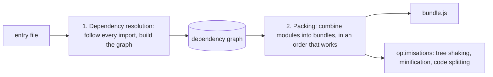

# Sharing code between browser and server

## In plain words

A good recipe works in your kitchen and in a friend's kitchen, even though your oven is gas and theirs is electric. The recipe itself (quantities, order of steps) is the same. Only the last detail, how you produce heat, depends on the kitchen. A sensible cook writes the recipe once and adds a short note per kind of oven.

JavaScript is the only language that runs natively in both web browsers and servers. Code written so that the same files work in both places is called **universal JavaScript** (an older name is *isomorphic JavaScript*). The rule for validating an email address, the function that formats a price, the definition of what a "valid order" is: written once, used by the page in the browser *and* by the server that must check the same data again.

Why it matters for a job: full-stack frameworks such as Next.js, Nuxt, Remix and SvelteKit are built on this idea, and most front-end job listings mention one of them. Even without a framework, sharing validation and data-shaping code between client and server removes a whole class of bugs in which the two sides disagree.

> **Before this lesson:** you need both module systems from [CommonJS](#/lesson/nodejs/commonjs-modules) and [ES modules in Node](#/lesson/nodejs/es-modules-node), plus the adapter and dependency-injection ideas from [Decorator and adapter](#/lesson/nodejs/decorator-adapter) and [Singleton, module wiring and dependency injection](#/lesson/nodejs/singleton-di). No front-end framework knowledge is assumed.

## What can be shared, and what cannot

The *language* is identical in both environments. The *surroundings* are not.

| | Browser | Node.js |
|---|---|---|
| Language features (classes, promises, `Map`, `async`/`await`) | yes | yes |
| `fetch`, `URL`, `TextEncoder`, `AbortController`, `structuredClone`, timers | yes | yes (modern versions) |
| The page: `document`, `window`, `localStorage` | yes | no |
| Files, processes, raw network sockets: `node:fs`, `node:child_process`, `node:net` | no | yes |
| Secrets such as database passwords | **must never be present** | yes |
| Where the code comes from | downloaded over the network on each visit | read from the local disk |
| Who chooses the JavaScript version | each visitor's browser | you |

Three consequences shape everything in this lesson:

1. **Pure logic is freely shareable.** A function that takes data and returns data, touching nothing else, runs anywhere.
2. **Platform-specific code must be isolated** behind a common interface, so the shared part does not care which platform it is on.
3. **Browser code travels over the network.** Every byte must be downloaded by every visitor, so size matters in a way it does not on a server. And anything shipped to a browser is public: users can read all of it.

## The first obstacle: getting modules into a browser

Node resolves `import x from "some-package"` by searching `node_modules` on disk. A browser has no disk to search; it can import only from URLs. Browsers do support ES modules natively (`<script type="module">`), but a real application with hundreds of small files and dependencies would need hundreds of network requests, each one discovered only after the previous file has been downloaded and parsed.

The tool that bridges this gap is a **module bundler**. It takes your source files and their dependencies and produces a small number of files, called **bundles**, optimised for the browser. Well-known bundlers are webpack, Rollup, esbuild, Parcel and Vite (which combines several).

### How a bundler works

A bundler does two jobs, one after the other.



**Dependency resolution.** Starting from the **entry point**, the bundler reads the file, finds its `import` statements, locates each imported module (using the same resolution rules as Node), and repeats for each of them, visiting every module once. The result is the **dependency graph** you met in the ES modules lesson, usually stored as a map from module identifier to source code.

**Packing.** The graph is turned into one executable file: every module wrapped in a function, plus a few lines of loader code that give each module a working `require` or `import` and cache the results.

That description should sound familiar. It is the homemade module loader from the CommonJS lesson, run ahead of time. The model below does both phases for a three-file program:

```js-run
// "Source files" of a tiny application.
const sources = {
  "main.js": `
    const { formatPrice } = require("./format.js");
    const { TAX } = require("./config.js");
    console.log("total:", formatPrice(100 * (1 + TAX)));`,
  "format.js": `
    const { CURRENCY } = require("./config.js");
    exports.formatPrice = (n) => n.toFixed(2) + " " + CURRENCY;`,
  "config.js": `
    exports.TAX = 0.2;
    exports.CURRENCY = "EUR";`,
  "unused.js": `exports.neverImported = true;`,
};

// Phase 1: dependency resolution. Follow require() calls from the entry point.
function buildGraph(entry) {
  const graph = new Map();
  (function visit(name) {
    if (graph.has(name)) return;                      // each module once, cycles included
    const code = sources[name];
    graph.set(name, code);
    for (const match of code.matchAll(/require\("\.\/(.+?)"\)/g)) visit(match[1]);
  })(entry);
  return graph;
}

// Phase 2: packing. Emit ONE piece of text containing every module plus a mini loader.
function pack(graph, entry) {
  const modules = [...graph].map(([name, code]) => `"${name}": function (module, exports, require) {${code}\n  }`);
  return `(function (modules) {
  const cache = {};
  function require(id) {
    id = id.replace("./", "");
    if (cache[id]) return cache[id].exports;
    const module = (cache[id] = { exports: {} });
    modules[id](module, module.exports, require);
    return module.exports;
  }
  require("${entry}");
})({
  ${modules.join(",\n  ")}
});`;
}

const graph = buildGraph("main.js");
console.log("modules in the graph:", [...graph.keys()].join(", "), "(unused.js is left out)");

const bundle = pack(graph, "main.js");
console.log("bundle is one string of", bundle.length, "characters; running it:");
new Function("console", bundle)(console);
```

- `buildGraph` finds `require("./x")` calls with a regular expression (real bundlers parse the code properly) and recursively visits each dependency. `unused.js` is never reached, so it never enters the bundle.
- `pack` writes out a single self-contained script: an object of module functions and a `require` with a cache.
- The last line runs that string as a program, standing in for a `<script>` tag in a page.

### What real bundlers add

- **Tree shaking.** Leaving out not only unused files but unused *exports* inside used files. It relies on the static structure of ES module syntax, one more reason to prefer `import`/`export`.
- **Minification.** Shortening names and removing whitespace and comments so there is less to download.
- **Code splitting.** Producing several bundles so that a page loads only what it needs; a dynamic `import()` becomes a separate file fetched on demand.
- **Transformations.** Compiling TypeScript or JSX, and adapting newer syntax for older browsers.
- **Source maps.** Files that map the transformed code back to your original source, so errors and debuggers show the lines you wrote.
- **Assets.** Treating style sheets and images as modules that can be imported.

> [!NOTE]
> You do not need to master a bundler's configuration at this stage. The mental model is enough: *entry point, dependency graph, bundles*. Frameworks ship with a bundler already configured.

## Writing code for two platforms

Now the central question. A module is mostly shareable but needs one thing that differs per platform. How should it be written? There are three techniques, in increasing order of cleanliness.

### 1. Run-time branching

Test for the platform while the program runs:

```javascript
export function greet() {
  if (typeof window !== "undefined") {
    return `Hello from a browser at ${window.location.host}`;
  }
  return `Hello from Node ${process.version}`;
}
```

`typeof window` is safe even where `window` does not exist, since `typeof` never throws. This is fine for a line or two, and has real drawbacks beyond that:

- **Both branches are shipped to both platforms.** The browser downloads the Node code it can never run.
- **Server-only code and secrets can leak** into the public bundle if the server branch mentions them.
- **Bundlers follow imports regardless.** If the server branch imports `node:fs`, the bundler tries to include it for the browser and fails or pulls in a bulky replacement.
- **Readability.** Business logic becomes peppered with platform checks.

### 2. Build-time branching

Let the bundler decide, by replacing a constant before the code is packed. Bundlers can substitute an expression such as `__BROWSER__` with the literal `true` or `false`; then the minifier removes branches that can never run, a step called **dead code elimination**.

```javascript
export function greet() {
  if (__BROWSER__) {
    return `Hello from a browser at ${window.location.host}`;
  }
  return `Hello from Node ${process.version}`;
}
```

The model below performs both steps on a string of source code, the way a build tool would:

```js-run
const source = `
function greet() {
  if (__BROWSER__) {
    return "Hello from a browser";
  }
  return "Hello from Node " + readSecretFromDisk();
}`;

function build(code, defines) {
  // Step 1: replace the constants (what webpack's DefinePlugin or esbuild's "define" do).
  for (const [name, value] of Object.entries(defines)) code = code.replaceAll(name, String(value));
  // Step 2: dead code elimination (very simplified).
  code = code.replace(/if \(true\) \{\s*(return [^;]+;)\s*\}[\s\S]*?\n\}/, "$1\n}");   // the rest is unreachable
  code = code.replace(/if \(false\) \{[\s\S]*?\}\s*/, "");                              // the block never runs
  return code.trim();
}

console.log("--- browser build ---\n" + build(source, { __BROWSER__: true }));
console.log("\n--- server build ---\n" + build(source, { __BROWSER__: false }));
```

The browser build contains no trace of `readSecretFromDisk`. Each platform receives only its own branch. The cost: the source still mixes two platforms in one function, and there are now two different builds to test.

### 3. Module swapping

Cleaner still: put each platform's implementation in **its own file with the same exports**, and tell the build which file to use for which platform. The shared code imports "the storage module" and never contains an `if`.

```text
src/
  storage.node.js       export async function load(key) { ...reads a file... }
  storage.browser.js    export async function load(key) { ...reads localStorage... }
  cart.js               import { load } from "#storage";    <- no platform checks
```

The mapping lives in configuration. Packages can declare it in `package.json` using conditional entries, which both Node and bundlers understand:

```json
{
  "imports": {
    "#storage": {
      "browser": "./src/storage.browser.js",
      "default": "./src/storage.node.js"
    }
  }
}
```

Node picks the `default` entry; a bundler building for browsers picks `browser`. The `exports` field of a published package supports the same conditions, which is how libraries deliver a smaller browser version of themselves. Bundlers also offer an *alias* option that maps one module name to another.

Module swapping keeps each file free of the other platform's code, lets the files be tested separately, and needs no dead-code tricks.

## Design patterns that make swapping work

Module swapping is a build-time mechanism. The *design* that makes it possible is one you already know: define an interface, write one implementation per platform, and hand the right one to the shared code.

- **Adapter**: each platform file adapts a native facility (the file system, `localStorage`) to your interface.
- **Strategy / dependency injection**: the shared code receives the implementation instead of looking for it.
- **Template**: a base class holds the shared algorithm; a browser subclass and a server subclass fill in platform steps.
- **Proxy**: a browser-side object with the same methods as a server-side service forwards calls over HTTP, so that calling code looks identical on both sides.

```js-run
// ---------- shared, platform-neutral code ----------
function createCart({ storage, clock }) {
  return {
    async add(product, qty) {
      const items = (await storage.load("cart")) ?? [];
      items.push({ product, qty, addedAt: clock() });
      await storage.save("cart", items);
      return items.length;
    },
    async summary() {
      const items = (await storage.load("cart")) ?? [];
      return items.map((item) => `${item.qty} x ${item.product}`).join(", ") || "(empty)";
    },
  };
}

// ---------- "browser" adapter: wraps something shaped like localStorage (strings only, synchronous) ----------
function createBrowserStorage(localStorageLike) {
  return {
    async load(key) { const text = localStorageLike.getItem(key); return text === null ? null : JSON.parse(text); },
    async save(key, value) { localStorageLike.setItem(key, JSON.stringify(value)); },
  };
}

// ---------- "server" adapter: wraps something shaped like fs/promises (files, asynchronous) ----------
function createServerStorage(fsLike, directory) {
  const file = (key) => `${directory}/${key}.json`;
  return {
    async load(key) {
      try { return JSON.parse(await fsLike.readFile(file(key), "utf8")); }
      catch (error) { if (error.code === "ENOENT") return null; throw error; }
    },
    async save(key, value) { await fsLike.writeFile(file(key), JSON.stringify(value)); },
  };
}

// ---------- stand-ins for the two platforms, so this runs anywhere ----------
const fakeLocalStorage = { data: {}, getItem(k) { return k in this.data ? this.data[k] : null; }, setItem(k, v) { this.data[k] = String(v); } };
const fakeFs = {
  files: {},
  async readFile(path) { if (!(path in this.files)) throw Object.assign(new Error("ENOENT"), { code: "ENOENT" }); return this.files[path]; },
  async writeFile(path, text) { this.files[path] = text; },
};

for (const [platform, storage] of [["browser", createBrowserStorage(fakeLocalStorage)], ["server ", createServerStorage(fakeFs, "/var/data")]]) {
  const cart = createCart({ storage, clock: () => 0 });
  await cart.add("tea", 2);
  await cart.add("jam", 1);
  console.log(platform, "->", await cart.summary());
}
console.log("where the browser kept it:", Object.keys(fakeLocalStorage.data), "| where the server kept it:", Object.keys(fakeFs.files));
```

`createCart` is the universal part: no `window`, no `fs`, no `if`. It runs identically on both sides because its only contact with the outside world is the `storage` object it is given. The two adapters translate that small interface to each platform. The composition root of each build (the browser entry file, the server entry file) creates the right adapter. This is the same structure as the cache adapters two modules ago, applied across the browser/server divide.

> [!TIP]
> Arrange a universal codebase in three folders: `shared/` (no platform APIs allowed), `client/` (may touch the page) and `server/` (may touch files, databases, secrets). Lint rules or simple import restrictions can enforce that `shared/` imports from neither of the others. Most "it works on the server and crashes in the browser" bugs are imports that crossed that line.

> [!WARNING]
> Anything that ends up in a browser bundle is public. API keys, database passwords and internal URLs in a shared file are published to every visitor, minified but perfectly readable. Run-time branching does not protect them. Keep secrets in server-only modules and make sure no shared or client file imports those modules.

## Validation: the classic thing to share

A form should tell the user immediately that an email address is malformed; that needs the rule in the browser. The server must check again, since requests can be sent without using your page at all; that needs the rule on the server. Two hand-written copies drift apart. One shared module cannot.

```javascript
// shared/validateSignup.js: pure, no platform APIs
export function validateSignup({ email, password }) {
  const errors = {};
  if (!/^[^@\s]+@[^@\s]+\.[^@\s]+$/.test(email ?? "")) errors.email = "Enter a valid email address";
  if ((password ?? "").length < 12) errors.password = "Use at least 12 characters";
  return { ok: Object.keys(errors).length === 0, errors };
}
```

```javascript
// client/form.js                               // server/routes.js
import { validateSignup } from "../shared/validateSignup.js";
form.addEventListener("submit", (event) => {    app.post("/signup", (req, res) => {
  const result = validateSignup(readForm());      const result = validateSignup(req.body);
  if (!result.ok) { event.preventDefault();       if (!result.ok) return res.status(400).json(result);
    showErrors(result.errors); }                   // ...create the account
});                                             });
```

The browser check is a convenience for the user. The server check is the security measure. Never rely on the first alone.

> [!INTERVIEW]
> **"What is universal (isomorphic) JavaScript, and what are the challenges?"** "Code that runs in both the browser and Node. The language is shared but the environments differ: module loading, available APIs, the need to keep bundles small and secret-free. Bundlers resolve the dependency graph and pack it for the browser. Platform differences are handled by isolating them behind interfaces (adapters, injected dependencies) and selecting the implementation by module swapping or build-time branching in preference to run-time checks." **"What does a bundler do?"** Entry point, dependency resolution into a graph, packing into bundles, plus tree shaking, minification, code splitting and source maps.

## Pitfalls

- **`window is not defined` / `document is not defined`** on the server: a shared module touched a browser global at import time. Move that code into a client-only file or a function called only in the browser.
- **`Module not found: Can't resolve 'fs'`** in a browser build: a shared module imported a Node core module.
- **Secrets in shared files.**
- **Giant bundles**: importing a whole utility library for one function, or a heavy server-side package by mistake. Inspect what the bundle contains.
- **Assuming identical behaviour of similar APIs**: time zones and locales, for instance, come from the user's machine in a browser and from the server's settings in Node.
- **Run-time checks sprinkled everywhere** instead of one adapter.
- **Module-level state on the server.** A variable at the top of a module is per-user in a browser tab and **shared by all users** on a server. Keeping "the current user" in such a variable leaks data between requests.

## Cheat sheet

| Concept | Meaning |
|---|---|
| Universal / isomorphic code | The same source runs in browser and Node |
| Bundler | Tool that resolves the dependency graph and packs it into bundles |
| Entry point | The file where resolution starts |
| Tree shaking | Dropping unused exports |
| Code splitting | Several bundles, loaded on demand |
| Source map | Mapping from generated code back to the original |
| Run-time branching | `if (typeof window !== "undefined")`: both branches shipped |
| Build-time branching | constant replaced during the build + dead code elimination |
| Module swapping | per-platform files chosen by `imports`/`exports` conditions or aliases |
| Portable design | interface + adapter per platform + injection |
| Always share | validation rules, formatting, data transformations, types |
| Never share | secrets, direct database access, file-system code |

## Summary

- JavaScript runs on both sides of the web; universal code exploits that by writing platform-neutral logic once.
- Browsers cannot search `node_modules`, so a bundler resolves the dependency graph from an entry point and packs it into optimised bundles.
- Platform differences can be handled by run-time checks, by build-time replacement with dead code elimination, or, most cleanly, by swapping whole modules.
- The design underneath is adapter plus dependency injection: shared code depends on a small interface, each platform provides an implementation.
- Browser bundles are public and paid for in download time; keep them small and free of secrets. Validate on both sides from one shared module.

## Glossary

- **Universal (isomorphic) JavaScript**: code able to run unchanged in browsers and in Node.
- **Module bundler**: a build tool that combines modules into files suited to browsers.
- **Bundle**: an output file of a bundler.
- **Entry point**: the starting module of an application or bundle.
- **Dependency graph**: all modules reachable from the entry point and the imports linking them.
- **Tree shaking**: removal of exports that are never imported.
- **Minification**: shrinking code without changing its behaviour.
- **Code splitting**: dividing the output into parts loaded when needed.
- **Source map**: data linking generated code to original source lines.
- **Run-time / build-time branching**: choosing platform code while running / while building.
- **Dead code elimination**: removing code that can never execute.
- **Module swapping**: substituting one module file for another per target platform.
- **Alias**: a build setting that redirects one module name to another.

```quiz
[
  {"q": "Why can't a browser load an application the way Node does, straight from node_modules?", "options": ["Browsers do not support modules at all", "A browser has no file system to search and would need a network request per file; a bundler packs the graph into few files", "node_modules is encrypted", "Browsers only run minified code"], "answer": 1,
   "explain": "Resolution by searching folders needs a disk. Bundlers do that work ahead of time."},
  {"q": "What are the two main phases of a bundler?", "options": ["Compile and link", "Dependency resolution, then packing", "Minify, then upload", "Lint, then test"], "answer": 1,
   "explain": "First the dependency graph is built from the entry point, then it is packed into bundles."},
  {"q": "What is the main drawback of run-time branching with `typeof window`?", "options": ["typeof throws on the server", "Both platforms' code is included in both outputs, including server-only code in the public bundle", "It cannot detect browsers", "It is slower than a function call"], "answer": 1,
   "explain": "The check happens while running, so nothing is removed at build time."},
  {"q": "After a browser build replaces `__BROWSER__` with true, what does dead code elimination do with `if (!__BROWSER__) { readDatabase(); }`?", "options": ["Leaves it unchanged", "Removes the block, since `if (false)` can never run", "Throws a build error", "Moves it to another file"], "answer": 1,
   "explain": "Code that is provably unreachable is deleted from the output."},
  {"q": "In the module-swapping approach, what does the shared code contain?", "options": ["An if statement per platform", "An import of one module name; the build chooses which file that name refers to", "Both implementations", "A copy of node:fs"], "answer": 1,
   "explain": "Shared code stays free of platform checks; configuration maps the name to a per-platform file."},
  {"q": "In the cart example, what makes `createCart` universal?", "options": ["It checks typeof window", "It uses no platform API directly; storage and clock are injected", "It is minified", "It only runs on the server"], "answer": 1,
   "explain": "Its only contact with the environment is through the objects passed in."},
  {"q": "Why must validation run on the server even when the same rule already ran in the browser?", "options": ["Browsers are slow", "Requests can be sent directly to the server, bypassing the page and its checks", "The server uses a different language", "It does not need to"], "answer": 1,
   "explain": "Client-side checks help the user; only server-side checks can be trusted."},
  {"q": "A shared module stores the logged-in user in a top-level `let currentUser`. What goes wrong on the server?", "options": ["Nothing", "The variable is shared by all requests, so users can see each other's data", "It throws a ReferenceError", "It is reset on every import"], "answer": 1,
   "explain": "A module is evaluated once per server process; per-user state must live in per-request objects."}
]
```

> **Source:** Casciaro & Mammino, *Node.js Design Patterns* 3e, ch. 10 (topics only; wording and examples are original). Documentation: https://nodejs.org/docs/latest/api/packages.html#conditional-exports, https://nodejs.org/docs/latest/api/packages.html#subpath-imports, https://webpack.js.org/concepts/
