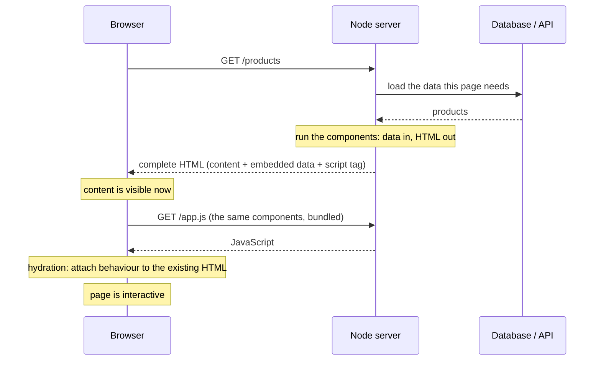
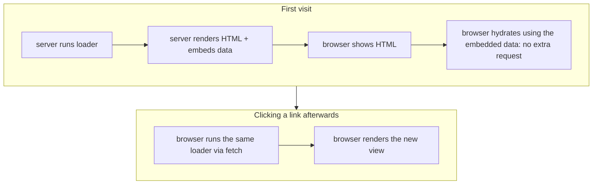

# Server-side rendering, hydration and universal data loading

## In plain words

A restaurant can serve dinner in two ways. It can bring you a finished plate: you start eating the moment it lands on the table. Or it can hand you a box of raw ingredients and a recipe card: you have everything you need, but you look at an empty table while you cook.

A web application has the same choice. With **client-side rendering** the server sends an almost empty page and a large JavaScript file; the browser must download, parse and run that file before anything appears. With **server-side rendering** (SSR) the server runs the application's code itself and sends finished HTML; the user sees content at once. Afterwards, JavaScript arrives and makes that ready-made page interactive, a step with the odd name **hydration**.

SSR is where universal JavaScript earns its name: the *same* component code runs on the server, to produce HTML, and in the browser, to handle clicks.

Why it matters for a job: Next.js, Nuxt, Remix, SvelteKit and Astro are all built around these ideas, and "explain SSR, hydration, and the trade-offs against a single-page app" is a routine question for full-stack and front-end roles. Understanding the mechanism also makes the confusing errors of those frameworks ("hydration mismatch", "window is not defined") readable.

> **Before this lesson:** read [Sharing code between browser and server](#/lesson/nodejs/universal-sharing-code). You need the first HTTP server from [npm, package.json and your first HTTP server](#/lesson/nodejs/npm-first-server) and `async`/`await`. Knowing a front-end framework helps but is not required; the examples use plain functions.

## Three ways to produce a page

| | Client-side rendering (CSR) | Server-side rendering (SSR) | Static generation (SSG) |
|---|---|---|---|
| Who builds the HTML | the browser, with JavaScript | the server, on each request | a build step, once, ahead of time |
| First response contains | an empty shell plus scripts | the real content | the real content |
| Time until the user sees content | slow: after scripts load and run | fast | fastest: files served as they are |
| Search engines and link previews | may see an empty page | see the content | see the content |
| Server cost per request | minimal | CPU work for every request | none |
| Fresh, per-user data | fetched by the browser afterwards | included in the HTML | only as fresh as the last build |
| Typical fit | dashboards behind a login | shops, news, social feeds | blogs, documentation, marketing pages |

An application that renders in the browser and never reloads the page while you navigate is called a **single-page application** (SPA). Most real products mix the techniques: static pages for marketing, SSR for the catalogue, client rendering for the account area.

**SEO**, search engine optimisation, means making pages easy for search engines to read and rank. Crawlers and link-preview bots work best with content that is present in the HTML.

## A component is a function from data to markup

Modern UI libraries (React, Vue, Svelte, Solid) share one core idea: a **component** is a function that takes data and returns a description of what should be on screen. If that function touches no browser API, it can run anywhere, including inside Node.

```js-run
// Universal components: plain functions from data to an HTML string. No DOM, no Node API.
const escapeHtml = (text) => String(text).replace(/[&<>"']/g, (c) => ({ "&": "&amp;", "<": "&lt;", ">": "&gt;", '"': "&quot;", "'": "&#39;" }[c]));

const ProductCard = (product) => `
  <li class="card">
    <h2>${escapeHtml(product.name)}</h2>
    <p>${(product.cents / 100).toFixed(2)} EUR</p>
    <button data-add="${escapeHtml(product.id)}">Add to basket</button>
  </li>`;

const ProductList = ({ title, products }) => `
  <section>
    <h1>${escapeHtml(title)}</h1>
    <ul>${products.map(ProductCard).join("")}</ul>
    <p id="basket">Basket: 0 items</p>
  </section>`;

const data = {
  title: "Teas & jams",
  products: [{ id: "t1", name: "Green tea", cents: 450 }, { id: "j1", name: 'Jam "Deluxe" <limited>', cents: 620 }],
};
console.log(ProductList(data));
```

- `ProductCard` and `ProductList` are **pure functions**: the same input always gives the same output and nothing else is touched.
- `escapeHtml` replaces the characters that have a special meaning in HTML. Without it, a product named `<script>...` would become live code in every visitor's page. That attack is called **cross-site scripting** (XSS). Framework templates escape by default; a hand-written template must do it explicitly.
- The `data-add` attribute marks the buttons so that browser code can find them later.

Real frameworks return a tree of objects (a "virtual DOM") instead of a string, which lets them update the page efficiently later. For rendering on a server the outcome is the same: text.

## Server-side rendering, step by step



On the server, the handler loads data, calls the components, and wraps the result in a full document:

```javascript
import http from "node:http";
import { ProductList } from "./shared/components.js";       // the SAME file the browser bundle uses
import { loadProducts } from "./server/db.js";

http.createServer(async (req, res) => {
  if (req.url !== "/products") { res.writeHead(404).end("Not found"); return; }

  const data = { title: "Teas & jams", products: await loadProducts() };
  const html = `<!doctype html>
<html>
  <head><meta charset="utf-8"><title>${data.title}</title></head>
  <body>
    <div id="root">${ProductList(data)}</div>
    <script>window.__INITIAL_DATA__ = ${serializeForScript(data)}</script>
    <script type="module" src="/app.js"></script>
  </body>
</html>`;

  res.writeHead(200, { "Content-Type": "text/html; charset=utf-8" });
  res.end(html);
}).listen(3000);
```

Three parts of that document matter:

1. **`<div id="root">`** contains the rendered components: real, readable content.
2. **`window.__INITIAL_DATA__`** is a copy of the data that was used, embedded in the page. The next section explains why.
3. **`<script src="/app.js">`** loads the browser bundle, built from the same component files.

## Hydration

The HTML that arrived is inert. The button exists, but clicking it does nothing: event handlers are JavaScript functions, and functions cannot be sent as HTML. **Hydration** is the browser-side step that takes the existing HTML and attaches behaviour to it, without throwing it away and building it again.

To do that correctly, the browser code needs the same data the server used. Hence the embedded `__INITIAL_DATA__`: without it, the browser would have to request the data a second time, and for a moment its idea of the page could differ from what the server drew.

The preview below is a complete miniature. The HTML inside `#root` plays the part of the server's output; the script plays the part of the browser bundle. Press Run, then click the buttons.

```html-run
<!doctype html>
<html>
<head>
<style>
  body { font-family: system-ui, sans-serif; margin: 1rem; }
  ul { list-style: none; padding: 0; display: flex; gap: 1rem; }
  .card { border: 1px solid #bbb; border-radius: 8px; padding: .75rem 1rem; }
  button { cursor: pointer; }
  #status { color: #3c873a; font-size: .9rem; }
</style>
</head>
<body>
  <!-- 1. What the server sent: finished markup, visible before any script runs -->
  <div id="root">
    <section>
      <h1>Teas &amp; jams</h1>
      <ul>
        <li class="card"><h2>Green tea</h2><p>4.50 EUR</p><button data-add="t1">Add to basket</button></li>
        <li class="card"><h2>Plum jam</h2><p>6.20 EUR</p><button data-add="j1">Add to basket</button></li>
      </ul>
      <p id="basket">Basket: 0 items</p>
    </section>
  </div>
  <p id="status">Not hydrated yet: the buttons would do nothing.</p>

  <!-- 2. The data the server used, embedded in the page -->
  <script>
    window.__INITIAL_DATA__ = { products: [{ id: "t1", name: "Green tea", cents: 450 }, { id: "j1", name: "Plum jam", cents: 620 }] };
  </script>

  <!-- 3. The "browser bundle": hydration -->
  <script>
    const state = { products: window.__INITIAL_DATA__.products, basket: [] };

    function hydrate(root) {
      root.addEventListener("click", (event) => {
        const id = event.target.dataset.add;
        if (!id) return;
        state.basket.push(state.products.find((product) => product.id === id));
        const total = state.basket.reduce((sum, product) => sum + product.cents, 0);
        root.querySelector("#basket").textContent =
          `Basket: ${state.basket.length} items, ${(total / 100).toFixed(2)} EUR`;
      });
      document.querySelector("#status").textContent = "Hydrated: the same HTML is now interactive.";
    }

    hydrate(document.querySelector("#root"));
  </script>
</body>
</html>
```

Notice what hydration did **not** do: it did not rebuild the list. It found the existing elements and connected a click handler and some state to them. Frameworks do this for a whole component tree: they run the components again in the browser, check that the result matches the HTML already in the page, and attach handlers.

When the two do not match, you get a **hydration mismatch**: the server rendered one thing and the browser expected another. Typical causes are rendering the current time, a random number, or anything read from `window` or the user's locale. Frameworks warn about it because the visible page and the framework's internal picture disagree, which leads to flicker or broken handlers.

> [!WARNING]
> Embedding data in a `<script>` tag is an XSS risk if done with plain `JSON.stringify`. If any string in the data contains `</script>`, the browser ends the script element right there and treats what follows as HTML. Escape the dangerous characters, at least `<`, as Unicode escapes, or use a well-tested helper:
> `const serializeForScript = (data) => JSON.stringify(data).replace(/</g, "\\u003c");`

## The data problem

Rendering in a browser is forgiving: draw a spinner, fetch data, draw again. Rendering on a server is one shot: the HTML is sent once, so **all the data a page needs must be loaded before rendering begins**. How does the server know what a given page needs? Two designs are common.

### Two-pass rendering

Let components request their own data as they render. Render once, notice which requests were started, wait for them, and render a second time with the data in place. It keeps components self-contained, and its price is doing the rendering work twice (or more, if loaded data triggers further requests), all while the user waits.

### Data loaders per route

Declare, **next to each page**, an asynchronous function that returns the data for that page. The server finds the page for the requested URL, runs its loader, and renders once. This is the model of most current frameworks, under names like `loader`, `load` or `getServerSideProps`.

A **route** is the mapping from a URL pattern to the page that handles it. The route table is itself universal: the server uses it to answer requests, the browser uses it to switch pages without a full reload.

```js-run
const escapeHtml = (t) => String(t).replace(/[&<>"']/g, (c) => ({ "&": "&amp;", "<": "&lt;", ">": "&gt;", '"': "&quot;", "'": "&#39;" }[c]));

// ---- universal: one table describes every page: its URL pattern, its data needs, its view ----
const routes = [
  {
    pattern: /^\/$/,
    load: async (api) => ({ products: await api.listProducts() }),
    view: ({ products }) => `<h1>Shop</h1><ul>${products.map((p) => `<li><a href="/product/${p.id}">${escapeHtml(p.name)}</a></li>`).join("")}</ul>`,
  },
  {
    pattern: /^\/product\/(\w+)$/,
    load: async (api, [id]) => {
      const product = await api.getProduct(id);
      if (!product) throw Object.assign(new Error("no such product"), { status: 404 });
      return { product };
    },
    view: ({ product }) => `<h1>${escapeHtml(product.name)}</h1><p>${(product.cents / 100).toFixed(2)} EUR</p>`,
  },
];

async function renderPage(url, api) {
  for (const route of routes) {
    const match = url.match(route.pattern);
    if (!match) continue;
    try {
      const data = await route.load(api, match.slice(1));        // 1. all data first
      return { status: 200, html: route.view(data), data };      // 2. then render exactly once
    } catch (error) {
      return { status: error.status ?? 500, html: `<h1>${escapeHtml(error.message)}</h1>`, data: null };
    }
  }
  return { status: 404, html: "<h1>Page not found</h1>", data: null };
}

// ---- server-only: the API implementation that talks to the "database" directly ----
const table = [{ id: "t1", name: "Green tea", cents: 450 }, { id: "j1", name: "Plum <jam>", cents: 620 }];
const serverApi = {
  async listProducts() { return table.map(({ id, name }) => ({ id, name })); },
  async getProduct(id) { return table.find((p) => p.id === id) ?? null; },
};

for (const url of ["/", "/product/j1", "/product/zzz", "/about"]) {
  const page = await renderPage(url, serverApi);
  console.log(`GET ${url} -> ${page.status}  ${page.html}`);
}
```

- Each route has a `pattern`, a `load` function and a `view` function. Adding a page means adding one entry.
- `renderPage` runs the loader to completion and only then calls the view: one pass, no spinner in the HTML.
- A loader can fail deliberately, with a status code, which becomes the HTTP status of the response. A missing product yields a real `404`, which crawlers understand.
- The loader receives an `api` object instead of importing a database module. On the server that object talks to the database directly. In the browser, navigating to another page runs **the same loader** with a different implementation of `api`, one whose methods call `fetch("/api/products")`. This is the adapter-plus-injection design of the previous lesson, and it is what keeps database code and credentials out of the browser bundle.

### Avoiding the double fetch

On first load the server has already run the loader. Its result is embedded in the page, and the browser uses that copy for hydration instead of fetching again. Only **later** navigations inside the application run loaders in the browser.



## What SSR costs

SSR is not free, and it is not always the right answer.

- **Server load.** Rendering is CPU work, executed on Node's single JavaScript thread. A complex page under heavy traffic can occupy the event loop; pages that are the same for everyone should be cached or generated statically.
- **Time to first byte.** The server cannot send anything until the slowest loader has finished, unless it streams.
- **Complexity.** Code must run in two environments; bugs can exist in one and not the other.
- **Interactivity gap.** Between "content is visible" and "hydration is done", buttons look ready and are not. On slow phones this gap can last seconds.

Current frameworks soften these costs with further techniques, worth knowing by name:

- **Streaming SSR**: send the page's shell at once and stream each slower section when its data arrives, using the streams from earlier in this track.
- **Partial or selective hydration ("islands")**: hydrate only the interactive parts of a page and leave static parts as plain HTML.
- **Server components**: components that run only on the server and send their output, never their code, to the browser, which shrinks the bundle.
- **Incremental static regeneration**: serve a static page and rebuild it in the background from time to time.

> [!TIP]
> Decide per page, not per application. Ask three questions. Does it need to be found by search engines or shared as a link? Does it differ per user? How often does its data change? Public and rarely changing: static. Public and frequently changing: SSR, with caching. Private and highly interactive: client rendering is often enough.

> [!INTERVIEW]
> **"What is hydration?"** "After server-side rendering, the browser receives finished HTML that has no behaviour. Hydration is the client-side process in which the framework runs the same components with the same data, matches them to the existing DOM instead of recreating it, and attaches event handlers and state. The server therefore embeds the data it used in the page, so the client renders the same thing without a second request." **"SSR versus CSR?"** SSR gives fast first content and crawlable HTML at the cost of server CPU, more complexity and an interactivity gap; CSR is simpler to host and fine behind a login, but shows nothing until the JavaScript has run.

## Pitfalls

- **Browser globals during server rendering** (`window`, `document`, `localStorage`). Touch them only in code that runs after hydration.
- **Non-deterministic output** (`Date.now()`, `Math.random()`, locale-dependent formatting) causing hydration mismatches. Compute such values once on the server and pass them as data.
- **Unescaped user content** in templates, and unescaped JSON in `<script>` tags.
- **Fetching the same data twice**, on the server and again on hydration.
- **Per-request data in module-level variables** on the server, leaking between users.
- **Loaders that run sequentially** when their requests are independent; use `Promise.all`.
- **Rendering heavy pages on every request** without caching, blocking the event loop.
- **Shipping server-only code or secrets** because a shared file imported them.

## Cheat sheet

| Term | One line |
|---|---|
| CSR | Browser builds the page with JavaScript |
| SSR | Server builds the HTML on each request |
| SSG | HTML is built once at build time |
| Component | Function from data to markup |
| Hydration | Attaching behaviour and state to server-made HTML |
| Initial data | The loader's result embedded in the page for hydration |
| Loader | Per-route async function returning the page's data |
| Universal router | One route table used by server and browser |
| Hydration mismatch | Server HTML differs from what the client renders |
| Streaming SSR | Sending HTML in parts as data becomes ready |
| Islands | Hydrating only the interactive parts |

## Summary

- Pages can be rendered in the browser, on the server per request, or ahead of time; real applications combine all three.
- Components are functions from data to markup, so the same code can produce HTML in Node and drive interaction in the browser.
- SSR sends finished HTML for a fast first view and for crawlers; hydration then attaches handlers and state to that HTML using the data the server embedded.
- The server must have all data before it renders. Route-level loaders, run once per request and re-used in the browser with a different API adapter, are the standard solution.
- Escape everything that goes into HTML or into an inline script. SSR adds server cost and complexity, so choose the rendering mode page by page.

## Glossary

- **Client-side rendering (CSR)**: building the page in the browser with JavaScript.
- **Server-side rendering (SSR)**: building the page's HTML on the server for each request.
- **Static site generation (SSG)**: building HTML files during a build step.
- **Single-page application (SPA)**: an application that updates the page in place instead of loading new documents.
- **SEO**: search engine optimisation.
- **Component**: a reusable function (or class) that turns data into a piece of user interface.
- **Pure function**: a function whose result depends only on its arguments and which has no side effects.
- **Hydration**: making server-rendered HTML interactive in the browser.
- **Hydration mismatch**: a difference between server-rendered markup and the client's rendering.
- **Cross-site scripting (XSS)**: injecting script into a page through unescaped content.
- **Route**: a mapping from a URL pattern to a page.
- **Loader**: the function that fetches the data a route needs.
- **Time to first byte**: how long until the first part of the response arrives.

```quiz
[
  {"q": "What does the browser receive first in server-side rendering?", "options": ["An empty div and a script", "HTML that already contains the page's content", "Only JSON data", "A redirect"], "answer": 1,
   "explain": "The server runs the components and sends finished markup, so content is visible before any JavaScript runs."},
  {"q": "What is hydration?", "options": ["Compressing HTML", "Attaching event handlers and state to HTML that the server already rendered", "Fetching CSS files", "Rendering the page a second time from scratch on the server"], "answer": 1,
   "explain": "The existing DOM is kept; behaviour is connected to it."},
  {"q": "Why does the server embed the data it used into the page?", "options": ["For search engines", "So the browser can hydrate with exactly the same data without requesting it again", "To make the page larger", "Because HTML cannot be cached otherwise"], "answer": 1,
   "explain": "It avoids a double fetch and guarantees that the client renders the same thing."},
  {"q": "A component renders `new Date().toLocaleTimeString()`. What is the likely problem with SSR?", "options": ["Dates cannot be rendered on servers", "The server's output and the browser's output differ, causing a hydration mismatch", "It is a security hole", "It blocks the event loop"], "answer": 1,
   "explain": "The time and locale differ between server and browser, so the two renderings do not match."},
  {"q": "In the per-route loader design, in what order does the server work for one request?", "options": ["Render, then load data, then render again", "Match the route, run its loader, then render once", "Send the HTML, then load the data", "Hydrate, then render"], "answer": 1,
   "explain": "All data is loaded first so that a single rendering pass produces the complete page."},
  {"q": "Why does a loader receive an `api` object instead of importing the database module?", "options": ["To make it slower", "So the same loader can run in the browser with an api that calls fetch, keeping database code out of the bundle", "Because imports are not allowed in loaders", "To avoid using promises"], "answer": 1,
   "explain": "Injection lets one loader work on both sides with different adapters."},
  {"q": "Why is `<script>window.DATA = ${JSON.stringify(data)}</script>` dangerous?", "options": ["JSON.stringify is slow", "A string containing </script> inside the data ends the script element and lets attacker-controlled HTML run", "window is undefined on the server", "It breaks hydration"], "answer": 1,
   "explain": "The HTML parser sees the closing tag before the JavaScript parser sees the string. Escape < as \\u003c."},
  {"q": "For which page is plain client-side rendering usually an acceptable choice?", "options": ["A public product page that should rank in search engines", "A news article shared on social media", "An admin dashboard behind a login", "A marketing landing page"], "answer": 2,
   "explain": "No crawler needs to read it and users are already in the application, so SSR's benefits matter least."}
]
```

> **Source:** Casciaro & Mammino, *Node.js Design Patterns* 3e, ch. 10 (topics only; wording and examples are original). Documentation: https://react.dev/reference/react-dom/client/hydrateRoot, https://nodejs.org/docs/latest/api/http.html
