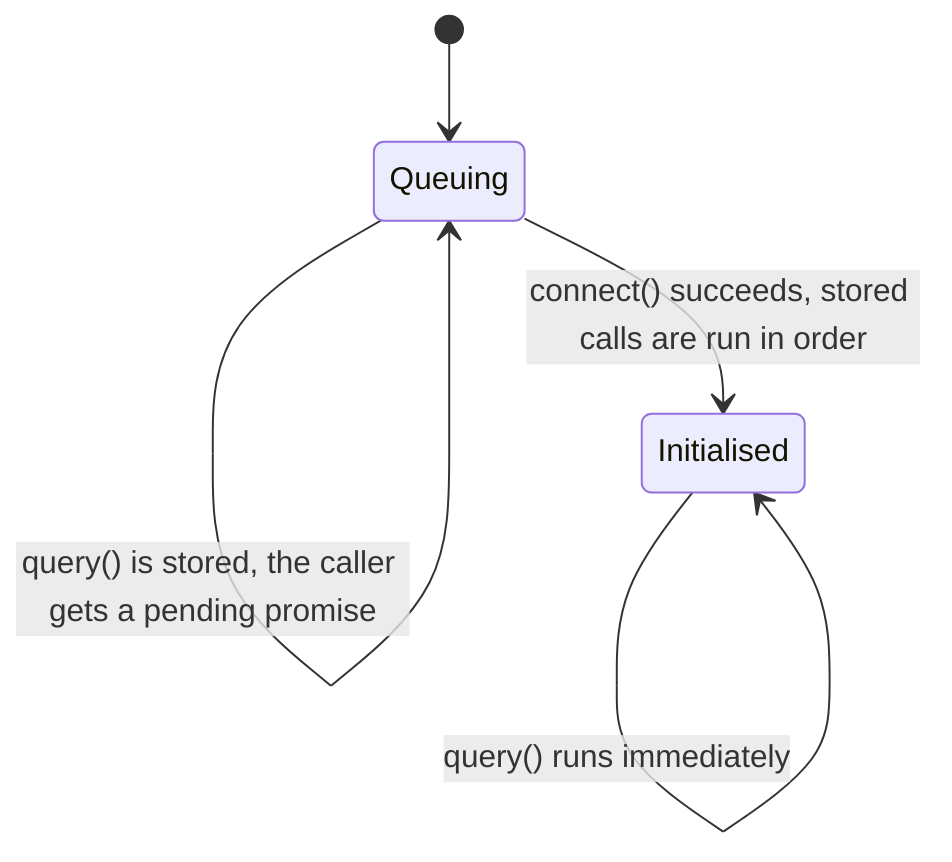
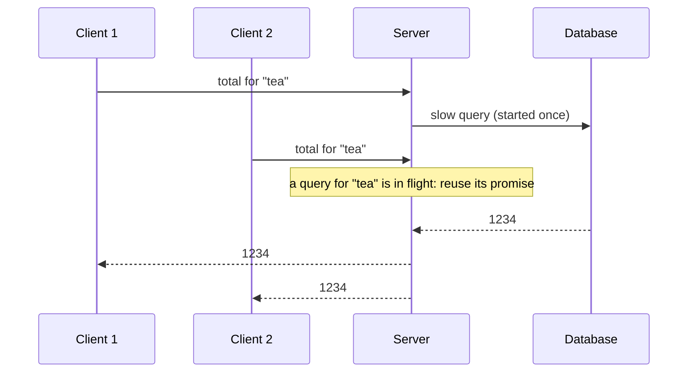

# Async initialisation, request batching and caching

## In plain words

Two everyday situations, two recipes.

A shop's doors are open at nine, but the till takes two minutes to start up. What happens to a customer who wants to pay at 9:01? Either the cashier explains "not ready yet" to each customer (tiresome), or the shop keeps its doors shut until the till is up (simple), or customers queue and are all served the moment the till is ready (smoothest). Software components that need time to start, such as a database connection, face exactly this choice. This is the problem of **asynchronously initialised components**.

Second: ten colleagues each walk to the archive to ask for the same report within the same minute. A sensible archivist fetches it once and hands a copy to all ten. Giving one answer to many simultaneous identical requests is **request batching**. Keeping the report on the desk for the next hour, for whoever asks next, is **caching**.

Both recipes rest on one property of promises: a promise can be handed to any number of waiters, before or after it settles.

Why it matters for a job: "the first requests after a deploy fail with *not connected*" and "the database melts when a popular page's cache expires" are two production classics. The patterns here are the standard fixes, and a small in-memory cache with batching is a frequent live-coding interview task.

> **Before this lesson:** you need promises and `async`/`await` from [Promises and promisification](#/lesson/nodejs/promises-promisification) and [Async/await: sequential and parallel flows](#/lesson/nodejs/async-await-flows), the module singleton from [Singleton, module wiring and dependency injection](#/lesson/nodejs/singleton-di), and the state pattern from [Strategy, state and template](#/lesson/nodejs/strategy-state-template).

## Part 1: components that are not ready yet

### The problem

Many components need an asynchronous step before they are usable: a database client must open a network connection and log in; a message-queue client must connect; a search index must load from disk. Module loading with `require` is synchronous, and a constructor cannot `await`. So an exported instance exists immediately but is not *ready* immediately.

```js-run
class Database {
  connected = false;
  async connect() {
    await new Promise((resolve) => setTimeout(resolve, 50));     // network handshake
    this.connected = true;
  }
  async query(sql) {
    if (!this.connected) throw new Error("not connected yet");
    await new Promise((resolve) => setTimeout(resolve, 5));
    return `rows for: ${sql}`;
  }
}

const db = new Database();
db.connect();                                   // started, not awaited

// A request arrives 10 ms after start-up, before the connection is ready:
await new Promise((resolve) => setTimeout(resolve, 10));
console.log(await db.query("SELECT 1").catch((error) => "early request failed: " + error.message));

await new Promise((resolve) => setTimeout(resolve, 60));
console.log("later request:", await db.query("SELECT 1"));
```

The early request fails. In production this shows up as a burst of errors right after every restart. There are three ways out.

### Solution 1: check before each use

Make sure the component is initialised at the start of every operation that needs it.

```javascript
async function getUser(id) {
  if (!db.connected) await db.connect();
  return db.query(`SELECT * FROM users WHERE id = ${Number(id)}`);
}
```

It works, with two weaknesses. The check must be repeated in every function that touches the component, and someone will forget one. And two requests arriving together would both see "not connected" and both call `connect()`, unless `connect` itself guards against being run twice (by remembering and returning its own promise).

### Solution 2: delayed start-up

Do not let the application accept work until every component is ready. In the entry file, await the initialisation and only then start listening.

```javascript
// main.js (an ES module, so top-level await is available)
import { db } from "./db.js";
import { createServer } from "./server.js";

await db.connect();                    // if this fails, the process stops here, loudly
createServer({ db }).listen(3000, () => console.log("ready"));
```

This is the simplest and most robust approach, and the right default for a server: no code path ever sees a half-ready component, and a failure to connect prevents start-up altogether, which deployment tools notice. Its limits: start-up takes as long as the slowest component, and it does not handle a component that must be *re*-initialised later, such as a connection that drops and reconnects.

### Solution 3: a pre-initialisation queue

Let callers use the component at once, and have the component itself **queue the operations** that arrive before it is ready, then run them all when it is. Callers never know.

The cleanest way to write this is the state pattern. The component has two states with the same methods: a *queuing* state that stores each call, and an *initialised* state that executes directly.



```js-run
class Database {
  #queue = [];
  #state;

  constructor() {
    const initialised = {
      query: async (sql) => {
        await new Promise((resolve) => setTimeout(resolve, 5));
        return `rows for: ${sql}`;
      },
    };
    const queuing = {
      // Return a promise now; remember how to settle it later.
      query: (sql) => new Promise((resolve, reject) => {
        this.#queue.push(() => initialised.query(sql).then(resolve, reject));
      }),
    };
    this.#state = queuing;
    this.ready = this.#connect().then(() => {
      this.#state = initialised;                       // switch state
      this.#queue.splice(0).forEach((run) => run());   // flush what was waiting
    });
  }

  async #connect() { await new Promise((resolve) => setTimeout(resolve, 50)); }

  query(sql) { return this.#state.query(sql); }        // delegate to the current state
}

const started = Date.now();
const stamp = () => String(Math.round((Date.now() - started) / 10) * 10).padStart(3) + " ms";
const db = new Database();                             // usable immediately

db.query("SELECT early").then((rows) => console.log(stamp(), "early request answered:", rows));
db.query("SELECT also early").then((rows) => console.log(stamp(), "second early request:", rows));

await new Promise((resolve) => setTimeout(resolve, 90));
console.log(stamp(), "request after start-up:", await db.query("SELECT late"));
```

- While connecting, `query` returns a promise immediately and pushes a small function onto the queue. That function, when called later, performs the real query and forwards its outcome to the promise the caller is already holding. The same trick powered the promise-based task queue.
- When the connection is up, the state object is swapped and the queue is flushed in order.
- The early callers are answered shortly after the 50 ms connection completes, without having written a single line of waiting logic.

Many database and messaging libraries do precisely this internally, which is why you can often call them straight after creating a client.

> [!WARNING]
> A pre-initialisation queue can hide a problem. If the connection never succeeds, queued requests wait forever and the queue grows with every new request, until memory runs out. A production-grade version puts a limit on the queue's length and a timeout on waiting, and rejects everything in the queue if initialisation fails.

| | Check before use | Delayed start-up | Pre-initialisation queue |
|---|---|---|---|
| Effort for callers | a check in every operation | none | none |
| Start-up time | fast | waits for all components | fast |
| Handles reconnection later | with care | no | yes |
| Risk | forgotten checks, duplicate connects | none to speak of | unbounded queue if never ready |
| Use when | quick scripts | **servers: the default** | writing a reusable client library |

## Part 2: request batching

### The problem

An endpoint returns the sales total for a product category. Computing it means reading many rows and takes a second. The page that shows it is popular: fifty users load it within the same second. Fifty identical queries run side by side, each one slowing the others, all producing the same number.

### The idea

When a request arrives for something that is **already being computed**, do not start a second computation. Hand the newcomer the promise of the one in flight.



No results are stored after completion, so there is no stale data and no memory growth. Batching is "free" in that sense, which makes it a good first optimisation.

```js-run
let queriesRun = 0;
async function totalSales(category) {                 // the slow, original function
  queriesRun++;
  await new Promise((resolve) => setTimeout(resolve, 60));
  return { category, total: category.length * 100 };
}

const inFlight = new Map();                            // category -> promise

function totalSalesBatched(category) {
  if (inFlight.has(category)) return inFlight.get(category);      // join the running request

  const promise = totalSales(category);
  inFlight.set(category, promise);
  promise.finally(() => inFlight.delete(category)).catch(() => {});   // forget it once settled
  return promise;
}

const started = Date.now();
const results = await Promise.all([
  totalSalesBatched("tea"), totalSalesBatched("tea"), totalSalesBatched("jam"),
  totalSalesBatched("tea"), totalSalesBatched("jam"),
]);
console.log(results.map((r) => `${r.category}=${r.total}`).join("  "));
console.log(`5 requests, ${queriesRun} real queries, about ${Math.round((Date.now() - started) / 10) * 10} ms`);

await totalSalesBatched("tea");
console.log("a request after completion starts a new query:", queriesRun, "queries in total");
```

Reading `totalSalesBatched`:

- The map holds **promises**, keyed by whatever identifies a request (here, the category).
- A hit returns the stored promise. Any number of callers can await one promise; each receives the same value.
- A miss starts the real work, stores its promise, and arranges for the entry to be removed when the promise settles, whether it fulfilled or rejected. (The trailing `.catch(() => {})` only stops the clean-up chain from producing an unhandled rejection; callers still receive the error through the original promise.)
- The check and the `set` have no `await` between them, so two calls in the same tick cannot both miss. That is the "claim synchronously" rule once more.

Five requests cost two queries. A request arriving after completion runs a new query, which is correct: the answer may have changed.

## Part 3: caching

Batching helps only while requests overlap. If the same question is asked once a second and takes 60 ms to answer, nothing overlaps and every request pays in full. **Caching** keeps the result for a while after it has been computed.

The change from batching is small: do not delete the entry on success; delete it after a **time-to-live** (TTL), or when the data is known to have changed.

```js-run
let queriesRun = 0;
async function totalSales(category) {
  queriesRun++;
  await new Promise((resolve) => setTimeout(resolve, 30));
  if (category === "broken") throw new Error("query failed");
  return { category, total: category.length * 100 };
}

function createCachedFunction(fn, { ttlMs, now = () => Date.now() }) {
  const cache = new Map();                             // key -> { promise, expiresAt }

  return function cached(key) {
    const entry = cache.get(key);
    if (entry && entry.expiresAt > now()) return entry.promise;       // fresh (or still in flight)

    const promise = fn(key);
    cache.set(key, { promise, expiresAt: Infinity });                 // in flight: batching
    promise.then(
      () => { cache.get(key).expiresAt = now() + ttlMs; },            // success: start the TTL now
      () => { cache.delete(key); },                                   // failure: do not cache errors
    );
    return promise;
  };
}

const cachedTotal = createCachedFunction(totalSales, { ttlMs: 80 });
const sleep = (ms) => new Promise((resolve) => setTimeout(resolve, ms));

await Promise.all([cachedTotal("tea"), cachedTotal("tea")]);
console.log("two overlapping requests       -> queries so far:", queriesRun);
await cachedTotal("tea");
console.log("one more, within the TTL       -> queries so far:", queriesRun);
await sleep(100);
await cachedTotal("tea");
console.log("after the TTL has expired      -> queries so far:", queriesRun);

await cachedTotal("broken").catch(() => {});
await cachedTotal("broken").catch(() => {});
console.log("two failing requests in a row  -> queries so far:", queriesRun, "(the failure was not cached)");
```

Design decisions worth noticing:

- **The promise is cached, not the value.** The entry exists from the moment the work *starts*, so batching comes for free: overlapping requests find the in-flight promise. This also avoids the **cache stampede** (or *thundering herd*): when a popular entry expires, the first request starts recomputing and all the others wait for that one promise, instead of every request recomputing at once.
- **The TTL starts on completion**, not on start.
- **Failures are not kept.** Caching a rejected promise would serve the same error to everyone for the whole TTL, long after the cause has gone.
- **Always asynchronous.** Callers get a promise whether the value was cached or not, so there is no "sometimes synchronous" behaviour.

The problem [Request batching and caching](#/problem/node-batch-cache) asks you to classify each request of a timeline as fetch, batched or cached.

### What a real cache must also handle

The toy above is twenty lines. Three questions separate it from production code.

**When is cached data wrong?** A TTL bounds how stale data can get. Removing an entry when you know the source changed is called **invalidation**: after writing a new sale, delete the cached total for that category. Deciding what to invalidate, and not missing a case, is the hard part of caching.

**How big may the cache grow?** A `Map` keyed by anything user-controlled grows without limit, which is a memory leak with a delay. Put a ceiling on the number of entries and evict the **least recently used** (LRU) one when full. The problem [A bounded LRU cache](#/problem/node-lru-cache) implements that policy.

**How many processes are there?** An in-memory cache belongs to one process. Four server processes have four caches, each warming up separately and each possibly holding a different version. Invalidating in one does not invalidate in the others. A shared cache in a store such as Redis solves that, at the price of a network hop per lookup.

> [!TIP]
> Apply the two techniques in order. Batching first: it never serves stale data and uses no lasting memory. Add caching only where measurements show repeated identical requests, and choose the shortest TTL that gives the benefit. Even a one-second TTL turns a thousand queries per second into one.

> [!INTERVIEW]
> **"Many identical expensive requests arrive at the same time. How do you avoid doing the work N times?"** "Keep a map from request key to the promise of the in-flight operation. If a request finds an entry, it returns that promise; otherwise it starts the operation, stores the promise, and removes it on completion. That is request batching, also called single-flight or de-duplication. To also serve later requests, keep the entry for a TTL, cache the promise instead of the value to prevent a stampede on expiry, never cache rejections, bound the size with LRU eviction, and invalidate on writes." **"How do you handle a module that needs async initialisation?"** Delay start-up until it is ready (preferred for servers), or queue calls made before readiness.

## Pitfalls

- **Using a component before it is ready**, typically only noticed right after deploys.
- **Calling `connect()` from several places** without guarding against duplicate initialisation.
- **Unbounded pre-initialisation queues** and requests that wait forever.
- **Caching values instead of promises**, which reintroduces the stampede.
- **Caching rejections.**
- **Caches without a size limit or TTL.**
- **Cache keys that are too coarse**, for example a key without the user's id for per-user data, so one user receives another user's response. This is a security bug, not only a correctness bug.
- **Mutating a cached object.** Every caller gets the same object; a caller that modifies it changes it for all. Treat cached results as read-only or copy them.
- **Assuming an in-memory cache is shared** across processes or servers.

## Cheat sheet

| Problem | Pattern | Core line |
|---|---|---|
| Component needs async start-up | delayed start-up | `await db.connect(); server.listen(...)` |
| Callers must be able to use it at once | pre-initialisation queue | queue `() => real(args).then(resolve, reject)`, flush when ready |
| Identical concurrent requests | batching | `if (inFlight.has(k)) return inFlight.get(k);` |
| Identical repeated requests | caching | keep the promise until `expiresAt` |
| Popular entry expires | cache the promise | all waiters share one recomputation |
| Failed computation | do not cache | delete the entry on rejection |
| Memory growth | bound the cache | LRU eviction, TTL |
| Data changed | invalidate | delete the affected keys on write |
| Several processes | shared cache | Redis or similar |

## Summary

- A component that initialises asynchronously exists before it is ready. Delay start-up until it is, or have the component queue early calls and flush them on readiness; the state pattern expresses the latter neatly.
- Request batching returns the promise of an operation already in flight to every identical request, with no stored data and no staleness.
- Caching keeps that promise for a time-to-live. Cache promises, not values; start the TTL at completion; never keep failures.
- Real caches need invalidation, a size bound such as LRU, careful keys, and a shared store when several processes are involved.

## Glossary

- **Asynchronously initialised component**: an object that needs an asynchronous step before it can be used.
- **Delayed start-up**: accepting work only after all components are initialised.
- **Pre-initialisation queue**: a queue of operations requested before a component became ready.
- **Request batching (de-duplication, single-flight)**: letting identical concurrent requests share one operation.
- **In flight**: started and not yet finished.
- **Cache**: a store of previously computed results.
- **Time-to-live (TTL)**: how long a cached entry is considered valid.
- **Stale**: older than the current truth.
- **Invalidation**: removing or refreshing cache entries when the underlying data changes.
- **Cache stampede (thundering herd)**: many requests recomputing the same expired entry at once.
- **LRU eviction**: removing the least recently used entry when the cache is full.
- **Cache key**: the value that identifies an entry; it must include everything the result depends on.

```quiz
[
  {"q": "Why can't a constructor wait for a database connection before returning?", "options": ["Constructors cannot call functions", "A constructor cannot use await; it must return the object synchronously", "Databases forbid it", "It would leak memory"], "answer": 1,
   "explain": "Construction is synchronous, so the instance exists before its asynchronous initialisation has finished."},
  {"q": "Which approach to asynchronous initialisation is the recommended default for a server application?", "options": ["Checking in every function", "Delayed start-up: await initialisation before listening for requests", "Ignoring the problem", "Retrying each failed request"], "answer": 1,
   "explain": "It is the simplest, leaves no code path with a half-ready component, and fails loudly at start-up."},
  {"q": "In the pre-initialisation queue, what does `query()` return while the component is still connecting?", "options": ["undefined", "An error", "A pending promise that is settled when the queued operation finally runs", "The previous result"], "answer": 2,
   "explain": "The caller receives a promise immediately; the queued function later forwards the real outcome to it."},
  {"q": "Five identical requests arrive while the first is still being computed, using request batching. How many computations run?", "options": ["Five", "One", "Two", "Zero"], "answer": 1,
   "explain": "The four later requests receive the promise of the computation already in flight."},
  {"q": "A fetch takes 100 ms and the cache TTL is 50 ms, counted from completion. A fetch starts at t=0. What happens to requests at t=30, t=120 and t=160?", "options": ["fetch, fetch, fetch", "batched, cache, fetch", "cache, cache, cache", "batched, batched, fetch"], "answer": 1,
   "explain": "t=30 joins the fetch in flight. It completes at 100, so the value is fresh until 150: t=120 is a cache hit and t=160 starts a new fetch."},
  {"q": "Why cache the promise instead of the resolved value?", "options": ["Promises use less memory", "Requests arriving while the value is being (re)computed share that one computation, preventing a stampede", "Values cannot be stored in a Map", "It makes the cache synchronous"], "answer": 1,
   "explain": "The entry exists as soon as work starts, so concurrent callers do not all start their own."},
  {"q": "Why should a rejected promise not stay in the cache?", "options": ["Rejections cannot be stored", "Every caller would receive the same error for the whole TTL even after the cause is gone", "It slows down the Map", "It would be garbage collected anyway"], "answer": 1,
   "explain": "Failures are usually transient; caching them prolongs the outage."},
  {"q": "A cache key is the URL path only, for a page that shows the logged-in user's orders. What goes wrong?", "options": ["Nothing", "One user can be served another user's cached orders", "The cache never hits", "The TTL is ignored"], "answer": 1,
   "explain": "The key must include everything the response depends on, here the user's identity."}
]
```

> **Source:** Casciaro & Mammino, *Node.js Design Patterns* 3e, ch. 11 (topics only; wording and examples are original). Documentation: https://nodejs.org/docs/latest/api/esm.html#top-level-await
