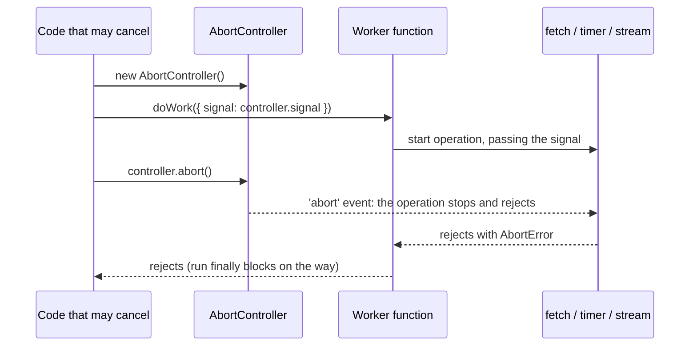
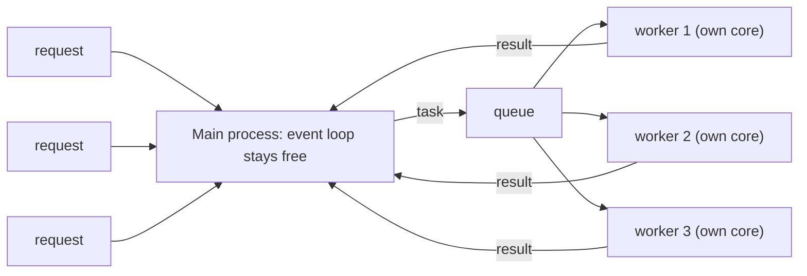

# Cancelling async work and running CPU-bound tasks

## In plain words

You ask a colleague to prepare a long report, then realise five minutes later that you no longer need it. You cannot reach into their head and stop them. All you can do is leave a note on their desk saying "never mind", and hope they look at the desk between tasks. Cancellation in JavaScript works the same way: there is no way to stop a running function from outside, so the function itself must **check, at sensible moments, whether it has been asked to stop**. This is called *cooperative cancellation*.

The second topic is the mirror image. Node's single waiter (the event loop) is superb at carrying orders and terrible at cooking. If the waiter is made to peel a sack of potatoes, every table waits. Heavy computation, known as **CPU-bound** work, must be handed to someone else: a helper in the kitchen. Node offers three ways to do that, and choosing between them is the second half of this lesson.

Why it matters for a job: users close tabs, requests time out, and deployments shut servers down; without cancellation, abandoned work keeps consuming databases and money. And "our API freezes for two seconds whenever someone exports a report" is the CPU-bound problem, guaranteed to appear in any growing Node service and in any senior Node interview.

> **Before this lesson:** you need `async`/`await` from [Async/await: sequential and parallel flows](#/lesson/nodejs/async-await-flows), generators from [Iterators, generators and async iterators](#/lesson/nodejs/iterators-generators), and the event loop from [The event loop in detail](#/lesson/nodejs/event-loop-phases), especially why a long synchronous function blocks everything.

## Part 1: cancelling asynchronous operations

### Why promises cannot be cancelled

A promise is a placeholder for a result. It has no method to stop the work behind it, and deliberately so: several parties may be waiting on the same promise, and one of them should not be able to take the result away from the others. So when a user navigates away, a `Promise.race` timeout wins, or `Promise.all` rejects early, the "losing" operations **keep running** to the end. Their results are thrown away, and their cost is not.

### The basic recipe: check a flag between steps

An async function is a series of steps separated by `await`. After each step it can ask: am I still wanted?

```js-run
class CancelError extends Error {
  constructor() { super("cancelled"); this.name = "CancelError"; }
}

const step = (name, ms) => new Promise((resolve) => setTimeout(() => { console.log("   finished", name); resolve(); }, ms));

async function exportReport(token) {
  await step("load orders", 30);
  if (token.cancelRequested) throw new CancelError();     // check after every await
  await step("compute totals", 30);
  if (token.cancelRequested) throw new CancelError();
  await step("render PDF", 30);
  if (token.cancelRequested) throw new CancelError();
  return "report.pdf";
}

const token = { cancelRequested: false };
setTimeout(() => { console.log("   (user clicked cancel)"); token.cancelRequested = true; }, 45);

try {
  console.log(await exportReport(token));
} catch (error) {
  console.log(error instanceof CancelError ? "export was cancelled; no PDF was rendered" : "failed: " + error.message);
}
```

- `token` is a plain object shared between the code that wants to cancel and the code that does the work.
- The request arrives at 45 ms, in the middle of "compute totals". That step is **not interrupted**; it finishes. The check after it throws, and "render PDF" never starts.
- Cancellation is reported by throwing a specific error type, so callers can tell "cancelled" (expected, usually ignored) from "failed" (a real problem).

The repeated `if` lines are noise and easy to forget. The standard platform feature removes most of them.

### The standard tool: `AbortController` and `AbortSignal`

Browsers and Node share a built-in pair of objects for cancellation.

- An **`AbortController`** is held by the side that may want to cancel. Calling `controller.abort()` requests cancellation.
- Its **`signal`** (an `AbortSignal`) is passed to the side doing the work. The work can read `signal.aborted`, call `signal.throwIfAborted()`, or listen for the `"abort"` event.



The great advantage is that most asynchronous APIs in Node accept a signal directly, and they stop **in the middle** of what they are doing:

```javascript
import { setTimeout as sleep } from "node:timers/promises";
import { readFile } from "node:fs/promises";

const controller = new AbortController();
setTimeout(() => controller.abort(), 100);                   // cancel after 100 ms

try {
  const response = await fetch("https://example.com/big.json", { signal: controller.signal });
  const config = await readFile("settings.json", { signal: controller.signal });
  await sleep(5000, undefined, { signal: controller.signal });
} catch (error) {
  if (error.name === "AbortError") console.log("stopped early");
  else throw error;
}
```

```text
stopped early
```

`fetch`, `fs` functions, timers from `node:timers/promises`, `events.once`, `stream.pipeline`, child processes and more take `{ signal }`. Two helpers cover common cases: `AbortSignal.timeout(ms)` creates a signal that aborts itself after a delay, and `AbortSignal.any([a, b])` combines several, so that "the user cancelled **or** five seconds passed" is one signal.

```javascript
const signal = AbortSignal.any([userController.signal, AbortSignal.timeout(5000)]);
const response = await fetch(url, { signal });
```

Your own functions should follow the same convention: accept an options object with a `signal`, pass it on to everything they call, and check it between steps of their own.

```js-run
// A delay that honours a signal, as timers/promises does in Node:
function sleep(ms, { signal } = {}) {
  return new Promise((resolve, reject) => {
    if (signal?.aborted) return reject(signal.reason);
    const timer = setTimeout(resolve, ms);
    signal?.addEventListener("abort", () => { clearTimeout(timer); reject(signal.reason); }, { once: true });
  });
}

async function syncAccounts(accounts, { signal } = {}) {
  const done = [];
  try {
    for (const account of accounts) {
      signal?.throwIfAborted();                    // between steps: one line, no custom flag
      await sleep(30, { signal });                 // inside a step: interrupted immediately
      done.push(account);
      console.log("   synced", account);
    }
    return done;
  } finally {
    console.log("   cleanup: releasing the lock (runs on success, failure and cancellation)");
  }
}

const controller = new AbortController();
setTimeout(() => controller.abort(new Error("user navigated away")), 75);

const started = Date.now();
try {
  await syncAccounts(["acc-1", "acc-2", "acc-3", "acc-4"], { signal: controller.signal });
} catch (error) {
  console.log(`stopped after about ${Math.round((Date.now() - started) / 5) * 5} ms:`, error.message);
}
```

The abort arrives at 75 ms, in the middle of the third 30 ms sleep. That sleep rejects **at once**: the timer is cleared, nothing more happens, and the function unwinds through its `finally` block. Compare with the flag version, which could only react after the step in progress had finished.

Two details of `sleep` matter for any signal-aware function you write: check `signal.aborted` *before* starting (the signal may already be aborted), and remove or use `{ once: true }` on the listener so it does not accumulate.

> [!WARNING]
> Cancellation is a request, not a guarantee. Aborting a `fetch` stops *your* program from waiting; the server may already have processed the request. Work with side effects (a payment, an email) may or may not have happened. Design such operations to be safe to repeat or to query afterwards.

### Cancellable flows with generators

There is one more technique, worth seeing once for the insight it gives. A generator function pauses at every `yield`, and **the code that drives the generator decides whether to resume it**. So if an async flow is written as a generator that yields promises, a small driver can check for cancellation at every pause automatically. This is how async functions were emulated before `async`/`await` existed.

```js-run
function createCancellable(generatorFunction) {
  return function start(...args) {
    const generator = generatorFunction(...args);
    let cancelled = false;

    const promise = new Promise((resolve, reject) => {
      function resume(method, value) {
        if (cancelled) {                                    // the one and only cancellation check
          generator.return();                               // runs the generator's finally blocks
          return reject(new Error("cancelled"));
        }
        let result;
        try { result = generator[method](value); }
        catch (error) { return reject(error); }
        if (result.done) return resolve(result.value);
        Promise.resolve(result.value).then((v) => resume("next", v), (e) => resume("throw", e));
      }
      resume("next");
    });

    return { promise, cancel: () => { cancelled = true; } };
  };
}

const step = (name, ms) => new Promise((resolve) => setTimeout(() => { console.log("   finished", name); resolve(name); }, ms));

const exportReport = createCancellable(function* (title) {
  try {
    yield step("load orders", 30);            // reads like await, but the driver is in charge
    yield step("compute totals", 30);
    yield step("render PDF", 30);
    return title + ".pdf";
  } finally {
    console.log("   cleanup ran");
  }
});

const job = exportReport("november");
setTimeout(job.cancel, 45);
console.log(await job.promise.catch((error) => "result: " + error.message));
```

The business function contains no cancellation code at all. Every `yield` is a point where the driver may decline to continue. Libraries built on this idea exist, but for new code `AbortSignal` is the standard choice, since the platform's own APIs understand it.

The problem [Cooperative cancellation](#/problem/node-cancel-token) models interruptible and non-interruptible steps on a timeline.

## Part 2: CPU-bound tasks

### The problem, measured

A task is **CPU-bound** when its duration is spent computing, not waiting: resizing images, parsing a huge file, hashing passwords, generating a PDF, searching a large in-memory data set. While such code runs, the event loop is stuck in it.

Our example task: count the prime numbers below a limit by trial division, a deliberately slow method. The page's own timers serve as a heartbeat showing whether the event loop is alive.

```js-run
function isPrime(n) {
  if (n < 2) return false;
  for (let d = 2; d * d <= n; d++) if (n % d === 0) return false;
  return true;
}
function countPrimesBlocking(limit) {
  let count = 0;
  for (let n = 2; n < limit; n++) if (isPrime(n)) count++;
  return count;
}

const started = Date.now();
let beats = 0;
const heartbeat = setInterval(() => beats++, 10);          // should tick every 10 ms

const count = countPrimesBlocking(1_500_000);
const elapsed = Date.now() - started;
clearInterval(heartbeat);
console.log(`found ${count} primes in ${elapsed} ms`);
console.log(`heartbeats during the computation: ${beats} (an idle loop would have managed about ${Math.floor(elapsed / 10)})`);
```

Zero heartbeats. For the whole computation no timer fired, and in a server no request would have been accepted or answered. One user's report export freezes everyone.

### Solution 1: interleaving

Split the computation into small slices and return to the event loop between slices, so pending callbacks get a turn. In Node the tool for "continue after pending I/O" is `setImmediate`; the page uses `setTimeout(..., 0)`, which serves the same purpose here.

```js-run
function isPrime(n) {
  if (n < 2) return false;
  for (let d = 2; d * d <= n; d++) if (n % d === 0) return false;
  return true;
}
const yieldToLoop = () => new Promise((resolve) => setTimeout(resolve, 0));   // in Node: setImmediate

async function countPrimesInterleaved(limit, sliceSize = 50_000) {
  let count = 0;
  for (let n = 2; n < limit; n++) {
    if (isPrime(n)) count++;
    if (n % sliceSize === 0) await yieldToLoop();           // let timers and I/O run
  }
  return count;
}

const started = Date.now();
let beats = 0;
const heartbeat = setInterval(() => beats++, 10);

const count = await countPrimesInterleaved(1_500_000);
const elapsed = Date.now() - started;
clearInterval(heartbeat);
console.log(`found ${count} primes in ${elapsed} ms, with ${beats} heartbeats along the way`);
```

The loop now breathes. Interleaving needs no extra processes or threads, which makes it attractive for moderate jobs. Its limits are real, though:

- The work still runs on the one thread. The total time is slightly **longer**, and other requests are served more slowly while it runs.
- It uses one CPU core, however many the machine has.
- Each slice must be short; one slice that happens to be slow blocks as before.
- Do **not** use `process.nextTick` or a resolved promise to yield: those run before the loop continues, so I/O would still starve.

### Solution 2: separate processes

Run the computation in another **process**: a separate running program with its own memory and its own event loop. Node's `child_process.fork()` starts a second Node process running a given file and opens a message channel to it.

```javascript
// primes-worker.js: the child process
function countPrimes(limit) { /* the blocking version from above */ }

process.on("message", ({ id, limit }) => {
  process.send({ id, count: countPrimes(limit) });          // blocks only this child
});
```

```javascript
// main.js: the parent process
import { fork } from "node:child_process";

const child = fork("./primes-worker.js");
let nextId = 0;
const pending = new Map();
child.on("message", ({ id, count }) => { pending.get(id)(count); pending.delete(id); });

function countPrimesInChild(limit) {
  return new Promise((resolve) => {
    const id = nextId++;
    pending.set(id, resolve);                               // remember who is waiting for this id
    child.send({ id, limit });
  });
}

console.log(await countPrimesInChild(1_500_000));           // the parent's event loop stays free
```

```text
114155
```

The parent sends a message and awaits; its loop keeps serving requests while the child computes on another CPU core. The `id` ties each reply to its request, a small instance of the request/reply pattern from the messaging module. Messages are **copied** between processes (serialised on one side and rebuilt on the other), so they must be plain data, and sending very large inputs has a cost.

Starting a process takes tens of milliseconds and tens of megabytes. Starting one per request would be slow, and an attacker could request thousands. The standard design is a **process pool**: a fixed number of long-lived children, each handling one task at a time, with waiting tasks queued. That is the task queue with a concurrency limit again, with processes as the slots.



### Solution 3: worker threads

A **worker thread** is a lighter alternative provided by the `node:worker_threads` module: a second JavaScript thread *inside the same process*, with its own V8 instance and its own event loop. It starts faster and uses less memory than a process.

```javascript
// primes-thread.js
import { parentPort } from "node:worker_threads";

parentPort.on("message", ({ id, limit }) => {
  parentPort.postMessage({ id, count: countPrimes(limit) });
});
```

```javascript
// main.js
import { Worker } from "node:worker_threads";

const worker = new Worker(new URL("./primes-thread.js", import.meta.url));
worker.on("message", ({ id, count }) => console.log(`task ${id}: ${count} primes`));
worker.on("error", (error) => console.error("worker crashed:", error));
worker.postMessage({ id: 1, limit: 1_500_000 });
```

Unlike threads in many languages, worker threads **do not share ordinary variables** with the main thread. Each has its own objects, and they communicate by messages, which keeps the "no data races in my JavaScript" property. Two efficient options exist for large binary data: *transferring* an `ArrayBuffer` (ownership moves to the other thread without copying), and `SharedArrayBuffer`, a block of raw memory truly shared between threads, to be used with the `Atomics` functions and great care.

As with processes, use a **pool** of workers. Writing a robust pool (queueing, restarting crashed workers, timeouts, cancellation) is real work; mature packages such as `piscina` and `workerpool` do it.

### Choosing

| | Interleaving | Child processes | Worker threads |
|---|---|---|---|
| Uses several CPU cores | no | yes | yes |
| Event loop of the main program | partly busy | free | free |
| Start-up cost and memory | none | highest | moderate |
| Isolation if the task crashes | none: it is your process | strongest: separate process | a crash can still affect the process |
| Data exchange | direct | copied messages | copied messages, transferable or shared buffers |
| Can run non-JavaScript programs | no | yes (`spawn` any executable) | no |
| Good for | short, occasional jobs | isolation, existing command-line tools | CPU-heavy JavaScript in a server |

A fourth option belongs to architecture, not code: do not compute in the web server at all. Put a job on a queue and let a separate worker service process it, then notify the user. The messaging module covers that design.

> [!TIP]
> Before reaching for threads, check whether the heavy part is already asynchronous. Node's built-in `crypto.pbkdf2`, `crypto.scrypt`, `zlib` compression and file-system calls run on libuv's thread pool when used in their asynchronous forms. The usual mistake is calling the `...Sync` variant inside a request handler.

> [!INTERVIEW]
> **"How do you handle a CPU-intensive task in Node?"** "Never on the event loop inside a request handler. Options: break it into chunks and yield with `setImmediate`, which keeps the loop responsive on one core; run it in a pool of worker threads, which uses several cores inside one process and communicates by message passing; run it in child processes for stronger isolation or to use an existing executable; or move it out of the request path onto a job queue. I would use a pool library in production and limit its size to the number of cores." **"How do you cancel a promise?"** "You cannot. You cancel the underlying operation cooperatively, with an `AbortController` whose signal is passed to the APIs involved and checked between steps; the promise then rejects with an `AbortError`."

## Pitfalls

- **Assuming a timed-out or abandoned promise stopped working.** It did not, unless the operation received a signal.
- **Not passing the signal down.** A function that accepts `signal` and calls `fetch(url)` without it cannot be interrupted during the request.
- **Treating `AbortError` as a failure** in logs and alerts.
- **No `finally`**: cancellation leaves locks held, files open, temporary data behind.
- **Leaking abort listeners** on a long-lived signal.
- **Yielding with `nextTick` or promises** in an interleaved computation.
- **One worker per request** instead of a pool.
- **Passing huge objects to workers** and paying more for copying than the computation saves.
- **A pool larger than the number of CPU cores**: more threads than cores only adds switching overhead for CPU-bound work.

## Cheat sheet

| Goal | Code |
|---|---|
| Create a cancel handle | `const controller = new AbortController()` |
| Request cancellation | `controller.abort(reason)` |
| Pass it down | `doWork({ signal: controller.signal })` |
| Check between steps | `signal.throwIfAborted()` |
| React immediately | `signal.addEventListener("abort", onAbort, { once: true })` |
| Timeout signal | `AbortSignal.timeout(5000)` |
| Combine signals | `AbortSignal.any([a, b])` |
| Recognise cancellation | `error.name === "AbortError"` |
| Yield to the loop | `await setImmediate()` from `node:timers/promises` |
| New Node process with a channel | `fork(file)`, `child.send(msg)`, `process.on("message", ...)` |
| New thread | `new Worker(file)`, `worker.postMessage(msg)`, `parentPort.on("message", ...)` |
| Pool libraries | `piscina`, `workerpool` |

## Summary

- JavaScript cannot interrupt running code, and promises cannot be cancelled; cancellation is cooperative.
- `AbortController` and `AbortSignal` are the standard mechanism. Most Node APIs accept a signal and stop mid-operation; your functions should accept one, pass it on and check it between steps, with clean-up in `finally`.
- Generators offer an automatic cancellation point at every `yield`, which shows how such flows work underneath.
- CPU-bound work blocks the event loop for all users. Interleave it for small jobs, or move it to a pool of worker threads or child processes that communicate by messages, or to a separate service through a queue.

## Glossary

- **Cooperative cancellation**: cancellation in which the running code checks for a stop request.
- **`AbortController`**: the object used to request cancellation.
- **`AbortSignal`**: the object passed to work so that it can observe a cancellation request.
- **`AbortError`**: the error an aborted operation rejects with.
- **CPU-bound**: limited by computation time.
- **Interleaving**: splitting a computation into slices separated by returns to the event loop.
- **Process**: a running program with its own memory.
- **Child process**: a process started by another process.
- **IPC (inter-process communication)**: exchanging messages between processes.
- **Worker thread**: an additional JavaScript thread within the same process, with separate memory for ordinary objects.
- **Pool**: a fixed set of reusable workers with a queue of waiting tasks.
- **Transferable**: binary data whose ownership can be moved to another thread without copying.
- **`SharedArrayBuffer`**: raw memory accessible from several threads at once.

```quiz
[
  {"q": "`Promise.race([slowQuery(), timeout(1000)])` rejects because the timeout won. What happens to slowQuery?", "options": ["It is cancelled automatically", "It keeps running; only its result is ignored", "It is retried", "It throws an AbortError"], "answer": 1,
   "explain": "Promises have no cancellation. The underlying operation continues unless it was given a signal."},
  {"q": "With the flag-checking recipe, a cancel request arrives while a 30 ms step is 10 ms in. When does the function stop?", "options": ["Immediately", "After that step completes, at the next check", "Never", "After all steps"], "answer": 1,
   "explain": "A plain awaited step is not interrupted; the check after it sees the flag."},
  {"q": "What is the advantage of passing an AbortSignal to `fetch` or a timer over checking a flag between steps?", "options": ["It is shorter to type", "The operation itself is interrupted mid-way and rejects at once", "It makes the code synchronous", "It retries on failure"], "answer": 1,
   "explain": "Signal-aware APIs stop the I/O when the signal aborts, instead of waiting for it to finish."},
  {"q": "In what order do these log?\n\n`setTimeout(() => console.log('timer'), 0); let n = 0; for (let i = 0; i < 2e9; i++) n += i; console.log('loop done');`", "options": ["timer, loop done", "loop done, timer", "They alternate", "Only loop done"], "answer": 1,
   "explain": "The timer callback cannot run until the synchronous loop returns control to the event loop."},
  {"q": "Why must an interleaved computation yield with setImmediate (or a timer) and not with process.nextTick?", "options": ["nextTick is deprecated", "nextTick callbacks run before the loop proceeds, so pending I/O would still be starved", "setImmediate is faster", "nextTick only works in workers"], "answer": 1,
   "explain": "Only returning to the loop's phases gives other callbacks a turn."},
  {"q": "How do worker threads in Node share ordinary JavaScript objects with the main thread?", "options": ["Directly, like global variables", "They do not; data is passed by messages, copied or transferred", "Through require.cache", "Through process.env"], "answer": 1,
   "explain": "Each thread has its own heap; only SharedArrayBuffer memory is truly shared."},
  {"q": "Why use a pool of workers instead of creating one per request?", "options": ["Pools use more cores than exist", "Creating workers is costly, and an unbounded number would exhaust memory and CPU under load", "Workers cannot be created at run time", "Pools avoid message passing"], "answer": 1,
   "explain": "A fixed number of reusable workers with a queue bounds resource use."},
  {"q": "Which statement about interleaving is true?", "options": ["It spreads the work over all CPU cores", "It keeps the loop responsive but still uses a single thread, and total time does not improve", "It requires child processes", "It makes the computation faster"], "answer": 1,
   "explain": "Interleaving trades a little total time for responsiveness; it adds no computing power."}
]
```

> **Source:** Casciaro & Mammino, *Node.js Design Patterns* 3e, ch. 11 (topics only; wording and examples are original). Documentation: https://nodejs.org/docs/latest/api/globals.html#class-abortcontroller, https://nodejs.org/docs/latest/api/worker_threads.html, https://nodejs.org/docs/latest/api/child_process.html#child_processforkmodulepath-args-options
