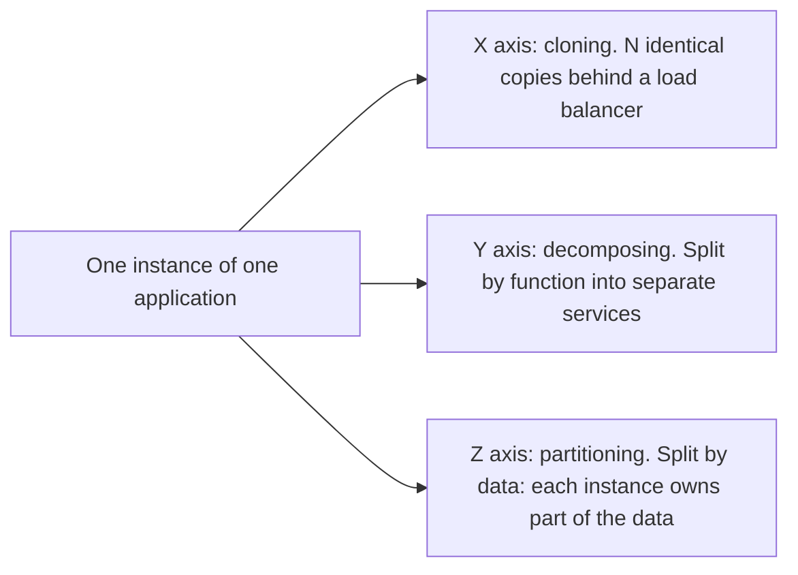
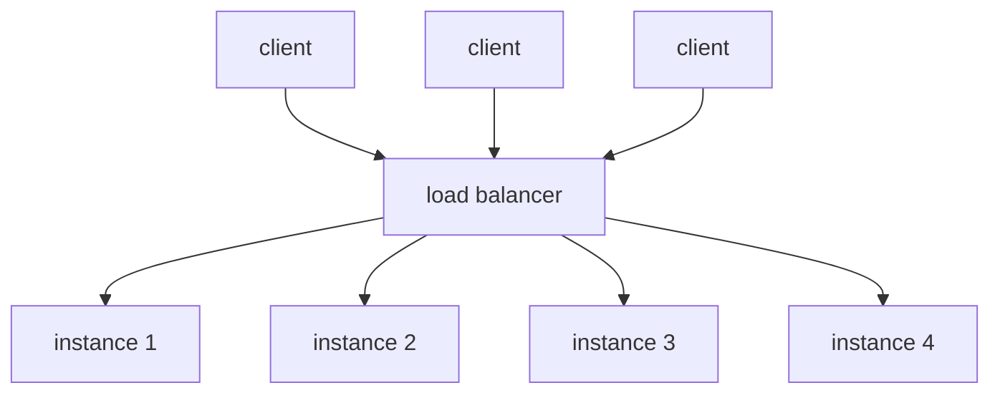
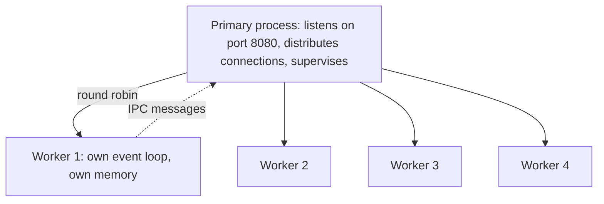
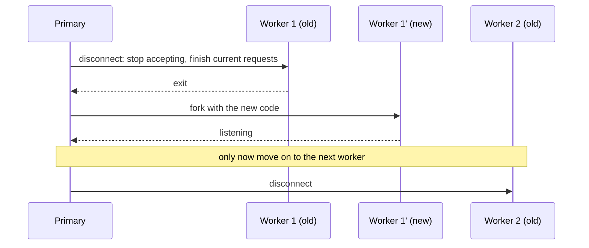

# The scale cube, cluster and zero-downtime restarts

## In plain words

A supermarket with one checkout and a growing queue has three options. Open more identical checkouts and send customers to whichever is free. Create specialised counters: one for the bakery, one for returns, one for the pharmacy. Or split customers by some attribute: loyalty-card holders to the left, everyone else to the right. Most large shops do all three.

Software grows in the same three directions. **Scalability** is the ability of a system to handle more work by adding resources. This lesson introduces a simple map of those three directions, called the **scale cube**, and then takes the first and cheapest step in practice: running several copies of a Node application on one machine with the built-in `cluster` module, surviving crashes, and deploying new versions without a single failed request.

Why it matters for a job: a Node process runs JavaScript on one thread, so a single process uses one CPU core of a machine that probably has eight or more. Running several processes behind a load balancer is how every serious Node deployment works. "How do you scale a Node application?" and "how do you deploy without downtime?" are standard senior-level interview questions.

> **Before this lesson:** you need the single-thread model from [Philosophy, non-blocking I/O and the reactor pattern](#/lesson/nodejs/nonblocking-reactor), the first HTTP server from [npm, package.json and your first HTTP server](#/lesson/nodejs/npm-first-server), and child processes from [Cancelling async work and running CPU-bound tasks](#/lesson/nodejs/cancel-cpu-bound).

## Why scale, and in which direction

Two reasons to scale, of which the second is easy to forget:

- **Capacity**: serve more requests, more users, more data.
- **Availability**: keep working when a part fails. With one process, one crash is an outage. With four, the other three carry on.

Two basic ways to add resources:

- **Vertical scaling** (scaling *up*): a bigger machine with more CPU and memory. Simple, but it has a ceiling, costs rise steeply, and it still leaves a single point of failure.
- **Horizontal scaling** (scaling *out*): more instances of the application, on the same machine or across many. No practical ceiling, and it brings redundancy, but the application must be written to allow it.

Node's design pushes you towards horizontal scaling early, since one process cannot use a second core by itself. That is a blessing in disguise: an application that already runs as four processes on one machine is most of the way to running on four machines.

### The scale cube

The scale cube, popularised by the book *The Art of Scalability*, names three independent dimensions of growth.



| Axis | Idea | Example | Difficulty |
|---|---|---|---|
| **X: cloning** | Run *n* identical copies; each handles 1/n of the load | 8 processes of the same API | low |
| **Y: decomposing by function** | Split the application into services by feature | separate `orders`, `catalogue` and `auth` services | high: changes architecture and teams |
| **Z: partitioning by data** | Each instance is responsible for a slice of the data | users A–M on one database server, N–Z on another (*sharding*) | highest: mostly a database matter |

This lesson covers the X axis. The next lesson continues with load balancing across machines and with the Y axis (microservices). The Z axis appears as consistent hashing in the problems.

## Cloning and load balancing

X-axis scaling needs two things: several **instances** (running copies) of the application, and a **load balancer**, a component that receives every incoming connection and hands it to one of the instances.



The simplest distribution rule is **round robin**: connections are handed out in rotation, 1, 2, 3, 4, 1, 2, … so each instance gets an equal share.

## The `cluster` module

Node ships a load balancer for the single-machine case. With `node:cluster`, one process, the **primary**, starts several **worker** processes with `fork()`. The workers all run your server code. The primary owns the listening port, accepts incoming connections and distributes them among the workers, round robin by default on every platform except Windows.



```javascript
// server.js
import cluster from "node:cluster";
import http from "node:http";
import { availableParallelism } from "node:os";

if (cluster.isPrimary) {
  const count = availableParallelism();                 // usable CPU cores
  console.log(`primary ${process.pid}: starting ${count} workers`);
  for (let i = 0; i < count; i++) cluster.fork();       // each fork runs this same file
} else {
  http.createServer((req, res) => {
    res.end(`hello from worker ${process.pid}\n`);
  }).listen(8080, () => console.log(`worker ${process.pid} listening`));
}
```

```text
$ node server.js
primary 4101: starting 4 workers
worker 4102 listening
worker 4103 listening
worker 4105 listening
worker 4104 listening
$ curl localhost:8080
hello from worker 4102
$ curl localhost:8080
hello from worker 4103
```

Line by line:

- The same file runs in two roles. `cluster.isPrimary` is `true` in the process you started and `false` in the forked ones.
- `availableParallelism()` reports how many CPU cores the process may use. One worker per core is the usual starting point; more workers than cores brings no benefit for a busy server.
- `cluster.fork()` starts a new Node process running the same script.
- Each worker calls `listen(8080)`. Normally a second process listening on a port in use fails with `EADDRINUSE`. Inside a cluster, `listen` is intercepted: the worker asks the primary, which holds the real socket and passes connections down.
- A **PID** (process identifier) is the number the operating system gives each process; the different PIDs in the output show different workers answering.

### What workers do not share

Every worker is a full, separate process: its own V8, its own event loop, its own memory. **Nothing in memory is shared.** A variable set in worker 1 does not exist in worker 2. That is the single most important fact about clustering, and it has consequences we return to below.

Primary and workers can exchange messages over the built-in channel (`worker.send(...)`, `process.on("message", ...)`), which is useful for coordination but not a substitute for shared state.

## Resilience: restarting crashed workers

A bug that throws an uncaught exception kills the process it occurs in. With a cluster, that is one worker, and the primary can replace it:

```javascript
if (cluster.isPrimary) {
  for (let i = 0; i < availableParallelism(); i++) cluster.fork();

  cluster.on("exit", (worker, code, signal) => {
    if (code !== 0 && !worker.exitedAfterDisconnect) {       // crashed, not stopped on purpose
      console.log(`worker ${worker.process.pid} died (code ${code}); starting a replacement`);
      cluster.fork();
    }
  });
}
```

While one worker restarts, the others keep answering. Requests that were in progress *inside the crashed worker* are lost, but the service as a whole stays up. Compare with a single process, where every crash is a total outage until something restarts it.

The model below simulates a primary doing round robin over workers, one of which crashes and is replaced. (The page cannot fork processes, so workers are plain objects.)

```js-run
function createCluster(size) {
  let nextId = 1, pointer = 0;
  const workers = Array.from({ length: size }, () => ({ id: nextId++, alive: true, handled: 0 }));
  return {
    workers,
    handle(request) {                                    // round robin, skipping dead workers
      for (let step = 0; step < workers.length; step++) {
        const worker = workers[(pointer + step) % workers.length];
        if (worker.alive) {
          pointer = (workers.indexOf(worker) + 1) % workers.length;
          worker.handled++;
          return `request ${request} -> worker ${worker.id}`;
        }
      }
      return `request ${request} -> 503 no worker available`;
    },
    crash(id) { workers.find((w) => w.id === id).alive = false; return `   (worker ${id} crashed)`; },
    replaceDead() {
      for (let i = 0; i < workers.length; i++) {
        if (!workers[i].alive) { const old = workers[i].id; workers[i] = { id: nextId++, alive: true, handled: 0 }; return `   (primary replaced worker ${old} with worker ${workers[i].id})`; }
      }
    },
  };
}

const cluster = createCluster(3);
const lines = [];
for (let r = 1; r <= 4; r++) lines.push(cluster.handle(r));
lines.push(cluster.crash(2));
for (let r = 5; r <= 7; r++) lines.push(cluster.handle(r));          // service continues on two workers
lines.push(cluster.replaceDead());
for (let r = 8; r <= 10; r++) lines.push(cluster.handle(r));
console.log(lines.join("\n"));
```

No request was answered with an error: while worker 2 was down, the remaining two shared the traffic. The problem [Round-robin load balancer with failing workers](#/problem/node-round-robin) asks you to write this distribution logic.

## Graceful shutdown

Stopping a worker by killing it cuts off whatever it was doing. A **graceful shutdown** stops accepting new work, lets work in progress finish, releases resources, and only then exits.

Processes are asked to stop by a **signal**, a small notification from the operating system. `SIGTERM` is the polite "please terminate" sent by deployment tools and container platforms; `SIGINT` is what Ctrl+C sends; `SIGKILL` cannot be caught and stops the process on the spot.

```javascript
const server = http.createServer(handler).listen(8080);

function shutdown(signal) {
  console.log(`${signal} received: finishing in-flight requests`);
  server.close(async () => {                 // stop accepting; callback runs when connections are done
    await db.end();                          // then release resources
    process.exit(0);
  });
  setTimeout(() => {                         // safety net: do not wait forever
    console.error("could not finish in time, forcing exit");
    process.exit(1);
  }, 10_000).unref();                        // unref: this timer alone must not keep the process alive
}

process.on("SIGTERM", () => shutdown("SIGTERM"));
process.on("SIGINT", () => shutdown("SIGINT"));
```

`server.close()` stops the server from accepting new connections and calls back when existing ones have ended. The timeout guards against a stuck connection keeping the process alive indefinitely.

## Zero-downtime restarts

Deploying a new version means stopping the old code and starting the new. Do that to all workers at once and there is a gap during which nobody listens. A **rolling restart** avoids the gap: restart the workers **one at a time**, waiting for each replacement to be ready before touching the next. Capacity dips by one worker and never reaches zero.



```javascript
import { once } from "node:events";

if (cluster.isPrimary) {
  process.on("SIGUSR2", async () => {                    // an agreed "please reload" signal
    for (const worker of Object.values(cluster.workers)) {
      worker.disconnect();                               // graceful: finish in-flight requests
      await once(worker, "exit");
      if (!worker.exitedAfterDisconnect) continue;       // it crashed instead; the exit handler deals with it
      const replacement = cluster.fork();                // runs the new code from disk
      await once(replacement, "listening");              // wait until it can take traffic
    }
    console.log("all workers restarted");
  });
}
```

`SIGUSR2` is one of two signals reserved for application-defined purposes; sending it with `kill -SIGUSR2 <primary pid>` triggers the reload. (Windows has no such signals; there you would use another trigger, such as a message or a file watcher.) The simulation shows the property that matters, the number of workers able to serve at each step:

```js-run
const workers = [{ id: 1, version: "v1" }, { id: 2, version: "v1" }, { id: 3, version: "v1" }];
const show = (label) => console.log(label.padEnd(34), workers.map((w) => w ? `${w.id}:${w.version}` : "  --  ").join("  "), "| serving:", workers.filter(Boolean).length);

show("before the deploy");
let nextId = 4, minimum = workers.length;
for (let slot = 0; slot < workers.length; slot++) {
  workers[slot] = null;                                  // old worker drained and stopped
  minimum = Math.min(minimum, workers.filter(Boolean).length);
  show(`slot ${slot + 1}: old worker stopped`);
  workers[slot] = { id: nextId++, version: "v2" };       // replacement started and listening
  show(`slot ${slot + 1}: new worker ready`);
}
console.log("lowest number of serving workers at any moment:", minimum, "(never zero)");
```

During the roll, old and new versions serve traffic side by side. That is harmless only if the two versions are **compatible**: a new version that requires a database column the old one does not write, or the reverse, breaks half the requests for the duration. Deployments are therefore usually done in backward-compatible steps.

## The catch: state that lives in memory

Suppose your application remembers logged-in users in a `Map` inside the process: session id to user. With one process it works. With four workers:

1. The login request lands on worker 1, which stores the session in *its* memory.
2. The next request from the same user lands on worker 2, which has never heard of that session. The user appears logged out.

```js-run
const workers = [new Map(), new Map(), new Map()];       // each worker's private memory
let turn = 0;
const pickWorker = () => turn++ % workers.length;        // round robin

function login(sessionId, user) { const w = pickWorker(); workers[w].set(sessionId, user); return `login handled by worker ${w + 1}`; }
function profile(sessionId) { const w = pickWorker(); return `worker ${w + 1}: ` + (workers[w].get(sessionId) ?? "401 who are you?"); }

console.log(login("s-1", "ana"));
console.log(profile("s-1"));
console.log(profile("s-1"));
console.log(profile("s-1"));                              // only this one reaches the worker that knows her

// Fix: move the state out of the workers into something they all can reach.
const sharedStore = new Map();                            // stands in for Redis or a database
turn = 0;
const login2 = (id, user) => { pickWorker(); sharedStore.set(id, user); };
const profile2 = (id) => `worker ${pickWorker() + 1}: ` + (sharedStore.get(id) ?? "401");
login2("s-1", "ana");
console.log("with a shared store ->", profile2("s-1"), "|", profile2("s-1"), "|", profile2("s-1"));
```

An application that keeps such per-client data in process memory is called **stateful**. There are two remedies.

**Share the state.** Keep sessions, caches, counters and rate-limit data in a store that all instances reach: a database or an in-memory store such as Redis. The processes themselves become **stateless**: any instance can serve any request, instances can be added, removed and restarted freely. This is the standard approach, and the one that works across machines.

**Sticky load balancing.** Configure the balancer to send all requests of one client to the same instance, typically by hashing the client's IP address or by a cookie. It needs no code changes and it is required for some connection-oriented protocols, but it undermines the benefits of cloning: if that instance dies its users' state is gone, the load spreads unevenly, and many users behind one company network may all hash to one instance.

> [!WARNING]
> Anything kept in a module-level variable is per-process: in-memory sessions, caches, rate-limit counters, "is this job already running?" flags, uploaded files written to a local folder. Code that depends on such state works on a developer's laptop and fails, intermittently, the day a second instance is started.

## Beyond `cluster`

`cluster` is the right tool for learning and for using all cores of a single machine. In practice the same job is often done by other layers:

- **Process managers** such as PM2 run your script in cluster mode, restart crashed processes and perform rolling reloads from the command line (`pm2 reload app`), so you do not write the primary's logic yourself.
- **Container platforms** (Docker with Kubernetes, covered next) run each instance as a separate container with *one* Node process inside, and the platform does the load balancing, restarting and rolling updates. In that world you usually do not use `cluster` at all.
- **Worker threads** are not an alternative to `cluster` for serving requests. They exist to move CPU-heavy work off the event loop inside one process.

Whichever tool is used, the ideas are the ones above: several stateless instances, a balancer in front, health-based restarts, graceful shutdown, rolling replacement.

> [!TIP]
> Write every Node service as if several copies were already running: no state in memory that another instance would need, a `SIGTERM` handler that shuts down gracefully, and a quick, honest health-check endpoint. Then the question of scaling becomes a deployment setting instead of a rewrite.

> [!INTERVIEW]
> **"Node is single-threaded. How do you use all CPU cores?"** "Run one process per core. On one machine, the `cluster` module forks workers that share a listening port; the primary distributes connections round robin and restarts workers that die. Across machines, a reverse proxy or the container platform's load balancer does the distributing. Each process has its own memory, so shared state such as sessions must live in an external store like Redis, or the balancer must use sticky sessions." **"How do you deploy without downtime?"** "Rolling restart: replace instances one at a time, waiting for each new one to be ready, with graceful shutdown so in-flight requests finish. Old and new versions overlap, so changes must be backward compatible."

## Pitfalls

- **In-memory state** (sessions, caches, counters) in a clustered application.
- **More workers than cores**, or one worker per core on a machine that also runs a database.
- **A crash loop**: a worker that dies at start-up is re-forked instantly, forever, at 100% CPU. Add a delay or a limit on restarts.
- **No graceful shutdown**: every deploy drops in-flight requests.
- **No timeout on graceful shutdown**: one idle keep-alive connection keeps the old process alive for hours.
- **Incompatible versions overlapping** during a rolling restart.
- **Doing work in the primary.** It should only supervise; if it blocks, nothing is distributed.
- **Scheduled jobs in every worker.** A timer in the application code fires in all *n* workers, so the nightly email goes out *n* times. Run such jobs in exactly one place.

## Cheat sheet

| Concept | In practice |
|---|---|
| Vertical scaling | bigger machine |
| Horizontal scaling | more instances |
| X axis | clone: *n* identical instances + load balancer |
| Y axis | split by function into services |
| Z axis | partition by data (sharding) |
| Start workers | `if (cluster.isPrimary) for (...) cluster.fork()` |
| Number of workers | `os.availableParallelism()` |
| Restart on crash | `cluster.on("exit", (w, code) => { if (code !== 0 && !w.exitedAfterDisconnect) cluster.fork(); })` |
| Graceful shutdown | on `SIGTERM`: `server.close(cb)`, close resources, exit; force after a timeout |
| Rolling restart | for each worker: `disconnect()`, wait for `exit`, `fork()`, wait for `listening` |
| Shared state | Redis or a database, not process memory |
| Sticky sessions | same client always to the same instance; a last resort |

## Summary

- Scaling adds capacity and availability. The scale cube describes three directions: cloning (X), decomposing by function (Y) and partitioning by data (Z).
- A Node process uses one core for JavaScript, so cloning is the natural first step. The `cluster` module forks one worker per core behind a shared port and balances connections round robin.
- Workers share no memory. The primary can restart crashed workers, keeping the service up.
- Graceful shutdown finishes in-flight work on `SIGTERM`; a rolling restart replaces workers one at a time for deployments without downtime.
- State held in process memory breaks under cloning: move it to a shared store and keep instances stateless, or fall back to sticky sessions.

## Glossary

- **Scalability**: the ability to handle more load by adding resources.
- **Availability**: the proportion of time a system is able to serve.
- **Vertical / horizontal scaling**: a larger machine / more instances.
- **Scale cube**: a model with three scaling axes: cloning, functional decomposition, data partitioning.
- **Instance**: one running copy of an application.
- **Load balancer**: a component that distributes incoming connections among instances.
- **Round robin**: distributing in rotation.
- **Primary / worker**: the supervising process / the processes doing the serving, in the `cluster` module.
- **PID**: the operating system's identifier for a process.
- **Signal**: an operating-system notification to a process, such as `SIGTERM`.
- **Graceful shutdown**: stopping after finishing work in progress.
- **Rolling restart**: replacing instances one at a time.
- **Stateful / stateless**: keeping / not keeping per-client data in process memory.
- **Sticky session**: routing one client's requests always to the same instance.
- **Sharding**: splitting data across several database servers.

```quiz
[
  {"q": "Which scale-cube axis is \"run eight identical copies of the API behind a load balancer\"?", "options": ["X axis", "Y axis", "Z axis", "None"], "answer": 0,
   "explain": "Cloning identical instances is X-axis scaling."},
  {"q": "In the cluster module, how can several workers all call `listen(8080)` without EADDRINUSE?", "options": ["Each uses a different hidden port", "The primary owns the listening socket and hands connections to the workers", "The operating system merges them", "Only the first worker really listens"], "answer": 1,
   "explain": "listen is intercepted inside a cluster; the primary distributes incoming connections."},
  {"q": "Worker 1 sets `globalThis.visits = 10`. What does worker 2 read from `globalThis.visits`?", "options": ["10", "undefined", "0", "An error is thrown"], "answer": 1,
   "explain": "Workers are separate processes with separate memory; nothing is shared."},
  {"q": "A cluster has 4 workers and one crashes. What happens to incoming requests while the primary forks a replacement?", "options": ["All requests fail", "The remaining three workers keep serving", "Requests are queued until the replacement is ready", "The primary serves them"], "answer": 1,
   "explain": "Only the crashed worker's in-flight requests are lost; the others continue."},
  {"q": "In what order should a rolling restart proceed for each worker?", "options": ["fork a replacement, kill all old workers at once", "disconnect the old worker, wait for it to exit, fork a replacement, wait until it is listening, then continue with the next", "kill, fork, do not wait", "restart the primary"], "answer": 1,
   "explain": "Waiting for each replacement to be ready keeps capacity from dropping to zero."},
  {"q": "A user logs in and is randomly logged out on later requests after you enabled clustering. Most likely cause?", "options": ["Cookies are disabled", "Sessions are stored in each worker's memory, and later requests reach other workers", "The primary crashed", "The port changed"], "answer": 1,
   "explain": "In-memory session state is per process. Use a shared store, or sticky sessions."},
  {"q": "What does a graceful shutdown handler do on SIGTERM?", "options": ["Exits immediately", "Stops accepting new connections, lets in-flight requests finish, closes resources, then exits, with a timeout as a safety net", "Restarts the process", "Ignores the signal"], "answer": 1,
   "explain": "That sequence avoids dropping requests during deploys."},
  {"q": "An in-app `setInterval` sends a daily report, and the app runs as 6 cluster workers. How many reports are sent per day?", "options": ["1", "6", "0", "It depends on the load balancer"], "answer": 1,
   "explain": "Every worker runs the same code, including the timer. Scheduled jobs must run in exactly one place."}
]
```

> **Source:** Casciaro & Mammino, *Node.js Design Patterns* 3e, ch. 12 (topics only; wording and examples are original). Documentation: https://nodejs.org/docs/latest/api/cluster.html, https://nodejs.org/docs/latest/api/os.html#osavailableparallelism, https://nodejs.org/docs/latest/api/process.html#signal-events
