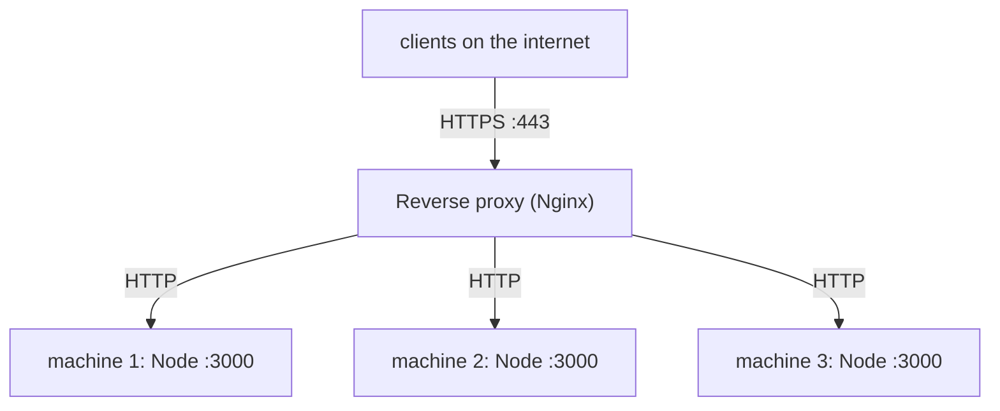
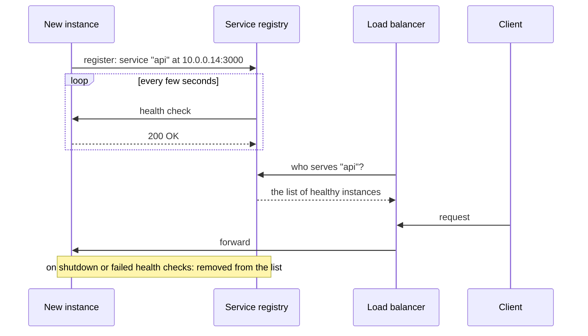
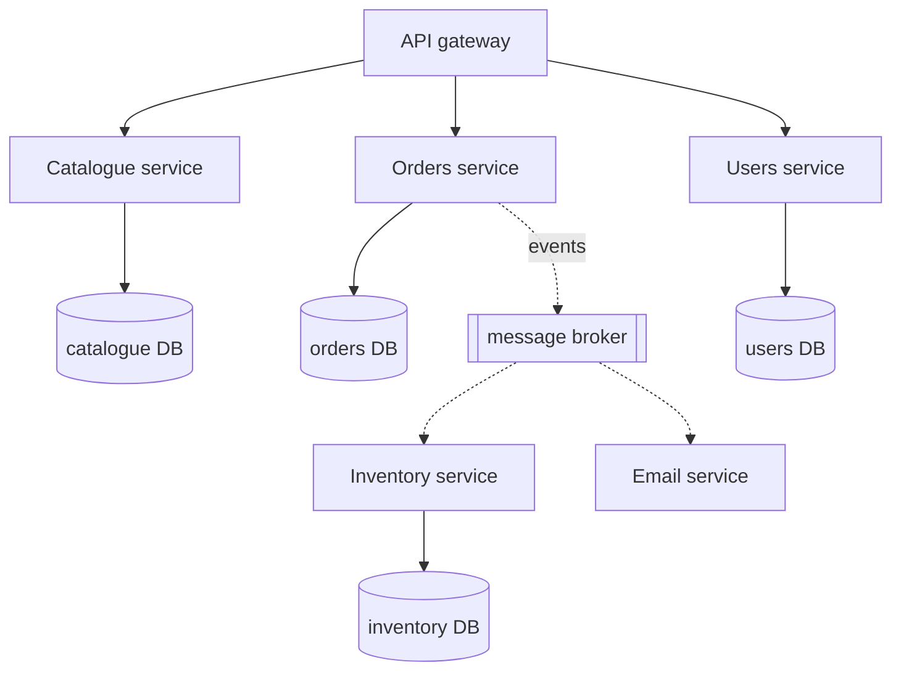

# Reverse proxies, service discovery and microservices

## In plain words

A large company has a front desk. Visitors never wander the corridors looking for someone; they ask at the desk and are sent to whichever clerk is free. The desk also keeps a staff list that changes as people start and finish their shifts. And the company is organised in departments (sales, accounts, shipping), each with its own files, which cooperate by passing requests and memos.

That is this lesson in miniature. The front desk is a **reverse proxy**: one public address in front of many server instances. The changing staff list is a **service registry**: a live directory of which instances exist right now. The departments are **microservices**: small, separately deployed applications that together make up one system. Along the way we look at **containers**, the standard packaging that makes starting and stopping instances routine.

Why it matters for a job: almost every production Node service sits behind a reverse proxy, runs in containers, and talks to other services. System-design interviews consist largely of the vocabulary introduced here: load balancer, health check, service discovery, API gateway, monolith versus microservices, orchestration versus events.

> **Before this lesson:** read [The scale cube, cluster and zero-downtime restarts](#/lesson/nodejs/scaling-cluster). HTTP basics from [npm, package.json and your first HTTP server](#/lesson/nodejs/npm-first-server) are assumed. Messaging is introduced only briefly here and developed in the next module.

## Scaling beyond one machine: the reverse proxy

The `cluster` module balances between processes on one machine. To use several machines, or to get features `cluster` lacks, the standard tool is a **reverse proxy**: a server that accepts client connections and forwards each request to one of several application instances, called **upstream** or **backend** servers. (A plain, or *forward*, proxy acts on behalf of clients; a reverse proxy acts on behalf of servers.) Popular ones are Nginx, HAProxy, Caddy and Traefik, and every cloud offers one as a managed "load balancer".



What it gives you beyond distribution:

| Feature | Meaning |
|---|---|
| **Several machines** | Backends can be anywhere on the network |
| **TLS termination** | The proxy handles HTTPS encryption; backends speak plain HTTP on a private network |
| **Health checks** | Backends that stop answering are taken out of rotation automatically |
| **Static files, compression, caching** | Done in highly optimised C code, off Node's event loop |
| **Protection** | Request size limits, rate limiting, slow-client buffering |
| **Choice of algorithm** | Round robin, least connections, hashing |

A minimal Nginx configuration for three Node instances:

```nginx
upstream api {
    least_conn;                        # send each request to the backend with the fewest open connections
    server 10.0.0.11:3000;
    server 10.0.0.12:3000;
    server 10.0.0.13:3000 max_fails=3 fail_timeout=10s;
}

server {
    listen 443 ssl;
    server_name api.example.com;
    # ssl_certificate ... ; ssl_certificate_key ... ;

    location / {
        proxy_pass http://api;
        proxy_set_header X-Forwarded-For $remote_addr;      # tell Node the real client address
        proxy_set_header X-Forwarded-Proto $scheme;
    }
}
```

The `upstream` block lists the backends; `proxy_pass` forwards to that group. The `X-Forwarded-For` header exists because, from Node's point of view, every connection now comes from the proxy; the original client address has to be passed along explicitly.

### Balancing algorithms

| Algorithm | Rule | Good when |
|---|---|---|
| **Round robin** | take turns | requests cost about the same |
| **Least connections** | pick the backend with the fewest in-flight requests | request durations vary a lot |
| **IP hash / consistent hash** | the same client (or key) always goes to the same backend | sticky sessions, per-instance caches |
| **Weighted** | stronger machines get a larger share | mixed hardware, gradual roll-outs |

Hashing deserves a note. `hash(key) % numberOfBackends` works until the number changes; then nearly every key maps somewhere new, and every per-instance cache becomes useless at once. **Consistent hashing** arranges backends on a ring so that adding or removing one moves only a small share of the keys. The problem [Consistent hashing ring](#/problem/node-consistent-hash) builds it.

## Instances that come and go: service discovery

The Nginx file above lists fixed addresses. Modern deployments are not fixed: instances are started when traffic rises, stopped when it falls, replaced when they fail, and each new one gets a fresh address. Adjusting capacity automatically is called **dynamic** or **elastic scaling**, and it needs an answer to the question "where are the instances *right now*?".

The answer is a **service registry**: a small, highly available database of live instances.



1. On start-up each instance **registers** itself: service name, address, port.
2. The registry checks each instance's health regularly, usually by calling a **health-check endpoint** such as `GET /health`, and drops instances that fail.
3. The load balancer, or the calling services themselves, **look up** the current list.
4. On graceful shutdown an instance deregisters.

Registries you will meet: Consul, etcd, ZooKeeper, and, most commonly today, the one built into Kubernetes, where it appears as ordinary DNS names.

A health-check endpoint in Node is a few lines, and worth doing honestly: report unhealthy when the service cannot do its job.

```javascript
app.get("/health", async (req, res) => {
  try {
    await db.query("SELECT 1");                      // can we reach what we depend on?
    res.status(200).json({ status: "ok" });
  } catch {
    res.status(503).json({ status: "database unreachable" });
  }
});
```

### Client-side balancing

A central load balancer is one more hop and one more thing to keep alive. Inside a system, a service calling another service can skip it: fetch the instance list from the registry and choose a target itself. This is **client-side** (or *peer-to-peer*) load balancing. It removes a network hop and a potential bottleneck; the price is that every client must contain the balancing and retry logic.

The simulation combines the pieces: a registry with health checks, and a client that balances over whatever is healthy at the moment.

```js-run
function createRegistry() {
  const instances = new Map();                        // id -> { service, address, healthy }
  return {
    register(id, service, address) { instances.set(id, { service, address, healthy: true }); },
    deregister(id) { instances.delete(id); },
    report(id, healthy) { if (instances.has(id)) instances.get(id).healthy = healthy; },   // result of a health check
    lookup(service) {
      return [...instances.values()].filter((i) => i.service === service && i.healthy).map((i) => i.address);
    },
  };
}

function createClient(registry, service) {
  let turn = 0;
  return {
    call(request) {
      const addresses = registry.lookup(service);     // a fresh list each time (real clients cache it briefly)
      if (addresses.length === 0) return `${request} -> 503 no healthy instance of "${service}"`;
      return `${request} -> ${addresses[turn++ % addresses.length]}`;
    },
  };
}

const registry = createRegistry();
registry.register("a", "catalogue", "10.0.0.11:3000");
registry.register("b", "catalogue", "10.0.0.12:3000");
const client = createClient(registry, "catalogue");

console.log(client.call("req 1"), "|", client.call("req 2"));
registry.register("c", "catalogue", "10.0.0.13:3000");            // scaled out under load
console.log(client.call("req 3"), "|", client.call("req 4"), "|", client.call("req 5"));
registry.report("a", false);                                      // instance a fails its health check
console.log(client.call("req 6"), "|", client.call("req 7"));
registry.deregister("b"); registry.report("c", false);
console.log(client.call("req 8"));
```

The client never held a list of addresses in its code. It adapts as instances appear, fail and vanish.

## Containers and orchestration, briefly

Running many instances on many machines raises a practical question: how do you make sure each one has the right Node version, the right dependencies and the right configuration? The industry's answer is the **container**.

A **container image** is a file bundling an application with everything it needs to run: the runtime, libraries, system tools and the code itself. A **container** is a running instance of an image, isolated from other processes on the machine but much lighter than a virtual machine, since it shares the host's operating-system kernel. **Docker** is the best-known tool for building and running them.

An image is described by a `Dockerfile`:

```dockerfile
FROM node:22-slim                      # start from an official image that contains Node
WORKDIR /app
COPY package.json package-lock.json ./
RUN npm ci --omit=dev                  # install exact production dependencies
COPY . .
USER node                              # do not run as root
EXPOSE 3000
CMD ["node", "server.js"]
```

```text
$ docker build -t shop-api:1.4.0 .
$ docker run -p 3000:3000 shop-api:1.4.0
```

The same image runs unchanged on a laptop, a test server and production. Copying the two package files and installing *before* copying the rest of the code is deliberate: Docker caches each step, so dependencies are reinstalled only when those files change.

Starting a container by hand does not scale to hundreds of them. A **container orchestrator**, of which **Kubernetes** is the dominant one, takes a description of the desired state ("run 5 copies of `shop-api:1.4.0`") and keeps reality matching it. Its vocabulary maps directly onto the previous lesson:

| Kubernetes term | What it is | Earlier concept |
|---|---|---|
| **Pod** | one running instance (one or more containers) | a worker |
| **Deployment** | "keep *n* replicas of this image running" | the primary that re-forks |
| **Service** | a stable name and address that balances across the pods | load balancer + registry |
| **Liveness / readiness probe** | periodic checks: restart if dead, send traffic only if ready | health checks |
| **Rolling update** | replace pods gradually with a new image | rolling restart |
| **Horizontal autoscaler** | change the number of replicas with load | dynamic scaling |

In this world each container runs **one** Node process. You do not use `cluster`; you ask for more replicas. Everything the last lesson demanded of an application applies unchanged: stateless instances, graceful shutdown on `SIGTERM`, an honest health endpoint.

## The Y axis: from monolith to microservices

### The monolith

A **monolithic** application is one deployable unit containing all the features: catalogue, basket, orders, payments, users, in one codebase, usually on one database.

A monolith is the right way to begin. One codebase to understand, one thing to deploy, function calls instead of network calls, database transactions that keep data consistent. Many successful products are monoliths. A *modular monolith*, with clear internal boundaries between features, gets many of the structural benefits of services without their operational cost.

It strains when it becomes large. Every change redeploys everything. A memory leak in report generation takes down the checkout. Fifty developers trip over each other in one codebase. One feature that needs ten times the capacity forces all the others to scale with it.

### Microservices

A **microservice architecture** splits the system into small services, each responsible for one business capability, each deployed and scaled independently, each **owning its own data**, and communicating only over the network.



| | Monolith | Microservices |
|---|---|---|
| Deploy | all at once | each service by itself |
| Scale | the whole application | only the hot service |
| Failure | can take everything down | can be contained to one service |
| Technology | one stack | may differ per service |
| Team work | shared codebase | a team owns a service |
| Calls between features | in-process, fast, reliable | over the network: slower, can fail |
| Data consistency | database transactions | no cross-service transactions; eventual consistency |
| Operations | one thing to run and monitor | dozens: needs automation, tracing, discovery |
| Debugging | one stack trace | a request crosses many services |

The right-hand column is not uniformly better. Microservices exchange **code complexity for operational complexity**. A function call that could not fail becomes a network call that can time out, be retried, arrive twice, or reach a service that is down. The honest advice is: start with a well-structured monolith, and split out a service when a concrete pressure (team size, differing scaling needs, deployment conflicts) justifies its cost.

Node suits small services well: start-up is fast, memory use is modest, and its I/O model fits programs that mostly wait for other services.

> [!WARNING]
> The cardinal rule of microservices is that each service owns its data and nobody else reads its database directly. Break that rule and you have a *distributed monolith*: all the network problems of microservices plus all the coupling of a monolith. Getting data from another service means calling its API or subscribing to its events.

## Integration patterns

Features of a real product span several services. "Place an order" must record the order, reserve stock, take payment and send a confirmation. How should the services cooperate? Three patterns cover most cases.

### The API proxy (API gateway)

A single entry point in front of all services. It routes each request to the right service by URL and takes care of concerns common to all of them: authentication, rate limiting, TLS, logging. Clients see one address and one API; the layout of services behind it can change freely. It is a reverse proxy that understands the application's routes.

### API orchestration

One component, the **orchestrator**, implements a multi-service operation by calling each service in turn and combining the results. It may be the gateway itself or a dedicated service.

- For it: the whole flow is readable in one place, and the caller gets an immediate, definite answer.
- Against it: the orchestrator must know every service; all must be up at that moment; and a failure half-way leaves earlier steps to be undone by explicit **compensating actions**.

### Integration through a message broker

A service announces a fact by publishing an **event**, such as `order.placed`, to a **message broker**. Any service that cares subscribes and reacts independently. The publisher knows neither who is listening nor how many. This style is called **event-driven** architecture, or *choreography*: no conductor, each dancer knows their own steps.

- For it: services are decoupled; new reactions are added without touching the publisher; a consumer that is down catches up later, since the broker keeps its messages.
- Against it: no single place describes the whole flow; outcomes are **eventually consistent** (for a moment the order exists while the stock is not yet reserved); debugging means following an event across services.

The two styles side by side, for the same operation:

```js-run
// Three services, each with private state. Email is "down" during the first attempt.
function createServices() {
  const log = [];
  return {
    log,
    orders: { create: async (o) => { log.push(`orders: saved order ${o.id}`); } },
    inventory: { reserve: async (o) => { log.push(`inventory: reserved ${o.qty} x ${o.item}`); } },
    email: { up: false, send: async function (o) { if (!this.up) throw new Error("email service is down"); log.push(`email: confirmation sent for ${o.id}`); } },
  };
}
const order = { id: "A-17", item: "tea", qty: 2 };

// ---- Style 1: orchestration. One function knows and calls everyone. ----
async function placeOrderOrchestrated(services, o) {
  await services.orders.create(o);
  await services.inventory.reserve(o);
  await services.email.send(o);                     // a failure here fails the whole request
}
const s1 = createServices();
const outcome = await placeOrderOrchestrated(s1, order).then(() => "ok", (e) => "FAILED: " + e.message);
console.log("orchestration ->", outcome);
console.log("   ", s1.log.join(" | "), "| (order and stock were changed; must now be compensated or retried)");

// ---- Style 2: a broker. The orders service only announces what happened. ----
function createBroker() {
  const subscribers = [];                           // { topic, handler, pending: [] }
  return {
    subscribe(topic, handler) { subscribers.push({ topic, handler, pending: [] }); },
    publish(topic, message) { for (const s of subscribers) if (s.topic === topic) s.pending.push(message); },
    async deliver() {                               // try to deliver; keep what a consumer could not handle
      for (const s of subscribers) {
        const retry = [];
        for (const message of s.pending) { try { await s.handler(message); } catch { retry.push(message); } }
        s.pending = retry;
      }
    },
    waiting: () => subscribers.reduce((n, s) => n + s.pending.length, 0),
  };
}
const s2 = createServices();
const broker = createBroker();
broker.subscribe("order.placed", (o) => s2.inventory.reserve(o));
broker.subscribe("order.placed", (o) => s2.email.send(o));

await s2.orders.create(order);
broker.publish("order.placed", order);              // the request can already be answered: "order accepted"
await broker.deliver();
console.log("broker        -> order accepted;", broker.waiting(), "message still waiting for a consumer");
s2.email.up = true;                                 // the email service comes back
await broker.deliver();
console.log("   ", s2.log.join(" | "));
```

With orchestration the customer's request failed because of the least important step, and two services were left changed. With the broker the order was accepted, the email was delivered once its service returned, and adding a fourth reaction (say, analytics) would be one more `subscribe` line with no change to the orders service. The price was that, for a while, the system was in an in-between state. Neither style is "correct"; steps the caller must know the result of (payment authorised or not) tend to be orchestrated, and side effects (emails, search indexing, analytics) tend to be events.

> [!TIP]
> A useful test when deciding whether to call a service or publish an event: does the caller need the answer to continue? If yes, call it (synchronously, with a timeout and a plan for failure). If no, publish an event and move on.

> [!INTERVIEW]
> **"Monolith or microservices?"** "It depends on team size and on scaling and deployment pressures. A monolith is simpler to build, test, deploy and keep consistent; microservices allow independent deployment and scaling and fault isolation, at the cost of network unreliability, eventual consistency and much more operations work. I would start with a modular monolith and extract services where there is a clear reason." **"How do services find each other?"** A service registry with health checks, queried by a load balancer or by clients directly; in Kubernetes, Services and DNS. **"Orchestration versus choreography?"** A central coordinator calling services, with explicit flow and immediate results, versus services reacting to events through a broker, with loose coupling and eventual consistency.

## Pitfalls

- **Trusting the socket's address behind a proxy.** Read the client address from `X-Forwarded-For`, and accept that header only from your own proxy.
- **A health check that always says OK**, or one so heavy that it becomes load itself.
- **Hard-coded instance addresses** in configuration.
- **`hash % n` for sticky routing**, reshuffling everything on each scaling event.
- **Running containers as root, or shipping development dependencies and secrets inside images.**
- **Splitting into microservices too early**, or along technical layers instead of business capabilities.
- **A shared database between services.**
- **Chains of synchronous calls** (A calls B calls C calls D): latency adds up and availability multiplies down. Four services each available 99.9% of the time give about 99.6% together.
- **No timeouts, retries or circuit breakers** on calls between services.
- **Assuming exactly-once delivery** from a broker. Consumers should be idempotent.

## Cheat sheet

| Term | Meaning |
|---|---|
| Reverse proxy | Server in front of backends: balancing, TLS, health checks |
| Upstream / backend | An application instance behind the proxy |
| Least connections | Send to the instance with the fewest in-flight requests |
| Consistent hashing | Key-to-instance mapping that barely changes when instances change |
| Service registry | Live directory of healthy instances |
| Health check | Endpoint or probe reporting whether an instance can serve |
| Client-side balancing | The caller picks an instance from the registry itself |
| Image / container | Packaged application / a running instance of it |
| Orchestrator (Kubernetes) | Keeps the desired number of containers running, balances, updates |
| Monolith | One deployable unit with all features |
| Microservice | Small, independently deployed service owning its data |
| API gateway | Single entry point routing to services |
| Orchestration | A coordinator calls each service in turn |
| Choreography | Services react to events from a broker |
| Eventual consistency | Parts of the system agree after a short delay, not instantly |

## Summary

- A reverse proxy extends load balancing across machines and adds TLS termination, health checks and a choice of algorithms.
- When instances come and go, a service registry with health checks tracks them; balancers or clients look instances up at run time.
- Containers package an application with its environment; an orchestrator such as Kubernetes keeps replicas running, balances traffic and performs rolling updates.
- A monolith is simple and consistent; microservices allow independent deployment, scaling and fault isolation at the cost of distributed-systems complexity. Each service must own its data.
- Services integrate through a gateway, through orchestration, or through events on a message broker, trading explicitness and immediacy against decoupling and resilience.

## Glossary

- **Reverse proxy**: a server that forwards client requests to backend servers.
- **TLS termination**: handling HTTPS encryption at the proxy.
- **Upstream (backend)**: a server that a proxy forwards to.
- **Elastic (dynamic) scaling**: changing the number of instances automatically with load.
- **Service registry**: a directory of running service instances.
- **Health check**: a test of whether an instance is able to serve.
- **Consistent hashing**: a hashing scheme that minimises remapping when nodes change.
- **Container image / container**: a packaged application with its dependencies / a running instance of an image.
- **Kubernetes**: a platform that runs and manages containers across machines.
- **Pod, Deployment, Service**: Kubernetes objects for an instance, a replicated set of instances, and a stable balanced address.
- **Monolith**: an application deployed as a single unit.
- **Microservice**: a small service with one business responsibility and its own data.
- **API gateway**: one entry point that routes to many services.
- **Orchestration / choreography**: central coordination / decentralised reaction to events.
- **Message broker**: a system that receives messages and delivers them to subscribers.
- **Eventual consistency**: the guarantee that data converges after a delay.
- **Compensating action**: an operation that undoes the effect of an earlier one.

```quiz
[
  {"q": "Which task is a reverse proxy typically given that the cluster module cannot do?", "options": ["Running JavaScript faster", "Distributing requests across several machines and terminating TLS", "Sharing memory between workers", "Compiling TypeScript"], "answer": 1,
   "explain": "cluster works within one machine; a reverse proxy sits in front of backends anywhere on the network."},
  {"q": "Requests vary from 5 ms to 30 s. Which balancing rule usually spreads load best?", "options": ["Round robin", "Least connections", "Random", "IP hash"], "answer": 1,
   "explain": "Least connections accounts for instances still busy with long requests; round robin does not."},
  {"q": "What problem does a service registry solve?", "options": ["Storing user sessions", "Knowing which instances of a service exist and are healthy right now", "Compressing responses", "Encrypting traffic"], "answer": 1,
   "explain": "With dynamic scaling, addresses change constantly and cannot be listed in a static file."},
  {"q": "In the registry simulation, instance a fails its health check. What do clients do on the next call?", "options": ["Keep sending every third request to a", "Balance only over the instances still reported healthy", "Stop working", "Restart a"], "answer": 1,
   "explain": "lookup returns healthy instances only, so the failed one silently leaves the rotation."},
  {"q": "In Kubernetes, which object keeps \"5 replicas of this image\" running and replaces ones that die?", "options": ["Pod", "Deployment", "Service", "Dockerfile"], "answer": 1,
   "explain": "A Deployment maintains the desired number of pods; a Service gives them one stable, balanced address."},
  {"q": "Which statement about microservices is accurate?", "options": ["They are always simpler than a monolith", "They allow independent deployment and scaling but add network failures, eventual consistency and operational overhead", "They must share one database", "They cannot be written in Node"], "answer": 1,
   "explain": "They trade in-process simplicity for distributed-system complexity."},
  {"q": "With event-based integration, the email service is down when an order is placed. What happens?", "options": ["The order fails", "The order is accepted; the event waits in the broker and the email is sent when the service returns", "The email is lost for ever", "The orders service retries in a loop and blocks"], "answer": 1,
   "explain": "The broker decouples the publisher from consumers in time; the system becomes consistent later."},
  {"q": "Four services are called in a synchronous chain, each available 99.9% of the time. Roughly how available is the whole operation?", "options": ["99.9%", "About 99.6%", "100%", "About 90%"], "answer": 1,
   "explain": "Availabilities multiply: 0.999 to the fourth power is about 0.996."}
]
```

> **Source:** Casciaro & Mammino, *Node.js Design Patterns* 3e, ch. 12 (topics only; wording and examples are original). Documentation: https://nginx.org/en/docs/http/load_balancing.html, https://docs.docker.com/reference/dockerfile/, https://kubernetes.io/docs/concepts/overview/
