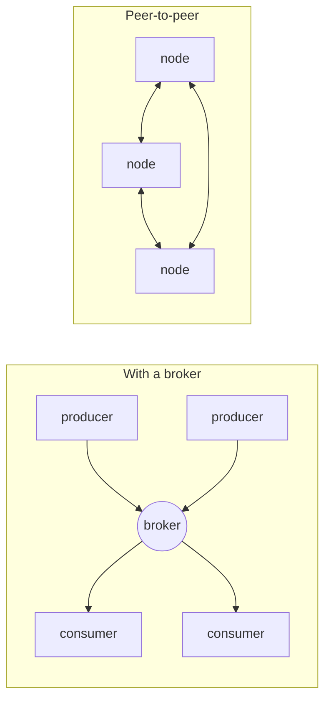
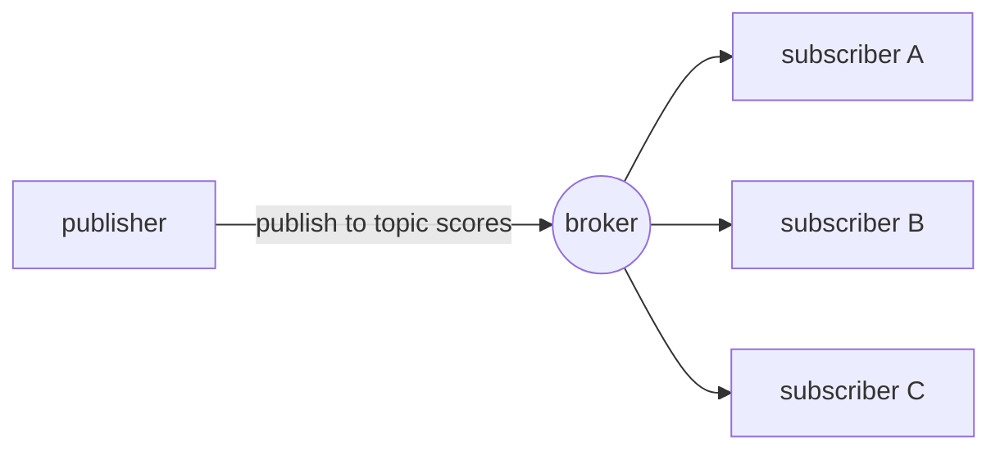
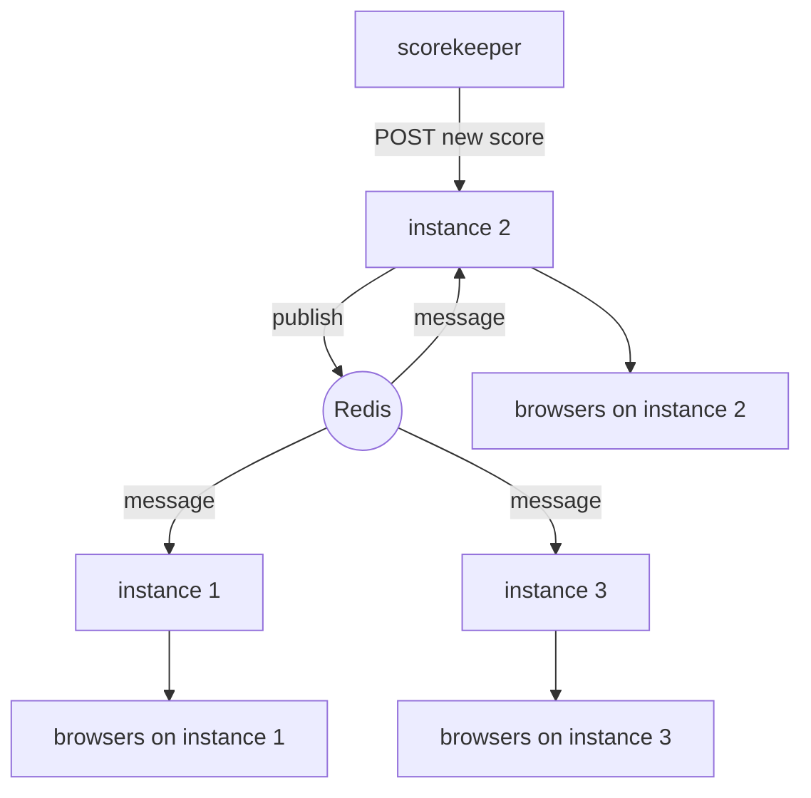
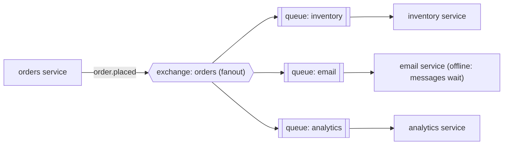

# Messaging fundamentals and publish/subscribe

## In plain words

There are two ways to tell a colleague something. You can phone them: they must be at their desk right now, and you wait on the line for their answer. Or you can leave a note in their in-tray: you carry on with your day, and they read it when they are ready, even if they were out when you left it.

And there are two ways to tell *many* people something. You can ring each of them in turn, which means keeping a list of everyone who cares. Or you can pin a notice on the board in the corridor, and whoever follows that board sees it; you need not know who they are.

Passing notes instead of phoning is **messaging**. The noticeboard is the **publish/subscribe** pattern (pub/sub for short). Together they are how the parts of a distributed system, meaning one whose pieces run as separate processes on separate machines, cooperate without being tied to each other.

Why it matters for a job: the moment an application runs as more than one process, questions appear that ordinary function calls cannot answer. How does instance 3 tell a user connected to instance 1 that their order has shipped? How does the orders service inform five other services without knowing them? The answer is a message broker, and working with Redis, RabbitMQ or Kafka is part of most back-end jobs.

> **Before this lesson:** read [Reverse proxies, service discovery and microservices](#/lesson/nodejs/balancing-microservices), where events and brokers were introduced, and [The observer pattern and EventEmitter](#/lesson/nodejs/observer-eventemitter): pub/sub is the observer pattern stretched across a network.

## The vocabulary of messaging

A **message** is a self-contained packet of data sent from one program, the **producer** (or sender, or publisher), to another, the **consumer** (or receiver, or subscriber). Four questions describe any messaging design.

### 1. Which direction: one-way or request/reply?

- **One-way**: the sender transmits and expects nothing back. Notifications, log lines, "this happened".
- **Request/reply**: the sender expects an answer. Over a messaging system that takes two one-way messages and a way to match them up, covered in the next lesson.

### 2. What kind of message?

| Type | Says | Example | Typical style |
|---|---|---|---|
| **Command** | "Do this" | `{ type: "resizeImage", id: 42 }` | sent to one receiver; this is the command pattern as data |
| **Event** | "This happened" | `{ type: "order.shipped", orderId: 17 }` | broadcast to whoever is interested |
| **Document** | "Here is some data" | a product record, a query result | carries information, implies no action |

A command names what the receiver should do; an event states a fact in the past tense and leaves the reaction to the listeners. Confusing the two ("an event that everyone is required to act on in a specific way") is a common design smell.

### 3. Synchronous or asynchronous?

A phone call is **synchronous** communication: both parties must be present at the same time. A note in an in-tray is **asynchronous**: the receiver may read it later.

Asynchronous messaging needs somewhere for the message to wait. That place is a **message queue**: a buffer that stores messages until the consumer takes them. The sender is finished as soon as the message is in the queue; if the consumer is slow, restarting or offline, messages accumulate and are delivered when it returns. This is called *store-and-forward*, and it is what makes systems tolerant of each other's failures.

A close relative is the **stream**, also called a *log*: an ordered, append-only record of messages that are **not removed when read**. Each consumer remembers how far it has got. A queue is an in-tray that empties; a stream is a diary that anyone may read from any page.

| | Message queue | Stream (log) |
|---|---|---|
| After a consumer reads a message | it is removed | it stays |
| A new consumer arriving later | sees only new messages | can read history from the start |
| Typical use | distributing tasks | event history, analytics, rebuilding state |
| Examples | RabbitMQ, Amazon SQS | Apache Kafka, Redis Streams |

### 4. Through a broker, or directly?



A **message broker** is a server whose job is to receive messages and route them to consumers. Producers and consumers know only the broker's address, never each other's. The broker can store messages, speak several protocols, and be monitored in one place. It is also one more system to run, and a single point of failure unless it is itself clustered.

In a **peer-to-peer** design, programs connect to each other directly. That removes a hop and a dependency, at the cost of every node needing to know who its peers are and of building the routing and reliability yourself. Libraries such as ZeroMQ provide building blocks for it. Most teams begin with a broker.

## Publish/subscribe

**Publish/subscribe** is one-way messaging to many receivers. Subscribers register their interest in a category of messages, called a **topic** or **channel**. A publisher sends a message to a topic; every current subscriber of that topic gets a copy. The publisher does not know who, or how many, are listening.



You have met this pattern inside one process: `emitter.emit("scores", data)` with listeners added by `on`. Pub/sub is the same idea where the emitter and its listeners are in different processes. The decoupling is the same too, and so is the main benefit: new subscribers can be added without touching any publisher.

### An in-memory broker to experiment with

```js-run
function createBroker() {
  const topics = new Map();                               // topic -> Set of handlers
  return {
    subscribe(topic, handler) {
      if (!topics.has(topic)) topics.set(topic, new Set());
      topics.get(topic).add(handler);
      return () => topics.get(topic).delete(handler);     // call this to unsubscribe
    },
    publish(topic, message) {
      const handlers = topics.get(topic) ?? new Set();
      for (const handler of handlers) queueMicrotask(() => handler(message));   // delivery is asynchronous
      return handlers.size;                               // how many were reached
    },
  };
}

const broker = createBroker();

console.log("receivers of an early message:", broker.publish("scores", { home: 0, away: 0 }));   // nobody listening yet

const stopScreen = broker.subscribe("scores", (m) => console.log("  stadium screen:", m.home, "-", m.away));
broker.subscribe("scores", (m) => console.log("  mobile app    :", m.home, "-", m.away));
broker.subscribe("weather", (m) => console.log("  weather widget:", m.text));

console.log("receivers:", broker.publish("scores", { home: 1, away: 0 }));
await null;                                               // let the deliveries happen
stopScreen();
console.log("receivers:", broker.publish("scores", { home: 1, away: 1 }));
```

Three observations that hold for real brokers of this simplest kind:

- The first message reached **zero** subscribers and is gone. Plain pub/sub does not store messages.
- Each subscriber of `scores` got its own copy; the `weather` subscriber got nothing.
- The publisher's code is the same whether there are zero, two or two hundred subscribers.

Real brokers often allow subscribing by **pattern** as well as by exact name, for example `orders.*` or `logs.#`. The problem [A pub/sub broker with topic wildcards](#/problem/node-pubsub-broker) implements those matching rules.

## A real use: live updates across several server instances

A sports site shows live scores. Browsers hold a **WebSocket** connection to the server: a long-lived, two-way connection over which the server can push data at any moment. On a single server process the code is short: keep a set of connected clients and send each new score to all of them.

Now run three instances behind a load balancer, as the scaling lessons advised. Each browser is connected to *one* instance. The score update arrives at *one* instance (whichever handled the scorekeeper's request). That instance can reach only its own clients. Two-thirds of the audience see nothing.



The fix: every instance subscribes to a channel on a shared broker. An instance that receives an update **publishes** it to the broker instead of sending it to its clients directly. The broker delivers it to all instances, including the one that published, and each forwards it to its own browsers. The model shows the before and after:

```js-run
function createInstance(name, broker) {
  const browsers = [];
  const instance = {
    connect(browser) { browsers.push(browser); },
    deliverLocally(score) { for (const b of browsers) console.log(`   ${b} (on ${name}) sees ${score}`); },
    handleUpdate(score) {
      if (broker) broker.publish("scores", score);        // tell everyone, through the broker
      else instance.deliverLocally(score);                // naive: only my own browsers
    },
  };
  if (broker) broker.subscribe("scores", (score) => instance.deliverLocally(score));
  return instance;
}

function createBroker() {
  const handlers = new Map();
  return {
    subscribe(topic, h) { (handlers.get(topic) ?? handlers.set(topic, []).get(topic)).push(h); },
    publish(topic, m) { for (const h of handlers.get(topic) ?? []) h(m); },
  };
}

console.log("Without a broker: the update reaches instance 2 only");
let [i1, i2, i3] = [createInstance("instance 1"), createInstance("instance 2"), createInstance("instance 3")];
i1.connect("Ana"); i2.connect("Bo"); i3.connect("Cy");
i2.handleUpdate("1-0");

console.log("With a shared broker: every instance relays to its own browsers");
const redis = createBroker();
[i1, i2, i3] = ["instance 1", "instance 2", "instance 3"].map((n) => createInstance(n, redis));
i1.connect("Ana"); i2.connect("Bo"); i3.connect("Cy");
i2.handleUpdate("1-0");
```

### The same thing with Redis

**Redis** is an in-memory data store that also has a simple pub/sub feature, which makes it a popular first broker. With the `redis` package and the `ws` WebSocket library, each instance runs this:

```javascript
import { createClient } from "redis";
import { WebSocketServer } from "ws";

const publisher = createClient({ url: process.env.REDIS_URL });
const subscriber = publisher.duplicate();          // a connection in subscribe mode cannot issue other commands
await Promise.all([publisher.connect(), subscriber.connect()]);

const wss = new WebSocketServer({ port: Number(process.env.PORT) });

// 1. Whatever arrives from Redis goes to the browsers connected to THIS instance.
await subscriber.subscribe("scores", (message) => {
  for (const client of wss.clients) {
    if (client.readyState === client.OPEN) client.send(message);
  }
});

// 2. Whatever a browser sends is published to Redis, never sent to clients directly.
wss.on("connection", (socket) => {
  socket.on("message", (data) => publisher.publish("scores", data.toString()));
});
```

Two connections are needed because a Redis connection that has subscribed is dedicated to receiving. Messages are strings, so objects travel as JSON. Start the file three times on three ports and a message sent to any instance reaches every browser.

## Reliability: what if a subscriber is not there?

Redis pub/sub is **fire-and-forget**. A message is delivered to the subscribers connected at that instant; an instance that is restarting misses it for ever. For live scores that is acceptable: the next update is seconds away. For "order placed: reserve the stock" it is not.

This leads to the central reliability vocabulary of messaging, the **delivery guarantee**:

| Guarantee | Meaning | Cost |
|---|---|---|
| **At most once** | A message may be lost, never duplicated | none; this is fire-and-forget |
| **At least once** | A message is never lost, but may arrive more than once | the broker stores messages and waits for confirmation |
| **Exactly once** | Delivered once and only once | not achievable in general across failures; approximated by at-least-once plus consumers that tolerate duplicates |

A consumer for which processing the same message twice has the same effect as processing it once is **idempotent**. Building idempotent consumers on top of at-least-once delivery is the standard, practical route to correctness.

### Durable subscribers with a queue per consumer

To avoid losing messages while a subscriber is away, give each subscriber **its own queue** inside the broker. The broker copies every published message into every queue; a queue keeps its messages until its consumer has taken and confirmed them. A subscriber set up this way is a **durable subscriber**.

This is the model of **AMQP** (Advanced Message Queuing Protocol), an open standard implemented by the broker **RabbitMQ**. It has three building blocks:

- An **exchange** is where publishers send messages. It stores nothing; it routes. Its type sets the rule: *fanout* copies to every bound queue, *direct* routes by an exact key, *topic* routes by a pattern.
- A **queue** stores messages for consumers.
- A **binding** connects an exchange to a queue, optionally with a routing pattern.



```javascript
import amqp from "amqplib";

const connection = await amqp.connect(process.env.AMQP_URL);
const channel = await connection.createChannel();

await channel.assertExchange("orders", "fanout");
const { queue } = await channel.assertQueue("email", { durable: true });   // survives a broker restart
await channel.bindQueue(queue, "orders", "");

await channel.consume(queue, async (message) => {
  const order = JSON.parse(message.content.toString());
  await sendConfirmationEmail(order);
  channel.ack(message);                           // only now does the broker delete it
});

// elsewhere, in the orders service:
channel.publish("orders", "", Buffer.from(JSON.stringify({ id: "A-17" })), { persistent: true });
```

`channel.ack(message)` is the **acknowledgement**: the consumer's confirmation that the message has been dealt with. Until it arrives the broker keeps the message, and if the consumer crashes first, the broker delivers it again. That is at-least-once delivery, and it is why `sendConfirmationEmail` had better cope with being called twice for the same order.

The difference between the two behaviours, in a model:

```js-run
function createFireAndForget() {
  const online = new Map();
  return {
    connect(name, handler) { online.set(name, handler); },
    disconnect(name) { online.delete(name); },
    publish(message) { for (const handler of online.values()) handler(message); },
  };
}

function createDurable() {
  const queues = new Map();                               // subscriber -> { messages, handler }
  const flush = (q) => { while (q.handler && q.messages.length) q.handler(q.messages.shift()); };
  return {
    connect(name, handler) { if (!queues.has(name)) queues.set(name, { messages: [], handler: null }); const q = queues.get(name); q.handler = handler; flush(q); },
    disconnect(name) { queues.get(name).handler = null; },    // the queue itself stays
    publish(message) { for (const q of queues.values()) { q.messages.push(message); flush(q); } },
  };
}

for (const [label, broker] of [["fire-and-forget", createFireAndForget()], ["durable queues ", createDurable()]]) {
  const received = [];
  broker.connect("email", (m) => received.push(m));
  broker.publish("order 1");
  broker.disconnect("email");                             // the email service restarts...
  broker.publish("order 2");                              // ...and this is published meanwhile
  broker.publish("order 3");
  broker.connect("email", (m) => received.push(m));       // back online
  broker.publish("order 4");
  console.log(label, "-> email service received:", received.join(", "));
}
```

### Reliability through streams

The other route to "nothing is lost" is the stream. Messages are appended to a log and kept; each consumer reads from a position of its choosing and remembers it. A consumer that was offline resumes from where it stopped, and a brand-new consumer can read the entire history.

**Redis Streams** provides this with a handful of commands: `XADD` appends a record and returns its id; `XREAD` reads records after a given id, optionally waiting for new ones.

```javascript
// producer
await redis.xAdd("orders", "*", { type: "order.placed", id: "A-17" });      // "*": let Redis assign the id

// consumer: start from the beginning ("0"), then follow new records
let lastId = "0";
while (true) {
  const streams = await redis.xRead({ key: "orders", id: lastId }, { BLOCK: 0 });   // wait for news
  for (const record of streams?.[0].messages ?? []) {
    await handle(record.message);
    lastId = record.id;                         // our bookmark; persist it to survive restarts
  }
}
```

**Apache Kafka** applies the same model at very large scale and is the usual choice for event pipelines and analytics.

```js-run
function createStream() {
  const log = [];
  return {
    append(message) { log.push(message); return log.length; },             // returns the record's position
    readFrom(position) { return log.slice(position).map((message, i) => ({ id: position + i + 1, message })); },
  };
}

const stream = createStream();
stream.append("order 1"); stream.append("order 2");

let emailBookmark = 0;
const emailReads = () => { const records = stream.readFrom(emailBookmark); if (records.length) emailBookmark = records.at(-1).id; return records.map((r) => r.message); };

console.log("email service reads   :", emailReads());
stream.append("order 3"); stream.append("order 4");       // published while the email service is offline
console.log("email service resumes :", emailReads());
console.log("new analytics service, reading from the start:", stream.readFrom(0).map((r) => r.message));
```

### Choosing among them

| Need | Reasonable choice |
|---|---|
| Live, disposable updates (scores, cursors, typing indicators) | Redis pub/sub |
| Every subscriber must eventually get every message | durable queues (RabbitMQ) or a stream |
| New consumers need history; events are a record of truth | a stream (Kafka, Redis Streams) |
| Complex routing by pattern | AMQP topic exchange |
| Minimal infrastructure, lowest latency, you control all peers | peer-to-peer (ZeroMQ) |

> [!TIP]
> Design message payloads as carefully as an HTTP API: they are a contract between services that are deployed at different times. Include a `type`, a unique `id` (it makes duplicate detection possible), a timestamp and a version; add fields instead of renaming or removing them.

> [!WARNING]
> Ordering is not automatically guaranteed. With several consumers on a queue, or after a redelivery, message B can be processed before message A. If order matters (two updates to the same account), route all messages for one entity to the same consumer, or make each message carry enough information (a version number, the full new state) to be applied safely out of order.

> [!INTERVIEW]
> **"What is pub/sub, and when would you use a queue instead?"** "Pub/sub broadcasts each message to all current subscribers of a topic; publishers and subscribers are decoupled. In its simplest form (Redis pub/sub) it is fire-and-forget, which suits live notifications. When messages must not be lost, each subscriber gets a durable queue from which messages are removed only after acknowledgement, or the messages go into a stream that consumers read by position. Queues distribute work and delete on consumption; streams keep history and allow replay." **"At-least-once versus exactly-once?"** Brokers offer at-least-once; exactly-once effects come from idempotent consumers that recognise duplicates.

## Pitfalls

- **Using fire-and-forget pub/sub for messages that must not be lost.**
- **Acknowledging before the work is done.** A crash after the ack loses the message; ack last.
- **Consumers that are not idempotent** under at-least-once delivery: double emails, double charges.
- **Assuming global ordering.**
- **Huge messages.** Put the large object in storage and send a reference.
- **One Redis connection for both subscribing and other commands.**
- **Unbounded queues.** If consumers are slower than producers, queues grow until the broker runs out of memory or disk. Monitor queue length, and set limits.
- **Events that are commands in disguise**, quietly coupling services again.

## Cheat sheet

| Term | Meaning |
|---|---|
| Message | A self-contained packet of data between programs |
| Command / event / document | "do this" / "this happened" / "here is data" |
| Queue | Stores messages until consumed; consumption removes them |
| Stream (log) | Append-only record; consumers read by position; history is kept |
| Broker | Server that routes and often stores messages |
| Pub/sub | A message goes to every subscriber of a topic |
| Topic (channel) | The named category subscribers register for |
| Durable subscriber | One whose messages wait for it while it is offline |
| Exchange / queue / binding | AMQP's router / storage / connection between them |
| Acknowledgement | Consumer's confirmation that a message was handled |
| At most once / at least once | may lose, no duplicates / no loss, possible duplicates |
| Idempotent consumer | Processing a duplicate changes nothing |

| Redis pub/sub | `subscriber.subscribe(channel, fn)`, `publisher.publish(channel, text)` |
|---|---|
| AMQP | `assertExchange`, `assertQueue`, `bindQueue`, `publish`, `consume`, `ack` |
| Redis Streams | `XADD stream * field value`, `XREAD ... STREAMS stream lastId` |

## Summary

- Messaging lets separately running programs communicate through self-contained messages: commands, events or documents, one-way or request/reply.
- Asynchronous messaging stores messages in a queue or a stream so that sender and receiver need not be available at the same time.
- A broker decouples producers from consumers; peer-to-peer designs remove the broker at the cost of doing more yourself.
- Publish/subscribe delivers each message to all subscribers of a topic. With a shared broker it lets every instance of a scaled application reach every user.
- Simple pub/sub loses messages for absent subscribers. Durable queues with acknowledgements, or streams read by position, give at-least-once delivery, which requires idempotent consumers.

## Glossary

- **Distributed system**: a system whose parts run as separate processes, usually on several machines.
- **Message**: a discrete, self-describing unit of data sent between programs.
- **Producer / consumer**: the sender / the receiver of messages.
- **Message queue**: a buffer holding messages until they are consumed.
- **Stream (log)**: an ordered, append-only sequence of messages that are retained.
- **Message broker**: an intermediary that routes messages.
- **Peer-to-peer messaging**: nodes exchanging messages directly.
- **Publish/subscribe**: delivering a message to all subscribers of a topic.
- **Topic (channel)**: the subject under which messages are published.
- **WebSocket**: a persistent two-way connection between browser and server.
- **Fire-and-forget**: sending without storage or confirmation.
- **Delivery guarantee**: at most once, at least once, or (effectively) exactly once.
- **Durable subscriber**: a subscriber that receives the messages published while it was disconnected.
- **AMQP**: an open messaging protocol with exchanges, queues and bindings.
- **Acknowledgement (ack)**: confirmation by a consumer that a message was processed.
- **Idempotent**: producing the same result when applied more than once.

```quiz
[
  {"q": "What is the difference between a command message and an event message?", "options": ["Commands are larger", "A command asks a receiver to do something; an event states that something happened and lets listeners decide", "Events require a reply", "There is no difference"], "answer": 1,
   "explain": "Commands are directed and imperative; events are facts broadcast to whoever cares."},
  {"q": "With plain pub/sub, a message is published to a topic that has no subscribers at that moment. What happens to it?", "options": ["It waits for the first subscriber", "It is discarded", "The publisher receives an error", "It is stored for 24 hours"], "answer": 1,
   "explain": "Simple pub/sub delivers only to currently connected subscribers and keeps nothing."},
  {"q": "In what order do these log, using the lesson's first broker (which delivers via queueMicrotask)?\n\n`broker.subscribe('t', () => console.log('got it')); console.log('A'); broker.publish('t', 1); console.log('B');`", "options": ["A, got it, B", "A, B, got it", "got it, A, B", "A, B"], "answer": 1,
   "explain": "publish only schedules the delivery as a microtask, which runs after the current synchronous code."},
  {"q": "Three server instances each hold WebSocket connections. An update arrives at instance 2. How do users on instances 1 and 3 receive it?", "options": ["They cannot", "Instance 2 publishes to a shared broker; every instance is subscribed and forwards to its own clients", "The load balancer copies it", "Browsers poll each other"], "answer": 1,
   "explain": "Each instance can reach only its own sockets, so the broker carries the update between instances."},
  {"q": "Why does a consumer acknowledge a message only after finishing its work?", "options": ["To save bandwidth", "So that if it crashes mid-way the broker still has the message and delivers it again", "Because acks are slow", "To keep messages in order"], "answer": 1,
   "explain": "An early ack tells the broker to delete a message that may never have been fully processed."},
  {"q": "At-least-once delivery means a consumer may see the same message twice. What property should the consumer have?", "options": ["Statelessness", "Idempotence: handling a duplicate has no additional effect", "A larger queue", "Synchronous I/O"], "answer": 1,
   "explain": "Duplicates are part of the guarantee; the consumer must tolerate them."},
  {"q": "A new analytics service must process all order events from the last month. Which storage model allows that?", "options": ["Fire-and-forget pub/sub", "A queue that deletes on consumption", "A stream (log) that retains messages and lets consumers read from any position", "A WebSocket"], "answer": 2,
   "explain": "Only a retained log lets a late-arriving consumer read history."},
  {"q": "In AMQP, which component decides which queues receive a published message?", "options": ["The queue", "The exchange, according to its type and bindings", "The consumer", "The channel"], "answer": 1,
   "explain": "Publishers send to an exchange; bindings connect it to queues, and the exchange type sets the routing rule."}
]
```

> **Source:** Casciaro & Mammino, *Node.js Design Patterns* 3e, ch. 13 (topics only; wording and examples are original). Documentation: https://redis.io/docs/latest/develop/interact/pubsub/, https://redis.io/docs/latest/develop/data-types/streams/, https://www.rabbitmq.com/tutorials/amqp-concepts
