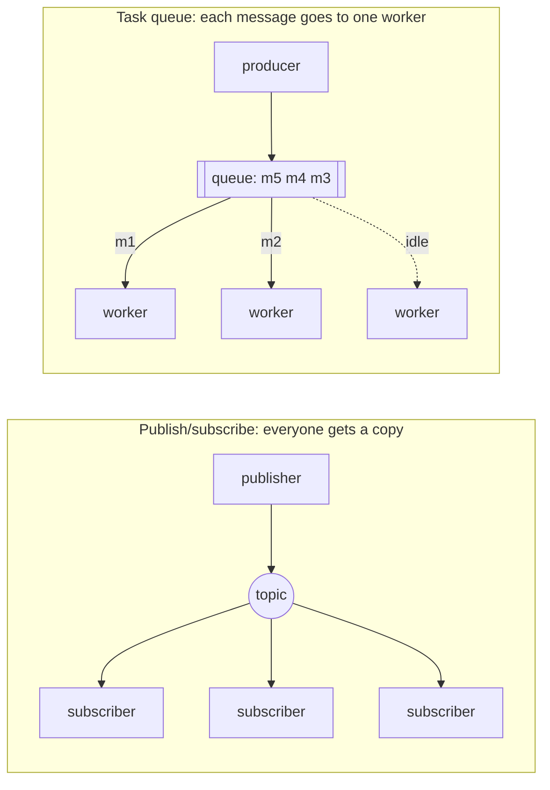
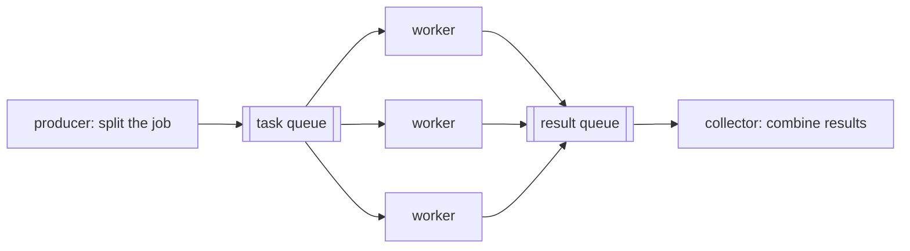
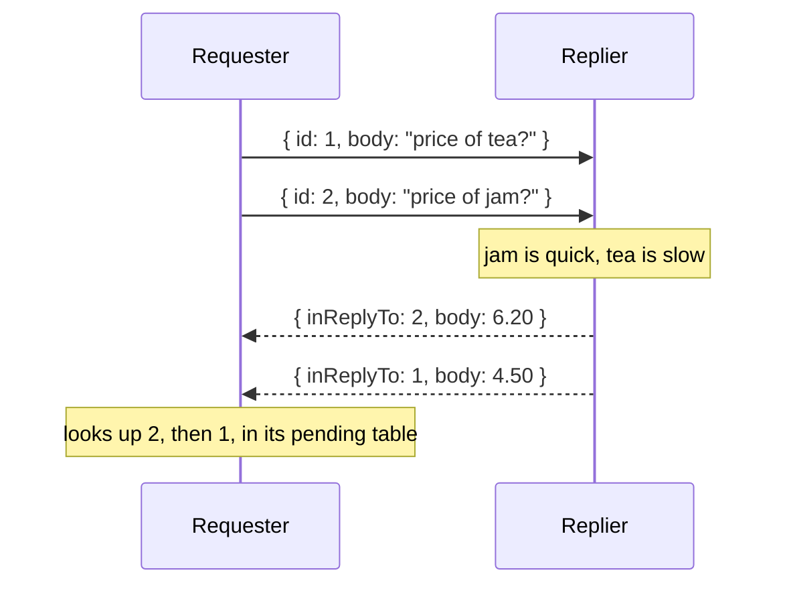
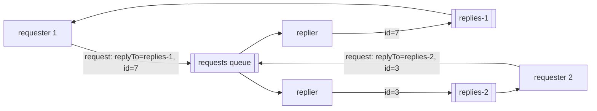

# Task queues, competing consumers and request/reply

## In plain words

In a busy kitchen, order slips are clipped to a rail. Each cook takes the next slip, cooks that dish and only then throws the slip away. Every dish is cooked by **one** cook, never by all of them; adding cooks gets the orders out faster; and if a cook faints at the stove, the slip is still on the rail for someone else. That is a **task queue** with **competing consumers**.

Second scene: you hand your coat to a cloakroom attendant and get a numbered ticket. Later, coats are handed back in whatever order people return, and the number on your ticket is what guarantees you get *your* coat. That number is a **correlation identifier**, and it is the trick that makes **request/reply** work over channels that only carry one-way messages.

Why it matters for a job: "the user uploads a video; process it in the background and notify them" is a task queue, and you will build some version of it within months in almost any back-end role. Request/reply with correlation ids is how services call each other through brokers, how a parent process talks to workers, and how most network protocols work underneath.

> **Before this lesson:** read [Messaging fundamentals and publish/subscribe](#/lesson/nodejs/messaging-pubsub) for queues, acknowledgements and delivery guarantees. The concurrency limit from [Limited concurrency and async pitfalls](#/lesson/nodejs/async-limits-pitfalls) and the command pattern from [Middleware and command](#/lesson/nodejs/middleware-command) are both at work here.

## Distributing tasks

### How it differs from pub/sub

In publish/subscribe every subscriber gets a copy of every message. For work to be done, that is wrong: if four workers each receive "send invoice 17", the customer receives four invoices. Task distribution needs each message to go to **exactly one** of the available workers.



Several consumers taking messages from the same queue are called **competing consumers**. The pattern gives three things at once:

- **Load levelling.** A burst of a thousand tasks does not need a thousand simultaneous workers. Tasks wait in the queue and are worked off at the pace the workers can sustain. The queue is a shock absorber.
- **Scalability.** To go faster, start more workers. The producer does not change.
- **Reliability.** A task stays in the queue until a worker confirms it is done.

It is the `TaskQueue` with a concurrency limit from earlier in this track, moved out of the process: the tasks are command messages, the slots are worker processes, and the queue lives in a broker.

### Acknowledgements, prefetch and redelivery

Three settings decide how a task queue behaves under failure.

**Acknowledgement.** The broker hands a message to a worker and marks it "in progress", but keeps it. Only when the worker sends an **ack** does the broker delete it. If the worker's connection drops first, the broker puts the message back and gives it to another worker. A worker can also refuse a message explicitly with a **negative acknowledgement** (nack), asking for it to be requeued or discarded.

**Prefetch.** How many unacknowledged messages a worker may hold at once. With a prefetch of 1, a worker gets a new task only after acknowledging the previous one, so tasks flow to whoever is free, and a slow worker does not sit on a pile of tasks while others idle.

**Durability.** A *durable* queue and *persistent* messages are written to disk, so they survive a restart of the broker itself.

The model below is a working miniature: a queue with acks, prefetch 1 and redelivery. One worker "crashes" while holding a task.

```js-run
function createWorkQueue() {
  const ready = [];                        // tasks waiting
  const idle = [];                         // workers with nothing to do
  const holding = new Map();               // worker -> task being processed (unacknowledged)
  const log = [];

  function dispatch() {
    while (ready.length > 0 && idle.length > 0) {
      const worker = idle.shift(), task = ready.shift();
      holding.set(worker, task);
      log.push(`deliver ${task} -> ${worker}`);
    }
  }
  return {
    log,
    send(task) { ready.push(task); dispatch(); },
    join(worker) { idle.push(worker); dispatch(); },
    ack(worker) { log.push(`ack     ${holding.get(worker)} by ${worker}`); holding.delete(worker); idle.push(worker); dispatch(); },
    crash(worker) {                        // connection lost: unacked task goes back to the FRONT
      const task = holding.get(worker);
      holding.delete(worker);
      log.push(`crash   ${worker} (was holding ${task}: requeued)`);
      if (task) ready.unshift(task);
      dispatch();
    },
    state: () => `ready=[${ready}] in-progress=${JSON.stringify(Object.fromEntries(holding))}`,
  };
}

const queue = createWorkQueue();
["resize-1", "resize-2", "resize-3", "resize-4"].forEach((task) => queue.send(task));
queue.join("w1");
queue.join("w2");
queue.ack("w1");                           // w1 finishes resize-1 and immediately gets the next task
queue.crash("w2");                         // w2 dies holding resize-2
queue.ack("w1");
queue.ack("w1");
queue.ack("w1");
console.log(queue.log.join("\n"));
console.log("final:", queue.state());
```

Read the log. `resize-2` was delivered to `w2`, which crashed; the task went back to the queue and was later delivered to `w1`. All four tasks were completed, although one worker died. Note also that `resize-2` was *delivered twice*. Had `w2` finished the work and crashed a moment before acknowledging, the image would have been resized twice. Task queues give **at-least-once** processing, so tasks must be **idempotent**: safe to repeat. The problem [A work queue with acknowledgements](#/problem/node-work-queue) asks you to implement this machine in full.

### With RabbitMQ (AMQP)

In AMQP, competing consumers need nothing special: several consumers on **one queue** already compete. Compare with pub/sub in the last lesson, where each subscriber had its own queue bound to a fanout exchange.

```javascript
// producer.js: the web server enqueues a task and answers the user immediately
import amqp from "amqplib";

const connection = await amqp.connect(process.env.AMQP_URL);
const channel = await connection.createChannel();
await channel.assertQueue("thumbnails", { durable: true });

channel.sendToQueue("thumbnails", Buffer.from(JSON.stringify({ imageId: 42, width: 320 })), { persistent: true });
```

```javascript
// worker.js: start as many copies of this process as you like
import amqp from "amqplib";

const connection = await amqp.connect(process.env.AMQP_URL);
const channel = await connection.createChannel();
await channel.assertQueue("thumbnails", { durable: true });
await channel.prefetch(1);                               // one unacknowledged task at a time

await channel.consume("thumbnails", async (message) => {
  const task = JSON.parse(message.content.toString());
  try {
    await makeThumbnail(task.imageId, task.width);
    channel.ack(message);                                // done: remove it from the queue
  } catch (error) {
    console.error("task failed:", error.message);
    channel.nack(message, false, false);                 // do not requeue: send to the dead-letter queue
  }
});
```

```text
$ node worker.js &  node worker.js &  node worker.js &
[worker 5120] thumbnail for image 42 done
[worker 5121] thumbnail for image 43 done
[worker 5122] thumbnail for image 44 done
[worker 5120] thumbnail for image 45 done
```

The last argument of `nack` matters. Requeueing a task that fails every time creates a **poison message**: it is delivered, fails, is requeued and delivered again, for ever, blocking the queue. The usual remedy is to count attempts and, after a few, move the message to a **dead-letter queue**: a side queue of failed messages that people or tools inspect later.

### With Redis Streams: consumer groups

A stream keeps its records and lets every reader see all of them, which is pub/sub-like behaviour. To get competing consumers on a stream, Redis provides **consumer groups**. A group is a named set of consumers that share one position in the stream; each record is given to only one member of the group, and must be acknowledged.

```javascript
await redis.xGroupCreate("thumbnails", "workers", "$", { MKSTREAM: true });    // once

while (true) {
  const reply = await redis.xReadGroup("workers", `worker-${process.pid}`,
    { key: "thumbnails", id: ">" },                      // ">" means: records nobody in the group has received
    { COUNT: 1, BLOCK: 0 });
  for (const record of reply?.[0].messages ?? []) {
    await makeThumbnail(record.message);
    await redis.xAck("thumbnails", "workers", record.id);
  }
}
```

Records delivered and not yet acknowledged sit in a *pending* list. If a consumer dies, another can take over its pending records (`XAUTOCLAIM`) after a timeout. Several groups can read the same stream independently, so one stream can feed a pool of thumbnail workers *and* an analytics service that sees everything. Kafka's consumer groups work on the same principle.

> [!NOTE]
> For background jobs inside a Node application, most teams do not program against the broker directly. Libraries such as BullMQ (built on Redis) provide named queues, retries with backoff, delayed and repeating jobs, concurrency limits and a dashboard. They are implementations of the patterns in this lesson.

### Pipelines: fan-out and fan-in

A larger computation can be split into parts, distributed, and reassembled. Three roles appear:

- a **producer** (sometimes called *ventilator*) that splits the job into tasks: **fan-out**;
- a pool of **workers** that each take tasks, compute and emit results;
- a **collector** (or *sink*) that gathers results from all workers: **fan-in**.



```js-run
const sleep = (ms) => new Promise((resolve) => setTimeout(resolve, ms));

function createQueue() {                               // an async queue: take() waits for an item
  const items = [], waiters = [];
  return {
    put(item) { const waiter = waiters.shift(); if (waiter) waiter(item); else items.push(item); },
    take() { return items.length ? Promise.resolve(items.shift()) : new Promise((resolve) => waiters.push(resolve)); },
  };
}

const tasks = createQueue(), results = createQueue();

// Job: count the words of a 12-page document, 3 pages per task.
const pages = Array.from({ length: 12 }, (_, i) => "lorem ipsum dolor ".repeat(i + 1).trim());
const chunks = [];
for (let i = 0; i < pages.length; i += 3) chunks.push({ id: i / 3, pages: pages.slice(i, i + 3) });

// Fan-out: the producer puts every task on the queue.
for (const chunk of chunks) tasks.put(chunk);

// Workers: an endless loop of take, compute, emit.
async function worker(name) {
  while (true) {
    const task = await tasks.take();
    await sleep(20);                                    // the "heavy" computation
    const words = task.pages.join(" ").split(" ").length;
    results.put({ taskId: task.id, words, by: name });
  }
}
worker("w1"); worker("w2"); worker("w3");

// Fan-in: the collector waits for exactly as many results as there were tasks.
const started = Date.now();
let total = 0;
for (let received = 0; received < chunks.length; received++) {
  const result = await results.take();
  console.log(`result for task ${result.taskId} from ${result.by}: ${result.words} words`);
  total += result.words;
}
console.log(`total: ${total} words; 4 tasks of 20 ms on 3 workers took about ${Math.round((Date.now() - started) / 10) * 10} ms`);
```

Each task was handled by one worker, and the results arrived in whatever order the workers finished, which is why each result carries its `taskId`. The collector knows it is done by counting. In a distributed version, `tasks` and `results` are two queues in a broker, the workers are separate processes on any number of machines, and nothing else changes.

## Request/reply

### The problem

Messaging channels are one-way: a message goes in, and that is all. Often a sender needs an **answer**. With HTTP the answer comes back on the same connection, in order, so there is no doubt which response belongs to which request. Over a queue, a socket carrying several conversations, or the IPC channel to a child process, replies arrive later, on a separate channel, and **in any order**. How does the requester know which reply answers which request?

### Correlation identifier

Mark every request with a unique id. The replier copies that id into the reply. The requester keeps a table of pending requests, keyed by id, and uses the id of each incoming reply to find the right one.



The implementation wraps the mechanics so that callers see an ordinary promise-returning function. This runs as written; the "channel" is a pair of one-way functions with random delays.

```js-run
function createChannel() {                               // two independent one-way links
  const ends = { a: null, b: null };
  const send = (to) => (message) => setTimeout(() => ends[to]?.(structuredClone(message)), 5 + Math.random() * 30);
  return {
    sideA: { send: send("b"), onMessage: (handler) => (ends.a = handler) },
    sideB: { send: send("a"), onMessage: (handler) => (ends.b = handler) },
  };
}

function createRequester(link, { timeoutMs = 100 } = {}) {
  const pending = new Map();                             // correlation id -> { resolve, reject, timer }
  let nextId = 1;

  link.onMessage((message) => {
    const entry = pending.get(message.inReplyTo);
    if (!entry) return;                                  // unknown or already timed out: ignore
    clearTimeout(entry.timer);
    pending.delete(message.inReplyTo);
    message.error ? entry.reject(new Error(message.error)) : entry.resolve(message.body);
  });

  return function request(body) {
    return new Promise((resolve, reject) => {
      const id = nextId++;
      const timer = setTimeout(() => {
        pending.delete(id);                              // forget it, or the table grows for ever
        reject(new Error(`request ${id} timed out after ${timeoutMs} ms`));
      }, timeoutMs);
      pending.set(id, { resolve, reject, timer });
      link.send({ id, body });
    });
  };
}

function createReplier(link, handler) {
  link.onMessage(async (message) => {
    try { link.send({ inReplyTo: message.id, body: await handler(message.body) }); }
    catch (error) { link.send({ inReplyTo: message.id, error: error.message }); }
  });
}

const channel = createChannel();
const prices = { tea: 4.5, jam: 6.2 };
createReplier(channel.sideB, async (product) => {
  if (product === "slow") await new Promise((resolve) => setTimeout(resolve, 300));
  if (!(product in prices) && product !== "slow") throw new Error(`unknown product "${product}"`);
  return prices[product];
});
const request = createRequester(channel.sideA);

const outcomes = await Promise.allSettled([request("tea"), request("jam"), request("gold"), request("slow")]);
console.log(outcomes.map((o) => (o.status === "fulfilled" ? o.value : "ERROR: " + o.reason.message)));
```

Follow one request through `createRequester`:

1. `request(body)` picks a fresh id, creates a promise, and stores that promise's `resolve` and `reject` in the `pending` map under the id. Then it sends `{ id, body }`.
2. Some time later a message arrives with `inReplyTo`. The handler looks that id up, removes the entry, and settles the stored promise.
3. If no reply arrives in time, the timer rejects the promise **and deletes the entry**. Without a timeout, a lost reply would leave a promise pending for ever and an entry in the map for ever: a memory leak.
4. A reply for an id that is no longer in the table (late, duplicated or bogus) is ignored.

The four requests go out together, the replies come back in a scrambled order because of the random delays, and each lands with the right caller. Errors travel as data in the reply and are turned back into rejections. You have seen this shape before: it is how the parent matched results from a child process in the lesson on CPU-bound tasks. The problem [Request/reply with correlation ids](#/problem/node-request-reply) drills the bookkeeping, including late and duplicate replies.

### Return address

With one requester and one replier on a dedicated link, the replier knows where to send its answer. In a brokered system there may be many requesters, and a pool of repliers taking requests from a shared queue. The reply must find its way back to the right requester. So each request also carries a **return address**: the name of a queue on which the sender listens for replies.



AMQP has message properties for exactly these two fields:

```javascript
// requester
const { queue: replyQueue } = await channel.assertQueue("", { exclusive: true });   // private, auto-named
await channel.consume(replyQueue, (message) => {
  resolvePending(message.properties.correlationId, JSON.parse(message.content.toString()));
}, { noAck: true });

channel.sendToQueue("price-requests", Buffer.from(JSON.stringify({ product: "tea" })), {
  correlationId: id,          // which request this is
  replyTo: replyQueue,        // where to send the answer
});

// replier
await channel.consume("price-requests", async (message) => {
  const answer = await lookUpPrice(JSON.parse(message.content.toString()));
  channel.sendToQueue(message.properties.replyTo, Buffer.from(JSON.stringify(answer)), {
    correlationId: message.properties.correlationId,
  });
  channel.ack(message);
});
```

The repliers are competing consumers on the request queue, so the two halves of this lesson combine: requests are load-balanced across a pool, and each answer returns to its own requester.

> [!TIP]
> Before building request/reply over a broker, ask whether a plain HTTP call would do. Messaging-based request/reply is valuable when repliers should be load-balanced and buffered by a queue, when the reply may take a long time, or when direct connections between the two parties are not possible. For a quick lookup between two services, HTTP with a timeout is simpler to operate and to debug.

> [!WARNING]
> Every remote request needs a timeout and a decision about what happens afterwards. After a timeout you do **not** know whether the work was done: the request may have been lost, or the reply may have been. Retrying is safe only for idempotent operations. For the others, send an idempotency key with the request so that the replier can recognise a repeat and return the original result.

> [!INTERVIEW]
> **"Design a system that generates thumbnails for uploaded images."** "The upload handler stores the original, puts a task message on a durable queue and responds at once. A pool of worker processes consumes the queue as competing consumers with prefetch 1, acknowledges after success, and retries with backoff; after several failures a task goes to a dead-letter queue. Workers are idempotent, since delivery is at-least-once. The queue absorbs bursts and I scale by adding workers." **"How does request/reply work over a message queue?"** "Each request carries a correlation id and a reply-to address; the requester keeps a map from id to pending promise with a timeout; the replier copies the id into its reply, sent to the reply-to queue."

## Pitfalls

- **Publishing tasks to a pub/sub topic**, so every worker does every task.
- **Acknowledging before the work is finished**, losing tasks on a crash; or never acknowledging, so tasks are redelivered for ever.
- **Non-idempotent tasks** under at-least-once delivery.
- **No prefetch limit**: one worker takes the entire backlog and the others idle.
- **Requeueing a failing task without a limit**: a poison message. Use attempt counts and a dead-letter queue.
- **No monitoring of queue length.** A steadily growing queue means consumers cannot keep up; you find out when the broker fills its disk.
- **A pending-request table without timeouts.**
- **Blocking a request handler on a long job** instead of returning "accepted" and reporting completion separately.
- **Assuming results come back in the order tasks were sent.**

## Cheat sheet

| Concept | Meaning |
|---|---|
| Task (work) queue | Each message is processed by exactly one worker |
| Competing consumers | Several workers consuming one queue |
| Load levelling | The queue absorbs bursts; workers proceed at their own pace |
| Ack / nack | "Done, delete it" / "failed: requeue or discard" |
| Prefetch | Maximum unacknowledged messages per consumer |
| Durable / persistent | Queue / message survives a broker restart |
| Poison message | A message that fails every time it is processed |
| Dead-letter queue | Where repeatedly failing messages are parked |
| Consumer group | Competing consumers over a stream (Redis Streams, Kafka) |
| Fan-out / fan-in | Split a job across workers / gather their results |
| Correlation id | Unique id copied from request to reply |
| Return address (reply-to) | The queue on which the requester awaits replies |

| AMQP task queue | `assertQueue(q, {durable})`, `sendToQueue(q, buf, {persistent})`, `prefetch(1)`, `consume`, `ack` / `nack` |
|---|---|
| Redis Streams | `XGROUP CREATE`, `XREADGROUP GROUP g consumer ... >`, `XACK`, `XAUTOCLAIM` |
| AMQP request/reply | properties `correlationId` and `replyTo`, an exclusive reply queue |

## Summary

- A task queue delivers each message to one of several competing consumers, levelling load, scaling by adding workers and surviving worker crashes.
- Acknowledgements keep a task in the queue until it is done; prefetch spreads tasks fairly; redelivery makes processing at-least-once, so tasks must be idempotent and repeatedly failing ones moved to a dead-letter queue.
- AMQP gets competing consumers from several consumers on one queue; streams get them from consumer groups.
- Fan-out/fan-in pipelines split a job into tasks and collect results that arrive in any order.
- Request/reply over one-way channels uses a correlation id to match replies to requests, a pending table with timeouts, and a return address so the reply reaches the right requester.

## Glossary

- **Task queue (work queue)**: a queue from which each message is consumed by one worker.
- **Competing consumers**: multiple consumers reading the same queue, each message going to one of them.
- **Load levelling**: smoothing bursts of work by buffering them in a queue.
- **Negative acknowledgement (nack)**: a consumer's signal that it could not process a message.
- **Prefetch**: the limit on unacknowledged messages a consumer may hold.
- **Redelivery**: handing an unacknowledged message to a consumer again.
- **Poison message**: a message that can never be processed successfully.
- **Dead-letter queue**: a queue that collects messages that failed permanently.
- **Consumer group**: a set of consumers sharing a position in a stream.
- **Pending list**: records delivered to a group member and not yet acknowledged.
- **Fan-out / fan-in**: distributing tasks to many workers / merging their results.
- **Correlation identifier**: a value linking a reply to its request.
- **Return address**: where a reply should be sent.
- **Idempotency key**: an id sent with a request so that repeats can be detected.

```quiz
[
  {"q": "A message says \"send invoice 17\". Which delivery pattern is correct?", "options": ["Publish/subscribe to all workers", "A task queue: exactly one of the competing workers receives it", "Broadcast over WebSocket", "A stream read by every worker from the start"], "answer": 1,
   "explain": "Work must be done once; pub/sub would give every worker a copy."},
  {"q": "A worker crashes after receiving a task but before acknowledging it. What does the broker do?", "options": ["Deletes the task", "Returns the task to the queue and delivers it to another worker", "Stops the queue", "Sends it to all workers"], "answer": 1,
   "explain": "An unacknowledged message is still owned by the broker and is redelivered."},
  {"q": "Because of redelivery, what must task handlers be?", "options": ["Synchronous", "Idempotent", "Stateless singletons", "Written as generators"], "answer": 1,
   "explain": "A task may be processed more than once; repeating it must be harmless."},
  {"q": "With no prefetch limit, 1,000 tasks are queued and then three workers connect. What is likely?", "options": ["Each gets about 333", "The first worker may be handed nearly all of them while the others idle", "Tasks are discarded", "The broker rejects the workers"], "answer": 1,
   "explain": "Prefetch 1 makes the broker hand out one task per free worker."},
  {"q": "What is a dead-letter queue for?", "options": ["Storing acknowledged messages", "Parking messages that keep failing so they stop blocking the main queue and can be inspected", "Speeding up delivery", "Holding replies"], "answer": 1,
   "explain": "It breaks the redelivery loop of a poison message."},
  {"q": "Requests 1, 2, 3 are sent over a one-way channel; replies arrive in the order 3, 1, 2. How does the requester match them?", "options": ["By arrival order", "By the correlation id copied into each reply, looked up in a table of pending requests", "It cannot", "By message size"], "answer": 1,
   "explain": "Order is not preserved, so each reply must name the request it answers."},
  {"q": "In the requester implementation, why must the timeout handler delete the entry from the pending map?", "options": ["To make the reply arrive faster", "Otherwise entries for lost replies accumulate for ever, leaking memory", "Maps cannot hold promises", "To resend the request"], "answer": 1,
   "explain": "A request that never gets a reply would stay in the table indefinitely."},
  {"q": "A payment request times out. What is known about the payment?", "options": ["It definitely failed", "It definitely succeeded", "Nothing: the request or the reply may have been lost, so the outcome is unknown", "It was refunded"], "answer": 2,
   "explain": "A timeout only says no reply arrived in time. Use an idempotency key before retrying."}
]
```

> **Source:** Casciaro & Mammino, *Node.js Design Patterns* 3e, ch. 13 (topics only; wording and examples are original). Documentation: https://www.rabbitmq.com/tutorials/tutorial-two-javascript, https://www.rabbitmq.com/tutorials/tutorial-six-javascript, https://redis.io/docs/latest/develop/data-types/streams/#consumer-groups
