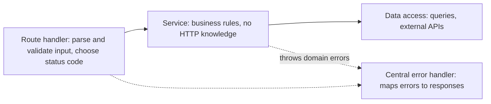

# Production basics: frameworks, errors, logging, config, security

## In plain words

Cooking a meal for friends and running a restaurant use the same recipes. The restaurant also needs things nobody thinks about at home: a way to take many orders at once, a routine for when a dish goes wrong, a record of what happened during the night, settings that differ between the branch in town and the one at the airport, and a lock on the back door.

Code that runs **in production**, meaning on real servers for real users, needs the same extras. This lesson covers the five that every Node service has: a **web framework** to organise request handling, an **error-handling strategy**, **logging**, **configuration**, and basic **security**. None of them is difficult. All of them are things an interviewer expects you to have opinions about, and things whose absence turns a small bug into a long night.

Why it matters for a job: these topics separate "I followed a tutorial" from "I can be trusted with a service". Most take-home assignments and code reviews are judged at least as much on error handling, validation and structure as on the feature itself.

> **Before this lesson:** you need the bare HTTP server from [npm, package.json and your first HTTP server](#/lesson/nodejs/npm-first-server), middleware from [Middleware and command](#/lesson/nodejs/middleware-command), `async`/`await` error handling from [Async/await: sequential and parallel flows](#/lesson/nodejs/async-await-flows), and graceful shutdown from [The scale cube, cluster and zero-downtime restarts](#/lesson/nodejs/scaling-cluster).

## Web frameworks: Express and Fastify

With bare `node:http` you wrote routing, body parsing and JSON responses by hand. A **web framework** supplies those. The two you are most likely to meet:

- **Express**: the oldest and most widely used. Minimal, built around middleware, with an enormous ecosystem.
- **Fastify**: newer, focused on speed and on built-in validation, with first-class `async` support and a plugin system.

The same small API in each:

```javascript
// Express
import express from "express";

const app = express();
app.use(express.json({ limit: "100kb" }));               // parse JSON bodies, with a size limit

const tasks = new Map();

app.get("/tasks/:id", (req, res) => {
  const task = tasks.get(req.params.id);                 // :id from the URL
  if (!task) return res.status(404).json({ error: "task not found" });
  res.json(task);
});

app.post("/tasks", (req, res) => {
  const { title } = req.body;
  if (typeof title !== "string" || title.trim() === "") {
    return res.status(400).json({ error: "title is required" });
  }
  const task = { id: crypto.randomUUID(), title: title.trim(), done: false };
  tasks.set(task.id, task);
  res.status(201).json(task);
});

app.listen(3000);
```

```javascript
// Fastify
import Fastify from "fastify";

const app = Fastify({ logger: true });                   // structured logging built in
const tasks = new Map();

app.get("/tasks/:id", async (request, reply) => {
  const task = tasks.get(request.params.id);
  if (!task) return reply.code(404).send({ error: "task not found" });
  return task;                                           // returned values are sent as JSON
});

app.post("/tasks", {
  schema: {                                              // declarative validation
    body: {
      type: "object",
      required: ["title"],
      additionalProperties: false,
      properties: { title: { type: "string", minLength: 1, maxLength: 200 } },
    },
  },
}, async (request, reply) => {
  const task = { id: crypto.randomUUID(), title: request.body.title, done: false };
  tasks.set(task.id, task);
  return reply.code(201).send(task);
});

await app.listen({ port: 3000 });
```

```text
$ curl -s -X POST localhost:3000/tasks -H 'content-type: application/json' -d '{"title":"write tests"}'
{"id":"0b6f0c1e-6d0a-4c57-9d3b-0f4f3a9d7c11","title":"write tests","done":false}
$ curl -s -X POST localhost:3000/tasks -H 'content-type: application/json' -d '{}'
{"statusCode":400,"error":"Bad Request","message":"body must have required property 'title'"}
```

What to notice:

- **Routing.** `app.get("/tasks/:id", handler)` binds a method and a path pattern to a function; `:id` is a **route parameter**.
- **Body parsing** happens before your handler runs. Always set a size limit.
- **Validation.** In Express you validate by hand or with a library. Fastify validates against a **JSON Schema**, a standard way of describing the shape of JSON data, before the handler is called, and rejects bad input with a `400` for you.
- **Async handlers.** Fastify handlers are async functions whose return value is the response. Express 5 forwards rejected promises from async handlers to its error handler; in the still-common Express 4, an async handler that throws produces an unhandled rejection unless you wrap it.

Both are thin layers over what you built by hand. Choose by what your team uses.

### Structure: keep HTTP at the edge

A handler should translate, not decide. A structure that scales:



The service layer takes plain values and returns plain values or throws. It can be tested without a server and reused from a queue worker or a command-line script. Its dependencies are injected, as in the creational module.

## An error-handling strategy

### Two kinds of error

| | **Operational error** | **Programmer error** |
|---|---|---|
| What it is | A failure that a correct program must expect | A bug |
| Examples | invalid input, record not found, timeout, connection refused, disk full | reading a property of `undefined`, wrong argument type, a forgotten `await` |
| Right reaction | handle it: answer with 4xx/5xx, retry, fall back | fix the code. At run time: log, let the process crash, restart clean |

The distinction decides everything else. Operational errors are part of normal operation and must never crash the server. Programmer errors mean the program is in a state its author did not foresee; carrying on risks corrupting data, so the safe reaction is to fail fast and let the supervisor (the cluster primary, the container platform) start a fresh process.

### Typed errors and one central handler

Give expected failures their own classes carrying the information needed to answer the client. Throw them from anywhere. Convert them to responses in **one** place.

```js-run
class AppError extends Error {
  constructor(message, { status = 500, code = "internal_error", expose = false, cause } = {}) {
    super(message, { cause });
    this.name = this.constructor.name;
    this.status = status;        // HTTP status to answer with
    this.code = code;            // stable, machine-readable identifier
    this.expose = expose;        // may the message be shown to the client?
  }
}
class ValidationError extends AppError { constructor(message) { super(message, { status: 400, code: "validation_failed", expose: true }); } }
class NotFoundError extends AppError { constructor(what) { super(`${what} not found`, { status: 404, code: "not_found", expose: true }); } }

// ---- service layer: throws domain errors, knows nothing about HTTP ----
const tasks = new Map([["1", { id: "1", title: "write tests" }]]);
const taskService = {
  async get(id) {
    if (!/^\d+$/.test(id)) throw new ValidationError("id must be numeric");
    if (id === "13") { const config = undefined; return config.retries; }       // a bug
    if (id === "99") throw new AppError("database unreachable", { status: 503, code: "db_unavailable", cause: new Error("ECONNREFUSED 10.0.0.5:5432") });
    const task = tasks.get(id);
    if (!task) throw new NotFoundError("task");
    return task;
  },
};

// ---- the single place where errors become responses ----
function toResponse(error, logger) {
  const known = error instanceof AppError;
  const status = known ? error.status : 500;
  if (status >= 500) logger.push(`ERROR ${error.name}: ${error.message}${error.cause ? " (cause: " + error.cause.message + ")" : ""}`);
  return {
    status,
    body: { error: { code: known ? error.code : "internal_error", message: known && error.expose ? error.message : "Something went wrong" } },
  };
}

const serverLog = [];
for (const id of ["1", "abc", "42", "99", "13"]) {
  let response;
  try { response = { status: 200, body: await taskService.get(id) }; }
  catch (error) { response = toResponse(error, serverLog); }
  console.log(`GET /tasks/${id} ->`, response.status, JSON.stringify(response.body));
}
console.log("server log:\n  " + serverLog.join("\n  "));
```

Reading the output:

- `abc` and `42` are operational errors with `expose: true`: the client gets a precise message and a 4xx status. Nothing is logged as an error; a client's mistake is not an incident.
- `99` is an operational failure on our side. The client gets a 503 and a generic message; the log gets the real cause, including the internal address that must not leak.
- `13` is a bug: a `TypeError` that is not an `AppError`. The client sees a generic 500; the details go to the log. The response never contains a stack trace.
- `cause` chains the low-level error to the high-level one, preserving both.

In Express, `toResponse` lives in the error-handling middleware `(err, req, res, next)` registered last; in Fastify, in `app.setErrorHandler`.

### The process-level safety net

Errors that escape everything end up at the process:

```javascript
process.on("uncaughtException", (error) => {
  logger.fatal({ err: error }, "uncaught exception");
  shutdown(1);                       // stop accepting requests, finish in-flight ones, then exit
});
process.on("unhandledRejection", (reason) => {
  logger.fatal({ err: reason }, "unhandled rejection");
  shutdown(1);
});
```

These handlers are for logging and an orderly exit, not for carrying on. Combined with the graceful shutdown from the scaling lesson and a supervisor that restarts the process, a bug costs a few failed requests instead of an outage.

> [!WARNING]
> Never send error details to clients in production: stack traces, SQL statements, file paths and internal host names are a map for attackers. Send a stable error code and a safe message; keep the rest in the logs. Many frameworks print full errors when `NODE_ENV` is not set to `production`, so make sure it is.

## Logging

`console.log("user saved")` is fine in a script. In production, logs are read by machines first: shipped to a central system, searched, counted, alerted on. That calls for **structured logging**: every log entry is one line of JSON with consistent fields.

```text
{"level":"info","time":"2026-03-14T09:26:53.589Z","service":"shop-api","requestId":"a41f","msg":"order created","orderId":"A-17","ms":42}
```

The essentials:

- **Levels.** `fatal`, `error`, `warn`, `info`, `debug`, `trace`, each more detailed than the last. A configured minimum level decides what is written: `info` in production, `debug` when investigating.
- **Context.** A **request id** attached to every line produced while handling one request lets you pull that request's whole story out of millions of lines. Generate it at the edge, or take it from an incoming header, and pass it on to the services you call.
- **Standard output.** Write logs to stdout and let the platform collect them. The application should not manage log files.
- **A real logger.** Libraries such as **pino** (Fastify's default) and winston are fast and handle levels, serialisation and child loggers.
- **No secrets.** Never log passwords, tokens, card numbers or full request bodies. Loggers can *redact* named fields.

How a logger with levels and child contexts works:

```js-run
const LEVELS = { debug: 20, info: 30, warn: 40, error: 50 };

function createLogger({ level = "info", base = {}, write = (line) => console.log(line), redact = [] } = {}) {
  const emit = (name, fields, msg) => {
    if (LEVELS[name] < LEVELS[level]) return;                       // below the configured level: skip
    const entry = { level: name, ...base, ...fields, msg };
    for (const key of redact) if (key in entry) entry[key] = "[redacted]";
    write(JSON.stringify(entry));                                   // one JSON object per line
  };
  const logger = { child: (extra) => createLogger({ level, base: { ...base, ...extra }, write, redact }) };
  for (const name of Object.keys(LEVELS)) logger[name] = (fields, msg) => (typeof fields === "string" ? emit(name, {}, fields) : emit(name, fields, msg));
  return logger;
}

const logger = createLogger({ level: "info", base: { service: "shop-api" }, redact: ["password"] });
logger.info("server started");
logger.debug("this is below the level and is not written");

// Per request: a child logger that stamps every line with the request id.
const requestLog = logger.child({ requestId: "a41f" });
requestLog.info({ userId: 7, password: "hunter2" }, "login attempt");
requestLog.warn({ ms: 2140 }, "slow query");
requestLog.error({ orderId: "A-17" }, "payment provider timed out");
```

Passing the child logger through every function call gets tedious. Node provides `AsyncLocalStorage` (in `node:async_hooks`), which keeps a value available to all code running on behalf of one request, across `await`s, without passing it explicitly:

```javascript
import { AsyncLocalStorage } from "node:async_hooks";
const context = new AsyncLocalStorage();

app.use((req, res, next) => {
  context.run({ requestId: req.headers["x-request-id"] ?? crypto.randomUUID() }, next);
});

// anywhere deeper, with no parameter passing:
function log(message) { console.log(JSON.stringify({ ...context.getStore(), msg: message })); }
```

> [!TIP]
> Log one line per request on completion (method, path, status, duration, request id), every 5xx with its error, and significant business events. Avoid logging inside tight loops: `console.log` to a terminal or file can be synchronous, and heavy logging is a known cause of event-loop stalls.

## Configuration

The same code must run on a laptop, on a test server and in production, where the database address, the credentials and the log level all differ. The rule followed almost universally, from the "twelve-factor app" guidelines, is: **configuration lives in the environment, not in the code.** Each deployment supplies **environment variables**; the code reads `process.env`.

Three habits make this robust.

1. **Read and validate everything once, at start-up**, in a single module. Convert types (environment variables are always strings), apply defaults, and refuse to start if something required is missing. A crash at boot with a clear message beats `undefined` surfacing at three in the morning.
2. **Export an immutable config object** and import it everywhere else. Nothing but that one module touches `process.env`.
3. **Keep secrets out of the repository.** A local `.env` file, listed in `.gitignore`, holds a developer's values; Node can load it with `node --env-file=.env server.js`. Production secrets come from the platform's secret store.

```js-run
function loadConfig(env) {
  const problems = [];
  const required = (name) => { if (!env[name]) problems.push(`${name} is required`); return env[name]; };
  const integer = (name, fallback) => {
    if (env[name] === undefined) return fallback;
    const value = Number(env[name]);
    if (!Number.isInteger(value) || value <= 0) problems.push(`${name} must be a positive integer, got "${env[name]}"`);
    return value;
  };
  const oneOf = (name, allowed, fallback) => {
    const value = env[name] ?? fallback;
    if (!allowed.includes(value)) problems.push(`${name} must be one of ${allowed.join(", ")}`);
    return value;
  };

  const config = {
    env: oneOf("NODE_ENV", ["development", "test", "production"], "development"),
    port: integer("PORT", 3000),
    databaseUrl: required("DATABASE_URL"),
    logLevel: oneOf("LOG_LEVEL", ["debug", "info", "warn", "error"], "info"),
  };
  if (problems.length > 0) throw new Error("Invalid configuration:\n  - " + problems.join("\n  - "));
  return Object.freeze(config);
}

console.log(loadConfig({ NODE_ENV: "production", PORT: "8080", DATABASE_URL: "postgres://db.internal/shop" }));
try {
  loadConfig({ PORT: "eighty", LOG_LEVEL: "verbose" });
} catch (error) {
  console.log(error.message);
}
```

All problems are reported together, so a deployment does not need three attempts to discover three missing variables. In a real file the last line would be `export const config = loadConfig(process.env);`.

## Security basics

Security is a large field; these are the items that every Node developer is expected to get right. The first rule is the root of most of the others: **all input is hostile until validated.** Body, query string, route parameters, headers, cookies, uploaded files and messages from queues all come from outside.

### Injection

**Injection** happens when input is pasted into something that is then interpreted as code. The classic is SQL:

```js-run
const userInput = "x' OR '1'='1";

// Dangerous: the input becomes part of the SQL text.
const concatenated = "SELECT * FROM users WHERE name = '" + userInput + "'";
console.log("string concatenation ->", concatenated);
console.log("   the WHERE clause is now always true: every row is returned\n");

// Safe: the query text is fixed; values travel separately and are never parsed as SQL.
const parameterised = { text: "SELECT * FROM users WHERE name = $1", values: [userInput] };
console.log("parameterised query  ->", JSON.stringify(parameterised));
console.log("   the database looks for a user literally named:", parameterised.values[0]);
```

Use **parameterised queries** (also called prepared statements) always, with every database library. The same principle covers the others in the family: never build shell commands from input (use `execFile` with an argument array, not `exec` with a string), never `eval` input, and escape output placed into HTML.

### The short list

| Risk | Defence |
|---|---|
| Malformed or oversized input | Validate type, length, range and format at the edge (JSON Schema, a validation library); limit body size |
| SQL / command / HTML injection | Parameterised queries; no shell strings; escape output |
| Stolen passwords | Never store them. Store a salted hash from a slow algorithm designed for passwords: argon2, scrypt or bcrypt. Not SHA-256, not MD5 |
| Brute force and abuse | Rate limiting per client; lock-out or delay on repeated failures |
| Missing access checks | Authenticate (who is this?) and then **authorise** every request (may they do this to *this* record?) |
| Vulnerable dependencies | `npm audit`, automated update tools, the lock file, few dependencies |
| Unsafe browser defaults | Security headers (the `helmet` middleware sets sensible ones); cookies with `HttpOnly`, `Secure`, `SameSite`; a narrow CORS policy |
| Catastrophic regular expressions | Avoid nested quantifiers on user input (`(a+)+`); one such pattern can freeze the event loop for seconds: a *ReDoS* attack |
| Prototype pollution | Do not merge untrusted objects into your own; reject keys such as `__proto__`; use `Map` or `Object.create(null)` for lookups keyed by user input |
| Leaked secrets | Environment or secret store, never the repository or the logs |
| Privileged process | Do not run as root; in containers set a non-root user |

**Authentication** establishes identity; **authorisation** decides permission. The most common serious bug in web APIs is the second one missing: `GET /invoices/1042` returns invoice 1042 to any logged-in user, whether or not it is theirs.

**Rate limiting** is simple enough to model. A **token bucket** gives each client a bucket that refills at a steady rate; each request spends a token; an empty bucket means `429 Too Many Requests`.

```js-run
function createRateLimiter({ capacity, refillPerSecond }) {
  const buckets = new Map();                             // client -> { tokens, updatedAt }
  return function allow(client, nowMs) {
    const bucket = buckets.get(client) ?? { tokens: capacity, updatedAt: nowMs };
    const elapsedSeconds = (nowMs - bucket.updatedAt) / 1000;
    bucket.tokens = Math.min(capacity, bucket.tokens + elapsedSeconds * refillPerSecond);   // refill
    bucket.updatedAt = nowMs;
    buckets.set(client, bucket);
    if (bucket.tokens < 1) return false;
    bucket.tokens -= 1;
    return true;
  };
}

const allow = createRateLimiter({ capacity: 3, refillPerSecond: 1 });
const timeline = [0, 100, 200, 300, 400, 1500, 1600, 5000, 5001, 5002, 5003];
console.log(timeline.map((t) => `${t}ms:${allow("10.1.2.3", t) ? "200" : "429"}`).join("  "));
console.log("another client at 300 ms:", allow("10.9.9.9", 300) ? "200" : "429", "(each client has a separate bucket)");
```

A burst of three is allowed, then roughly one request per second. In a clustered deployment the buckets must live in a shared store such as Redis, for the reason given in the scaling lesson: per-process counters let a client spread requests across instances.

> [!WARNING]
> Do not invent your own cryptography, password hashing, session scheme or token format. Use the maintained library and the documented defaults. In security, "it works on my test" proves nothing, since the failure is not a wrong result but an open door.

## A production checklist

- [ ] Handlers are thin; business logic sits in services with injected dependencies.
- [ ] All input is validated at the edge; bodies have size limits.
- [ ] Expected failures are typed errors; one central handler maps them to responses; clients never see internals.
- [ ] `uncaughtException` and `unhandledRejection` log and trigger a graceful exit.
- [ ] `SIGTERM` leads to graceful shutdown; a health endpoint exists.
- [ ] Logs are structured JSON on stdout, with levels and a request id; no secrets in them.
- [ ] Configuration comes from the environment, validated at start-up; `NODE_ENV=production`.
- [ ] Queries are parameterised; passwords are hashed with argon2, scrypt or bcrypt.
- [ ] Rate limiting, security headers and authorisation checks are in place.
- [ ] Outgoing calls have timeouts; dependencies are audited; the process is not root.
- [ ] Tests run in CI (Node has a built-in runner: `node --test`).

> [!INTERVIEW]
> **"How do you handle errors in a Node API?"** Worked answer: "I separate operational errors from programmer errors. Operational ones, such as validation failures, not-found, timeouts, are thrown as typed errors carrying a status and a safe message, and a single error-handling middleware converts them to responses and logs server-side failures with the request id. Clients never get stack traces. Programmer errors are bugs: they surface as 500s, are logged with full detail, and for anything that escapes to `uncaughtException` or `unhandledRejection` I log and shut down gracefully so the supervisor restarts a clean process. In async code every promise is awaited inside try/catch or returned to a caller who does."
>
> **"Where does configuration go?"** "Environment variables, read and validated in one module at start-up, exported as a frozen object. Secrets come from the platform's secret manager and are never committed or logged."
>
> **"Name three security measures for an Express app."** "Validate and limit all input; use parameterised queries; hash passwords with a slow password hash. Then rate limiting, `helmet` headers, authorisation checks on every resource, and keeping dependencies patched."

## Pitfalls

- **Business logic in route handlers**, untestable without HTTP.
- **`try`/`catch` in every handler** with slightly different responses, instead of one central handler.
- **Swallowing errors** with empty `catch` blocks, or logging them and continuing as if nothing had happened.
- **Returning `err.message` or the stack to the client.**
- **Catching `uncaughtException` and carrying on.**
- **`console.log` debugging left in hot paths; logging whole request bodies with passwords in them.**
- **Reading `process.env` all over the codebase**; configuration errors found at run time.
- **Secrets in the repository** or baked into container images.
- **Trusting the client**: validation only in the browser, authorisation by hiding buttons.
- **In-memory rate limiting or sessions** in a multi-instance deployment.
- **No timeouts on outgoing HTTP or database calls**: one slow dependency ties up every request.

## Cheat sheet

| Area | Do |
|---|---|
| Framework | Express (middleware, `app.use`) or Fastify (schemas, plugins, async handlers) |
| Structure | route → service → data access; inject dependencies |
| Validation | JSON Schema or a validation library, at the edge |
| Errors | typed `AppError` with `status`, `code`, `expose`; one central handler |
| Fatal errors | log, graceful shutdown, exit non-zero, let the supervisor restart |
| Logging | JSON lines to stdout, levels, request id, redaction (pino) |
| Request context | `AsyncLocalStorage` |
| Config | `process.env` → one validated, frozen object; `node --env-file=.env` locally |
| SQL | parameterised queries only |
| Passwords | argon2 / scrypt / bcrypt |
| Abuse | rate limiting (token bucket), body size limits |
| Headers and cookies | `helmet`; `HttpOnly`, `Secure`, `SameSite` |
| Dependencies | lock file, `npm audit`, few and well-maintained packages |

## Summary

- Frameworks such as Express and Fastify provide routing, parsing, validation hooks and middleware over `node:http`; keep handlers thin and logic in services.
- Distinguish operational errors (handle and answer) from programmer errors (log, crash, restart). Use typed errors and a single place that maps them to responses without leaking internals.
- Log structured JSON with levels and a request id to standard output, and never log secrets.
- Take configuration from the environment, validate it once at start-up, and keep secrets out of code.
- Treat all input as hostile: validate, parameterise, hash passwords properly, authorise every request, limit rates, and keep dependencies patched.

## Glossary

- **Production**: the environment that serves real users.
- **Web framework**: a library that structures request handling (routing, parsing, middleware).
- **Route parameter**: a variable part of a URL path, such as `:id`.
- **JSON Schema**: a standard format for describing the allowed shape of JSON data.
- **Operational error**: an expected run-time failure in a correct program.
- **Programmer error**: a bug.
- **Central error handler**: the single place that turns errors into responses.
- **Structured logging**: logs as machine-readable records with consistent fields.
- **Log level**: the severity of a log entry, used to filter output.
- **Request id (correlation id)**: an identifier attached to everything done for one request.
- **`AsyncLocalStorage`**: a Node API that carries context across asynchronous calls.
- **Environment variable**: a named string setting supplied to a process from outside.
- **Injection**: an attack in which input is interpreted as code.
- **Parameterised query**: a query whose values are sent separately from its text.
- **Authentication / authorisation**: establishing identity / checking permission.
- **Rate limiting**: restricting how many requests a client may make in a period.
- **Token bucket**: a rate-limiting algorithm with a refillable allowance.
- **ReDoS**: denial of service through a pathologically slow regular expression.

```quiz
[
  {"q": "Which of these is a programmer error rather than an operational error?", "options": ["The database connection times out", "A user submits an invalid email address", "The code reads a property of undefined because of a typo", "A requested record does not exist"], "answer": 2,
   "explain": "The first, second and fourth are expected failures a correct program must handle; the third is a bug."},
  {"q": "What should a client see when an unexpected bug causes a 500?", "options": ["The full stack trace, for debugging", "The SQL statement that failed", "A generic message and a stable error code; details stay in the server log", "Nothing; the connection should hang"], "answer": 2,
   "explain": "Internals help attackers. Log them server-side and return a safe message."},
  {"q": "Why validate configuration at start-up and refuse to start when it is invalid?", "options": ["It makes requests faster", "A clear failure at boot is better than undefined values causing errors later under load", "Environment variables can only be read once", "It is required by Express"], "answer": 1,
   "explain": "Fail fast: deployment tools notice a process that will not start; nobody notices a latent undefined."},
  {"q": "A logger is configured with level `warn`. Which calls produce output?", "options": ["debug, info, warn, error", "warn and error only", "info and warn only", "error only"], "answer": 1,
   "explain": "Entries below the configured level are skipped; warn and anything more severe are written."},
  {"q": "Which query construction prevents SQL injection?", "options": ["\"... WHERE id = \" + req.params.id", "`... WHERE id = ${req.params.id}`", "query(\"... WHERE id = $1\", [req.params.id])", "Escaping quotes by hand with replace"], "answer": 2,
   "explain": "With a parameterised query the value is never parsed as SQL."},
  {"q": "How should passwords be stored?", "options": ["Encrypted with a key kept in the code", "As SHA-256 hashes", "As salted hashes from a slow password-hashing algorithm such as argon2, scrypt or bcrypt", "In plain text in a private table"], "answer": 2,
   "explain": "Password hashes must be slow and salted to resist guessing; fast general-purpose hashes are not suitable."},
  {"q": "A token bucket has capacity 3 and refills 1 token per second. A client sends requests at t = 0, 0.1, 0.2, 0.3 and 1.4 seconds. Which are rejected?", "options": ["None", "Only the request at 0.3 s", "The requests at 0.3 s and 1.4 s", "All after the first"], "answer": 1,
   "explain": "Three tokens cover the first three requests. At 0.3 s only 0.3 of a token has been refilled: rejected. By 1.4 s more than one token is available: allowed."},
  {"q": "`GET /invoices/1042` returns the invoice to any logged-in user. Which control is missing?", "options": ["Authentication", "Authorisation", "Rate limiting", "Input validation"], "answer": 1,
   "explain": "The user is identified, but nothing checks whether this invoice belongs to them."}
]
```

> **Source:** Casciaro & Mammino, *Node.js Design Patterns* 3e, ch. 9, 11 and 12 (related practices; wording and examples are original). Documentation: https://expressjs.com/en/guide/error-handling.html, https://fastify.dev/docs/latest/Reference/Validation-and-Serialization/, https://nodejs.org/docs/latest/api/async_context.html, https://nodejs.org/docs/latest/api/cli.html#--env-fileconfig, https://cheatsheetseries.owasp.org/cheatsheets/Nodejs_Security_Cheat_Sheet.html
