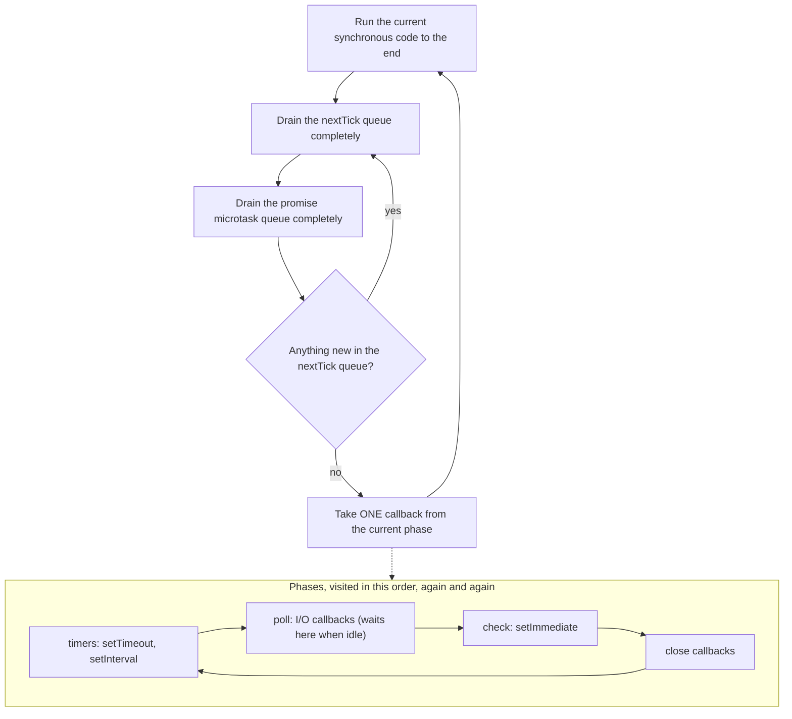

# Interview essentials: ordering puzzles, leaks, streams vs buffers

## In plain words

A driving test does not ask you to build an engine. It checks whether you know the rules of the road and can handle the common tricky situations: the roundabout, the hill start, the emergency stop. A Node.js interview is similar. A handful of situations come up again and again, because each one reveals whether you understand how the platform works underneath:

- "What does this code print, and in what order?"
- "This service's memory keeps growing. Why, and how do you find out?"
- "Would you use a stream or a buffer here?"
- "Is Node the right tool for this job?"

This lesson works through each with full answers. It is a consolidation of the whole track: nothing here is new machinery, but everything is arranged the way it is asked.

Why it matters for a job: these are the questions. They are also the situations you will meet in production, where the "interviewer" is an incident at an inconvenient hour.

> **Before this lesson:** you need [The event loop in detail](#/lesson/nodejs/event-loop-phases) (phases, `nextTick`, microtasks), [Async/await: sequential and parallel flows](#/lesson/nodejs/async-await-flows), [The observer pattern and EventEmitter](#/lesson/nodejs/observer-eventemitter) and [Why streams: readable, writable and backpressure](#/lesson/nodejs/streams-readable-writable). Treat this lesson as revision; follow the links when a step is unclear.

## Part 1: the event loop on one page

Everything about ordering follows from one picture and three rules.



**Rule 1.** Synchronous code always finishes first. Nothing interrupts a running function.

**Rule 2.** After the main script, and after **every single callback**, Node empties the `process.nextTick` queue, then the promise microtask queue, repeating until both are empty.

**Rule 3.** Only then does the loop take the next callback from a phase. Phases go timers → poll → check → close.

A method for any puzzle, to say aloud while you work:

1. Walk through the code top to bottom. Write down everything logged synchronously. For each scheduling call, note which queue it lands in: **tick**, **micro**, **timer** (with delay), **immediate**, or **I/O**.
2. Drain tick, then micro. Callbacks that run may add more; add them to the right queue and keep draining.
3. Run the phases. After each phase callback, go back to step 2.

Two facts to keep ready: an `async` function runs synchronously **up to its first `await`**, and the code after an `await` is a microtask. A timer delay of `0` means "at least 1 ms".

## Part 2: ordering puzzles with worked answers

Cover the answer, predict, then check.

### Puzzle 1: everything at once

```javascript
// puzzle1.js (CommonJS)
console.log("1");
setTimeout(() => console.log("2"), 0);
setImmediate(() => console.log("3"));
process.nextTick(() => console.log("4"));
Promise.resolve().then(() => console.log("5"));
(async () => {
  console.log("6");
  await null;
  console.log("7");
})();
console.log("8");
```

```text
1
6
8
4
5
7
2
3
```

Working: **Synchronous**: `1`; the async function starts immediately and logs `6`, then pauses at `await`; `8`. **Queues after the script**: tick `[4]`, micro `[5, 7]` (the `.then` was registered before the `await`, so `5` is ahead of `7`), timer `[2]`, immediate `[3]`. **Drain**: `4`, then `5`, `7`. **Phases**: timer `2`, check `3`.

The honest footnote, which earns credit: from the main module, the last two lines can appear as `3` then `2`, because whether the 1 ms timer is due when the loop first reaches the timers phase depends on how long start-up took.

### Puzzle 2: inside an I/O callback

```javascript
const fs = require("node:fs");

fs.readFile(__filename, () => {
  setTimeout(() => console.log("timeout"), 0);
  setImmediate(() => console.log("immediate"));
  process.nextTick(() => console.log("tick"));
  Promise.resolve().then(() => console.log("promise"));
});
```

```text
tick
promise
immediate
timeout
```

Working: the callback runs in the **poll** phase. After it, the urgent queues drain: `tick`, `promise`. The next phase is **check**: `immediate`. The timer waits for the following iteration: `timeout`. This order is guaranteed, unlike puzzle 1.

### Puzzle 3: queues that feed each other

```javascript
Promise.resolve().then(() => {
  console.log("p1");
  process.nextTick(() => console.log("tick inside p1"));
  Promise.resolve().then(() => console.log("p2"));
});

process.nextTick(() => {
  console.log("tick1");
  Promise.resolve().then(() => console.log("p3"));
});
```

```text
tick1
p1
p3
p2
tick inside p1
```

Working: after the script, tick `[tick1]`, micro `[p1]`. Ticks first: `tick1`, which queues `p3` → micro `[p1, p3]`. Now microtasks: `p1` logs, queues a tick and queues `p2` → micro `[p3, p2]`. The microtask queue is drained **completely** before returning to ticks: `p3`, `p2`. Only then `tick inside p1`.

### Puzzle 4: async functions (runs on this page)

```js-run
async function outer() {
  console.log("outer start");
  await inner();
  console.log("outer end");
}
async function inner() {
  console.log("inner");
}

console.log("script start");
outer();
Promise.resolve().then(() => console.log("then"));
setTimeout(() => console.log("timeout"), 0);
console.log("script end");
```

Predicted: `script start`, `outer start`, `inner`, `script end`, `outer end`, `then`, `timeout`.

Working: calling `outer()` runs it synchronously to the `await`: it logs, calls `inner()` (which logs and returns a resolved promise), and suspends; its continuation is queued as a microtask. Next, the `.then` callback is queued behind it. `script end` is synchronous. Microtasks in order: `outer end`, `then`. Timer last.

### Puzzle 5: a blocked loop and three timers (runs on this page)

```js-run
setTimeout(() => console.log("A (10 ms timer)"), 10);
setTimeout(() => console.log("B (0 ms timer)"), 0);

const end = Date.now() + 40;
while (Date.now() < end) {}                 // block for 40 ms

setTimeout(() => console.log("C (5 ms timer, registered after the block)"), 5);
console.log("D (synchronous)");
```

Predicted: `D`, `B`, `A`, `C`.

Working: nothing asynchronous can run during the 40 ms loop, so `D` is first. When the loop finally reaches the timers phase, `A` and `B` are both overdue; they run in order of their due time: `B` was due at about 1 ms, `A` at 10 ms. `C` was registered at about 40 ms and is due at 45 ms, so it comes last, although its delay is shorter than A's. The lesson: a timer's delay is a minimum, and a blocked loop delays every timer.

### Puzzle 6: emitters are synchronous (runs on this page)

```js-run
class Emitter {
  constructor() { this.handlers = {}; }
  on(name, fn) { (this.handlers[name] ??= []).push(fn); }
  emit(name, value) { for (const fn of this.handlers[name] ?? []) fn(value); }
}
const emitter = new Emitter();

emitter.on("data", async (v) => {
  console.log("listener 1 start", v);
  await null;
  console.log("listener 1 after await");
});
emitter.on("data", (v) => console.log("listener 2", v));

console.log("before emit");
emitter.emit("data", 42);
console.log("after emit");
```

Predicted: `before emit`, `listener 1 start 42`, `listener 2 42`, `after emit`, `listener 1 after await`.

Working: `emit` calls listeners one after another, synchronously. The async listener runs to its `await` and returns a promise that the emitter ignores; the second listener runs; `emit` returns. The rest of listener 1 is a microtask. Note the practical danger: if that async listener throws after the `await`, nobody is holding its promise.

### Puzzle 7: `forEach` and `await` (runs on this page)

```js-run
const sleep = (ms) => new Promise((resolve) => setTimeout(resolve, ms));

async function main() {
  [30, 10, 20].forEach(async (ms) => {
    await sleep(ms);
    console.log("forEach", ms);
  });
  console.log("after forEach");

  for (const ms of [30, 10, 20]) {
    await sleep(ms);
    console.log("for...of", ms);
  }
  console.log("after for...of");
}
main();
```

Predicted: `after forEach`, then `forEach 10`, `forEach 20`, `forEach 30` interleaved with `for...of 30` at the 30 ms mark, then `for...of 10`, `for...of 20`, `after for...of`.

Working: `forEach` starts all three callbacks and returns at once; they finish in order of their delay, not their position. The `for...of` loop awaits each sleep before the next, so it keeps the listed order and takes 60 ms in total. Both the `forEach` timer for 30 ms and the first `for...of` sleep end at about the same moment; the `forEach` one was registered first.

> [!TIP]
> In an interview, narrate the queues instead of announcing the answer. "Synchronous output is 1, 6, 8; the tick queue has 4; the microtask queue has 5 and then 7…" shows the model, and a slip in arithmetic costs little when the reasoning is visible.

## Part 3: memory leaks

### What a leak is in a garbage-collected language

JavaScript frees memory automatically: the **garbage collector** reclaims any object that can no longer be reached from the running program. So a **memory leak** in Node is never "forgot to free". It is always "something still holds a reference to data that is no longer needed". The art is finding the holder.

The symptom is a memory graph shaped like a staircase or a ramp that never comes back down, ending in a crash:

```text
FATAL ERROR: Reached heap limit Allocation failed - JavaScript heap out of memory
```

### The five usual suspects

| Cause | Typical code | Fix |
|---|---|---|
| **Unbounded caches and maps** | `cache[key] = value` keyed by user input, never evicted | size limit with LRU eviction, TTL, or a `WeakMap` |
| **Event listeners never removed** | `emitter.on(...)` per request on a long-lived emitter | `once`, `off`, `AbortSignal`, short-lived emitters |
| **Timers never cleared** | `setInterval` whose callback closes over large data | `clearInterval`; `unref()` |
| **Closures holding more than intended** | a small callback that keeps a huge enclosing scope alive | keep only what is needed; set references to `null` |
| **Queues that grow faster than they drain** | ignoring backpressure; pending-request tables without timeouts; unlimited `Promise` backlog | honour backpressure, bound queues, add timeouts |

Plain global variables and module-level arrays that only ever grow are the simplest form of the first row.

```js-run
// A "server" handling requests for many different users.
function simulate(cache, requests) {
  for (let i = 0; i < requests; i++) {
    const userId = "user-" + (i % 5000);                 // 5,000 distinct users, repeating
    if (cache.get(userId) === undefined) cache.set(userId, { profile: "x".repeat(200) });
  }
  return cache.size;
}

// Leaky: a Map that only grows.
console.log("unbounded Map after 50,000 requests:", simulate(new Map(), 50_000), "entries (grows with the number of users)");

// Bounded: least recently used entries are evicted.
class LruCache {
  constructor(limit) { this.limit = limit; this.map = new Map(); }
  get size() { return this.map.size; }
  get(key) {
    if (!this.map.has(key)) return undefined;
    const value = this.map.get(key);
    this.map.delete(key); this.map.set(key, value);      // refresh recency
    return value;
  }
  set(key, value) {
    this.map.delete(key);
    if (this.map.size >= this.limit) this.map.delete(this.map.keys().next().value);   // evict the oldest
    this.map.set(key, value);
  }
}
console.log("LRU cache (limit 500) after 50,000 requests:", simulate(new LruCache(500), 50_000), "entries (bounded)");

// Listener leak: one listener per request on an object that lives for ever.
const config = { listeners: [], on(fn) { this.listeners.push(fn); } };
for (let request = 0; request < 1000; request++) {
  const bigRequestData = new Array(1000).fill(request);
  config.on(() => bigRequestData.length);                // closure keeps bigRequestData alive
}
console.log("listeners attached to the long-lived config object:", config.listeners.length, "(each holding its request's data)");
```

A `Map` uses memory in proportion to the number of distinct keys it has ever seen; with keys chosen by users that number is unbounded. The LRU cache holds at most its limit. The problem [A bounded LRU cache](#/problem/node-lru-cache) asks you to write one.

A **`WeakMap`** is the other tool. Its keys must be objects, and an entry does **not** keep its key alive: when nothing else references the key object, the entry disappears. That suits "extra data attached to an object for as long as that object exists", such as per-request or per-socket metadata.

```javascript
const metadata = new WeakMap();
function track(socket) { metadata.set(socket, { connectedAt: Date.now() }); }
// when a socket is closed and dropped, its metadata entry can be collected too
```

### Finding a leak

A worked answer to "memory keeps growing; what do you do?":

1. **Confirm it.** Chart memory over hours. Growth that levels off is a cache warming up, not a leak. Watch `process.memoryUsage()`: `heapUsed` is JavaScript objects, `rss` is the whole process, `external` and `arrayBuffers` cover Buffers.
2. **Reproduce it** under load in a test environment, so you can experiment.
3. **Take heap snapshots.** Start Node with `--inspect`, open the DevTools memory tab (`chrome://inspect`), or call `v8.writeHeapSnapshot()`. Take one snapshot, apply load, force a collection, take another.
4. **Compare.** Sort by what grew between snapshots. The object type that keeps increasing (thousands of closures, strings, `Socket` objects) points at the cause, and the *retainers* view shows the chain of references keeping them alive.
5. **Fix the holder** (bound the cache, remove the listener, clear the timer) and repeat the measurement to verify.

```javascript
setInterval(() => {
  const { rss, heapUsed, external } = process.memoryUsage();
  const mb = (n) => (n / 1024 / 1024).toFixed(1) + " MB";
  console.log(`rss ${mb(rss)}  heapUsed ${mb(heapUsed)}  external ${mb(external)}`);
}, 10_000).unref();
```

```text
rss 61.4 MB  heapUsed 12.9 MB  external 2.1 MB
rss 88.0 MB  heapUsed 37.2 MB  external 2.1 MB
rss 131.7 MB  heapUsed 79.8 MB  external 2.1 MB
```

`heapUsed` climbing with steady traffic and never falling back is the signature. If `heapUsed` is flat while `rss` or `external` climbs, look at Buffers and native add-ons instead.

> [!WARNING]
> Raising the heap limit with `--max-old-space-size` or restarting the service every night hides a leak; it does not fix it. Both are acceptable as emergency measures for a day. A leak that takes a week to kill the process at today's traffic will take a day at next year's.

## Part 4: streams versus buffers

The question usually arrives as a scenario: "users upload large CSV files; you must parse them and insert rows into a database" or "serve a 2 GB video file".

| | Buffer (load everything, then process) | Stream (process chunk by chunk) |
|---|---|---|
| Memory | proportional to the data size | roughly constant |
| Time to first result | after everything has loaded | almost immediately |
| Maximum size | limited by memory and by maximum Buffer/string size | effectively unlimited |
| Concurrent users | memory multiplies per user | cheap per user |
| Code | simplest | more involved; needs backpressure and error handling |
| Random access, sorting, multiple passes | easy | hard or impossible in one pass |

Rough numbers make the point. The model computes the peak memory of both strategies for a few workloads:

```js-run
const MB = 1024 * 1024;
const chunkSize = 64 * 1024;                                  // a typical stream chunk

function peakMemory({ fileMb, concurrentUsers, strategy }) {
  const perUser = strategy === "buffer" ? fileMb * MB : chunkSize * 3;   // a few chunks in flight per pipeline
  return ((perUser * concurrentUsers) / MB).toFixed(1) + " MB";
}

for (const scenario of [
  { fileMb: 0.05, concurrentUsers: 10, what: "50 KB config file, 10 users" },
  { fileMb: 50, concurrentUsers: 20, what: "50 MB CSV upload, 20 users" },
  { fileMb: 2000, concurrentUsers: 100, what: "2 GB video, 100 viewers" },
]) {
  console.log(scenario.what.padEnd(30),
    "| buffer:", peakMemory({ ...scenario, strategy: "buffer" }).padStart(11),
    "| stream:", peakMemory({ ...scenario, strategy: "stream" }).padStart(8));
}
```

A worked answer: "For the CSV upload I would stream: pipe the request through a CSV parser as a transform, batch rows, and insert each batch, awaiting the insert so that the database's speed applies backpressure all the way to the client's upload. Memory stays flat however large the file is, and I use `pipeline` so that an aborted upload or a parse error tears everything down cleanly. I would buffer only when the data is small and bounded, such as a JSON request body with a size limit, or when I truly need the whole thing at once."

Decision rule: **small and bounded → buffer; large, unbounded or arriving over time → stream.** If the size is controlled by someone outside your organisation, treat it as unbounded.

## Part 5: when Node is the wrong tool

Knowing a tool's limits is a senior-level signal. Node's model, one JavaScript thread with non-blocking I/O, defines both lists.

**Where Node fits well**

- APIs and back-ends for web and mobile that mostly wait on databases and other services.
- Real-time applications: chat, notifications, collaborative editing, live dashboards (many idle connections).
- Gateways, proxies and "glue" services that combine other APIs.
- Streaming data: uploads, media, log processing.
- Tooling and command-line programs, especially for JavaScript projects.
- Server-side rendering that shares code with the browser.

**Where another tool is usually better**

| Situation | Why Node struggles | Common alternatives |
|---|---|---|
| Heavy CPU-bound computation (video encoding, simulations, large-scale number crunching) | Blocks the event loop; worker threads help but are not the platform's strength | Go, Rust, C++, Java; or call out to native tools |
| Data science and machine-learning training | The ecosystem lives elsewhere | Python |
| Workloads needing shared-memory parallelism across many cores | JavaScript threads do not share ordinary objects | Go, Java, Rust, C# |
| Hard real-time or tight latency guarantees | Garbage-collection pauses, no control over scheduling | C, C++, Rust |
| Very memory-constrained environments | The runtime's baseline footprint | C, Rust, Go |

Two qualifications keep the answer balanced. A Node service can still *orchestrate* such work: accept the request, enqueue a job, let a specialised worker do the computing, report back. And one slow endpoint in an otherwise I/O-bound service is a job for worker threads or a queue, not a reason to rewrite everything.

> [!INTERVIEW]
> **Rapid-fire questions with short worked answers.**
>
> - **Is Node single-threaded?** JavaScript runs on one thread; libuv uses a thread pool (four by default) for file I/O, DNS, crypto and compression, and the OS handles network I/O asynchronously.
> - **`process.nextTick` vs `setImmediate`?** `nextTick` runs right after the current operation, before promises and before the loop continues; `setImmediate` runs in the check phase of the loop, after I/O callbacks.
> - **Microtask vs macrotask?** Microtasks (promise reactions, `queueMicrotask`) drain completely after each callback; macrotasks (timers, I/O, immediates) are taken one at a time from the phases.
> - **`cluster` vs worker threads?** Cluster runs several processes to serve more requests across cores, with no shared memory. Worker threads run CPU-heavy JavaScript off the main thread inside one process.
> - **CommonJS vs ES modules?** `require` is synchronous, run-time, and exports are copies of properties; `import` is static, asynchronously loaded, with live read-only bindings and top-level `await`.
> - **What is backpressure?** A slow consumer signalling a fast producer to pause: `write()` returns `false`, resume on `'drain'`; `pipeline` handles it.
> - **How do you handle an uncaught exception?** Log it, shut down gracefully, exit, and let a supervisor restart; do not continue.
> - **How do you find a memory leak?** Confirm with metrics, take and compare heap snapshots under load, follow retainers to the reference that holds the growing objects.
> - **How do you scale a Node service?** Stateless instances, one per core or container, behind a load balancer; shared state in an external store; queues for background work.
> - **`Promise.all` vs `Promise.allSettled`?** `all` fails fast on the first rejection; `allSettled` waits for every outcome and never rejects.
> - **What blocks the event loop?** Long synchronous code: big loops, `...Sync` APIs, huge `JSON.parse`, catastrophic regular expressions, synchronous crypto.

## Pitfalls

- **Reciting an output without the reasoning**, and without mentioning the timer-versus-immediate ambiguity from the main module.
- **Forgetting that an async function starts synchronously.**
- **Believing `await` yields to timers and I/O.** It yields only to other microtasks.
- **Calling every growth in memory a leak** before checking that it does not level off.
- **"Fixing" leaks with a bigger heap or scheduled restarts.**
- **Using a plain object or `Map` as a cache with user-controlled keys** and no limit.
- **Buffering uploads or downloads whose size someone else controls.**
- **Claiming Node cannot do CPU work at all**, or that it is good at everything. Name the trade-off.

## Cheat sheet

| Question | Answer in one line |
|---|---|
| Priority order | sync → `nextTick` → promise microtasks → timers → I/O (poll) → `setImmediate` (check) → close |
| When are urgent queues drained? | after the main script and after every callback |
| Timer vs immediate from main | order not guaranteed |
| Timer vs immediate inside an I/O callback | immediate first, always |
| Async function start | synchronous until the first `await` |
| After `await` | continues as a microtask |
| `emit` | synchronous, listeners in registration order |
| Leak definition | unneeded data that is still referenced |
| Leak suspects | unbounded caches, listeners, timers, closures, unbounded queues |
| Leak tools | `process.memoryUsage()`, `--inspect`, heap snapshot comparison |
| Bounded cache | LRU with a size limit, TTL; `WeakMap` for object-keyed metadata |
| Buffer or stream | small and bounded → buffer; large, unbounded or continuous → stream |
| Node's sweet spot | I/O-bound, many concurrent connections |
| Node's weak spot | CPU-bound work on the main thread |

## Summary

- Ordering questions reduce to three rules: synchronous code first; the `nextTick` and microtask queues are drained after every callback; then one callback at a time from the phases timers, poll, check, close. Narrate the queues.
- Async functions run synchronously to their first `await`; emitters call listeners synchronously; array methods do not wait for async callbacks.
- A leak in Node is a lingering reference. Look first at unbounded caches, forgotten listeners and timers, oversized closures and growing queues; prove it with heap snapshots; bound or release the holder.
- Buffer what is small and bounded; stream what is large, unbounded or continuous, with backpressure and `pipeline`.
- Node excels at I/O-bound, highly concurrent services and tooling; CPU-bound, shared-memory-parallel or hard real-time work belongs elsewhere or behind a queue.

## Glossary

- **Tick queue**: callbacks scheduled with `process.nextTick`.
- **Microtask**: a promise reaction or `queueMicrotask` callback.
- **Macrotask**: a callback run by an event-loop phase (timer, I/O, immediate).
- **Drain**: to run a queue until it is empty.
- **Garbage collector**: the engine component that frees unreachable objects.
- **Reachable**: accessible through some chain of references from running code.
- **Memory leak**: memory kept allocated by references that are no longer useful.
- **Heap**: the memory area where JavaScript objects live.
- **RSS (resident set size)**: the total physical memory used by the process.
- **Heap snapshot**: a dump of all objects on the heap and the references between them.
- **Retainer**: an object holding a reference that keeps another object alive.
- **LRU cache**: a size-limited cache that evicts the least recently used entry.
- **`WeakMap`**: a map whose entries do not prevent their key objects from being collected.
- **I/O-bound / CPU-bound**: limited by waiting / by computation.

```quiz
[
  {"q": "In what order do these log in a CommonJS file?\n\n`setImmediate(() => console.log('I')); process.nextTick(() => console.log('N')); Promise.resolve().then(() => console.log('P')); console.log('S');`", "options": ["S, N, P, I", "S, P, N, I", "N, S, P, I", "S, I, N, P"], "answer": 0,
   "explain": "Synchronous first, then the nextTick queue, then promise microtasks, then the check phase."},
  {"q": "In what order do these log?\n\n`async function f() { console.log('A'); await 1; console.log('B'); } f(); console.log('C');`", "options": ["A, B, C", "A, C, B", "C, A, B", "B, A, C"], "answer": 1,
   "explain": "f runs synchronously to the await (A), the caller continues (C), and the rest resumes as a microtask (B)."},
  {"q": "In what order do these log?\n\n`setTimeout(() => console.log('T'), 0); Promise.resolve().then(() => { console.log('P1'); return Promise.resolve().then(() => console.log('P2')); }).then(() => console.log('P3')); console.log('S');`", "options": ["S, T, P1, P2, P3", "S, P1, P2, P3, T", "S, P1, P3, P2, T", "P1, S, P2, P3, T"], "answer": 1,
   "explain": "All promise callbacks are microtasks and are drained, in dependency order, before the timer phase."},
  {"q": "Inside an fs.readFile callback, which runs first: `setTimeout(a, 0)` or `setImmediate(b)`?", "options": ["a", "b", "It varies", "Whichever was registered first"], "answer": 1,
   "explain": "The I/O callback runs in the poll phase; check comes next, so the immediate always wins there."},
  {"q": "Which code is the most likely memory leak in a long-running server?", "options": ["A local array created and returned inside a request handler", "A module-level Map keyed by user id that is never pruned", "A const string at module level", "An await inside a for loop"], "answer": 1,
   "explain": "The map lives as long as the process and grows with every new key."},
  {"q": "heapUsed rises steadily under constant traffic and never drops after garbage collection. What is the best next step?", "options": ["Increase --max-old-space-size and move on", "Take heap snapshots at two points under load and compare what grew and what retains it", "Switch to worker threads", "Add more instances"], "answer": 1,
   "explain": "Snapshot comparison identifies the growing object type and the reference chain that keeps it alive."},
  {"q": "Users upload CSV files of unknown size for import. Which approach is appropriate?", "options": ["Read the whole body into a Buffer, then parse", "Stream the request through a parser and insert rows in batches with backpressure", "Reject all uploads", "Store the file in a global variable"], "answer": 1,
   "explain": "Size is controlled by the user, so it must be treated as unbounded; streaming keeps memory constant."},
  {"q": "Which workload is the poorest fit for Node's main thread?", "options": ["A chat server with 50,000 mostly idle connections", "An API aggregating three other HTTP services", "Transcoding video frames in JavaScript inside request handlers", "Serving static files through streams"], "answer": 2,
   "explain": "Transcoding is CPU-bound and would block the event loop; it belongs in native tools, workers or a separate service."}
]
```

> **Source:** Casciaro & Mammino, *Node.js Design Patterns* 3e, ch. 1, 3, 5, 6 and 11 (topics only; wording and examples are original). Documentation: https://nodejs.org/en/learn/asynchronous-work/event-loop-timers-and-nexttick, https://nodejs.org/en/learn/diagnostics/memory/using-heap-snapshot, https://nodejs.org/docs/latest/api/process.html#processmemoryusage
