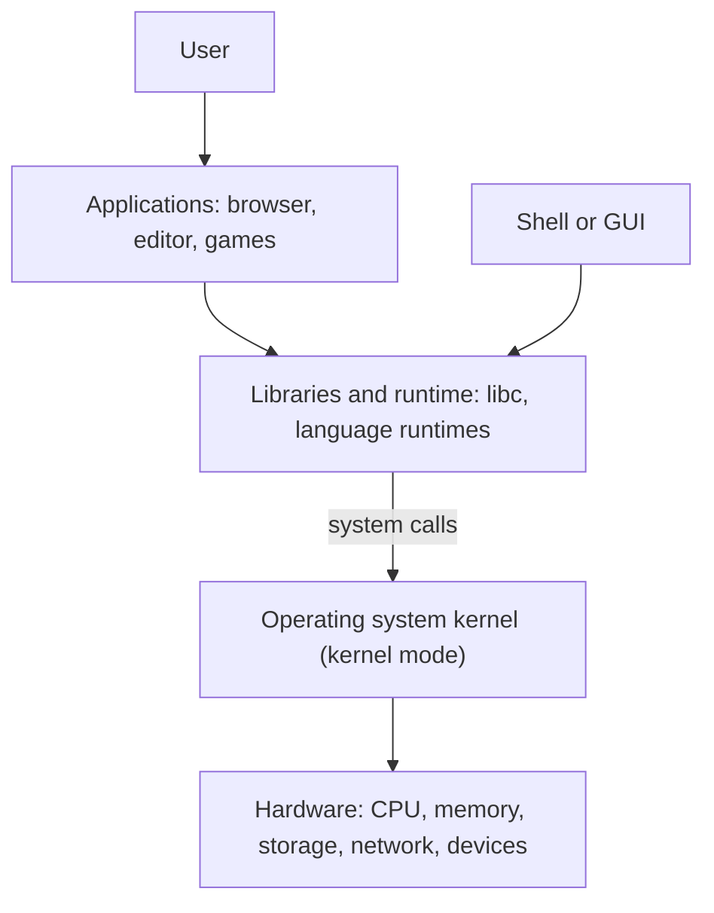
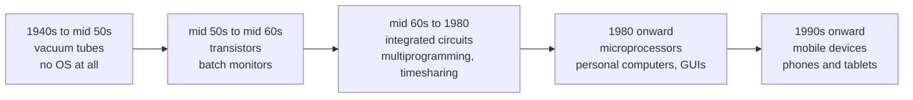

# What an operating system is, its history and its many forms

> **Before this lesson:** nothing. This is the first lesson of the track and assumes no computing background beyond having used a computer or a phone.

## In plain words

An **operating system** is the program that runs a computer on behalf of every other program. Windows, macOS, Linux, Android and iOS are operating systems.

Think of a large hotel. Guests (the programs you use: a browser, a game, a music player) want rooms, electricity, water and room service. They do not deal with the plumbing or the wiring. The hotel's management stands between the guests and the building: it hands out rooms, keeps guests out of each other's rooms, and hides the machinery in the basement. An operating system is the management of a computer. It sits between your programs and the **hardware** (the physical parts: the processor chip that does the calculating, the memory that holds data while the machine is on, the disk that keeps data when it is off) and does two jobs: it makes the hardware *easy to use*, and it *shares it out fairly and safely*.

Why it matters for a job: every program you will ever write runs on top of an operating system and depends on it. When a program is slow, freezes or loses data, the explanation is very often in this layer, and employers expect engineers to be able to reason about it.

## Why this lesson exists

Open a laptop, tap a phone, swipe a transit card, start a car. In every case a program you never chose and rarely notice wakes up first, takes charge of the hardware, and only then lets the software you care about run. That program is the operating system. It is the most heavily used piece of software on any machine, and also the least visible: when it works you forget it exists, and when it fails nothing else matters.

People who write applications can get surprisingly far without understanding it. But the moment a program is slow for no apparent reason, uses more memory than expected, hangs while two threads wait for each other, or loses data in a power cut, the explanation lives in the operating system. This track is about building an accurate mental model of that layer. This first lesson answers three questions: *what is an operating system for*, *how did it come to look the way it does*, and *how many different kinds are there*.

## Two jobs, one program

Ask ten engineers to define "operating system" and you will collect ten answers, because the thing does two quite different jobs at once.

### Job one: turning ugly hardware into pleasant abstractions

Real hardware is hostile to programmers. A storage device does not understand "save my essay"; it understands commands such as "write these 4,096 bytes at logical block 9,216,331," wrapped in a protocol with status registers, timeouts, retry rules and vendor quirks. A network card deals in frames and interrupts. A processor offers a few dozen primitive operations and knows nothing about "programs" at all.

The operating system hides that mess behind a small set of invented objects that are much nicer to think with:

| Raw hardware | Abstraction the OS presents |
|---|---|
| One or a few CPU cores | Any number of **processes** and **threads**, each apparently with its own processor |
| A fixed amount of RAM chips | A private, large, contiguous **address space** per process |
| Blocks on disks and flash chips | Named **files** arranged in **directories** |
| Network interface hardware | **Sockets** and connections |
| Keyboards, screens, sensors | Streams of events and windows |

None of these objects exists physically. There is no such thing as a file inside an SSD; there are only cells holding charge. The file is a fiction maintained by software — a useful one, because it lets a spreadsheet and a music player share a disk without knowing anything about each other or about the disk.

This is sometimes called the *extended machine* view: the OS plus the hardware together form a new, friendlier computer than the hardware alone.

### Job two: managing and policing shared resources

The second job looks at the same system from below. A computer has finite hardware and many programs that all want it at once, often on behalf of different people who do not trust one another. Someone has to decide who gets the CPU for the next few milliseconds, which program's data stays in RAM when memory is tight, whose print job goes first, and what happens when a program tries to read memory that belongs to someone else.

Sharing takes two forms:

- **Multiplexing in time.** Programs take turns. A single core runs one program for a slice of time, then another. A printer serves one job, then the next.
- **Multiplexing in space.** Each program gets a piece. RAM is carved up among processes; a disk is carved up among files.

For both, the OS must have a *policy* (who gets what, and when) and an *enforcement mechanism* (hardware-backed protection so that the policy cannot be ignored). The enforcement part is what separates an operating system from a mere library of helpful routines: a library can be bypassed, a kernel cannot.

> [!NOTE]
> The two jobs are the same code seen from two angles. "A process" is both an abstraction offered to the programmer (job one) and the unit to which CPU time and memory are allocated (job two).

### Where it sits



Two hardware *modes* make this layering real. In **kernel mode** (also called supervisor mode) every instruction is allowed, including those that reprogram the memory-protection hardware or talk directly to devices. In **user mode** those instructions are forbidden; attempting one causes a trap into the kernel. Applications, shells and even graphical desktops run in user mode. The piece that runs in kernel mode is the *kernel*, and in strict usage "the operating system" means the kernel.

The boundary is blurrier in practice. A desktop's window system or the program that checks your password runs in user mode but is clearly part of "the system" as shipped. On tiny embedded devices there may be no user mode at all. Throughout this track, when precision matters, we say *kernel*.

> [!INTERVIEW]
> "What is the difference between an operating system and a kernel?" A crisp answer: the kernel is the part that runs with full hardware privilege and implements processes, memory, file systems and device access. The operating system as a product also includes user-mode pieces — shells, system services, libraries, utilities. Follow up with *why* the split exists: code in kernel mode can corrupt anything, so we want as little of it as possible.

### Why operating systems are hard to change

A production kernel is enormous — tens of millions of lines once drivers are counted — and long-lived. The core ideas of UNIX date from around 1970, and the design of Windows NT from around 1990; both are still in daily use, heavily evolved but recognisable. Nobody rewrites that much working code casually. One consequence is that operating systems carry their history with them, so understanding the history genuinely helps you understand the present.

## A short history, told as a sequence of problems

It is tempting to memorise the history as a list of dates. It is more useful to see each generation as an answer to whatever was the scarcest resource at the time.



### No operating system: the machine is the scarce resource

The earliest electronic computers were built from thousands of vacuum tubes. A programmer booked the whole machine for a block of time, wired or keyed the program in by hand, and hoped no tube failed before the run ended. There was nothing to share and nobody to protect against. The "operating system" was a sign-up sheet on the wall.

### Batch systems: stop wasting machine time

Transistors made computers reliable enough to sell, but they cost as much as a building. Every minute the machine sat idle while an operator walked across the room to load the next job was money burned. The fix was the **batch system**: collect many jobs on tape, and let a small resident program — a *monitor* — load each one, run it, record its output and move straight to the next without human intervention. That monitor is the ancestor of every kernel. Job-control cards told it what to compile, load and run, which is the ancestor of the shell script.

### Multiprogramming: stop wasting CPU time during I/O

Batch systems still left the processor idle whenever the current job waited for a tape or card reader — and commercial data processing waits for I/O most of the time. The third generation's key idea was **multiprogramming**: keep several jobs in memory at once and switch the CPU to another whenever the running one blocks. This single idea forced almost everything else in this track into existence. If several jobs share memory, they must be protected from each other (memory management). If they share a CPU, something must choose who runs (scheduling). If they share devices, something must queue and arbitrate (I/O management).

A related trick, **spooling**, let the system read jobs onto disk ahead of time and write output to disk for later printing, so slow devices never held up the processor.

### Timesharing: stop wasting human time

Multiprogrammed batch was efficient for the machine and miserable for programmers, who waited hours to learn about a missing semicolon. **Timesharing** gave each user a terminal and switched among users so quickly that each seemed to have the computer alone. Because humans think slowly and type slower, a machine could serve dozens of them.

An ambitious timesharing project of the mid-1960s, MULTICS, aimed to be a computing utility for an entire city. It was too large for the hardware of its day, but it introduced ideas still in use (hierarchical file systems, dynamic linking, rings of protection). Two researchers who had worked on it wrote a far smaller system for a discarded minicomputer. That system was **UNIX**. Its source code circulated widely among universities, which is why it spawned so many descendants: the BSD line from Berkeley, commercial System V variants, a teaching clone called MINIX, and in 1991 a hobby kernel by a Finnish student that became **Linux**. The POSIX standard was later written to define a common interface that all these relatives could implement, so that a program written for one would compile on another.

### Personal computers: the machine is cheap, the user is not an expert

Once a whole processor fitted on one chip, a computer could belong to one person. Early microcomputer systems (CP/M, then MS-DOS) were deliberately simple — a single user, one program at a time, no protection — because the hardware could do no better. The decisive change in this era was not technical depth but **usability**: the graphical user interface, with windows, icons, menus and a pointing device, invented in a research lab and popularised by the Macintosh, then by Windows. Under the surface, the simple systems were gradually replaced by proper protected, multitasking kernels: Windows moved to the NT design, and Apple moved to a UNIX-derived core.

This era also brought **networked and distributed systems**: once every desk had a computer, people wanted them to share files, printers and eventually everything.

### Mobile: the battery is the scarce resource

Phones merged telephony with computing. After a period dominated by purpose-built phone systems, the market consolidated around two platforms — one built on a UNIX-derived kernel by Apple, the other, Android, on the Linux kernel. Their constraints are different again: limited energy, intermittent connectivity, touch input, and applications downloaded from strangers that must be sandboxed from each other and from the user's private data.

> [!TIP]
> A pattern worth noticing: ideas keep reappearing. Each new class of hardware starts with a primitive single-program system, then rediscovers protection, multiprogramming and virtual memory as it gets more powerful. Mainframes did it, then minicomputers, then PCs, then phones, and smart cards are following. "Obsolete" techniques also return when the economics change — huge memories once made clever memory management seem unnecessary, until virtual machines and containers made it matter again.

## The operating system zoo

"The operating system" suggests one kind of thing. In reality the same core ideas are tuned for wildly different targets.

| Kind | What it optimises | Typical examples |
|---|---|---|
| **Mainframe** | Massive I/O throughput; thousands of disks; batch, transaction processing and timesharing at once | z/OS; Linux on mainframe hardware |
| **Server** | Many simultaneous network clients; uptime | Linux, Windows Server, the BSDs |
| **Multiprocessor** | Using many cores well; this is now every desktop and phone | Mainstream systems with SMP support |
| **Personal computer** | A good experience for one interactive user | Windows, macOS, desktop Linux |
| **Handheld** | Energy, touch, app sandboxing | Android, iOS |
| **Embedded** | Small footprint; no untrusted software installed after shipping | Embedded Linux, QNX, VxWorks |
| **Sensor node** | Tiny memory, battery life measured in months, event-driven | TinyOS |
| **Real-time** | Meeting deadlines | Industrial controllers, avionics, audio systems |
| **Smart card** | A few kilobytes of RAM, milliwatts of power, strong isolation | Card platforms running a small language virtual machine |

Two distinctions inside that table are frequent interview material.

**Hard versus soft real time.** In a *hard* real-time system, a missed deadline is a failure of the system: a welding robot that fires late ruins the car body; an airbag that fires late is useless. Such systems are designed so that worst-case timing can be proven. In a *soft* real-time system, missing a deadline now and then is undesirable but tolerable — a dropped video frame, a glitch in audio. Phones and desktop media stacks are soft real time.

**Embedded versus handheld.** The practical dividing line is whether users can install arbitrary software. A microwave oven's firmware is fixed at the factory, so it needs little internal protection. A phone runs code from thousands of unknown developers and needs a great deal.

## Worked example: why multiprogramming pays

A back-of-the-envelope model shows why the third generation bothered. Suppose a typical job spends a fraction $p$ of its time waiting for I/O. With $n$ jobs in memory, and assuming (optimistically) that they wait independently, the processor is idle only when *all* of them are waiting at once, which happens with probability $p^n$. So

$$\text{CPU utilisation} \approx 1 - p^n.$$

Run the model and change the numbers:

```python-run
def utilisation(p, n):
    return 1 - p ** n

print("jobs in memory -> CPU utilisation")
for p in (0.5, 0.8, 0.95):
    row = ", ".join(f"n={n}: {utilisation(p, n):5.1%}" for n in (1, 2, 4, 8, 16))
    print(f"I/O wait {p:.0%}:  {row}")

# How much does adding RAM help? Suppose each job needs 1 GB and the OS needs 1 GB.
print()
for ram_gb in (4, 8, 16):
    n = ram_gb - 1
    print(f"{ram_gb:2d} GB RAM -> {n:2d} jobs -> utilisation at 85% I/O wait: {utilisation(0.85, n):.1%}")
```

**What the code does, line by line.** `def utilisation(p, n)` defines a small reusable calculation, called a *function*, with two inputs: `p`, the fraction of time a job spends waiting for a device, and `n`, the number of jobs in memory. `p ** n` means "p multiplied by itself n times", which is the chance that all the jobs are waiting at the same moment; one minus that is the fraction of time the processor is busy. The first `for` loop repeats its body for three values of `p` and prints one row each; the text inside `f"..."` is a template in which the parts in curly brackets are replaced by values, and `:5.1%` means "show as a percentage with one decimal". The second loop asks how many one-gigabyte jobs fit beside the operating system in 4, 8 or 16 gigabytes of memory.

**The output.** With jobs that wait 80% of the time, one job keeps the processor only 20% busy, four jobs about 59%, and sixteen about 97%. In the second table, going from 4 to 8 gigabytes raises utilisation by about 29 percentage points, and going from 8 to 16 — twice as much extra memory — by only about 23: each gigabyte added helps less than the one before.

With interactive or I/O-heavy work ($p$ around 0.8–0.95), one job leaves the processor idle most of the time; a handful of jobs recovers most of it. The second table shows a point managers used to care about a great deal: memory upgrades have diminishing returns. The first extra gigabytes let you add jobs that soak up a lot of idle time; later ones add little.

The model is crude — jobs do not really wait independently, and it ignores the cost of switching — but it captures why keeping several programs in memory is worth all the complexity that follows.

## Simulating the two views

To make "abstraction" concrete, here is a toy that sits on top of a fake block device. The device only understands numbered blocks; the thin layer above it offers named files. Notice how little the "application" code at the bottom needs to know.

```python-run
class BlockDevice:
    """Pretend hardware: a fixed array of 16-byte blocks, addressed by number."""
    BLOCK = 16
    def __init__(self, blocks):
        self.data = [bytes(self.BLOCK) for _ in range(blocks)]
    def write(self, n, payload):
        assert len(payload) <= self.BLOCK
        self.data[n] = payload.ljust(self.BLOCK, b"\0")
    def read(self, n):
        return self.data[n]

class TinyFS:
    """Pretend operating system: maps names to lists of block numbers."""
    def __init__(self, dev):
        self.dev, self.table, self.next_free = dev, {}, 0
    def save(self, name, text):
        raw = text.encode()
        blocks = []
        for i in range(0, len(raw), self.dev.BLOCK):
            self.dev.write(self.next_free, raw[i:i + self.dev.BLOCK])
            blocks.append(self.next_free)
            self.next_free += 1
        self.table[name] = (blocks, len(raw))
    def load(self, name):
        blocks, size = self.table[name]
        return b"".join(self.dev.read(b) for b in blocks)[:size].decode()

disk = BlockDevice(64)
fs = TinyFS(disk)

# "Application" code: no block numbers anywhere.
fs.save("notes.txt", "Remember to back up before the upgrade.")
fs.save("todo.txt", "1. tea  2. kernel")
print(fs.load("notes.txt"))
print(fs.load("todo.txt"))
print("where notes.txt really lives:", fs.table["notes.txt"])
```

**What the code does.** A `class` is a template for building objects that bundle data with the operations on that data. `BlockDevice` plays the part of a disk: `self.data` is a list of blocks, each 16 bytes long, and it offers only two operations, `write(n, payload)` and `read(n)`, addressed by block *number*. `TinyFS` plays the part of the operating system. Its `table` is a dictionary — a look-up table from a name to a value — recording, for each file name, which blocks hold the file and how long it is. `save` cuts the text into 16-byte pieces, writes each piece to the next unused block and remembers the block numbers. `load` reads those blocks back, joins them, and trims the padding. The last few lines are the "application": it mentions only file names.

**The output.** The two saved texts come back unchanged, and the final line reveals what the application never needed to know: `notes.txt` really lives in blocks 0, 1 and 2.

Every real file system is this idea plus forty years of answers to awkward questions: what if the power fails halfway through `save`? What if two programs save at once? What if the file is deleted and the blocks must be reused? Later modules take those questions one at a time.

## Pitfalls and misconceptions

- **"The OS is the desktop."** The graphical shell is a user-mode program. You can replace it, or run with none, and the operating system is still there.
- **"The OS is always running."** On a single core, when your program is executing, the kernel is *not* executing. It regains control only through an interrupt, a trap or a system call. The periodic timer interrupt exists precisely so that it cannot be shut out forever.
- **"Abstraction is free."** Each layer costs something — time crossing into the kernel, memory for bookkeeping. Much OS engineering is about making the common path through the abstraction nearly as fast as raw hardware.
- **"Real-time means fast."** It means *predictable*. A hard real-time system may be quite slow, as long as it is never late.
- **"Old ideas are dead ideas."** Batch processing lives on as job queues in data centres; timesharing lives on as cloud tenancy; the mainframe trick of virtual machines, invented in the 1960s, is the foundation of modern cloud computing.
- **"Linux is UNIX."** Linux is a reimplementation of the UNIX interface, written from scratch; it shares design and standards, not original code. Android, in turn, is Linux at the kernel level with a very different user-mode world on top.

## Summary

- An operating system does two things with one body of code: it **abstracts** hardware into processes, address spaces and files, and it **manages** hardware by multiplexing it in time and space among competing programs.
- Hardware enforces the split between **kernel mode**, where everything is permitted, and **user mode**, where privileged operations trap. The kernel is the part that runs in kernel mode.
- History is a chain of responses to scarcity: batch systems saved machine time, multiprogramming saved CPU time during I/O, timesharing saved programmer time, personal computers and GUIs served non-experts, and mobile systems economise on energy while sandboxing untrusted apps.
- UNIX, born as a reaction to an over-ambitious predecessor, seeded BSD, System V, MINIX, Linux and the POSIX standard; Windows evolved from a single-user loader into the NT kernel.
- The same principles are specialised into a zoo: mainframe, server, multiprocessor, personal, handheld, embedded, sensor-node, real-time and smart-card systems, each tuned for a different scarce resource.
- A simple probability model, utilisation $\approx 1 - p^n$, explains why multiprogramming was worth inventing.

## Glossary

- **Operating system** — the program that manages a computer's hardware and runs all other programs.
- **Hardware** — the physical parts of a computer.
- **Processor (CPU)** — the chip that carries out a program's instructions.
- **Memory (RAM)** — fast storage that holds programs and data while the machine is on.
- **Abstraction** — a simplified object, such as a file, that hides complicated details.
- **Process** — a program that is currently running.
- **File** — a named collection of data kept on a storage device.
- **Kernel** — the core of the operating system, which runs with full control of the hardware.
- **Kernel mode / user mode** — the processor setting in which everything is permitted / in which dangerous operations are forbidden.
- **Multiplexing** — sharing one resource among several users, either by taking turns (in time) or by dividing it up (in space).
- **Batch system** — an early kind of system that ran a queue of jobs one after another without a person attending.
- **Multiprogramming** — keeping several programs in memory and switching the processor between them.
- **Timesharing** — switching between users so quickly that each seems to have the computer alone.
- **POSIX** — a standard describing a common set of operating-system services.
- **Real-time system** — a system that must respond within fixed time limits; *hard* if a missed limit is a failure, *soft* if it is merely undesirable.
- **Embedded system** — a computer built into another device, such as a car or a washing machine.

## Check yourself

```quiz
[
  {"q": "Which statement best captures the 'extended machine' view of an operating system?",
   "options": ["It decides which process runs next", "It presents invented objects such as files and processes that are easier to use than raw hardware", "It prevents users from installing software", "It translates source code into machine code"],
   "answer": 1,
   "explain": "The extended-machine view is about abstraction: hiding device details behind cleaner objects. Deciding who runs next belongs to the resource-manager view; translation is a compiler's job."},
  {"q": "A single-core laptop is playing music while compiling code. Which kind of resource sharing does the CPU illustrate, and which does RAM illustrate?",
   "options": ["CPU: space multiplexing; RAM: time multiplexing", "Both are time multiplexing", "CPU: time multiplexing; RAM: space multiplexing", "Neither is shared; each program has its own hardware"],
   "answer": 2,
   "explain": "One core is handed to the programs in turn (time). Memory is divided so that each program occupies a different part of it simultaneously (space)."},
  {"q": "What problem did multiprogramming primarily solve?",
   "options": ["Operators taking too long to load tapes", "The CPU sitting idle while the current job waited for I/O", "Programmers waiting hours for output", "Users being unable to use a mouse"],
   "answer": 1,
   "explain": "Batch monitors already removed operator delays. Multiprogramming kept several jobs in memory so that another could use the CPU during I/O waits. Fast turnaround for humans was the goal of timesharing."},
  {"q": "With the simple model utilisation = 1 - p^n, how busy is the CPU when 3 jobs are in memory and each waits for I/O 50% of the time?",
   "options": ["50%", "75%", "87.5%", "100%"],
   "answer": 2,
   "explain": "p^n = 0.5^3 = 0.125 is the probability that all three wait at once, so the CPU is busy 1 - 0.125 = 87.5% of the time."},
  {"q": "An insulin pump must deliver each dose within a strict time bound or the patient is harmed. What class of system is required?",
   "options": ["Soft real-time", "Hard real-time", "Server", "Handheld"],
   "answer": 1,
   "explain": "When a missed deadline counts as failure, the system is hard real-time and must be designed so worst-case timing can be guaranteed."},
  {"q": "Which of these runs in user mode on a typical desktop system?",
   "options": ["The code that reprograms the memory-management hardware", "A disk interrupt handler", "The command shell", "The scheduler"],
   "answer": 2,
   "explain": "Shells and graphical environments are ordinary user-mode programs that use system calls like any other application. The other three need kernel privilege."},
  {"q": "Why does understanding OS history help with understanding current systems?",
   "options": ["Old systems are still required reading for certification", "Kernels are huge and long-lived, so today's designs carry decisions made decades ago", "Modern hardware is identical to 1960s hardware", "History is used to pick variable names"],
   "answer": 1,
   "explain": "Rewriting millions of lines of working code is rarely affordable, so systems evolve rather than restart. Design choices from UNIX and NT origins remain visible in current releases."},
  {"q": "What is the most useful practical distinction between an embedded OS and a handheld OS?",
   "options": ["Embedded systems have no CPU", "Handheld systems cannot connect to networks", "Embedded devices generally do not accept user-installed software, so they need less internal protection", "Embedded systems always run Linux"],
   "answer": 2,
   "explain": "If all code is fixed at the factory, it can be trusted and tested together. Phones run downloaded code from unknown authors, so they need strong isolation between apps."}
]
```

> **Source:** Tanenbaum & Bos, Modern Operating Systems 4e, §1.1 (What is an operating system?), §1.2 (History of operating systems), §1.4 (The operating system zoo)
