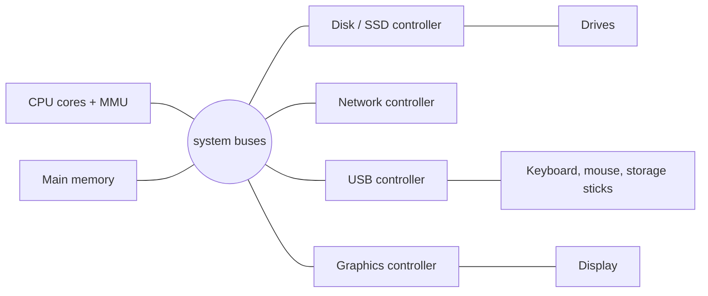
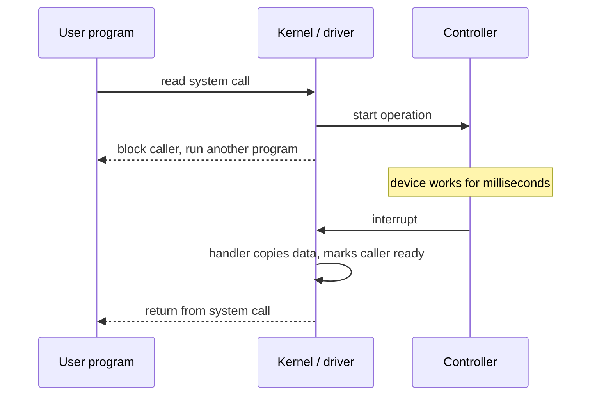

# Hardware review: CPUs, memory, devices and booting

> **Before this lesson:** [What an operating system is, its history and its many forms](#/lesson/os/what-is-an-os), for what an operating system is and the idea of kernel mode and user mode.

## In plain words

An operating system manages hardware, so before studying it you need a rough picture of the hardware it manages. No electronics is required — only what each part does.

Picture an office. One clerk (the **processor**, also called the CPU, for *central processing unit*) does all the work, following written instructions one at a time. On the desk is a small notepad for figures being worked on right now (the processor's **registers**). Within arm's reach is a desk drawer of papers in current use (the **cache**). Across the room is a large filing cabinet (**main memory**), and in the basement is an archive that survives overnight (the **disk**). The nearer the storage, the faster and the smaller it is. Messengers (the **devices**: keyboard, screen, network) bring work in and take it away, and can tap the clerk on the shoulder when something arrives — that tap is an **interrupt**.

Why it matters for a job: almost every performance question — "why is this loop slow?", "why is the disk the bottleneck?" — is answered by this picture. The huge speed differences between the layers are the reason operating systems are designed the way they are.

## Why an OS course starts with hardware

An operating system is shaped by the machine underneath it the way a boat is shaped by water. Almost every design decision you will meet later — why a context switch is expensive, why page tables have several levels, why disk scheduling used to matter and now matters less, why drivers are the buggiest part of a kernel — is a reaction to some property of hardware. You do not need to be able to design a processor. You do need a working model of five things: the CPU, the memory hierarchy, storage, I/O devices and the buses that connect them, plus the sequence of events that turns a powered-off box into a running system.



## The processor

### The fetch–decode–execute loop and its registers

A CPU repeats one cycle endlessly: fetch the instruction at the address held in the **program counter**, decode it, execute it, and advance the program counter. Instruction sets differ between processor families, which is why a binary built for an ARM phone will not run on an x86 laptop without translation.

Because reaching main memory is slow compared with the CPU's internal speed, processors keep a small set of **registers** inside the chip. Three special ones matter enormously to an operating system:

- The **program counter (PC)** — where the next instruction is.
- The **stack pointer (SP)** — the top of the current stack, where each active procedure keeps its return address, parameters and local variables that do not fit in registers.
- The **program status word (PSW)** — a collection of control bits: condition codes from comparisons, the interrupt-enable flag, and above all the bit that says whether the CPU is in kernel mode or user mode.

Whenever the OS stops one program to run another, it must save *every* register of the old one and load those of the new one. That set of saved registers is, quite literally, what a suspended computation consists of. Keep this in mind for the lesson on processes: a "context switch" is mostly an exercise in saving and restoring registers.

### Pipelines and superscalar cores

The one-instruction-at-a-time loop is a simplification that has not been true for decades. A **pipelined** CPU overlaps the stages: while one instruction is executing, the next is being decoded and the one after is being fetched. A **superscalar** CPU goes further, fetching several instructions at once, parking the decoded results in a buffer and executing them out of their original order whenever a functional unit is free.

For the OS designer the consequence is uncomfortable: at the instant an interrupt arrives, several instructions are in flight in various stages of completion. The hardware must present a clean picture ("everything before this point is done; nothing after it has had a visible effect"), and doing so costs work. The aggressive speculation these cores perform has also turned out to leak information across protection boundaries, a topic the security module returns to.

### Kernel mode, user mode and the trap

The mode bit in the PSW is the foundation of all protection. In kernel mode the processor accepts its full instruction set. In user mode a subset is disabled — typically anything that touches I/O devices or the memory-protection machinery, and of course the instruction that changes the mode bit itself.

So how does a user program get anything privileged done? It asks. A special instruction (variously called a trap, a system call instruction or a software interrupt) switches to kernel mode *and simultaneously* jumps to a fixed entry point chosen by the OS. The program cannot jump into the middle of arbitrary kernel code; it can only knock at the front door. When the kernel has done the work it returns to the instruction after the trap, back in user mode.

Traps are also raised by the hardware itself when a program does something exceptional, such as dividing by zero or touching an address it has no right to.

> [!INTERVIEW]
> "What is the difference between a trap and an interrupt?" A **trap** (or exception) is *synchronous*: it is caused by the instruction currently executing — a system call, an illegal operation, a page fault — and would happen at the same point if you re-ran the program. An **interrupt** is *asynchronous*: it is caused by something outside the running program, such as a device finishing or a timer expiring, and can arrive between any two instructions. Both transfer control to the kernel through a table of handler addresses.

### Multithreaded and multicore chips

Clock speeds stopped climbing in the mid-2000s because of heat, but transistor counts kept rising, so chip designers spent the extra transistors on parallelism instead.

- **Simultaneous multithreading** (Intel's brand name is hyperthreading) lets one physical core hold the state of two threads and interleave them at the granularity of nanoseconds. It is not true parallelism — there is still one set of execution units — but if one thread stalls on a slow memory access, the other can use the core. The OS sees each hardware thread as a separate CPU, which creates a subtle scheduling problem: placing two busy programs on the two hardware threads of one core, while another core sits idle, is a poor choice, and the scheduler must be aware of the topology to avoid it.
- **Multicore** chips contain several complete processors. Using them well requires a multiprocessor-aware kernel, covered in a later module.
- **GPUs** contain thousands of tiny cores. They are superb at regular numerical work on arrays and awkward for general-purpose code; operating systems treat them mostly as devices, not as places to run the kernel.

## Memory: a hierarchy forced by economics

Everyone wants memory that is infinitely large, infinitely fast, free, and retains data without power. No technology offers all four, so machines combine several technologies in layers.

| Layer | Typical access time | Typical capacity | Managed by |
|---|---|---|---|
| CPU registers | under 1 ns | a few hundred bytes | Compiler |
| Cache (L1 / L2 / L3) | about 1–20 ns | tens of KB to tens of MB | Hardware |
| Main memory (RAM) | about 100 ns | gigabytes | Operating system |
| Solid-state drive | tens to hundreds of µs | hundreds of GB to TB | Operating system |
| Magnetic disk | several ms | terabytes | Operating system |

Each step down is cheaper per byte and dramatically slower. The gap between RAM and a magnetic disk is around five orders of magnitude: if a RAM access took one second, a disk access would take more than a day.

### Caches

Main memory is divided by the hardware into **cache lines**, commonly 64 bytes. The most heavily used lines are kept in a small, fast store inside or next to the CPU. When a program reads a word, the hardware checks whether its line is cached. A **hit** costs a nanosecond or two; a **miss** means fetching the line from RAM at a cost perhaps a hundred times greater. Modern chips stack two or three levels, each larger and slower than the one before, with the first level usually split into separate instruction and data caches.

Caching is not only a hardware trick — it is the single most reused idea in systems. Whenever a resource can be divided into pieces, some pieces are used much more than others, and the fast storage cannot hold everything, somebody builds a cache. File systems cache disk blocks in RAM; name lookups are cached; address translations are cached. Every caching scheme has to answer the same questions:

1. When should a new item be brought into the cache?
2. Where in the cache should it be put?
3. Which existing item should be thrown out to make room?
4. Where does an evicted item go if it has been changed?

Remember these four questions; they return, almost word for word, when we study page replacement.

```python-run
# Effective access time for a two-level hierarchy:
#   t = hit_ratio * fast + (1 - hit_ratio) * slow
def effective(hit, fast, slow):
    return hit * fast + (1 - hit) * slow

print("Cache (1 ns) in front of RAM (100 ns)")
for hit in (0.50, 0.90, 0.99, 0.999):
    print(f"  hit ratio {hit:6.1%} -> {effective(hit, 1, 100):6.2f} ns")

print("\nRAM (100 ns) in front of a disk (8 ms = 8,000,000 ns)")
for hit in (0.99, 0.9999, 0.999999):
    t = effective(hit, 100, 8_000_000)
    print(f"  hit ratio {hit:9.4%} -> {t:10.1f} ns  ({t / 100:7.1f}x slower than pure RAM)")
```

**What the code does, line by line.** `effective(hit, fast, slow)` computes an average: a fraction `hit` of accesses are answered by the fast store and the rest (`1 - hit`) by the slow one. The first loop evaluates it for a cache that answers in 1 nanosecond (a billionth of a second) in front of memory that answers in 100. The second loop does the same for memory in front of a disk that needs 8 milliseconds, written here as 8,000,000 nanoseconds so that both numbers use the same unit; the underscores in `8_000_000` are only there to make the number readable.

**The output.** For the cache, a 90% hit ratio already brings the average down to about 11 ns. For the disk, a hit ratio of 99% still gives an average of roughly 80,000 ns — 800 times slower than pure memory — because each miss is so enormously expensive. Only at 99.9999% does the average come close to memory speed.

The second table is the important one. When the slow layer is tens of thousands of times slower than the fast one, even a 99% hit ratio is terrible, and you need "five nines" before the average looks respectable. That arithmetic drives the whole design of virtual memory: page faults must be astonishingly rare.

### Main memory and the odd memories around it

RAM is the workhorse: everything the CPU actively computes on must be here. It is volatile — its contents vanish when power is removed. Around it sit a few non-volatile relatives. **ROM** is fixed at manufacture and is used for the very first code a machine runs. **Flash** memory can be erased and rewritten electrically, though each cell survives only a limited number of erase cycles. A small battery-backed memory keeps the clock ticking and holds basic configuration.

## Storage devices

A **magnetic disk** stores bits on spinning platters. A mechanical arm moves read/write heads across the surface. All the tracks reachable at one arm position form a **cylinder**; each track is divided into **sectors**. To read a sector the arm must move to the right cylinder (a *seek*, a few milliseconds), then wait for the sector to rotate under the head (a few more milliseconds), then transfer the data. These mechanical delays are why disks are so slow and why, as we will see, the order in which requests are served used to be a major topic.

A **solid-state drive** has no moving parts. It is flash memory behind a controller that imitates a disk's interface. Random reads are fast because nothing has to move; writes are more complicated, since flash must be erased in large blocks before being rewritten and wears out, so the controller continuously shuffles data to spread the wear. From the OS's point of view an SSD is a disk that happens to have almost no seek cost — which invalidates some old optimisations and motivates new ones.

## I/O devices

A device has two parts: the mechanism itself and a **controller**, a chip or set of chips that actually operates it and presents a simpler interface to the rest of the computer. The controller of a modern drive is a small computer in its own right, hiding bad-sector remapping, error correction and internal caching.

Because every controller model is different, each needs its own piece of kernel software, a **device driver**, usually written by the hardware manufacturer. Drivers run in kernel mode in most systems, and they make up the bulk of kernel source code — and the bulk of kernel bugs. They can be linked into the kernel at build time, discovered and loaded at boot, or loaded on the fly when a device is plugged in.

The driver talks to the controller through a handful of **device registers**: a command register, a status register, data registers. Some architectures map these registers into ordinary memory addresses; others give them a separate port address space reached with special instructions.

### Three ways to do I/O

1. **Busy waiting (polling).** The driver starts the operation and then spins in a loop checking the status register until the device is finished. Simple, and it wastes the CPU for the entire duration.
2. **Interrupt-driven I/O.** The driver starts the operation and asks the device to raise an interrupt on completion. The OS blocks the calling program and runs something else meanwhile. When the interrupt arrives, the CPU saves the PC and PSW, switches to kernel mode, and uses the device number as an index into the **interrupt vector** to find the right handler.
3. **Direct memory access (DMA).** A DMA chip is told "move this many bytes between that device and this memory address" and does so on its own, interrupting only once at the end rather than once per byte or word.



The following simulation compares polling and interrupts for a device that needs 5,000 time units per operation, while a second job has useful computing to do.

```python-run
def polling(io_time, ops, other_work):
    """CPU spins while the device works; the other job only runs afterwards."""
    clock = ops * io_time            # CPU is busy-waiting the whole time
    wasted = clock
    clock += other_work
    return clock, wasted

def interrupts(io_time, ops, other_work, handler_cost=20):
    """While the device works, the CPU runs the other job; each completion costs a short handler."""
    clock = wasted = 0
    remaining = other_work
    for _ in range(ops):
        used = min(io_time, remaining)   # other job runs during the I/O
        remaining -= used
        wasted += io_time - used         # idle only if nothing else to do
        clock += io_time + handler_cost
    clock += remaining
    return clock, wasted

for name, fn in (("polling", polling), ("interrupts", interrupts)):
    total, wasted = fn(io_time=5000, ops=10, other_work=40000)
    print(f"{name:11s} finish time {total:6d}   CPU time wasted {wasted:6d}")
```

**What the code does.** Two functions model the same ten device operations, each taking 5,000 time units, while a second job has 40,000 units of computing to do. In `polling`, the processor does nothing useful during the operations (`wasted = clock`), and the other job runs only afterwards. In `interrupts`, during each operation the other job runs for as long as it has work (`used = min(io_time, remaining)`); the processor is idle only if that job has run out; and each completion costs a short handler of 20 units. The final loop calls both and prints the finishing time and the wasted processor time.

**The output.** Polling finishes at 90,000 with 50,000 units wasted. With interrupts everything finishes at 50,200 and only 10,000 units are idle — the other job's work was done *during* the waiting.

Polling is not always wrong. If a device responds in less time than it takes to save state, schedule another program and switch back, spinning briefly is cheaper. High-speed network and storage stacks often poll on purpose for exactly this reason.

> [!WARNING]
> Interrupts can arrive while another interrupt is being handled. Systems cope either by disabling interrupts for the duration of a handler (simple, but a slow handler delays everything) or by assigning priorities so that an urgent device can pre-empt a less urgent handler. Either way, handlers are kept short and the bulk of the work is deferred.

## Buses

Early PCs had a single bus that everything shared. As devices and CPUs got faster, one bus could not serve them all, and a modern machine has many: a fast link from CPU to memory, a graphics link, and general-purpose peripheral buses.

The important shift is from **shared, parallel** buses to **point-to-point, serial** ones. On an old parallel bus, each word travelled over many wires at once and every device listened to the same wires, so an arbiter had to grant turns, and all the bits had to arrive at exactly the same moment — a constraint that got harder as speeds rose. **PCI Express** instead gives each device its own dedicated connection made of one or more serial *lanes*; data is sent as packets, more like a tiny network than a traditional bus. **USB** connects slower external devices through a tree rooted at a controller, supplies them with power, and lets them be attached and removed while the system runs, with drivers bound automatically. That last property — **plug and play** — relieved users of the old chore of hand-assigning interrupt lines and I/O addresses, and requires the OS to enumerate devices and hand out those resources itself.

## Booting: from power button to login prompt

A powered-off computer has nothing in RAM, so something non-volatile must run first.

1. Firmware stored on the motherboard starts executing. Historically this was the **BIOS**; modern machines use **UEFI**, which boots faster, understands large disks and can verify digital signatures on what it loads.
2. The firmware tests and initialises basic hardware, scans the buses to discover what devices are present, and picks a boot device according to a configured order.
3. It loads a **boot loader** from that device. On BIOS systems this began with the first sector of the disk; UEFI reads a loader file from a dedicated partition.
4. The boot loader finds the kernel image, loads it into memory, and jumps to it.
5. The kernel queries the firmware for hardware information, initialises its own data structures, loads the drivers it needs, mounts the root file system, and starts the first user-mode process, which in turn launches background services and a login screen.

Each stage does only enough to load a more capable successor — which is where the word "bootstrapping" comes from.

## Pitfalls

- **Treating memory as uniformly fast.** Two loops with identical instruction counts can differ in speed by a factor of ten depending on whether they walk memory in cache-friendly order.
- **Believing hyperthreads are cores.** Two hardware threads on one core share its execution units; their combined throughput is well short of two cores.
- **Assuming interrupts are free.** Each one costs saved state, polluted caches and a mode switch. At very high event rates, interrupt handling can consume the whole CPU, which is why fast drivers batch work or fall back to polling.
- **Assuming an SSD is "only a fast disk".** It has no seek time, but it has erase blocks, wear and a busy internal controller; an OS that keeps optimising for arm movement is optimising for something that is not there.
- **Forgetting that devices are computers too.** Controllers run their own firmware, with their own bugs and their own security implications.

## Summary

- A CPU fetches, decodes and executes; its registers — especially PC, SP and PSW — are the state the OS must save and restore to switch programs.
- A **mode bit** distinguishes kernel from user mode. Programs cross the boundary only through **traps** (synchronous) and the kernel is also entered by **interrupts** (asynchronous).
- Pipelining, superscalar execution, multithreading and multicore make processors fast and make the OS's job harder.
- Memory is a **hierarchy** of fast-small-expensive to slow-large-cheap layers; **caching** makes the hierarchy tolerable, and the hit ratio dominates performance.
- Magnetic disks pay mechanical seek and rotation delays; SSDs do not, but have their own constraints.
- Devices are operated through **controllers** by **drivers**, using polling, interrupts or DMA.
- Modern buses are serial and point-to-point (PCIe) or hot-pluggable trees (USB); the OS allocates their resources automatically.
- Booting is a relay: firmware → boot loader → kernel → first process.

## Glossary

- **Processor (CPU)** — the chip that fetches and carries out instructions.
- **Register** — one of a handful of very fast storage slots inside the processor.
- **Program counter** — the register holding the address of the next instruction.
- **Stack pointer** — the register marking the top of the current stack, where functions in progress keep their data.
- **Program status word (PSW)** — the register of control bits, including the kernel/user mode bit.
- **Trap** — a transfer of control into the kernel caused by the instruction being executed.
- **Interrupt** — a transfer of control into the kernel caused by a device, at an unpredictable moment.
- **Core** — one complete processing unit; a multicore chip has several.
- **Cache** — a small, fast store holding copies of recently used data.
- **Cache hit / miss** — finding / not finding the wanted data in the cache.
- **Main memory (RAM)** — the working memory of the computer; its contents are lost when power is removed.
- **Disk / solid-state drive (SSD)** — storage that keeps its contents without power; a disk has moving parts and an SSD does not.
- **Controller** — the electronics that operate a device and present a simpler interface to the computer.
- **Device driver** — the software that knows how to talk to one kind of controller.
- **Polling (busy waiting)** — repeatedly asking a device whether it has finished.
- **DMA (direct memory access)** — letting a helper chip move a whole block of data between a device and memory.
- **Bus** — a set of connections along which the parts of a computer exchange data.
- **Booting** — starting a computer: firmware loads a boot loader, which loads the kernel.
- **Firmware (BIOS / UEFI)** — the built-in program that runs first when the machine is switched on.

## Check yourself

```quiz
[
  {"q": "Which register holds the bit that distinguishes kernel mode from user mode?",
   "options": ["Program counter", "Stack pointer", "Program status word", "Instruction register"],
   "answer": 2,
   "explain": "The PSW gathers control and status bits, including the mode bit and the interrupt-enable flag."},
  {"q": "A user program executes an instruction that divides by zero. What kind of event transfers control to the kernel?",
   "options": ["An interrupt, because it is unexpected", "A trap, because it is caused synchronously by the running instruction", "A DMA transfer", "Nothing; the result is zero"],
   "answer": 1,
   "explain": "Events caused by the instruction being executed are traps (exceptions). Interrupts come from outside the running program."},
  {"q": "A cache has a 2 ns access time and main memory 100 ns. With a 95% hit ratio, what is the effective access time using t = h*fast + (1-h)*slow?",
   "options": ["2.0 ns", "5.1 ns", "6.9 ns", "51 ns"],
   "answer": 2,
   "explain": "0.95 * 2 + 0.05 * 100 = 1.9 + 5.0 = 6.9 ns."},
  {"q": "Why is busy waiting sometimes preferred over interrupts in very fast storage or network stacks?",
   "options": ["Interrupts cannot be used on multicore CPUs", "If the device answers faster than a block-and-switch would take, spinning briefly wastes less time", "Busy waiting uses less power", "Interrupt handlers cannot access memory"],
   "answer": 1,
   "explain": "Blocking, scheduling another task and switching back has a fixed cost. For microsecond-scale devices that cost can exceed the wait itself."},
  {"q": "What does DMA save compared with plain interrupt-driven I/O?",
   "options": ["It removes the need for a device driver", "It avoids an interrupt per byte or word by letting a controller move a whole block itself", "It lets user programs execute privileged instructions", "It makes disks rotate faster"],
   "answer": 1,
   "explain": "The CPU programs the DMA hardware once; data moves between device and memory without CPU involvement, and a single interrupt signals completion."},
  {"q": "How does PCI Express differ fundamentally from the older shared parallel buses?",
   "options": ["It uses wider parallel connectors", "Each device gets a dedicated serial point-to-point link, with data sent as packets", "It does not support interrupts", "It can only connect graphics cards"],
   "answer": 1,
   "explain": "PCIe replaced a shared set of parallel wires with per-device serial lanes, removing bus arbitration and bit-skew problems."},
  {"q": "Put the boot stages in order.",
   "options": ["Boot loader, firmware, kernel, first process", "Firmware, boot loader, kernel, first process", "Kernel, firmware, boot loader, first process", "Firmware, kernel, boot loader, first process"],
   "answer": 1,
   "explain": "Non-volatile firmware (BIOS or UEFI) runs first, loads a boot loader, which loads the kernel, which finally starts the first user-mode process."},
  {"q": "The OS sees a 4-core CPU with two hardware threads per core as 8 CPUs. Two CPU-bound programs are ready. Where should a topology-aware scheduler place them?",
   "options": ["On the two hardware threads of the same core, to share its cache", "On two different physical cores", "It makes no difference", "Both on the same hardware thread, taking turns"],
   "answer": 1,
   "explain": "Hardware threads of one core share its execution units, so two busy programs there slow each other down. Separate cores give real parallelism."}
]
```

> **Source:** Tanenbaum & Bos, Modern Operating Systems 4e, §1.3 (Computer hardware review)
